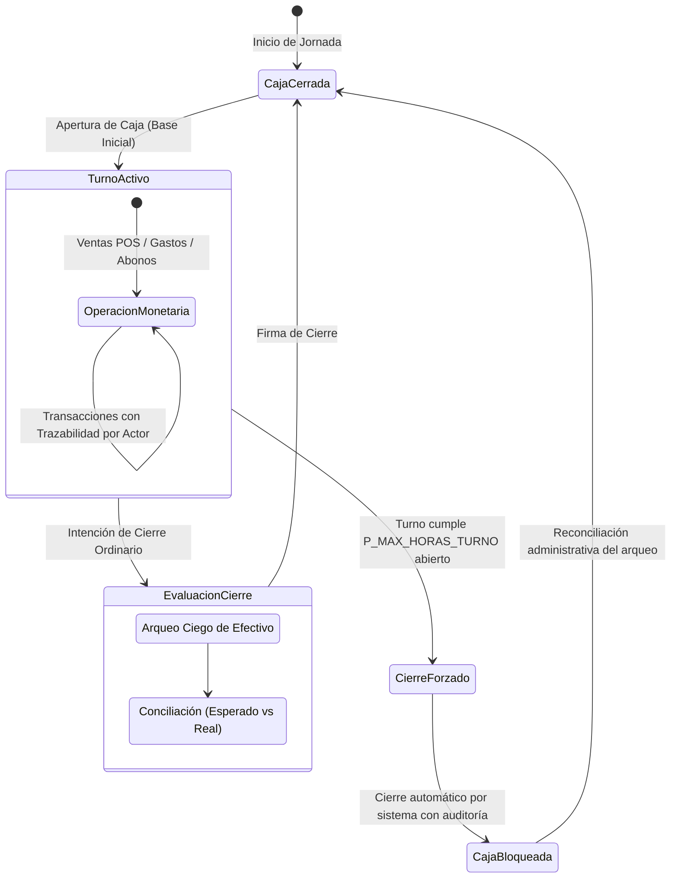

# FRD-017: Alineación del Ciclo Contable de Caja y Ciclo de Vida de Sesiones

> **Módulo:** Contabilidad / Control de Caja / Autenticación  
> **Rol:** Arquitecto de Producto y Requisitos (Desarrollador-Economista Senior)  
> **Versión:** 4.0  
> **Fecha:** 2026-10-24  
> **Estado:** ✅ Especificación Formalizada con Límite de 24 Horas  
> **Políticas Rectoras:** `POL-FIN-01`, `POL-SEG-02`, `POL-SEG-03`, `POL-LOG-01`, `POL-AUD-01`, `POL-AUD-02`, `POL-AUD-03`

---

## 1. Evaluación Económico-Contable (Análisis de Dominio)

En la economía del comercio minorista, la unidad de medida de un período contable de caja es el **Hecho Económico continuo** (el turno de trabajo), no el reloj astronómico. Un turno de 10:00 PM a 02:00 AM constituye un solo hecho económico ininterrumpido con un solo arqueo físico de efectivo.

Sin embargo, para evitar la negligencia operativa de turnos perpetuos que acumulen errores o propicien fugas de liquidez, se impone un **techo temporal estricto de `P_MAX_HORAS_TURNO` (24 horas)**. Este límite temporal generoso permite jornadas continuas o turnos dobles, pero elimina el riesgo de arrastrar descuadres por abandono de caja.

Asimismo, dado que en una tienda de barrio pueden operar de forma concurrente hasta `P_MAX_EMPLOYEES_PER_STORE` colaboradores junto al Administrador sobre una única gaveta física, cada movimiento de efectivo o venta DEBE atribuirse individualmente al colaborador responsable, distinguiendo con claridad meridiana las operaciones monetarias (que exigen caja abierta) de las operaciones logísticas y de inventario (que operan con total independencia de la caja).

---

## 2. Definición del Ciclo Contable Oficial con Techo Temporal

---

## 3. Reglas de Negocio Duras (RN)

### RN-017-01: Continuidad del Turno en Cruce de Medianoche
Un turno de caja puede cruzar libremente la medianoche sin interrupciones operativas ni cortes contables artificiales.
- Las sesiones de los usuarios y los Pases Diarios aprobados en el día calendario anterior conservan plena validez operativa después de las `00:00` horas siempre y cuando el turno de caja de la tienda continúe abierto y no haya alcanzado el límite de `P_MAX_HORAS_TURNO`.
- El sistema **TIENE PROHIBIDO** ejecutar cierres de sesión forzados o invalidar pases diarios a las `00:00` horas si existe un turno nocturno abierto en curso.

### RN-017-02: Cierre Forzado por Techo Temporal (`P_MAX_HORAS_TURNO`)
Si un turno de caja permanece abierto exactamente `P_MAX_HORAS_TURNO` (24 horas) después de su marca temporal de apertura:
1. El servidor central transiciona automáticamente el estado del turno a `closed` marcándolo como cierre forzado por caducidad.
2. El sistema sella el saldo esperado de la caja con las transacciones registradas hasta ese instante.
3. Las operaciones monetarias (ventas, gastos, abonos) quedan inmediatamente bloqueadas para toda la tienda hasta que se realice el arqueo de reconciliación.
4. Si un colaborador operaba amparado exclusivamente en el turno nocturno del día anterior, su pase diario expira en ese momento; si cuenta con un pase aprobado para el día calendario actual, conserva acceso para labores no monetarias (inventario, catálogo, proveedores).

### RN-017-03: Auditoría y Reconciliación de Cierre Forzado
Cuando ocurre un Cierre Forzado:
1. **Auditoría Inviolable:** Se registra un evento en la bitácora de auditoría (`audit_logs`) con nivel de advertencia, indicando cierre forzado por negligencia temporal y sellando los totales esperados.
2. **Notificación al Administrador:** El sistema genera una alerta prioritaria para el Administrador.
3. **Desbloqueo mediante Reconciliación:** Para poder iniciar un nuevo turno de caja, un usuario autorizado (Administrador o colaborador con permiso de apertura/cierre de caja) DEBE realizar el conteo físico del dinero para sellar el arqueo real y justificar los descuadres si existiesen.

### RN-017-04: Inmutabilidad de la Asignación Contable y Trazabilidad Multi-Actor
Toda transacción monetaria (venta, gasto, abono, anulación) registrada durante un turno queda irrevocablemente asociada al turno activo en que se ejecutó (*Principio de Devengo*).
- **Autoría Individual:** En una tienda con múltiples colaboradores operando simultáneamente, cada movimiento de caja DEBE almacenar de forma obligatoria el identificador del colaborador o Administrador específico que ejecutó la operación (`POL-AUD-02`).
- **Sincronización Tardía de Ventas Offline:** Si una venta realizada en Modo Offline contiene un sello de turno (`origin_session_id`) que ya fue cerrado (ordinaria o forzosamente) al momento de sincronizar:
  1. La venta se imputa contablemente al turno de origen al que perteneció.
  2. El servidor recalcula el balance esperado del turno de origen para reflejar el ingreso real.
  3. El sistema estampa un registro de auditoría (`LATE_SYNC_UPDATE`) documentando el ajuste contable tardío y su responsable.
  4. La venta **NO SE IMPUTA** al turno nuevo que pudiera estar abierto, protegiendo la pureza contable de ambos períodos.

### RN-017-05: Independencia de Labores No Monetarias ante Estado de Caja
El estado de la caja (abierta, cerrada, o caducada por 24 horas) rige única y exclusivamente sobre las transacciones que involucren flujo monetario.
- Los módulos de Inventario, Proveedores, Cuentas por Pagar y Reportes operan con total independencia del estado de la caja (*POL-LOG-01*).
- El sistema NO PUEDE bloquear el acceso ni forzar la navegación hacia el control de caja a colaboradores que no posean permiso de arqueo o que se encuentren ejecutando labores logísticas de inventario.

---

## 4. Casos de Uso

### CU-017-A: Operación Nocturna Continua
- **Actor:** Cajero / Colaborador.
- **Precondición:** Caja abierta el viernes a las 10:00 PM con pase diario aprobado.
- **Flujo Principal:**
  1. El colaborador procesa ventas a las 11:30 PM y continúa atendiendo a las 00:30 AM y 01:45 AM del sábado.
  2. El sistema valida que el turno no supera `P_MAX_HORAS_TURNO`.
  3. Todas las ventas se imputan al turno abierto el viernes.
  4. El colaborador realiza el arqueo de cierre a las 02:30 AM del sábado.
- **Postcondición:** Cierre limpio con todas las ventas del hecho económico unificadas.

### CU-017-B: Turno Olvidado y Cierre Forzado
- **Actor:** Sistema / Administrador.
- **Precondición:** Turno abierto a las 08:00 AM. Al terminar la jornada a las 08:00 PM nadie cierra la caja.
- **Flujo Principal:**
  1. Al día siguiente a las 08:00 AM (cumplidas las 24 horas exactas), el servidor ejecuta el Cierre Forzado.
  2. El turno queda cerrado, se expide la auditoría y se emite la notificación.
  3. A las 08:15 AM ingresa el Administrador e intenta abrir caja.
  4. El sistema le notifica que existe un turno cerrado forzosamente y solicita la declaración del efectivo real existente en la gaveta.
  5. El Administrador declara el conteo físico, el sistema asienta el descuadre y autoriza la apertura del nuevo turno.
- **Postcondición:** Trazabilidad de negligencia asentada y tienda desbloqueada.

### CU-017-C: Sincronización de Venta Offline sobre Turno ya Cerrado
- **Actor:** Colaborador / Sistema.
- **Precondición:** El colaborador vendió offline a las 06:00 PM durante un turno que el Administrador cerró a las 09:00 PM. El celular se reconecta a internet a las 10:00 PM.
- **Flujo Principal:**
  1. La cola envía la venta con su sello del turno original de las 06:00 PM.
  2. El servidor detecta que el turno original ya está cerrado.
  3. El servidor registra la venta vinculada al turno original, actualiza el balance esperado de dicho turno y genera un evento de auditoría `LATE_SYNC_UPDATE`.
  4. La venta no se mezcla con el turno del día siguiente.
- **Postcondición:** Contabilidad fidedigna sin distorsión de turnos contemporáneos.

---

## 5. Criterios de Aceptación
- [ ] **CA-017-01:** Durante un turno abierto de menos de `P_MAX_HORAS_TURNO`, el cruce de medianoche no invalida pases ni interrumpe la operación.
- [ ] **CA-017-02:** Al cumplirse `P_MAX_HORAS_TURNO`, el sistema cierra automáticamente el turno con sello de auditoría y bloquea operaciones monetarias.
- [ ] **CA-017-03:** Cada movimiento de efectivo dentro del turno almacena obligatoriamente la identidad individual del colaborador que lo ejecutó.
- [ ] **CA-017-04:** Las ventas offline sincronizadas tardíamente sobre turnos cerrados se imputan a su turno original registrando un evento `LATE_SYNC_UPDATE`.
- [ ] **CA-017-05:** El bloqueo por turno caducado o caja cerrada no impide a colaboradores autorizados trabajar en inventario o módulos no monetarios.
