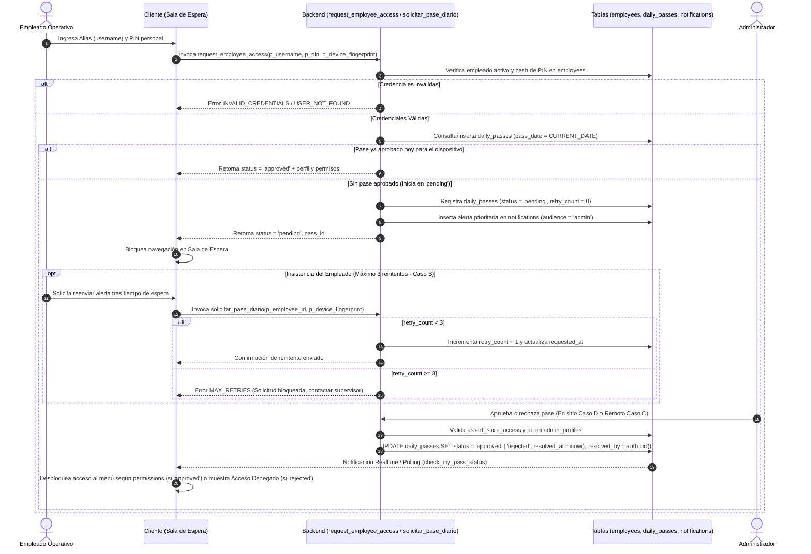
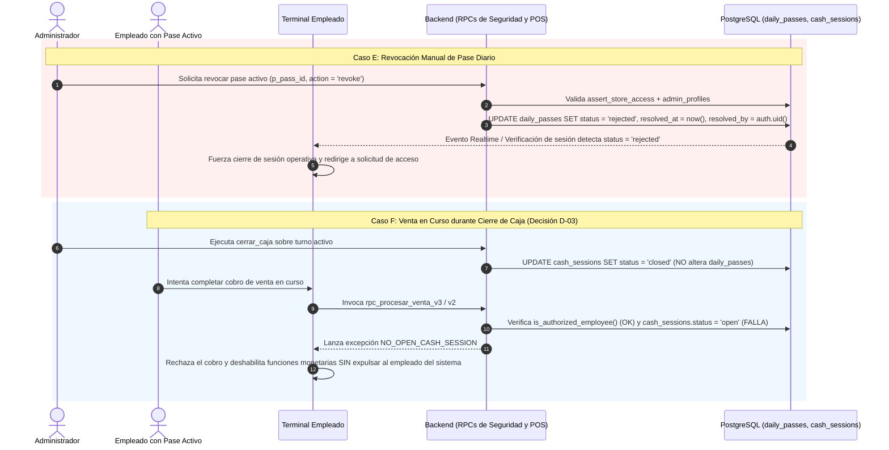
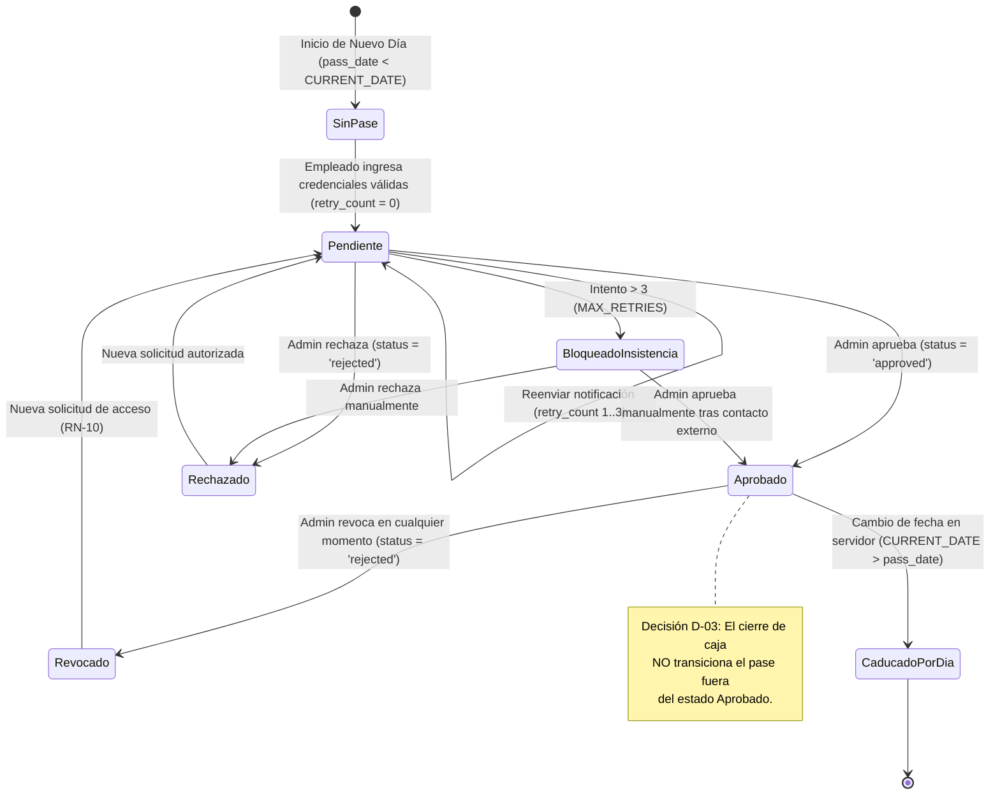
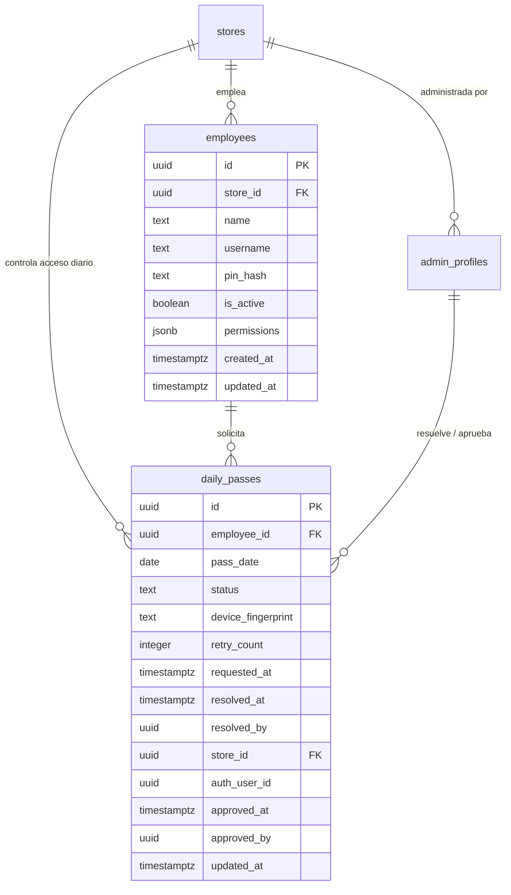

# SDD-001: Protocolo de Seguridad Diaria y Pase de Acceso ("Zero Trust Daily")

> **Asociado a:** [FRD-001](../FRD/FRD_001_SEGURIDAD_DIARIA.md) (Protocolo de Seguridad Diaria y Pase de Acceso v3.0)  
> **Fase del Plan:** Ola 5 — Sesiones, Autenticación y Offline (Saneamiento Pre-Código)  
> **Estado:** 🟢 Aprobado y Certificado en BD (Migración Ola 5 Aplicada con Evidencia)  
> **Última Actualización:** 2026-10-17  

---

## 0. Contexto y Restricciones Aplicables

### 0.1 Políticas Globales Activadas (ARQ-002)

| Política ID | Dominio | Impacto Concreto en este SDD |
| :--- | :--- | :--- |
| **POL-SEC-02** | Seguridad | **Cero Confianza Diaria (Zero Trust Daily):** Todo intento de acceso de un empleado operativo inicia en estado `'pending'` (`RN-1`). Ningún colaborador (excepto el Administrador verificado en `admin_profiles`) puede operar sin aprobación explícita del día en `daily_passes` (`RN-2`). No existe aprobación automática. |
| **POL-AUTH-01 / RN-14** | Seguridad | **Autorización Estricta en Servidor:** Toda operación de aprobación, rechazo, revocación o consulta de pases valida identidad y tienda en el servidor mediante `assert_store_access(p_store_id)` y verificación sobre `admin_profiles` (`auth.uid()`). |
| **Decisión D-03 (RN-3 / RN-4)** | Operaciones | **Desacople Definitivo entre Pase Diario y Cierre de Caja:** El pase diario es válido hasta las 23:59 del día operativo en curso (`pass_date = (now() AT TIME ZONE 'America/Bogota')::date`) y **NO expira por cierre de caja**. El cierre de caja bloquea las operaciones monetarias y el POS (`RN-5`, `RN-12`), pero permite al empleado permanecer en el sistema para tareas logísticas autorizadas (`RN-13`). |
| **SPEC-006 (Decisión D-01)** | Seguridad | **Erradicación del PIN de Caja:** Se elimina cualquier requerimiento de PIN de caja secundario. El acceso al sistema se gobierna por `daily_passes` y la operación de caja por el permiso `canOpenCloseCash` en `employees.permissions` (`RN-9`). |
| **POL-AUD-01** | Auditoría | **Trazabilidad de Accesos:** Toda aprobación, rechazo o revocación de pase diario registra el autor (`resolved_by` / `approved_by`), marca de tiempo (`resolved_at` / `approved_at`) y huella informativa del dispositivo (`device_fingerprint`, `RN-8`). |

### 0.2 Contratos Vecinos que Limitan el Diseño

| SDD Vecino | Restricción que Impone | Impacto en Seguridad Diaria |
| :--- | :--- | :--- |
| **SDD_002 (Registro Admin y Autorización)** | Define la tabla `admin_profiles` y la guardia RBAC de servidor. | Solo un usuario presente en `admin_profiles` con rol `'owner'` o `'manager'` en la tienda activa puede aprobar, rechazar o revocar registros de `daily_passes`. |
| **SDD_003 (Gestión de Empleados)** | Gobierna el ciclo de vida de `employees` y sus permisos granulares (`permissions` JSONB). | La desactivación de un empleado (`toggle_empleado_activo`) revoca atómicamente su pase diario activo. Un pase aprobado no sustituye los permisos granulares (`RN-9`). |
| **SDD_004 / SDD_020 (Control de Caja)** | La apertura y cierre de turno operan sobre `cash_sessions`. | El cierre de caja (`status = 'closed'`) bloquea el checkout POS (`NO_OPEN_CASH_SESSION`), pero tiene prohibido revocar o expirar `daily_passes` (`RN-4`). |
| **SDD_013 (Gestión de Sesiones)** | Límite estricto de 6 sesiones activas por tienda (1 Admin + 5 Empleados) e inactividad. | La aprobación de un pase diario verifica el cupo disponible de terminales operativas. La revocación manual expulsa inmediatamente al empleado en su siguiente pulso o evento Realtime (`RN-10`). |
| **SDD_015 (Gestión de Dispositivos)** | Widget centralizado de control de accesos en el centro de notificaciones del Administrador. | Consume los estados `'pending'` y `'approved'` de `daily_passes` para presentar solicitudes y dispositivos conectados en una sola vista unificada. |

### 0.3 Auditoría de BD contra Realidad (Deuda Técnica Formalizada y Cerrada)

En cumplimiento de las Reglas 2, 4, 6, 7 y 9 de `AGENTS.md`, la inspección empírica sobre `information_schema.columns` y `pg_proc` en producción (`ihtjocmhzuliwwvdzfnz`) confirma el cierre de las deudas técnicas con evidencia real y registra la deuda pendiente de sincronización horaria:

| ID | Hallazgo en Esquema / Función Real | Estado en BD Real | Evidencia de Cierre en Ola 5 / Estado |
| :---: | :--- | :--- | :--- |
| **D-1** | **Trigger legacy `expire_daily_passes()` contradice Decisión D-03.** | 🟢 Resuelto | Trigger `trg_expire_passes_on_cash_close` y función eliminados en migración `20261017134000_wave5_daily_security_devices_and_employees.sql`. |
| **D-2** | **Asimetría entre `request_employee_access` y `solicitar_pase_diario`.** | 🟢 Resuelto | Ambas funciones homologadas con `pass_date = (now() AT TIME ZONE 'America/Bogota')::date`, control de 3 reintentos (`MAX_RETRIES`) y alertas a `notifications`. |
| **D-3** | **Ausencia de `assert_store_access` y soporte de revocación en `aprobar_pase_diario`.** | 🟢 Resuelto | Homologado con `rpc_gestionar_dispositivo` (acciones `approve`, `reject`, `revoke`), `assert_store_access`, validación en `admin_profiles` y auditoría dual (`audit_logs` + `audit_seguridad`). |
| **D-4** | **Sinceramiento de Esquema Físico en `daily_passes` (14 columnas reales).** | 🟢 Resuelto | Modelo sincronizado sin alucinaciones (`expires_at` eliminado) e índice operativo `idx_daily_passes_store_date_status` creado. |
| **D-5** | **Asimetría Horaria en Funciones Auxiliares RLS (`get_current_store_id()`, `get_employee_id_from_session()`).** | 🟡 Deuda Formalizada (Ola 6) | `solicitar_pase_diario` y `request_employee_access` usan `(now() AT TIME ZONE 'America/Bogota')::date`, pero los helpers RLS aún usan `CURRENT_DATE` (UTC en servidor). Entre 19:00 y 23:59 hora Bogotá, `CURRENT_DATE` avanza a mañana, desconectando la sesión. Se corregirá en migración Ola 6. |

---

## 1. Glosario Local

- **Pase Diario (`daily_passes`):** Registro diario por empleado y tienda (`pass_date = (now() AT TIME ZONE 'America/Bogota')::date`) que certifica la autorización explícita del Administrador para ingresar al sistema hasta las 23:59 del día operativo en curso.
- **Sala de Espera:** Estado de bloqueo operativo en el que permanece el empleado autenticado mientras su pase diario se encuentra en estado `'pending'`.
- **Límite de Insistencia (`P_MAX_ACCESS_ATTEMPTS`):** Tope máximo de tres (3) reintentos de notificación al Administrador (`retry_count = 3`). Al alcanzarse sin respuesta, la solicitud queda bloqueada para nuevos reenvíos automáticos.
- **Huella de Dispositivo (`device_fingerprint`):** Identificador descriptivo del navegador/terminal enviado en la solicitud con carácter exclusivamente informativo para el Administrador (`RN-8`); nunca bloquea dispositivos por sí mismo.
- **Desacople Pase-Caja (Decisión D-03):** Principio arquitectónico que separa la autorización de acceso al sistema (`daily_passes.status = 'approved'`) de la habilitación de operaciones monetarias (`cash_sessions.status = 'open'`).

---

## 2. Diagramas de Secuencia

### 2.1 Flujo Diario Estándar, Sala de Espera e Insistencia (Casos A, B, C y D)



### 2.2 Revocación Manual en Caliente y Venta en Curso con Caja Cerrada (Casos E y F)



---

## 3. Diagramas de Estado



---

## 4. Especificación Detallada de Casos de Uso

### 4.1 Caso A: Flujo Diario Estándar (`RN-1`, `RN-2`, `RN-6`, `RN-8`)
- **Actor:** Empleado Operativo y Administrador.
- **Precondición:** El empleado posee perfil activo (`employees.is_active = true`) y no cuenta con registro en `daily_passes` con `status = 'approved'` para `pass_date = CURRENT_DATE`.
- **Flujo Principal:**
  1. El empleado ingresa su alias (`username`) y PIN personal de 4 dígitos.
  2. El backend verifica las credenciales contra `employees.pin_hash` (`crypt`).
  3. Al no existir pase aprobado del día, el servidor crea o actualiza el registro en `daily_passes` con `status = 'pending'`, `pass_date = CURRENT_DATE` y `device_fingerprint`.
  4. El empleado queda retenido en la Sala de Espera (`RN-6`).
  5. El Administrador visualiza la solicitud con el nombre del empleado y la huella del dispositivo (`RN-8`) y ejecuta la aprobación.
  6. El registro en `daily_passes` pasa a `status = 'approved'` sellando `resolved_at`, `resolved_by`, `approved_at` y `approved_by`.
  7. La terminal del empleado desbloquea el acceso a los módulos permitidos por `employees.permissions`.
- **Flujo Alternativo:** Si las credenciales son incorrectas, retorna `INVALID_CREDENTIALS`. Si el Administrador rechaza la solicitud, el estado pasa a `'rejected'` y la terminal informa acceso denegado.
- **Postcondición:** El empleado opera bajo su pase diario válido hasta las 23:59 del día corriente.

### 4.2 Caso B: Insistencia por Ausencia de Respuesta (`RN-7`)
- **Actor:** Empleado en Sala de Espera.
- **Precondición:** Solicitud en `daily_passes` con `status = 'pending'` y sin respuesta del Administrador.
- **Flujo Principal:**
  1. Tras cumplirse los intervalos de espera (`P_WAIT_TIME_RETRY_1`, `P_WAIT_TIME_RETRY_2`), el empleado acciona el reenvío de alerta.
  2. El servidor verifica en `daily_passes` que `retry_count < 3` (`P_MAX_ACCESS_ATTEMPTS`).
  3. En los intentos 1, 2 y 3, incrementa `retry_count = retry_count + 1`, actualiza `requested_at = now()` y emite alerta al Administrador.
  4. Si el empleado intenta un cuarto reenvío (`retry_count >= 3`), el servidor rechaza la operación con código `MAX_RETRIES`.
- **Postcondición:** La insistencia automática queda bloqueada y se instruye al empleado a contactar a su supervisor por vía externa (`CA-FRD-001-13`, `CA-FRD-001-14`).

### 4.3 Casos C y D: Aprobación Remota y Aprobación en Sitio (`RN-2`, `RN-8`, `RN-14`)
- **Actor:** Administrador (fuera de tienda o con sesión activa en tienda).
- **Precondición:** Solicitud pendiente en `daily_passes`.
- **Flujo Principal:**
  1. El Administrador recibe la alerta (remota o en el widget prioritario de notificaciones) mostrando empleado, tienda y `device_fingerprint`.
  2. El Administrador selecciona Aprobar o Rechazar.
  3. El servidor valida `assert_store_access(store_id)` y pertenencia a `admin_profiles` (`auth.uid()`), actualiza `daily_passes` y confirma la operación.
- **Flujo Alternativo (Caso D):** Si el Administrador ignora temporalmente la alerta en sitio, el pase permanece en `'pending'`.
- **Postcondición:** El acceso del empleado se actualiza en tiempo real sin confiar en banderas del cliente (`CA-FRD-001-23`, `CA-FRD-001-24`).

### 4.4 Caso E: Revocación Manual de Pase (`RN-10`)
- **Actor:** Administrador.
- **Precondición:** Existe un pase en `daily_passes` con `status = 'approved'` y `pass_date = CURRENT_DATE`.
- **Flujo Principal:**
  1. El Administrador selecciona revocar sobre el pase activo en el panel de control de accesos.
  2. El servidor valida autoridad administrativa, cambia `daily_passes.status` a `'rejected'`, registra `resolved_at = now()` y `resolved_by = auth.uid()`.
  3. En la siguiente validación o evento Realtime, la sesión del empleado detecta la pérdida de autorización (`is_authorized_employee() = false`), cierra el acceso operativo y redirige a la pantalla de solicitud de acceso.
- **Postcondición:** El empleado pierde acceso inmediatamente y requiere una nueva solicitud para volver a ingresar (`CA-FRD-001-19`, `CA-FRD-001-20`).

### 4.5 Caso F: Venta en Curso con Cierre de Caja (`RN-4`, `RN-5`, `RN-12`, `RN-13`)
- **Actor:** Empleado Operativo.
- **Precondición:** Empleado con pase `'approved'` vigente y carrito de venta en curso; la sesión de caja en `cash_sessions` pasa a `'closed'`.
- **Flujo Principal:**
  1. El cierre de caja no modifica `daily_passes`.
  2. El empleado intenta procesar el pago de la venta.
  3. El motor transaccional verifica la existencia de turno abierto en `cash_sessions` y rechaza la operación con `NO_OPEN_CASH_SESSION`.
  4. La interfaz informa que la caja está cerrada y deshabilita las acciones monetarias sin cerrar la sesión del empleado.
- **Postcondición:** La venta no se procesa, pero el empleado conserva su sesión activa para tareas no monetarias permitidas (`CA-FRD-001-08` al `CA-FRD-001-12`, `CA-FRD-001-21`, `CA-FRD-001-22`).

### 4.6 Caso G: Caducidad Natural por Cambio de Día (`RN-3`, `RN-11`)
- **Actor:** Reloj del Servidor PostgreSQL en Zona Horaria Operativa (`(now() AT TIME ZONE 'America/Bogota')::date`).
- **Precondición:** Pase aprobado con `pass_date < (now() AT TIME ZONE 'America/Bogota')::date`.
- **Flujo Principal:**
  1. Al iniciar un nuevo día calendario operativo (00:00 hora Colombia), las funciones del backend y las consultas de sesión filtran estrictamente `pass_date = (now() AT TIME ZONE 'America/Bogota')::date`.
  2. Todo pase de fechas anteriores queda automáticamente sin efecto operativo.
  3. El empleado es redirigido a solicitar un nuevo pase para la nueva jornada operativa.
- **Postcondición:** Renovación diaria obligatoria garantizada a nivel de motor de base de datos (`CA-FRD-001-05`, `CA-FRD-001-06`).

---

## 5. Contrato de Interfaz

### 5.1 Solicitud Inicial de Acceso: `request_employee_access`
- **Parámetros de Entrada:**
  - `p_username` (`TEXT`, obligatorio): Alias del empleado.
  - `p_pin` (`TEXT`, obligatorio): PIN personal en texto plano (validado en servidor con `crypt`).
  - `p_device_fingerprint` (`TEXT`, obligatorio): Identificador informativo del dispositivo.
- **Salida Exitosa (`JSONB`):**
  ```json
  {
    "success": true,
    "status": "pending",
    "pass_id": "uuid-del-pase",
    "employee": {
      "id": "uuid-empleado",
      "name": "Nombre Empleado",
      "role": "employee",
      "store_id": "uuid-tienda",
      "permissions": {
        "canSell": true,
        "canOpenCloseCash": false
      }
    }
  }
  ```

### 5.2 Reintento de Notificación en Sala de Espera: `solicitar_pase_diario`
- **Parámetros de Entrada:**
  - `p_employee_id` (`UUID`, obligatorio)
  - `p_device_fingerprint` (`TEXT`, obligatorio)
- **Salida Exitosa (`JSONB`):**
  ```json
  {
    "success": true,
    "status": "pending",
    "pass_id": "uuid-del-pase",
    "retry_count": 1
  }
  ```

### 5.3 Verificación de Estado de Pase: `check_my_pass_status` / `check_daily_pass_status`
- **Parámetros de Entrada:** `p_pass_id` (`UUID`) o `(p_employee_id UUID, p_device_fingerprint TEXT)`.
- **Invariante de Fecha y Prohibición de TTL Arbitrario en Cliente:**
  - Toda consulta de estado de pase debe filtrar por `pass_date = (now() AT TIME ZONE 'America/Bogota')::date`.
  - **Prohibición de Fallo Silencioso / TTL Arbitrario (Regla 3 `AGENTS.md`):** Se prohíbe terminantemente en el frontend (`authRepository.ts`) cualquier filtro de expiración temporal arbitrario sobre `requested_at` (por ejemplo, `requested_at > now() - 5 minutos`). El pase diario solo caduca a las 23:59 del día operativo o por revocación explícita del Administrador (`RN-3`, `RN-10`).
- **Salida Exitosa (`JSONB`):** Retorna `"status": "pending" | "approved" | "rejected" | "expired"` y, si es `"approved"`, el objeto `employee` con sus permisos vigentes.

### 5.4 Resolución y Revocación Administrativa: `aprobar_pase_diario` / `rpc_gestionar_dispositivo`
- **Parámetros de Entrada:**
  - `p_pass_id` (`UUID`, obligatorio)
  - `p_action` (`TEXT`: `'approve'`, `'reject'`, `'revoke'`)
- **Reglas de Transformación en Servidor:**
  1. Obtiene `store_id` del pase y ejecuta `PERFORM public.assert_store_access(v_store_id);`.
  2. Verifica que `auth.uid()` exista en `public.admin_profiles` para esa tienda.
  3. Actualiza `daily_passes.status` a `'approved'` (para `'approve'`) o `'rejected'` (para `'reject'` y `'revoke'`), sellando `resolved_at = now()` y `resolved_by = auth.uid()`.

### 5.5 Catálogo de Errores del Módulo

| Código de Error | Condición de Disparo | Comportamiento Esperado en Cliente |
| :--- | :--- | :--- |
| `USER_NOT_FOUND` | El `p_username` no existe en `employees`. | Mostrar error de credenciales sin revelar detalles internos. |
| `INVALID_CREDENTIALS` | El `p_pin` no coincide con `employees.pin_hash` o el empleado está inactivo. | Mostrar mensaje de PIN incorrecto y limpiar campo. |
| `MAX_RETRIES` | `daily_passes.retry_count >= 3` (`P_MAX_ACCESS_ATTEMPTS`). | Bloquear botón de reenvío y mostrar: *"Límite de intentos alcanzado. Contacte a su supervisor por otro medio."* |
| `ALREADY_PROCESSED` | Intento de reenviar solicitud sobre un pase ya rechazado o procesado. | Refrescar estado del pase en pantalla. |
| `STORE_ACCESS_DENIED` | Invocador de aprobación/revocación no pertenece a la tienda (`assert_store_access`). | Abortar operación con HTTP 403 y registrar alerta de seguridad. |
| `UNAUTHORIZED_ROLE` | Invocador no pertenece a `admin_profiles`. | Rechazar mutación de `daily_passes`. |
| `NO_OPEN_CASH_SESSION` | Intento de ejecutar operación monetaria con pase activo pero caja cerrada (`RN-5`, `RN-12`). | Rechazar cobro y deshabilitar controles monetarios manteniendo la sesión del empleado abierta. |

---

## 6. Análisis de Seguridad

1. **Funciones Centralizadas Obligatorias (Regla 4):**
   - `public.assert_store_access(p_store_id)`: Primera instrucción obligatoria en toda función administrativa que apruebe, rechace, revoque o liste pases diarios de la tienda.
   - `public.get_current_store_id()`: Filtra todas las políticas RLS sobre `daily_passes`, `employees` y `notifications`, verificando para empleados que `daily_passes.status = 'approved'` y `pass_date = CURRENT_DATE`.
   - `public.get_employee_id_from_session()` e `public.is_authorized_employee()`: Guardias de servidor invocadas por los módulos transaccionales para confirmar que el operador tiene pase vigente en la fecha actual del servidor.
2. **Mitigación de Amenazas:**
   - **Manipulación de Reloj Local:** La caducidad del pase se evalúa exclusivamente contra `CURRENT_DATE` del servidor PostgreSQL, haciendo inútil cambiar la hora del dispositivo cliente (`CA-FRD-001-06`).
   - **Suplantación de Rol en Cliente:** El servidor ignora banderas locales y verifica `admin_profiles` mediante `auth.uid()` antes de autorizar cambios de estado en `daily_passes` (`CA-FRD-001-23`, `CA-FRD-001-24`).

---

## 7. Modelo de Datos Lógico

### 7.1 Diagrama Entidad-Relación (Esquema Verificado)



### 7.2 Diccionario de Datos Físico Verificado (`public.daily_passes` — 14 Columnas Reales)

| Columna | Tipo de Dato | Nullable | Estado en BD Real | Descripción Técnica |
| :--- | :--- | :---: | :---: | :--- |
| `id` | `uuid` | NO | 🟢 Existente | Identificador primario del pase diario. |
| `employee_id` | `uuid` | NO | 🟢 Existente | FK hacia `public.employees(id)`. Conforma clave única con `pass_date`. |
| `pass_date` | `date` | NO | 🟢 Existente | Fecha calendario del pase (`CURRENT_DATE`). Determina su vigencia hasta las 23:59. |
| `status` | `text` | NO | 🟢 Existente | Estado del pase: `'pending'`, `'approved'`, `'rejected'`, `'expired'`. |
| `device_fingerprint` | `text` | SÍ | 🟢 Existente | Huella informativa del dispositivo solicitante (`RN-8`). |
| `retry_count` | `integer` | SÍ | 🟢 Existente | Contador de reenvíos de alerta al Administrador (máximo 3 según `RN-7`). |
| `requested_at` | `timestamptz` | NO | 🟢 Existente | Marca de tiempo de la solicitud inicial o último reintento. |
| `resolved_at` | `timestamptz` | SÍ | 🟢 Existente | Marca de tiempo de aprobación, rechazo o revocación. |
| `resolved_by` | `uuid` | SÍ | 🟢 Existente | Identificador del Administrador que resolvió o revocó el pase. |
| `store_id` | `uuid` | SÍ | 🟢 Existente | Identificador de la tienda a la que pertenece el pase. |
| `auth_user_id` | `uuid` | SÍ | 🟢 Existente | Vínculo con la sesión `auth.uid()` del terminal operativo. |
| `approved_at` | `timestamptz` | SÍ | 🟢 Existente | Marca de tiempo específica de aprobación. |
| `approved_by` | `uuid` | SÍ | 🟢 Existente | Identificador del Administrador que aprobó el pase. |
| `updated_at` | `timestamptz` | SÍ | 🟢 Existente | Marca de tiempo de última actualización del registro. |
