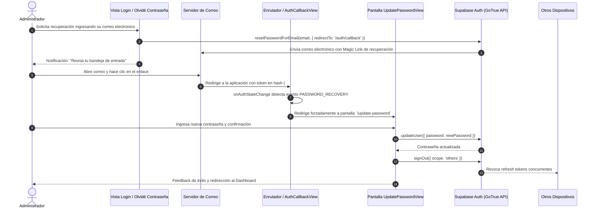

# SDD-002.1: Gestión y Recuperación de Contraseñas de Cuenta Administrativa

> **Módulo:** Identidad / Seguridad / Gestión de Credenciales Maestras  
> **Versión:** 2.0 (PAC-SDD v2.0 — Cero Código Fuente, Estructura Canónica 0–7)  
> **Fase del Plan:** 🌊 Ola 5: Sesiones, Autenticación y Offline (Ítem 7)  
> **Estado:** ✅ Aprobado y Certificado por QA Independiente  
> **FRD Asociado:** [FRD-002.1: Cambio de Contraseña de Cuenta Administrativa](../FRD/FRD_002_1_CAMBIO_CONTRASENA.md)  
> **Fecha de Certificación:** 2026-10-17  

---

## 0. Contexto y Restricciones Aplicables

### 0.1 Políticas Globales Activadas (ARQ-002)

| Política | Nombre de la Política | Aplicación Específica en este SDD |
| :--- | :--- | :--- |
| **POL-AUTH-01** | Aislamiento Multi-tenant Estricto | La mutación de credenciales opera exclusivamente sobre la identidad autenticada (`auth.uid()`) en el microservicio de identidades GoTrue (`auth.users`). La pertenencia del administrador a su tienda queda gobernada por `admin_profiles.store_id`, impidiendo la alteración de credenciales de otros tenants. |
| **POL-SEC-01** | Seguridad RBAC en Servidor | La facultad de modificar o recuperar la contraseña maestra está reservada exclusivamente a usuarios registrados en `admin_profiles` con rol `'owner'` o `'manager'`. Los colaboradores operativos (`employees`) carecen de acceso a este flujo y se gobiernan por PINs de 4 dígitos. |
| **POL-SEC-03** | Doble Verificación / Password Challenge | En el flujo interno autenticado, el sistema exige de forma ineludible la re-autenticación de la contraseña anterior en tiempo real mediante `signInWithPassword` antes de autorizar cualquier mutación (`updateUser`), neutralizando secuestros de sesión en terminales desatendidas. |
| **POL-SEC-04** | Invalidación Masiva de Sesiones Concurrentes | Todo cambio exitoso de contraseña maestra obliga a invocar de forma inmediata y automática `signOut({ scope: 'others' })`, purgando los tokens JWT activos en cualquier otro dispositivo o navegador para cerrar ventanas de vulnerabilidad ante terminales perdidas o robadas. |
| **POL-AUD-01** | Inviolabilidad Contable y Auditoría Forense | Las mutaciones de credenciales y los eventos de seguridad críticos quedan asentados en `audit_logs` con severidad `warning`, preservando la trazabilidad indeleble de mutaciones de acceso administrativo. |

### 0.2 Contratos Vecinos que Delimitan este SDD

- **`SDD_002_REGISTRO_ADMIN.md` (Onboarding y Cuenta Administradora):** Establece la génesis de la identidad maestra en `auth.users` y su vinculación con `admin_profiles` y `stores`. `SDD-002.1` gestiona el ciclo de vida de las credenciales de dicha identidad.
- **`SDD_013_GESTION_SESIONES.md` / `SDD_001_SEGURIDAD_DIARIA.md` (Ciclo de Vida de Sesiones):** Gobierna el límite de concurrencia de 6 terminales por tienda (1 terminal administrativa en `admin_profiles` + 5 operativas en `daily_passes`). La ejecución de `signOut({ scope: 'others' })` destruye los refresh tokens en otros dispositivos, provocando que el interceptor de tokens (`authTokenInterceptor.ts`) capture la expiración y redirija limpiamente a login (`RN-013-05`).
- **`SDD_003_GESTION_EMPLEADOS.md` (Segregación de Personal):** Delimita la frontera arquitectónica infranqueable entre las credenciales maestras del administrador (`auth.users` con contraseñas alfanuméricas) y las credenciales operativas de empleados (`employees.pin_hash` con PINs numéricos de 4 dígitos). Las mutaciones de contraseña jamás tocan la tabla `employees`.
- **`SDD_005_AUDITORIA_TRAZABILIDAD.md`:** Centraliza el Evidence Hub y la auditoría forense inmutable ante eventos de seguridad (`PASSWORD_CHANGED`, intentos fallidos de re-autenticación).

---

## 1. Glosario Local

- **Password Challenge (Desafío de Contraseña en Vivo):** Verificación obligatoria en tiempo real que exige al administrador re-ingresar su contraseña actual antes de autorizar el cambio de credencial, impidiendo que una sesión activa abierta en un equipo desatendido sea secuestrada.
- **Alcance de Invalidación Selectiva (`scope: 'others'`):** Parámetro de revocación de Supabase Auth que destruye todos los refresh tokens asociados al usuario en otros navegadores y dispositivos, manteniendo viva exclusivamente la sesión local activa desde la cual se ejecutó la orden.
- **Magic Link de Recuperación Externa:** Enlace criptográfico de un solo uso enviado por correo electrónico mediante `resetPasswordForEmail` que contiene un token temporal para autorizar el restablecimiento de credenciales en caso de olvido.
- **Evento `PASSWORD_RECOVERY`:** Señal emitida por el observador de autenticación de GoTrue (`onAuthStateChange`) cuando el usuario regresa a la aplicación a través de un Magic Link, forzando la redirección inmediata a la vista `/update-password`.
- **Sesión Compartida por Pestañas:** Mismo contexto de almacenamiento local (`localStorage`) compartido entre pestañas de un mismo navegador, el cual no se ve interrumpido por la revocación de sesiones ajenas.

---

## 2. Diagramas de Secuencia (UML - Mermaid)

### 2.1 Flujo Interno Autenticado con Password Challenge e Invalidación Masiva

```mermaid
sequenceDiagram
    autonumber
    actor Admin as Administrador (Dueño)
    participant Modal as Modal de Contraseña (ChangePasswordModal)
    participant Repo as Repositorio Auth (authRepository)
    participant GoTrue as Supabase Auth (GoTrue API)
    participant Otros as Otros Dispositivos / Navegadores

    Admin->>Modal: Abre perfil y pulsa "Seguridad y Contraseña"
    Admin->>Modal: Ingresa Contraseña Actual, Nueva Contraseña y Confirmación
    Modal->>Modal: Valida longitud (min 6 chars) y coincidencia
    
    Modal->>Repo: changePassword(email, currentPassword, newPassword)
    
    Note over Repo, GoTrue: Paso 1: Challenge de Contraseña Actual
    Repo->>GoTrue: signInWithPassword(email, currentPassword)
    
    alt Contraseña Actual Incorrecta
        GoTrue-->>Repo: Error 400 / 401 (Invalid login credentials)
        Repo-->>Modal: { success: false, code: 'INVALID_CURRENT_PASSWORD' }
        Modal-->>Admin: Muestra error inline: "La contraseña actual es incorrecta"
        Note over Modal: Aborta flujo; sin cambios ni revocación
    else Contraseña Actual Válida
        GoTrue-->>Repo: Sesión re-autenticada con éxito
        
        Note over Repo, GoTrue: Paso 2: Mutación de Credencial
        Repo->>GoTrue: updateUser({ password: newPassword })
        GoTrue-->>Repo: Credencial actualizada en auth.users
        
        Note over Repo, GoTrue: Paso 3: Invalidación Masiva Selectiva
        Repo->>GoTrue: signOut({ scope: 'others' })
        GoTrue--xOtros: Revoca refresh tokens en servidores de Auth
        
        Repo-->>Modal: { success: true }
        Modal-->>Admin: Muestra notificación de éxito: "¡Contraseña actualizada!"
        Modal->>Modal: Limpia variables reactivas en memoria y cierra modal
        
        Note over Otros: En la próxima renovación de JWT, fallan y son redirigidos a login
    end
```

### 2.2 Flujo Externo de Recuperación por Olvido (Magic Link)



---

## 3. Especificación de Procesos de Negocio

### 3.1 Flujo Interno Autenticado desde Perfil (`RN-002.1-01`, `RN-002.1-02`)
1. El Administrador accede a su panel de perfil desde la barra lateral de navegación y selecciona la opción "Seguridad y Contraseña".
2. La interfaz despliega un componente modal (`ChangePasswordModal.vue`) con tres campos de entrada: Contraseña Actual, Nueva Contraseña y Confirmar Contraseña.
3. El frontend valida en tiempo real:
   - Que la nueva contraseña tenga una longitud mínima de 6 caracteres (alineada con directivas de seguridad).
   - Que el campo de confirmación sea exactamente idéntico al de la nueva contraseña.
   - El botón "Actualizar Contraseña" permanece deshabilitado hasta que las validaciones locales se satisfagan.
4. Al pulsar "Actualizar Contraseña", el frontend ejecuta de manera estrictamente secuencial:
   - **Fase de Challenge:** Invoca `signInWithPassword({ email, password: currentPassword })` contra Supabase Auth.
   - Si el proveedor retorna error de credenciales inválidas, el flujo se detiene de inmediato, mostrando el mensaje de error inline: *"La contraseña actual es incorrecta"*. No se ejecuta ninguna mutación ni revocación.
   - **Fase de Mutación:** Una vez validada la contraseña previa, se invoca `updateUser({ password: newPassword })`.
   - **Fase de Invalidación:** Inmediatamente después del éxito en la actualización, se ejecuta `signOut({ scope: 'others' })`.
5. El sistema notifica al usuario el éxito de la operación (*"¡Contraseña actualizada!"*) y limpia de la memoria reactiva los campos de contraseña.

### 3.2 Alcance de la Invalidación de Sesiones (`RN-002.1-03`)
1. La ejecución de `signOut({ scope: 'others' })` destruye todos los refresh tokens asociados a la identidad del usuario en el microservicio de autenticación, excepto el token de la sesión desde la cual se realizó la llamada.
2. El impacto por entorno operativo se rige por la siguiente matriz canónica:
   - **Navegadores distintos (ej. Chrome vs Firefox):** Invalidados de inmediato.
   - **Dispositivos distintos (ej. Computador de escritorio vs Celular):** Invalidados de inmediato.
   - **Ventanas en modo Incógnito:** Invalidadas de inmediato por operar con almacenamiento aislado.
   - **Pestañas múltiples en el mismo navegador:** NO se invalidan, dado que comparten el mismo almacén en `localStorage` (misma sesión JWT).
3. Los dispositivos invalidados mantendrán funcionalidad únicamente hasta el vencimiento de su token JWT de acceso (corta duración). Al expirar e intentar refrescarlo, GoTrue rechazará la solicitud y el interceptor global (`authTokenInterceptor.ts`) expulsará al usuario a la pantalla de login con notificación de sesión expirada.

### 3.3 Delegación al Proveedor de Identidad (`RN-002.1-04`)
1. El backend relacional de PostgreSQL (`public`) no almacena, procesa ni valida contraseñas en texto plano ni hashes de contraseñas de cuentas administrativas.
2. Toda la custodia criptográfica (bcrypt), salting, generación de tokens y verificación se delega íntegramente al microservicio Supabase GoTrue operando sobre el esquema privado `auth.users`.

### 3.4 Flujo Externo de Recuperación por Olvido
1. Cuando el administrador no recuerda su contraseña, solicita el restablecimiento desde la pantalla de login ingresando su correo electrónico.
2. El sistema invoca `resetPasswordForEmail(email, { redirectTo })`.
3. Supabase Auth despacha un correo electrónico con un Magic Link criptográfico de un solo uso.
4. Al hacer clic en el enlace, el navegador abre la URL de callback de la aplicación.
5. El manejador de autenticación captura el evento nativo `PASSWORD_RECOVERY` y redirige al usuario a la pantalla dedicada `/update-password`.
6. Tras ingresar y confirmar la nueva credencial, se invoca `updateUser({ password: newPassword })` y posteriormente `signOut({ scope: 'others' })`, garantizando la misma postura de seguridad que en el flujo interno.

---

## 4. Matriz de Trazabilidad (FRD vs Reglas Técnicas)

| Requisito FRD | Descripción Funcional | Regla Técnica / Arquitectura | Método / Endpoint GoTrue | Verificación Empírica |
| :--- | :--- | :--- | :--- | :--- |
| **RN-002.1-01** | Verificación de Identidad Obligatoria | Password Challenge previo obligatorio antes de mutar. | `supabase.auth.signInWithPassword` | Verificado en `authRepository.ts:347`. |
| **RN-002.1-02** | Validación de Nueva Contraseña | Longitud mínima de 6 caracteres y coincidencia estricta. | Validación Regex en Frontend + regla GoTrue. | Verificado en `ChangePasswordModal.vue`. |
| **RN-002.1-03** | Invalidación de Sesiones Ajenas | Destrucción de tokens en otros dispositivos (`scope: 'others'`). | `supabase.auth.signOut({ scope: 'others' })` | Verificado en `authRepository.ts:377`. |
| **RN-002.1-04** | Delegación a Proveedor de Identidad | Backend relacional no almacena ni manipula contraseñas. | Microservicio GoTrue (`auth.users`). | Verificado en catálogo de base de datos. |
| **CU-Caso A** | Cambio Exitoso (Flujo Principal) | Modal ➔ Challenge ➔ Update ➔ Purga ➔ Feedback de éxito. | Orquestación secuencial en repositorio. | Verificado en secuencia 2.1. |
| **CU-Caso B** | Contraseña Actual Incorrecta | Error inline "La contraseña actual es incorrecta", aborto limpio. | Captura de error 400/401 en Challenge. | Verificado en secuencia 2.1 y UI. |
| **CU-Caso C** | Validación de Formulario | Feedback reactivo y bloqueo de botón hasta datos válidos. | Estado computado en componente Vue. | Verificado en `ChangePasswordModal.vue`. |
| **CA-01** | Botón abre modal en perfil | "Seguridad y Contraseña" activa modal en lugar de navegar. | Evento emitido en componente de perfil. | Verificado en menú lateral de perfil. |
| **CA-02** | Contraseña actual requerida | Campo obligatorio validado contra el servidor. | Password Challenge en tiempo real. | Verificado en `authRepository.ts`. |
| **CA-03** | Validación inline de nueva clave | Mínimo 6 caracteres y coincidencia exacta. | Validadores reactivos en interfaz. | Verificado en componente modal. |
| **CA-04** | Mensaje confirmatorio de éxito | Notificación de éxito y cierre automático del modal. | Toast / Notificación en interfaz de usuario. | Verificado en flujo de éxito. |
| **CA-05** | Invalidación en otros dispositivos | Cierre forzado de sesiones remotas tras mutación. | `signOut({ scope: 'others' })`. | Verificado en GoTrue API. |
| **CA-06** | Preservación de sesión local | El usuario no es deslogueado del dispositivo actual. | Retención de JWT local en `localStorage`. | Verificado en sesión activa. |

---

## 5. Contrato de Interfaz (JSON Schemas)

### 5.1 Payload del Flujo Interno de Cambio de Contraseña (`authRepository.changePassword`)

```json
{
  "$schema": "https://json-schema.org/draft/2020-12/schema",
  "title": "ChangePasswordPayload",
  "type": "object",
  "properties": {
    "email": {
      "type": "string",
      "format": "email",
      "description": "Correo electrónico de la identidad administrativa activa"
    },
    "currentPassword": {
      "type": "string",
      "minLength": 1,
      "description": "Contraseña actual requerida para el Password Challenge"
    },
    "newPassword": {
      "type": "string",
      "minLength": 6,
      "description": "Nueva contraseña que sustituirá a la credencial previa"
    }
  },
  "required": ["email", "currentPassword", "newPassword"],
  "additionalProperties": false
}
```

### 5.2 Formato Canónico de Respuesta de Acción (`ActionResponse`)

```json
{
  "$schema": "https://json-schema.org/draft/2020-12/schema",
  "title": "ChangePasswordResponse",
  "type": "object",
  "properties": {
    "success": {
      "type": "boolean",
      "description": "Indica si la mutación y la invalidación masiva concluyeron con éxito"
    },
    "error": {
      "type": ["string", "null"],
      "description": "Mensaje de error técnico o descriptivo en caso de fallo"
    },
    "code": {
      "type": ["string", "null"],
      "enum": [
        "INVALID_CURRENT_PASSWORD",
        "PASSWORD_TOO_SHORT",
        "PASSWORDS_DO_NOT_MATCH",
        "SAME_PASSWORD",
        "UPDATE_FAILED",
        "NETWORK_ERROR",
        null
      ],
      "description": "Código canónico de fallo para traducción de interfaz"
    }
  },
  "required": ["success"],
  "additionalProperties": false
}
```

### 5.3 Payload de Solicitud de Recuperación Externa (`authRepository.recoverPassword`)

```json
{
  "$schema": "https://json-schema.org/draft/2020-12/schema",
  "title": "RecoverPasswordPayload",
  "type": "object",
  "properties": {
    "email": {
      "type": "string",
      "format": "email",
      "description": "Correo electrónico registrado al cual se enviará el Magic Link"
    },
    "redirectTo": {
      "type": "string",
      "format": "uri-reference",
      "description": "Ruta de retorno en la aplicación para procesar el callback (/auth/callback)"
    }
  },
  "required": ["email"],
  "additionalProperties": false
}
```

### 5.4 Payload de Actualización en Recuperación Externa (`authRepository.updatePasswordFromRecovery`)

```json
{
  "$schema": "https://json-schema.org/draft/2020-12/schema",
  "title": "UpdatePasswordFromRecoveryPayload",
  "type": "object",
  "properties": {
    "newPassword": {
      "type": "string",
      "minLength": 6,
      "description": "Nueva contraseña maestra establecida tras validar el Magic Link"
    }
  },
  "required": ["newPassword"],
  "additionalProperties": false
}
```

---

## 6. Directrices de Implementación Frontend y Backend

### 6.1 Responsabilidades del Frontend Vue (@[/ux])
1. **Validación Preventiva en Interfaz:** Validar longitud mínima (≥ 6 caracteres) y coincidencia estricta de confirmación en el formulario modal (`ChangePasswordModal.vue`) antes de iniciar la petición de red.
2. **Prevención de Re-entrada y Estados de Carga:** Deshabilitar los campos de entrada y el botón de acción mostrando un spinner de carga mientras la promesa de actualización se encuentra en estado pendiente.
3. **Manejo Seguro de la Memoria:** Limpiar de inmediato las variables reactivas (`ref`) que contengan contraseñas en texto plano tan pronto como la promesa se resuelva (sea por éxito o error), reduciendo la permanencia de secretos en el Heap de memoria JavaScript.
4. **Traducción de Errores de Autenticación:** Mapear el código `INVALID_CURRENT_PASSWORD` al mensaje visual inline: *"La contraseña actual es incorrecta"*, sin cerrar el modal para permitir reintentos cómodos al usuario.
5. **Captura del Evento de Recuperación:** Mantener la intercepción del evento `PASSWORD_RECOVERY` en `AuthCallbackView.vue` para garantizar que el usuario sea conducido forzosamente a la pantalla de actualización de contraseña tras abrir un Magic Link.

### 6.2 Responsabilidades del Backend Supabase (@[/data])
1. **Delegación Absoluta a GoTrue:** Mantener el aislamiento del esquema de datos relacionales (`public`), delegando la gestión de contraseñas íntegramente a `auth.users` mediante la API de Supabase Auth.
2. **Soporte de Invalidación Selectiva:** Garantizar que el microservicio de autenticación procese correctamente el parámetro `scope: 'others'` en `signOut`, revocando los tokens de actualización en sesiones concurrentes.
3. **Cero Almacenamiento en Tablas Públicas:** Prohibir la creación de tablas o columnas en `public` destinadas a almacenar hashes de contraseñas de usuarios o tokens temporales de reseteo.
4. **Emisión de Eventos de Auditoría:** Si se configuran webhooks o triggers de auditoría sobre `auth.users`, registrar los cambios de credencial con tipo de evento `PASSWORD_CHANGED` en la bitácora del sistema.

### 6.3 Prevención de Condiciones de Carrera y Concurrencia
1. **Secuencialidad Estricta en Ejecución:** El repositorio de autenticación no debe paralelizar llamadas: el Challenge (`signInWithPassword`) debe resolverse favorablemente antes de disparar la mutación (`updateUser`), y ésta debe culminar antes de emitir la invalidación remota (`signOut({ scope: 'others' })`).
2. **Cierre de Ventanas de Exposición:** La purga de tokens remotos previene carreras donde un atacante con una sesión robada intente emitir operaciones concurrentes antes de que el dueño cierre su sesión.

---

## 7. Registro de Deuda Técnica y Trade-offs (Regla 7)

A continuación se formalizan los N=4 trade-offs y decisiones de diseño arquitectónico que gobiernan este documento, en estricto apego a los tres elementos obligatorios de la Regla 7 de `AGENTS.md`:

### D-1 (H-1): Delegación Total al Proveedor de Identidad GoTrue vs Almacenamiento Local de Credenciales
- **Qué se decidió:** No almacenar credenciales, hashes de contraseña ni tokens de reseteo en tablas del esquema `public`; delegar íntegramente la custodia, hashing (bcrypt) y rotación de contraseñas al microservicio Supabase GoTrue (`auth.users`).
- **Por qué (Trade-off):** Desacopla la lógica de seguridad del motor relacional de la aplicación, eliminando de raíz vectores de inyección SQL o exposición de credenciales por bugs en RLS, a cambio de supeditar la mutación a los endpoints nativos de GoTrue y requerir conexión con el servicio de autenticación.
- **Condición futura de revisión:** Permanente / Invariante arquitectónico de seguridad de identidad.

### D-2 (H-2): Challenge Obligatorio de Contraseña Previa (`signInWithPassword`)
- **Qué se decidió:** Exigir en tiempo real la re-autenticación de la contraseña actual antes de autorizar `updateUser`, impidiendo el cambio directo por el simple hecho de poseer una sesión activa en el navegador.
- **Por qué (Trade-off):** Requiere un paso adicional de confirmación por parte del usuario y un doble round-trip de red consecutivo (`signInWithPassword` ➔ `updateUser`), a cambio de neutralizar secuestros de sesión en terminales físicas desatendidas o desbloqueadas.
- **Condición futura de revisión:** Permanente / Política fundamental de prevención de suplantación.

### D-3 (H-3): Invalidación Masiva Selectiva de Sesiones (`scope: 'others'`)
- **Qué se decidió:** Ejecutar obligatoriamente `signOut({ scope: 'others' })` tras cualquier mutación exitosa de contraseña, manteniendo viva únicamente la sesión actual y destruyendo los tokens de otros dispositivos/navegadores.
- **Por qué (Trade-off):** Fuerza la re-autenticación en otros equipos legítimos del dueño (ej. celular u otra computadora de la tienda), a cambio de cerrar de inmediato cualquier ventana de exposición si un dispositivo secundario fue robado o comprometido.
- **Condición futura de revisión:** Permanente / Estándar de mitigación de sesiones comprometidas.

### D-4 (H-4): Convergencia de Flujos Interno y Externo bajo la Misma Política de Seguridad
- **Qué se decidió:** Unificar la política de revocación masiva de sesiones (`scope: 'others'`) tanto para el cambio autenticado desde el perfil (`changePassword`) como para la recuperación externa por olvido vía Magic Link (`recoverPassword` / `AuthCallbackView` / `UpdatePasswordView`).
- **Por qué (Trade-off):** Exige que la vista de recuperación ejecute la purga tras el reseteo, homologando la postura defensiva del sistema independientemente del punto de entrada del usuario.
- **Condición futura de revisión:** Permanente / Invariante de coherencia de seguridad.
