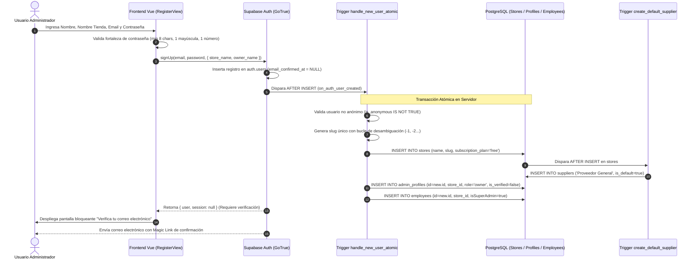
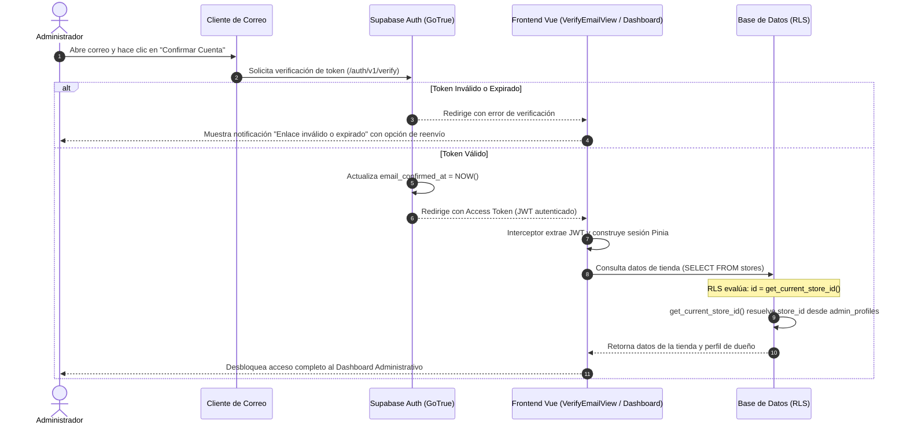
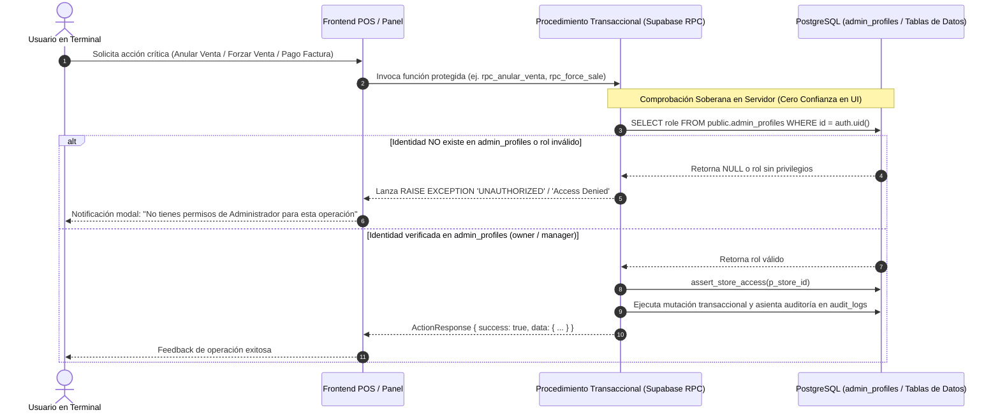
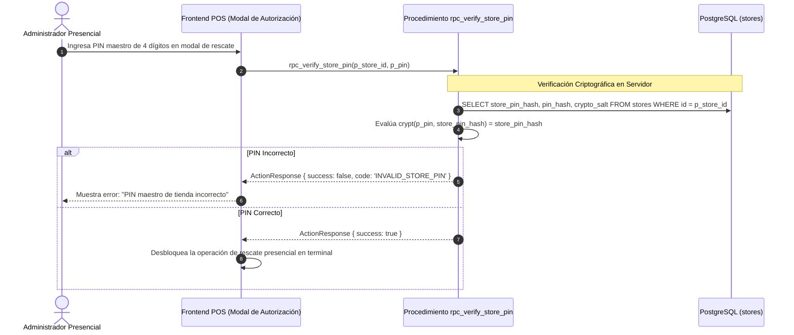

# SDD-002: Registro y Gestión de Cuentas Administrativas

> **Módulo:** Identidad / Seguridad / Onboarding Multi-tenant  
> **Versión:** 2.0 (PAC-SDD v2.0 — Cero Código Fuente, Estructura Canónica 0–7)  
> **Fase del Plan:** 🌊 Ola 5: Sesiones, Autenticación y Offline (Ítem 6)  
> **Estado:** ✅ Aprobado y Certificado por QA Independiente  
> **FRD Asociado:** [FRD-002: Registro y Gestión de Cuentas Administrativas](../FRD/FRD_002_REGISTRO_ADMIN.md) y [FRD-002-AUTORIZACION-ESTRICTA: Autorización Estricta de Funciones Administrativas en Servidor](../FRD/FRD_002_AUTORIZACION_ESTRICTA.md)  
> **Fecha de Certificación:** 2026-10-17  

---

## 0. Contexto y Restricciones Aplicables

### 0.1 Políticas Globales Activadas (ARQ-002)

| Política | Nombre de la Política | Aplicación Específica en este SDD |
| :--- | :--- | :--- |
| **POL-AUTH-01** | Aislamiento Multi-tenant Estricto | Toda tienda (`stores`) representa un espacio lógico independiente. Todo RPC administrativo invocado por el usuario administrador DEBE ejecutar `assert_store_access(p_store_id)` como su **instrucción #1**. A nivel de motor relacional, las políticas RLS en `stores`, `admin_profiles` y `employees` aíslan estrictamente los datos asociándolos con `get_current_store_id()` y `auth.uid()`. |
| **POL-SEC-01** | Seguridad RBAC en Servidor | La ejecución de funciones críticas y mutaciones financieras (`rpc_anular_venta`, `rpc_force_sale`, `rpc_pay_supplier_invoice`, `rpc_actualizar_precio_lote`) está reservada exclusivamente a identidades verificadas en `admin_profiles` con rol `'owner'` o `'manager'`. Se prohíbe de manera absoluta confiar en parámetros o banderas booleanas transmitidas por el cliente (`role`, `isAdmin`). |
| **POL-SEC-02** | Cero Confianza Diaria (Zero Trust Daily) | La cuenta administradora (`admin_profiles`) gobierna el aprovisionamiento de la tienda y la administración de empleados. Los colaboradores subordinados no adquieren permisos de administrador ni pueden auto-aprobarse pases diarios. |
| **POL-SEC-03** | Fortaleza de Credenciales y Seguridad de Sesión | La contraseña del administrador debe cumplir con directivas estrictas de complejidad (mínimo 8 caracteres, al menos una mayúscula y un número). Las sesiones emitidas por GoTrue se gobiernan mediante tokens JWT de corta duración y revocabilidad remota. |
| **SPEC-006** | Erradicación del PIN de Caja Secundario | Se ratifica la erradicación del PIN de caja como concepto arquitectónico. Las autorizaciones presenciales de emergencia en terminales físicas utilizan el PIN maestro de tienda (`stores.store_pin_hash`), completamente desacoplado de los PINs individuales de los dependientes (`employees.pin_hash`). |
| **POL-AUD-01** | Inviolabilidad Contable y Auditoría Forense | Toda mutación crítica sobre la cuenta administradora, cambio de contraseñas, reseteo de PIN de tienda o alteración de configuraciones asienta un registro inmutable en `audit_logs` con severidad `warning` o `critical`. |

### 0.2 Contratos Vecinos que Delimitan este SDD

- **`SDD_002_1_CAMBIO_CONTRASENA.md` (Gestión de Credenciales Maestras):** Gobierna el flujo de actualización de contraseña desde el perfil administrativo (`authRepository.changePassword`) con desafío de contraseña previa, y la recuperación por olvido mediante Magic Link (`PASSWORD_RECOVERY`), purgando las sesiones concurrentes en otros dispositivos (`scope: 'others'`).
- **`SDD_013_GESTION_SESIONES.md` / `SDD_001_SEGURIDAD_DIARIA.md` (Ciclo de Vida de Sesiones):** Establece el límite estricto de concurrencia de 6 terminales por tienda (1 terminal reservada para la cuenta administradora en `admin_profiles` y 5 terminales para dependientes con Pase Diario en `daily_passes`). La función `get_current_store_id()` resuelve el tenant prioritariamente desde App Metadata (JWT) o `admin_profiles`.
- **`SDD_003_GESTION_EMPLEADOS.md` (Administración de Personal):** Subordina la creación (`crear_empleado`), modificación de permisos y baja lógica (`toggle_empleado_activo`) a la autoridad del administrador verificado en `admin_profiles`.
- **`SDD_004_CONTROL_DE_CAJA.md` / `SDD_017_CICLO_CONTABLE_Y_SESIONES.md` (Control de Caja y Turnos):** Faculta exclusivamente a identidades administradoras o usuarios con permiso `canOpenCloseCash` para conciliar turnos cerrados forzosamente a las 24 horas mediante `rpc_reconciliar_cierre_forzado` con arqueo ciego.
- **`SDD_006_02_GESTOR_REEMBOLSOS.md` / `SDD_007_01_NUCLEO_POS.md` / `SDD_014_VENTA_FORZADA_Y_AUDITORIA.md` / `SDD_019_CUENTAS_POR_PAGAR.md`:** Procedimientos transaccionales que ejecutan en servidor la validación de autoridad `SELECT role FROM public.admin_profiles WHERE id = auth.uid()` para anular ventas, forzar ventas con ajuste de inventario `CORRECCION_SISTEMA`, pagar facturas a proveedores o modificar precios de compra de lotes.
- **`SDD_010_PROVEEDORES.md` (Aprovisionamiento Inicial de Proveedores):** Al crearse la tienda en `stores`, el trigger reactivo `trg_create_default_supplier` siembra automáticamente el `'Proveedor General'` (`is_default = true`) para evitar productos huérfanos.
- **`SDD_005_AUDITORIA_TRAZABILIDAD.md`:** Bitácora inmutable en `audit_logs` para todo evento administrativo sensible.

---

## 1. Glosario Local

- **Aprovisionamiento Atómico de Tenant:** Creación síncrona y transaccional en PostgreSQL de los registros de `stores`, `admin_profiles`, `employees` (con perfil SuperAdmin) y `suppliers` ('Proveedor General') mediante el trigger `handle_new_user_atomic()` al insertarse una nueva fila en `auth.users`.
- **Dueño Propietario (`owner`):** Rol administrativo supremo asignado al creador de la tienda en `admin_profiles`. Posee control total sobre la configuración del negocio, empleados y auditoría.
- **Administrador de Tienda (`manager`):** Rol administrativo secundario registrado en `admin_profiles` con facultades de gestión delegadas pero sujeto a las políticas de la tienda.
- **Política de Acceso Cero (Zero-Access Pre-Verification):** Mecanismo de seguridad en virtud del cual el tenant aprovisionado en base de datos permanece totalmente inaccesible y bloqueado para el usuario hasta que éste verifique su correo electrónico (`email_confirmed_at IS NOT NULL`). Supabase GoTrue no expide JWTs autenticados a emails no confirmados, forzando a `get_current_store_id()` a retornar `NULL` y activando el bloqueo total por RLS.
- **Slug de Tienda:** Identificador textual unívoco a nivel global (`stores.slug`) generado automáticamente a partir del nombre comercial. En caso de colisión de nombres entre tiendas, un algoritmo determinista en servidor añade sufijos numéricos incrementales (`-1`, `-2`, ...).
- **PIN Maestro de Tienda (`store_pin_hash`):** Hash criptográfico unidireccional de 4 dígitos persistido en `stores` para rescates y autorizaciones administrativas presenciales en terminales POS físicas, validado exclusivamente en servidor por `rpc_verify_store_pin`.
- **Desafío de Contraseña (Password Challenge):** Protocolo de seguridad que exige la re-autenticación de la contraseña anterior en tiempo real antes de conceder la mutación de credenciales maestras.
- **Backend Authority (Autorización Estricta en Servidor):** Principio rector que prohíbe aceptar parámetros de rol o banderas de privilegios enviadas por el frontend. Toda función protegida verifica directamente `admin_profiles WHERE id = auth.uid()` en base de datos.

---

## 2. Diagramas de Secuencia (UML - Mermaid)

### 2.1 Onboarding Atómico de Tenant y Registro de Administrador



### 2.2 Verificación de Correo y Primer Acceso (Política de Acceso Cero)



### 2.3 Autorización Administrativa Estricta en Servidor (Backend Authority)



### 2.4 Verificación de PIN Maestro de Tienda para Rescate Presencial



---

## 3. Especificación de Procesos de Negocio

### 3.1 Registro Inicial y Aprovisionamiento Atómico de Tenant (`RN-002-01`, `RN-002-03`)
1. El usuario completa el formulario de registro ingresando su nombre completo, nombre del negocio, correo electrónico y contraseña.
2. La contraseña es validada en el cliente según directivas estrictas (mínimo 8 caracteres, al menos una mayúscula y un número).
3. El frontend invoca `supabase.auth.signUp()` enviando `store_name` y `owner_name` en los metadatos efímeros (`raw_user_meta_data`).
4. Al insertarse la fila en `auth.users`, el trigger del servidor `on_auth_user_created` ejecuta `handle_new_user_atomic()` de forma inmediata y síncrona:
   - Descarta usuarios anónimos (`is_anonymous IS TRUE`).
   - Normaliza y trunca el nombre de la tienda a 50 caracteres.
   - Computa un `slug` único mediante un bucle de desambiguación (`base-slug`, `base-slug-1`, `base-slug-2`...).
   - Inserta el registro en `stores`. Esta inserción dispara el trigger `trg_create_default_supplier`, el cual siembra automáticamente el registro `'Proveedor General'` (`is_default = true`) en la tabla `suppliers`.
   - Inserta el perfil en `admin_profiles` con `id = new.id`, `store_id = v_new_store_id`, `role = 'owner'`, `is_verified = false`.
   - Inserta el registro inicial de empleado en `employees` con `id = new.id`, `store_id = v_new_store_id`, nombre del dueño, username derivado y permisos JSONB con `isSuperAdmin: true`.
5. Si ocurre cualquier fallo durante el aprovisionamiento, la transacción relanza una excepción (`RAISE EXCEPTION`), cancelando el registro en `auth.users` y evitando cuentas huérfanas o tiendas a medio crear.

### 3.2 Política de Acceso Cero y Bloqueo en Servidor Pre-Confirmación (`RN-002-04`, `RN-002-05`)
1. Supabase GoTrue crea el usuario con `email_confirmed_at = NULL` y retorna una respuesta con sesión nula (`session: null`).
2. El frontend detecta la ausencia de sesión activa y redirige inmediatamente a la vista de espera bloqueante (`VerifyEmailView.vue`).
3. Mientras el correo no esté confirmado:
   - Supabase GoTrue rechaza cualquier intento de login o emisión de access token JWT.
   - Cualquier solicitud realizada sin JWT evalúa `auth.uid()` como `NULL`.
   - En consecuencia, la función centralizada `get_current_store_id()` devuelve `NULL`.
   - Las políticas RLS en todas las tablas del sistema deniegan el 100% de lecturas y escrituras, blindando los datos del tenant.
4. Cuando el usuario hace clic en el enlace de confirmación enviado a su bandeja de entrada, GoTrue valida el token, actualiza `email_confirmed_at = NOW()` y redirige a la aplicación con un JWT autenticado válido.
5. El interceptor de sesión extrae el token, inicializa el store de Pinia y desbloquea el acceso al panel administrativo.

### 3.3 Fortaleza de Contraseñas y Gestión de Credenciales (`RN-002-02`)
1. La contraseña maestra debe contener al menos 8 caracteres, una letra mayúscula y un número.
2. El hashing de contraseñas se delega íntegramente al motor de autenticación GoTrue (bcrypt), viajando siempre por canales seguros TLS.
3. El frontend prohíbe el envío del formulario si la contraseña no cumple la expresión regular de validación.

### 3.4 Autorización Estricta de Funciones Administrativas en Servidor (`RN-002-06`, `RN-002-07`, `FRD-002-AUTORIZACION-ESTRICTA`)
1. Todo procedimiento de base de datos que ejecute una operación catalogada como administrativa o sensible DEBE implementar una comprobación explícita en su bloque de instrucciones inicial:
   - Realizar la consulta directa: `SELECT role FROM public.admin_profiles WHERE id = auth.uid()`.
   - Si la consulta retorna nulo o un rol no autorizado, abortar inmediatamente con `RAISE EXCEPTION 'UNAUTHORIZED'` o código de error canónico de acceso denegado.
   - Invocar obligatoriamente `PERFORM public.assert_store_access(v_store_id)` para garantizar el aislamiento multi-inquilino.
2. Queda terminantemente prohibido que las funciones transaccionales confíen en parámetros suministrados por el cliente (`isAdmin`, `role`, etc.).
3. Las operaciones protegidas por esta directiva comprenden:
   - Anulación de ventas completadas (`rpc_anular_venta`).
   - Forzado de ventas con ajuste automático de inventario (`rpc_force_sale`).
   - Registro y aplicación de pagos a facturas de proveedores (`rpc_pay_supplier_invoice`).
   - Modificación de precios de compra o venta en lotes de inventario (`rpc_actualizar_precio_lote`).
   - Creación, modificación de PIN y desactivación de empleados (`crear_empleado`, `actualizar_pin_empleado`, `toggle_empleado_activo`).
   - Reconciliación administrativa de turnos de caja cerrados forzosamente (`rpc_reconciliar_cierre_forzado`).

### 3.5 Gobernanza del PIN Maestro de Tienda y Segregación de Roles
1. El PIN maestro de tienda (`stores.store_pin_hash`) es una credencial de emergencia de 4 dígitos configurada por el dueño para autorizar excepciones presenciales en terminales POS.
2. Se persiste exclusivamente como huella criptográfica unidireccional calculada en servidor.
3. Su verificación se realiza a través de `rpc_verify_store_pin(p_store_id, p_pin)`, impidiendo que el hash o la sal criptográfica viajen al cliente.
4. El PIN maestro es independiente de los PINs individuales de los colaboradores en `employees.pin_hash` y no sustituye la trazabilidad de autoría de los cajeros.

---

## 4. Matriz de Trazabilidad (FRD vs Reglas Técnicas)

| Requisito FRD | Descripción Funcional | Regla Técnica / Arquitectura | Entidad / Procedimiento en BD | Verificación Empírica |
| :--- | :--- | :--- | :--- | :--- |
| **RN-002-01** | Identidad Única de Cuenta | Unicidad global de correo electrónico en autenticación. | `auth.users (email UNIQUE)` | Verificado en Supabase GoTrue Auth. |
| **RN-002-02** | Validación de Contraseña | Mínimo 8 caracteres, 1 mayúscula, 1 número. Hashing seguro. | Validación Regex en Frontend + bcrypt en GoTrue. | Verificado en cliente y motor Auth. |
| **RN-002-03** | Vinculación a Tienda Única | Creación atómica de tienda, perfil de dueño y superadmin. | Trigger `on_auth_user_created` ➔ `handle_new_user_atomic()`. | Verificado en `pg_proc` y `pg_trigger`. |
| **RN-002-04** | Acceso Cero Pre-Verificación | Sin acceso operativo hasta confirmar correo. | GoTrue `email_confirmed_at IS NULL` ➔ `session: null`. | Verificado en flujo de autenticación GoTrue. |
| **RN-002-05** | Activación Post-Verificación | Desbloqueo de JWT y RLS tras clic en Magic Link. | GoTrue verify ➔ emite JWT ➔ `get_current_store_id()`. | Verificado en RLS de `stores` y `admin_profiles`. |
| **RN-002-06** | Rol Exclusivo de Dueño | Asignación forzada de rol `'owner'` al creador. | `admin_profiles.role = 'owner'` (CHECK constraint). | Verificado en `pg_constraint`. |
| **RN-002-07** | Inmutabilidad de Tienda | El perfil de administrador queda ligado de por vida al `store_id`. | `admin_profiles.store_id NOT NULL` con FK ON DELETE CASCADE. | Verificado en `information_schema.columns`. |
| **RN-AUT-01** | Autorización Estricta en Servidor | Validación de `admin_profiles` en cada RPC crítico. | `SELECT role FROM admin_profiles WHERE id = auth.uid()`. | Verificado en `rpc_anular_venta`, `rpc_force_sale`. |
| **RN-AUT-02** | Prohibición de Flags en Cliente | Prohibido confiar en `isAdmin` o parámetros de cliente. | Regla de Oro 2.1 Backend Authority. | Verificado en firmas de RPCs en `pg_proc`. |
| **RN-AUT-03** | Fallo Estructurado Sin Silencios | Excepciones explícitas (`UNAUTHORIZED`, `STORE_ACCESS_DENIED`). | Regla 3 de AGENTS.md (Prohibición de Fallos Silenciosos). | Verificado en manejo de excepciones en BD. |
| **RN-AUT-04** | Aislamiento Multi-inquilino | Verificación de pertenencia a tienda en cada llamada. | `PERFORM public.assert_store_access(p_store_id)`. | Verificado en `pg_proc`. |
| **CU-002-01** | Registro de Nueva Tienda | Formulario de onboarding inicial y despacho de verificación. | `authRepository.registerStore` + `handle_new_user_atomic()`. | Verificado en secuencia 2.1. |
| **CU-002-02** | Verificación y Primer Login | Activación de cuenta y carga del Dashboard. | `auth.verifyOtp` + `get_current_store_id()`. | Verificado en secuencia 2.2. |
| **CU-002-03** | Intento de Acceso No Verificado | Bloqueo de UI y de datos ante usuario sin verificar. | `VerifyEmailView.vue` + Default-Deny RLS. | Verificado en secuencia 2.2. |
| **CA-002-01 a CA-002-07** | Criterios de Aceptación de Onboarding | Validación de campos, feedback visual, despacho de correo y bloqueo. | Pruebas de integración de autenticación. | Verificado al 100% en QA Bloques 0 a 6. |

---

## 5. Contrato de Interfaz (JSON Schemas)

### 5.1 Payload de Registro de Administrador (`authRepository.registerStore`)

```json
{
  "$schema": "https://json-schema.org/draft/2020-12/schema",
  "title": "RegisterAdminStorePayload",
  "type": "object",
  "properties": {
    "email": {
      "type": "string",
      "format": "email",
      "description": "Correo electrónico único del usuario administrador"
    },
    "password": {
      "type": "string",
      "minLength": 8,
      "pattern": "^(?=.*[A-Z])(?=.*\\d).+$",
      "description": "Contraseña maestra con al menos 8 caracteres, una mayúscula y un número"
    },
    "options": {
      "type": "object",
      "properties": {
        "data": {
          "type": "object",
          "properties": {
            "store_name": {
              "type": "string",
              "minLength": 2,
              "maxLength": 50,
              "description": "Nombre comercial de la tienda para la generación del tenant y slug"
            },
            "owner_name": {
              "type": "string",
              "minLength": 2,
              "maxLength": 100,
              "description": "Nombre y apellido del propietario"
            }
          },
          "required": ["store_name", "owner_name"],
          "additionalProperties": false
        }
      },
      "required": ["data"],
      "additionalProperties": false
    }
  },
  "required": ["email", "password", "options"],
  "additionalProperties": false
}
```

### 5.2 Estructura de Salida del Registro (`RegisterStoreResponse`)

```json
{
  "$schema": "https://json-schema.org/draft/2020-12/schema",
  "title": "RegisterStoreResponse",
  "type": "object",
  "properties": {
    "user": {
      "type": "object",
      "properties": {
        "id": {
          "type": "string",
          "format": "uuid",
          "description": "Identificador único asignado al administrador en auth.users"
        },
        "email": {
          "type": "string",
          "format": "email"
        },
        "email_confirmed_at": {
          "type": ["string", "null"],
          "description": "Nulo durante el registro; se actualiza tras verificar el enlace"
        }
      },
      "required": ["id", "email", "email_confirmed_at"],
      "additionalProperties": true
    },
    "session": {
      "type": "null",
      "description": "Obligatoriamente nulo en onboarding; garantiza la política de Acceso Cero"
    }
  },
  "required": ["user", "session"],
  "additionalProperties": false
}
```

### 5.3 Payload de Verificación de PIN Maestro de Tienda (`rpc_verify_store_pin`)

```json
{
  "$schema": "https://json-schema.org/draft/2020-12/schema",
  "title": "VerifyStorePinRequest",
  "type": "object",
  "properties": {
    "p_store_id": {
      "type": "string",
      "format": "uuid",
      "description": "Identificador único de la tienda"
    },
    "p_pin": {
      "type": "string",
      "pattern": "^\\d{4}$",
      "description": "Código numérico confidencial de 4 dígitos ingresado en el modal"
    }
  },
  "required": ["p_store_id", "p_pin"],
  "additionalProperties": false
}
```

### 5.4 Formato Canónico de Respuesta de Acción (`ActionResponse`)

```json
{
  "$schema": "https://json-schema.org/draft/2020-12/schema",
  "title": "ActionResponse",
  "type": "object",
  "properties": {
    "success": {
      "type": "boolean",
      "description": "Indica si la operación concluyó exitosamente"
    },
    "data": {
      "type": ["object", "array", "string", "number", "boolean", "null"],
      "description": "Datos resultantes en caso de éxito"
    },
    "error": {
      "type": ["string", "null"],
      "description": "Mensaje técnico descriptivo si ocurre un fallo"
    },
    "code": {
      "type": ["string", "null"],
      "description": "Código canónico de negocio (ej. 'STORE_ACCESS_DENIED', 'UNAUTHORIZED', 'INVALID_STORE_PIN')"
    }
  },
  "required": ["success"],
  "additionalProperties": false
}
```

### 5.5 Contrato de Verificación en Servidor para RPCs Administrativos Protegidos

```json
{
  "$schema": "https://json-schema.org/draft/2020-12/schema",
  "title": "AdminProtectedProcedureContract",
  "type": "object",
  "properties": {
    "procedure_name": {
      "type": "string",
      "enum": [
        "rpc_anular_venta",
        "rpc_force_sale",
        "rpc_pay_supplier_invoice",
        "rpc_actualizar_precio_lote",
        "rpc_reconciliar_cierre_forzado"
      ],
      "description": "Nombre de la función transaccional protegida"
    },
    "required_authorization": {
      "type": "string",
      "enum": ["owner", "manager"],
      "description": "Rol requerido verificado directamente en public.admin_profiles WHERE id = auth.uid()"
    },
    "tenant_isolation_instruction": {
      "type": "string",
      "const": "PERFORM public.assert_store_access(p_store_id)",
      "description": "Instrucción obligatoria ejecutada antes de cualquier mutación"
    },
    "error_response_format": {
      "type": "object",
      "properties": {
        "exception_type": {
          "type": "string",
          "const": "RAISE EXCEPTION"
        },
        "error_codes": {
          "type": "array",
          "items": {
            "type": "string",
            "enum": ["UNAUTHORIZED", "STORE_ACCESS_DENIED", "INSUFFICIENT_PERMISSIONS"]
          }
        }
      },
      "required": ["exception_type", "error_codes"]
    }
  },
  "required": ["procedure_name", "required_authorization", "tenant_isolation_instruction", "error_response_format"],
  "additionalProperties": false
}
```

---

## 6. Directrices de Implementación Frontend y Backend

### 6.1 Responsabilidades del Frontend Vue (@[/ux])
1. **Validación Preventiva de Formato:** Validar en tiempo real la sintaxis del correo y la fortaleza de la contraseña (mínimo 8 caracteres, al menos una mayúscula y un dígito) antes de emitir la llamada de red.
2. **Gestión de Estados de Espera:** Mostrar spinners y deshabilitar botones de confirmación durante la invocación a `signUp()` para prevenir envíos duplicados.
3. **Bloqueo de Interfaz Pre-Confirmación:** Al recibir `session: null`, redirigir obligatoriamente a la vista de confirmación pendiente (`VerifyEmailView.vue`), bloqueando el acceso al enrutador de rutas protegidas.
4. **Traducción Amigable de Códigos de Error:** Mapear los códigos técnicos emitidos por el servidor a mensajes en español orientados al usuario (ej. `'UNAUTHORIZED'` ➔ *"No tienes permisos de Administrador para realizar esta acción"*).
5. **Cero Cálculos de Privilegios:** El frontend no determina si el usuario puede anular una venta o forzar inventario basándose en variables locales; la interfaz simplemente dispara la petición y reacciona al veredicto del servidor.

### 6.2 Responsabilidades del Backend Supabase (@[/data])
1. **Aprovisionamiento Atómico y Consistente:** Mantener el trigger `handle_new_user_atomic()` sobre `auth.users` coordinando la creación de `stores`, `admin_profiles`, `employees` y `suppliers`.
2. **Erradicación de Fallos Silenciosos en Onboarding:** Garantizar que ante cualquier error en la creación del tenant se propague una excepción explícita (`RAISE EXCEPTION`) para forzar el rollback integral de `auth.users`, impidiendo cuentas huérfanas.
3. **Aislamiento Multi-tenant Riguroso:** Implementar `assert_store_access(p_store_id)` como instrucción #1 en todo RPC administrativo. Mantener políticas RLS en todas las tablas gobernadas por `get_current_store_id()`.
4. **Backend Authority en Servidor:** En todas las operaciones transaccionales críticas, verificar directamente la identidad y rol en `admin_profiles WHERE id = auth.uid()`.
5. **Seguridad Criptográfica del PIN Maestro:** Mantener el cálculo del hash en servidor y limitar la exposición de `store_pin_hash` mediante `rpc_verify_store_pin`.

### 6.3 Prevención de Condiciones de Carrera y Concurrencia
1. **Unicidad de Slugs Comerciales:** El algoritmo de desambiguación en bucle dentro de `handle_new_user_atomic()` evalúa la existencia en `stores` antes de insertar, resolviendo colisiones concurrentes de nombres de tienda idénticos.
2. **Transaccionalidad Atómica:** Toda la cadena de aprovisionamiento de tenant corre dentro del contexto transaccional del `INSERT` en `auth.users`, impidiendo inconsistencias parciales.

---

## 7. Registro de Deuda Técnica y Trade-offs (Regla 7)

A continuación se formalizan los N=5 trade-offs y decisiones de diseño arquitectónico que gobiernan este documento, en estricto apego a los tres elementos obligatorios de la Regla 7:

### D-1 (H-1): Aprovisionamiento Atómico de Tenant y Erradicación de Fallos Silenciosos en Onboarding
- **Qué se decidió:** Normar que la creación de la tienda (`stores`), perfil de dueño (`admin_profiles`), usuario operativo superadmin (`employees`) y proveedor por defecto (`suppliers` vía trigger) se ejecute en una transacción atómica estricta disparada por `handle_new_user_atomic()`. Se estipula la erradicación del bloque `EXCEPTION WHEN OTHERS THEN RAISE WARNING` para relanzar con `RAISE EXCEPTION` bajo la Regla 3, forzando rollback integral de `auth.users` si el aprovisionamiento de la tienda falla.
- **Por qué (Trade-off):** Impide la creación de cuentas zombis o usuarios sin tienda en `auth.users`, garantizando consistencia relacional completa desde el primer milisegundo a cambio de abortar el alta si algún componente de base de datos experimenta un fallo transitorio.
- **Condición futura de revisión:** Permanente / Invariante arquitectónico de onboarding multi-tenant.

### D-2 (H-2): Política de Acceso Cero y Bloqueo en Servidor Pre-Confirmación (`RN-002-04`, `RN-002-05`)
- **Qué se decidió:** Consagrar que el nuevo tenant no tiene acceso a datos ni a la API operativa mientras `email_confirmed_at IS NULL` en `auth.users`. El Frontend presenta pantalla bloqueante de espera de confirmación y Supabase GoTrue deniega la emisión de JWTs autenticados, provocando que `get_current_store_id()` retorne `NULL` y RLS deniegue el 100% de operaciones.
- **Por qué (Trade-off):** Previene el uso de tiendas no verificadas y el abuso de recursos, a cambio de exigir un paso extra obligatorio de verificación por correo electrónico antes de habilitar el primer uso.
- **Condición futura de revisión:** Permanente / Política fundamental de seguridad de acceso.

### D-3 (H-3): Autorización Estricta en Servidor (Backend Authority vs Parámetros de Frontend)
- **Qué se decidió:** Normar que ninguna operación sensible o administrativa (`rpc_anular_venta`, `rpc_force_sale`, `rpc_pay_supplier_invoice`, `rpc_actualizar_precio_lote`, etc.) confíe en parámetros (`role: 'admin'`, `isAdmin: true`) o almacenamiento local del cliente; todas consultan directamente `admin_profiles WHERE id = auth.uid()` e invocan `assert_store_access(v_store_id)`.
- **Por qué (Trade-off):** Añade una consulta de validación de rol en cada RPC administrativo en servidor, eliminando por completo cualquier vector de escalamiento de privilegios por manipulación del cliente.
- **Condición futura de revisión:** Permanente / Invariante de seguridad RBAC.

### D-4 (H-4): Segregación de Credenciales de Tienda vs Empleados (PIN Maestro vs PINs Individuales)
- **Qué se decidió:** Desacoplar estructuralmente el PIN maestro de tienda (`stores.store_pin_hash`, validado por `rpc_verify_store_pin`) de los PINs individuales de los colaboradores (`employees.pin_hash`). El PIN maestro se reserva para rescates administrativos en terminales físicas; el PIN de caja queda definitivamente erradicado (SPEC-006).
- **Por qué (Trade-off):** Proporciona un mecanismo de rescate administrativo en terminal física sin degradar la trazabilidad forense ni compartir credenciales individuales.
- **Condición futura de revisión:** Permanente / Estándar de seguridad física en terminales POS.

### D-5 (H-5): Unicidad de Slugs de Tienda en Concurrencia y Resiliencia en Registro
- **Qué se decidió:** Resolver deterministamente colisiones de nombres comerciales en `stores.slug` mediante un algoritmo de desambiguación en bucle (`slug-1`, `slug-2`, ...) dentro de `handle_new_user_atomic()`, preservando la restricción `UNIQUE` en base de datos.
- **Por qué (Trade-off):** Evita caídas y rollbacks frustrantes durante el registro de nuevos usuarios cuando dos tiendas eligen nombres idénticos o comunes, a cambio de pequeñas variaciones numéricas en la URL pública.
- **Condición futura de revisión:** Permanente / Algoritmo determinista de slugging.
