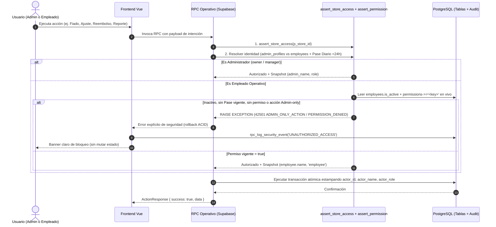
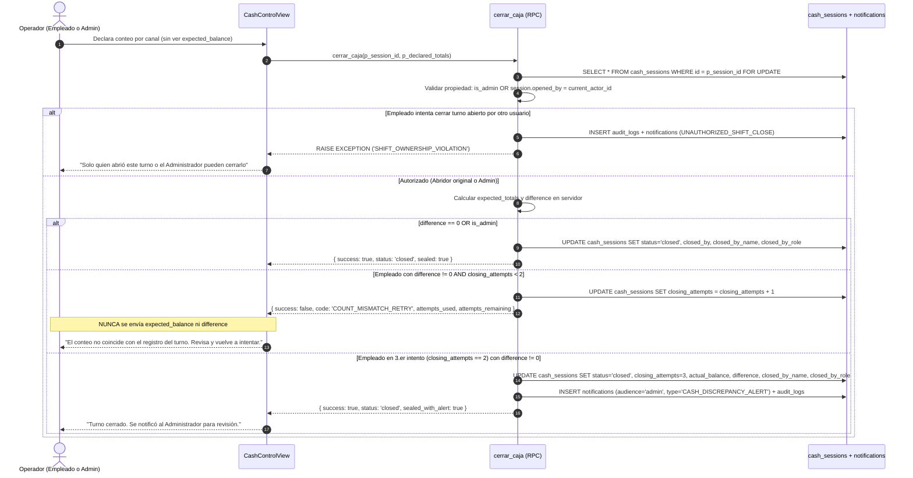

# SDD-003-01: Matriz de Permisos de Empleados y Límites Naturales de Operación (Contrato Marco)

> **Módulo:** Personal / Seguridad / RBAC Operativo y Gobernanza Transversal  
> **Versión:** 1.0 (PAC-SDD v2.0 — Cero Código Fuente, Estructura Canónica 0–7)  
> **Estado:** 🟢 Aprobado en PAC-SDD (Bloques 0–6 verificados por `auditor-qa`, pendiente implementación en Olas SQL/Frontend)  
> **Asociado a:** [FRD-003-01: Matriz de Permisos de Empleados y Límites Naturales de Operación](../FRD/FRD_003_01_MATRIZ_PERMISOS_EMPLEADOS.md)  
> **Fecha de Creación:** 2026-11-19  
> **Enmienda y consolida como contrato marco:** `SDD-001`, `SDD-003`, `SDD-004`, `SDD-005`, `SDD-006`, `SDD-006-01-01`, `SDD-006-01-02`, `SDD-006-02`, `SDD-007-01`, `SDD-008`, `SDD-009`, `SDD-015`, `SDD-017`, `SDD-018`, `SDD-019`, `SDD-020`, `SDD-021`, `SDD-022`, `SDD-024`, `SDD-026`, `SDD-027-01`, `SDD-027-02` (absorbido) y `SDD-030`.

---

## 0. Contexto y Restricciones Aplicables

### 0.1 Políticas Globales Activadas (`ARQ-002` v1.4 — 17 Políticas Trazadas en `ARQ-003` v1.5)

| Política | Nombre de la Política | Aplicación Específica en este SDD |
| :--- | :--- | :--- |
| **POL-FIN-01** | Caja Dedicada POS y Canales Válidos | La Caja Dedicada POS es la única caja registradora del mostrador. Los únicos canales operativos válidos son **`efectivo`**, **`nequi`** y **`llave_bre`** (se elimina `'daviplata'` y el código legacy `'bre'`). Todo desembolso fuera del cajón POS es **"pago externo / fuera de caja"** (100% exclusivo del Administrador). |
| **POL-FIN-02** | Prohibición de Sobregiro por Canal | Gastos menores de caja y reembolsos validan fondos suficientes en el canal seleccionado antes de ejecutarse (`INSUFFICIENT_CHANNEL_FUNDS`). |
| **POL-FIN-03** | Integridad del Crédito y Cupos | Las ventas a crédito (`fiado`) y los abonos exigen el permiso `canFiar` (o rol Administrador). El cupo global por defecto (`stores.default_credit_limit`) aplica exclusivamente a clientes nuevos sin sobrescribir cupos existentes. |
| **POL-FIN-04** | Separación de Gastos Operativos vs. Costos y Reembolsos | Los gastos menores POS (`movement_type = 'gasto'`) son OPEX; los reembolsos de clientes (`FRD-006-02`) no contaminan el OPEX monetario de caja y solo impactan pérdidas en P&L cuando llevan la etiqueta `"merma"` (al costo de adquisición). |
| **POL-FIN-05** | Consumo y Retiro Personal Separado del Negocio | El Consumo/Retiro Personal se opera literalmente como una venta en el carrito POS con impacto `$0` en Caja Dedicada POS, asignado automáticamente al propio perfil del empleado (solo el Administrador puede elegir otro perfil), valorado al costo de adquisición en P&L conservando el precio de venta como referencia. |
| **POL-LOG-01** | Trazabilidad de Inventario y Costos | El permiso `canManageInventory` (`Inventario completo`) unifica la gestión de catálogo, visualización de costos de adquisición, baja lógica de productos, entradas, ajustes por conteo físico (`+/-`) y devoluciones físicas a proveedor (`$0` en caja). |
| **POL-LOG-02** | Reembolsos en Acción Única con Etiqueta `"merma"` | El botón de Reembolsos se ubica en el POS al lado del buscador, requiere permiso `canManageRefunds` (o Admin) y caja abierta, permite búsqueda flexible por nombre/código/PLU (incluso con `current_stock = 0`), y procesa en una sola acción atómica: con etiqueta `"merma"` ejecuta salida directa a merma sin pasar por stock vendible; sin etiqueta reingresa al stock vendible. |
| **POL-LOG-03** | Salidas Logísticas `$0` en Caja POS | Mermas y Consumo del Negocio están abiertos a cualquier usuario activo con Pase Diario vigente, sin requerir caja abierta, con impacto `$0` en POS y sin exponer costo unitario a quien no tenga `canManageInventory`. Devoluciones físicas a proveedor (`$0` POS) nunca alteran automáticamente Cuentas por Pagar (`FRD-019`). |
| **POL-LOG-04** | Inmutabilidad de Movimientos (Contra-Movimiento) | Todo movimiento de inventario y ajuste por conteo físico es inmutable: no se edita ni se elimina; cualquier corrección se ejecuta mediante un contra-movimiento firmado y con motivo obligatorio. |
| **POL-SEG-01** | Arqueo Ciego y Cierre Asistido (3 Intentos) | El cajero nunca ve `expected_balance` ni `difference`. Si el conteo declarado no coincide, el sistema solo avisa que no coincide y otorga hasta **3 intentos**; al 3.er intento sella el cierre y genera notificación/alerta inmediata al Administrador (`notifications` con `audience = 'admin'`). Todos los reportes del negocio son 100% Admin-only. |
| **POL-SEG-02** | Pase Diario Zero Trust, Continuidad `<24h` y Límite `+24h` | El Pase Diario (`daily_passes`) mantiene vigencia tras la medianoche mientras exista un turno abierto con `<24h` (`FRD-017`). En turnos vencidos (`+24h`), solo el abridor original (vía Cierre Asistido) o el Administrador (vía Cierre Forzoso, donde declarar conteo físico **no siempre es obligatorio**) pueden cerrarlo. |
| **POL-SEG-03** | Modelo de 4 Permisos Delegables y Propiedad Estricta del Turno | Exactamente **4 interruptores booleanos independientes** (`false` por defecto): `canManageInventory`, `canFiar`, `canOpenCloseCash`, `canManageRefunds`. Se eliminan `canViewReports` y `canViewInventory`. Regla de **1 dispositivo por cuenta** (sin cambio rápido por PIN). **Propiedad estricta del turno:** ningún empleado puede cerrar un turno abierto por otro usuario o por el Administrador. |
| **POL-AUD-01** | Fotografía Histórica Inmutable de Firma | Toda operación en cualquier módulo estampa no solo el UUID del actor sino su fotografía histórica inmutable (`actor_name`, `actor_role`) vigentes al instante de la transacción, preservando la autoría aunque el perfil se edite o desactive después. |
| **POL-AUD-02** | Visibilidad Seccionada y Evidence Hub Admin-Only | Evidence Hub, auditoría forense y todos los reportes históricos/financieros son 100% exclusivos del Administrador (`admin_profiles.role IN ('owner', 'manager')`). El empleado únicamente puede consultar **sus propios movimientos del turno abierto actual** con toda su información operativa. |
| **POL-AUD-03** | Alertas Automáticas al Administrador | Los eventos críticos (3.er intento fallido en Cierre Asistido, intento bloqueado de cierre de turno ajeno o sin permiso, ajuste por conteo físico y turno vencido `+24h`) generan registro de auditoría y alerta en la tabla `notifications` para el Administrador. |
| **POL-PRIV-01** | Exclusividad Administrativa de Clientes y Cupos | Crear, reactivar, editar, cambiar cupos (individuales o global por defecto) y eliminar clientes es 100% exclusivo del Administrador. |
| **POL-PRIV-02** | Resguardo Contable Silencioso (`FRD-030`) | No existe filtro "Mostrar eliminados" en listas de clientes (`rpc_admin_get_clients` no expone `p_include_deleted`). Los clientes con saldo `$0` archivados preservan su historia contable silenciosamente y solo el Administrador puede reactivarlos. |

### 0.2 Contratos Vecinos y Plan de Alineación (23 SDDs Vecinos — Opción A)

Este SDD actúa como **Contrato Marco de Autorización, Identidad y Propiedad del Turno**. Todos los **23 SDDs vecinos** identificados en el barrido contra `ARQ-002` v1.4 quedan vinculados al siguiente plan de alineación (10 con cambios mayores y 13 con ajustes puntuales):

- **Cambios Mayores (10 SDDs):** `SDD_003` (4 permisos JSONB + snapshot), `SDD_004` y `SDD_027_01` (propiedad estricta del turno, Cierre Asistido 3 intentos, reportes Admin-only, movimientos propios del turno, canales `efectivo/nequi/llave_bre`), `SDD_005` (Evidence Hub 100% Admin-only + snapshot `actor_name`/`actor_role` + nuevos eventos), `SDD_006`, `SDD_006_01_01` y reactivación de `SDD_006_01_02` (`canManageInventory` con costos/soft-delete/ajustes/devolución proveedor `$0`, mermas y consumo del negocio abiertos a todos, contra-movimiento), `SDD_006_02` (botón en POS junto al buscador, búsqueda flexible sin filtro `stock > 0`, etiqueta única `"merma"`), `SDD_007_01` (Consumo/Retiro Personal `$0` en carrito POS, acceso a Reembolsos, validación `canFiar`, canales) y `SDD_018` (OPEX P&L al costo para mermas, reembolsos `"merma"`, consumo negocio y retiro personal por perfil y consolidado).
- **Ajustes Puntuales (13 SDDs):** `SDD_001` y `SDD_015` (continuidad `<24h` en pase diario), `SDD_008` (100% Admin-only), `SDD_009`, `SDD_024` y `SDD_030` (`canFiar`, `default_credit_limit` solo a nuevos, retiro de `p_include_deleted`), `SDD_017` y `SDD_027_02` *(mantenido `Derogado/Absorbido`: reglas de cierre forzoso `+24h` sin conteo obligatorio actualizadas en `SDD_004` y `SDD_017`, refrescando su nota de redirección)*, `SDD_019` (CxP 100% Admin-only y `"pago externo / fuera de caja"`), `SDD_020`, `SDD_021`, `SDD_022` y `SDD_026` (canales `efectivo/nequi/llave_bre` sin `daviplata` y lectura propia del turno actual).

### 0.3 Auditoría de BD contra Realidad y Deudas Técnicas Registradas (`N = 10` Ejes)

> **Nota de Verificación de Esquema (`AGENTS.md` Regla 2):** Los tipos y columnas abajo fueron verificados en `frontend/src/types/database.types.ts` y `supabase/migrations/20261017130000*`..`20261111173000*`. Debido a timeout de red del MCP de Supabase Cloud (`ihtjocmhzuliwwvdzfnz`) el 2026-11-19, **es precondición obligatoria** ejecutar `SELECT column_name, data_type FROM information_schema.columns` contra producción antes de aplicar cualquier migración SQL de Fase 3.

| ID | Brecha Verificada en Código Actual (BD / Frontend) | Impacto y Remediación Mandatoria en Fase 3 |
| :--- | :--- | :--- |
| **B-01** | `employees.permissions` aún admite llaves legacy (`canViewReports`, `canViewInventory`, `canSell`, `canManageClients`) y carece de saneamiento en `crear_empleado` / UI (`EmployeeFormModal.vue` L251–301). | Normalizar JSONB a las **4 llaves canónicas** (`canManageInventory`, `canFiar`, `canOpenCloseCash`, `canManageRefunds`) en BD y Frontend, eliminando `canViewReports` y `canViewInventory`. |
| **B-02** | `chk_cash_movements_payment_method` (`20261017130000` L23–25) y `sales_payment_method_check` (`20261017132000` L12–14) usan `('efectivo','nequi','daviplata','bre')` en vez de `'llave_bre'` sin `'daviplata'`. | Migrar registros `'bre'` a `'llave_bre'`, retirar `'daviplata'` de constraints, 7 RPCs y vistas Frontend (`config.ts`, `ClientDetailView`, `PayInvoiceModal`, `CheckoutModal`). |
| **B-03** | `cash_sessions` (`database.types.ts` L383–397) carece de `closing_attempts`; `cerrar_caja` cierra en el 1.er intento, no valida `opened_by` y retorna `expected_balance`/`difference` al cajero; `rpc_reconciliar_cierre_forzado` exige siempre `p_actual_balance`. | Agregar `closing_attempts`, imponer propiedad estricta (`opened_by = actor OR is_admin`), implementar Cierre Asistido (3 intentos + alerta en `notifications`), quitar `PinChallengeModal` en caja y hacer opcional el conteo físico en cierre forzoso Admin `+24h`. |
| **B-04** | `get_history_caja`, `get_daily_summary`, `rpc_get_comprehensive_financial_report` y `DashboardView.vue` (L71–91) permiten consulta a empleados; falta vista/RPC de movimientos propios del turno actual. | Exigir `admin_profiles` (`'owner'`, `'manager'`) en todos los RPCs de reportes/auditoría y crear `rpc_obtener_mis_movimientos_turno` filtrado por `actor_id` y sesión abierta actual. |
| **B-05** | Solo `client_lifecycle_audit` (`20261111173000` L20–21) guarda `actor_name`/`actor_role`; `sales`, `cash_sessions`, `cash_movements`, `inventory_movements`, `client_ledger` y `audit_*` dependen de JOIN vivo a `employees`. | Agregar columnas de snapshot histórico (`actor_name`, `actor_role`, y pares apertura/cierre en `cash_sessions`) capturadas atómicamente en servidor vía helper `resolve_actor_snapshot()`. |
| **B-06** | `get_employee_id_from_session` (`20261111173000` L706–749) ya soporta continuidad `<24h`, pero `request_employee_access` (`20261031140000` L243) y `toggle_empleado_activo` (`20261017134000` L685) solo evalúan `pass_date = v_today`. | Alinear ambos RPCs para cubrir `pass_date IN (v_today, v_today - 1)` cuando exista turno abierto `<24h` y revocar ambos al desactivar empleado. |
| **B-07** | No existe soporte de **Consumo/Retiro Personal** como venta `$0` en carrito POS (`rpc_procesar_venta_v3` / `CheckoutModal.vue`). | Extender cierre POS con modalidad de retiro personal (`$0` en caja, FIFO al costo, precio venta referencia, auto-asignación a perfil propio y selector de perfil solo para Admin). |
| **B-08** | No existe `rpc_procesar_reembolso_item` en `database.types.ts` ni botón de Reembolsos junto al buscador en `POSView.vue` (L480–490); `ExpensesView.vue` mantiene `'Reembolso'` como gasto OPEX. | Implementar botón/modal en POS + `rpc_procesar_reembolso_item` con búsqueda sin filtro `stock > 0`, validación `canManageRefunds` y etiqueta única `"merma"`. |
| **B-09** | `StockEntryView.vue` mezcla entradas con `'Ajuste Positivo'`, acopla `'Devolución Proveedor'` a facturas CxP, oculta mermas/consumo negocio tras `canManageInventory`, y `ProductFormModal.vue` L560 oculta costo a `canManageInventory`. | Desacoplar `bridge_movement_to_batch` de CxP, ampliar `inventory_movements.movement_type`, abrir Merma y Consumo del Negocio a todo usuario activo sin mostrar costo, y habilitar costo/soft-delete/ajustes `+/-` a `canManageInventory`. |
| **B-10** | `rpc_procesar_venta_v3` (`fiado`), `rpc_registrar_abono` y `rpc_obtener_estado_cuenta_cliente` no validan `canFiar`; `stores` carece de `default_credit_limit`; `rpc_admin_get_clients` expone `p_include_deleted`; `rpc_get_comprehensive_financial_report` no incluye mermas/consumos al costo. | Imponer validación servidor de `canFiar`, añadir `stores.default_credit_limit` (solo altas nuevas), retirar `p_include_deleted` y actualizar motor P&L (`FRD-018`) con desglose por perfil y consolidado. |

---

## 1. Glosario Local

- **Administrador (`admin_profiles`):** Identidad con `role IN ('owner', 'manager')` vinculada a `store_id`. Posee autoridad total, no requiere Pase Diario ni interruptores en `employees.permissions`, y es el único actor habilitado para acciones de la Sección 5 de `FRD-003-01`.
- **Empleado Operativo Activo:** Cuenta en `employees` con `is_active = true` y Pase Diario vigente (`pass_date = v_today`, o `v_today - 1` si existe turno de caja abierto `<24h`), operando exclusivamente desde su propia sesión/dispositivo (sin cambio rápido por PIN).
- **Capacidades Operativas Base:** Conjunto de 5 operaciones implícitas de mostrador que posee todo Empleado Operativo Activo sin interruptores adicionales: (1) Vender en POS (caja abierta), (2) Gastos menores desde Caja Dedicada POS, (3) Mermas y Consumo del Negocio (`$0` POS), (4) Consumo/Retiro Personal en carrito POS asignado a su propio perfil (`$0` POS), y (5) Consultar únicamente sus propios movimientos del turno actual con toda su información.
- **Permisos Delegables (`employees.permissions`):** Objeto JSONB cerrado con exactamente **4 llaves booleanas independientes** (`false` por defecto): `canManageInventory` (*Inventario completo*), `canFiar` (*Fiar y cobrar abonos*), `canOpenCloseCash` (*Abrir/cerrar caja*) y `canManageRefunds` (*Reembolsos*).
- **Propiedad Estricta del Turno:** Regla de seguridad de `cash_sessions` que restringe el cierre de un turno abierto exclusivamente al usuario que lo abrió (`opened_by`) o a un Administrador (`admin_profiles`).
- **Cierre Asistido (3 Intentos):** Protocolo de arqueo ciego donde el abridor declara su conteo sin conocer `expected_balance`. Si hay descuadre en intentos 1 o 2, el servidor rechaza el sellado informando únicamente que el conteo no coincide (sin revelar cifras). En el 3.er intento, sella la sesión con el último conteo declarado y dispara alerta en `notifications` (`audience = 'admin'`).
- **Fotografía Histórica Inmutable (Snapshot de Firma):** Par de columnas textuales (`actor_name`, `actor_role`) capturadas en el servidor dentro de la misma transacción que crea el movimiento, garantizando legibilidad forense permanente incluso si el empleado cambia de nombre o es desactivado posteriormente.

---

## 2. Diagramas de Secuencia (UML - Mermaid)

### 2.1 Validación Centralizada de Autoridad y Snapshot de Firma (Flujo Transversal)



### 2.2 Propiedad Estricta del Turno y Cierre Asistido (3 Intentos + Alerta Admin)



---

## 3. Reglas de Negocio Técnicas (Matriz de Autorización en Servidor)

### 3.1 Funciones Centralizadas Obligatorias (`AGENTS.md` Regla 4)
Todo RPC del sistema DEBE reutilizar funciones centralizadas de seguridad (prohibido reimplementar `JOIN`/`EXISTS` ad-hoc por tabla):
1. **`assert_store_access(p_store_id UUID)`** *(ya existente)*: valida pertenencia multi-tenant.
2. **`is_store_admin(p_store_id UUID)`** *(centralizado sobre `admin_profiles`)*: retorna `true` únicamente si `auth.uid()` existe en `admin_profiles` para `p_store_id` con `role IN ('owner', 'manager')`.
3. **`assert_store_admin(p_store_id UUID)`**: exige `is_store_admin(p_store_id)`; en caso contrario aborta atómicamente con `RAISE EXCEPTION 'ADMIN_ONLY_ACTION'` (`SQLSTATE 42501`, dejando la auditoría persistente del intento denegado en una transacción dedicada vía `rpc_log_security_event('UNAUTHORIZED_ACCESS')` para evitar pérdida por rollback ACID en PostgreSQL).
4. **`assert_employee_permission(p_store_id UUID, p_permission_key TEXT)`**:
   - Si `is_store_admin(p_store_id)` es `true` → aprueba de inmediato sin requerir fila en `employees`.
   - Si es empleado → valida `is_active = true`, Pase Diario vigente (`pass_date = v_today` o `v_today - 1` con turno abierto `<24h`) y `COALESCE((permissions ->> p_permission_key)::boolean, false) = true`.
   - Si falla → aborta atómicamente con `RAISE EXCEPTION 'PERMISSION_DENIED: %', p_permission_key` (`SQLSTATE 42501`; la bitácora persistente del intento denegado se registra en transacción dedicada vía `rpc_log_security_event('UNAUTHORIZED_ACCESS')`).
   - **`p_permission_key` solo admite 4 valores:** `'canManageInventory'`, `'canFiar'`, `'canOpenCloseCash'`, `'canManageRefunds'`.
5. **`resolve_actor_snapshot(p_store_id UUID)`**: retorna `(actor_id UUID, actor_name TEXT, actor_role TEXT)` resolviendo desde `admin_profiles` (`role`: `'owner'`/`'manager'`) o `employees` (`role`: `'employee'`) para estampar la fotografía histórica inmutable en la misma transacción.

### 3.2 Matriz de Enforcement por Capa

| Categoría / Acción | Regla en Servidor (RPC / RLS) | Regla en Frontend (UX) |
| :--- | :--- | :--- |
| **Capacidades Base (5)** | `assert_store_access` + Admin o Empleado activo con Pase Diario `<24h` (no exige ninguno de los 4 toggles). | Disponible para todo usuario autenticado con pase vigente. En Merma / Consumo del Negocio no renderizar `unit_cost` si `!canManageInventory && !isAdmin`. |
| **`canManageInventory`** | `assert_employee_permission(store, 'canManageInventory')` en creación/edición/soft-delete de productos, entradas (`Compra/Reposición`), ajustes `+/-`, devolución física a proveedor `$0` y lectura de costos/Kardex. | Habilita sección Inventario completo, campo Costo en `ProductFormModal`, ajustes por conteo y devolución física (sin selector de factura CxP). |
| **`canFiar`** | `assert_employee_permission(store, 'canFiar')` en `rpc_procesar_venta_v3` (cuando `p_payment_method = 'fiado'`), `rpc_registrar_abono` y `rpc_obtener_estado_cuenta_cliente`. | Habilita opción Fiado en `CheckoutModal`, pestaña Clientes (solo lectura + abonos) y botón `REGISTRAR ABONO`. Oculta CRUD/cupos (100% Admin). |
| **`canOpenCloseCash`** | `assert_employee_permission(store, 'canOpenCloseCash')` en `abrir_caja` y `cerrar_caja`; adicionalmente `cerrar_caja` impone `is_store_admin OR session.opened_by = v_actor_id`. | Habilita Abrir Caja y Cierre Asistido (solo si el usuario actual abrió el turno o es Admin). Nunca solicita `PinChallengeModal` ni muestra `expected_balance`. |
| **`canManageRefunds`** | `assert_employee_permission(store, 'canManageRefunds')` en `rpc_procesar_reembolso_item` + turno abierto `<24h` + fondos suficientes en canal (`efectivo`, `nequi`, `llave_bre`). | Renderiza botón **Reembolsos** en `POSView.vue` al lado del buscador con búsqueda flexible (sin filtro `stock > 0`) y switch único `"merma"`. |
| **Exclusivo 100% Admin** | `assert_store_admin(store)` obligatorio en todos los RPCs de Reportes/P&L/Evidence Hub, CRUD y cupos de Clientes, Proveedores/CxP y pagos externos, cierre forzoso `+24h` de turnos ajenos, gestión de empleados y selección de otro beneficiario en Retiro Personal. | Rutas `/admin/*`, `/reports`, `/financial-dashboard`, `/suppliers`, `/payables`, `/employees` y acciones CRUD de clientes protegidas por `authStore.isAdmin` (sin `canViewReports`). |

### 3.3 Prohibición de Fallos Silenciosos (`AGENTS.md` Regla 3)
- Ningún RPC de autorización puede retornar `{ success: false }` disfrazado de éxito ni listas vacías silenciosas cuando el usuario carece de permisos: DEBE ejecutar `RAISE EXCEPTION` con código técnico explícito (`ADMIN_ONLY_ACTION`, `PERMISSION_DENIED`, `SHIFT_OWNERSHIP_VIOLATION`, `DAILY_PASS_REQUIRED`).
- El único retorno estructurado no-excepcional por validación de negocio en cierre de caja son los intentos 1 y 2 del Cierre Asistido (`COUNT_MISMATCH_RETRY`), donde la transacción incrementa `closing_attempts` en BD y retorna aviso neutro sin exponer `expected_balance`.

---

## 4. Casos de Uso Técnicos y Casos Límite

1. **Caso A — Revocación inmediata de permiso o desactivación durante turno activo:** El Admin apaga `canFiar` o desactiva al empleado a las 10:15 a.m.; a las 10:15:05 a.m. el empleado intenta registrar un fiado (o desactivado tras medianoche en turno `<24h`). `assert_employee_permission` lee `employees` y `daily_passes` en tiempo real y aborta con `PERMISSION_DENIED` / `DAILY_PASS_REQUIRED`.
2. **Caso B — Intento de cierre de turno ajeno:** Empleado B tiene `canOpenCloseCash = true` e intenta cerrar el turno abierto por Empleado A (o por el Admin). `cerrar_caja` bloquea la fila con `FOR UPDATE`, detecta `opened_by <> actor_id`, inserta alerta en `audit_logs` y `notifications`, y lanza `SHIFT_OWNERSHIP_VIOLATION`.
3. **Caso C — Cierre Asistido (3 intentos) vs. Cierre Forzoso Admin `+24h`:** Empleado A falla conteo en intento 1 (`closing_attempts: 0 -> 1`, aviso neutro) y en intento 2 (`1 -> 2`, aviso neutro). En intento 3 (`2 -> 3`), si aún difiere, el servidor sella `status = 'closed'`, guarda `difference` y envía notificación `'CASH_DISCREPANCY_ALERT'` al Admin. Si el turno supera 24h (`Expirado/Bloqueado`), el Admin puede ejecutar `rpc_reconciliar_cierre_forzado` con `p_actual_balance = NULL` (conteo físico opcional según `FRD-027-02` R5).
4. **Caso D — Reembolso con etiqueta `"merma"` cuando `current_stock = 0`:** Un cliente devuelve un producto dañado cuyo último ejemplar se vendió (stock actual = `0`). Con `canManageRefunds = true` y etiqueta `"merma"` activa, `rpc_procesar_reembolso_item` desconta el reembolso del canal de caja y registra directamente la pérdida en `inventory_movements` (al costo de adquisición para P&L) **sin** intentar sumar ni restar al stock vendible `0`.
5. **Caso E — Empleado consulta sus movimientos del turno actual:** Al invocar `rpc_obtener_mis_movimientos_turno`, el servidor filtra estrictamente por `session_id = v_active_session_id` y `actor_id = v_actor_id` (mostrando sus ventas, gastos menores, abonos, reembolsos y retiros personales del turno actual con todo su detalle, sin exponer movimientos de otros compañeros ni `expected_balance`).
6. **Caso F — Cambio de nombre o baja lógica de empleado:** El empleado `"Carlos"` pasa a llamarse `"Carlos M."` o queda `is_active = false`. Los registros históricos en `sales`, `cash_sessions`, `cash_movements`, `inventory_movements`, `client_ledger` y `audit_logs` siguen mostrando `"Carlos"` y su rol histórico gracias a `actor_name`/`actor_role`.

---

## 5. Contrato de Interfaz (Payloads Canónicos)

### 5.1 Esquema Cerrado de Permisos (`employees.permissions`)
```json
{
  "canManageInventory": false,
  "canFiar": false,
  "canOpenCloseCash": false,
  "canManageRefunds": false
}
```
- **Validación estricta en `crear_empleado` y `rpc_actualizar_permisos_empleado`:** Rechaza o descarta cualquier llave fuera de este conjunto de 4 (erradicando `canViewReports`, `canViewInventory`, `canSell`, `canManageClients`). Todos los campos faltantes se inicializan en `false`.

### 5.2 Payload de Cierre Asistido (`cerrar_caja`)
- **Request:**
```typescript
type CloseCashRequest = {
  p_session_id: string
  p_declared_efectivo: number
  p_declared_nequi?: number
  p_declared_llave_bre?: number
}
```
- **Response (Intento 1 o 2 con descuadre — NUNCA incluye `expected_balance` ni `difference`):**
```typescript
type CloseCashRetryResponse = {
  success: false
  code: 'COUNT_MISMATCH_RETRY'
  attempts_used: 1 | 2
  attempts_remaining: 2 | 1
  message: 'El conteo no coincide con el registro del turno. Revisa y vuelve a intentar.'
}
```
- **Response (Sellado — Coincide o 3.er intento):**
```typescript
type CloseCashSealedResponse = {
  success: true
  data: {
    session_id: string
    status: 'closed'
    sealed_with_alert: boolean
    closed_at: string
    closed_by_name: string
    closed_by_role: 'owner' | 'manager' | 'employee'
  }
}
```
*(Solo cuando el invocador es Administrador `is_store_admin = true`, el panel administrativo de reportes de caja expone `expected_balance`, `actual_balance` y `difference` vía RPCs exclusivos de Admin).*

### 5.3 Payload de Movimientos Propios del Turno Actual (`rpc_obtener_mis_movimientos_turno`)
```typescript
type OwnShiftMovementsResponse = {
  data: Array<{
    id: string
    source: 'sale' | 'expense' | 'payment' | 'refund' | 'personal_withdrawal'
    payment_method: 'efectivo' | 'nequi' | 'llave_bre' | 'fiado' | 'consumo_personal'
    amount: number
    description: string
    category?: string | null
    created_at: string
    actor_name: string
    actor_role: 'owner' | 'manager' | 'employee'
  }>
  count: number
}
```

---

## 6. Seguridad, Aislamiento Multi-Tenant y RLS

1. **Aislamiento Multi-Tenant:** Todas las funciones y políticas RLS emplean exclusivamente `assert_store_access(p_store_id)` y `get_current_store_id()` (Regla 4 `AGENTS.md`).
2. **Restricción RLS en Tablas Sensibles:**
   - `audit_logs`, `audit_seguridad`, `audit_caja`, `audit_ventas`, `audit_precios`, `client_lifecycle_audit`, `suppliers`, `supplier_invoices`: política `SELECT` y mutación restringida a `is_store_admin(store_id)`.
   - `cash_sessions` y `cash_movements`: lectura directa PostgREST restringida; los empleados consumen su estado de turno y movimientos propios únicamente vía RPCs acotados (`rpc_obtener_mis_movimientos_turno`) que excluyen `expected_balance`, `difference` y registros de terceros.
   - `employees`: `INSERT`/`UPDATE` exclusivamente vía RPCs `SECURITY DEFINER` protegidos con `assert_store_admin(p_store_id)`.
3. **Privilegios Base (`AGENTS.md` Regla 8):** Toda tabla o columna nueva introducida en las migraciones de Fase 3 DEBE incluir `GRANT ALL ON TABLE <tabla> TO anon, authenticated, service_role;` acompañado de RLS habilitado (`ENABLE ROW LEVEL SECURITY`).
4. **Visibilidad de Errores (`AGENTS.md` Regla 3):** Ante fallo de permisos, propiedad de turno o pase diario, el usuario recibe un mensaje claro en interfaz ("No tienes permiso para esta acción" / "Solo quien abrió este turno o el Administrador pueden cerrarlo" / "Tu pase diario no está vigente") y el evento queda registrado en `audit_logs`.

---

## 7. Modelo de Datos e Impacto en Esquema (Basado en Bloque 2)

> Todas las tablas abajo existen y fueron verificadas en `frontend/src/types/database.types.ts` y `supabase/migrations/`. Las columnas marcadas como **(Nueva en Fase 3)** se añadirán mediante migración controlada previa consulta `information_schema.columns` en producción.

| Tabla Existente | Columnas Existentes Verificadas | Extensiones Requeridas en Fase 3 |
| :--- | :--- | :--- |
| **`employees`** | `id`, `store_id`, `name`, `username`, `pin_hash`, `permissions` (JSONB), `is_active` | Normalizar `permissions` a exactamente las 4 llaves canónicas (`canManageInventory`, `canFiar`, `canOpenCloseCash`, `canManageRefunds`). |
| **`admin_profiles`** | `id`, `store_id`, `role` (`'owner'`, `'manager'`) | Referencia autoritativa de `is_store_admin()` y fuente de `actor_name`/`actor_role` para Administradores. |
| **`daily_passes`** | `id`, `store_id`, `employee_id`, `pass_date`, `status` | Alinear `request_employee_access` y `toggle_empleado_activo` con la regla `<24h` ya presente en `get_employee_id_from_session`. |
| **`cash_sessions`** | `id`, `store_id`, `opened_by`, `closed_by`, `opening_balance`, `expected_balance`, `actual_balance`, `difference`, `status`, `opened_at`, `closed_at`, `forced_close` | **(Nuevas):** `closing_attempts SMALLINT NOT NULL DEFAULT 0`, `opened_by_name TEXT`, `opened_by_role TEXT`, `closed_by_name TEXT`, `closed_by_role TEXT`, `forced_close_without_count BOOLEAN DEFAULT false`. |
| **`cash_movements`** | `id`, `store_id`, `session_id`, `actor_id`, `movement_type`, `payment_method`, `category`, `voucher_ref`, `amount`, `description` | Actualizar `CHECK` de `payment_method` a `('efectivo', 'nequi', 'llave_bre')` (retirar `'daviplata'`/`'bre'`). **(Nuevas):** `actor_name TEXT`, `actor_role TEXT`. |
| **`sales`** | `id`, `store_id`, `employee_id`, `voided_by`, `client_id`, `payment_method`, `total` | Actualizar `CHECK` de `payment_method` a `('efectivo', 'nequi', 'llave_bre', 'fiado', 'consumo_personal')`. **(Nuevas):** `actor_name TEXT`, `actor_role TEXT`, `voided_by_name TEXT`, `voided_by_role TEXT`, `beneficiary_employee_id UUID`. |
| **`inventory_movements`** | `id`, `store_id`, `product_id`, `created_by`, `movement_type`, `quantity`, `unit_cost`, `reason` | Ampliar `CHECK` de `movement_type` con `'consumo_negocio'`, `'consumo_personal'`, `'devolucion_proveedor'`, `'ajuste_conteo'`. **(Nuevas):** `actor_name TEXT`, `actor_role TEXT`, `session_id UUID`, `reversed_movement_id UUID`, `beneficiary_employee_id UUID`, `reference_sale_price NUMERIC`. |
| **`client_ledger`** | `id`, `store_id`, `client_id`, `created_by`, `amount`, `type` | **(Nuevas):** `actor_name TEXT`, `actor_role TEXT`. |
| **`stores`** | `id`, `name`, ... | **(Nueva):** `default_credit_limit NUMERIC(12,2) NOT NULL DEFAULT 0` (aplica exclusivamente a clientes nuevos). |
| **`notifications`** | `id`, `store_id`, `audience`, `type`, `title`, `message`, `metadata`, `is_read` | Consumida en tiempo real / carga inicial por el Administrador para alertas de `CASH_DISCREPANCY_ALERT`, `UNAUTHORIZED_SHIFT_CLOSE`, `INVENTORY_COUNT_ADJUSTMENT` y `FORCED_CLOSE_24H`. |
| **`audit_logs` / `audit_*`** | `id`, `store_id`, `actor_id` / `changed_by`, `event_type`, `metadata` | **(Nuevas):** `actor_name TEXT`, `actor_role TEXT` (siguiendo el patrón ya verificado en `client_lifecycle_audit` L20–21). |
