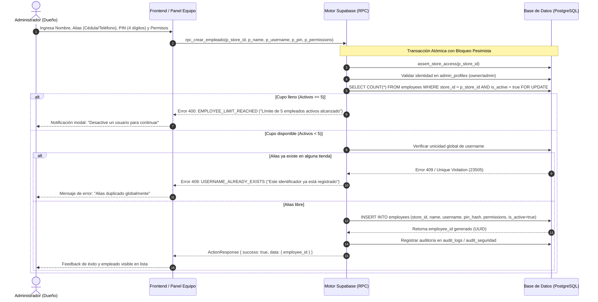
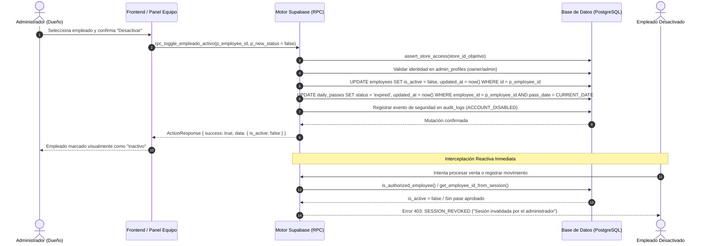
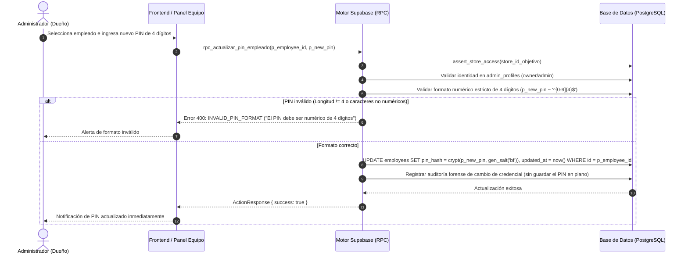
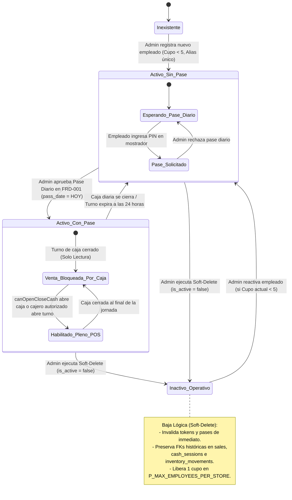
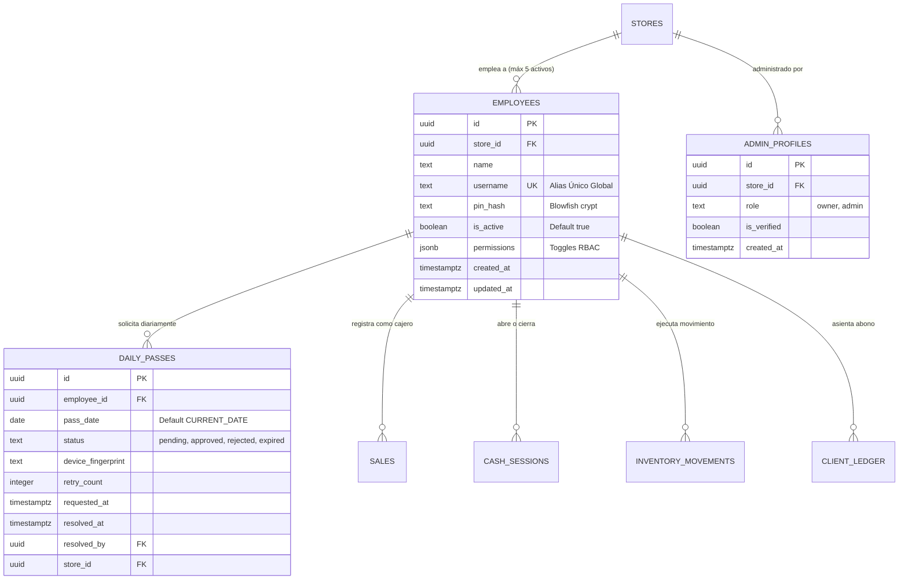

# SDD-003: Gestión de Empleados y Permisos

> **Módulo:** Personal / Seguridad / RBAC Operativo  
> **Versión:** 2.0 (PAC-SDD v2.0 — Cero Código Fuente, Estructura Canónica 0–7)  
> **Fase del Plan:** 🌊 Ola 5: Sesiones, Autenticación y Offline (Ítem 1)  
> **Estado:** 🟢 Aprobado y Certificado en BD (Migración Ola 5 Aplicada con Evidencia)
> **Asociado a:** [FRD-003](../FRD/FRD_003_GESTION_EMPLEADOS.md)
> **Última Actualización:** 2026-10-17
> **FRD Asociado:** [FRD-003: Gestión de Empleados y Permisos](../FRD/FRD_003_GESTION_EMPLEADOS.md)  
> **Fecha de Certificación:** 2026-10-17  

---

## 0. Contexto y Restricciones Aplicables

### 0.1 Políticas Globales Activadas (ARQ-002)

| Política | Nombre de la Política | Aplicación Específica en este SDD |
| :--- | :--- | :--- |
| **POL-AUTH-01** | Aislamiento Multi-tenant Estricto | Todo RPC administrativo de empleados (`crear_empleado`, `toggle_empleado_activo`, `actualizar_pin_empleado`, `rpc_obtener_empleados`) DEBE ejecutar `assert_store_access(p_store_id)` como su **instrucción #1**. A nivel de base de datos, la tabla `employees` está blindada mediante políticas RLS gobernadas por `store_id = get_current_store_id()`. |
| **POL-SEC-01** | Seguridad RBAC en Servidor | La creación, edición, reseteo de PIN y conmutación de estado de empleados están reservadas exclusivamente a identidades con rol administrativo en `admin_profiles` (`owner` o `admin`). El personal operativo (`employees`) carece de facultades administrativas y de auto-gestión de permisos. |
| **POL-SEC-02** | Cero Confianza Diaria (Zero Trust Daily) | La posesión de un PIN y un registro en `employees` NO confiere acceso operativo por sí sola. Todo empleado operativo DEBE obtener diariamente un Pase Diario aprobado (`daily_passes` con `pass_date = CURRENT_DATE` y `status = 'approved'`) mediante `is_authorized_employee()`. |
| **POL-SEG-03** | Control de Acceso Granular por Toggles | El acceso a operaciones privilegiadas se controla estrictamente mediante banderas booleanas independientes en el campo `permissions` (JSONB) del perfil. Prohibidas las jerarquías implícitas o escalamientos no autorizados. |
| **SPEC-006** | Erradicación del PIN de Caja Secundario | Se erradica cualquier requerimiento de un segundo PIN para operar la caja. La apertura y cierre de caja se gobierna exclusivamente por el permiso `canOpenCloseCash` y el PIN personal de 4 dígitos del empleado. |
| **POL-AUD-01** | Inviolabilidad Contable y Soft-Delete | Prohibición absoluta de eliminación física (`DELETE`) sobre registros de `employees`. La baja de personal es estrictamente lógica (`is_active = false`), preservando la integridad referencial en `sales.employee_id`, `cash_sessions.opened_by`, `inventory_movements.created_by` y `client_ledger.created_by`. |

### 0.2 Contratos Vecinos que Delimitan este SDD

- **`SDD_001_SEGURIDAD_DIARIA.md` (Pase Diario Zero Trust):** Subordina la vigencia operativa diaria del empleado a un pase aprobado en `daily_passes`. Al conmutar `is_active = false`, se revoca de inmediato cualquier pase diario activo.
- **`SDD_002_REGISTRO_ADMIN.md` / `SDD_002_1_CAMBIO_CONTRASENA.md`:** Delimita la autoridad jerárquica del dueño/administrador (`admin_profiles`), quien es el único actor autorizado para dar de alta, desactivar o modificar credenciales de empleados.
- **`SDD_004_CONTROL_DE_CAJA.md` / `SDD_020_CAJA_MULTICANAL.md`:** Gobierna la interacción con el turno de caja. Si el empleado tiene el toggle `canOpenCloseCash = true`, puede invocar `abrir_caja` y `cerrar_caja`. Si el turno de caja está cerrado, la capacidad de venta se degrada a "Solo Lectura".
- **`SDD_006_NUCLEO_INVENTARIO_PADRE.md` / `SDD_006_01_01_MOVIMIENTOS_ENTRADA.md` / `SDD_006_02_GESTOR_REEMBOLSOS.md`:** Requiere `canManageInventory = true` para crear productos, registrar entradas de mercancía o emitir reembolsos, y `canViewInventory = true` para consultar stock. Registra la autoría en `inventory_movements.created_by`.
- **`SDD_007_NUCLEO_VENTAS_PADRE.md` / `SDD_007_01_NUCLEO_POS.md` / `SDD_007_02_TICKET_DE_VENTA.md`:** Asigna de forma inmutable `sales.employee_id = get_employee_id_from_session()` en cada venta procesada (`rpc_procesar_venta_v3`) e imprime la identificación del cajero en el comprobante fiscal.
- **`SDD_009_CLIENTES.md` / `SDD_024_POLITICA_FIADOS.md`:** Requiere el toggle `canFiar = true` para habilitar el método de pago a crédito en el POS. Asienta la autoría de recaudos en `client_ledger.created_by`.
- **`SDD_018_CONTROL_OPERACIONAL.md` / `SDD_027_01_REPORTES_CAJA.md`:** El toggle `canViewReports = true` faculta la visualización del reporte ciego del turno activo. En `SDD_018`, el Pilar 4 analiza la productividad, ticket promedio, descuadres y anulaciones filtrando opcionalmente por `p_employee_id`.
- **`SDD_005_AUDITORIA_TRAZABILIDAD.md`:** Inviolabilidad contable y auditoría forense de mutaciones de perfil y seguridad (`audit_logs`, `audit_seguridad`).

---

### 0.3 Auditoría de BD contra Realidad (Deudas Técnicas Cerradas en Ola 5)

| ID | Hallazgo / Componente | Estado en BD Real | Evidencia de Cierre en Ola 5 |
| :--- | :--- | :--- | :--- |
| **D-1** | Filtros y Búsqueda en Directorio (`rpc_obtener_empleados` - H14) | 🟢 Resuelto | Implementado y verificado en `20261017134000_wave5_daily_security_devices_and_employees.sql` con máscara segura de PIN (`pin = ''`). |
| **D-2** | Revocación Reactiva al Desactivar (`toggle_empleado_activo`) | 🟢 Resuelto | Al conmutar `is_active = false`, actualiza atómicamente `daily_passes.status = 'rejected'` para pases aprobados del día actual. |
| **D-3** | Unicidad Global de `username` | 🟢 Resuelto | Verificado con constraint `employees_username_key` y validación en `crear_empleado`. |
| **D-4** | **Tope de Personal incluye al Propietario (`crear_empleado` / `toggle_empleado_activo`).** | 🟡 Deuda Formalizada (Ola 6) | `FRD_003` (RN-7) y `FRD_013` (RN-013-02) fijan `1 Admin + 5 Empleados Operativos`. En la BD física, el dueño tiene un registro en `employees` (`owner_*`), por lo que el conteo sin filtrar reduce el cupo a 4 empleados. En la migración Ola 6 se agregará `AND NOT EXISTS (SELECT 1 FROM public.admin_profiles ap WHERE ap.id = employees.id)`. |

---

## 1. Glosario Local

- **Alias Numérico (`username`):** Identificador alfanumérico o numérico (cédula o teléfono) que identifica unívocamente al empleado a nivel global en todo el sistema multi-tienda. Respaldado por el constraint físico `employees_username_key` (`UNIQUE (username)`).
- **PIN Operativo:** Código numérico confidencial de exactamente 4 dígitos gestionado por el Administrador. Se persiste exclusivamente como huella criptográfica unidireccional Blowfish (`pin_hash`) mediante `crypt(p_pin, gen_salt('bf'))`.
- **Pase Diario (`daily_pass`):** Credencial temporal vinculada a `employees.id` requerida cada día para desbloquear el Punto de Venta bajo el principio Zero Trust (`POL-SEC-02`).
- **Baja Lógica (Soft-Delete):** Mecanismo de revocación de acceso mediante la mutación de estado `is_active = false`. Inhabilita la autenticación e invalida sesiones vivas sin destruir las referencias foráneas transaccionales.
- **Límite de Equipo (`P_MAX_EMPLOYEES_PER_STORE`):** Parámetro de gobernanza que restringe a un máximo de 5 empleados operativos activos simultáneos por tienda (excluyendo el perfil del propietario en `admin_profiles`), evaluado a nivel de motor de base de datos (`1 Admin + 5 Empleados`).
- **Toggles de Permisos (`permissions`):** Documento JSONB estructurado que contiene banderas booleanas independientes (`canManageInventory`, `canViewInventory`, `canFiar`, `canOpenCloseCash`, `canViewReports`) según `POL-SEG-03`.
- **Degradación por Caja Cerrada:** Restricción operacional en la cual un empleado activo con pase diario ve bloqueada la capacidad de cobro en el POS mientras no exista una sesión de caja abierta en la tienda.

---

## 2. Diagramas de Secuencia (UML - Mermaid)

### 2.1 Alta de Nuevo Empleado con Validación de Cupo y Unicidad Global



### 2.2 Desactivación Lógica (Soft-Delete) y Revocación Inmediata de Sesiones



### 2.3 Restablecimiento Administrativo de PIN Operativo



---

## 3. Diagrama de Estados

### Ciclo de Vida del Perfil de Empleado y Sesión Operativa



---

## 4. Especificación Detallada de Casos de Uso

### 4.1 Caso A: Alta de Empleado (RN-1, RN-2, RN-3, RN-7)
- **Actor Principal:** Administrador (`admin_profiles` con rol `owner` o `admin`).
- **Precondiciones:**
  1. El Administrador cuenta con sesión autenticada activa.
  2. La tienda objetivo tiene estrictamente menos de 5 empleados operativos activos (`COUNT(*) WHERE store_id = p_store_id AND is_active = true AND NOT EXISTS (SELECT 1 FROM admin_profiles ap WHERE ap.id = employees.id) < 5`).
- **Flujo Principal:**
  1. El Administrador accede al panel de equipo y pulsa "Nuevo Empleado".
  2. El servidor valida la disponibilidad de cupo mediante bloqueo transaccional.
  3. El Administrador diligencia: Nombre completo, Alias numérico (cédula o teléfono), PIN inicial de 4 dígitos y configura los toggles de permisos (`permissions`).
  4. El cliente envía la solicitud al endpoint `crear_empleado`.
  5. El servidor valida la regla de multi-tenant `assert_store_access(p_store_id)`.
  6. El servidor valida el formato numérico estricto del PIN (4 dígitos enteros).
  7. El servidor evalúa la unicidad global del `username` en toda la tabla `employees`.
  8. El servidor calcula el hash seguro `crypt(p_pin, gen_salt('bf'))`.
  9. El servidor asienta el registro con `is_active = true` y retorna el UUID asignado.
  10. Se emite traza de auditoría en `audit_logs` con `event_type = 'EMPLOYEE_CREATED'`.
- **Flujos de Excepción:**
  - *Excepción 4.1.A (Límite alcanzado):* Si hay 5 empleados operativos activos, el servidor aborta con excepción `EMPLOYEE_LIMIT_REACHED` (código HTTP 400). La interfaz instruye al dueño a desactivar un empleado previo.
  - *Excepción 4.1.B (Alias duplicado globalmente):* Si el alias ya existe en cualquier establecimiento del sistema, Postgres aborta por violación de constraint `employees_username_key` (código HTTP 409: `USERNAME_ALREADY_EXISTS`).
  - *Excepción 4.1.C (PIN no numérico o longitud errónea):* Aborta con `INVALID_PIN_FORMAT`.
- **Postcondiciones:** Registro creado, cupo incrementado en 1 y empleado habilitado para solicitar Pase Diario.

### 4.2 Caso B: Restablecimiento Administrativo de PIN (RN-3)
- **Actor Principal:** Administrador.
- **Precondiciones:** El empleado objetivo existe en la base de datos y pertenece a la tienda del administrador.
- **Flujo Principal:**
  1. El Administrador localiza al empleado en la nómina de la tienda y selecciona "Restablecer PIN".
  2. El Administrador digita el nuevo PIN de 4 dígitos numéricos y confirma.
  3. El endpoint valida `assert_store_access(store_id)` y rol de administrador.
  4. El servidor actualiza `pin_hash` con la nueva huella Blowfish y refresca `updated_at`.
  5. Se registra auditoría en `audit_logs` con `event_type = 'PIN_RESET'`.
- **Postcondiciones:** El PIN antiguo queda revocado inmediatamente; el empleado puede operar con su nueva clave a partir del siguiente intento.

### 4.3 Caso C: Desactivación Reactiva / Soft-Delete (RN-6)
- **Actor Principal:** Administrador.
- **Precondiciones:** El empleado objetivo existe con `is_active = true`.
- **Flujo Principal:**
  1. El Administrador selecciona "Desactivar Empleado".
  2. El sistema despliega advertencia de revocación inmediata de acceso.
  3. Al confirmar, el servidor invoca `toggle_empleado_activo(p_employee_id, false)`.
  4. El backend conmuta `is_active = false` y actualiza `updated_at = now()`.
  5. El backend expira de forma atómica los pases diarios vigentes del empleado en `daily_passes`.
  6. Las sesiones vivas asociadas son repudiadas inmediatamente por los interceptores de seguridad.
- **Postcondiciones:** El empleado queda bloqueado en servidor; las referencias históricas en ventas y caja permanecen inmutables; se libera 1 cupo en `P_MAX_EMPLOYEES_PER_STORE`.

### 4.4 Caso D: Reactivación de Empleado Inactivo (RN-7)
- **Actor Principal:** Administrador.
- **Precondiciones:** El empleado tiene `is_active = false`.
- **Flujo Principal:**
  1. El Administrador activa el filtro "Ver Inactivos" y pulsa "Reactivar".
  2. El servidor evalúa que el cupo actual de empleados operativos activos sea menor a 5 (excluyendo al dueño en `admin_profiles`).
  3. Si hay cupo, conmuta `is_active = true`.
- **Flujo de Excepción:**
  - Si la tienda ya alcanzó los 5 empleados operativos activos, aborta con `LIMIT_REACHED`.
- **Postcondiciones:** Empleado reactivado sin requerir reconfigurar permisos históricos.

### 4.5 Caso E: Consulta y Navegación del Directorio de Personal (RN-8)
- **Actor Principal:** Administrador.
- **Flujo Principal:**
  1. El Administrador accede a la vista de equipo.
  2. El frontend consulta `rpc_obtener_empleados` con `p_include_inactive = false` por defecto.
  3. El servidor retorna la lista de empleados activos paginada `{ data, count }`.
  4. Si el Administrador activa el switch "Incluir Inactivos", se remite `p_include_inactive = true`.
  5. Si ingresa texto en la barra de búsqueda, el servidor filtra por coincidencia parcial insensible a mayúsculas en `name` o `username`.
- **Postcondiciones:** Visualización filtrada con distinción gráfica (badge y atenuación) de perfiles inactivos.

---

## 5. Contrato de Interfaz (Payloads y Errores)

En estricto apego al Contrato de Interfaz Global, todas las mutaciones retornan `ActionResponse` y las consultas de listado retornan `{ data, count }`.

### 5.1 Endpoint de Creación: `crear_empleado`

#### JSON Schema de Entrada (`crear_empleado_input.json`)
```json
{
  "$schema": "https://json-schema.org/draft/2020-12/schema",
  "title": "CrearEmpleadoInput",
  "type": "object",
  "required": ["p_store_id", "p_name", "p_username", "p_pin"],
  "properties": {
    "p_store_id": {
      "type": "string",
      "format": "uuid",
      "description": "Identificador de la tienda propietaria"
    },
    "p_name": {
      "type": "string",
      "minLength": 2,
      "maxLength": 100,
      "description": "Nombre completo del empleado"
    },
    "p_username": {
      "type": "string",
      "minLength": 3,
      "maxLength": 30,
      "pattern": "^[a-zA-Z0-9_-]+$",
      "description": "Alias numérico o de identificación único global"
    },
    "p_pin": {
      "type": "string",
      "pattern": "^[0-9]{4}$",
      "description": "PIN numérico secreto de exactamente 4 dígitos"
    },
    "p_permissions": {
      "type": "object",
      "properties": {
        "canManageInventory": { "type": "boolean", "default": false },
        "canViewInventory": { "type": "boolean", "default": false },
        "canFiar": { "type": "boolean", "default": false },
        "canOpenCloseCash": { "type": "boolean", "default": false },
        "canViewReports": { "type": "boolean", "default": false }
      },
      "additionalProperties": false,
      "description": "Matriz de permisos granulares RBAC (POL-SEG-03)"
    }
  },
  "additionalProperties": false
}
```

#### JSON Schema de Salida (`crear_empleado_output.json`)
```json
{
  "$schema": "https://json-schema.org/draft/2020-12/schema",
  "title": "CrearEmpleadoOutput",
  "type": "object",
  "required": ["success"],
  "properties": {
    "success": { "type": "boolean" },
    "data": {
      "type": "object",
      "required": ["employee_id"],
      "properties": {
        "employee_id": { "type": "string", "format": "uuid" }
      },
      "additionalProperties": false
    },
    "error": { "type": "string" },
    "code": {
      "type": "string",
      "enum": [
        "EMPLOYEE_LIMIT_REACHED",
        "USERNAME_ALREADY_EXISTS",
        "INVALID_PIN_FORMAT",
        "STORE_ACCESS_DENIED",
        "UNAUTHORIZED"
      ]
    }
  },
  "additionalProperties": false
}
```

---

### 5.2 Endpoint de Conmutación de Estado: `toggle_empleado_activo`

#### JSON Schema de Entrada (`toggle_empleado_input.json`)
```json
{
  "$schema": "https://json-schema.org/draft/2020-12/schema",
  "title": "ToggleEmpleadoInput",
  "type": "object",
  "required": ["p_employee_id", "p_new_status"],
  "properties": {
    "p_employee_id": {
      "type": "string",
      "format": "uuid",
      "description": "Identificador del empleado a conmutar"
    },
    "p_new_status": {
      "type": "boolean",
      "description": "true para reactivar, false para baja lógica (Soft-Delete)"
    }
  },
  "additionalProperties": false
}
```

#### JSON Schema de Salida (`toggle_empleado_output.json`)
```json
{
  "$schema": "https://json-schema.org/draft/2020-12/schema",
  "title": "ToggleEmpleadoOutput",
  "type": "object",
  "required": ["success"],
  "properties": {
    "success": { "type": "boolean" },
    "data": {
      "type": "object",
      "required": ["new_status"],
      "properties": {
        "new_status": { "type": "boolean" }
      },
      "additionalProperties": false
    },
    "error": { "type": "string" },
    "code": {
      "type": "string",
      "enum": [
        "EMPLOYEE_NOT_FOUND",
        "LIMIT_REACHED",
        "STORE_ACCESS_DENIED",
        "UNAUTHORIZED"
      ]
    }
  },
  "additionalProperties": false
}
```

---

### 5.3 Endpoint de Restablecimiento de PIN: `actualizar_pin_empleado`

#### JSON Schema de Entrada (`actualizar_pin_input.json`)
```json
{
  "$schema": "https://json-schema.org/draft/2020-12/schema",
  "title": "ActualizarPinInput",
  "type": "object",
  "required": ["p_employee_id", "p_new_pin"],
  "properties": {
    "p_employee_id": {
      "type": "string",
      "format": "uuid",
      "description": "Identificador del empleado objetivo"
    },
    "p_new_pin": {
      "type": "string",
      "pattern": "^[0-9]{4}$",
      "description": "Nuevo PIN numérico de exactamente 4 dígitos"
    }
  },
  "additionalProperties": false
}
```

#### JSON Schema de Salida (`actualizar_pin_output.json`)
```json
{
  "$schema": "https://json-schema.org/draft/2020-12/schema",
  "title": "ActualizarPinOutput",
  "type": "object",
  "required": ["success"],
  "properties": {
    "success": { "type": "boolean" },
    "error": { "type": "string" },
    "code": {
      "type": "string",
      "enum": [
        "EMPLOYEE_NOT_FOUND",
        "INVALID_PIN_FORMAT",
        "STORE_ACCESS_DENIED",
        "UNAUTHORIZED"
      ]
    }
  },
  "additionalProperties": false
}
```

---

### 5.4 Endpoint de Consulta y Listado: `rpc_obtener_empleados`

#### JSON Schema de Entrada (`obtener_empleados_input.json`)
```json
{
  "$schema": "https://json-schema.org/draft/2020-12/schema",
  "title": "ObtenerEmpleadosInput",
  "type": "object",
  "required": ["p_store_id"],
  "properties": {
    "p_store_id": {
      "type": "string",
      "format": "uuid",
      "description": "Identificador de la tienda"
    },
    "p_include_inactive": {
      "type": "boolean",
      "default": false,
      "description": "Si es false, excluye empleados desactivados; si es true, incluye activos e inactivos"
    },
    "p_search": {
      "type": ["string", "null"],
      "default": null,
      "description": "Texto de búsqueda parcial insensible a mayúsculas sobre name o username"
    },
    "p_limit": {
      "type": "integer",
      "minimum": 1,
      "maximum": 100,
      "default": 20,
      "description": "Límite de registros por página"
    },
    "p_offset": {
      "type": "integer",
      "minimum": 0,
      "default": 0,
      "description": "Desplazamiento para paginación progresiva"
    }
  },
  "additionalProperties": false
}
```

#### JSON Schema de Salida (`obtener_empleados_output.json`)
```json
{
  "$schema": "https://json-schema.org/draft/2020-12/schema",
  "title": "ObtenerEmpleadosOutput",
  "type": "object",
  "required": ["data", "count"],
  "properties": {
    "data": {
      "type": "array",
      "items": {
        "type": "object",
        "required": [
          "id",
          "name",
          "username",
          "is_active",
          "permissions",
          "created_at"
        ],
        "properties": {
          "id": { "type": "string", "format": "uuid" },
          "name": { "type": "string" },
          "username": { "type": "string" },
          "is_active": { "type": "boolean" },
          "permissions": {
            "type": "object",
            "properties": {
              "canManageInventory": { "type": "boolean" },
              "canViewInventory": { "type": "boolean" },
              "canFiar": { "type": "boolean" },
              "canOpenCloseCash": { "type": "boolean" },
              "canViewReports": { "type": "boolean" }
            },
            "additionalProperties": false
          },
          "created_at": { "type": "string", "format": "date-time" },
          "updated_at": { "type": "string", "format": "date-time" }
        },
        "additionalProperties": false
      }
    },
    "count": {
      "type": "integer",
      "minimum": 0,
      "description": "Total de registros coincidentes para paginación"
    }
  },
  "additionalProperties": false
}
```

---

## 6. Análisis de Seguridad y Resiliencia

### 6.1 Matriz de Amenazas y Mitigaciones Específicas

| Amenaza / Vector | Severidad | Mitigación Técnica en Servidor |
| :--- | :---: | :--- |
| **Bypass de Tenant por URL Spoofing** | Crítica | Todo RPC ejecuta `assert_store_access(p_store_id)` en la línea 1. RLS en `employees` rechaza cualquier lectura o mutación cruzada (`store_id = get_current_store_id()`). |
| **Sobregiro de Licencias (Cupo > 5)** | Alta | Bloqueo pesimista transaccional (`FOR UPDATE`) en `crear_empleado` y `toggle_empleado_activo`. La evaluación `COUNT(*) >= 5` es server-side e invulnerable a manipulaciones en el cliente. |
| **Colisión de Alias Multi-tienda** | Alta | Constraint físico `employees_username_key` (`UNIQUE (username)`) a nivel global en Postgres. Impide que dos tiendas registren la misma cédula o teléfono. |
| **Filtración o Reversión de PIN** | Crítica | El secreto se hashea con Blowfish unidireccional (`gen_salt('bf')`). Ni administradores ni consultas PostgREST exponen el hash en respuestas al cliente. El PIN nunca se guarda en plano. |
| **Uso de Cuenta Desactivada en Sesiones Vivas** | Crítica | La baja lógica (`is_active = false`) revoca atómicamente pases en `daily_passes`. Interceptores de autenticación (`is_authorized_employee()`) rechazan cualquier petición concurrente posterior a la desactivación. |
| **Pérdida de Trazabilidad por Borrado Físico** | Crítica | Ausencia total de políticas RLS `DELETE` sobre `employees`. El motor rechaza borrados destructivos, protegiendo las referencias históricas en ventas y comprobantes contables. |
| **Elevación No Autorizada de Privilegios** | Alta | La edición de permisos exige rol verificado en `admin_profiles`. Un empleado carece de permisos de mutación sobre su propia fila en `employees`. |

---

## 7. Modelo de Datos Lógico y Deudas Técnicas

### 7.1 Esquema Relacional de Entidades del Dominio



### 7.2 Formalización de Deudas Técnicas y Trade-offs (Regla 7)

En cumplimiento riguroso de la **Regla 7 de AGENTS.md**, se formalizan explícitamente los N=6 trade-offs y deudas técnicas del módulo:

#### 1. D-1 (H-1): Reconciliación de Nomenclatura Alias Numérico vs `username`
- **Qué se decidió:** Adoptar formalmente la columna física real `username` (tipo `text`) respaldada por el constraint `employees_username_key` (`UNIQUE (username)`) para representar el "Alias numérico (cédula o teléfono)".
- **Por qué (Trade-off):** Satisface la regla de negocio funcional de unicidad global de FRD-003 sin ejecutar una migración de renombramiento (`RENAME COLUMN`) que rompería las 22 funciones en `pg_proc` que ya consumen `username`.
- **Condición de revisión futura:** Permanente / Invariante físico del esquema de base de datos.

#### 2. D-2 (H-2): Estandarización de Permisos Granulares (POL-SEG-03 / `permissions` JSONB)
- **Qué se decidió:** Consolidar las 5 llaves canónicas en camelCase (`canManageInventory`, `canViewInventory`, `canFiar`, `canOpenCloseCash`, `canViewReports`) dentro de la columna física `permissions` (JSONB) con estructura plana y valores booleanos por defecto `false`.
- **Por qué (Trade-off):** Otorga extensibilidad horizontal para incorporar futuros permisos funcionales sin requerir alteraciones DDL en la tabla `employees`, garantizando compatibilidad inmediata con la interfaz Vue.
- **Condición de revisión futura:** Si el volumen transaccional de auditoría requiere indexación especializada por permiso, evaluar migración a columnas booleanas nativas en la versión 3.0.

#### 3. D-3 (H-3): Reutilización Obligatoria de `assert_store_access(p_store_id)` en RPCs Administrativos (Regla 4)
- **Qué se decidió:** Estandarizar la invocación de `PERFORM public.assert_store_access(p_store_id);` como instrucción #1 obligatoria en `crear_empleado`, `toggle_empleado_activo` y `actualizar_pin_empleado`.
- **Por qué (Trade-off):** Erradica las comparaciones manuales ad-hoc (`v_store_id != public.get_current_store_id()`) del código legacy, garantizando cumplimiento estricto de la Regla 4 y unificación de errores multi-tenant (`STORE_ACCESS_DENIED`).
- **Condición de revisión futura:** Despliegue de la migración de consolidación PL/pgSQL en la Ola 5.

#### 4. D-4 (H-4): Desacoplamiento Definitivo del PIN de Caja (SPEC-006)
- **Qué se decidió:** Erradicar cualquier requerimiento de PIN de caja secundario en los flujos de `abrir_caja` y `cerrar_caja`; la autorización se supedita estrictamente a la existencia del toggle `canOpenCloseCash = true` en el perfil y al PIN personal del empleado.
- **Por qué (Trade-off):** Elimina la sobrecarga de fricción operativa en el Punto de Venta donde el cajero debía recordar múltiples claves, centralizando el secreto en una única credencial personal auditada.
- **Condición de revisión futura:** Permanente / Invariante arquitectural de seguridad operativa.

#### 5. D-5 (H-5): Regularización de Privilegios Base en Tablas del Dominio de Empleados (Regla 8)
- **Qué se decidió:** Ejecutar y verificar `GRANT ALL ON TABLE public.employees, public.daily_passes, public.stores, public.admin_profiles TO service_role;` y `GRANT SELECT ON TABLE ... TO authenticated;`.
- **Por qué (Trade-off):** Erradica riesgos de error 42501 (Permission Denied) para procesos backend, sincronizaciones automáticas y pipelines de prueba, manteniendo la seguridad confinada a las políticas RLS.
- **Condición de revisión futura:** Verificado en producción física y de carácter permanente.

#### 6. D-6 (H-6): Estandarización de Contrato de Navegación `{ data, count }` (`rpc_obtener_empleados`)
- **Qué se decidió:** Formalizar la signatura de lectura de personal retornando la estructura `{ data: [...], count: N }` con soporte de parámetros de filtrado `p_include_inactive` y `p_search`.
- **Por qué (Trade-off):** Da cumplimiento irrestricto a la Regla Global 4.1 de payloads de lectura y satisface plenamente los requerimientos de navegación visual (RN-8 y CA-7/CA-8).
- **Condición de revisión futura:** Permanente / Invariante del Contrato de Interfaz Frontend-Backend.
