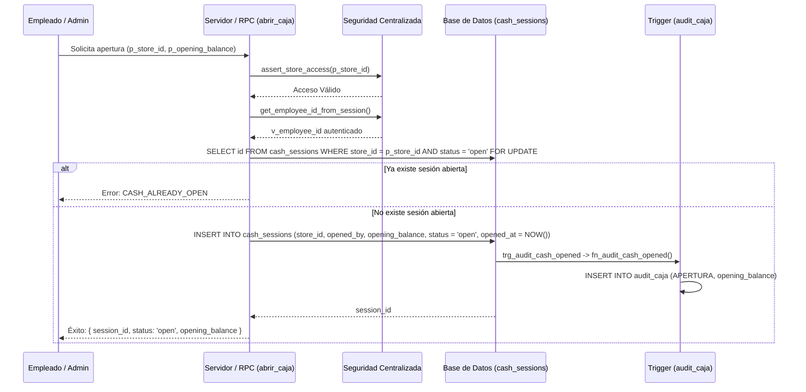
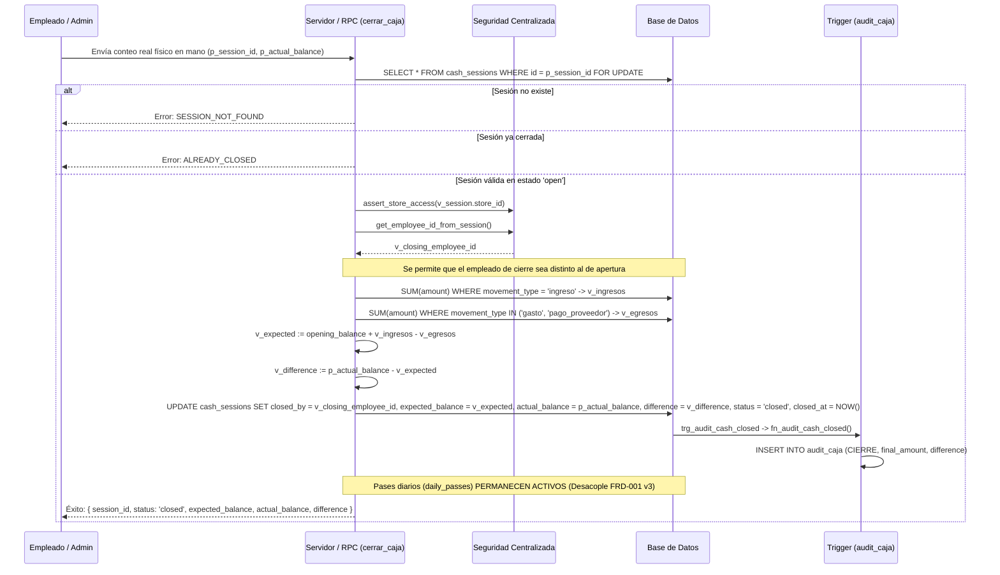
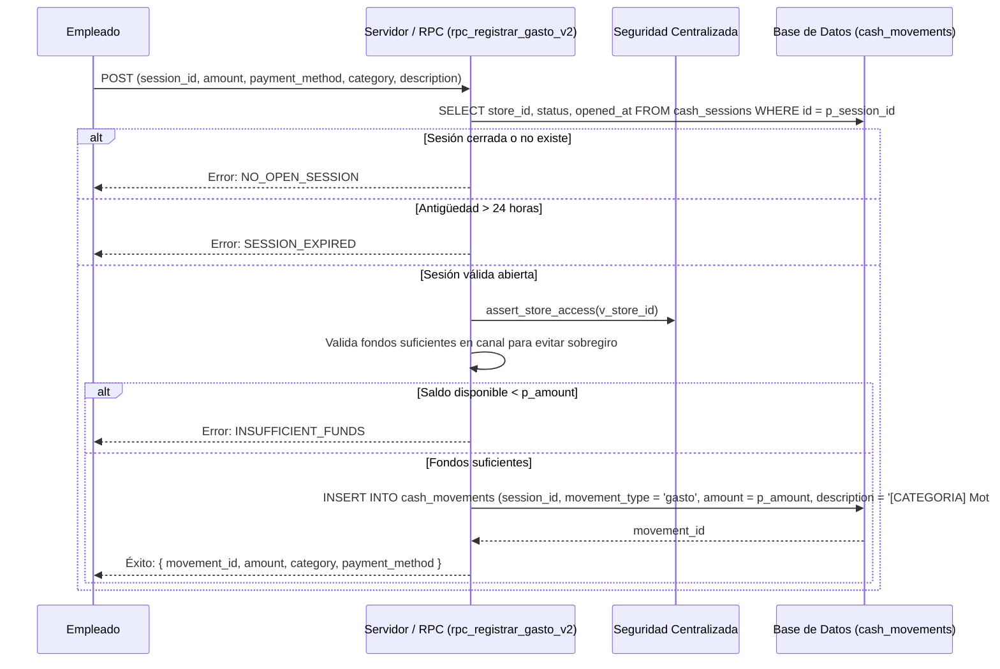
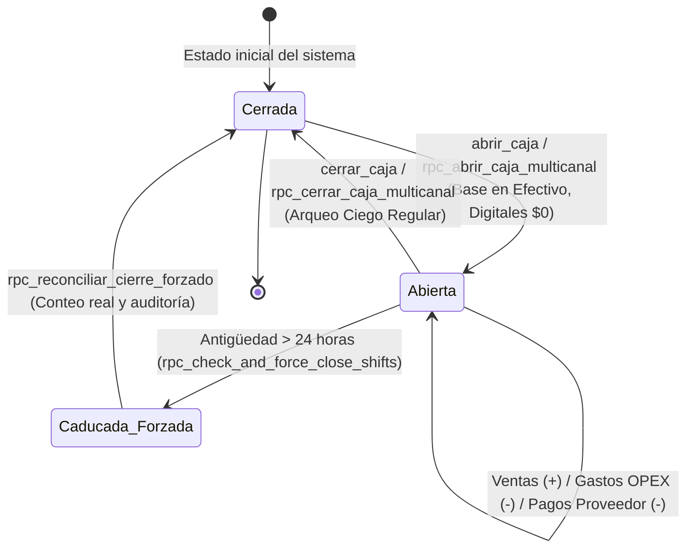
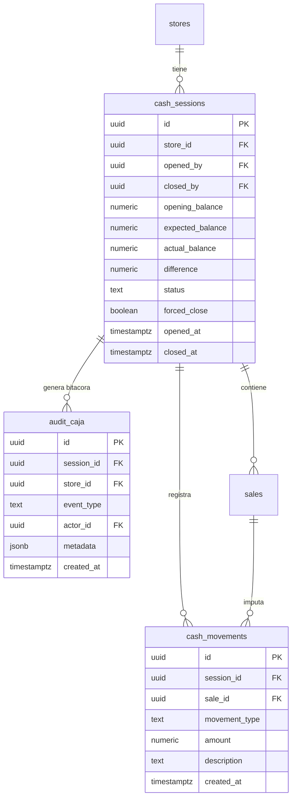

# SDD-004: Control Operativo de Caja (Sesiones Multicanal)

> **Asociado a:** [FRD-004](../FRD/FRD_004_CONTROL_DE_CAJA.md) (Versión 2.2 — Parche de alineación con FRD-001 v3)  
> **Fase del Plan:** Ola 1 — Cimientos de Caja y Gastos  
> **Estado:** 🟠 Aprobado con Deuda Técnica Documentada (PAC-SDD Completo 2026-10-12)  
> **Última Actualización:** 2026-10-12  

---

## 0. Contexto y Restricciones Aplicables

### 0.1 Políticas Globales Activadas (ARQ-002)
| Política ID | Dominio | Impacto Concreto en este SDD |
|-------------|---------|------------------------------|
| **POL-FIN-01** | Financiero | **Solidez de Caja (Liquidez Real):** La caja solo reconoce dinero físicamente presente en gaveta o confirmado en canal digital. Saldo esperado = Base Inicial + Entradas - Salidas. Queda prohibido el registro de gastos si la caja está cerrada o si el canal no cuenta con fondos suficientes. |
| **POL-FIN-02** | Financiero | **Segregación de Canales Monetarios:** Prohibición estricta de compensar faltantes de efectivo con sobrantes digitales. La base inicial de apertura se asigna exclusivamente al canal EFECTIVO. Canales digitales inician automáticamente cada turno en $0. |
| **POL-SEG-01** | Seguridad | **Arqueo Ciego Obligatorio:** El servidor no revela el saldo esperado antes de que el usuario envíe su declaración física y digital contada en mano. |
| **POL-AUD-01** | Auditoría | **Inmutabilidad de Turnos y Movimientos:** Todo movimiento asentado es definitivo (`append-only`). No se permite edición ni borrado; solo contra-movimientos compensatorios. |
| **POL-AUTH-01** | Seguridad | **Erradicación del PIN de Caja (Decisión D-01):** Todo control se valida mediante el token de sesión JWT, la función centralizada `assert_store_access` y la resolución de identidad con `get_employee_id_from_session()`. |
| **SPEC-010 / 011** | Financiero | **Conservación Numérica y Redondeo:** Manejo estricto de montos en pesos colombianos como enteros en tipo `NUMERIC`, sin tipos de coma flotante (`float`/`double`). Redondeo híbrido al múltiplo de $50 más cercano en ventas. |

### 0.2 Contratos Vecinos que Limitan el Diseño
| SDD Origen | Restricción Inyectada | Impacto en el Control de Caja |
|------------|-----------------------|-------------------------------|
| **SDD_001 (Seguridad Diaria)** | Desacople de Pase Diario y Caja (FRD-001 v3 / FRD-004 v2.2). | El cierre de caja **NO** expira los pases diarios (`daily_passes`). Solo bloquea operaciones transaccionales monetarias. Los empleados pueden permanecer en el sistema en modo lectura. |
| **SDD_020 (Caja Multicanal)** | Estructura multicanal de balances y dualidad operativa. | Regula la arquitectura multicanal por balances segregados (`rpc_abrir_caja_multicanal`, `rpc_cerrar_caja_multicanal`). Las operaciones escalares de este SDD (`abrir_caja`, `cerrar_caja`) actúan como capa de compatibilidad física directa en producción. |
| **SDD_007 / 007_01 (Ventas y POS)** | Bloqueo estricto del POS y contrapartidas contables. | El backend rechaza cualquier venta si `cash_sessions` no cuenta con una sesión en estado `OPEN` para la tienda. Las ventas en efectivo inyectan automáticamente contrapartidas de tipo `'ingreso'` en `cash_movements`. |
| **SDD_022 / 026 (Gastos OPEX)** | Inmediatez absoluta y categorización obligatoria. | El registro de gastos exige sesión abierta no caducada (< 24h), selecciona una categoría de las 6 del catálogo OPEX y valida liquidez en el canal seleccionado para evitar sobregiros. |
| **SDD_019 (Cuentas por Pagar)** | Pagos a proveedores en efectivo. | La operación `rpc_pay_supplier_invoice` inyecta egresos de tipo `'pago_proveedor'` en `cash_movements`, los cuales deben ser computados obligatoriamente en la conciliación del turno. |

### 0.3 Auditoría de BD contra Realidad (Deuda Técnica Declarada bajo Regla 7)
*Evidencia cruda obtenida de Supabase Producción (`ihtjocmhzuliwwvdzfnz`) mediante consultas a `information_schema` y `pg_proc`:*

```sql
-- Columnas reales en cash_sessions:
-- id (uuid), store_id (uuid), opened_by (uuid), closed_by (uuid), opening_balance (numeric),
-- expected_balance (numeric), actual_balance (numeric), difference (numeric),
-- status (text), opened_at (timestamptz), closed_at (timestamptz), forced_close (boolean)

-- Columnas reales en cash_movements:
-- id (uuid), session_id (uuid), movement_type (text), amount (numeric), 
-- description (text, NOT NULL), sale_id (uuid), created_at (timestamptz)

-- Constraint real en cash_movements:
-- CHECK (movement_type = ANY (ARRAY['ingreso', 'gasto', 'pago_proveedor']))
-- CHECK (amount > 0)
```

| # | Hallazgo / Componente | Brecha Real Detectada | Solución Normativa y Trade-off (Regla 7) | Condición de Revisión Futura |
|---|-----------------------|-----------------------|------------------------------------------|------------------------------|
| **H-1** | 🔴 **Ausencia de tabla `cash_session_balances`** | En producción no existe la tabla `cash_session_balances` ni la columna `payment_method` en `cash_movements`. La base almacena balances monolíticos. | **Decisión:** Mantener la compatibilidad con el esquema físico actual mediante las funciones escalares `abrir_caja` y `cerrar_caja`, proyectando el estándar multicanal de `SDD_020` como modelo destino. | Despliegue formal de la migración `20260727000000_multichannel_schema.sql` en producción. |
| **H-2** | 🔴 **Trigger anacrónico de revocación de pases** | Existe activado en BD el trigger `trg_expire_passes_on_cash_close` que ejecuta `expire_daily_passes()`, expirando pases en `daily_passes` al cerrar caja. | **Decisión:** Desacoplar normativamente el cierre de caja de los pases según FRD-001 v3. Registrar la eliminación del trigger como deuda técnica crítica de base de datos. | Ejecución de migración DDL: `DROP TRIGGER IF EXISTS trg_expire_passes_on_cash_close ON public.cash_sessions;`. |
| **H-3** | 🔴 **Columnas `payment_method` y `category` ausentes** | `cash_movements` no posee columnas para canal ni categoría OPEX en la base física. Solo dispone de `description (text NOT NULL)`. | **Decisión:** Parche transitorio: los RPCs exigen `p_category` obligatorio y lo concatenan en `description` como `[CATEGORIA] Motivo`. Los canales de venta se auditan vía join con `sales.payment_method`. | Migración DDL agregando `payment_method TEXT` y `category TEXT` a `cash_movements`. |
| **H-4** | 🟡 **Nulabilidad estricta de `description`** | En BD real, `cash_movements.description` tiene restricción `is_nullable = 'NO'`. En borradores preliminares figuraba como opcional. | **Decisión:** Rectificar el contrato y diccionario de datos: `description` es estrictamente obligatoria (longitud mínima 3 caracteres). | Resuelto en esta especificación. |
| **H-5** | 🔴 **Omisión de `pago_proveedor` en egresos legacy** | Las funciones legacy `cerrar_caja` y `get_history_caja` en BD calculan egresos filtrando únicamente `movement_type = 'gasto'`, ignorando `'pago_proveedor'`. | **Decisión:** Armonizar la especificación del cálculo de saldo esperado a: `opening_balance + ingresos - (gastos + pagos_proveedor)` para evitar falsos sobrantes al cerrar. | Despliegue del parche SQL que actualice `cerrar_caja` y `get_history_caja` en producción. |
| **H-6** | 🔴 **Seguridad ausente en RPCs legacy de BD** | Las funciones `abrir_caja` y `cerrar_caja` existentes en producción no ejecutan `assert_store_access`. | **Decisión:** Este SDD prescribe la incorporación obligatoria de `PERFORM assert_store_access(p_store_id)` como instrucción #1. | Despliegue de las nuevas versiones securizadas de RPCs. |
| **H-7** | 🟡 **Fórmula invertida en legacy** | La función `cerrar_caja` en producción calcula `difference := expected - actual`. | **Decisión:** Estandarizar al criterio contable universal `difference := actual - expected` (positivo = sobrante, negativo = faltante). | Despliegue de la refactorización de `cerrar_caja`. |

---

## 1. Glosario Local

- **Sesión de Caja (`cash_sessions`):** Intervalo de tiempo transaccional delimitado entre una apertura y un cierre para una tienda específica.
- **Turno Activo:** Sesión en estado `open` con antigüedad menor a 24 horas.
- **Arqueo Ciego:** Mecanismo de control donde el usuario reporta el dinero real contado en mano sin conocer previamente el cálculo del saldo esperado generado por el servidor.
- **Base de Apertura (Fondo de Cambio):** Monto inicial en efectivo físico colocado en la gaveta. Se asigna exclusivamente al canal Efectivo.
- **Categoría OPEX:** Clasificación contable del gasto operativo (`Servicios`, `Nomina`, `Transporte`, `Mantenimiento`, `Insumos`, `Reembolso`).
- **Bitácora Forense de Caja (`audit_caja`):** Registro inmutable generado automáticamente por triggers (`fn_audit_cash_opened`, `fn_audit_cash_closed`) que asienta marcas forenses de apertura y cierre con metadatos de saldos.
- **Turno Olvidado / Caducado:** Sesión de caja abierta cuya antigüedad supera las 24 horas (`opened_at < NOW() - INTERVAL '24 hours'`), requiriendo cierre forzado antes de permitir nuevas ventas.

---

## 2. Diagramas de Secuencia

### 2.1 Flujo de Apertura de Turno Regular


### 2.2 Flujo de Cierre de Turno y Arqueo Ciego


### 2.3 Flujo de Registro de Gasto OPEX Inmediato


### 2.4 Flujo de Caducidad y Reconciliación Forzada (> 24 Horas)
```mermaid
sequenceDiagram
    participant Cron as Tarea de Sistema / Cron
    participant Admin as Administrador
    participant S as Servidor / RPCs
    participant DB as cash_sessions

    Cron->>S: rpc_check_and_force_close_shifts()
    S->>DB: SELECT id FROM cash_sessions WHERE status = 'open' AND opened_at < NOW() - INTERVAL '24h'
    S->>DB: UPDATE cash_sessions SET status = 'closed', forced_close = true, closed_at = NOW()
    Note over S,DB: Bloqueo de POS activado para la tienda
    Admin->>S: Inicia jornada y detecta alerta de turno caducado
    Admin->>S: rpc_reconciliar_cierre_forzado(p_session_id, p_actual_balance)
    S->>S: assert_store_access(store_id)
    S->>DB: UPDATE cash_sessions SET actual_balance = p_actual_balance, difference = p_actual_balance - expected_balance
    S-->>Admin: Turno regularizado; habilitada la apertura de un nuevo turno
```

---

## 3. Diagramas de Estado



---

## 4. Especificación Detallada de Casos de Uso (Conforme a FRD-004)

### Caso A: Apertura de Turno Regular
- **Actor:** Administrador o empleado con permiso para abrir y cerrar caja (`permissions->>'canOpenCloseCash' = 'true'`).
- **Precondición:** Caja cerrada para la tienda, pase diario aprobado (`daily_passes.status = 'approved'`).
- **Flujo Principal:**
  1. El usuario ingresa al módulo de control de caja.
  2. El sistema verifica permisos y confirma que no existe otra sesión abierta para la tienda.
  3. Muestra la interfaz de "Apertura de Turno".
  4. El usuario ingresa el monto base de efectivo (fondo de cambio físico en gaveta). Este monto se asigna al canal EFECTIVO. Los canales digitales (Nequi, Llave BRE) inician automáticamente con base $0.
  5. El usuario confirma la apertura.
  6. El sistema crea la sesión con estado `open`, registra marca forense en `audit_caja` y habilita el terminal POS.
- **Flujo Alternativo:** Si ya existe un turno abierto, el sistema rechaza la operación con código `CASH_ALREADY_OPEN`.
- **Postcondición:** Turno activo registrado; operaciones de venta habilitadas.

### Caso B: Cierre de Turno y Arqueo Ciego
- **Actor:** Administrador o empleado con permiso para abrir y cerrar caja. El sistema acepta que este empleado sea distinto al empleado que abrió la sesión.
- **Precondición:** Turno de caja en estado `open`.
- **Flujo Principal:**
  1. El usuario selecciona la acción "Cerrar Turno".
  2. El sistema solicita el conteo de dinero físico (Arqueo Ciego), sin revelar el saldo esperado.
  3. El usuario realiza el conteo físico e ingresa el dinero real que tiene en mano.
  4. El usuario pulsa "Confirmar Cierre".
  5. El sistema cierra la sesión, calcula el saldo esperado (`Base + Ingresos - Egresos`), calcula la diferencia (`actual - expected`) y sella la sesión con estado `closed`.
  6. El sistema genera el registro forense en `audit_caja`.
- **Flujo Alternativo:** Si la sesión ya fue cerrada previamente, el sistema rechaza con código `ALREADY_CLOSED`.
- **Postcondición:** Caja cerrada, operaciones monetarias y POS bloqueados. Los pases diarios del personal permanecen vigentes sin alteración de expiración según FRD-001 v3.

### Caso C: Registro de Gasto OPEX Inmediato
- **Actor:** Empleado con sesión activa en el sistema.
- **Precondición:** Turno de caja en estado `open` con antigüedad menor a 24 horas.
- **Flujo Principal:**
  1. El usuario desembolsa dinero de la gaveta o canal digital para cubrir una necesidad operativa.
  2. Ingresa a la interfaz de gastos operativos.
  3. Digita el monto, selecciona el canal de egreso, selecciona la categoría OPEX y añade una descripción descriptiva obligatoria (>= 3 caracteres).
  4. El sistema valida fondos suficientes en el canal para evitar sobregiro, registra el egreso en `cash_movements` con tipo `'gasto'` y reduce el saldo esperado inmediatamente.
- **Flujo Alternativo:** Fondos insuficientes en el canal seleccionado. El servidor aborta con código `INSUFFICIENT_FUNDS`.
- **Postcondición:** Movimiento inmutable registrado; saldo esperado actualizado en tiempo real.

### Caso D: Recuperación de Turno Olvidado (> 24 Horas)
- **Actor:** Administrador o empleado al iniciar jornada laboral.
- **Precondición:** Existe un turno abierto con antigüedad superior a 24 horas (`opened_at < NOW() - INTERVAL '24 hours'`).
- **Flujo Principal:**
  1. El usuario inicia sesión en la tienda.
  2. El sistema detecta que el turno anterior no fue cerrado y superó el límite de 24 horas.
  3. Muestra una alerta bloqueante: "Turno anterior no cerrado".
  4. El sistema redirige forzosamente a la pantalla de Cierre de Caja y bloquea el POS.
  5. El usuario realiza el conteo del dinero actual (real).
  6. El usuario confirma el cierre forzado mediante `rpc_reconciliar_cierre_forzado`.
  7. El sistema cierra y regulariza el turno caducado registrando `forced_close = true`.
  8. El sistema libera el bloqueo y permite la apertura de un nuevo turno para el día corriente.
- **Flujo Alternativo:** Ninguno.
- **Postcondición:** Turno caducado archivado; sistema listo para operar normalmente.

---

## 5. Contrato de Interfaz

### 5.1 Operación Escalar: `abrir_caja` (Capa de Compatibilidad Física)
- **Tipo:** RPC Postgres / Acción (WRITE)
- **Entradas:**
  ```json
  {
    "p_store_id": "UUID (Obligatorio)",
    "p_opening_balance": "NUMERIC >= 0 (Obligatorio, asignado a Efectivo)"
  }
  ```
- **Salida Exitosa:**
  ```json
  {
    "success": true,
    "session_id": "UUID",
    "status": "open",
    "opening_balance": 50000.00
  }
  ```
- **Catálogo de Errores:**
  | Código de Error | Causa | Mensaje Técnico |
  |-----------------|-------|-----------------|
  | `STORE_ACCESS_DENIED` | Usuario no pertenece a la tienda | El usuario no tiene acceso a esta tienda |
  | `CASH_ALREADY_OPEN` | Ya existe una caja abierta para la tienda | Ya existe una caja abierta |
  | `INVALID_OPENING_AMOUNT` | Monto negativo | El valor de apertura debe ser mayor o igual a cero |
  | `UNAUTHORIZED` | Empleado sin permiso de caja ni admin | Usuario no autorizado para operar caja |

### 5.2 Operación Escalar: `cerrar_caja` (Capa de Compatibilidad Física)
- **Tipo:** RPC Postgres / Acción (WRITE)
- **Entradas:**
  ```json
  {
    "p_session_id": "UUID (Obligatorio)",
    "p_actual_balance": "NUMERIC >= 0 (Obligatorio, dinero real contado en mano)"
  }
  ```
- **Salida Exitosa:**
  ```json
  {
    "success": true,
    "expected_balance": 150000.00,
    "actual_balance": 148000.00,
    "difference": -2000.00
  }
  ```
- **Catálogo de Errores:**
  | Código de Error | Causa | Mensaje Técnico |
  |-----------------|-------|-----------------|
  | `STORE_ACCESS_DENIED` | Usuario no pertenece a la tienda | El usuario no tiene acceso a esta tienda |
  | `SESSION_NOT_FOUND` | `session_id` inexistente | Sesión no encontrada |
  | `ALREADY_CLOSED` | La sesión ya fue cerrada previamente | La caja ya está cerrada |
  | `INVALID_BALANCE` | Monto real reportado es negativo | El balance real no puede ser negativo |
  | `UNAUTHORIZED` | Usuario sin permisos de cierre | Usuario no autorizado para cerrar caja |

### 5.3 Operación: `rpc_registrar_gasto_v2`
- **Tipo:** RPC Postgres / Acción (WRITE)
- **Entradas:**
  ```json
  {
    "p_session_id": "UUID (Obligatorio)",
    "p_amount": "NUMERIC > 0 (Obligatorio)",
    "p_payment_method": "TEXT (Obligatorio: 'efectivo', 'nequi', 'llave_bre')",
    "p_category": "TEXT (Obligatorio: 'Servicios', 'Nomina', 'Transporte', 'Mantenimiento', 'Insumos', 'Reembolso')",
    "p_description": "TEXT (Obligatorio, longitud >= 3)"
  }
  ```
- **Salida Exitosa:**
  ```json
  {
    "success": true,
    "data": {
      "movement_id": "UUID",
      "amount": 25000.00,
      "category": "Servicios",
      "payment_method": "efectivo",
      "created_at": "TIMESTAMPTZ"
    }
  }
  ```
- **Catálogo de Errores (Armonizado con SDD_022 y SDD_026):**
  | Código de Error | Causa | Mensaje Técnico |
  |-----------------|-------|-----------------|
  | `STORE_ACCESS_DENIED` | Usuario no pertenece a la tienda | Permisos insuficientes |
  | `NO_OPEN_SESSION` | Sesión no existe o cerrada | No existe una sesión de caja activa |
  | `SESSION_EXPIRED` | Antigüedad mayor a 24 horas | El turno actual está caducado; debe cerrarse antes de operar |
  | `INSUFFICIENT_FUNDS` | Saldo menor al monto en canal | Fondos insuficientes en el canal seleccionado |
  | `INVALID_OPEX_CATEGORY` | Categoría fuera del catálogo | Categoría de gasto no permitida |
  | `EMPTY_DESCRIPTION` | Motivo menor a 3 caracteres | Debe ingresar una descripción con al menos 3 caracteres |
  | `INVALID_AMOUNT` | Monto menor o igual a cero | El monto del gasto debe ser estrictamente positivo |

### 5.4 Dualidad Normativa Multicanal (SDD_020)
Cuando la migración multicanal `20260727000000_multichannel_schema.sql` esté aplicada en producción, las operaciones de apertura y cierre escalares son sucedidas por las operaciones granulares definidas en `SDD_020`:
- `rpc_abrir_caja_multicanal(p_store_id, p_opening_cash)`
- `rpc_cerrar_caja_multicanal(p_session_id, p_balances: [{ payment_method, actual_amount }])`

---

## 6. Análisis de Seguridad

- **Funciones Centralizadas de Autorización:**
  Toda mutación de caja invoca obligatoriamente:
  ```sql
  PERFORM public.assert_store_access(v_store_id);
  ```
- **Resolución Autorizada de Empleado (Anti-Suplantación):**
  Para evitar que un cajero suplante a otro pasando un ID de empleado adulterado, el usuario responsable de la apertura, cierre o gasto se resuelve con autoridad de servidor:
  ```sql
  v_employee_id := public.get_employee_id_from_session();
  IF v_employee_id IS NULL AND EXISTS (SELECT 1 FROM public.admin_profiles WHERE id = auth.uid()) THEN
      v_employee_id := auth.uid();
  END IF;
  ```
- **Políticas RLS Estandarizadas:**
  Las consultas directas sobre `cash_sessions`, `cash_movements` y `audit_caja` emplean `store_id = public.get_current_store_id()`.
- **Bloqueo RLS de Escritura Directa:**
  Las tablas `cash_sessions` y `cash_movements` prohíben `INSERT`/`UPDATE` directo desde clientes PostgREST anónimos o no autorizados; toda alteración transaccional se ejecuta mediante RPCs `SECURITY DEFINER`.
- **Bitácora Forense Automática:**
  Los triggers `trg_audit_cash_opened` y `trg_audit_cash_closed` asientan copias inmutables de los eventos en `audit_caja`.

---

## 7. Modelo de Datos Lógico



### Diccionario de Campos Verificados en Base de Datos Real
| Tabla | Columna | Tipo Físico | Nullable | Verificado en BD | Descripción |
|-------|---------|-------------|----------|------------------|-------------|
| `cash_sessions` | `id` | UUID | NO | ✅ Sí | Identificador único de la sesión |
| `cash_sessions` | `store_id` | UUID | NO | ✅ Sí | Tienda propietaria de la sesión |
| `cash_sessions` | `opened_by` | UUID | NO | ✅ Sí | Empleado o Admin que abrió el turno |
| `cash_sessions` | `closed_by` | UUID | SÍ | ✅ Sí | Empleado o Admin que cerró el turno |
| `cash_sessions` | `opening_balance` | NUMERIC | NO | ✅ Sí | Base inicial en Efectivo |
| `cash_sessions` | `expected_balance` | NUMERIC | SÍ | ✅ Sí | Saldo calculado por el sistema al cierre |
| `cash_sessions` | `actual_balance` | NUMERIC | SÍ | ✅ Sí | Dinero físico contado y declarado |
| `cash_sessions` | `difference` | NUMERIC | SÍ | ✅ Sí | Descuadre (`actual - expected`) |
| `cash_sessions` | `status` | TEXT | NO | ✅ Sí | Estado: `'open'` o `'closed'` |
| `cash_sessions` | `opened_at` | TIMESTAMPTZ | NO | ✅ Sí | Marca de tiempo de apertura |
| `cash_sessions` | `closed_at` | TIMESTAMPTZ | SÍ | ✅ Sí | Marca de tiempo de cierre |
| `cash_sessions` | `forced_close` | BOOLEAN | NO | ✅ Sí | Indicador de cierre forzado (> 24h) |
| `cash_movements` | `id` | UUID | NO | ✅ Sí | Identificador único del movimiento |
| `cash_movements` | `session_id` | UUID | NO | ✅ Sí | Sesión de caja vinculada |
| `cash_movements` | `movement_type` | TEXT | NO | ✅ Sí | Tipo (`'ingreso'`, `'gasto'`, `'pago_proveedor'`) |
| `cash_movements` | `amount` | NUMERIC | NO | ✅ Sí | Monto positivo de la transacción |
| `cash_movements` | `description` | TEXT | NO | ✅ Sí | Motivo y categoría (`[CATEGORIA] Motivo`) |
| `cash_movements` | `sale_id` | UUID | SÍ | ✅ Sí | Referencia a venta vinculada (si aplica) |
| `cash_movements` | `created_at` | TIMESTAMPTZ | NO | ✅ Sí | Marca de tiempo del registro |
| `audit_caja` | `id` | UUID | NO | ✅ Sí | Identificador único del evento forense |
| `audit_caja` | `session_id` | UUID | NO | ✅ Sí | Sesión de caja vinculada |
| `audit_caja` | `store_id` | UUID | NO | ✅ Sí | Tienda propietaria |
| `audit_caja` | `event_type` | TEXT | NO | ✅ Sí | Evento: `'APERTURA'` o `'CIERRE'` |
| `audit_caja` | `actor_id` | UUID | NO | ✅ Sí | Usuario autor del evento |
| `audit_caja` | `metadata` | JSONB | NO | ✅ Sí | Metadatos de saldos y diferencias |
| `audit_caja` | `created_at` | TIMESTAMPTZ | NO | ✅ Sí | Marca de tiempo forense inmutable |
