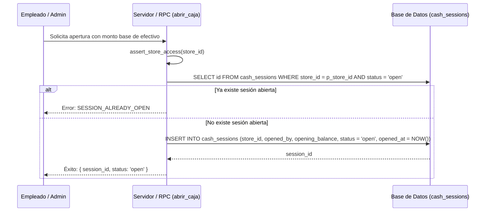
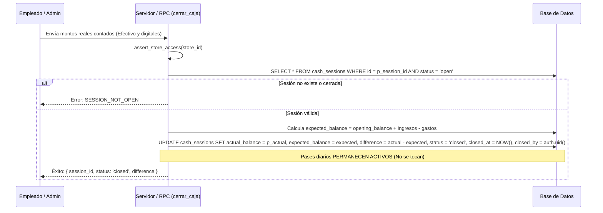
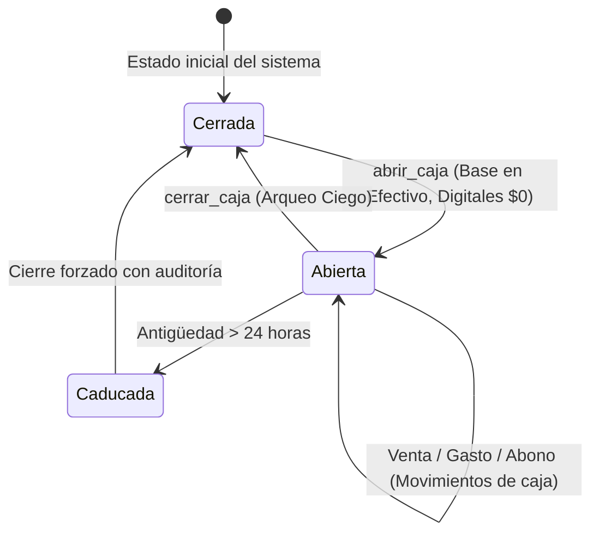
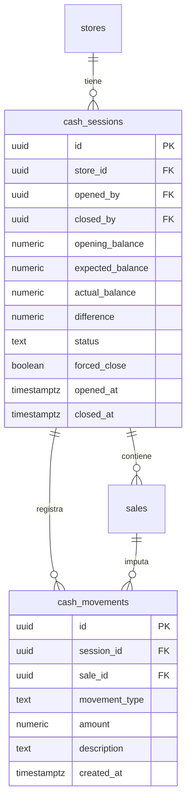

# SDD-004: Control Operativo de Caja (Sesiones Multicanal)

> **Asociado a:** [FRD-004](../FRD/FRD_004_CONTROL_DE_CAJA.md)  
> **Fase del Plan:** Ola 1 — Cimientos de Caja y Gastos  
> **Estado:** 🟡 Validado Localmente (Post Alineación v1.5.8)  
> **Última Actualización:** 2026-10-11  

---

## 0. Contexto y Restricciones Aplicables

### 0.1 Políticas Globales Activadas (ARQ-002)
| Política ID | Dominio | Impacto Concreto en este SDD |
|-------------|---------|------------------------------|
| **POL-FIN-01** | Financiero | **Solidez de Caja (Liquidez Real):** La caja solo reconoce dinero físicamente presente o confirmado en canal digital. Saldo esperado = Base Inicial + Entradas - Salidas. |
| **POL-FIN-02** | Financiero | **Segregación de Canales:** Prohibición estricta de compensar faltantes de efectivo con sobrantes digitales. La base inicial de apertura se asigna exclusivamente al canal EFECTIVO. Canales digitales inician automáticamente en $0. |
| **POL-SEG-01** | Seguridad | **Arqueo Ciego Obligatorio:** El servidor no revela el saldo esperado antes de que el usuario envíe su declaración física y digital. |
| **POL-AUD-01** | Auditoría | **Inmutabilidad de Turnos y Movimientos:** Todo movimiento asentado es definitivo. No se permite edición ni borrado; solo contra-movimientos compensatorios. |
| **POL-AUTH-01** | Seguridad | **Erradicación del PIN de Caja:** Todo control se valida mediante el token de sesión y la función centralizada `assert_store_access`. |

### 0.2 Contratos Vecinos que Limitan el Diseño
| SDD Origen | Restricción Inyectada | Impacto en el Control de Caja |
|------------|-----------------------|-------------------------------|
| **SDD_001 (Seguridad Diaria)** | Desacople de Pase Diario y Caja (FRD-001 v3). | El cierre de caja **NO** expira los pases diarios (`daily_passes`). Solo bloquea operaciones transaccionales monetarias. |
| **SDD_020 (Caja Multicanal)** | Estructura multicanal de balances. | La apertura y cierre operan a nivel de canal. La base declarada va a Efectivo; digitales en 0. |
| **SDD_007 (Ventas y POS)** | Bloqueo estricto del POS. | El backend rechaza cualquier venta si `cash_sessions` no cuenta con una sesión en estado `OPEN` para la tienda. |
| **SDD_026 (Gastos Inmediatos)** | Categorización OPEX obligatoria. | El registro de gastos exige seleccionar una categoría válida y tener fondos disponibles en el canal seleccionado. |

### 0.3 Auditoría de BD contra Realidad (Deuda Técnica Declarada)
*Evidencia cruda obtenida de Supabase Producción (`ihtjocmhzuliwwvdzfnz`):*

```sql
-- Columnas reales en cash_sessions:
-- id (uuid), store_id (uuid), opened_by (uuid), closed_by (uuid), opening_balance (numeric),
-- expected_balance (numeric), actual_balance (numeric), difference (numeric),
-- opened_at (timestamptz), closed_at (timestamptz), status (text), forced_close (boolean)

-- Columnas reales en cash_movements:
-- id (uuid), session_id (uuid), sale_id (uuid), movement_type (text), amount (numeric), description (text), created_at (timestamptz)

-- Constraint real:
-- cash_movements_movement_type_check: CHECK (movement_type = ANY (ARRAY['ingreso', 'gasto', 'pago_proveedor']))
```

| Hallazgo / Componente | Brecha Real Detectada | Solución Normativa y Trade-off | Condición de Revisión |
|-----------------------|-----------------------|---------------------------------|-----------------------|
| 🔴 **Esquema Multicanal no Migrado en BD** | En producción no existe la tabla `cash_session_balances` ni la columna `payment_method` en `cash_movements`. La base almacena balances monolíticos. | **Decisión:** Mantener el diseño normativo multicanal en este SDD. El backend opera actualmente sobre `cash_sessions` monolítico como fallback de compatibilidad. | Ejecución formal de la migración `20260727000000_multichannel_schema.sql` en producción. |
| 🔴 **Desacople de Pases Diarios** | Versiones antiguas del SDD proponían `UPDATE daily_passes SET expires_at = NOW()` al cerrar caja. | **Decisión:** Eliminada toda revocación de pases en el cierre de caja. El cierre solo actualiza `cash_sessions.status = 'closed'`. | Ninguna (Resuelto en este SDD según FRD-001 v3). |
| 🔴 **Categoría OPEX en Movimientos** | `cash_movements` no posee columna `category` en producción. Los gastos solo tienen `description`. | **Decisión:** Se define el parámetro obligatorio `p_category` en el contrato RPC de gastos. Hasta que exista columna dedicada, se concatena temporalmente en el texto de `description` como `[CATEGORIA] Motivo`. | Migración de adición de columna `category` a `cash_movements`. |

---

## 1. Glosario Local

- **Sesión de Caja (`cash_sessions`):** Intervalo de tiempo transaccional delimitado entre una apertura y un cierre para una tienda específica.
- **Turno Activo:** Sesión en estado `OPEN` con antigüedad menor a 24 horas.
- **Arqueo Ciego:** Mecanismo de control donde el usuario reporta el dinero real sin conocer el cálculo del saldo esperado generado por el servidor.
- **Base de Apertura (Fondo de Cambio):** Monto inicial en efectivo físico colocado en la gaveta. Se asigna exclusivamente al canal Efectivo.
- **Categoría OPEX:** Clasificación contable del gasto operativo (Servicios, Nómina, Transporte, Mantenimiento, Insumos, Reembolso).

---

## 2. Diagramas de Secuencia

### 2.1 Flujo de Apertura de Turno


### 2.2 Flujo de Cierre de Turno (Arqueo Ciego)


---

## 3. Diagramas de Estado



---

## 4. Especificación Detallada de Casos de Uso

### Caso A: Apertura de Turno Regular
- **Actor:** Administrador o empleado con permiso `canOpenCloseCash`.
- **Precondición:** No existe turno abierto para la tienda. Pase diario aprobado si es empleado.
- **Flujo Principal:**
  1. El usuario envía la solicitud de apertura declarando el fondo de cambio físico.
  2. El servidor valida permisos mediante `assert_store_access`.
  3. El servidor confirma que no existan sesiones abiertas previas.
  4. El servidor asigna el monto base al canal Efectivo y $0 a los canales digitales.
  5. El servidor inserta la sesión con estado `open` y registra `opened_at` y `opened_by`.
- **Flujo Alternativo:** Si existe una sesión abierta, el servidor rechaza con código `SESSION_ALREADY_OPEN`.
- **Postcondición:** Turno activo registrado; operaciones de venta habilitadas.

### Caso B: Cierre de Turno y Arqueo Ciego
- **Actor:** Administrador o empleado con permiso `canOpenCloseCash`.
- **Precondición:** Turno de caja en estado `open`.
- **Flujo Principal:**
  1. El usuario declara el dinero físico contado en gaveta y los saldos digitales.
  2. El servidor valida acceso mediante `assert_store_access`.
  3. El servidor calcula el saldo esperado consolidado y por canal a partir de los movimientos registrados.
  4. El servidor calcula la diferencia (`actual - expected`) y sella la sesión con estado `closed`.
  5. Los pases diarios del personal permanecen intactos sin alteración de expiración.
- **Flujo Alternativo:** Si la sesión ya fue cerrada, el servidor retorna `SESSION_ALREADY_CLOSED`.
- **Postcondición:** Caja cerrada; transacciones monetarias y POS bloqueados hasta una nueva apertura.

### Caso C: Registro de Gasto OPEX Inmediato
- **Actor:** Empleado con sesión activa.
- **Precondición:** Turno de caja en estado `open` con antigüedad < 24 horas.
- **Flujo Principal:**
  1. El usuario envía monto, canal de egreso, categoría OPEX y motivo detallado.
  2. El servidor verifica que la caja esté abierta y no caducada.
  3. El servidor valida que el canal seleccionado tenga liquidez suficiente para evitar sobregiros.
  4. El servidor asienta el egreso en `cash_movements` con tipo `gasto`.
- **Flujo Alternativo:** Fondos insuficientes en el canal seleccionado. El servidor rechaza con código `INSUFFICIENT_FUNDS`.
- **Postcondición:** Saldo de caja reducido de forma inmediata; movimiento trazable en auditoría.

### Caso D: Detección y Cierre de Turno Olvidado (> 24 Horas)
- **Actor:** Administrador o empleado al iniciar jornada.
- **Precondición:** Sesión de caja abierta con `opened_at < NOW() - INTERVAL '24 hours'`.
- **Flujo Principal:**
  1. El sistema detecta que la sesión sobrepasó el límite de 24 horas.
  2. Se bloquea cualquier intento de venta con error `SESSION_EXPIRED_REQUIRE_CLOSE`.
  3. El usuario ejecuta el cierre forzado declarando el dinero actual.
  4. La sesión se sella con `forced_close = true`.
- **Postcondición:** Turno caducado liquidado; listo para apertura de un nuevo turno.

---

## 5. Contrato de Interfaz

### 5.1 Operación: `abrir_caja`
- **Tipo:** RPC Postgres / Acción (WRITE)
- **Entradas:**
  ```json
  {
    "p_store_id": "UUID (Obligatorio)",
    "p_opening_balance": "NUMERIC >= 0 (Obligatorio, asignado a Efectivo)"
  }
  ```
- **Salida Exitosa:**
  ```json
  {
    "success": true,
    "data": {
      "session_id": "UUID",
      "status": "open",
      "opened_at": "TIMESTAMPTZ"
    }
  }
  ```
- **Catálogo de Errores:**
  | Código de Error | Causa | Mensaje Técnico |
  |-----------------|-------|-----------------|
  | `STORE_ACCESS_DENIED` | Usuario no pertenece a la tienda | Permisos insuficientes |
  | `SESSION_ALREADY_OPEN` | Ya existe una sesión abierta | Existe una sesión activa para esta tienda |
  | `INVALID_AMOUNT` | Monto negativo o no numérico | El monto de apertura debe ser mayor o igual a cero |

### 5.2 Operación: `cerrar_caja`
- **Tipo:** RPC Postgres / Acción (WRITE)
- **Entradas:**
  ```json
  {
    "p_session_id": "UUID (Obligatorio)",
    "p_actual_balance": "NUMERIC >= 0 (Obligatorio, dinero real contado)"
  }
  ```
- **Salida Exitosa:**
  ```json
  {
    "success": true,
    "data": {
      "session_id": "UUID",
      "status": "closed",
      "expected_balance": 150000.00,
      "actual_balance": 148000.00,
      "difference": -2000.00,
      "closed_at": "TIMESTAMPTZ"
    }
  }
  ```
- **Catálogo de Errores:**
  | Código de Error | Causa | Mensaje Técnico |
  |-----------------|-------|-----------------|
  | `SESSION_NOT_FOUND` | `session_id` inválido | Sesión de caja no encontrada |
  | `SESSION_ALREADY_CLOSED` | La sesión ya está cerrada | La sesión ya fue cerrada previamente |
  | `STORE_ACCESS_DENIED` | Usuario no autorizado | Sin permisos para cerrar caja en esta tienda |

### 5.3 Operación: `rpc_registrar_gasto_v2`
- **Tipo:** RPC Postgres / Acción (WRITE)
- **Entradas:**
  ```json
  {
    "p_session_id": "UUID (Obligatorio)",
    "p_amount": "NUMERIC > 0 (Obligatorio)",
    "p_payment_method": "TEXT (Obligatorio: 'efectivo', 'nequi', 'llave_bre')",
    "p_category": "TEXT (Obligatorio: 'Servicios', 'Nomina', 'Transporte', 'Mantenimiento', 'Insumos', 'Reembolso')",
    "p_description": "TEXT (Obligatorio, longitud >= 3)"
  }
  ```
- **Salida Exitosa:**
  ```json
  {
    "success": true,
    "data": {
      "movement_id": "UUID",
      "amount": 25000.00,
      "category": "Servicios",
      "created_at": "TIMESTAMPTZ"
    }
  }
  ```
- **Catálogo de Errores:**
  | Código de Error | Causa | Mensaje Técnico |
  |-----------------|-------|-----------------|
  | `NO_OPEN_SESSION` | Sesión no existe o cerrada | No hay sesión de caja abierta para registrar el egreso |
  | `SESSION_EXPIRED` | Antigüedad mayor a 24 horas | El turno actual ha caducado; debe cerrarse antes de operar |
  | `INSUFFICIENT_FUNDS` | Saldo menor al monto en el canal | Fondos insuficientes en el canal seleccionado |
  | `INVALID_CATEGORY` | Categoría fuera del catálogo OPEX | Categoría de gasto no permitida |
  | `EMPTY_DESCRIPTION` | Motivo en blanco o < 3 caracteres | Debe especificarse un motivo descriptivo para el gasto |

---

## 6. Análisis de Seguridad

- **Funciones Centralizadas:**
  Toda operación de apertura, cierre y movimiento valida acceso mediante:
  ```sql
  PERFORM public.assert_store_access(v_store_id);
  ```
- **Rol y Privilegios:**
  Apertura y cierre exigen rol de Administrador (`admin_profiles`) o empleado con `permissions->>'canOpenCloseCash' = 'true'`.
- **Bloqueo RLS de Escritura Directa:**
  Las tablas `cash_sessions` y `cash_movements` prohíben `INSERT` directo desde clientes no privilegiados; toda alteración de liquidez se ejecuta obligatoriamente vía funciones RPC `SECURITY DEFINER` con validación transaccional.
- **Inmutabilidad de Auditoría:**
  Triggers automáticos `fn_audit_cash_opened` y `fn_audit_cash_closed` asientan copia forense de los eventos en `audit_caja`.

---

## 7. Modelo de Datos Lógico



### Diccionario de Campos de Caja
| Tabla | Columna | Tipo | Nullable | Verificado en BD | Descripción |
|-------|---------|------|----------|------------------|-------------|
| `cash_sessions` | `id` | UUID | NO | ✅ Sí | Identificador único de la sesión |
| `cash_sessions` | `store_id` | UUID | NO | ✅ Sí | Tienda propietaria de la sesión |
| `cash_sessions` | `opened_by` | UUID | NO | ✅ Sí | Empleado o Admin que abrió el turno |
| `cash_sessions` | `closed_by` | UUID | SÍ | ✅ Sí | Empleado o Admin que cerró el turno |
| `cash_sessions` | `opening_balance` | NUMERIC | NO | ✅ Sí | Base inicial en Efectivo |
| `cash_sessions` | `expected_balance` | NUMERIC | SÍ | ✅ Sí | Saldo calculado al cierre |
| `cash_sessions` | `actual_balance` | NUMERIC | SÍ | ✅ Sí | Dinero físico/digital declarado |
| `cash_sessions` | `difference` | NUMERIC | SÍ | ✅ Sí | Descuadre (`actual - expected`) |
| `cash_sessions` | `status` | TEXT | NO | ✅ Sí | Estado: `'open'` o `'closed'` |
| `cash_sessions` | `forced_close` | BOOLEAN | SÍ | ✅ Sí | `true` si fue cerrado por límite > 24h |
| `cash_movements` | `id` | UUID | NO | ✅ Sí | Identificador único del movimiento |
| `cash_movements` | `session_id` | UUID | NO | ✅ Sí | Sesión de caja vinculada |
| `cash_movements` | `movement_type` | TEXT | NO | ✅ Sí | Tipo (`'ingreso'`, `'gasto'`, `'pago_proveedor'`) |
| `cash_movements` | `amount` | NUMERIC | NO | ✅ Sí | Monto positivo de la transacción |
| `cash_movements` | `description` | TEXT | SÍ | ✅ Sí | Motivo y categoría (`[OPEX] Motivo`) |
| `cash_movements` | `sale_id` | UUID | SÍ | ✅ Sí | Referencia a venta (si aplica) |
