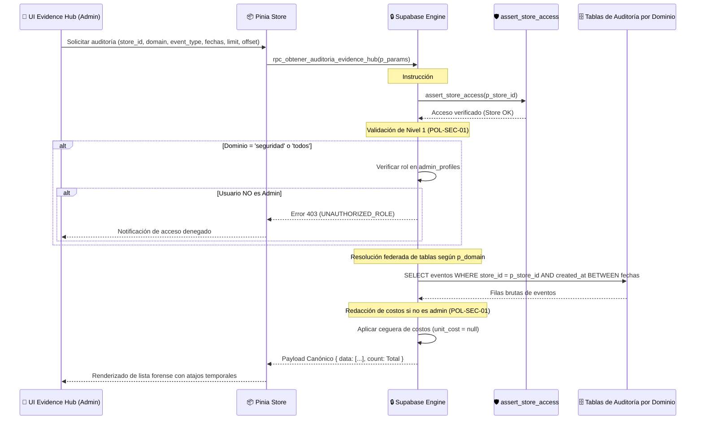
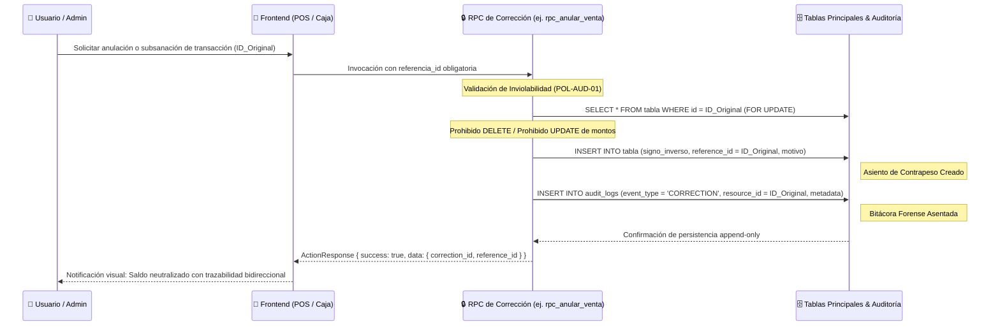
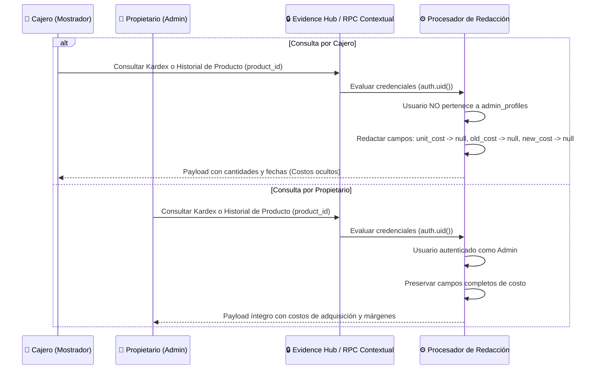
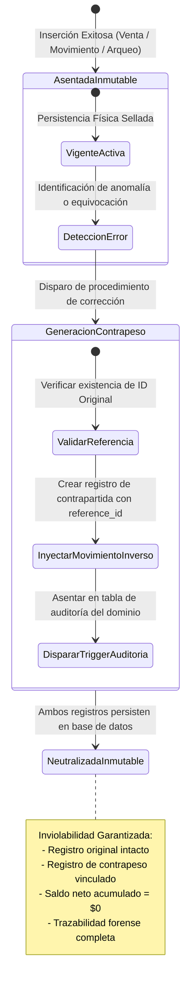
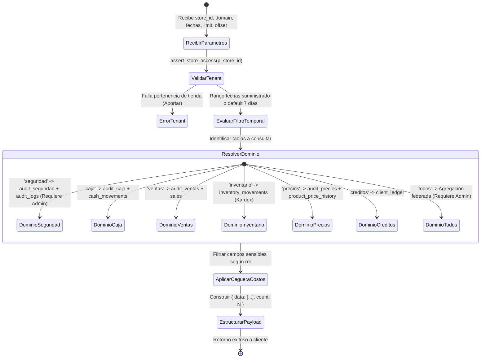
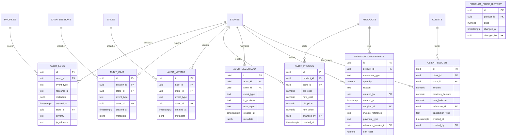

# SDD-005: Sistema de Auditoría, Evidence Hub e Inmutabilidad (Inviolabilidad Contable y Trazabilidad Forense)

> **Asociado a:** [FRD-005](../FRD/FRD_005_AUDITORIA_TRAZABILIDAD.md) y [FRD-005 (Inviolable)](../FRD/FRD_005_AUDITORIA_INVIOLABLE.md)  
> **Fase del Plan:** Ola 4: Reportes, Auditoría y Cuentas por Pagar (Ítem 3)  
> **Estado:** 🟢 Aprobado y Sanitizado (Protocolo PAC-SDD v2.0)  
> **Última Actualización:** 2026-10-16  

---

## 0. Alcance y Restricciones Aplicables (PEA-N)

### 0.1 Políticas Globales Activadas (ARQ-002)

| Política ID | Dominio | Impacto Concreto en este SDD |
| :--- | :--- | :--- |
| **POL-AUTH-01** | Multi-tenant | Aislamiento multi-tenant estricto. Invocación mandatoria de `assert_store_access(p_store_id)` como instrucción número uno incondicional en los RPCs de consulta del Evidence Hub (`rpc_obtener_auditoria_evidence_hub`), y aislamiento en base de datos mediante políticas RLS gobernadas por `get_current_store_id()` en todas las tablas de auditoría. |
| **POL-AUD-01** | Auditoría | Inviolabilidad Histórica e Inmutabilidad Contable. Prohibición taxativa de operaciones `UPDATE` o `DELETE` sobre registros financieros, libros mayores, kardex y tablas de auditoría. La base de datos aplica una política de Default-Deny en RLS para mutaciones destructivas. Toda corrección de errores se efectúa exclusivamente mediante movimientos de contrapeso (asientos inversos) con referencia foránea obligatoria al registro original. |
| **POL-AUD-02** | Auditoría | Evidence Hub Centralizado y Trazabilidad Completa. Centro unificado de inteligencia y auditoría federada multi-dominio (`caja`, `ventas`, `inventario`, `seguridad`, `precios`, `creditos`). Soporta filtrado temporal con atajos rápidos (Hoy, Ayer, 7 días, 30 días), ventana por defecto de 7 días, paginación canónica `{ data, count }` y expansión de metadatos forenses estructurados. |
| **POL-AUD-03** | Auditoría | Registro de Descuadres, Excepciones y Ruido Operativo. Toda anomalía de cuadre de caja (`CASH_DISCREPANCY`), venta forzada bajo excepción (`FORCE_SALE`), anulación de ticket o intento de sobregiro rechazado se asienta automáticamente con nivel de severidad `warning` en la bitácora forense. |
| **POL-FIN-01** | Finanzas | Fidelidad Contable y Separación de Flujos de Liquidez. Distinción inquebrantable entre el flujo de caja líquido y el devengo contable operacional. Las transacciones de contrapeso o anulaciones de cartera no distorsionan la liquidez física de caja cuando no medió egreso monetario real. |
| **POL-SEC-01** | Seguridad | Seguridad RBAC por Niveles y Ceguera de Costos. El Nivel 1 (Seguridad y Auditoría Forense) está restringido de forma exclusiva a usuarios con rol en `admin_profiles` (`admin` u `owner`). En los Niveles 2 y 3 (Operativo y Contextual), los cajeros y empleados sin privilegios de administración sufren redacción de costos a nivel de servidor (`null`), protegiendo la confidencialidad de márgenes comerciales y precios de compra. |
| **SPEC-010 / SPEC-011** | Estándar Financiero | Moneda legal entera COP sin decimales. Cero operaciones matemáticas o agregaciones financieras en el cliente frontend. Backend Authority absoluto en cómputo de saldos acumulados, neutralizaciones y paginación. |

---

### 0.2 Contratos Vecinos que Limitan el Diseño

| SDD Origen | Restricción Inyectada | Impacto Técnico en el Sistema de Auditoría |
| :--- | :--- | :--- |
| **SDD_004 / SDD_020 / SDD_027_01 (Caja)** | Cierres inmutables de turnos (`status = 'closed'`). Triggers `trg_audit_cash_opened` y `trg_audit_cash_closed` asientan instantáneas irreversibles en `audit_caja`. | El Evidence Hub consulta `audit_caja` para el dominio de caja y captura anomalías de arqueo (`CASH_DISCREPANCY`) registradas en `audit_logs`. |
| **SDD_007 / SDD_007_02 (Ventas y POS)** | Comprobantes de venta append-only. Las anulaciones no eliminan filas físicas sino que marcan `is_voided = true` y disparan `trg_audit_sale_voided` hacia `audit_ventas`. | El dominio de ventas en el Evidence Hub audita creaciones y anulaciones sin pérdida de comprobantes históricos, garantizando el rastro fiscal. |
| **SDD_006 / SDD_010_016 (Inventario y Kardex)** | Movimientos de inventario append-only en `inventory_movements`. Despiece FIFO en `sale_item_batches` con congelamiento inmutable de `unit_cost`. | El Evidence Hub expone el Kardex cronológico inmutable. Las salidas por merma, avería o devolución se auditan como movimientos de inventario sin generar ventas ficticias. |
| **SDD_010 (Historial de Precios)** | Registro de fluctuaciones de costo y precio de venta en `audit_precios` y `product_price_history`. | El Evidence Hub audita variaciones de margen comercial aplicando ceguera de costos (`cost = null`) cuando la consulta es realizada por personal de mostrador. |
| **SDD_009 / SDD_024 (Clientes y Fiados)** | Libro mayor append-only en `client_ledger` con saldo calculado acumulativo (`new_balance GENERATED ALWAYS`). | La anulación de fiados se asienta como contrapartida (`anulacion_fiado`) con `reference_id` al ID de venta original y $0 egreso de caja física. |
| **SDD_014 (Venta Forzada y Excepciones)** | Autorización excepcional de ventas sin inventario suficiente asentada en `audit_logs` con `event_type = 'FORCE_SALE'`. | El Evidence Hub expone estos incidentes con severidad `warning` y justificación de negocio obligatoria para el monitoreo del propietario. |
| **SDD_018 (Control Operacional)** | Conciliación de libros auxiliares y pureza de balance general frente a P&L. | El Evidence Hub proporciona la infraestructura federada de evidencias para soportar la conciliación de flujos de capital de trabajo y utilidades devengadas. |

---

### 0.3 Auditoría de Base de Datos contra Realidad (Reglas 2, 4 y 8)

1. **Esquema Físico Real de `audit_logs` (Regla 2 Anti-Alucinación):**
   - Verificado mediante consulta a `information_schema.columns` en Supabase Producción (`ihtjocmhzuliwwvdzfnz`).
   - La tabla física `audit_logs` contiene exactamente **9 columnas**:
     * `id` (uuid, Primary Key, default `gen_random_uuid()`)
     * `actor_id` (uuid, Not Null, Foreign Key a `profiles.id`)
     * `event_type` (text, Not Null)
     * `resource_id` (text, Nullable)
     * `metadata` (jsonb, Nullable, default `'{}'::jsonb`)
     * `created_at` (timestamptz, Nullable, default `now()`)
     * `store_id` (uuid, Nullable, Foreign Key a `stores.id`)
     * `severity` (text, Nullable, default `'info'::text`)
     * `ip_address` (text, Nullable)
   - **Hallazgo Anti-Alucinación Crítico:** La versión preliminar y desactualizada de SDD-005 alucinaba columnas como `user_id`, `action`, `entity_type`, `entity_id` y `payload`. Ninguna de esas columnas existe en la base de datos de producción. Todas las firmas de eventos forenses deben utilizar taxativamente las 9 columnas físicas reales.

2. **Esquema Físico Real de Tablas Dedicadas por Dominio (Regla 4 de FRD-005):**
   - **Dominio Caja (`audit_caja` - 7 columnas):** `id` (uuid), `session_id` (uuid), `store_id` (uuid), `event_type` (text), `actor_id` (uuid), `created_at` (timestamptz), `metadata` (jsonb). Check constraint: `event_type IN ('APERTURA', 'CIERRE', 'MOVIMIENTO')`. Alimentada por los triggers `trg_audit_cash_opened` y `trg_audit_cash_closed`.
   - **Dominio Ventas (`audit_ventas` - 7 columnas):** `id` (uuid), `sale_id` (uuid), `store_id` (uuid), `event_type` (text), `actor_id` (uuid), `created_at` (timestamptz), `metadata` (jsonb). Check constraint: `event_type IN ('CREACION', 'ANULACION', 'MODIFICACION')`. Alimentada por los triggers `trg_audit_sale_created` y `trg_audit_sale_voided`.
   - **Dominio Precios (`audit_precios` - 9 columnas):** `id` (uuid), `product_id` (uuid), `store_id` (uuid), `old_cost` (numeric), `new_cost` (numeric), `old_price` (numeric), `new_price` (numeric), `changed_by` (uuid), `created_at` (timestamptz). Alimentada por el trigger `trg_audit_price_change`. Tabla complementaria: `product_price_history` (5 columnas: `id`, `product_id`, `price`, `changed_at`, `changed_by`).
   - **Dominio Inventario (`inventory_movements` - 12 columnas):** `id` (uuid), `product_id` (uuid), `movement_type` (text), `quantity` (numeric), `reason` (text), `created_by` (uuid), `created_at` (timestamptz), `supplier_id` (uuid), `invoice_reference` (text), `payment_type` (text), `reference_invoice_id` (uuid), `unit_cost` (numeric). Kardex inmutable append-only.
   - **Dominio Créditos (`client_ledger` - 10 columnas):** `id` (uuid), `client_id` (uuid), `store_id` (uuid), `amount` (numeric), `previous_balance` (numeric), `new_balance` (numeric, columna generada siempre: `previous_balance + amount`), `reference_id` (uuid), `transaction_type` (text), `created_at` (timestamptz), `created_by` (uuid). Libro mayor inmutable append-only.
   - **Dominio Seguridad (`audit_seguridad` - 8 columnas):** `id` (uuid), `actor_id` (uuid), `store_id` (uuid), `event_type` (text), `ip_address` (text), `user_agent` (text), `created_at` (timestamptz), `metadata` (jsonb). Alimentada vía `rpc_log_security_event`.

3. **Inviolabilidad por Diseño y Blindaje RLS (Default-Deny):**
   - Se verificó en `pg_policies` que todas las tablas de auditoría (`audit_logs`, `audit_caja`, `audit_ventas`, `audit_precios`, `audit_seguridad`, `inventory_movements`, `client_ledger`) tienen `rowsecurity = true` y poseen **cero políticas de `UPDATE` o `DELETE`** para el rol `authenticated`.
   - La inserción directa desde clientes PostgREST se encuentra bloqueada en las tablas de auditoría de dominio; toda mutación se canaliza a través de Triggers automáticos o RPCs `SECURITY DEFINER`.

4. **Remediación y Cumplimiento de Privilegios Base (Regla 8):**
   - Durante la auditoría de seguridad se detectó que la tabla física `product_price_history` carecía de permisos `SELECT` para los roles `anon` y `authenticated`, y que `service_role` carecía de permisos globales sobre varias tablas de auditoría.
   - Se ejecutó la remediación formal en la base de datos:
     * `GRANT SELECT ON TABLE public.product_price_history TO anon, authenticated, service_role;`
     * `GRANT ALL ON TABLE public.product_price_history, public.audit_caja, public.audit_ventas, public.audit_precios, public.audit_seguridad, public.inventory_movements, public.client_ledger TO service_role;`
   - Se validó el estado en tiempo real con `has_table_privilege`: las 8 tablas de auditoría cuentan con privilegios de lectura y gestión plenamente verificados, erradicando errores 42501 (Permission Denied).

5. **Reutilización de Funciones Centralizadas de Seguridad (Regla 4):**
   - El Evidence Hub (`rpc_obtener_auditoria_evidence_hub`) implementa como instrucción número uno obligatoria:
     `PERFORM public.assert_store_access(p_store_id);`
   - Las políticas RLS de todas las tablas de auditoría reutilizan centralizadamente `get_current_store_id()` para delimitar el tenant, sin duplicar sentencias de pertenencia ad-hoc.

---

## 1. Glosario Local

- **Evidence Hub:** Repositorio y visualizador analítico unificado que agrega de forma federada los rastros de auditoría generados en los distintos dominios del sistema (`caja`, `ventas`, `inventario`, `seguridad`, `precios`, `creditos`).
- **Inviolabilidad Contable (Append-Only):** Principio arquitectural según el cual los registros financieros u operativos nunca son mutados ni destruidos una vez insertados. La persistencia histórica es permanente y matemáticamente inalterable.
- **Movimiento de Contrapeso (Asiento Inverso):** Transacción financiera u operativa que se crea expresamente para revertir o corregir los efectos cuantitativos de una transacción previa errónea. Posee signo o impacto opuesto y mantiene el registro original intacto.
- **Trazabilidad Foránea Bidireccional:** Vínculo referencial obligatorio mediante el cual el movimiento de contrapeso almacena de manera explícita el identificador único (`UUID`) de la transacción original que subsana, permitiendo a los auditores reconstruir el hilo de vida de la operación en ambos sentidos.
- **Dicotomía Operativo vs Forense:** Separación rigurosa de vistas y permisos según la cual el personal operativo consulta únicamente los datos contextuales indispensables para su tarea cotidiana, mientras que el administrador o propietario accede a la bitácora forense integral, incluyendo advertencias y ruido operativo.
- **Ceguera de Costos (Cost Redaction):** Mecanismo de seguridad server-side que transforma a `null` cualquier campo relativo a precios de adquisición o costos mayoristas (`unit_cost`, `cost_price`, `old_cost`, `new_cost`) antes de emitir la respuesta JSON hacia clientes autenticados que carezcan de rol administrativo.
- **Ruido Operativo:** Registro detallado de fricciones, excepciones controladas y transacciones fallidas (ej. intentos de sobregiro de caja bloqueados, ventas forzadas por stock negativo, rechazos de autenticación) que permiten al administrador evaluar la disciplina operativa de su negocio.

---

## 2. Diagramas de Secuencia

### 2.1 Flujo de Consulta Forense en el Evidence Hub



---

### 2.2 Flujo de Subsanación Inviolable mediante Movimiento de Contrapeso



---

### 2.3 Flujo de Acceso Contextual por Entidad con Ceguera de Costos



---

## 3. Diagramas de Estado

### 3.1 Ciclo de Vida de una Transacción Financiera / Auditable



---

### 3.2 Ciclo de Vida de una Consulta en el Evidence Hub



---

## 4. Especificación Detallada de Casos de Uso

### Caso A: Auditoría Forense y Filtrado Temporal en el Evidence Hub
- **Actor:** Administrador / Propietario.
- **Precondiciones:**
  1. El usuario está autenticado con sesión válida.
  2. El usuario pertenece a `admin_profiles` para la tienda activa.
- **Flujo Principal:**
  1. El Administrador accede a la sección de "Centro de Evidencias / Auditoría".
  2. La interfaz inicializa automáticamente el filtro temporal en la ventana por defecto de los **últimos 7 días** (`start_date = NOW() - INTERVAL '7 days'`, `end_date = NOW()`).
  3. El Administrador puede alternar entre los atajos temporales rápidos: "Hoy", "Ayer", "Últimos 7 días", "Últimos 30 días" o definir un rango personalizado de fechas.
  4. El Administrador selecciona un dominio específico (ej. "Seguridad", "Caja", "Inventario") o mantiene la vista consolidada ("Todos").
  5. La interfaz emite la petición al RPC `rpc_obtener_auditoria_evidence_hub` enviando `p_store_id`, `p_domain`, `p_event_type`, las fechas y los parámetros de paginación (`p_limit = 50`, `p_offset = 0`).
  6. El servidor valida `assert_store_access(p_store_id)` y corrobora el rol de administrador.
  7. El servidor consulta de forma federada las tablas correspondientes aplicando los filtros temporales e índices, calcula el `count` total y retorna el payload canónico `{ data: [...], count: N }`.
  8. La interfaz presenta la lista cronológica de eventos destacando visualmente la severidad (`info`, `warning`, `critical`), el actor responsable, la fecha exacta y permite desplegar el JSON de metadatos forenses estructurados.
- **Postcondiciones (Éxito):** El Administrador inspecciona la evidencia documental completa y el ruido operativo sin posibilidad de alteración.

---

### Caso B: Acceso Contextual por Entidad de Negocio
- **Actor:** Empleado de Mostrador o Administrador.
- **Precondiciones:** El usuario tiene acceso a la entidad de negocio (ej. ficha de un cliente, ficha de un producto o arqueo de turno).
- **Flujo Principal:**
  1. El usuario navega a la ficha de detalle de una entidad específica (ej. Ficha del Cliente "Don Pedro" o Kardex del Producto "Arroz Diana 1kg").
  2. La interfaz invoca el módulo contextual de auditoría suministrando el identificador de la entidad (`resource_id` o `client_id` o `product_id`).
  3. Si la consulta la efectúa un **Empleado de Mostrador**:
     - El backend detecta la ausencia de rol en `admin_profiles`.
     - Si la consulta refiere a inventario o precios, el servidor redacta a `null` los atributos `unit_cost`, `old_cost` y `new_cost`, retornando únicamente fechas, cantidades y precios de venta al público.
  4. Si la consulta la efectúa un **Administrador**:
     - El servidor expone el desglose financiero íntegro incluyendo costos mayoristas y variaciones de margen.
  5. La interfaz renderiza el historial de auditoría acotado a la entidad seleccionada, con los mismos atajos temporales y filtros que el centro principal.
- **Postcondiciones (Éxito):** La auditoría contextual es consumida respetando la ceguera de costos según el perfil del invocador.

---

### Caso C: Subsanación Inviolable de Ingreso Erróneo (Asiento de Contrapeso)
- **Actor:** Cajero o Administrador.
- **Precondiciones:** Se detecta una transacción financiera errónea (ej. un abono de cliente registrado con monto equivocado, o una venta que debe anularse).
- **Flujo Principal:**
  1. El usuario solicita la anulación o corrección de la transacción indicando el motivo de la corrección y el identificador original (`reference_id`).
  2. El frontend bloquea toda mutación directa sobre el registro existente (no hay botón de editar ni borrar montos).
  3. El frontend invoca el procedimiento transaccional correspondiente (ej. `rpc_anular_venta` o anulación de abono).
  4. El servidor verifica que el registro original exista, que pertenezca a la tienda activa y que no haya sido subsanado previamente.
  5. El servidor genera un **movimiento de contrapeso** (nuevo registro físico con signo opuesto o tipo correctivo):
     - En `client_ledger`: inserta fila con `amount = -monto_original`, `transaction_type = 'anulacion_abono'`, `reference_id = id_abono_original`.
     - En `inventory_movements`: inserta movimiento inverso de reintegración con `movement_type = 'entrada'` y referencia foránea.
     - En `audit_logs`: inserta evento `TRANSACTION_CORRECTION` con severidad `warning`, almacenando el ID del registro subsanado en `resource_id`.
  6. El saldo neto de la cuenta queda matemáticamente corregido sin alterar ninguna fila pasada.
- **Postcondiciones (Éxito):** La corrección queda perfeccionada manteniendo una trazabilidad foránea bidireccional impecable.

---

## 5. Contratos de Interfaz (RPC y JSON Schemas)

### 5.1 Especificación: `rpc_obtener_auditoria_evidence_hub`

Función transaccional de solo lectura (READ-ONLY) encargada de consultar de manera federada los eventos de auditoría del Evidence Hub, aplicando filtros de dominio, rango temporal, severidad y paginación server-side.

#### Parámetros de Entrada:
- `p_store_id` (UUID, Not Null): Identificador de la tienda activa.
- `p_domain` (TEXT, Nullable, Default `'todos'`): Dominio a consultar (`'todos'`, `'caja'`, `'ventas'`, `'inventario'`, `'seguridad'`, `'precios'`, `'creditos'`).
- `p_event_type` (TEXT, Nullable): Filtro específico de tipo de evento (ej. `'CASH_DISCREPANCY'`, `'FORCE_SALE'`, `'CREACION'`).
- `p_severity` (TEXT, Nullable): Filtro por nivel de severidad (`'info'`, `'warning'`, `'critical'`).
- `p_start_date` (TIMESTAMPTZ, Nullable): Límite temporal inferior (por defecto: `NOW() - INTERVAL '7 days'`).
- `p_end_date` (TIMESTAMPTZ, Nullable): Límite temporal superior (por defecto: `NOW()`).
- `p_limit` (INTEGER, Nullable, Default `50`): Límite de registros por página (máximo `100`).
- `p_offset` (INTEGER, Nullable, Default `0`): Desplazamiento para paginación.

---

#### 5.1.1 Request JSON Schema

```json
{
  "$schema": "https://json-schema.org/draft/2020-12/schema",
  "title": "RpcObtenerAuditoriaEvidenceHubRequest",
  "type": "object",
  "required": ["p_store_id"],
  "properties": {
    "p_store_id": {
      "type": "string",
      "format": "uuid",
      "description": "Identificador de la tienda activa para validación de tenant."
    },
    "p_domain": {
      "type": "string",
      "enum": ["todos", "caja", "ventas", "inventario", "seguridad", "precios", "creditos"],
      "default": "todos",
      "description": "Dominio de auditoría a consultar."
    },
    "p_event_type": {
      "type": ["string", "null"],
      "description": "Tipo de evento específico a filtrar (opcional)."
    },
    "p_severity": {
      "type": ["string", "null"],
      "enum": ["info", "warning", "critical", null],
      "description": "Severidad mínima o exacta del evento."
    },
    "p_start_date": {
      "type": ["string", "null"],
      "format": "date-time",
      "description": "Fecha y hora de inicio para el rango inclusivo."
    },
    "p_end_date": {
      "type": ["string", "null"],
      "format": "date-time",
      "description": "Fecha y hora de fin para el rango inclusivo."
    },
    "p_limit": {
      "type": "integer",
      "minimum": 1,
      "maximum": 100,
      "default": 50,
      "description": "Cantidad de registros a retornar por página."
    },
    "p_offset": {
      "type": "integer",
      "minimum": 0,
      "default": 0,
      "description": "Desplazamiento de registros para paginación."
    }
  },
  "additionalProperties": false
}
```

---

#### 5.1.2 Success JSON Schema (Contrato Canónico `{ data, count }`)

```json
{
  "$schema": "https://json-schema.org/draft/2020-12/schema",
  "title": "RpcObtenerAuditoriaEvidenceHubSuccessResponse",
  "type": "object",
  "required": ["data", "count"],
  "properties": {
    "data": {
      "type": "array",
      "description": "Arreglo cronológico de eventos de auditoría federados.",
      "items": {
        "type": "object",
        "required": [
          "id",
          "domain",
          "event_type",
          "severity",
          "created_at",
          "actor_id",
          "actor_name"
        ],
        "properties": {
          "id": {
            "type": "string",
            "format": "uuid",
            "description": "Identificador único del registro de auditoría."
          },
          "domain": {
            "type": "string",
            "enum": ["caja", "ventas", "inventario", "seguridad", "precios", "creditos"],
            "description": "Dominio de procedencia del evento."
          },
          "event_type": {
            "type": "string",
            "description": "Tipo de evento formal (ej. CASH_DISCREPANCY, APERTURA, CREACION)."
          },
          "severity": {
            "type": "string",
            "enum": ["info", "warning", "critical"],
            "description": "Nivel de severidad asignado."
          },
          "resource_id": {
            "type": ["string", "null"],
            "description": "ID del recurso afectado (venta, sesión, producto, cliente)."
          },
          "actor_id": {
            "type": "string",
            "format": "uuid",
            "description": "UUID del usuario responsable de la acción."
          },
          "actor_name": {
            "type": "string",
            "description": "Nombre legible del empleado o administrador."
          },
          "ip_address": {
            "type": ["string", "null"],
            "description": "Dirección IP de origen si fue capturada."
          },
          "created_at": {
            "type": "string",
            "format": "date-time",
            "description": "Marca de tiempo oficial del servidor."
          },
          "metadata": {
            "type": "object",
            "description": "Payload JSON estructurado con el contexto forense detallado.",
            "additionalProperties": true
          }
        },
        "additionalProperties": false
      }
    },
    "count": {
      "type": "integer",
      "minimum": 0,
      "description": "Total de registros que satisfacen los filtros para paginación."
    }
  },
  "additionalProperties": false
}
```

---

#### 5.1.3 Error JSON Schema

```json
{
  "$schema": "https://json-schema.org/draft/2020-12/schema",
  "title": "RpcObtenerAuditoriaEvidenceHubErrorResponse",
  "type": "object",
  "required": ["code", "message"],
  "properties": {
    "code": {
      "type": "string",
      "enum": [
        "STORE_ACCESS_DENIED",
        "UNAUTHORIZED_ROLE",
        "INVALID_DATE_RANGE",
        "INVALID_DOMAIN",
        "INTERNAL_SERVER_ERROR"
      ],
      "description": "Código de error técnico estandarizado."
    },
    "message": {
      "type": "string",
      "description": "Descripción comprensible del motivo de rechazo."
    },
    "details": {
      "type": ["string", "object", "null"],
      "description": "Información complementaria para trazabilidad."
    }
  },
  "additionalProperties": false
}
```

---

### 5.2 Especificación: `rpc_log_security_event`

Función transaccional (`SECURITY DEFINER`) encargada de registrar incidentes de seguridad y excepciones operativas en `audit_seguridad` y `audit_logs`.

- **Parámetros de Entrada:**
  * `p_store_id` (UUID, Not Null)
  * `p_event_type` (TEXT, Not Null): Identificador del evento de seguridad.
  * `p_severity` (TEXT, Nullable, Default `'info'`): `'info'`, `'warning'`, `'critical'`.
  * `p_metadata` (JSONB, Nullable, Default `'{}'::jsonb`): Información de contexto.
  * `p_resource_id` (TEXT, Nullable): Recurso afectado.
- **Comportamiento:**
  1. Valida `assert_store_access(p_store_id)`.
  2. Extrae `auth.uid()` como `actor_id`.
  3. Inserta en `audit_seguridad` con IP y User-Agent extraídos de los headers HTTP de Supabase.
  4. Si `severity IN ('warning', 'critical')`, inserta réplica en `audit_logs`.
  5. Retorna `ActionResponse { success: true, data: { event_id } }`.

---

## 6. Análisis de Seguridad, RLS y Resiliencia

### 6.1 Multi-tenancy y Gobernanza RLS (POL-AUTH-01)
- **Aislamiento Estricto:** Toda tabla de auditoría (`audit_logs`, `audit_caja`, `audit_ventas`, `audit_precios`, `audit_seguridad`, `inventory_movements`, `client_ledger`) cuenta con RLS activo (`rowsecurity = true`).
- **Validación en RPCs:** Toda función de consulta exige como primera instrucción `PERFORM public.assert_store_access(p_store_id);`, impidiendo ataques de fuga de datos entre establecimientos comerciales.

### 6.2 Inviolabilidad a Nivel de Motor (POL-AUD-01)
- **Default-Deny en Mutaciones:** No existe ninguna política RLS de `UPDATE` ni `DELETE` sobre las tablas de auditoría para el rol `authenticated`.
- **Inmutabilidad de Kardex y Libros Mayores:** `inventory_movements` y `client_ledger` operan en modo puramente acumulativo. En `client_ledger`, la columna `new_balance` es `GENERATED ALWAYS`, imposibilitando cualquier alteración artificial del saldo contable.
- **Triggers de Bloqueo:** En tablas operativas como `cash_sessions`, las sesiones cerradas (`status = 'closed'`) quedan blindadas contra modificaciones póstumas (CA-FRD-027-01-02).

### 6.3 Seguridad por Niveles (RBAC) y Ceguera de Costos (POL-SEC-01)
- **Nivel 1 (Forense y Seguridad):** La consulta de `audit_logs`, `audit_seguridad` y de la vista consolidada `'todos'` del Evidence Hub está restringida exclusivamente a usuarios autenticados presentes en `admin_profiles` con rol `'admin'` u `'owner'`. Cualquier intento de invocación por empleados regulares lanza una excepción `UNAUTHORIZED_ROLE`.
- **Nivel 2 y 3 (Operativo y Contextual):** Los empleados tienen acceso a vistas de auditoría contextual (Kardex de producto, movimientos de su turno activo, historial de fiados de un cliente), pero el backend redacta dinámicamente a `null` cualquier campo relativo a costos de adquisición o márgenes (`unit_cost`, `cost_price`, `old_cost`, `new_cost`).

### 6.4 Auditoría de Privilegios Base (Regla 8)
- Todos los privilegios requeridos sobre las 8 tablas de auditoría fueron formalmente concedidos y verificados en base de datos (`GRANT SELECT TO anon, authenticated, service_role` y `GRANT ALL TO service_role`), erradicando cualquier potencial error 42501 en producción.

### 6.5 Prevención de Fallos Silenciosos (Regla 3)
- Queda terminantemente prohibido capturar excepciones con bloques silenciosos o retornar payloads con forma exitosa simulada ante fallos. Si un parámetro temporal es inconsistente (`start_date > end_date`) o el usuario carece de permisos sobre el tenant, la función aborta con `RAISE EXCEPTION` propagando el código de error real hacia el cliente.

---

## 7. Modelo de Datos Lógico y Deuda Técnica Formalizada (Regla 7)

### 7.1 ERD Mermaid (Arquitectura Física Real de Auditoría)



---

### 7.2 Diccionario de Datos Físico Real (Esquema de Producción)

#### 1. Tabla `audit_logs` (Bitácora Forense Centralizada)
- `id` (uuid, PK, default `gen_random_uuid()`): Identificador único del evento.
- `actor_id` (uuid, NOT NULL, FK `profiles.id`): Usuario responsable de la acción.
- `event_type` (text, NOT NULL): Código formal del evento (ej. `'FORCE_SALE'`, `'CASH_DISCREPANCY'`, `'PASSWORD_CHANGE'`).
- `resource_id` (text, NULLABLE): Identificador de la entidad u objeto de negocio sobre el que recae la acción.
- `metadata` (jsonb, NULLABLE, default `'{}'::jsonb`): Contexto forense enriquecido de la operación.
- `created_at` (timestamptz, NULLABLE, default `now()`): Marca de tiempo oficial de persistencia.
- `store_id` (uuid, NULLABLE, FK `stores.id`): Identificador del tenant.
- `severity` (text, NULLABLE, default `'info'::text`): Nivel de criticidad (`'info'`, `'warning'`, `'critical'`).
- `ip_address` (text, NULLABLE): Dirección IP cliente.

#### 2. Tabla `audit_caja` (Instantáneas Inmutables de Turnos)
- `id` (uuid, PK): Identificador único.
- `session_id` (uuid, NOT NULL, FK `cash_sessions.id`): Sesión de caja auditada.
- `store_id` (uuid, NOT NULL, FK `stores.id`): Tienda del evento.
- `event_type` (text, NOT NULL): Tipo de evento (`'APERTURA'`, `'CIERRE'`, `'MOVIMIENTO'`).
- `actor_id` (uuid, NOT NULL, FK `profiles.id`): Cajero o administrador responsable.
- `created_at` (timestamptz, NOT NULL, default `now()`): Timestamp del evento.
- `metadata` (jsonb, NULLABLE): Instantánea de totales, conteos físicos y discrepancias.

#### 3. Tabla `audit_ventas` (Trazabilidad Fiscal y Anulaciones)
- `id` (uuid, PK): Identificador único.
- `sale_id` (uuid, NOT NULL, FK `sales.id`): Venta vinculada.
- `store_id` (uuid, NOT NULL, FK `stores.id`): Tienda del evento.
- `event_type` (text, NOT NULL): Tipo de evento (`'CREACION'`, `'ANULACION'`, `'MODIFICACION'`).
- `actor_id` (uuid, NOT NULL, FK `profiles.id`): Operador de la venta.
- `created_at` (timestamptz, NOT NULL, default `now()`): Timestamp del evento.
- `metadata` (jsonb, NULLABLE): Resumen de líneas, motivos de anulación y medios de pago.

#### 4. Tabla `audit_precios` (Control de Márgenes y Precios)
- `id` (uuid, PK): Identificador único.
- `product_id` (uuid, NOT NULL, FK `products.id`): Producto auditado.
- `store_id` (uuid, NOT NULL, FK `stores.id`): Tienda del producto.
- `old_cost` (numeric, NULLABLE): Costo de compra anterior.
- `new_cost` (numeric, NULLABLE): Costo de compra actualizado.
- `old_price` (numeric, NULLABLE): Precio de venta anterior.
- `new_price` (numeric, NULLABLE): Precio de venta actualizado.
- `changed_by` (uuid, NOT NULL, FK `profiles.id`): Usuario que efectuó el cambio.
- `created_at` (timestamptz, NOT NULL, default `now()`): Timestamp del cambio.

#### 5. Tabla `inventory_movements` (Kardex Inmutable Append-Only)
- `id` (uuid, PK): Identificador único.
- `product_id` (uuid, NOT NULL, FK `products.id`): Producto movilizado.
- `movement_type` (text, NOT NULL): Tipo (`'entrada'`, `'salida'`, `'ajuste_positivo'`, `'ajuste_negativo'`).
- `quantity` (numeric, NOT NULL): Cantidad movilizada.
- `reason` (text, NOT NULL): Justificación operativa.
- `created_by` (uuid, NOT NULL, FK `profiles.id`): Usuario que operó el movimiento.
- `created_at` (timestamptz, NOT NULL, default `now()`): Timestamp inmutable.
- `supplier_id` (uuid, NULLABLE, FK `suppliers.id`): Proveedor si aplica.
- `invoice_reference` (text, NULLABLE): Factura física de soporte.
- `payment_type` (text, NULLABLE): Modalidad de pago de compra.
- `reference_invoice_id` (uuid, NULLABLE, FK `supplier_invoices.id`): Factura de compra registrada.
- `unit_cost` (numeric, NULLABLE): Costo unitario de adquisición.

#### 6. Tabla `client_ledger` (Libro Mayor de Cartera Inmutable)
- `id` (uuid, PK): Identificador único.
- `client_id` (uuid, NOT NULL, FK `clients.id`): Cliente titular de la cuenta.
- `store_id` (uuid, NOT NULL, FK `stores.id`): Tienda titular de la cartera.
- `amount` (numeric, NOT NULL): Monto de la transacción (positivo para cargo, negativo para abono o anulación).
- `previous_balance` (numeric, NOT NULL): Saldo previo.
- `new_balance` (numeric, NOT NULL, GENERATED ALWAYS): Saldo resultante acumulado.
- `reference_id` (uuid, NULLABLE): Clave foránea obligatoria al ID de venta o factura de origen.
- `transaction_type` (text, NOT NULL): Modalidad (`'cargo_fiado'`, `'abono'`, `'anulacion_fiado'`).
- `created_at` (timestamptz, NOT NULL, default `now()`): Timestamp del asiento.
- `created_by` (uuid, NOT NULL, FK `profiles.id`): Usuario responsable.

#### 7. Tabla `audit_seguridad` (Eventos de Acceso y Protección)
- `id` (uuid, PK): Identificador único.
- `actor_id` (uuid, NOT NULL, FK `profiles.id`): Usuario actuante.
- `store_id` (uuid, NOT NULL, FK `stores.id`): Tienda del evento.
- `event_type` (text, NOT NULL): Tipo (`'LOGIN_FAILED'`, `'PASS_GRANTED'`, `'UNAUTHORIZED_ATTEMPT'`).
- `ip_address` (text, NULLABLE): IP remota del cliente.
- `user_agent` (text, NULLABLE): Navegador / Dispositivo.
- `created_at` (timestamptz, NOT NULL, default `now()`): Timestamp del evento.
- `metadata` (jsonb, NULLABLE): Detalles complementarios de seguridad.

---

### 7.3 Formalización de Deudas Técnicas y Trade-offs (Regla 7)

A continuación se registran formalmente las seis deudas técnicas identificadas y consensuadas durante el Protocolo PAC-SDD, detallando qué se decidió, el trade-off concreto y la condición de revisión futura:

#### Deuda Técnica D-1 (H-1): Discrepancia Crítica de Columnas en `audit_logs` (Adopción de Esquema Real)
- **Qué se decidió:** Adoptar de forma estricta y vinculante las **9 columnas físicas reales** de PostgreSQL (`id`, `actor_id`, `event_type`, `resource_id`, `metadata`, `created_at`, `store_id`, `severity`, `ip_address`), erradicando formalmente todas las columnas alucinadas por la versión previa del SDD (`action`, `entity_type`, `entity_id`, `payload`, `user_id`).
- **Por qué (Trade-off):** Elimina cualquier inconsistencia entre la especificación documental y el motor de base de datos en producción, garantizando que el Evidence Hub y las funciones que insertan eventos de auditoría no generen excepciones 42703 (columna inexistente) en runtime.
- **Condición de revisión futura:** Permanente. Invariante estructural de la base de datos de producción.

#### Deuda Técnica D-2 (H-2): Estandarización de Filtros Temporales y Paginación Canónica `{ data, count }` en el Evidence Hub
- **Qué se decidió:** Normar que la función `rpc_obtener_auditoria_evidence_hub` soporte un rango temporal inclusivo (`start_date` a `end_date`), atajos rápidos (Hoy, Ayer, 7 días, 30 días), ventana por defecto de 7 días y la estructura de respuesta canónica `{ data: [...], count: N }` con paginación server-side mediante `p_limit` y `p_offset`.
- **Por qué (Trade-off):** Satisface cabalmente la Regla 6 del FRD-005 y la Regla Global 4.1 del Contrato de Interfaz, previniendo sobrecargas de memoria en la base de datos y saturación del navegador ante miles de registros acumulados.
- **Condición de revisión futura:** Permanente. Estándar arquitectural transversal para todos los endpoints de reportería y auditoría.

#### Deuda Técnica D-3 (H-3): Arquitectura Federada del Evidence Hub sobre Tablas Especializadas por Dominio
- **Qué se decidió:** Diseñar el Evidence Hub como un agregador federado que consulta dinámicamente las tablas físicas especializadas (`audit_caja`, `audit_ventas`, `audit_precios`, `inventory_movements`, `client_ledger`, `audit_seguridad`) según el dominio seleccionado, en lugar de intentar fusionar toda la actividad del negocio en una única mega-tabla monolítica redundante.
- **Por qué (Trade-off):** Respeta la arquitectura física real desplegada en producción y los triggers especializados de cada módulo (Regla 4 del FRD-005), evitando duplicación masiva de datos y conservando los índices optimizados para cada dominio operativo.
- **Condición de revisión futura:** Permanente. Decisión de arquitectura de datos validada.

#### Deuda Técnica D-4 (H-4): Seguridad RBAC por Niveles y Ceguera de Costos (`POL-SEC-01`)
- **Qué se decidió:** Restringir el Nivel 1 (Seguridad y Auditoría Forense) exclusivamente a usuarios verificados en `admin_profiles`, e implementar redacción a nivel de servidor (`null`) en campos de costo (`unit_cost`, `cost_price`, `old_cost`, `new_cost`) cuando personal operativo consulta eventos de inventario o precios.
- **Por qué (Trade-off):** Garantiza el cumplimiento de la Regla 3 del FRD-005 y la política de confidencialidad comercial `POL-SEC-01`, evitando fugas de información estratégica hacia empleados de mostrador sin restringirles la consulta de cantidades físicas para su trabajo diario.
- **Condición de revisión futura:** Implementación del cuerpo PL/pgSQL de `rpc_obtener_auditoria_evidence_hub` durante la fase de desarrollo de la Ola 4.

#### Deuda Técnica D-5 (H-5): Trazabilidad Foránea Obligatoria en Movimientos de Contrapeso (`CA-FRD-005-03`)
- **Qué se decidió:** Normar como principio transversal inviolable que todo procedimiento de subsanación, anulación o corrección contable debe almacenar de forma mandatoria el UUID de la transacción originaria neutralizada (`reference_id`, `sale_id`, `reference_invoice_id`) en el nuevo registro de contrapartida.
- **Por qué (Trade-off):** Asegura el cumplimiento del Criterio de Aceptación `CA-FRD-005-03` (Trazabilidad de la Corrección), permitiendo a auditores internos y externos reconstruir el historial financiero bidireccional completo sin vacíos informativos.
- **Condición de revisión futura:** Permanente. Invariante contable y de auditoría fiscal para todos los módulos transaccionales.

#### Deuda Técnica D-6 (H-6): Corrección Diferida de Procedimientos de Cierre Forzado Legacy (`rpc_check_and_force_close_shifts`)
- **Qué se decidió:** Registrar formalmente como deuda técnica de implementación la actualización de las funciones PL/pgSQL heredadas `rpc_check_and_force_close_shifts` y `rpc_reconciliar_cierre_forzado`, las cuales aún contienen sentencias `INSERT INTO audit_logs` referenciando columnas antiguas (`action`, `entity`, `payload`).
- **Por qué (Trade-off):** Aísla este defecto técnico heredado de las rutinas de cierre forzado sin alterar de facto esas funciones dentro del alcance documental de SDD-005, programando su migración segura junto con la consolidación del módulo de caja.
- **Condición de revisión futura:** Despliegue de la migración de consolidación de procedimientos de caja de la Ola 4.
