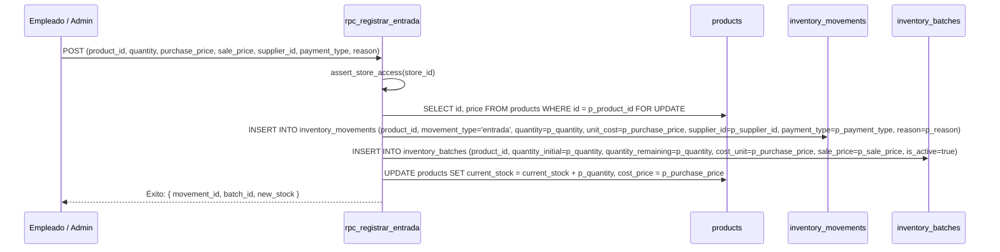
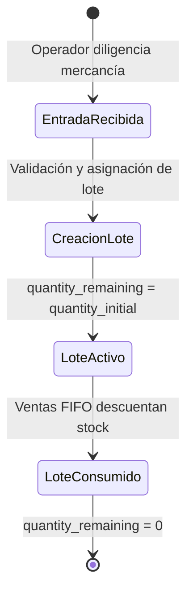
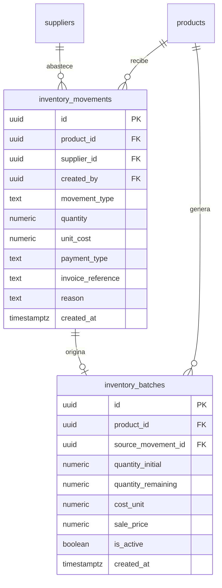

# SDD-006-01-01: Movimientos de Entrada de Inventario

> **Asociado a:** [FRD-006-01-01](../FRD/FRD_006_01_01_MOVIMIENTOS_ENTRADA_INVENTARIO.md)  
> **Fase del Plan:** Ola 2 — Inventario, Lotes y Proveedores  
> **Estado:** 🟡 Validado Localmente (Post Alineación v1.5.8)  
> **Última Actualización:** 2026-10-11  

---

## 0. Contexto y Restricciones Aplicables

### 0.1 Políticas Globales Activadas (ARQ-002)
| Política ID | Dominio | Impacto Concreto en este SDD |
|-------------|---------|------------------------------|
| **POL-LOG-01** | Logística | **Independencia Logística y Financiera:** La entrada física de mercancía incrementa stock y crea lotes en inventario; NO extrae dinero de caja automáticamente ni crea facturas sin intervención del módulo de Cuentas por Pagar. |
| **POL-FIN-01** | Financiero | **Separación de Obligaciones:** Si la compra fue a crédito, la deuda con el proveedor se gestiona en `supplier_invoices` (FRD-019); el Kardex solo documenta la recepción física. |
| **POL-AUD-02** | Auditoría | **Trazabilidad de Entradas:** Todo ingreso asienta el costo unitario, cantidad, proveedor y empleado responsable de forma inmutable. |

### 0.2 Contratos Vecinos que Limitan el Diseño
| SDD Origen | Restricción Inyectada | Impacto en Entradas |
|------------|-----------------------|---------------------|
| **SDD_010_016 (FIFO)** | Creación de lotes. | Cada entrada genera atómicamente un lote en `inventory_batches` con `quantity_initial = quantity_remaining`. |
| **SDD_019 (Cuentas por Pagar)** | Normalización de Proveedores (H-18). | El campo de proveedor se normaliza automáticamente (`TRIM` + formato título) y permite autocompletar desde el catálogo `suppliers`. |
| **SDD_006 (Inventario Padre)** | Sincronización de stock. | El stock del catálogo (`products.current_stock`) se incrementa por la cantidad ingresada. |

### 0.3 Auditoría de BD contra Realidad (Deuda Técnica Declarada)
*Evidencia cruda obtenida de Supabase Producción (`ihtjocmhzuliwwvdzfnz`):*

```sql
-- Función real en producción:
-- rpc_registrar_entrada(
--   p_product_id UUID, p_quantity NUMERIC, p_purchase_price NUMERIC, p_sale_price NUMERIC,
--   p_reason TEXT, p_supplier_id UUID, p_payment_type TEXT, p_invoice_reference TEXT,
--   p_reference_invoice_id UUID
-- )

-- Columnas en inventory_movements:
-- id (uuid), product_id (uuid), quantity (numeric), unit_cost (numeric), supplier_id (uuid),
-- reference_invoice_id (uuid), movement_type (text), invoice_reference (text), reason (text),
-- payment_type (text), created_by (uuid), created_at (timestamptz)

-- Constraint:
-- inventory_movements_movement_type_check: CHECK (movement_type = ANY (ARRAY['entrada', 'salida', 'devolucion', 'merma', 'ajuste', 'CORRECCION_SISTEMA', 'venta']))
-- inventory_movements_payment_type_check: CHECK (payment_type = ANY (ARRAY['contado', 'credito']))
```

| Hallazgo / Componente | Brecha Real Detectada | Solución Normativa y Trade-off | Condición de Revisión |
|-----------------------|-----------------------|---------------------------------|-----------------------|
| 🟡 **Tipo de movimiento físico** | En borradores antiguos se proponía `'purchase'` o `'adjustment_in'`. En la BD real el tipo exacto es `'entrada'`. | **Decisión:** Homologar el valor en BD a `'entrada'` y registrar el motivo detallado en `reason` (`'COMPRA'`, `'AJUSTE'`). | Resuelto en este SDD. |
| 🟡 **Catálogo de proveedores vs texto libre** | `suppliers` almacena `name`, pero movimientos anteriores aceptaban texto libre en `invoice_reference`. | **Decisión:** Normalizar el nombre del proveedor (TRIM + Capitalización) al crear o buscar en `suppliers` antes de vincular `supplier_id`. | Implementación estricta en el contrato de autocompletado de proveedores. |

---

## 1. Glosario Local

- **Movimiento de Entrada (`entrada`):** Incremento físico de inventario por compra de mercancía, bonificación o reposición inicial.
- **Normalización de Proveedor:** Proceso que elimina espacios redundantes al inicio y final (`trim`) y estandariza mayúsculas y minúsculas (formato título) para evitar duplicaciones en el catálogo (`suppliers`).
- **Lote de Ingreso:** Unidad de inventario con costo unitario y precio de venta asignados que ingresa a la cola FIFO.

---

## 2. Diagramas de Secuencia



---

## 3. Diagramas de Estado



---

## 4. Especificación Detallada de Casos de Uso

### Caso A: Registro de Entrada con Proveedor Existente
- **Actor:** Empleado con `canManageInventory` o Admin.
- **Precondición:** Producto activo en catálogo. Proveedor registrado en `suppliers`.
- **Flujo Principal:**
  1. El usuario selecciona el producto, digita la cantidad recibida (> 0) y el costo unitario.
  2. Selecciona el proveedor del autocompletado desplegable.
  3. Indica el tipo de pago acordado (`contado` o `credito`) y número de factura física.
  4. El servidor ejecuta `rpc_registrar_entrada`.
  5. Se inserta la entrada en `inventory_movements`, se crea el lote FIFO en `inventory_batches` y se actualiza el stock en `products`.
- **Postcondición:** Stock incrementado; lote creado en cola FIFO; trazabilidad de costo asentada.

### Caso B: Normalización de Nombre de Proveedor (Nuevo Proveedor)
- **Actor:** Administrador o empleado.
- **Precondición:** El proveedor de la factura no existe en el catálogo.
- **Flujo Principal:**
  1. El usuario digita el nombre del proveedor en el campo (ej. `  distribuidora del norte s.a.s  `).
  2. El sistema aplica limpieza automática: elimina espacios en los extremos y convierte a formato título (`Distribuidora Del Norte S.A.S`).
  3. Si tras normalizar coincide con un registro existente, lo asocia automáticamente.
  4. Si es nuevo, lo registra en `suppliers` garantizando un catálogo limpio.
- **Postcondición:** Proveedor registrado sin duplicados por espaciado o mayúsculas.

---

## 5. Contrato de Interfaz

### Operación: `rpc_registrar_entrada`
- **Tipo:** RPC Postgres / Acción (WRITE)
- **Entradas:**
  ```json
  {
    "p_product_id": "UUID (Obligatorio)",
    "p_quantity": "NUMERIC > 0 (Obligatorio)",
    "p_purchase_price": "NUMERIC >= 0 (Obligatorio, costo unitario)",
    "p_sale_price": "NUMERIC >= 0 (Opcional, precio de venta para el lote)",
    "p_reason": "TEXT (Opcional, ej: 'Compra factura F-405')",
    "p_supplier_id": "UUID (Opcional, proveedor asociado)",
    "p_payment_type": "TEXT (Opcional: 'contado' o 'credito')",
    "p_invoice_reference": "TEXT (Opcional, número físico de factura)",
    "p_reference_invoice_id": "UUID (Opcional, enlace a supplier_invoices)"
  }
  ```
- **Salida Exitosa:**
  ```json
  {
    "success": true,
    "data": {
      "movement_id": "UUID",
      "batch_id": "UUID",
      "product_id": "UUID",
      "new_stock": 50.00
    }
  }
  ```
- **Catálogo de Errores:**
  | Código de Error | Causa | Mensaje Técnico |
  |-----------------|-------|-----------------|
  | `STORE_ACCESS_DENIED` | Sin permisos en la tienda | Acceso denegado |
  | `PRODUCT_NOT_FOUND` | `p_product_id` inexistente | Producto no encontrado |
  | `INVALID_QUANTITY` | Cantidad <= 0 | La cantidad debe ser mayor a cero |
  | `INVALID_PURCHASE_PRICE` | Costo < 0 | El costo unitario no puede ser negativo |
  | `INVALID_PAYMENT_TYPE` | Tipo fuera de enum | El tipo de pago debe ser 'contado' o 'credito' |

---

## 6. Análisis de Seguridad

- **Validación Centralizada:** Requiere `assert_store_access()`.
- **Atomicidad Transaccional:** El movimiento en Kardex, la creación del lote FIFO y la actualización de stock en `products` ocurren dentro de una sola transacción de base de datos; si cualquiera de las 3 fases falla, se hace rollback completo.
- **Ocultamiento de Costos:** Cajeros sin permiso de administración solo ven cantidades físicas recepcionadas, no los márgenes ni costos de compra en vistas no autorizadas.

---

## 7. Modelo de Datos Lógico



### Diccionario de Datos
| Tabla | Atributo | Tipo | Nullable | Estado en BD | Descripción |
|-------|----------|------|----------|--------------|-------------|
| `inventory_movements` | `movement_type` | TEXT | NO | ✅ Sí | Fijo `'entrada'` |
| `inventory_movements` | `unit_cost` | NUMERIC | NO | ✅ Sí | Costo de adquisición por unidad |
| `inventory_movements` | `supplier_id` | UUID | SÍ | ✅ Sí | Proveedor asociado |
| `inventory_movements` | `payment_type` | TEXT | SÍ | ✅ Sí | `'contado'` o `'credito'` |
| `inventory_batches` | `quantity_initial` | NUMERIC | NO | ✅ Sí | Cantidad total recibida |
| `inventory_batches` | `quantity_remaining`| NUMERIC | NO | ✅ Sí | Stock remanente no consumido |
| `inventory_batches` | `cost_unit` | NUMERIC | NO | ✅ Sí | Costo unitario inmutable del lote |
