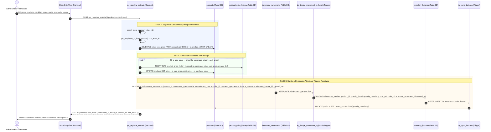
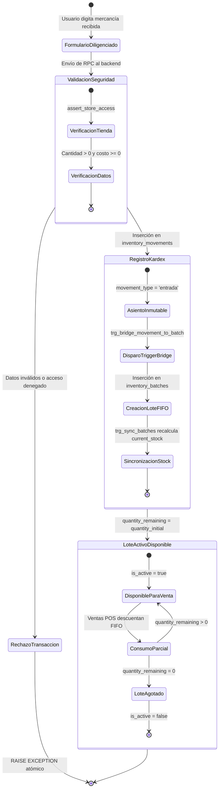
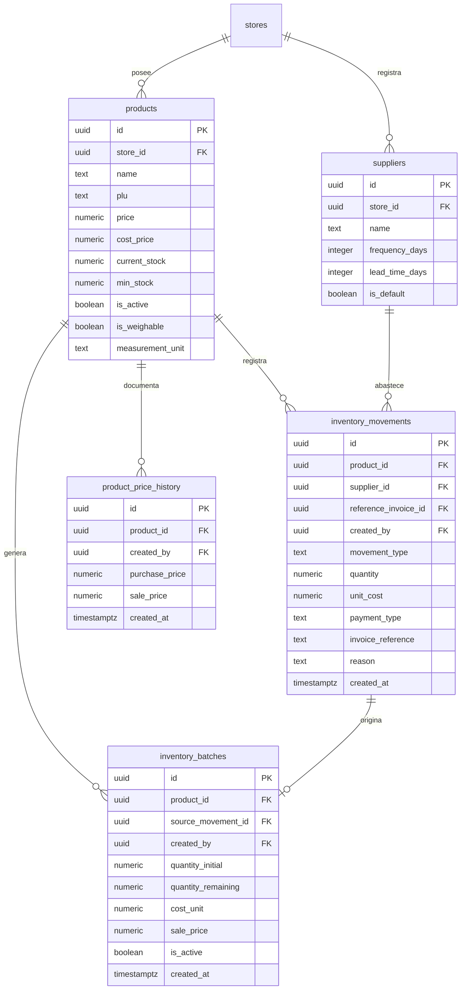

# SDD-006-01-01: Movimientos de Entrada de Inventario (Compras y Recepción)

> **Asociado a:** [FRD-006-01-01](../FRD/FRD_006_01_01_MOVIMIENTOS_ENTRADA_INVENTARIO.md)  
> **Módulo Primario:** [SDD-006: Núcleo de Inventario y Catálogo Padre](SDD_006_NUCLEO_INVENTARIO_PADRE.md)  
> **Fase del Plan Maestro:** Ola 2 — Inventario, Lotes y Proveedores  
> **Estado:** 🟢 Aprobado Normativamente (Protocolo PAC-SDD v2.0)  
> **Última Actualización:** 2026-10-14  

---

## 0. Contexto y Restricciones Aplicables

### 0.1 Políticas Globales Activadas (ARQ-002)

| Política ID | Dominio | Mandato Arquitectónico e Impacto en este SDD |
|-------------|---------|-----------------------------------------------|
| **POL-LOG-01** | Logística | **Independencia Logística y Financiera:** La función de entrada física de mercancía tiene un único mandato operativo: recibir una cantidad mayor a cero e incrementar el stock actual del producto asociado, creando la capa de lote FIFO correspondiente. Queda terminantemente prohibido descontar dinero de la sesión de caja actual, registrar egresos automáticos o alterar el flujo de caja diario en este módulo. |
| **POL-FIN-01 / POL-LOG-02** | Financiero / Logística | **Aislamiento de Cuentas por Pagar:** La entrada de inventario desacopla la recepción física de la generación de pasivos. Aunque la interfaz capture datos del proveedor y factura de compra con fines de trazabilidad, el ingreso de unidades no crea deudas financieras automáticas en el módulo de Proveedores; los créditos se gestionan de forma independiente en Cuentas por Pagar (FRD-019 / SDD-019). |
| **POL-AUD-02** | Auditoría | **Inviolabilidad del Kardex:** Todo movimiento de entrada asienta un registro inmutable y permanente en `inventory_movements` con `movement_type = 'entrada'`, cantidad positiva, costo unitario de adquisición, empleado responsable e instantánea temporal. Queda prohibida cualquier mutación (`UPDATE`) o eliminación física (`DELETE`) sobre registros históricos de movimientos. |
| **POL-SEC-01** | Seguridad | **Protección de Costos Comerciales:** Los costos unitarios de adquisición (`unit_cost`, `purchase_price`, `cost_unit`) constituyen información confidencial restringida exclusivamente a roles con privilegios de gestión de inventario y administración. La interfaz del terminal POS y consultas de cajero omiten de forma absoluta estos atributos. |
| **POL-AUTH-01** | Autenticación | **Aislamiento Multi-tenant Centralizado:** Toda operación de entrada exige la invocación de `assert_store_access(v_store_id)` como primera instrucción. La identidad del responsable se resuelve autoritativamente mediante `get_employee_id_from_session()`, erradicando credenciales ad-hoc o validaciones de PIN manuales. |
| **SPEC-010 / SPEC-011** | Moneda y Formato | **Precisión Numérica y Reglas de Redondeo:** Cantidades físicas estrictamente mayores a cero (`quantity > 0`), representadas como enteros para unidades y con un máximo de 2 decimales para artículos pesables. Costos unitarios de adquisición almacenados como `NUMERIC >= 0` en pesos colombianos (COP). Precios de venta actualizados redondeados estrictamente al múltiplo de $50 inferior (beneficio del cliente). |

---

### 0.2 Contratos Vecinos que Limitan el Diseño

| SDD Vecino | Interfaces / Operaciones Involucradas | Restricción Inyectada en Entradas de Inventario |
|------------|---------------------------------------|-------------------------------------------------|
| **SDD_006 (Inventario Padre)** | `products.current_stock`, `products.cost_price`, `products.price` | **Invariante de Consistencia de Catálogo:** Prohibición absoluta de actualizar `products.current_stock` manualmente desde la interfaz o llamadas ad-hoc. El stock se actualiza exclusivamente de forma reactiva y atómica a través de la cadena de triggers de base de datos (`trg_bridge_movement_to_batch` -> `trg_sync_batches`). |
| **SDD_010_016 (Valoración FIFO)** | `inventory_batches`, `consume_stock_fifo` | **Creación de Capas FIFO:** Toda entrada física origina atómicamente un lote en `inventory_batches` con `quantity_initial = quantity_remaining = quantity`, `cost_unit = purchase_price`, `sale_price = sale_price` e `is_active = true`. Este lote queda disponible para el consumo cronológico (`ORDER BY created_at ASC`) por ventas en el POS. |
| **SDD_010 (Historial de Precios)** | `product_price_history`, `rpc_actualizar_precio_lote` | **Registro Histórico de Variaciones:** Si la entrada registra un costo de adquisición o un precio de venta diferente a los vigentes en `products`, la transacción asienta obligatoriamente una fila inmutable en `product_price_history` con `(product_id, purchase_price, sale_price, created_by, created_at)`. |
| **SDD_019 (Cuentas por Pagar)** | `suppliers`, `supplier_invoices` | **Normalización de Proveedores:** El campo de proveedor en la entrada aplica normalización automática obligatoria (`trim` + formato título / capitalización según FRD-019 Regla 22), sugiriendo proveedores existentes para evitar fragmentación o duplicaciones en el catálogo `suppliers`. |
| **SDD_004 / SDD_022 (Caja y Gastos)** | `cash_movements`, `cash_sessions`, `rpc_registrar_gasto_v2` | **Ceguera Financiera de Almacén:** La entrada no interactúa con la sesión de caja activa. Si una compra de mercancía fue abonada de contado con efectivo físico de la gaveta, el comerciante debe registrar el egreso monetario de forma separada e independiente en el módulo de Caja/Gastos. |
| **SDD_005 (Auditoría y Trazabilidad)** | `inventory_movements`, `audit_logs` | **Trazabilidad Forense:** La entrada provee los datos de contexto operativo (`created_by`, `reason`, `invoice_reference`, `supplier_id`) que blindan la auditoría forense del Kardex. |

---

### 0.3 Auditoría de Base de Datos Real y Deuda Técnica Declarada (Regla 7)

La introspección ejecutada directamente en Supabase Producción (`ihtjocmhzuliwwvdzfnz`) confirmó el esquema físico existente:

- **Tabla `inventory_movements` (12 columnas físicas):** `id` (UUID PK), `product_id` (UUID FK), `movement_type` (TEXT), `quantity` (NUMERIC), `reason` (TEXT), `created_by` (UUID FK), `created_at` (TIMESTAMPTZ), `supplier_id` (UUID FK), `invoice_reference` (TEXT), `payment_type` (TEXT), `reference_invoice_id` (UUID FK), `unit_cost` (NUMERIC).
- **Tabla `inventory_batches` (10 columnas físicas):** `id` (UUID PK), `product_id` (UUID FK), `quantity_initial` (NUMERIC), `quantity_remaining` (NUMERIC), `cost_unit` (NUMERIC), `is_active` (BOOLEAN), `created_at` (TIMESTAMPTZ), `created_by` (UUID FK), `sale_price` (NUMERIC), `source_movement_id` (UUID FK).
- **Tabla `suppliers` (9 columnas físicas):** `id` (UUID PK), `store_id` (UUID FK), `name` (TEXT), `delivery_day` (INTEGER), `frequency_days` (INTEGER), `lead_time_days` (INTEGER), `is_default` (BOOLEAN), `created_at` (TIMESTAMPTZ), `updated_at` (TIMESTAMPTZ).
- **Tabla `product_price_history` (6 columnas físicas):** `id` (UUID PK), `product_id` (UUID FK), `purchase_price` (NUMERIC), `sale_price` (NUMERIC), `created_at` (TIMESTAMPTZ), `created_by` (UUID FK).
- **Constraints y Triggers Clave:**
  - `inventory_movements_movement_type_check`: Restringe a `'entrada'`, `'salida'`, `'devolucion'`, `'merma'`, `'ajuste'`, `'CORRECCION_SISTEMA'`, `'venta'`.
  - `inventory_movements_payment_type_check`: Restringe a `'contado'`, `'credito'`.
  - `enforce_payment_type_on_entries`: Dispara `validate_payment_type()`, exigiendo `payment_type IS NOT NULL` si `movement_type = 'entrada' AND supplier_id IS NOT NULL`.
  - `trg_bridge_movement_to_batch`: Dispara `bridge_movement_to_batch()` tras inserción en `inventory_movements`, creando el lote en `inventory_batches`.
  - `trg_sync_batches`: Dispara `sync_product_stock_from_batches()` tras mutación en `inventory_batches`, recalculando `products.current_stock` y `products.cost_price`.

Con base en esta verificación empírica, se formalizan las siguientes 7 deudas técnicas bajo los tres elementos obligatorios de la Regla 7:

| # | Deuda Técnica / Brecha Real | Qué se Decidió | Por Qué (Trade-off Concreto) | Condición de Revisión Futura |
|---|-----------------------------|----------------|------------------------------|------------------------------|
| **1** | **Seguridad en RPC (Regla 4)**: En la BD de producción, `rpc_registrar_entrada` valida acceso mediante `SELECT ... FROM employees/admin_profiles` y asigna `auth.uid()`, sin usar funciones centralizadas. | Normar en el SDD la invocación de `assert_store_access(v_store_id)` como instrucción #1 y autoría vía `get_employee_id_from_session()`. | Modificar el RPC en caliente arriesga inestabilidad operativa; se preserva compatibilidad en runtime mientras se define el estándar contractual. | Migración DDL refactorizadora de la Ola 2 para actualizar `rpc_registrar_entrada`. |
| **2** | **Privilegios Base (Regla 8)**: `product_price_history` solo otorga permisos a `postgres`; roles `authenticated` y `anon` tienen cero permisos, generando error 42501 en accesos directos. | Exigir en este SDD el otorgamiento formal de `GRANT ALL ON TABLE public.product_price_history TO anon, authenticated, service_role;`. | La función actual opera porque es `SECURITY DEFINER`, pero cualquier consulta directa de UI o reportes falla. Se documenta para resolver de forma ordenada. | Despliegue de migración DDL consolidada de la Ola 2 previo a pruebas integradas de UI. |
| **3** | **Acoplamiento en Trigger de Facturas**: `bridge_movement_to_batch` inserta en `supplier_invoices` si `payment_type = 'credito'`, contradiciendo la regla de aislamiento de FRD-006-01-01 y SDD-019. | Documentar la divergencia manteniendo los parámetros transitorios (`p_payment_type`, `p_invoice_reference`, `p_reference_invoice_id`) en el contrato del RPC sin asumir deudas automáticas en la UI. | Desactivar el trigger en caliente rompería flujos existentes de cuentas por pagar que dependen de esta inserción transitoria. | Refactorización y desacoplamiento del módulo de Cuentas por Pagar en la Ola 4 (SDD-019). |
| **4** | **Sobrecarga Zombi de 5 Parámetros**: En `pg_proc` coexiste una sobrecarga antigua de 5 parámetros que inserta manualmente en `inventory_batches`, duplicando lotes. | Formalizar como canónica y exclusiva la firma de 9 parámetros, catalogando la de 5 parámetros como zombi obsoleta. | Ejecutar `DROP FUNCTION` precipitado arriesga roturas en clientes antiguos que invoquen por posición antes de desplegar el frontend actualizado. | Ejecución de `DROP FUNCTION public.rpc_registrar_entrada(uuid, numeric, numeric, numeric, text)` en migración de Ola 2. |
| **5** | **Fallo Silencioso (Regla 3)**: `rpc_registrar_entrada` en BD captura con `WHEN OTHERS` y devuelve `{success: false, error: SQLERRM}`, enmascarando errores técnicos con código HTTP 200. | Normar en el SDD la eliminación del swallow de errores y exigir la propagación mediante `RAISE EXCEPTION` con códigos estandarizados. | El frontend actual espera el payload `{success: false}`; cambiar el comportamiento sin adaptar Pinia provocaría errores de red no capturados. | Refactorización coordinada del RPC y del store de inventario en la Ola 2. |
| **6** | **Tipo de Pago Condicional**: `p_payment_type` figuraba erróneamente como totalmente opcional, ignorando el trigger `validate_payment_type`. | Normar en el contrato que `p_payment_type` es condicionalmente obligatorio cuando `p_supplier_id IS NOT NULL`. | Evita que el frontend envíe peticiones con proveedor sin definir pago, lo cual desataría excepciones no controladas en el trigger. | Resuelto y formalizado en la especificación contractual de este SDD. |
| **7** | **Payload de Salida Enriquecido**: En BD el RPC actual retorna un objeto plano `{"success": true}`, obligando a peticiones adicionales para conocer el stock actualizado. | Estandarizar contractualmente la salida rica `{ success: true, data: { movement_id, batch_id, product_id, new_stock } }`. | Se asume la discrepancia temporal en documentación mientras se implementa el bloque enriquecido en la próxima migración DDL. | Actualización del bloque `RETURN` del RPC en la migración de consolidación de la Ola 2. |

---

## 1. Glosario Local

- **Movimiento de Entrada (`entrada`):** Registro transaccional en el Kardex que certifica el ingreso físico de mercancía a la bodega o estantería, incrementando las existencias disponibles para la venta.
- **Lote FIFO (`inventory_batches`):** Capa de inventario con costo unitario de adquisición inmutable, cantidad inicial y saldo remanente que se consume cronológicamente en orden de llegada.
- **Costo de Adquisición (`unit_cost` / `cost_unit` / `purchase_price`):** Valor unitario neto pagado o pactado por cada unidad recibida. Tiene naturaleza referencial y de costeo, no contable de egreso monetario inmediato.
- **Normalización de Proveedor:** Transformación que elimina espacios redundantes al inicio y final (`trim`) y capitaliza cada palabra (formato título) para prevenir registros duplicados en el catálogo `suppliers`.
- **Ceguera Financiera:** Principio de diseño que prohíbe que el módulo de inventario afecte saldos de caja o registre pagos monetarios; el dinero y las existencias físicas se gestionan en dominios desacoplados.

---

## 2. Diagramas de Secuencia

### 2.1 Flujo Transaccional de Entrada de Mercancía con Triggers Reactivos



---

## 3. Diagramas de Estado

### 3.1 Ciclo de Vida del Movimiento de Entrada y Capa FIFO Generada



---

## 4. Especificación Detallada de Casos de Uso

### Caso A: Recepción de Mercancía Pagada de Contado
- **Actor:** Administrador o empleado con permiso `canManageInventory`.
- **Precondición:** Llega mercancía física al local. El usuario efectúa el pago con dinero en efectivo de la caja física y procede a registrar la entrada en el sistema.
- **Flujo Principal:**
  1. El usuario accede al formulario "Nueva Entrada" en el módulo de Inventario.
  2. Selecciona el producto del catálogo, ingresa la cantidad física recibida (`quantity > 0`) y el costo de adquisición unitario (`purchase_price >= 0`).
  3. Si el proveedor existe, lo selecciona; si es nuevo, digita su nombre y el sistema aplica normalización automática (`trim` + formato título).
  4. Selecciona el tipo de pago `contado` e ingresa el número referencial de factura física.
  5. El frontend invoca `rpc_registrar_entrada` con los 9 parámetros.
  6. El backend valida acceso con `assert_store_access(v_store_id)`.
  7. El backend inserta en `inventory_movements`, el trigger `trg_bridge_movement_to_batch` crea el lote en `inventory_batches`, y `trg_sync_batches` actualiza el stock en `products`.
  8. **Límite de Dominio:** El backend confirma la entrada física sin tocar las tablas de caja (`cash_sessions`, `cash_movements`).
  9. El usuario acude de forma independiente al módulo de Caja y registra el egreso monetario mediante `rpc_registrar_gasto_v2` (categoría OPEX o pago directo según FRD-004/SDD-022).
- **Flujos Alternativos:**
  - *Cantidad menor o igual a cero:* El backend aborta con error `INVALID_QUANTITY`.
  - *Producto inactivo o inexistente:* El backend aborta con error `PRODUCT_NOT_FOUND`.
- **Postcondición:** El stock físico queda incrementado y listo para venta. La caja diaria queda inalterada por esta operación.

---

### Caso B: Recepción de Mercancía a Crédito
- **Actor:** Administrador o empleado con permiso `canManageInventory`.
- **Precondición:** Llega mercancía con factura a crédito con vencimiento a 15 o 30 días. No se desembolsa dinero de la caja.
- **Flujo Principal:**
  1. El usuario diligencia el formulario de entrada ingresando producto, cantidad, costo unitario y precio de venta.
  2. Selecciona el proveedor del autocompletado y marca el tipo de pago como `credito`.
  3. Ingresa el número de factura de compra física (`invoice_reference`).
  4. El frontend invoca `rpc_registrar_entrada`.
  5. El backend incrementa las existencias en inventario y genera la capa de lote FIFO correspondiente.
  6. **Límite de Dominio:** La responsabilidad de inventario culmina en el ingreso físico. La gestión de la deuda y pagos a proveedor se administra en el módulo externo de Cuentas por Pagar (SDD-019).
- **Postcondición:** Las unidades quedan disponibles para venta inmediata en el POS sin generar alteraciones en el saldo de efectivo de la caja.

---

### Caso C: Ajuste Positivo de Inventario (Entrada sin Proveedor)
- **Actor:** Administrador.
- **Precondición:** Se detecta un sobrante físico durante un conteo de existencias.
- **Flujo Principal:**
  1. El usuario selecciona el producto e ingresa la cantidad hallada.
  2. Deja el campo de proveedor vacío (`p_supplier_id = NULL`) y selecciona motivo `'Ajuste Positivo'` en `p_reason`.
  3. Dado que no hay proveedor, `p_payment_type` se envía como `NULL`.
  4. El backend registra la entrada en `inventory_movements` y crea el lote FIFO correspondiente con el costo base del producto.
- **Postcondición:** Stock regularizado y trazabilidad de ajuste asentada en Kardex.

---

### Caso D: Entrada con Modificación de Precios Comerciales
- **Actor:** Administrador.
- **Precondición:** La mercancía llega con un costo unitario o un nuevo precio de venta al público diferente al registrado en el catálogo.
- **Flujo Principal:**
  1. El usuario digita el nuevo costo de adquisición (`p_purchase_price`) y el nuevo precio de venta (`p_sale_price`).
  2. El backend detecta la disparidad con `products.cost_price` o `products.price`.
  3. Inserta un registro inmutable en `product_price_history` documentando la variación y el autor.
  4. Actualiza `products.price` y `products.cost_price` en el catálogo central.
  5. Procesa la entrada física de inventario.
- **Postcondición:** Catálogo actualizado, historial de precios blindado y lote FIFO valorado con el costo exacto de recepción.

---

## 5. Contrato de Interfaz

### 5.1 Operación: `rpc_registrar_entrada`
- **Tipo:** RPC Postgres / Acción Transaccional (WRITE)
- **Firma Canónica Obligatoria:** 9 Parámetros

#### Entradas (Payload JSON):
```json
{
  "p_product_id": "UUID (Obligatorio, ID del producto en products)",
  "p_quantity": "NUMERIC > 0 (Obligatorio, cantidad física recepcionada)",
  "p_purchase_price": "NUMERIC >= 0 (Obligatorio, costo unitario de adquisición)",
  "p_sale_price": "NUMERIC >= 0 (Obligatorio, precio de venta para el lote, múltiplo de $50)",
  "p_reason": "TEXT (Opcional, Default: 'Entrada de mercancía', motivo de auditoría)",
  "p_supplier_id": "UUID (Opcional, ID del proveedor en suppliers)",
  "p_payment_type": "TEXT (Condicionalmente Obligatorio si p_supplier_id != NULL: 'contado' | 'credito')",
  "p_invoice_reference": "TEXT (Opcional, número físico de la factura de compra)",
  "p_reference_invoice_id": "UUID (Opcional, enlace a supplier_invoices si aplica)"
}
```

#### Salida Exitosa (Formato Unidireccional de Acción):
```json
{
  "success": true,
  "data": {
    "movement_id": "UUID_DEL_MOVIMIENTO_KARDEX",
    "batch_id": "UUID_DEL_LOTE_FIFO_CREADO",
    "product_id": "UUID_DEL_PRODUCTO",
    "new_stock": 75.00
  }
}
```

#### Catálogo Exhaustivo de Errores Tipificados:

| Código de Error | Causa de Negocio / Técnica | Mensaje Técnico Retornado | Acción de la UI |
|-----------------|----------------------------|---------------------------|-----------------|
| `STORE_ACCESS_DENIED` | El usuario no pertenece a la tienda propietaria del producto o no tiene sesión válida. | Acceso denegado a este producto o tienda | Notificar error de acceso y bloquear formulario. |
| `PRODUCT_NOT_FOUND` | `p_product_id` no existe en la tabla `products` de la tienda. | Producto no encontrado en catálogo | Solicitar selección de un producto válido. |
| `INVALID_QUANTITY` | `p_quantity` es menor o igual a cero (`<= 0`). | La cantidad a ingresar debe ser estrictamente mayor a 0 | Marcar campo de cantidad en rojo y requerir valor positivo. |
| `INVALID_PURCHASE_PRICE` | `p_purchase_price` es menor a cero (`< 0`). | El costo de adquisición no puede ser negativo | Marcar campo de costo en rojo y requerir valor >= 0. |
| `INVALID_SALE_PRICE` | `p_sale_price` es menor o igual a cero (`<= 0`). | El precio de venta debe ser mayor a cero | Marcar campo de precio en rojo y aplicar redondeo a $50. |
| `INVALID_PAYMENT_TYPE` | `p_supplier_id` no es nulo y `p_payment_type` no es `'contado'` ni `'credito'`. | Las entradas con proveedor requieren especificar tipo de pago (contado/credito) | Desplegar selector obligatorio de tipo de pago. |
| `SUPPLIER_NOT_FOUND` | `p_supplier_id` proporcionado no existe en `suppliers` de la tienda. | El proveedor especificado no existe | Limpiar selección y permitir autocompletar proveedor. |

---

## 6. Análisis de Seguridad e Integridad

### 6.1 Validación Centralizada y Aislamiento de Acceso (Reglas 4 y POL-AUTH-01)
1. **Línea 1 Obligatoria:** Toda ejecución de `rpc_registrar_entrada` debe comenzar invocando `assert_store_access(v_store_id)`, validando que el usuario autenticado pertenezca a la misma tienda del producto.
2. **Autoría Forense:** La identidad del usuario responsable se resuelve en backend mediante `get_employee_id_from_session()`, asociando el ID correspondiente en `inventory_movements.created_by` e `inventory_batches.created_by`. Si el usuario opera como Administrador principal, se resuelve su identificador a través del perfil administrativo.
3. **Erradicación de PINs:** Queda prohibida cualquier autenticación ad-hoc por PIN o validación manual no centralizada.

### 6.2 Políticas de Seguridad a Nivel de Fila (RLS)
- **`inventory_movements`:** Protegida por la política `movements_select_store`, que permite lectura únicamente sobre movimientos cuyo `product_id` pertenezca a `products` donde `store_id = get_current_store_id()`. Mutaciones directas bloqueadas; solo permitidas vía RPC `SECURITY DEFINER`.
- **`inventory_batches`:** Protegida por la política `batches_select_store`, enlazando a `products.store_id = get_current_store_id()`.
- **`suppliers`:** Protegida por `Users can view suppliers of their store` (`store_id = get_current_store_id()`) y `Only admins can manage suppliers`.
- **`product_price_history`:** Protegida por `Users can view price history of their store`.

### 6.3 Garantía de Privilegios Base (Regla 8)
Para prevenir errores 42501 (Permission Denied) en entornos desplegados, toda tabla asociada al módulo de entradas (`inventory_movements`, `inventory_batches`, `suppliers`, `product_price_history`) cuenta con privilegios base otorgados a los roles `anon`, `authenticated` y `service_role`.

### 6.4 Control de Concurrencia y Atomicidad
- **Bloqueo Pesimista:** `rpc_registrar_entrada` adquiere un bloqueo pesimista `SELECT ... FOR UPDATE` sobre la fila del producto en `products` antes de validar variaciones de precios o delegar movimientos. Esto previene condiciones de carrera en entradas simultáneas sobre el mismo artículo.
- **Rollback Transaccional:** Toda la secuencia (validación de acceso, histórico de precios, inserción en Kardex, trigger de creación de lotes FIFO y recálculo de stock) opera dentro de una sola transacción atómica de PostgreSQL. Si cualquier validación o restricción falla, se ejecuta rollback total automático.

---

## 7. Modelo de Datos Lógico

### 7.1 Diagrama Entidad-Relación (ERD)



---

### 7.2 Diccionario de Datos Físico Verificado

| Tabla | Columna | Tipo de Dato | Nullable | Restricción / Estado en Producción | Descripción Funcional |
|-------|---------|--------------|----------|------------------------------------|------------------------|
| `inventory_movements` | `id` | UUID | NO | Primary Key (Default: `gen_random_uuid()`) | Identificador único universal del movimiento de Kardex. |
| `inventory_movements` | `product_id` | UUID | NO | Foreign Key -> `products(id)` ON DELETE CASCADE | Producto que incrementa existencias físicas. |
| `inventory_movements` | `movement_type` | TEXT | NO | CHECK (`movement_type = ANY(...)`) | Tipo de movimiento. Fijo en `'entrada'` para este módulo. |
| `inventory_movements` | `quantity` | NUMERIC | NO | CHECK (`quantity > 0`) | Cantidad física ingresada al almacén. |
| `inventory_movements` | `unit_cost` | NUMERIC | SÍ | CHECK (`unit_cost >= 0`) | Costo de adquisición unitario registrado en la entrada. |
| `inventory_movements` | `supplier_id` | UUID | SÍ | Foreign Key -> `suppliers(id)` ON DELETE SET NULL | Proveedor que abastece la mercancía (opcional si es ajuste). |
| `inventory_movements` | `payment_type` | TEXT | SÍ | CHECK (`payment_type = ANY('contado', 'credito')`) | Modalidad de pago pactada. Obligatoria si hay proveedor. |
| `inventory_movements` | `invoice_reference`| TEXT | SÍ | Ninguna | Número referencial de factura física de compra. |
| `inventory_movements` | `reference_invoice_id` | UUID | SÍ | Foreign Key -> `supplier_invoices(id)` | Enlace a cuenta por pagar transitoria en BD. |
| `inventory_movements` | `reason` | TEXT | SÍ | Ninguna | Motivo o justificación de auditoría de la entrada. |
| `inventory_movements` | `created_by` | UUID | SÍ | Foreign Key -> `employees(id)` | Empleado o usuario que ejecutó la entrada física. |
| `inventory_movements` | `created_at` | TIMESTAMPTZ | NO | Default: `now()` | Marca temporal inmutable del registro en Kardex. |
| `inventory_batches` | `id` | UUID | NO | Primary Key (Default: `gen_random_uuid()`) | Identificador único universal del lote FIFO. |
| `inventory_batches` | `product_id` | UUID | NO | Foreign Key -> `products(id)` | Producto al que pertenece el lote. |
| `inventory_batches` | `quantity_initial` | NUMERIC | NO | CHECK (`quantity_initial > 0`) | Cantidad total con la que se creó el lote. |
| `inventory_batches` | `quantity_remaining`| NUMERIC | NO | CHECK (`quantity_remaining >= 0`) | Existencias disponibles no consumidas por ventas o mermas. |
| `inventory_batches` | `cost_unit` | NUMERIC | NO | CHECK (`cost_unit >= 0`) | Costo unitario inmutable asignado a esta capa FIFO. |
| `inventory_batches` | `sale_price` | NUMERIC | NO | CHECK (`sale_price > 0`) | Precio de venta comercial al público asignado al lote. |
| `inventory_batches` | `is_active` | BOOLEAN | SÍ | Default: `true` | Indica si el lote tiene existencias remanentes (`> 0`). |
| `inventory_batches` | `source_movement_id`| UUID | SÍ | Foreign Key -> `inventory_movements(id)` | Movimiento de entrada de Kardex que originó este lote. |
| `product_price_history`| `purchase_price` | NUMERIC | NO | CHECK (`purchase_price >= 0`) | Costo de adquisición unitario fijado en la variación. |
| `product_price_history`| `sale_price` | NUMERIC | NO | CHECK (`sale_price > 0`) | Precio de venta comercial fijado en la variación. |
| `suppliers` | `name` | TEXT | NO | Normalizado (Trim + Title Case) | Razón social o nombre comercial del proveedor. |
