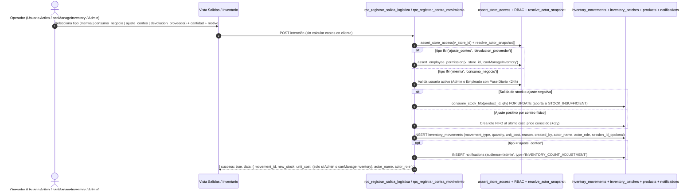

# SDD-006-01-02: Movimientos de Salida Logística ($0 POS), Consumos y Ajustes por Conteo Físico

> **Asociado a:** [FRD-006-01-02](../FRD/FRD_006_01_02_MOVIMIENTOS_SALIDA_INVENTARIO.md) | [SDD-003-01](SDD_003_01_MATRIZ_PERMISOS_EMPLEADOS.md)  
> **Módulo Primario:** [SDD-006: Núcleo de Inventario y Catálogo Padre](SDD_006_NUCLEO_INVENTARIO_PADRE.md)  
> **Fase del Plan Maestro:** Ola 2 — Inventario, Lotes y Proveedores (Reactivado bajo `ARQ-002` v1.4)  
> **Estado:** 🟢 REACTIVADO Y ALINEADO A `SDD-003-01` / `ARQ-002` v1.4 (Pendiente implementación SQL/Frontend Fase 3)  
> **Última Actualización:** 2026-11-19  

---

## 0. Contexto y Restricciones Aplicables

### 0.1 Políticas Globales Activadas (`ARQ-002` v1.4)

| Política ID | Dominio | Mandato Arquitectónico e Impacto en este SDD |
| :--- | :--- | :--- |
| **POL-LOG-03** | Logística | **Salidas Logísticas `$0` en Caja Dedicada POS:** Mermas, Consumo del Negocio, Ajustes por Conteo Físico (`+/-`) y Devolución Física a Proveedor operan directamente sobre `inventory_movements` con impacto **`$0` en la Caja Dedicada POS** (no exigen caja abierta ni generan movimientos en `cash_movements`), y la devolución física a proveedor **no altera automáticamente** Cuentas por Pagar (`supplier_invoices`). |
| **POL-FIN-05** | Financiero | **Separación Consumo del Negocio vs. Consumo/Retiro Personal:** El **Consumo del Negocio** (insumos usados para operar la tienda) se registra aquí con `$0` en POS; el **Consumo/Retiro Personal** se opera literalmente como una venta en el carrito del POS (`SDD_007_01`, `$0` en caja, auto-asignado al perfil propio o elegido por Admin) y ambos se valorizan al costo de adquisición en `SDD_018`. |
| **POL-SEG-03** | Seguridad | **Capacidades Base vs. `canManageInventory`:** **Merma** y **Consumo del Negocio** están abiertos a **cualquier usuario activo** (Admin o empleado con Pase Diario vigente, sin requerir `canManageInventory` ni caja abierta), ocultando el costo unitario a quien no tenga `canManageInventory`. **Ajustes por Conteo Físico (`+/-`)** y **Devolución Física a Proveedor (`$0` POS)** exigen **`canManageInventory`** o rol Admin. |
| **POL-LOG-04 / POL-AUD-01** | Auditoría | **Inmutabilidad por Contra-Movimiento y Snapshot de Firma:** Todo movimiento es append-only; ninguna salida o ajuste se edita ni se elimina. Toda corrección se ejecuta mediante un **contra-movimiento** (`reversed_movement_id`) con motivo obligatorio y fotografía histórica inmutable (`actor_name`, `actor_role`). |
| **POL-AUD-03** | Alertas | Todo **Ajuste por Conteo Físico (`+/-`)** emite alerta automática en `notifications` (`audience = 'admin'`, `type = 'INVENTORY_COUNT_ADJUSTMENT'`). |

### 0.2 Contratos Vecinos que Limitan el Diseño
- **`SDD_003_01` (Contrato Marco RBAC):** Define `assert_store_access`, `assert_employee_permission(..., 'canManageInventory')` y `resolve_actor_snapshot()`.
- **`SDD_006` / `SDD_006_01_01`:** `SDD_006_01_01` se restringe a `Compra / Reposición de Proveedor`; este SDD absorbe los **Ajustes Positivos y Negativos por Conteo Físico** (`ajuste_conteo`).
- **`SDD_007_01` (POS):** Ejecuta **Consumo/Retiro Personal** desde el carrito POS generando el movimiento complementario `consumo_personal` en `inventory_movements`.
- **`SDD_019` (Cuentas por Pagar):** Desacople absoluto: `devolucion_proveedor` jamás descuenta ni altera `supplier_invoices`.
- **`SDD_018` (P&L):** Contabiliza al costo de adquisición (`quantity * unit_cost`, neto de contra-movimientos) `merma`, `consumo_negocio` y `consumo_personal`.

### 0.3 Auditoría de BD contra Realidad (`SDD-003-01 §0.3`)
- En producción actual, `inventory_movements_movement_type_check` solo permite `('entrada', 'salida', 'devolucion', 'merma', 'ajuste', 'CORRECCION_SISTEMA', 'venta')` y `bridge_movement_to_batch` acopla `'devolucion'` con `supplier_invoices`.
- **Remediación Fase 3 (`B-09`):** Ampliar `movement_type` con `'consumo_negocio'`, `'consumo_personal'`, `'devolucion_proveedor'`, `'ajuste_conteo'`; agregar columnas `actor_name`, `actor_role`, `session_id`, `reversed_movement_id`, `beneficiary_employee_id`, `reference_sale_price`; desacoplar completamente CxP del trigger FIFO; y corregir el bug de `stores/inventory.ts` (L407–415) donde `'ajuste'` siempre sumaba.

---

## 1. Glosario Local
- **Merma (`merma`):** Mercancía dañada, rota o vencida retirada del stock vendible (Capacidad Base de todo usuario activo, `$0` POS, valorada al costo FIFO en P&L).
- **Consumo del Negocio (`consumo_negocio`):** Producto tomado del inventario para uso operativo de la tienda (ej. aseo, bolsas) (Capacidad Base de todo usuario activo, `$0` POS, valorado al costo FIFO en P&L).
- **Ajuste por Conteo Físico (`ajuste_conteo`):** Corrección positiva (`+cantidad`) o negativa (`-cantidad`) derivada de inventario físico (`canManageInventory` o Admin, motivo obligatorio, alerta automática al Admin).
- **Devolución Física a Proveedor (`devolucion_proveedor`):** Salida física de mercancía devuelta al proveedor (`canManageInventory` o Admin, `$0` en Caja POS, **sin** modificar `supplier_invoices`).
- **Contra-Movimiento (`reversed_movement_id`):** Registro inmutable de signo contrario que anula o corrige el efecto de un movimiento previo erróneo sin editar ni borrar la fila original.

---

## 2. Diagrama de Secuencia (Salidas Logísticas `$0`, Ajustes y Contra-Movimiento)

---

## 3. Reglas de Negocio y Matriz RBAC

| Operación | Usuario Activo (Base) | `canManageInventory` | Admin | Impacto Caja POS | Impacto CxP | ¿Exige Caja Abierta? | ¿Muestra Costo en UI? |
|---|:---:|:---:|:---:|:---:|:---:|:---:|:---:|
| **Merma (`merma`)** | ✅ | ✅ | ✅ | `$0` | Ninguno | NO | Solo Admin / `canManageInventory` |
| **Consumo del Negocio (`consumo_negocio`)** | ✅ | ✅ | ✅ | `$0` | Ninguno | NO | Solo Admin / `canManageInventory` |
| **Ajuste Conteo Físico `+/-` (`ajuste_conteo`)** | ❌ | ✅ *(alerta Admin)* | ✅ | `$0` | Ninguno | NO | Sí |
| **Devolución Física a Proveedor (`devolucion_proveedor`)** | ❌ | ✅ | ✅ | `$0` | **Ninguno** | NO | Sí |
| **Contra-Movimiento de Corrección** | ❌ | ✅ *(alerta Admin)* | ✅ | `$0` | Ninguno | NO | Sí |

---

## 4. Casos de Uso Técnicos
1. **Caso A — Empleado estándar registra Merma o Consumo del Negocio:** Sin caja abierta ni `canManageInventory`, registra la salida con motivo obligatorio (`>= 3` chars). El servidor descuenta FIFO, graba `unit_cost` internamente para `SDD_018`, estampa `actor_name`/`actor_role` y retorna `unit_cost: null` al cliente.
2. **Caso B — Ajuste por Conteo Físico Positivo o Negativo:** Usuario con `canManageInventory` (o Admin) corrige sobrante (`p_direction = 'positive'`) o faltante (`p_direction = 'negative'`). El servidor ajusta FIFO/stock, registra motivo obligatorio, estampa snapshot y envía alerta `INVENTORY_COUNT_ADJUSTMENT` al Admin.
3. **Caso C — Devolución Física a Proveedor (`$0` POS, sin CxP):** Usuario con `canManageInventory` (o Admin) registra la salida de mercancía devuelta al proveedor; descuenta FIFO con `$0` en caja y sin alterar `supplier_invoices`.
4. **Caso D — Corrección por Contra-Movimiento:** Ante un error de captura, se invoca `rpc_registrar_contra_movimiento(p_original_movement_id, p_reason)` creando un nuevo registro enlazado con `reversed_movement_id` sin mutar la fila original.

---

## 5. Contrato de Interfaz (`rpc_registrar_salida_logistica`)
- **Entrada:** `{ "p_product_id": "UUID", "p_movement_type": "merma | consumo_negocio | ajuste_conteo | devolucion_proveedor", "p_quantity": "NUMERIC > 0", "p_direction": "negative | positive (solo ajuste_conteo)", "p_reason": "TEXT >= 3 chars", "p_supplier_id": "UUID opcional (devolucion_proveedor)" }`
- **Salida Exitosa:** `{ "success": true, "data": { "movement_id": "UUID", "movement_type": "...", "new_stock": 12, "unit_cost": "NUMBER | null (omitido si !canManageInventory && !isAdmin)", "actor_name": "Texto", "actor_role": "owner|manager|employee" } }`
- **Errores:** `STORE_ACCESS_DENIED`, `PERMISSION_DENIED`, `DAILY_PASS_REQUIRED`, `STOCK_INSUFFICIENT`, `REASON_REQUIRED`, `INVALID_MOVEMENT_TYPE`, `PRODUCT_NOT_FOUND`.

---

## 6. Seguridad y RLS
- Centralización obligatoria (`AGENTS.md` Regla 4): `assert_store_access`, `assert_employee_permission(v_store_id, 'canManageInventory')`, `resolve_actor_snapshot`.
- Cero `UPDATE`/`DELETE` en `inventory_movements` (append-only estricto).
- Ceguera de costos (`POL-SEC-01`): `unit_cost` se redacta a `null` en respuestas dirigidas a usuarios sin `canManageInventory` ni rol Admin.

---

## 7. Modelo de Datos e Impacto Fase 3
Consolida sobre `inventory_movements` (`SDD_003_01 §7`) ampliando `movement_type` y añadiendo `actor_name`, `actor_role`, `session_id`, `reversed_movement_id`, `beneficiary_employee_id` y `reference_sale_price`.
