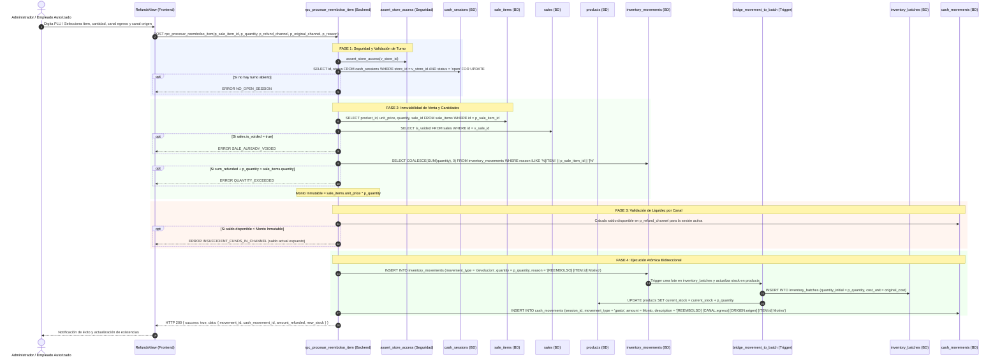
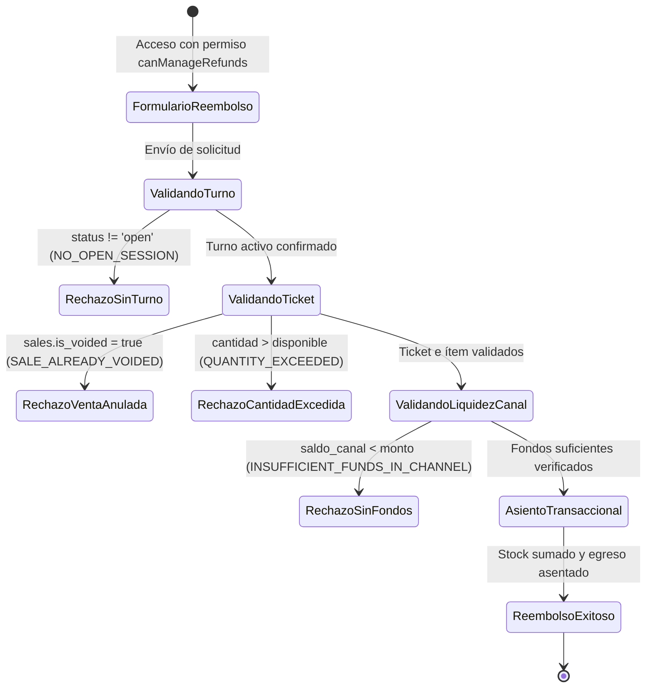

# SDD-006-02: Gestor de Reembolsos y Devoluciones de Ítems de Venta

> **Asociado a:** [FRD-006-02](../FRD/FRD_006_02_GESTOR_REEMBOLSOS.md)  
> **Módulo Primario:** [SDD-006: Núcleo de Inventario y Catálogo Padre](SDD_006_NUCLEO_INVENTARIO_PADRE.md)  
> **Fase del Plan Maestro:** Ola 2 — Inventario, Lotes y Proveedores  
> **Estado:** 🟠 Aprobado con Deuda Técnica Documentada (Protocolo PAC-SDD v2.0)
> **Última Actualización:** 2026-10-14  

---

## 0. Contexto y Restricciones Aplicables

### 0.1 Políticas Globales Activadas (ARQ-002)

| Política ID | Dominio | Mandato Arquitectónico e Impacto en este SDD |
|-------------|---------|-----------------------------------------------|
| **POL-AUTH-01** | Autenticación | **Aislamiento Multi-tenant Centralizado:** Toda operación de reembolso exige la invocación de `assert_store_access(v_store_id)` como instrucción #1 obligatoria. La identidad del responsable se resuelve autoritativamente mediante `get_employee_id_from_session()`, erradicando credenciales ad-hoc o validaciones de PIN manuales. |
| **POL-LOG-01** | Logística | **Restauración Física de Inventario:** El reembolso de mercancía tiene el mandato operativo de reincorporar las unidades devueltas en buen estado al catálogo activo, incrementando `products.current_stock` y creando la capa de lote correspondiente en `inventory_batches`. |
| **POL-FIN-01 / POL-FIN-02** | Financiero | **Solidez de Caja y Segregación Multicanal:** Todo reembolso genera un egreso inmediato en el turno de caja activo (`cash_sessions.status = 'open'`). El canal de egreso (Efectivo por defecto, Nequi o Llave BRE) debe contar con saldo suficiente en la sesión. Queda terminantemente prohibido compensar entre canales o generar sobregiro; si el canal no tiene fondos, la transacción completa se rechaza (rollback). |
| **POL-AUD-01 / POL-AUD-02** | Auditoría | **Inviolabilidad del Kardex y Trazabilidad Vinculada:** El reingreso al inventario (`movement_type = 'devolucion'`) y el egreso financiero (`movement_type = 'gasto'` tipificado como Reembolso) son inseparables e inmutables: o se registran ambos o ninguno. Ambos asientos quedan vinculados mediante un identificador común de operación, congelando ticket, producto, cantidad, monto, canal de salida y canal original. |
| **POL-SEC-01 / POL-SEC-02** | Seguridad | **Control de Acceso RBAC:** El acceso a la herramienta de reembolsos está gobernado por perfil: reservado a administradores o empleados con permiso explícito `canManageRefunds` en `employees.permissions` (JSONB). Erradicación de PINs temporales. |
| **SPEC-010 / SPEC-011** | Moneda y Formato | **Precisión Numérica y Reglas Financieras:** Montos monetarios calculados estrictamente por el backend en pesos colombianos enteros (COP) multiplicando cantidad devuelta por precio unitario congelado. Prohibición total de redondeos al alza o manipulación manual de importes desde el cliente. |

---

### 0.2 Contratos Vecinos que Limitan el Diseño

| SDD Vecino | Interfaces / Operaciones Involucradas | Restricción Inyectada en Reembolsos |
|------------|---------------------------------------|-------------------------------------|
| **SDD_006 (Inventario Padre)** | `products.current_stock`, `products.plu`, `products.price` | **Invariante de Stock No Negativo:** El reingreso físico de mercancía suma unidades a `current_stock` tras asentar el movimiento inmutable en `inventory_movements` con `movement_type = 'devolucion'`. |
| **SDD_007 / SDD_007_01 (Ventas y POS Engine)** | `sales`, `sale_items`, `rpc_anular_venta` | **Límite Funcional y Precio Congelado:** El gestor de reembolsos opera por ítem específico (`sale_item_id`). El valor monetario a devolver se calcula con base en `sale_items.unit_price`. Si el ticket fue anulado previamente (`sales.is_voided = true`), se rechaza con `SALE_ALREADY_VOIDED`. En sentido inverso, `rpc_anular_venta` rechaza la anulación completa si existen reembolsos parciales (`SALE_HAS_PARTIAL_REFUNDS`). |
| **SDD_004 / SDD_020 (Caja y Multicanal)** | `cash_sessions`, `cerrar_caja`, `cash_session_balances` | **Dependencia de Turno Abierto:** Exigencia mandatoria de sesión activa (`status = 'open'`). Validación atómica de liquidez en el canal de salida sin compensación cruzada. |
| **SDD_022 / SDD_026 (Gastos Multicanal)** | `cash_movements`, `cash_movements_movement_type_check` | **Tipificación Operativa en Gasto:** Al estar restringido `movement_type` en BD a `['ingreso', 'gasto', 'pago_proveedor']`, el egreso se registra como `gasto` utilizando el formato estructurado `[REEMBOLSO] [CANAL:<egreso>] [ORIGEN:<original>] [ITEM:<id>] Motivo` en `description`. |
| **SDD_010_016 (Valoración FIFO)** | `inventory_batches`, `consume_stock_fifo`, `bridge_movement_to_batch` | **Reincorporación de Capa FIFO:** La mercancía devuelta de clientes genera una nueva capa de lote en `inventory_batches` vinculada al movimiento (`source_movement_id`). Requiere distinción explícita en triggers entre devolución a proveedores (salida) y de clientes (reingreso). |
| **SDD_018 (Control Operacional)** | `rpc_get_comprehensive_financial_report` | **Aislamiento Contable en P&L:** En el Estado de Resultados, los reembolsos se restan de Ventas Brutas para calcular Ingresos Netos ($\text{Ingresos Netos} = \text{Ventas Brutas} - \text{Devoluciones}$), debiendo aislarse de los gastos operativos (OPEX). |
| **SDD_005 (Auditoría y Trazabilidad)** | `inventory_movements`, `cash_movements`, `audit_logs` | **Inviolabilidad Append-Only:** Prohibición absoluta de mutar o eliminar asientos de devolución en el Kardex o en caja. |

---

### 0.3 Auditoría de Base de Datos Real y Deuda Técnica Declarada (Regla 7)

La verificación empírica directa ejecutada en Supabase Producción (`ihtjocmhzuliwwvdzfnz`) arrojó las siguientes evidencias de esquema:

- **Tabla `products` (17 columnas físicas):** `id`, `store_id`, `name`, `plu`, `price`, `cost_price`, `current_stock`, `min_stock`, `category`, `measurement_unit`, `is_weighable`, `low_stock_alerted`, `created_at`, `updated_at`, `supplier_id`, `brand`, `is_active`.
- **Tabla `inventory_movements` (12 columnas físicas):** `id`, `product_id`, `movement_type`, `quantity`, `reason`, `created_by`, `created_at`, `supplier_id`, `invoice_reference`, `payment_type`, `reference_invoice_id`, `unit_cost`.
  - Constraint `inventory_movements_movement_type_check`: CHECK admite `'entrada'`, `'salida'`, `'devolucion'`, `'merma'`, `'ajuste'`, `'CORRECCION_SISTEMA'`, `'venta'`.
- **Tabla `inventory_batches` (10 columnas físicas):** `id`, `product_id`, `quantity_initial`, `quantity_remaining`, `cost_unit`, `is_active`, `created_at`, `created_by`, `sale_price`, `source_movement_id`.
- **Tabla `cash_sessions` (12 columnas físicas):** `id`, `store_id`, `opened_by`, `closed_by`, `opening_balance`, `expected_balance`, `actual_balance`, `difference`, `status`, `opened_at`, `closed_at`, `forced_close`.
- **Tabla `cash_movements` (7 columnas físicas):** `id`, `session_id`, `movement_type`, `amount`, `description`, `sale_id`, `created_at`.
  - Constraint `cash_movements_movement_type_check`: CHECK admite exclusivamente `'ingreso'`, `'gasto'`, `'pago_proveedor'`. No existe el tipo `'reembolso'`.
- **Triggers y Procedimientos en `pg_proc`:**
  - `bridge_movement_to_batch`: Actualmente agrupa `'devolucion'` junto a `'salida'` y `'merma'` llamando a `consume_stock_fifo`, diseñado para devoluciones a proveedor (salida de stock). Para devoluciones de clientes se requiere reingreso de existencias.
  - `cerrar_caja`: Suma todos los registros de tipo `'gasto'` para calcular el efectivo esperado en gaveta, sin discriminar el canal monetario de egreso.
  - `rpc_procesar_reembolso_item`: No existe físicamente en producción; se define contractualmente en este documento para su posterior migración.

Con base en esta verificación, se formalizan las siguientes 7 deudas técnicas bajo los tres elementos obligatorios de la Regla 7:

| # | Deuda Técnica / Conflicto Real | Qué se Decidió | Por Qué (Trade-off Concreto) | Condición de Revisión Futura |
|---|--------------------------------|----------------|------------------------------|------------------------------|
| **1** | **Constraint en `cash_movements` sin `'reembolso'`**: No existe el tipo ontológico `'reembolso'` en producción. | Insertar el egreso monetario con `movement_type = 'gasto'` y `description` canónico estructurado: `[REEMBOLSO] [CANAL:<egreso>] [ORIGEN:<original>] [ITEM:<sale_item_id>] Motivo`. | Modificar el CHECK constraint compartido de `cash_movements` en caliente en la Ola 2 arriesga inconsistencias en módulos concurrentes; se preserva compatibilidad inmediata con trazabilidad textual. | Adición formal de columnas `category` y `payment_method` en la migración multicanal de la Ola 4. |
| **2** | **Gate DDL Obligatorio sobre `bridge_movement_to_batch`**: El trigger actual redirige `'devolucion'` a `consume_stock_fifo` (decremento de existencias para proveedores). | Establecer como precondición mandatoria de despliegue que la migración de `rpc_procesar_reembolso_item` exige adaptar `bridge_movement_to_batch` para que las devoluciones de clientes (`supplier_id IS NULL`) creen un lote en `inventory_batches` y sumen existencias. | Frena la ejecución física del RPC hasta que el trigger esté corregido, impidiendo la corrupción silenciosa del inventario por consumo erróneo de existencias. | Despliegue de la migración de inventario y lotes en la Ola 2. |
| **3** | **Descuadre en `cerrar_caja` monolítico por egresos digitales**: `cerrar_caja` resta todos los `gasto` del efectivo esperado. Si el reembolso se hace por Nequi o Llave BRE, causará un falso sobrante físico en el arqueo de gaveta. | Registrar la convivencia transitoria: el frontend advertirá al cajero que el arqueo de gaveta en `cerrar_caja` debe reconciliarse si hubo reembolsos digitales, mientras el tag estructurado en `description` permite a la futura versión multicanal segregar el egreso. | Permite reembolsos digitales inmediatos sin frenar la operación a la espera del rediseño integral de cierre de caja multicanal. | Activación plena de `rpc_cerrar_caja_multicanal` con `cash_session_balances` en la Ola 4. |
| **4** | **Salvaguarda bidireccional contra doble restitución con `rpc_anular_venta`**: `rpc_anular_venta` en producción no verifica si hubo devoluciones previas en los ítems del ticket. | `rpc_procesar_reembolso_item` valida que `sales.is_voided = false`. En sentido inverso, se estipula que `rpc_anular_venta` debe rechazar la anulación con `SALE_HAS_PARTIAL_REFUNDS` si hay reembolsos parciales previos. | Requiere gestión manual individual ítem por ítem en comprobantes con devoluciones parciales, pero blinda la integridad financiera contra doble devolución de fondos y stock. | Refactorización de ventas y anulación de comprobantes en la Ola 3. |
| **5** | **Trazabilidad de cantidades devueltas sin columna física en `sale_items`**: `sale_items` no posee la columna `refunded_quantity`. | El backend computará dinámicamente la cantidad ya reembolsada agregando registros en `inventory_movements` vinculados al ítem mediante la etiqueta `[ITEM:<sale_item_id>]`. Si la suma devuelta más la nueva cantidad excede `sale_items.quantity`, se aborta con `QUANTITY_EXCEEDED`. | Evita alterar mediante DDL la tabla central transaccional `sale_items` en la Ola 2, asumiendo una sobrecarga de lectura agregada en el RPC. | Incorporación de la columna escalar `quantity_refunded` en la migración de Ventas V3 en la Ola 3. |
| **6** | **Dualidad de entrada manual por PLU sin ticket vs trazabilidad con `sale_item_id`**: El FRD-006-02 contempla devolución digitando PLU libre de catálogo, mientras que POS y el RVC exigen el ticket de compra original congelado. | El contrato normativo del RPC soporta de forma prioritaria `p_sale_item_id` (garantizando el precio real de venta congelado) y contempla que la interfaz POS/Admin filtre tickets recientes por PLU para enlazar la devolución con el ítem original. | Otorga flexibilidad operativa al tendero de barrio sin abrir brechas de fraude por precios mutados en catálogo. | Alineación formal de la política de devoluciones sin ticket en la Ola 3. |
| **7** | **Extensión de claim RBAC `canManageRefunds` en `employees.permissions` (JSONB)**: `employees.permissions` almacena permisos en formato semi-estructurado. | Documentar que la columna semi-estructurada `employees.permissions` admite la inyección de la claim booleana `canManageRefunds` sin alterar el DDL de la tabla física `employees`. | Cero impacto de esquema en BD, extensible por aplicación y validable de forma estricta en backend. | Registro formal de la claim en el catálogo maestro de permisos en la Ola 2. |

---

## 1. Mandato del Negocio (Traducción del FRD)

El documento [FRD-006-02](../FRD/FRD_006_02_GESTOR_REEMBOLSOS.md) establece las directrices funcionales y contables obligatorias para las devoluciones de ítems y reembolsos de dinero al cliente:

### 1.1 Reglas de Negocio (Citas Textuales)

1. **Regla 1: Control de Acceso Basado en Perfil:**
   > *"No se requieren PINs temporales. El acceso a esta herramienta está gobernado estrictamente por el sistema de permisos. Un empleado solo podrá visualizar y ejecutar esta función si el Administrador le ha otorgado explícitamente dicho permiso en su perfil de usuario."*

2. **Regla 2: Entrada Manual por PLU:**
   > *"El registro del producto a devolver se realiza digitando manualmente su código identificador interno (PLU), prescindiendo del uso del escáner de código de barras."*

3. **Regla 3: Cálculo de Monto Estricto e Inmutable:**
   > *"Una vez ingresado el PLU y la cantidad de unidades, el sistema calcula automáticamente el valor monetario a devolver (basado en el precio de venta del sistema). Este monto total desglosado es exacto e inalterable por el usuario. El sistema y el cajero asumen este valor como la única verdad contable para el reembolso."*

4. **Regla 4: Transacción Atómica Bidireccional:**
   > *"Al confirmar el reembolso, el sistema ejecuta una única transacción en la base de datos que dispara dos eventos simultáneos:*  
   > *- Evento Logístico: Incrementa el inventario del PLU en la cantidad especificada.*  
   > *- Evento Financiero: Registra un 'Egreso' (salida de efectivo) en la sesión de caja activa por el monto exacto calculado."*

5. **Regla 5: Dependencia de Turno Activo:**
   > *"Para poder entregar dinero al cliente, el sistema exige que el usuario tenga un Turno de Caja (Sesión) abierto y vigente. El egreso queda amarrado al session_id actual, asegurando que el arqueo de caja al final del día refleje el dinero entregado por la devolución."*

6. **Regla 6: Selección de Canal y Validación de Fondos por Canal:**
   > *- "Todo reembolso DEBE especificar el canal por el cual sale el dinero: EFECTIVO, NEQUI o LLAVE BRE (los tres canales fijos de FRD-004 Caja Estricta Multicanal). La interfaz DEBE preseleccionar EFECTIVO por defecto, permitiendo al usuario modificarlo a cualquiera de los otros canales permitidos."*  
   > *- "Para garantizar total transparencia y trazabilidad contable, el formulario DEBE incluir una lista desplegable para registrar el Canal de Venta Original (Efectivo, Nequi, Llave BRE) por el cual el cliente pagó la compra inicial."*  
   > *- "El canal de egreso seleccionado DEBE ser el origen real del dinero entregado al cliente (mismo principio de FRD-026). El saldo de cada canal se evalúa de forma aislada por turno (FRD-027, Regla 2)."*  
   > *- "El servidor DEBE validar los fondos disponibles exclusivamente en el canal de egreso seleccionado (FRD-027, Regla 3). Si los fondos no alcanzan, el servidor DEBE rechazar la operación completa: no se ingresa stock ni se registra egreso. No se compensa con saldo de otro canal ni se permite sobregiro."*  
   > *- "La pantalla de reembolsos NO DEBE ofrecer ni requerir ingresos manuales ficticios para habilitar un reembolso."*  
   > *- "Cuando el canal de egreso difiere del canal de venta original, el sistema registra ambos canales de forma transparente para auditoría sin realizar transferencias automáticas entre canales: cada canal concilia su realidad contable independientemente."*

7. **Regla 7: Trazabilidad Contable del Reembolso (POL-AUD-02):**
   > *- "El Egreso generado DEBE clasificarse con el tipo o subtipo Reembolso, diferenciado claramente de los gastos operativos estándar, para que los reportes de caja (FRD-027-01) y el análisis financiero (FRD-018, fórmula: Ingresos Netos = Ventas Brutas - Devoluciones) puedan identificarlo, aislarlo y descontarlo correctamente."*  
   > *- "El Egreso de caja y el Ingreso de inventario de una misma operación DEBEN quedar vinculados entre sí con un identificador común de operación, almacenando: session_id, usuario responsable, PLU, cantidad, monto total reembolsado, canal de egreso y canal de venta original."*  
   > *- "Ambos registros son inmutables. Cualquier error en el proceso se corrige mediante contra-movimiento auditable (FRD-004 Control de Caja, Regla 5)."*

---

### 1.2 Casos de Uso del Negocio

#### Caso A: Reembolso por Producto Devuelto
- **Actor:** Administrador o Empleado con permiso explícito de Reembolso (`canManageRefunds`).
- **Precondición:** El cliente devuelve mercancía en buen estado. El actor tiene un turno de caja activo.
- **Flujo Principal:**
  1. El actor navega a la pantalla de "Administración", bajo la sección "Equipo", y abre la herramienta de Reembolsos.
  2. Digita manualmente el código PLU del producto (o selecciona el ítem del comprobante original).
  3. Ingresa la cantidad de productos a devolver.
  4. El sistema calcula y muestra en pantalla el total exacto a reembolsar al cliente.
  5. El actor selecciona en la lista desplegable el Canal de Venta Original (Efectivo, Nequi o Llave BRE) por el que pagó el cliente.
  6. El actor verifica el Canal de Reembolso (Efectivo preseleccionado por defecto) y lo modifica si entregará el dinero por un canal digital.
  7. El actor confirma la operación.
  8. El sistema valida fondos en el canal de egreso, extrae el dinero contablemente de dicho canal en la sesión de caja, registra el canal original para trazabilidad y suma el stock al inventario de forma atómica.
- **Flujo Alternativo (Sin Permiso):** Si un cajero sin autorización intenta acceder a la ruta, el sistema le deniega el acceso visual o funcional.
- **Flujo Alternativo (Sin Turno):** Si el actor tiene permisos pero su caja está cerrada, el sistema aborta la operación advirtiendo que no hay caja de dónde sacar el dinero (`NO_OPEN_SESSION`).
- **Flujo Alternativo (Fondos Insuficientes en el Canal):** Si el canal de reembolso seleccionado no posee saldo suficiente en el turno activo, el sistema aborta la operación completa y muestra: *"Fondos insuficientes en [canal]. Saldo actual: $X. Selecciona el canal por el que realmente entregarás el dinero."* El formulario conserva el PLU, la cantidad y el canal original para que el actor ajuste el canal de entrega y reintente sin perder los datos ingresados. No se modifica inventario ni caja.
- **Postcondición:** El inventario aumenta, el flujo de caja del turno actual registra un egreso tipificado como Reembolso en el canal de salida, el canal original queda registrado para auditoría y el arqueo de cada canal cuadra con la realidad física y digital.

---

### 1.3 Criterios de Aceptación (Citas Textuales)

- **CA-FRD-006-02-01:** *"La herramienta de devoluciones DEBE estar protegida por la matriz de roles y permisos existente, denegando el renderizado o ejecución a usuarios sin autorización."*
- **CA-FRD-006-02-02:** *"La interfaz DEBE requerir la digitación del PLU y PROHIBIR la edición manual del campo 'Monto a Reembolsar', el cual debe ser un cálculo inyectado por el sistema."*
- **CA-FRD-006-02-03:** *"El backend DEBE abortar (rollback) la operación si la inserción del ingreso de inventario falla, o si la inserción del egreso de caja falla, garantizando consistencia."*
- **CA-FRD-006-02-04:** *"La función backend DEBE exigir un session_id activo para procesar el egreso de dinero."*
- **CA-FRD-006-02-05:** *"La interfaz muestra el canal de egreso con Efectivo preseleccionado por defecto, permitiendo cambiarlo a Nequi o Llave BRE."*
- **CA-FRD-006-02-06:** *"La interfaz incluye una lista desplegable obligatoria para registrar el canal de venta original (Efectivo, Nequi, Llave BRE) y el sistema lo persiste junto a la transacción."*
- **CA-FRD-006-02-07:** *"El backend DEBE rechazar el reembolso completo (sin ingresar stock ni registrar egreso) si el canal de salida no tiene fondos suficientes en el turno, sin compensar con otros canales."*
- **CA-FRD-006-02-08:** *"El egreso generado queda tipificado como Reembolso (diferenciado de gastos operativos) para asegurar el cálculo de Ingresos Netos según FRD-018."*
- **CA-FRD-006-02-09:** *"El egreso de caja y el ingreso de inventario quedan vinculados atómicamente con trazabilidad completa (turno, usuario, PLU, cantidad, monto, canal de salida y canal original)."*

---

## 2. Arquitectura del Flujo y Estado

### 2.1 Flujo Transaccional Atómico Bidireccional (Mermaid)



---

### 2.2 Diagrama de Estados del Reembolso



---

### 2.3 Regla de Cero Cálculos en Frontend (Flujo Unidireccional)

1. **El Frontend NO Calcula:** El cliente tiene estrictamente prohibido multiplicar precio por unidades, restar devoluciones de totales o inferir saldos de canales. La interfaz solo presenta el valor computado por el backend.
2. **El Frontend Solo Pide:** Envía la intención `{ p_sale_item_id, p_quantity, p_refund_channel, p_original_channel, p_reason }`.
3. **El Servidor es la Autoridad:** El backend recalcula el importe con base en el precio histórico inmutable congelado en `sale_items.unit_price`, verifica fondos disponibles en el canal seleccionado y ejecuta el doble asiento.

---

## 3. Seguridad y Multi-Tenant

### 3.1 Aislamiento Multi-Tenant y Validación de Tienda (Regla 4)

- **Instrucción #1 Mandatoria:** Todo RPC o mutación que procese un reembolso debe ejecutar como primera sentencia:
  `PERFORM assert_store_access(v_store_id);`
  donde `v_store_id` se resuelve de la sesión activa o de la tienda asociada al ítem de venta. Si el usuario no tiene acceso a dicha tienda, el motor lanza la excepción `STORE_ACCESS_DENIED`.
- **Políticas RLS en Tablas Afectadas:**
  - `products`: Protegida por `products_select_store` y `products_update_store` con filtro `store_id = get_current_store_id()`.
  - `inventory_movements`: Protegida por `movements_select_store` vinculando con `products.store_id = get_current_store_id()`.
  - `cash_sessions`: Protegida por `cash_sessions_policy` con filtro `store_id = get_current_store_id()`.
  - `cash_movements`: Protegida por `cash_movements_select_store` vinculando con `cash_sessions.store_id = get_current_store_id()`.
- **Resolución de Autoría:** La autoría del movimiento de inventario y de caja se resuelve autoritativamente mediante `get_employee_id_from_session()`, asociando el ID del empleado que opera la sesión.

---

### 3.2 Matriz de Control de Acceso Basada en Perfil (RBAC)

De acuerdo con la Regla 1 del FRD-006-02, se erradican los PINs temporales. El acceso se gobierna exclusivamente por la matriz de roles y permisos:

| Rol de Usuario | Permiso en `employees.permissions` | Visualización de Pantalla | Ejecución de Reembolso | Restricciones Operativas |
|----------------|------------------------------------|:-------------------------:|:----------------------:|--------------------------|
| **Administrador** | N/A (Rol jerárquico supremo) | SÍ | SÍ | Acceso total en todas las tiendas de su propiedad. |
| **Empleado con Permiso** | `"canManageRefunds": true` | SÍ | SÍ | Requiere turno de caja propio abierto (`status = 'open'`). |
| **Cajero Estándar** | `"canManageRefunds": false` | NO | NO | Acceso denegado en UI y aborto transaccional en backend. |

---

## 4. Casos Límite y Concurrencia (Regla 5 de AGENTS.md)

| ID | Escenario de Caso Límite | Comportamiento del Motor / Backend | Código de Error | Respuesta Visual en UI |
|---|---------------------------|-------------------------------------|-----------------|------------------------|
| **CL-01** | **Fondos Insuficientes en Canal de Salida** | Evalúa el saldo del canal (`p_refund_channel`) en la sesión. Si el monto excede el saldo, ejecuta rollback total sin alterar stock ni caja. | `INSUFFICIENT_FUNDS_IN_CHANNEL` | Mensaje: *"Fondos insuficientes en [Canal]. Saldo disponible: $X. Selecciona otro canal."* Formulario retiene datos para reintento. |
| **CL-02** | **Caja Cerrada o Inexistente** | Verifica `cash_sessions.status = 'open'`. Si no hay sesión o ya fue cerrada, aborta inmediatamente. | `NO_OPEN_SESSION` | Mensaje: *"Se requiere un turno de caja abierto para entregar dinero al cliente."* |
| **CL-03** | **Turno Expirado (> 24 Horas)** | Si la sesión tiene más de 24 horas abierta sin cerrar, el sistema prohíbe nuevos egresos por expiración. | `SESSION_EXPIRED` | Mensaje: *"El turno de caja actual ha expirado. Realiza el cierre de turno antes de continuar."* |
| **CL-04** | **Intento de Doble Reembolso (Cantidad Excedida)** | Calcula `SUM(quantity)` devueltas previamente para `p_sale_item_id`. Si nueva cantidad + previas > cantidad vendida en ticket, rechaza. | `QUANTITY_EXCEEDED` | Mensaje: *"La cantidad a devolver (X) supera el remanente disponible en el ticket (Y)."* |
| **CL-05** | **Venta Previamente Anulada** | Verifica `sales.is_voided = true`. Si el comprobante completo fue anulado, prohíbe devoluciones individuales de ítems. | `SALE_ALREADY_VOIDED` | Mensaje: *"Esta venta ya fue anulada en su totalidad. No admite reembolsos por ítem."* |
| **CL-06** | **Anulación Concurrente de Ticket con Reembolsos Parciales** | `rpc_anular_venta` detecta que el ticket tiene reembolsos parciales previos registrados en `inventory_movements` o `cash_movements`. | `SALE_HAS_PARTIAL_REFUNDS` | Mensaje: *"No se puede anular la venta completa porque contiene ítems reembolsados. Gestiona los ítems restantes individualmente."* |
| **CL-07** | **Reembolso Cruzado Multicanal (Diferente Canal de Origen y Egreso)** | El backend valida liquidez en canal de egreso, asienta el egreso en dicho canal y persiste ambos canales en `description` sin compensaciones ficticias. | N/A (Operación Válida) | La UI muestra confirmación del canal real de desembolso y el canal original para efectos de auditoría. |
| **CL-08** | **Concurrencia y Condición de Carrera en Desembolso** | La función aplica bloqueo pesimista `SELECT ... FOR UPDATE` sobre la sesión de caja y sobre el producto, serializando peticiones simultáneas. | N/A (Garantía de Consistencia) | Spinner de carga bloqueante en UI; previene doble click y sobregiro concurrente. |

---

## 5. Contratos de Interfaz

### 5.1 Operación: `rpc_procesar_reembolso_item` (Acción - WRITE)

Procesa de forma atómica y bidireccional la devolución física de un ítem vendido y el egreso monetario de la caja activa.

#### Payload de Entrada (JSON Schema Formal)

```json
{
  "$schema": "http://json-schema.org/draft-07/schema#",
  "title": "ProcesarReembolsoItemRequest",
  "type": "object",
  "required": [
    "p_sale_item_id",
    "p_quantity",
    "p_refund_channel",
    "p_original_channel",
    "p_reason"
  ],
  "properties": {
    "p_sale_item_id": {
      "type": "string",
      "format": "uuid",
      "description": "Identificador único inmutable del ítem específico vendido en el ticket."
    },
    "p_quantity": {
      "type": "number",
      "minimum": 0.01,
      "description": "Cantidad física a devolver. Para artículos pesables admite hasta 2 decimales; para unidades enteras números enteros."
    },
    "p_refund_channel": {
      "type": "string",
      "enum": ["efectivo", "nequi", "llave_bre"],
      "description": "Canal monetario real por el cual se desembolsa el dinero al cliente."
    },
    "p_original_channel": {
      "type": "string",
      "enum": ["efectivo", "nequi", "llave_bre"],
      "description": "Canal monetario original por el cual el cliente pagó la compra inicial."
    },
    "p_reason": {
      "type": "string",
      "minLength": 3,
      "maxLength": 255,
      "description": "Motivo justificado de la devolución para trazabilidad forense."
    }
  },
  "additionalProperties": false
}
```

#### Payload de Respuesta Exitosa (`ActionResponse`)

```json
{
  "$schema": "http://json-schema.org/draft-07/schema#",
  "title": "ProcesarReembolsoItemResponse",
  "type": "object",
  "required": ["success", "data"],
  "properties": {
    "success": {
      "type": "boolean",
      "enum": [true]
    },
    "data": {
      "type": "object",
      "required": [
        "movement_id",
        "cash_movement_id",
        "product_id",
        "amount_refunded",
        "refund_channel",
        "original_channel",
        "new_stock"
      ],
      "properties": {
        "movement_id": {
          "type": "string",
          "format": "uuid",
          "description": "Identificador del registro de devolución generado en inventory_movements."
        },
        "cash_movement_id": {
          "type": "string",
          "format": "uuid",
          "description": "Identificador del egreso monetario generado en cash_movements."
        },
        "product_id": {
          "type": "string",
          "format": "uuid",
          "description": "Identificador del producto cuyo stock fue reincorporado."
        },
        "amount_refunded": {
          "type": "integer",
          "minimum": 0,
          "description": "Monto total monetario devuelto al cliente en pesos colombianos enteros (COP)."
        },
        "refund_channel": {
          "type": "string",
          "enum": ["efectivo", "nequi", "llave_bre"],
          "description": "Canal de salida real del dinero."
        },
        "original_channel": {
          "type": "string",
          "enum": ["efectivo", "nequi", "llave_bre"],
          "description": "Canal original de compra registrado para auditoría."
        },
        "new_stock": {
          "type": "number",
          "description": "Existencias actualizadas del producto en el catálogo tras el reingreso."
        }
      },
      "additionalProperties": false
    }
  },
  "additionalProperties": false
}
```

#### Catálogo Exhaustivo de Códigos de Error

| Código de Error | Causa Raíz en Motor | Mensaje Técnico Propagado | Acción Correctiva Sugerida en UI |
|-----------------|---------------------|---------------------------|----------------------------------|
| `STORE_ACCESS_DENIED` | Falla en `assert_store_access` | Permiso denegado para operar en esta tienda | Redirigir al login o selector de tienda autorizada. |
| `NO_OPEN_SESSION` | `cash_sessions` no tiene fila `open` | No existe un turno de caja abierto en la tienda | Mostrar modal para realizar apertura de caja. |
| `SESSION_EXPIRED` | Turno abierto con antigüedad > 24h | La sesión de caja activa ha superado las 24 horas | Forzar flujo de arqueo y cierre de caja. |
| `INSUFFICIENT_FUNDS_IN_CHANNEL` | Saldo en canal < Monto | Fondos insuficientes en el canal seleccionado | Mostrar saldo actual del canal y permitir seleccionar otro canal de egreso. |
| `QUANTITY_EXCEEDED` | Devolución > Remanente vendido | La cantidad solicitada excede la vendida en el ticket | Ajustar la cantidad a un valor menor o igual al remanente. |
| `SALE_ALREADY_VOIDED` | `sales.is_voided = true` | La venta original se encuentra totalmente anulada | Informar al operador que no se admiten reembolsos en comprobantes anulados. |
| `SALE_ITEM_NOT_FOUND` | `sale_items.id` no existe en la tienda | El ítem de venta especificado no fue encontrado | Verificar el comprobante original ingresado. |
| `PERMISSION_DENIED` | Usuario sin `canManageRefunds` | El empleado no cuenta con permisos para devoluciones | Bloquear el botón y notificar requerimiento de autorización de administrador. |

---

## 6. Matriz de Trazabilidad e Impacto

| Requisito FRD / Política | Sección SDD | Elemento en Esquema BD | Impacto en Flujo de Datos y Garantía de Consistencia |
|--------------------------|-------------|------------------------|------------------------------------------------------|
| **FRD-006-02 Regla 1 (RBAC)** | §3.2 | `employees.permissions` (JSONB) | La clave `canManageRefunds` valida la autorización en cliente y servidor sin usar PINs. |
| **FRD-006-02 Regla 3 (Inmutabilidad)** | §2.3, §5.1 | `sale_items.unit_price` | El monto devuelto es inalterable y proviene del registro histórico congelado en BD. |
| **FRD-006-02 Regla 4 (Atomicidad)** | §2.1, §5.1 | `inventory_movements` + `cash_movements` | Asiento coordinado en una sola transacción: reingreso de stock y egreso monetario inseparables. |
| **FRD-006-02 Regla 5 (Turno Activo)** | §0.1, §4 | `cash_sessions.status` | Exige turno `open`, garantizando que el arqueo de cierre refleje el dinero extraído. |
| **FRD-006-02 Regla 6 (Multicanal)** | §0.1, §5.1 | `cash_movements.description` | Segrega saldos por canal, evita sobregiros y persiste canal de egreso y canal original. |
| **FRD-006-02 Regla 7 (POL-AUD-02)** | §0.1, §5.1 | `inventory_movements.reason` / `cash_movements.description` | Etiqueta canónica `[REEMBOLSO] [ITEM:<id>]` que vincula ambos asientos forenses. |
| **POL-FIN-01 / POL-FIN-02** | §0.1, §4 | Validación de saldos en canal | Previene saldos negativos y bloquea compensaciones ficticias entre gaveta física y digital. |
| **POL-AUTH-01** | §3.1 | `assert_store_access()` | Blindaje multi-tenant hermético en la primera línea de ejecución del RPC. |
| **Regla 7 AGENTS.md (Deuda D-2)** | §0.3 | Trigger `bridge_movement_to_batch` | Gate DDL obligatorio: precondición de adaptar el trigger para sumar existencias a clientes. |
| **Regla 7 AGENTS.md (Deuda D-4)** | §0.3, §4 | `rpc_anular_venta` | Salvaguarda bidireccional: rechaza anulación completa si existen reembolsos parciales. |

---

## 7. Verificación de Esquema Real

Introspección directa de columnas, tipos, constraints y privilegios verificada en Supabase Producción (`ihtjocmhzuliwwvdzfnz`):

### 7.1 Catálogo Físico de Columnas Involucradas

| Tabla | Columna | Tipo de Dato | Nullable | Rol en Reembolsos |
|-------|---------|--------------|:--------:|-------------------|
| `products` | `id` | `uuid` | NO | Clave primaria del artículo. |
| `products` | `store_id` | `uuid` | NO | Clave foránea multi-tenant. |
| `products` | `current_stock` | `numeric` | YES | Existencias reactivas actualizadas por el trigger de lotes. |
| `products` | `plu` | `text` | YES | Código identificador digitado por el comerciante. |
| `products` | `price` | `numeric` | NO | Precio de lista vigente (usado en devoluciones sin ticket según Caso A). |
| `products` | `is_active` | `boolean` | NO | Estado del producto en catálogo. |
| `sale_items` | `id` | `uuid` | NO | Identificador único del ítem vendido. |
| `sale_items` | `sale_id` | `uuid` | NO | Clave foránea del ticket original. |
| `sale_items` | `product_id` | `uuid` | NO | Clave foránea del producto vendido. |
| `sale_items` | `quantity` | `numeric` | NO | Cantidad original vendida en el ticket. |
| `sale_items` | `unit_price` | `numeric` | NO | Precio unitario inmutable congelado al momento de la venta. |
| `sales` | `id` | `uuid` | NO | Clave primaria del ticket. |
| `sales` | `is_voided` | `boolean` | NO | Bandera de anulación integral del ticket. |
| `inventory_movements` | `id` | `uuid` | NO | Clave primaria del movimiento de Kardex. |
| `inventory_movements` | `product_id` | `uuid` | NO | Clave foránea del producto devuelto. |
| `inventory_movements` | `movement_type` | `text` | NO | Fijo `'devolucion'` para reingreso a inventario. |
| `inventory_movements` | `quantity` | `numeric` | NO | Cantidad devuelta (positiva). |
| `inventory_movements` | `reason` | `text` | YES | Almacena tag `[REEMBOLSO] [ITEM:<id>]` y motivo. |
| `inventory_movements` | `created_by` | `uuid` | YES | Empleado responsable resuelto por sesión. |
| `inventory_batches` | `id` | `uuid` | NO | Clave primaria del lote de reingreso FIFO. |
| `inventory_batches` | `quantity_initial` | `numeric` | NO | Cantidad devuelta creada como nueva capa. |
| `inventory_batches` | `quantity_remaining` | `numeric` | NO | Saldo disponible de la capa devuelta. |
| `inventory_batches` | `cost_unit` | `numeric` | NO | Costo unitario original restaurado. |
| `inventory_batches` | `source_movement_id` | `uuid` | YES | Vínculo con el registro en `inventory_movements`. |
| `cash_sessions` | `id` | `uuid` | NO | Clave primaria de la sesión de caja activa. |
| `cash_sessions` | `store_id` | `uuid` | NO | Tienda propietaria de la sesión. |
| `cash_sessions` | `status` | `text` | NO | Estado del turno (debe ser `'open'`). |
| `cash_movements` | `id` | `uuid` | NO | Clave primaria del egreso monetario. |
| `cash_movements` | `session_id` | `uuid` | NO | Vínculo con el turno activo. |
| `cash_movements` | `movement_type` | `text` | NO | Fijo `'gasto'` por constraint de BD. |
| `cash_movements` | `amount` | `numeric` | NO | Monto exacto devuelto al cliente. |
| `cash_movements` | `description` | `text` | YES | Tag canónico estructurado con canales e ítem. |

---

### 7.2 Constraints y Privilegios Base Verificados (Regla 8)

- **Constraints de Integridad Física:**
  - `inventory_movements_movement_type_check`: CHECK `(movement_type = ANY (ARRAY['entrada', 'salida', 'devolucion', 'merma', 'ajuste', 'CORRECCION_SISTEMA', 'venta']))`.
  - `cash_movements_movement_type_check`: CHECK `(movement_type = ANY (ARRAY['ingreso', 'gasto', 'pago_proveedor']))`.
  - `cash_sessions_status_check`: CHECK `(status = ANY (ARRAY['open', 'closed']))`.
- **Privilegios Base (`GRANT ALL` según Regla 8):**
  - Verificado en `information_schema.role_table_grants` que las tablas `products`, `sale_items`, `sales`, `inventory_movements`, `inventory_batches`, `cash_sessions` y `cash_movements` tienen otorgados los privilegios `SELECT, INSERT, UPDATE, DELETE` a los roles `anon`, `authenticated` y `service_role`.
