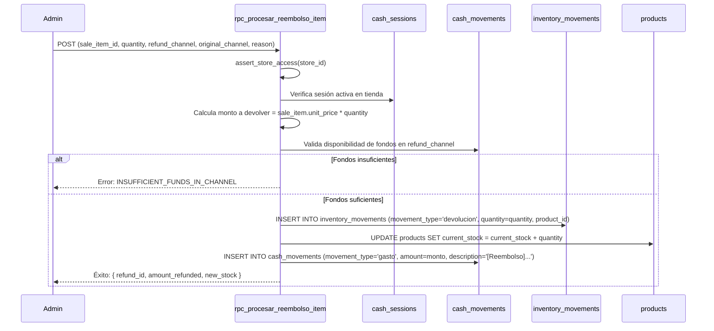
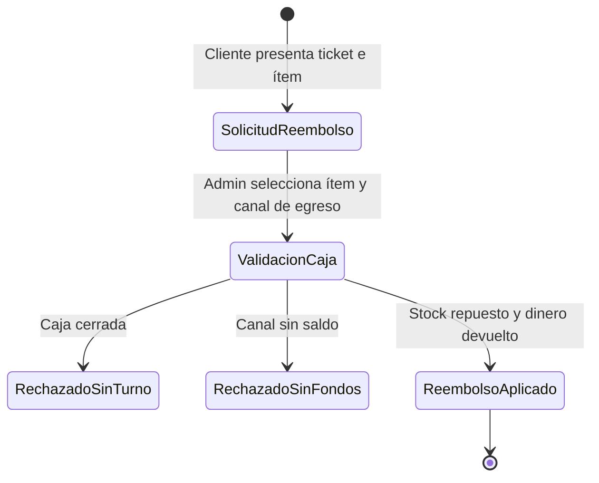
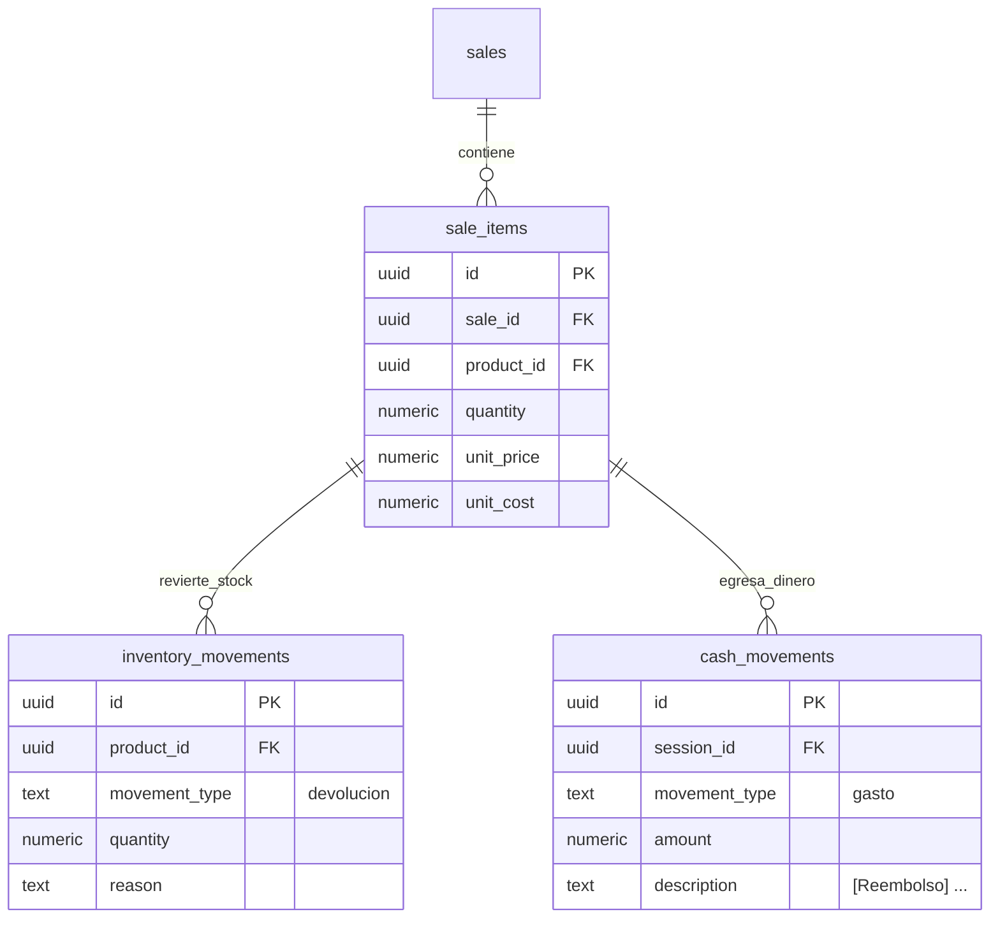

# SDD-006-02: Gestor de Reembolsos (Devoluciones Multicanal de Clientes)

> **Asociado a:** [FRD-006-02](../FRD/FRD_006_02_GESTOR_REEMBOLSOS.md)  
> **Fase del Plan:** Ola 2 — Inventario, Lotes y Proveedores  
> **Estado:** 🟠 Aprobado con Deuda Técnica Documentada (Deuda: Migración RPC de reembolso atómico pendiente)  
> **Última Actualización:** 2026-10-11  

---

## 0. Contexto y Restricciones Aplicables

### 0.1 Políticas Globales Activadas (ARQ-002)
| Política ID | Dominio | Impacto Concreto en este SDD |
|-------------|---------|------------------------------|
| **POL-FIN-01** | Financiero | **Solidez de Caja:** Todo reembolso de dinero genera un egreso inmediato en el turno de caja activo. Queda prohibido devolver dinero si la caja está cerrada. |
| **POL-FIN-02** | Financiero | **Segregación de Canales y Prevención de Sobregiros:** El canal de egreso (Efectivo por defecto) debe contar con fondos suficientes en la sesión activa. Se prohíbe compensar entre canales. |
| **POL-FIN-04** | Financiero | **Transacción Atómica Bidireccional:** El reingreso del producto a stock (`movement_type = 'devolucion'`) y la extracción monetaria de caja (`movement_type = 'gasto'`, tipificado como Reembolso) son inseparables: o se ejecutan ambos o ninguno. |
| **POL-SEC-02** | Seguridad | **Control RBAC:** Exclusivo para Administradores o empleados con permiso explícito `canManageRefunds`. |

### 0.2 Contratos Vecinos que Limitan el Diseño
| SDD Origen | Restricción Inyectada | Impacto en Reembolsos |
|------------|-----------------------|-----------------------|
| **SDD_004 (Control de Caja)** | Exigencia de turno abierto. | Si la tienda no tiene caja `OPEN`, el reembolso es bloqueado. |
| **SDD_020 (Caja Multicanal)** | Selección de canal de egreso. | Permite seleccionar el canal por el cual se entrega el dinero (Efectivo por defecto) y registra el canal original de la venta. |
| **SDD_018 (Control Operacional)** | Tipificación contable. | El egreso se clasifica como `Reembolso` para el cálculo exacto de Ingresos Netos en el Estado de Resultados. |
| **SDD_007 (Ventas y POS)** | Límite funcional vs Anulación. | El Gestor de Reembolsos se utiliza para devolver **ítems específicos**. La anulación completa del ticket se rige por `SDD_007`. |

### 0.3 Auditoría de BD contra Realidad (Deuda Técnica Declarada)
*Evidencia cruda obtenida de Supabase Producción (`ihtjocmhzuliwwvdzfnz`):*

```sql
-- En producción, rpc_procesar_venta_v3 aún no está desplegado. El motor actual es rpc_procesar_venta_v2.
-- Constraint en cash_movements:
-- cash_movements_movement_type_check: CHECK (movement_type = ANY (ARRAY['ingreso', 'gasto', 'pago_proveedor']))
-- inventory_movements_movement_type_check: CHECK (movement_type = ANY (ARRAY['entrada', 'salida', 'devolucion', 'merma', 'ajuste', 'CORRECCION_SISTEMA', 'venta']))
```

| Hallazgo / Componente | Brecha Real Detectada | Solución Normativa y Trade-off | Condición de Revisión |
|-----------------------|-----------------------|---------------------------------|-----------------------|
| 🔴 **Despliegue de RPC Reembolso** | La versión monolítica `rpc_procesar_venta_v3` no está en BD. Los reembolsos de ítems aislados requieren su propia función atómica `rpc_procesar_reembolso_item`. | **Decisión:** Formalizar el contrato `rpc_procesar_reembolso_item` con doble asiento atómico (devolución a stock + egreso en caja). | Despliegue de la migración del RPC dedicado a reembolsos. |
| 🔴 **Categorización en cash_movements** | `cash_movements` no tiene columna `payment_method` ni `category` en producción. | **Decisión:** El egreso se registra con `movement_type = 'gasto'` y `description = '[Reembolso] Ticket #TK-XXX Producto Y'`. | Migración multicanal en producción. |

---

## 1. Glosario Local

- **Reembolso Parcial / por Ítem:** Operación donde el cliente devuelve una cantidad específica de un ítem adquirido, reintegrando el artículo al inventario y recibiendo el dinero por el canal acordado.
- **Canal de Egreso:** Medio por el cual se devuelve el dinero al cliente (`efectivo`, `nequi`, `llave_bre`).
- **Canal Original:** Medio con el cual el cliente pagó la compra inicialmente.

---

## 2. Diagramas de Secuencia



---

## 3. Diagramas de Estado



---

## 4. Especificación Detallada de Casos de Uso

### Caso A: Devolución de Ítem con Reembolso en Efectivo
- **Actor:** Administrador o empleado con permiso `canManageRefunds`.
- **Precondición:** Turno de caja abierto. Venta original activa en el sistema.
- **Flujo Principal:**
  1. El usuario ubica la venta original y selecciona el ítem específico devuelto.
  2. El sistema congela el precio histórico de venta del ítem.
  3. El usuario indica la cantidad devuelta (ej. 1 unidad).
  4. El sistema preselecciona por defecto el canal "Efectivo" para la devolución.
  5. El usuario confirma el canal original de la venta (ej. Nequi) y el canal de salida real (Efectivo).
  6. El servidor valida que el canal Efectivo tenga saldo suficiente en el turno activo.
  7. El servidor asienta el reingreso al inventario (`devolucion`) y el egreso de caja (`gasto` con tag `[Reembolso]`).
- **Postcondición:** Stock restaurado atómicamente, dinero devuelto registrado en caja sin sobregiro.

### Caso B: Fondos Insuficientes en Canal de Devolución
- **Actor:** Administrador.
- **Precondición:** El canal de egreso seleccionado tiene saldo menor al monto a devolver.
- **Flujo Principal:**
  1. El Admin intenta devolver $45.000 seleccionando "Nequi", pero la caja solo tiene $10.000 en Nequi.
  2. El servidor interrumpe la operación y retorna `INSUFFICIENT_FUNDS_IN_CHANNEL`.
  3. El Admin selecciona un canal alternativo con liquidez (ej. Efectivo) y reintenta.
- **Postcondición:** Se previene la generación de saldos negativos en canales digitales.

---

## 5. Contrato de Interfaz

### Operación: `rpc_procesar_reembolso_item`
- **Tipo:** RPC Postgres / Acción (WRITE)
- **Entradas:**
  ```json
  {
    "p_sale_item_id": "UUID (Obligatorio)",
    "p_quantity": "NUMERIC > 0 (Obligatorio, <= quantity original no reembolsada)",
    "p_refund_channel": "TEXT (Obligatorio: 'efectivo', 'nequi', 'llave_bre')",
    "p_reason": "TEXT (Obligatorio, motivo de la devolución)"
  }
  ```
- **Salida Exitosa:**
  ```json
  {
    "success": true,
    "data": {
      "movement_id": "UUID",
      "cash_movement_id": "UUID",
      "product_id": "UUID",
      "amount_refunded": 25000.00,
      "refund_channel": "efectivo",
      "new_stock": 18.00
    }
  }
  ```
- **Catálogo de Errores:**
  | Código de Error | Causa | Mensaje Técnico |
  |-----------------|-------|-----------------|
  | `STORE_ACCESS_DENIED` | Sin permisos de administración | Permiso insuficiente para procesar reembolsos |
  | `NO_OPEN_SESSION` | Caja cerrada | Se requiere un turno de caja abierto para entregar dinero |
  | `INSUFFICIENT_FUNDS_IN_CHANNEL` | Saldo menor en el canal | Fondos insuficientes en el canal seleccionado |
  | `QUANTITY_EXCEEDED` | Cantidad mayor a la comprada | La cantidad a devolver excede lo vendido en el ticket |
  | `SALE_ALREADY_VOIDED` | Ticket anulado previamente | No se pueden procesar reembolsos de una venta anulada |

---

## 6. Análisis de Seguridad

- **Blindaje RBAC:** El rol `employee` estándar tiene bloqueada la ruta RPC en la política de base de datos a menos que cuente con claim `canManageRefunds`.
- **Inmutabilidad del Precio Histórico:** El precio a reembolsar se extrae directamente de `sale_items.unit_price`; el cliente no puede alterar el valor monetario a reintegrar.
- **Atomicidad Transaccional:** El reingreso a stock y el egreso monetario corren bajo una misma transacción SQL (`BEGIN ... COMMIT`).

---

## 7. Modelo de Datos Lógico



### Diccionario de Datos
| Tabla | Atributo | Tipo | Nullable | Estado en BD | Descripción |
|-------|----------|------|----------|--------------|-------------|
| `sale_items` | `id` | UUID | NO | ✅ Sí | Ítem específico del ticket |
| `sale_items` | `unit_price` | NUMERIC | NO | ✅ Sí | Precio unitario inmutable congelado en la venta |
| `inventory_movements` | `movement_type` | TEXT | NO | ✅ Sí | Fijo `'devolucion'` |
| `cash_movements` | `amount` | NUMERIC | NO | ✅ Sí | Monto positivo extraído de la caja |
| `cash_movements` | `description` | TEXT | NO | ✅ Sí | Contiene motivo y etiqueta `[Reembolso]` |
