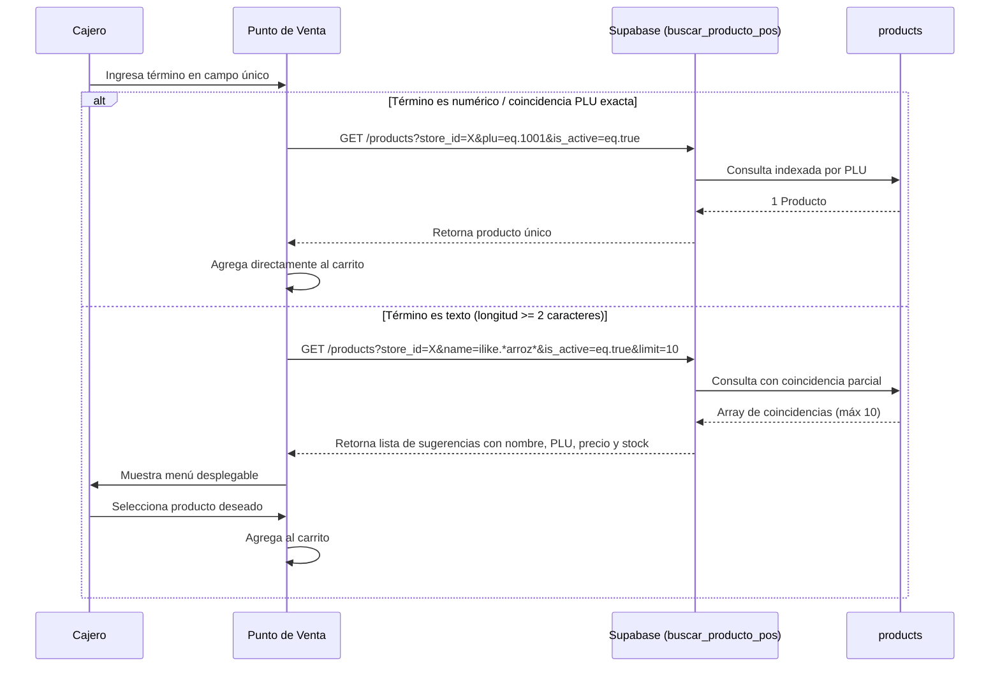
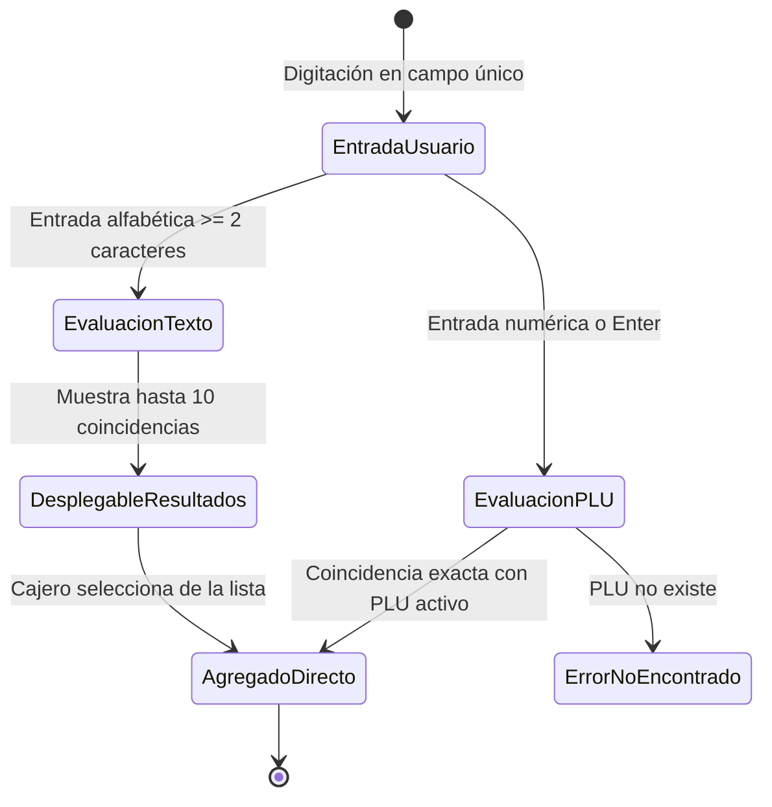
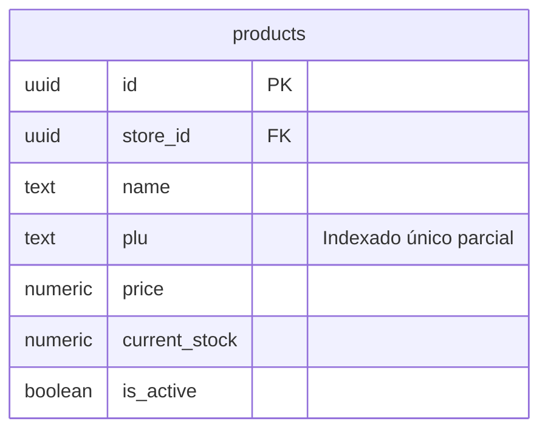

# SDD-006-03: Código de Producto (PLU y Búsqueda Unificada)

> **Asociado a:** [FRD-006-03](../FRD/FRD_006_03_CODIGO_PRODUCTO.md)  
> **Fase del Plan:** Ola 2 — Inventario, Lotes y Proveedores  
> **Estado:** 🟡 Validado Localmente (Post Alineación v1.5.8)  
> **Última Actualización:** 2026-10-11  

---

## 0. Contexto y Restricciones Aplicables

### 0.1 Políticas Globales Activadas (ARQ-002)
| Política ID | Dominio | Impacto Concreto en este SDD |
|-------------|---------|------------------------------|
| **POL-LOG-01** | Catálogo | **Identificación Unívoca:** El código PLU es un identificador rápido por tienda. Es único para productos con `is_active = true`. |
| **POL-UX-01** | Usabilidad | **Búsqueda Unificada sin Fricción:** El POS ofrece un único campo de búsqueda que detecta automáticamente si el término es un PLU exacto o un texto alfabético para búsqueda parcial. |
| **POL-AUTH-01** | Seguridad | **Validación de Tienda:** Toda consulta valida pertenencia de tienda con `assert_store_access`. |

### 0.2 Contratos Vecinos que Limitan el Diseño
| SDD Origen | Restricción Inyectada | Impacto en Búsqueda y Código |
|------------|-----------------------|------------------------------|
| **SDD_007_01 (POS Engine)** | Campo de entrada único en checkout. | Acepta PLU numérico exacto o nombre parcial. Si coincide exactamente con PLU, agrega directamente al carrito; si es texto, despliega resultados. |
| **SDD_006 (Inventario Padre)** | Clave primaria inmutable en `id` (UUID). | El PLU es estrictamente operacional; su mutación no altera el histórico en Kardex o ventas. |

### 0.3 Auditoría de BD contra Realidad (Deuda Técnica Declarada)
*Evidencia cruda obtenida de Supabase Producción (`ihtjocmhzuliwwvdzfnz`):*

```sql
-- Columna real en products:
-- plu (text) - almacena el código numérico/alfanumérico corto

-- Índice único parcial real:
-- CREATE UNIQUE INDEX idx_products_store_plu_active ON public.products (store_id, plu) WHERE (is_active = true AND plu IS NOT NULL);
```

| Hallazgo / Componente | Brecha Real Detectada | Solución Normativa y Trade-off | Condición de Revisión |
|-----------------------|-----------------------|---------------------------------|-----------------------|
| 🟡 **Nomenclatura de columna** | Versiones preliminares referenciaban `code` o `sku`. La columna física verificada en base de datos es `plu`. | **Decisión:** Homologar todos los contratos y modelos para usar exclusivamente el nombre real `plu`. | Resuelto en este SDD. |
| 🟡 **Búsqueda unificada en backend** | La búsqueda combinada PLU + Nombre puede ejecutarse vía PostgREST con operador `or` o función RPC optimizada. | **Decisión:** Especificar la operación `buscar_producto_pos` con diferenciación de rama por tipo de entrada (numérica exacta vs texto parcial). | Optimización mediante índice trigram (`pg_trgm`) en `name` para catálogos > 500 productos. |

---

## 1. Glosario Local

- **PLU (Price Look-Up):** Código alfanumérico corto (máximo 6 caracteres) asignado al producto para digitación ultra-rápida en terminal de caja.
- **Búsqueda Unificada POS:** Mecanismo donde un solo input en la interfaz resuelve la búsqueda por PLU exacto (si la entrada es numérica o coincide con código) o por nombre parcial (si la entrada es texto >= 2 caracteres).

---

## 2. Diagramas de Secuencia

### 2.1 Flujo de Búsqueda Unificada en POS


---

## 3. Diagramas de Estado



---

## 4. Especificación Detallada de Casos de Uso

### Caso A: Búsqueda Rápida por PLU Exacto
- **Actor:** Cajero con turno activo.
- **Precondición:** Producto activo con PLU asignado en la tienda.
- **Flujo Principal:**
  1. El cajero digita el número del PLU (ej. `104`) y presiona Enter o tecla rápida.
  2. El servidor ejecuta búsqueda estricta (`plu = '104' AND is_active = true`).
  3. Al encontrar coincidencia exacta única, el producto se agrega directamente al carrito sin necesidad de menú desplegable.
- **Flujo Alternativo:** Si el PLU no existe, el servidor retorna `PRODUCT_NOT_FOUND`.

### Caso D: Búsqueda Inteligente por Nombre Parcial
- **Actor:** Cajero con turno activo.
- **Precondición:** Catálogo con productos activos.
- **Flujo Principal:**
  1. El cajero ingresa al menos 2 caracteres en el mismo campo unificado (ej. `arr`).
  2. El servidor busca coincidencias parciales en `name` (`ilike '%arr%'`).
  3. Retorna los primeros 10 resultados con su nombre, PLU, precio y existencias actuales.
  4. Si hay más coincidencias, el contrato reporta el `count` total para permitir paginación bajo demanda.
  5. El cajero selecciona el producto requerido y este se añade al carrito.
- **Flujo Alternativo:** Si no hay coincidencias con el término buscado, el sistema informa: "No se encontraron productos coincidentes con '[termino]'".

---

## 5. Contrato de Interfaz

### 5.1 Operación: Búsqueda Unificada (`buscar_producto_pos`)
- **Tipo:** Consulta PostgREST / Lectura (READ)
- **Entradas (Query Params):**
  - `store_id`: UUID (Obligatorio)
  - `term`: String (Obligatorio, término digitado)
  - `limit`: Integer (Default: 10)
  - `offset`: Integer (Default: 0)
- **Salida Exitosa:**
  ```json
  {
    "data": [
      {
        "id": "UUID",
        "name": "Arroz Diana 1kg",
        "plu": "1001",
        "price": 4500,
        "current_stock": 25.00,
        "is_weighable": false
      }
    ],
    "count": 3,
    "match_type": "exact_plu | partial_name"
  }
  ```
- **Catálogo de Errores:**
  | Código de Error | Causa | Mensaje Técnico |
  |-----------------|-------|-----------------|
  | `STORE_ACCESS_DENIED` | Tienda no autorizada | Sin acceso a los productos de esta tienda |
  | `TERM_TOO_SHORT` | Menos de 2 caracteres en búsqueda alfabética | Ingrese al menos 2 caracteres para buscar por nombre |
  | `PRODUCT_NOT_FOUND` | PLU numérico no registrado | Código de producto no encontrado |

---

## 6. Análisis de Seguridad

- **Aislamiento Multitenant:** Obligatoriedad de `store_id = get_current_store_id()`.
- **Inyección SQL Prevenida:** Uso estricto de parámetros parametrizados en PostgREST / funciones preparadas.
- **Sanitización de Datos:** No se devuelven márgenes de ganancia ni precios de costo a clientes de venta.

---

## 7. Modelo de Datos Lógico



### Diccionario de Datos
| Tabla | Atributo | Tipo | Nullable | Estado en BD | Descripción |
|-------|----------|------|----------|--------------|-------------|
| `products` | `plu` | TEXT | SÍ | ✅ Sí | Código corto rápido único para activos |
| `products` | `name` | TEXT | NO | ✅ Sí | Nombre comercial indexado para búsqueda |
| `products` | `is_active` | BOOLEAN | NO | ✅ Sí | Condición para el índice parcial único |
