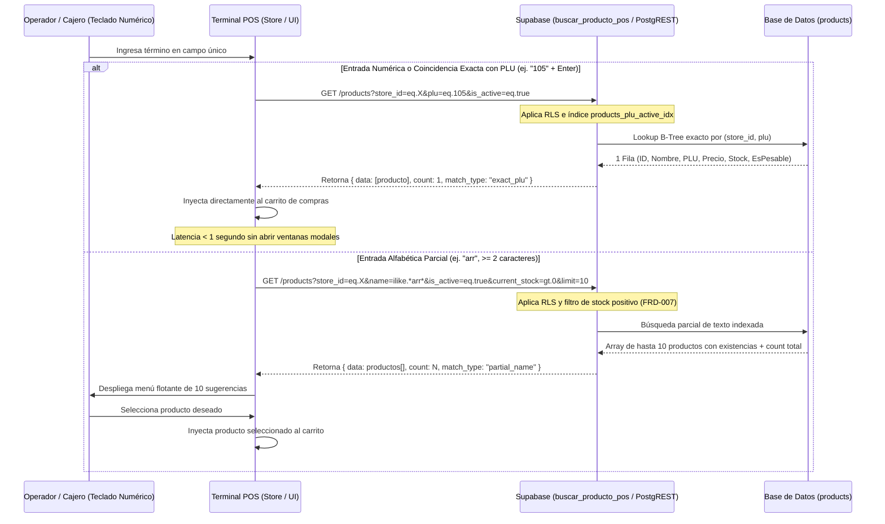
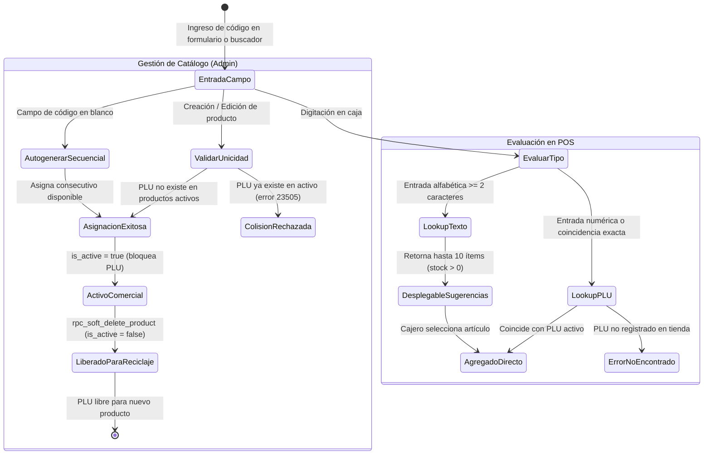
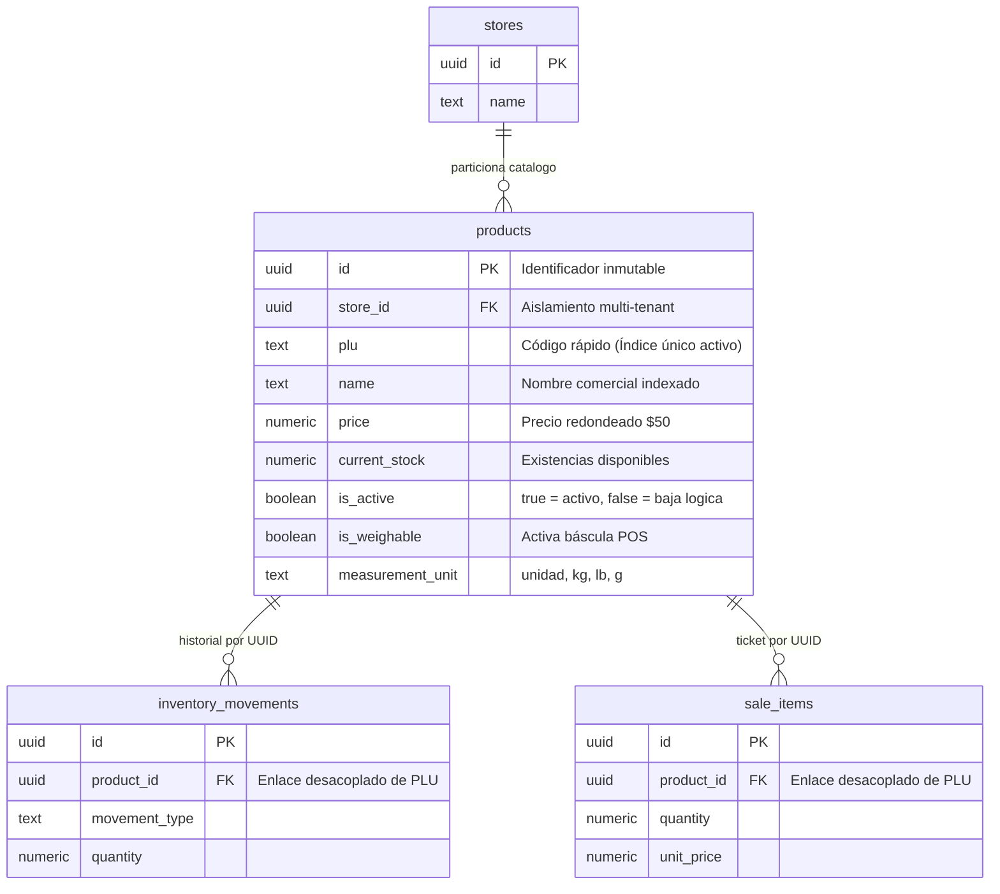

# SDD-006-03: Código de Producto (PLU y Búsqueda Unificada)

> **Asociado a:** [FRD-006-03](../FRD/FRD_006_03_CODIGO_PRODUCTO.md) (Código de Producto - PLU y Búsqueda Rápida)  
> **Fase del Plan:** Ola 2 — Inventario, Lotes y Proveedores  
> **Estado:** 🟠 Aprobado con Deuda Técnica Documentada (PAC-SDD Completo 2026-10-14)  
> **Última Actualización:** 2026-10-14  

---

## 0. Contexto y Restricciones Aplicables

### 0.1 Políticas Globales Activadas (ARQ-002)
| Política ID | Dominio | Impacto Concreto en este SDD |
|-------------|---------|------------------------------|
| **POL-LOG-01** | Catálogo | **Identificación Unívoca Operativa:** El Código de Producto (PLU) es un identificador rápido por tienda. Es estrictamente único entre los productos activos (`is_active = true`) dentro del mismo establecimiento. Dos productos activos no pueden compartir el mismo código simultáneamente. |
| **POL-UX-01** | Usabilidad | **Búsqueda Unificada sin Fricción:** El Punto de Venta (POS) provee un campo de entrada único sin botones selectores de modo. El sistema discrimina automáticamente: si la entrada es numérica o coincide exactamente con un PLU, realiza un lookup indexado exacto instantáneo (< 1s) agregando directo al ticket; si contiene caracteres alfabéticos (mínimo 2 caracteres), despliega sugerencias con carga progresiva (máx 10). |
| **POL-AUD-02** | Auditoría | **Desacoplamiento Absoluto de Identidad:** El PLU es estrictamente un alias comercial y de digitación rápida. El sistema tiene prohibido usar el PLU como clave foránea para tickets, ventas, Kardex o inventario. Todo enlace contable e histórico se realiza exclusivamente mediante la clave primaria inmutable `products.id` (UUID). |
| **POL-AUTH-01** | Seguridad | **Validación Centralizada Multi-Tenant:** Toda consulta de búsqueda y mutación de códigos de producto está aislada por tienda mediante la función centralizada `assert_store_access(v_store_id)` y la política RLS evaluada por `get_current_store_id()`. Queda prohibida la autenticación por PINs de tienda. |
| **POL-SEC-01** | Seguridad | **Ocultamiento de Información de Costos:** Los payloads de respuesta de búsqueda de productos expuestos a la terminal de ventas (cajeros) excluyen obligatoriamente la columna `cost_price` y márgenes comerciales, devolviendo únicamente nombre, PLU, precio redondeado, stock disponible y unidad de medida. |

### 0.2 Contratos Vecinos que Limitan el Diseño
| SDD Origen | Restricción Inyectada | Impacto en Búsqueda y Código |
|------------|-----------------------|------------------------------|
| **SDD_006_PADRE (Inventario)** | Catálogo maestro y ciclo de vida. | Define la columna física `products.plu` (tipo `text`) y la regla de liberación de código en baja lógica: `rpc_soft_delete_product` renombra el PLU a `'DEL-' \|\| substr(id::text, 1, 8)` y conmuta `is_active = false`, dejando el código original inmediatamente disponible para reasignación. |
| **SDD_007 / SDD_007_01 (POS Engine)** | Campo de entrada único en checkout. | El terminal de caja consume el PLU digitado en teclado numérico para lookup rápido. Una vez resuelto el producto, el carrito in-memory y el backend de ventas (`rpc_procesar_venta_v3` / `rpc_procesar_venta_v2`) operan exclusivamente con `product_id` (UUID). |
| **SDD_005 (Auditoría y Trazabilidad)** | Inviolabilidad del histórico forense. | Garantiza que la reasignación de un PLU o la reutilización de un código reciclado no corrompe los comprobantes ni movimientos pasados en `inventory_movements` o `sale_items`, ya que estos conservan su vínculo inmutable con el UUID original. |
| **FRD_007_VENTAS (Regla 7)** | Filtro de stock positivo para búsqueda por nombre. | La búsqueda asistida por texto alfabético en el POS debe filtrar estrictamente `current_stock > 0`, evitando que el menú desplegable muestre productos agotados al cajero. |

### 0.3 Auditoría de BD contra Realidad (Deuda Técnica Declarada)

Se ejecutó la introspección física directa en Supabase Producción (`ihtjocmhzuliwwvdzfnz`):

- **Columna física en `products`:** `plu` de tipo `text`, nullable `YES`. La denominación es estrictamente `plu`; las columnas `code`, `sku` y `barcode` no existen en el esquema físico.
- **Índice único parcial verificado en `pg_indexes`:**  
  `products_plu_active_idx`: `CREATE UNIQUE INDEX products_plu_active_idx ON public.products USING btree (store_id, plu) WHERE (is_active = true)`
- **Índice complementario de búsqueda:**  
  `idx_products_plu`: `CREATE INDEX idx_products_plu ON public.products USING btree (store_id, plu)`
- **Función de liberación de código en `pg_proc`:**  
  `rpc_soft_delete_product`: implementada y activa. Al dar de baja un producto sin existencias ni deudas, muta el PLU con prefijo `'DEL-'`, liberando el código original en el índice parcial.

#### Declaración de Brechas y Deudas Técnicas (Regla 7):

| ID | Hallazgo / Componente | Qué se Decidió | Justificación / Trade-off | Condición de Revisión Futura |
|---|-----------------------|----------------|---------------------------|------------------------------|
| **H-1** | Ausencia física de RPC `buscar_producto_pos` en `pg_proc` | Formalizar el contrato de interfaz normativo como `RPC Postgres / Lectura (READ)` con retorno estructurado `{ data, count, match_type }`, operando transitoriamente vía consultas PostgREST indexadas. | La construcción del endpoint especializado del POS pertenece a la Ola 3. PostgREST directo sobre `products` con `idx_products_plu` cubre la velocidad (< 1s) requerida sin introducir DDL prematuro en producción. | Despliegue del RPC optimizado en la migración de consolidación del POS de la Ola 3. |
| **H-2** | Ausencia de secuencia SQL para autogeneración de PLU (RN 5) | Delegar transitoriamente la autogeneración secuencial de PLU a la capa de servicio de frontend o cálculo `MAX(plu::numeric) + 1` al crear productos. | Las secuencias nativas PostgreSQL son globales de instancia y no particionan naturalmente por `store_id`. Crear secuencias dinámicas añade complejidad antes de consolidar el volumen multi-tenant. | Creación de función generadora de correlativos por tienda en migración de Ola 2. |
| **H-3** | Discrepancia documental en nombre y predicado del índice único | Homologar y corregir la referencia técnica documental al nombre real `products_plu_active_idx` con predicado `WHERE (is_active = true)`. | Erradicar citas desfasadas (`idx_products_store_plu_active`) para alinear 100% la documentación con la base de datos física. | Queda resuelto y cerrado en este SDD. |
| **H-4** | Filtro de stock positivo en búsqueda asistida por nombre | Especificar obligatoriamente `current_stock > 0` cuando el término ingresado en el buscador POS sea alfabético (>= 2 caracteres), según FRD-007 Regla 7. | Previene que el cajero cargue accidentalmente artículos agotados en el menú desplegable, manteniendo la búsqueda por PLU exacto sin filtro de stock para permitir ventas forzadas si la política lo autoriza. | Verificación en integración E2E del módulo POS en Ola 3. |
| **H-5** | Protección y exclusión de `cost_price` en contratos de venta | Ocultar estrictamente el atributo `cost_price` de los payloads devueltos por `buscar_producto_pos` hacia terminales de venta. | Proteger la confidencialidad de los márgenes comerciales del propietario frente al personal operativo en caja (POL-SEC-01). | Revisión en validación de componentes de frontend en Ola 3. |

---

## 1. Glosario Local

- **PLU (Price Look-Up):** Código numérico o alfanumérico corto (máximo 6 caracteres) asignado al producto para digitación ultra-rápida mediante teclado numérico en terminal de mostrador. Preserva ceros a la izquierda (ej. `"001"` y `"1"` son códigos distintos).
- **Búsqueda Unificada en POS:** Mecanismo donde un único campo de texto en la interfaz evalúa automáticamente la entrada del usuario:
  - *Rama PLU (Exacta):* Si la entrada es numérica o coincide exactamente con un PLU activo, resuelve inmediatamente en una única tupla y la añade directamente al carrito.
  - *Rama Texto (Asistida):* Si la entrada contiene caracteres alfabéticos (>= 2 caracteres), ejecuta búsqueda parcial insensible a mayúsculas/minúsculas y despliega un menú con hasta 10 coincidencias con existencias disponibles.
- **Liberación de PLU (Reciclaje):** Proceso mediante el cual un código numérico vuelve a estar disponible para asignación a un nuevo producto cuando el producto anterior es dado de baja lógica (`is_active = false`), garantizado físicamente por el predicado del índice parcial.

---

## 2. Diagramas de Secuencia

### Flujo de Búsqueda Unificada en Terminal POS (`buscar_producto_pos`)


---

## 3. Diagramas de Estado

### Ciclo de Evaluación y Asignación de Código de Producto


---

## 4. Especificación Detallada de Casos de Uso

### Caso A: Reasignación de Código de Producto (PLU)
- **Actor:** Empleado con permisos de gestión de inventario / Administrador.
- **Precondición:** El producto "Gaseosa Cola" existe con el código `015`. El dueño decide que ahora las gaseosas usarán la serie de los `300`.
- **Flujo Principal:**
  1. El empleado edita el producto en el sistema.
  2. Borra el código `015` y digita el nuevo código `301`.
  3. El sistema valida que el nuevo código `301` no esté asignado a otro producto activo en la tienda.
  4. El empleado guarda los cambios exitosamente.
- **Flujos Alternativos:**
  - *Colisión de código:* Si `301` ya pertenece a otro producto activo, el sistema aborta informando `PLU_ALREADY_EXISTS`.
- **Postcondición:** Las ventas futuras del producto se procesarán al digitar `301`. Los comprobantes pasados generados con el código `015` permanecen intactos y siguen referenciando de manera correcta a "Gaseosa Cola" debido al desacoplamiento por UUID.

### Caso B: Reutilización de un Código Liberado tras Baja Lógica
- **Actor:** Empleado con permisos de gestión de inventario / Administrador.
- **Precondición:** El código `100` pertenecía al producto "Pan de Bono" que ya fue dado de baja (marcado inactivo con `is_active = false` y PLU mutado a `'DEL-...'`).
- **Flujo Principal:**
  1. El empleado registra un nuevo producto llamado "Pan Integral".
  2. Asigna manualmente el código `100`.
  3. El servidor valida la disponibilidad evaluando el índice único condicional que excluye registros inactivos (`WHERE is_active = true`).
  4. El sistema permite la creación y persistencia sin generar conflicto.
- **Postcondición:** El código `100` ahora factura a nombre de "Pan Integral". El registro histórico del inventario del producto inactivo "Pan de Bono" no sufre alteraciones ni conflictos.

### Caso C: Búsqueda Rápida por Teclado Numérico en POS
- **Actor:** Cajero / Operario de caja.
- **Precondición:** Caja abierta con productos activos registrados con PLU.
- **Flujo Principal:**
  1. El cajero digita rápidamente el código `105` en el teclado numérico de la terminal y presiona la tecla de confirmación (Enter).
  2. El sistema recibe el código y localiza el producto mediante una búsqueda indexada de coincidencia exacta.
  3. El sistema agrega el producto directamente al ticket de venta en curso sin exigir ventanas o confirmaciones adicionales, en menos de 1 segundo.
- **Flujos Alternativos:**
  - *Código no registrado:* El sistema emite señal auditiva/visual de advertencia y mantiene el cursor en el campo de entrada.
- **Postcondición:** Ítem añadido al carrito con precio oficial redondeado y cálculo de subtotales.

### Caso D: Búsqueda Asistida por Nombre Parcial en POS
- **Actor:** Cajero / Operario de caja.
- **Precondición:** Catálogo con productos activos en la tienda.
- **Flujo Principal:**
  1. El cajero escribe al menos 2 caracteres alfabéticos en el mismo campo unificado (ej. `arr`).
  2. El sistema detecta automáticamente la presencia de texto y ejecuta búsqueda parcial insensible a mayúsculas/minúsculas (`name ILIKE '%arr%'`).
  3. El servidor aplica el filtro de existencias positivas (`current_stock > 0`) y limita la respuesta inicial a 10 elementos.
  4. El sistema despliega un menú flotante con las coincidencias, mostrando nombre, PLU, precio y existencias.
  5. El cajero selecciona el producto requerido y este se añade al carrito.
- **Flujos Alternativos:**
  - *Menos de 2 caracteres:* El sistema espera la digitación del segundo carácter antes de disparar la consulta.
  - *Sin coincidencias con existencias:* Muestra mensaje descriptivo: "Sin productos disponibles para '[termino]'".
- **Postcondición:** Selección fluida sin cambiar de pantalla.

### Caso E: Autogeneración Inteligente de Código
- **Actor:** Administrador o empleado al crear un nuevo producto.
- **Precondición:** El formulario de creación de producto tiene el campo de PLU en blanco.
- **Flujo Principal:**
  1. El usuario completa los datos del artículo (nombre, precio, unidad) y deja el código vacío.
  2. Al pulsar "Guardar", el sistema calcula el código consecutivo más alto disponible que no colisione con activos de la tienda.
  3. Asigna automáticamente el código numérico secuencial resultante.
  4. Guarda el producto con `is_active = true`.
- **Postcondición:** Producto registrado con código válido listo para digitación.

---

## 5. Contrato de Interfaz

### 5.1 Operación: Búsqueda Unificada de Productos en POS (`buscar_producto_pos`)
- **Tipo:** RPC Postgres / Lectura (READ) — *Ejecutable transitoriamente como consulta PostgREST indexada*
- **Entradas:**
  ```json
  {
    "p_store_id": "UUID (Obligatorio, resuelto por sesión)",
    "p_term": "TEXT (Obligatorio, código PLU o texto alfabético)",
    "p_limit": "INTEGER (Opcional, default: 10, máx: 50)",
    "p_offset": "INTEGER (Opcional, default: 0)"
  }
  ```
- **Reglas de Transformación del Backend:**
  1. Si `p_term` coincide exactamente con un PLU activo (`plu = p_term AND is_active = true`), retorna la tupla única con `match_type = 'exact_plu'`.
  2. Si `p_term` contiene caracteres alfabéticos y `length(p_term) >= 2`, ejecuta búsqueda parcial `name ILIKE ('%' || p_term || '%')`, filtrando estrictamente `is_active = true AND current_stock > 0`, ordenada por coincidencia de texto, retornando `match_type = 'partial_name'`.
  3. Si `p_term` tiene longitud < 2 y no es numérico, aborta con `TERM_TOO_SHORT`.
  4. Los campos de costo (`cost_price`) quedan estrictamente omitidos del payload.

- **Salida Exitosa (Formato Unidireccional de Lista Enriquecida):**
  ```json
  {
    "data": [
      {
        "id": "UUID",
        "name": "Arroz Diana 1kg",
        "plu": "1001",
        "price": 4200.00,
        "current_stock": 45.00,
        "measurement_unit": "unidad",
        "is_weighable": false
      }
    ],
    "count": 1,
    "match_type": "exact_plu"
  }
  ```

- **Catálogo de Errores:**
  | Código de Error | Causa | Mensaje Técnico |
  |-----------------|-------|-----------------|
  | `STORE_ACCESS_DENIED` | Usuario no pertenece a la tienda consultada | Sin acceso a los productos de esta tienda |
  | `TERM_TOO_SHORT` | Menos de 2 caracteres en búsqueda alfabética | Ingrese al menos 2 caracteres para buscar por nombre |
  | `PRODUCT_NOT_FOUND` | Código PLU numérico no registrado en activos | Código de producto no encontrado |
  | `PLU_ALREADY_EXISTS` | Intento de asignar un PLU que ya pertenece a otro producto activo | El código PLU ya se encuentra asignado a otro producto activo en esta tienda |

---

## 6. Análisis de Seguridad e Integridad

### 6.1 Multi-Tenant y Seguridad Centralizada (Regla 4)
- La búsqueda y consulta de productos está aislada a nivel de base de datos mediante la política RLS `products_select_store`, la cual restringe la visibilidad evaluando `store_id = public.get_current_store_id()`.
- Cualquier operación de mutación (creación, edición o reasignación de PLU) exige la invocación mandatoria de `public.assert_store_access(v_store_id)` como primera instrucción, abortando la transacción si el usuario no pertenece a la tienda.
- Queda terminantemente prohibido implementar validaciones de tienda ad-hoc o comprobaciones manuales por PIN.

### 6.2 Ocultamiento de Costos Comerciales (POL-SEC-01)
- La terminal de punto de venta es operada por cajeros y operarios. Por diseño contractual y de seguridad, la proyección de la consulta excluye taxativamente la columna `cost_price`.
- Los datos devueltos se limitan estrictamente a los atributos requeridos para la venta (`id`, `name`, `plu`, `price`, `current_stock`, `measurement_unit`, `is_weighable`), impidiendo la filtración de márgenes de utilidad del negocio.

### 6.3 Garantía de Privilegios Base (Regla 8)
- Se garantiza normativamente que la tabla `products` cuente con privilegios base otorgados (`GRANT ALL`) para los roles `anon`, `authenticated` y `service_role`.
- La seguridad reside en la activación de RLS (`ENABLE ROW LEVEL SECURITY`) y no en la omisión de grants, previniendo errores de permisos denegados (`42501`) en PostgREST.

### 6.4 Concurrencia e Integridad de Unicidad
- El riesgo de colisión concurrente (dos operarios intentando registrar el mismo PLU simultáneamente en la misma tienda) está resuelto a nivel de motor por el índice único parcial `products_plu_active_idx`.
- La base de datos garantiza la serialización estricta de la restricción de unicidad, arrojando excepción de clave duplicada (`23505`) si se produce un intento de colisión.

---

## 7. Modelo de Datos Lógico

### 7.1 Diagrama Entidad-Relación (Mermaid)


### 7.2 Diccionario de Datos Físico Verificado

#### Tabla: `products` (Atributos que gobiernan el código y la búsqueda)
| Columna | Tipo | Nullable | Restricción / Índice | Estado en BD | Descripción |
|---|---|---|---|---|---|
| `id` | `uuid` | NO | `gen_random_uuid()` PK | ✅ Existe | Identificador inmutable del producto (desacoplado de PLU) |
| `store_id` | `uuid` | NO | FK `stores(id)` | ✅ Existe | Tienda propietaria para particionamiento multi-tenant |
| `plu` | `text` | SÍ | `products_plu_active_idx` | ✅ Existe | Código comercial numérico/alfanumérico corto de digitación rápida |
| `name` | `text` | NO | `CHECK (length(name) >= 2)` | ✅ Existe | Nombre comercial del artículo para búsqueda alfabética |
| `price` | `numeric` | NO | `CHECK (price > 0)` | ✅ Existe | Precio de venta oficial redondeado a múltiplos de $50 |
| `cost_price` | `numeric` | SÍ | Protegido Admin | ✅ Existe | Costo de adquisición (oculto en payloads de venta) |
| `current_stock` | `numeric` | SÍ | `CHECK (current_stock >= 0)` | ✅ Existe | Existencias físicas reales para prevalidación en POS |
| `measurement_unit`| `text` | SÍ | `unidad`, `kg`, `lb`, `g` | ✅ Existe | Unidad de medida para visualización en terminal |
| `is_weighable` | `boolean` | SÍ | Default: `false` | ✅ Existe | Indica si el POS debe abrir la calculadora de balanza |
| `is_active` | `boolean` | NO | Default: `true` | ✅ Existe | Bandera de estado que condiciona la unicidad del PLU |
