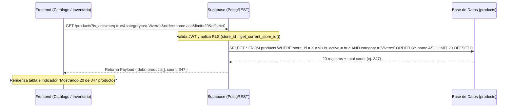
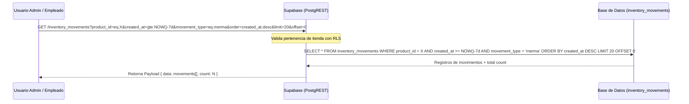
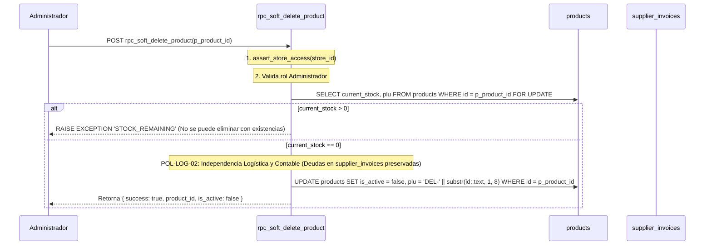
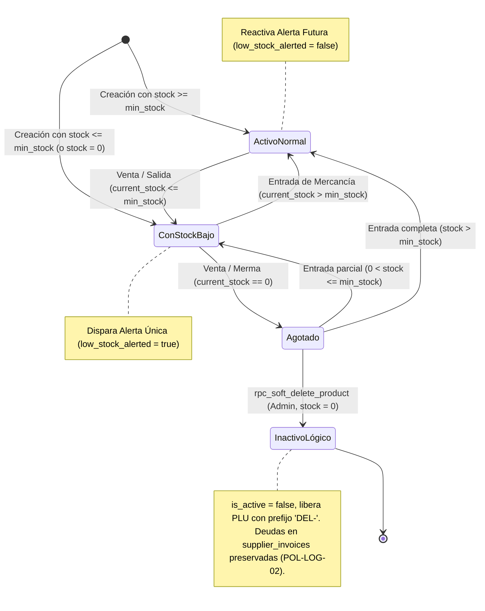
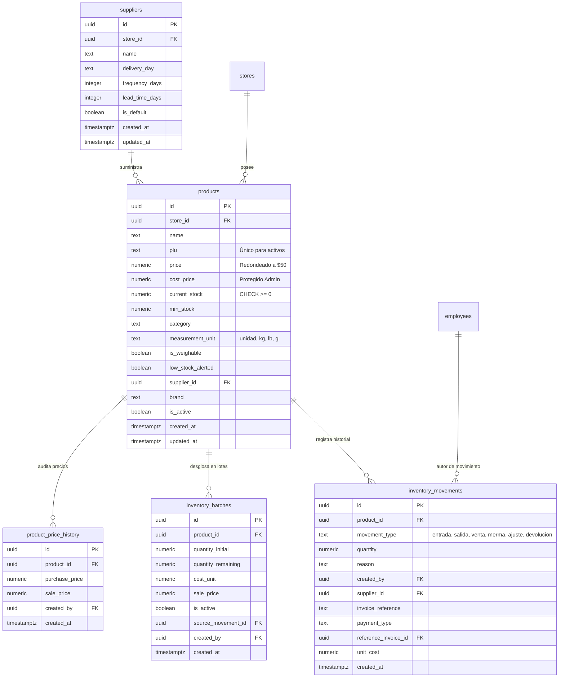

# SDD-006: Gestión de Inventario y Catálogo (Módulo Primario)

> **Asociado a:** [FRD-006](../FRD/FRD_006_INVENTARIO.md) (Gestión de Inventario y Catálogo)  
> **Fase del Plan:** Ola 2 — Inventario, Lotes y Proveedores  
> **Estado:** 🟠 Aprobado con Deuda Técnica Documentada (PAC-SDD Completo 2026-10-14)  
> **Última Actualización:** 2026-10-14  

---

## 0. Contexto y Restricciones Aplicables

### 0.1 Políticas Globales Activadas (ARQ-002)
| Política ID | Dominio | Impacto Concreto en este SDD |
|-------------|---------|------------------------------|
| **SPEC-010 / SPEC-011** | Financiero | **Redondeo e Inmutabilidad de Moneda:** Los precios de venta se redondean estrictamente al múltiplo de $50 más cercano, con regla de desempate hacia abajo (a favor del cliente). Los montos monetarios se almacenan como enteros sin decimales (`numeric`). Las cantidades unitarias y en gramos no admiten decimales; las pesables (kg, lb) admiten hasta 2 decimales. Los datos se almacenan ya redondeados, no solo a nivel de visualización. |
| **POL-LOG-02** | Logística | **Prohibición Absoluta de Stock Negativo:** El servidor aborta con `STOCK_INSUFFICIENT` cualquier operación o movimiento que intente reducir `current_stock` por debajo de cero. El stock físico real no puede ser negativo bajo ninguna circunstancia (respaldado por constraint `products_current_stock_check`). |
| **POL-AUD-02** | Auditoría | **Inviolabilidad del Kardex (Append-Only):** Todo movimiento de mercancía en `inventory_movements` es de solo inserción. Queda terminantemente prohibido ejecutar `UPDATE` o `DELETE` sobre el historial de movimientos de inventario. |
| **POL-SEC-01** | Seguridad | **Protección de Costos y Separación de Roles:** Las columnas de costo (`cost_price`, `unit_cost`) están protegidas y restringidas exclusivamente a roles con privilegios de Administrador. Los empleados o cajeros sin permiso explícito (`canViewCosts`) no tienen acceso a ver márgenes ni costos en ninguna pantalla ni payload. |
| **POL-AUTH-01** | Seguridad | **Autorización Centralizada y Multi-Tenant:** Toda consulta y mutación de inventario está aislada obligatoriamente por `store_id` mediante las funciones de seguridad centralizadas `assert_store_access(store_id)` y `get_current_store_id()`. Queda prohibida la autenticación ad-hoc por PINs de tienda o cajón. |

### 0.2 Contratos Vecinos que Limitan el Diseño
| SDD Origen | Restricción Inyectada | Impacto en Inventario |
|------------|-----------------------|-----------------------|
| **SDD_010_016 (FIFO)** | Valuación por capas de lotes activos. | La columna `products.current_stock` es un acumulador de lectura sincronizado automáticamente por el trigger `sync_product_stock_from_batches` como la sumatoria de `quantity_remaining` de los lotes activos en `inventory_batches`. |
| **SDD_007 / SDD_007_01 (Ventas y POS)** | Descuento atómico de existencias. | El motor de ventas (`rpc_procesar_venta_v2` / `rpc_procesar_venta_v3`) descuenta existencias mediante `consume_stock_fifo` e inserta la salida en `inventory_movements` con `movement_type = 'venta'`. En anulaciones (`rpc_anular_venta`), reingresa el stock al Kardex. |
| **SDD_006_03 (Código de Producto)** | Búsqueda unificada en POS. | Expone el contrato de búsqueda rápida en POS por coincidencia exacta de PLU (`plu = term AND is_active = true`) o coincidencia parcial de nombre (mínimo 2 caracteres, limit 10). |
| **SDD_006_01_01 (Movimientos de Entrada)** | Registro oficial de compras a proveedores. | Estandariza la firma oficial de 9 parámetros de `rpc_registrar_entrada`, normaliza proveedores (TRIM + formato título) y delega la creación del lote al trigger `bridge_movement_to_batch`. |
| **SDD_006_02 (Gestor de Reembolsos)** | Reingreso de stock por devoluciones. | La operación `rpc_procesar_reembolso_item` valida el ítem vendido, reingresa existencias al inventario y debita el dinero de la caja del canal seleccionado con control de sobregiro. |
| **SDD_005 (Auditoría y Trazabilidad)** | Trazabilidad forense del Kardex. | Exige registrar en `inventory_movements` el usuario responsable (`created_by`), la estampa temporal inmutable (`created_at`) y la justificación (`reason`), alimentando el Evidence Hub. |
| **SDD_018 (Control Operacional)** | Extracción de P&L e inventario final. | Consume la valuación de inventario y existencias para determinar el Costo de Mercancía Vendida (COGS) y el Balance General. |

### 0.3 Auditoría de BD contra Realidad (Deuda Técnica Declarada)

Se ejecutó la introspección física directa en Supabase Producción (`ihtjocmhzuliwwvdzfnz`), verificando la existencia real de las entidades y constraints que sustentan este diseño:

- **Tabla `products` (17 columnas verificadas):** `id`, `store_id`, `name`, `plu`, `price`, `cost_price`, `current_stock`, `min_stock`, `category`, `measurement_unit`, `is_weighable`, `low_stock_alerted`, `created_at`, `updated_at`, `supplier_id`, `brand`, `is_active`.
- **Tabla `inventory_movements` (12 columnas verificadas):** `id`, `product_id`, `movement_type`, `quantity`, `reason`, `created_by`, `created_at`, `supplier_id`, `invoice_reference`, `payment_type`, `reference_invoice_id`, `unit_cost`.
- **Tabla `inventory_batches` (10 columnas verificadas):** `id`, `product_id`, `quantity_initial`, `quantity_remaining`, `cost_unit`, `is_active`, `created_at`, `created_by`, `sale_price`, `source_movement_id`.
- **Tabla `suppliers` (9 columnas verificadas):** `id`, `store_id`, `name`, `delivery_day`, `frequency_days`, `lead_time_days`, `is_default`, `created_at`, `updated_at`.
- **Tabla `product_price_history` (6 columnas verificadas):** `id`, `product_id`, `purchase_price`, `sale_price`, `created_at`, `created_by`.
- **Restricciones CHECK activas:**
  - `products_current_stock_check`: `CHECK (current_stock >= 0)`
  - `products_price_check`: `CHECK (price > 0)`
  - `products_name_check`: `CHECK (length(name) >= 2)`
  - `products_measurement_unit_check`: `CHECK (measurement_unit IN ('unidad', 'kg', 'lb', 'g'))`
  - `inventory_movements_movement_type_check`: `CHECK (movement_type IN ('entrada', 'salida', 'devolucion', 'merma', 'ajuste', 'CORRECCION_SISTEMA', 'venta'))`
- **Índice Único Parcial para PLU:**
  - `products_plu_active_idx`: `CREATE UNIQUE INDEX products_plu_active_idx ON products (store_id, plu) WHERE (is_active = true)`

#### Declaración de Brechas y Deudas Técnicas (Regla 7):

| ID | Hallazgo / Componente | Qué se Decidió | Justificación / Trade-off | Condición de Revisión Futura |
|---|-----------------------|----------------|---------------------------|------------------------------|
| **H-1** | `assert_store_access` en `rpc_soft_delete_product` | Especificar en SDD-006 la invocación obligatoria de `assert_store_access(v_store_id)` como instrucción #1. | La función desplegada en producción actualmente carece de dicha guarda, dependiendo exclusivamente de filtros implícitos. Se documenta la brecha sin modificar en caliente producción. | Refactorización y aplicación en migración de seguridad de la Ola 2. |
| **H-2** | Semántica de `'devolucion'` en trigger `bridge_movement_to_batch` | Formalizar la separación ontológica entre devolución a proveedor (salida con deducción de deuda) y reembolso de cliente (entrada física de stock). | El trigger en producción agrupa `'devolucion'` junto a `'salida'` y `'merma'` consumiendo lotes FIFO (`consume_stock_fifo`), lo cual colisiona conceptualmente si un reembolso intenta usar ese tipo. | Unificación y desambiguación de tipos en migración del POS V3 (Ola 3). |
| **H-3** | Sobrecargas zombi de RPCs (`rpc_registrar_entrada` y `rpc_actualizar_precio_lote`) | Adoptar exclusivamente las firmas canónicas completas de 9 parámetros (`rpc_registrar_entrada`) y 3 parámetros (`rpc_actualizar_precio_lote`). | Coexisten en BD firmas antiguas de 5 y 2 parámetros por retrocompatibilidad temporal, pero se declaran obsoletas en el diseño normativo. | Ejecutar `DROP FUNCTION` sobre las firmas zombi en migración de limpieza de Ola 2. |
| **H-4** | Privilegios base en `product_price_history` | Exigir la asignación explícita de `GRANT ALL` para roles `anon`, `authenticated` y `service_role` según la Regla 8. | Físicamente en producción los privilegios están asignados únicamente al rol `postgres`, lo que provocaría errores 42501 si un cliente PostgREST consulta el historial directamente. | Aplicación de grants en migración DDL de consolidación de Ola 2. |
| **H-5** | Manejo de excepciones en `rpc_soft_delete_product` | Especificar propagación explícita de errores vía `RAISE EXCEPTION` conforme a la Regla 3. | La versión física actual en BD captura errores con `WHEN OTHERS THEN RETURN jsonb_build_object('success', false)` enmascarando fallas críticas del motor. | Refactorización de RPC en migración de saneamiento de Ola 2. |
| **H-6** | Conteo de columnas en `suppliers` | Corregir el modelo lógico reconociendo 9 columnas físicas reales (incorporando `updated_at`). | El documento preliminar citaba erróneamente 8 columnas por omitir la estampa de actualización. | Rectificado formalmente en el diccionario de datos de este SDD. |

---

## 1. Glosario Local

- **Kardex (`inventory_movements`):** Registro cronológico inmutable de entradas, salidas, mermas, ventas y ajustes de stock. Es de naturaleza exclusivamente `append-only`.
- **Stock Mínimo (`min_stock`):** Umbral configurable por producto que dispara la notificación visual y el filtro de reposición (`current_stock <= min_stock`).
- **Alerta de Stock Bajo (`low_stock_alerted`):** Bandera booleana que previene el spam de notificaciones. Se activa en `true` al caer el stock por debajo del umbral y solo se reactiva en `false` cuando una entrada repone el stock.
- **Borrado Lógico (`rpc_soft_delete_product`):** Acción destructiva administrativa segura que conmuta `is_active = false` y renombra el PLU con prefijo `'DEL-'`, exigiendo estrictamente existencias en cero y ausencia de pasivos pendientes.
- **Paginación Progresiva:** Estrategia transversal de carga de 20 en 20 elementos bajo demanda, retornando el bloque de datos y el conteo total para listados de alta cardinalidad.

---

## 2. Diagramas de Secuencia

### 2.1 Consulta Filtrada y Paginada del Catálogo de Productos


### 2.2 Consulta Filtrada del Kardex de un Producto


### 2.3 Borrado Lógico Seguro de Producto (`rpc_soft_delete_product`)


---

## 3. Diagramas de Estado

### Ciclo de Vida del Stock y Estados del Producto


---

## 4. Especificación Detallada de Casos de Uso

### Caso A: Crear Producto en Catálogo
- **Actor:** Administrador o empleado con permiso `canManageInventory`.
- **Precondición:** Usuario autenticado en tienda activa.
- **Flujo Principal:**
  1. El usuario ingresa a la pantalla de inventario y pulsa "Nuevo Producto".
  2. Diligencia los datos requeridos: Nombre (>= 2 caracteres), Precio (> $0), Unidad de Medida (`unidad`, `kg`, `lb`, `g`), Es Pesable (booleano), Stock Mínimo (default: 5) y campos opcionales: PLU (máx 4 dígitos), Categoría, Marca y Proveedor.
  3. Si ingresa costo referencial, este se guarda en `cost_price` (solo visible si tiene permiso de visualización).
  4. El sistema valida que el PLU no esté en uso por otro producto activo en la tienda.
  5. El servidor redondea automáticamente el precio de venta al múltiplo de $50 más cercano con regla de desempate hacia abajo.
  6. Si el stock inicial indicado es mayor a cero, se crea el producto con `current_stock = 0` y se ejecuta una entrada atómica en `inventory_movements` (generando su respectivo lote inicial en `inventory_batches`).
  7. El producto queda guardado con `is_active = true`.
- **Flujos Alternativos:**
  - *PLU duplicado:* El sistema rechaza con código `PLU_ALREADY_EXISTS`.
  - *Nombre inválido (< 2 caracteres):* Rechazo con `INVALID_PRODUCT_NAME`.
  - *Precio <= 0:* Rechazo con `INVALID_PRICE`.
- **Postcondición:** Producto disponible en catálogo y listo para venta o abastecimiento.

### Caso B: Borrado Lógico Seguro de Producto
- **Actor:** Administrador (Exclusivo; botón oculto para empleados regulares).
- **Precondición:** Producto existente con `is_active = true`.
- **Flujo Principal:**
  1. El Administrador selecciona "Eliminar Producto" en la ficha del artículo.
  2. El sistema solicita confirmación advirtiendo que la acción es definitiva.
  3. Al confirmar, el frontend invoca `rpc_soft_delete_product(p_product_id)`.
  4. El servidor verifica acceso multi-tenant vía `assert_store_access(store_id)`.
  5. El servidor verifica que `current_stock == 0`.
  6. El servidor conmuta `is_active = false`, renombra el PLU a `'DEL-' || substr(id::text, 1, 8)` para liberar el código numérico original y prefija el nombre con `'[ELIMINADO] '`.
  7. Las claves foráneas en históricos de ventas (`sale_items`), Kardex (`inventory_movements`) y facturas de compras (`supplier_invoices`) se preservan intactas en cumplimiento del principio de Independencia Logística y Contable (`POL-LOG-02`).
- **Flujos Alternativos:**
  - *Existencias remanentes (`current_stock > 0`):* Aborta con `STOCK_REMAINING` indicando las existencias que deben darse de baja previamente.
  - *Acceso denegado o no autorizado:* Aborta con `STORE_ACCESS_DENIED`.
- **Postcondición:** Producto retirado de la vista comercial sin corromper la integridad referencial.

### Caso C: Búsqueda Rápida por PLU
- **Actor:** Cajero o Administrador.
- **Precondición:** Catálogo con productos activos que poseen PLU.
- **Flujo Principal:**
  1. El usuario digita el código PLU (ej. `102`) en el campo unificado de búsqueda del POS.
  2. El servidor ejecuta la consulta indexada exacta: `plu = term AND is_active = true`.
  3. El sistema retorna el producto exacto en menos de 1 segundo y el POS lo añade directamente al carrito.
- **Flujos Alternativos:**
  - *PLU inexistente:* Informa que el código no existe y permite búsqueda alfabética.
- **Postcondición:** Selección instantánea sin abrir menús modales.

### Caso D: Localizar Producto por Nombre en el Catálogo
- **Actor:** Usuario del sistema.
- **Precondición:** Al menos 2 caracteres ingresados en la barra de búsqueda.
- **Flujo Principal:**
  1. El usuario escribe al menos 2 caracteres en el buscador (ej. `arr`).
  2. El sistema consulta con coincidencia parcial insensible a mayúsculas/minúsculas (`name ILIKE '%arr%'`) sobre productos activos.
  3. Retorna la lista de coincidencias con nombre, precio, stock actual y PLU.
- **Flujos Alternativos:**
  - *Sin coincidencias:* Muestra estado vacío con opción para crear el producto.
- **Postcondición:** Productos visualizados para edición o consulta.

### Caso E: Filtrar Productos con Stock Bajo
- **Actor:** Administrador o encargado de compras.
- **Precondición:** Catálogo activo con umbrales `min_stock` configurados.
- **Flujo Principal:**
  1. El usuario activa el filtro "Stock Bajo" en la vista de inventario.
  2. El servidor filtra exclusivamente los productos donde `current_stock <= min_stock AND is_active = true`.
  3. Permite combinar este filtro simultáneamente con filtros de categoría y texto de búsqueda.
- **Postcondición:** Lista de productos críticos lista para generar pedidos de reposición.

### Caso F: Auditar Discrepancia de Inventario vía Kardex
- **Actor:** Administrador o empleado con permiso `canViewInventory`.
- **Precondición:** Producto seleccionado en el catálogo.
- **Flujo Principal:**
  1. El usuario abre el historial Kardex del producto.
  2. Por defecto, el sistema consulta los movimientos de los últimos 7 días en orden cronológico descendente.
  3. Muestra fecha/hora exacta, tipo de movimiento (`entrada`, `salida`, `venta`, `merma`, `ajuste`, `devolucion`), cantidad afectada, motivo y usuario responsable.
  4. El usuario puede combinar simultáneamente filtros de: Rango de fechas personalizado, Tipo de movimiento específico y Empleado responsable.
  5. El listado carga de 20 en 20 elementos con indicador del total general.
- **Postcondición:** Auditoría completa del origen de las existencias.

---

## 5. Contrato de Interfaz

### 5.1 Operación: Consulta Paginada de Catálogo de Productos (`get_inventory_products`)
- **Tipo:** Consulta PostgREST / Lectura (READ)
- **Entradas (Query Parameters):**
  ```json
  {
    "store_id": "UUID (Obligatorio, resuelto por RLS)",
    "is_active": "BOOLEAN (Default: true, Admin puede consultar false)",
    "category": "TEXT (Opcional, filtro por categoría exacta)",
    "low_stock_only": "BOOLEAN (Opcional, si true filtra current_stock <= min_stock)",
    "search": "TEXT (Opcional, búsqueda parcial name ilike '%search%')",
    "order_by": "TEXT (Valores: 'name.asc', 'name.desc', 'current_stock.asc', 'current_stock.desc', 'price.asc', 'price.desc')",
    "limit": "INTEGER (Default: 20)",
    "offset": "INTEGER (Default: 0)"
  }
  ```
- **Salida Exitosa (Formato Unidireccional de Lista):**
  ```json
  {
    "data": [
      {
        "id": "UUID",
        "name": "Arroz Diana 1kg",
        "plu": "1001",
        "brand": "Diana",
        "category": "Viveres",
        "price": 4200.00,
        "cost_price": 3500.00,
        "current_stock": 45.00,
        "min_stock": 10.00,
        "measurement_unit": "unidad",
        "is_weighable": false,
        "is_active": true
      }
    ],
    "count": 347
  }
  ```
- **Catálogo de Errores:**
  | Código de Error | Causa | Mensaje Técnico |
  |-----------------|-------|-----------------|
  | `STORE_ACCESS_DENIED` | Usuario sin acceso a la tienda | El usuario no tiene permisos para consultar productos de esta tienda |
  | `INVALID_PAGE_LIMIT` | `limit` mayor a 100 o menor a 1 | El límite de paginación debe estar entre 1 y 100 |

---

### 5.2 Operación: Consulta Filtrada de Kardex (`get_inventory_kardex`)
- **Tipo:** Consulta PostgREST / Lectura (READ)
- **Entradas (Query Parameters):**
  ```json
  {
    "product_id": "UUID (Obligatorio)",
    "start_date": "TIMESTAMPTZ (Default: NOW() - INTERVAL '7 days')",
    "end_date": "TIMESTAMPTZ (Default: NOW())",
    "movement_type": "TEXT (Opcional: 'entrada', 'salida', 'venta', 'merma', 'ajuste', 'devolucion')",
    "created_by": "UUID (Opcional, filtro por usuario)",
    "limit": "INTEGER (Default: 20)",
    "offset": "INTEGER (Default: 0)"
  }
  ```
- **Salida Exitosa (Formato Unidireccional de Lista):**
  ```json
  {
    "data": [
      {
        "id": "UUID",
        "movement_type": "merma",
        "quantity": 2.00,
        "reason": "Empaque roto en estantería",
        "created_by": "UUID_EMPLEADO",
        "unit_cost": 3500.00,
        "created_at": "2026-10-14T10:30:00Z"
      }
    ],
    "count": 18
  }
  ```
- **Catálogo de Errores:**
  | Código de Error | Causa | Mensaje Técnico |
  |-----------------|-------|-----------------|
  | `STORE_ACCESS_DENIED` | Producto no pertenece a la tienda del usuario | Acceso denegado a los movimientos de este producto |
  | `PRODUCT_NOT_FOUND` | `product_id` no existe | Producto no encontrado en el catálogo |
  | `INVALID_DATE_RANGE` | `start_date > end_date` | La fecha inicial no puede ser posterior a la fecha final |

---

### 5.3 Operación Escalar: Borrado Lógico Seguro (`rpc_soft_delete_product`)
- **Tipo:** RPC Postgres / Acción (WRITE)
- **Entradas:**
  ```json
  {
    "p_product_id": "UUID (Obligatorio)"
  }
  ```
- **Salida Exitosa (Formato Unidireccional de Acción):**
  ```json
  {
    "success": true,
    "data": {
      "product_id": "UUID",
      "is_active": false,
      "released_plu": "1001",
      "deleted_at": "2026-10-14T15:00:00Z"
    }
  }
  ```
- **Catálogo Exhaustivo de Errores:**
  | Código de Error | Causa | Mensaje Técnico |
  |-----------------|-------|-----------------|
  | `STORE_ACCESS_DENIED` | Usuario no pertenece a la tienda propietaria | El usuario no tiene acceso a esta tienda |
  | `PRODUCT_NOT_FOUND` | `p_product_id` no existe en la tienda | El producto especificado (%) no existe |
  | `STOCK_REMAINING` | El producto tiene existencias (`current_stock > 0`) | El producto tiene existencias (%). Debe registrar un Ajuste de Salida o Merma antes de darlo de baja |
  | `PENDING_PAYABLES` *(Desacoplado / POL-LOG-02)* | Anteriormente bloqueaba la baja; desacoplado en favor de la Independencia Logística y Contable, manteniendo las deudas vivas en Cuentas por Pagar sin impedir la baja física de catálogo cuando `current_stock = 0`. | N/A (Desacoplado) |

---

## 6. Análisis de Seguridad e Integridad

### 6.1 Validación de Acceso Centralizada y Multi-Tenant (Regla 4)
Queda terminantemente prohibida cualquier comprobación ad-hoc manual de pertenencia de tienda (`WHERE store_id = ...` en el frontend). Todo acceso y mutación se rige por las funciones centralizadas de seguridad:
- La función `rpc_soft_delete_product` debe invocar obligatoriamente `public.assert_store_access(v_store_id)` como su primera instrucción de ejecución tras recuperar el registro de `products`. Si la comprobación falla, la transacción aborta inmediatamente arrojando `STORE_ACCESS_DENIED`.
- La pertenencia multi-tenant en políticas RLS sobre `products`, `inventory_movements` e `inventory_batches` se evalúa mediante `store_id = public.get_current_store_id()`.
- La autoría de las operaciones (`created_by`) se resuelve obligatoriamente en el servidor invocando `public.get_employee_id_from_session()`, garantizando que ningún usuario suplante la identidad de otro al registrar movimientos o crear artículos.

### 6.2 Ocultamiento de Información Sensible de Costos
- Las columnas `cost_price` en `products` y `unit_cost` en `inventory_movements` contienen información confidencial del margen del negocio.
- Siguiendo la política `POL-SEC-01`, los clientes con rol de cajero o empleado regular reciben estos campos en `null` o filtrados mediante proyecciones de vista/RLS, restringiendo la visibilidad del costo exclusivamente a usuarios con rol `admin` o empleados con el permiso granular `canViewCosts = true`.

### 6.3 Garantía de Privilegios Base (Regla 8)
- Para evitar errores de denegación de permisos (`42501 - Permission Denied`) en producción, se garantiza normativamente que las tablas `products`, `inventory_movements`, `inventory_batches` y `product_price_history` cuenten con privilegios otorgados (`GRANT ALL`) para los roles `anon`, `authenticated` y `service_role`.
- La seguridad no descansa en la denegación de privilegios DDL base, sino en la activación estricta de Row Level Security (`ENABLE ROW LEVEL SECURITY`) y en la canalización de operaciones complejas a través de funciones `SECURITY DEFINER` con `search_path = public`.

### 6.4 Concurrencia y Bloqueo Pesimista
- Las mutaciones de stock concurrentes (ej. ventas simultáneas en mostrador o ajustes físicos) se gobiernan mediante bloqueo pesimista de fila (`SELECT ... FOR UPDATE`) sobre los lotes de `inventory_batches` dentro de la función `consume_stock_fifo`, evitando decrementos desincronizados o saldos negativos.
- La unicidad del PLU está blindada concurrentemente por el índice único parcial `products_plu_active_idx`. Si dos administradores intentan registrar simultáneamente el mismo PLU para productos activos, la base de datos rechaza la segunda transacción por colisión de índice.

---

## 7. Modelo de Datos Lógico

### 7.1 Diagrama Entidad-Relación (Mermaid)


### 7.2 Diccionario de Datos Físico Verificado

#### Tabla: `products` (17 columnas en producción)
| Columna | Tipo | Nullable | Restricción / Default | Estado en BD | Descripción |
|---|---|---|---|---|---|
| `id` | `uuid` | NO | `gen_random_uuid()` PK | ✅ Existe | Identificador único del producto |
| `store_id` | `uuid` | NO | FK `stores(id)` | ✅ Existe | Tienda propietaria del catálogo |
| `name` | `text` | NO | `CHECK (length(name) >= 2)` | ✅ Existe | Nombre comercial del artículo |
| `plu` | `text` | SÍ | Índice único parcial activo | ✅ Existe | Código rápido numérico de hasta 4 dígitos |
| `price` | `numeric` | NO | `CHECK (price > 0)` | ✅ Existe | Precio de venta redondeado a múltiplo de $50 |
| `cost_price` | `numeric` | SÍ | `numeric` | ✅ Existe | Costo de adquisición referencial (Protegido Admin) |
| `current_stock` | `numeric` | SÍ | `CHECK (current_stock >= 0)` | ✅ Existe | Existencias físicas acumuladas (sincronizado con lotes) |
| `min_stock` | `numeric` | SÍ | Default: 5 | ✅ Existe | Umbral mínimo para disparo de alerta de reposición |
| `category` | `text` | SÍ | Texto libre / predefinido | ✅ Existe | Categoría del producto para filtrado y agrupación |
| `measurement_unit`| `text` | SÍ | `CHECK IN ('unidad', 'kg', 'lb', 'g')` | ✅ Existe | Unidad de medida oficial |
| `is_weighable` | `boolean` | SÍ | Default: `false` | ✅ Existe | Si es verdadero, el POS activa la calculadora de peso |
| `low_stock_alerted`| `boolean`| SÍ | Default: `false` | ✅ Existe | Bandera anti-spam de alerta de stock bajo |
| `supplier_id` | `uuid` | SÍ | FK `suppliers(id)` | ✅ Existe | Proveedor habitual asociado |
| `brand` | `text` | SÍ | Texto libre | ✅ Existe | Marca comercial del producto |
| `is_active` | `boolean` | NO | Default: `true` | ✅ Existe | Indicador de disponibilidad comercial (`false` = borrado lógico) |
| `created_at` | `timestamptz` | NO | `now()` | ✅ Existe | Fecha de creación del registro |
| `updated_at` | `timestamptz` | NO | `now()` | ✅ Existe | Fecha de última modificación |

#### Tabla: `inventory_movements` (12 columnas en producción)
| Columna | Tipo | Nullable | Restricción / Default | Estado en BD | Descripción |
|---|---|---|---|---|---|
| `id` | `uuid` | NO | `gen_random_uuid()` PK | ✅ Existe | Identificador del movimiento en Kardex |
| `product_id` | `uuid` | NO | FK `products(id)` | ✅ Existe | Producto afectado |
| `movement_type` | `text` | NO | `CHECK IN ('entrada', 'salida', 'venta', 'merma', 'ajuste', 'CORRECCION_SISTEMA', 'devolucion')` | ✅ Existe | Naturaleza contable del movimiento |
| `quantity` | `numeric` | NO | `numeric` | ✅ Existe | Magnitud física movida |
| `reason` | `text` | SÍ | Texto explicativo | ✅ Existe | Justificación descriptiva del movimiento |
| `created_by` | `uuid` | SÍ | FK `employees(id)` / `admin_profiles` | ✅ Existe | Responsable de la transacción |
| `supplier_id` | `uuid` | SÍ | FK `suppliers(id)` | ✅ Existe | Proveedor vinculado (en compras o devoluciones) |
| `invoice_reference`| `text` | SÍ | Número factura física | ✅ Existe | Referencia del comprobante externo |
| `payment_type` | `text` | SÍ | `'contado'`, `'credito'` | ✅ Existe | Modalidad de pago en adquisiciones |
| `reference_invoice_id`| `uuid`| SÍ| FK `supplier_invoices(id)` | ✅ Existe | Factura de pasivo asociada |
| `unit_cost` | `numeric` | SÍ | `numeric` | ✅ Existe | Costo unitario real de entrada en el movimiento |
| `created_at` | `timestamptz` | NO | `now()` | ✅ Existe | Marca temporal inmutable del Kardex |

#### Tabla: `inventory_batches` (10 columnas en producción)
| Columna | Tipo | Nullable | Restricción / Default | Estado en BD | Descripción |
|---|---|---|---|---|---|
| `id` | `uuid` | NO | `gen_random_uuid()` PK | ✅ Existe | Identificador del lote FIFO |
| `product_id` | `uuid` | NO | FK `products(id)` | ✅ Existe | Producto al que pertenece el lote |
| `quantity_initial` | `numeric` | NO | `numeric >= 0` | ✅ Existe | Cantidad original con la que ingresó el lote |
| `quantity_remaining`| `numeric`| NO | `numeric >= 0` | ✅ Existe | Saldo de existencias no consumidas |
| `cost_unit` | `numeric` | NO | `numeric` | ✅ Existe | Costo unitario de compra inmutable para FIFO |
| `sale_price` | `numeric` | NO | `numeric` | ✅ Existe | Precio de venta asignado a este lote |
| `is_active` | `boolean` | SÍ | Default: `true` | ✅ Existe | `true` si el lote aún posee saldo remanente (`> 0`) |
| `source_movement_id`| `uuid` | SÍ | FK `inventory_movements(id)` | ✅ Existe | Movimiento de entrada que originó el lote |
| `created_by` | `uuid` | SÍ | FK `employees(id)` | ✅ Existe | Usuario que dio ingreso al lote |
| `created_at` | `timestamptz` | NO | `now()` | ✅ Existe | Timestamp de ingreso para ordenar el consumo FIFO |

#### Tabla: `suppliers` (9 columnas en producción)
| Columna | Tipo | Nullable | Restricción / Default | Estado en BD | Descripción |
|---|---|---|---|---|---|
| `id` | `uuid` | NO | `gen_random_uuid()` PK | ✅ Existe | Identificador del proveedor |
| `store_id` | `uuid` | NO | FK `stores(id)` | ✅ Existe | Tienda a la que surte el proveedor |
| `name` | `text` | NO | Texto normalizado | ✅ Existe | Razón social o nombre comercial |
| `delivery_day` | `text` | SÍ | Día de entrega habitual | ✅ Existe | Planificación logística de recepción |
| `frequency_days` | `integer`| SÍ | Días entre pedidos | ✅ Existe | Periodicidad de suministro |
| `lead_time_days` | `integer`| SÍ | Días de espera entrega | ✅ Existe | Tiempo estimado de entrega |
| `is_default` | `boolean` | SÍ | Default: `false` | ✅ Existe | Proveedor predeterminado de la tienda |
| `created_at` | `timestamptz` | NO | `now()` | ✅ Existe | Fecha de registro |
| `updated_at` | `timestamptz` | NO | `now()` | ✅ Existe | Fecha de última actualización |

#### Tabla: `product_price_history` (6 columnas en producción)
| Columna | Tipo | Nullable | Restricción / Default | Estado en BD | Descripción |
|---|---|---|---|---|---|
| `id` | `uuid` | NO | `gen_random_uuid()` PK | ✅ Existe | Identificador de la instantánea |
| `product_id` | `uuid` | NO | FK `products(id)` | ✅ Existe | Producto cuyo precio mutó |
| `purchase_price` | `numeric` | SÍ | `numeric` | ✅ Existe | Costo de compra en el momento del cambio |
| `sale_price` | `numeric` | NO | `numeric` | ✅ Existe | Nuevo precio de venta establecido |
| `created_by` | `uuid` | SÍ | FK `employees(id)` / `admin_profiles` | ✅ Existe | Usuario que autorizó la modificación |
| `created_at` | `timestamptz` | NO | `now()` | ✅ Existe | Marca de tiempo inmutable del cambio |

---

## 8. Registro de Trade-offs y Decisiones de Alcance (Regla 7)

### D-006-01: Desacoplamiento de Cuentas por Pagar en Baja Lógica de Producto (`POL-LOG-02`)
- **Qué se decidió:** Remover la validación bloqueante `PENDING_PAYABLES` de `rpc_soft_delete_product`, permitiendo la baja lógica (`is_active = false`, prefijo `DEL-` en PLU) de cualquier artículo con `current_stock = 0`, sin exigir la liquidación previa de las facturas en `supplier_invoices`.
- **Por qué (trade-off concreto):** La baja lógica preserva íntegramente las filas y relaciones de clave foránea en `inventory_movements` y `supplier_invoices`. Las facturas impagas continúan registradas, visibles y exigibles en el módulo de Cuentas por Pagar (SDD-019). Bloquear la baja de un producto con stock en 0 violaba la Independencia Logística y Contable (`POL-LOG-02`) e impedía a los tenderos depurar su catálogo activo de productos descontinuados mientras mantuviesen créditos vigentes con proveedores mayoristas.
- **Bajo qué condición futura se revisará:** Solo en caso de requerirse un proceso de absorción o condonación de deudas vinculadas directamente a la liquidación judicial del comercio.

