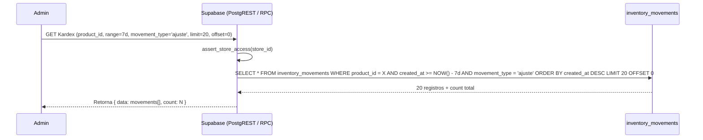
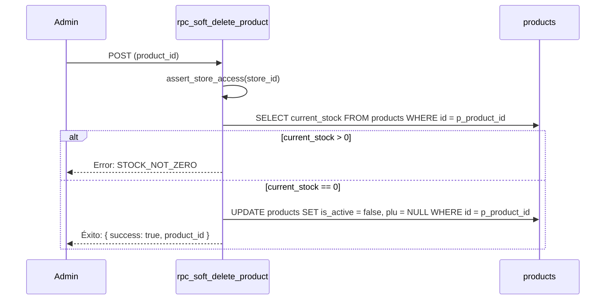
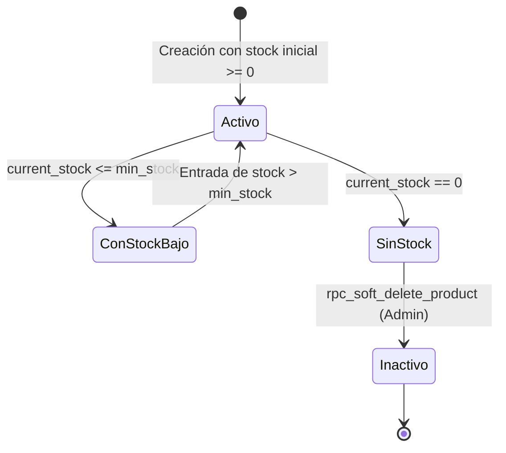
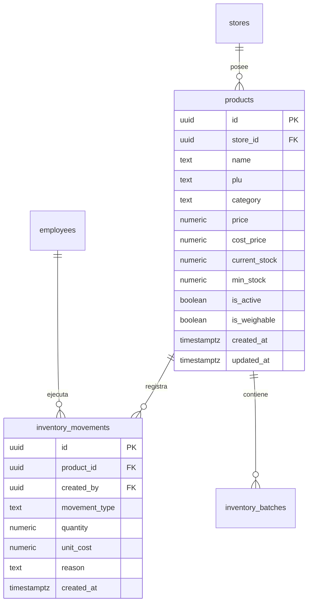

# SDD-006: Gestión de Inventario y Catálogo (Módulo Primario)

> **Asociado a:** [FRD-006](../FRD/FRD_006_INVENTARIO.md)  
> **Fase del Plan:** Ola 2 — Inventario, Lotes y Proveedores  
> **Estado:** 🟡 Validado Localmente (Post Alineación v1.5.8)  
> **Última Actualización:** 2026-10-11  

---

## 0. Contexto y Restricciones Aplicables

### 0.1 Políticas Globales Activadas (ARQ-002)
| Política ID | Dominio | Impacto Concreto en este SDD |
|-------------|---------|------------------------------|
| **SPEC-010 / 011** | Financiero | **Redondeo e Inmutabilidad de Moneda:** Precios al múltiplo de $50 más cercano. Formato entero en montos. Unidades pesables con máx 2 decimales. |
| **POL-LOG-02** | Logística | **Prohibición de Stock Negativo:** El servidor aborta con `STOCK_INSUFFICIENT` cualquier operación que pretenda decrementar `current_stock` por debajo de cero. |
| **POL-AUD-02** | Auditoría | **Inviolabilidad del Kardex:** Todo movimiento físico (`inventory_movements`) es append-only; prohibido `UPDATE` o `DELETE` sobre el historial. |
| **POL-SEC-01** | Seguridad | **Protección de Costos:** Columnas de costo (`cost_price`, `unit_cost`) se reservan para roles con privilegio administrativo. |

### 0.2 Contratos Vecinos que Limitan el Diseño
| SDD Origen | Restricción Inyectada | Impacto en Inventario |
|------------|-----------------------|-----------------------|
| **SDD_010_016 (FIFO)** | Valuación por lotes activos. | `current_stock` en `products` se sincroniza como la sumatoria de `quantity_remaining` de `inventory_batches`. |
| **SDD_007 (Ventas y POS)** | Descuento automático. | El motor de ventas descuenta del Kardex insertando movimientos de tipo `'venta'`. |
| **SDD_006_03 (Código Producto)** | Búsqueda unificada PLU y nombre. | El inventario expone índices para búsqueda exacta por PLU y coincidencia parcial por nombre (>= 2 caracteres). |
| **SDD_005 (Auditoría)** | Evidence Hub. | Los movimientos de inventario alimentan el dominio de auditoría de inventario con filtros temporales. |

### 0.3 Auditoría de BD contra Realidad (Deuda Técnica Declarada)
*Evidencia cruda obtenida de Supabase Producción (`ihtjocmhzuliwwvdzfnz`):*

```sql
-- Columnas en products:
-- id (uuid), store_id (uuid), name (text), plu (text), brand (text), category (text), price (numeric),
-- cost_price (numeric), current_stock (numeric), min_stock (numeric), is_active (boolean),
-- is_weighable (boolean), measurement_unit (text), supplier_id (uuid), low_stock_alerted (boolean),
-- created_at (timestamptz), updated_at (timestamptz)

-- Columnas en inventory_movements:
-- id (uuid), product_id (uuid), quantity (numeric), unit_cost (numeric), supplier_id (uuid),
-- reference_invoice_id (uuid), movement_type (text), invoice_reference (text), reason (text),
-- payment_type (text), created_by (uuid), created_at (timestamptz)

-- Constraint de tipos de movimiento en BD:
-- CHECK (movement_type = ANY (ARRAY['entrada', 'salida', 'devolucion', 'merma', 'ajuste', 'CORRECCION_SISTEMA', 'venta']))
```

| Hallazgo / Componente | Brecha Real Detectada | Solución Normativa y Trade-off | Condición de Revisión |
|-----------------------|-----------------------|---------------------------------|-----------------------|
| 🔴 **Desincronización de trigger Kardex** | En el histórico existieron triggers redundantes que recalculaban stock en conflicto con FIFO. | **Decisión:** Mantener sincronización atómica gobernada por `sync_product_stock_from_batches` y `bridge_movement_to_batch`. | Monitoreo continuo de consistencia en auditorías periódicas. |
| 🟡 **Paginación progresiva en servidor** | Consultas masivas de Kardex o catálogo sin paginación degradan rendimiento. | **Decisión:** Los contratos de lectura exigen parámetros `limit` (fijo en 20 por defecto) y `offset`, retornando `{ data, count }`. | Implementación estricta en queries PostgREST / RPCs. |

---

## 1. Glosario Local

- **Kardex (`inventory_movements`):** Registro cronológico inmutable de entradas, salidas, mermas, ventas y ajustes de stock.
- **Stock Mínimo (`min_stock`):** Umbral que activa la alerta visual de reposición (`current_stock <= min_stock`).
- **Borrado Lógico (`rpc_soft_delete_product`):** Marcado de un producto como `is_active = false` liberando su PLU, condicionado a tener existencias en cero.
- **Paginación Progresiva:** Estrategia de carga en bloques de 20 elementos bajo demanda para listas de alta cardinalidad.

---

## 2. Diagramas de Secuencia

### 2.1 Consulta Filtrada y Paginada del Kardex


### 2.2 Borrado Lógico de Producto


---

## 3. Diagramas de Estado



---

## 4. Especificación Detallada de Casos de Uso

### Caso A: Crear Producto en Catálogo
- **Actor:** Administrador o empleado con `canManageInventory`.
- **Precondición:** Tienda activa con acceso verificado.
- **Flujo Principal:**
  1. El usuario envía nombre, categoría, unidad de medida, precio y PLU opcional.
  2. El servidor valida la unicidad del PLU dentro de la tienda para productos activos.
  3. El servidor redondea el precio al múltiplo de $50 más cercano.
  4. Inserta el producto con `current_stock = 0` (o ejecuta entrada inicial atómica si se proveyó stock).
- **Postcondición:** Producto registrado y visible en catálogo.

### Caso B: Borrado Lógico Seguro de Producto
- **Actor:** Administrador (Exclusivo).
- **Precondición:** Producto con `current_stock == 0` y sin facturas de compra pendientes.
- **Flujo Principal:**
  1. El Admin envía solicitud de eliminación lógica vía `rpc_soft_delete_product`.
  2. El servidor valida que el stock disponible sea exactamente 0.
  3. El servidor actualiza `is_active = false`, libera el PLU asignado y renombra con prefijo de archivado.
- **Postcondición:** Producto inactivo; excluido del POS pero conservado en el historial de transacciones pasadas.

### Caso C: Búsqueda y Filtrado del Catálogo de Inventario
- **Actor:** Empleado o Administrador.
- **Precondición:** Sesión activa con acceso a la tienda.
- **Flujo Principal:**
  1. El usuario consulta el catálogo aplicando filtros combinables:
     - Búsqueda parcial por nombre (>= 2 caracteres) o código PLU.
     - Filtro por categoría.
     - Filtro por estado de stock (Todos, Stock Bajo, Sin Stock).
     - Filtro por estado activo/inactivo (inactivos solo visibles para Admin).
     - Ordenamiento por nombre, stock o precio.
  2. El servidor retorna los primeros 20 registros con el total de coincidencias.
  3. El usuario puede solicitar bloques subsiguientes de 20 en 20 bajo demanda.
- **Postcondición:** Lista de productos paginada y filtrada.

### Caso F: Auditoría de Discrepancias vía Kardex
- **Actor:** Administrador.
- **Precondición:** Producto existente con movimientos registrados.
- **Flujo Principal:**
  1. El Admin accede al historial Kardex de un producto.
  2. Por defecto, el sistema consulta los movimientos de los últimos 7 días en orden cronológico descendente.
  3. El Admin filtra por Tipo de Movimiento (`ajuste`, `merma`) y por empleado responsable.
  4. El servidor retorna los movimientos coincidentes respetando la paginación de 20 en 20.
  5. El Admin aísla la transacción anómala, identificando fecha, cantidad, motivo y autor.
- **Postcondición:** Trazabilidad operativa verificada sin recorrer la lista total de ventas.

---

## 5. Contrato de Interfaz

### 5.1 Operación: Consulta de Catálogo (`get_inventory_products`)
- **Tipo:** Consulta PostgREST / Lectura (READ)
- **Entradas (Query Params):**
  - `store_id`: UUID (Obligatorio)
  - `search`: String (Opcional, búsqueda parcial sobre `name` o exacta en `plu`)
  - `category`: String (Opcional)
  - `low_stock`: Boolean (Opcional, filtra `current_stock <= min_stock`)
  - `is_active`: Boolean (Default: `true`)
  - `limit`: Integer (Default: 20)
  - `offset`: Integer (Default: 0)
  - `order`: String (Opcional: `name.asc`, `current_stock.asc`, `price.desc`)
- **Salida Exitosa:**
  ```json
  {
    "data": [
      {
        "id": "UUID",
        "name": "Arroz Diana 1kg",
        "plu": "1001",
        "category": "Granos",
        "price": 4500,
        "cost_price": 3800,
        "current_stock": 25.00,
        "min_stock": 10.00,
        "is_active": true,
        "is_weighable": false
      }
    ],
    "count": 48
  }
  ```

### 5.2 Operación: Consulta de Kardex (`get_kardex_movements`)
- **Tipo:** Consulta PostgREST / Lectura (READ)
- **Entradas (Query Params):**
  - `product_id`: UUID (Obligatorio)
  - `start_date`: TIMESTAMPTZ (Default: `NOW() - INTERVAL '7 days'`)
  - `end_date`: TIMESTAMPTZ (Default: `NOW()`)
  - `movement_type`: Text (Opcional: `'entrada'`, `'salida'`, `'devolucion'`, `'merma'`, `'ajuste'`, `'venta'`)
  - `created_by`: UUID (Opcional, filtro por empleado)
  - `limit`: Integer (Default: 20)
  - `offset`: Integer (Default: 0)
- **Salida Exitosa:**
  ```json
  {
    "data": [
      {
        "id": "UUID",
        "movement_type": "merma",
        "quantity": 2.00,
        "reason": "Empaque roto en bodega",
        "created_by": "UUID_EMPLEADO",
        "employee_name": "Juan Perez",
        "created_at": "TIMESTAMPTZ"
      }
    ],
    "count": 14
  }
  ```

### 5.3 Operación: `rpc_soft_delete_product`
- **Tipo:** RPC Postgres / Acción (WRITE)
- **Entradas:**
  ```json
  {
    "p_product_id": "UUID (Obligatorio)"
  }
  ```
- **Salida Exitosa:**
  ```json
  {
    "success": true,
    "data": {
      "product_id": "UUID",
      "is_active": false
    }
  }
  ```
- **Catálogo de Errores:**
  | Código de Error | Causa | Mensaje Técnico |
  |-----------------|-------|-----------------|
  | `STORE_ACCESS_DENIED` | Usuario sin rol Admin | Solo administradores pueden desactivar productos |
  | `PRODUCT_NOT_FOUND` | ID inexistente | Producto no encontrado en la tienda |
  | `STOCK_NOT_ZERO` | `current_stock > 0` | No se puede desactivar un producto con existencias en stock |
  | `PENDING_INVOICES` | Atado a facturas pendientes | El producto tiene obligaciones pendientes con proveedores |

---

## 6. Análisis de Seguridad

- **Funciones Centralizadas:** Validación obligatoria con `assert_store_access(v_store_id)`.
- **Ocultamiento de Costos a Cajeros:** Las políticas RLS y consultas sanitizan `cost_price` y `unit_cost` cuando el rol de la sesión es `employee` sin permiso `canViewCosts`.
- **Integridad Referencial en Desactivación:** La eliminación física `DELETE` está deshabilitada en RLS para proteger las claves foráneas en `sale_items` y `inventory_movements`.

---

## 7. Modelo de Datos Lógico



### Diccionario de Datos de Inventario
| Tabla | Atributo | Tipo | Nullable | Estado en BD | Descripción |
|-------|----------|------|----------|--------------|-------------|
| `products` | `id` | UUID | NO | ✅ Sí | Clave primaria del producto |
| `products` | `store_id` | UUID | NO | ✅ Sí | Tienda propietaria |
| `products` | `name` | TEXT | NO | ✅ Sí | Nombre comercial del artículo |
| `products` | `plu` | TEXT | SÍ | ✅ Sí | Código rápido único para activos |
| `products` | `price` | NUMERIC | NO | ✅ Sí | Precio de venta (redondeo $50) |
| `products` | `cost_price` | NUMERIC | SÍ | ✅ Sí | Costo promedio o de última compra |
| `products` | `current_stock` | NUMERIC | NO | ✅ Sí | Stock total disponible |
| `products` | `min_stock` | NUMERIC | SÍ | ✅ Sí | Umbral de alerta de stock bajo |
| `products` | `is_active` | BOOLEAN | NO | ✅ Sí | `true` activo, `false` borrado lógico |
| `inventory_movements` | `id` | UUID | NO | ✅ Sí | Identificador del movimiento |
| `inventory_movements` | `product_id` | UUID | NO | ✅ Sí | Producto afectado |
| `inventory_movements` | `movement_type` | TEXT | NO | ✅ Sí | Tipo (`entrada`, `salida`, `merma`, `ajuste`, etc.) |
| `inventory_movements` | `quantity` | NUMERIC | NO | ✅ Sí | Cantidad movida |
| `inventory_movements` | `created_by` | UUID | SÍ | ✅ Sí | Empleado que registró la transacción |
| `inventory_movements` | `created_at` | TIMESTAMPTZ | NO | ✅ Sí | Marca de tiempo inmutable |
