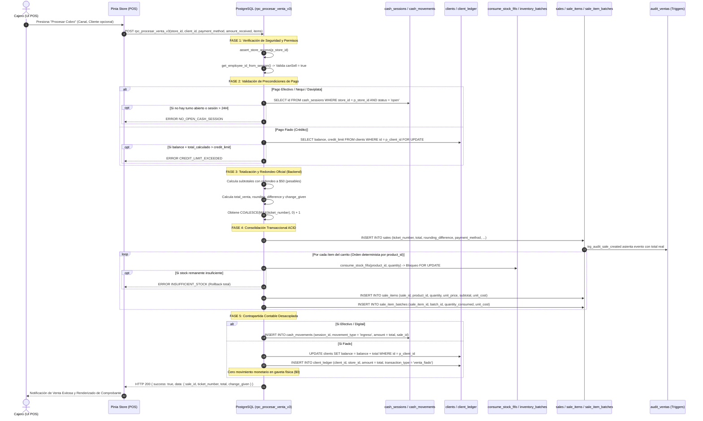
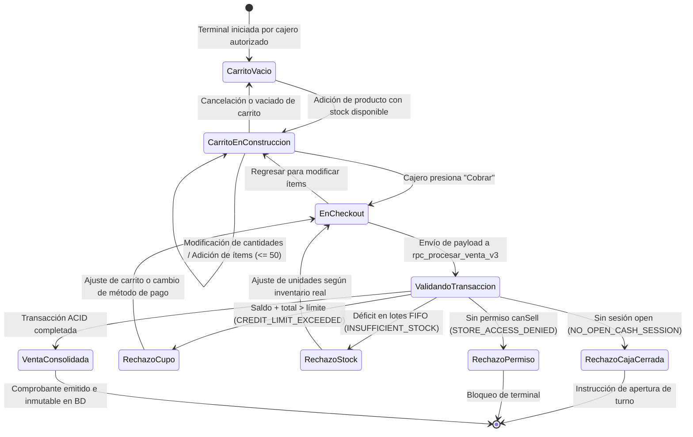
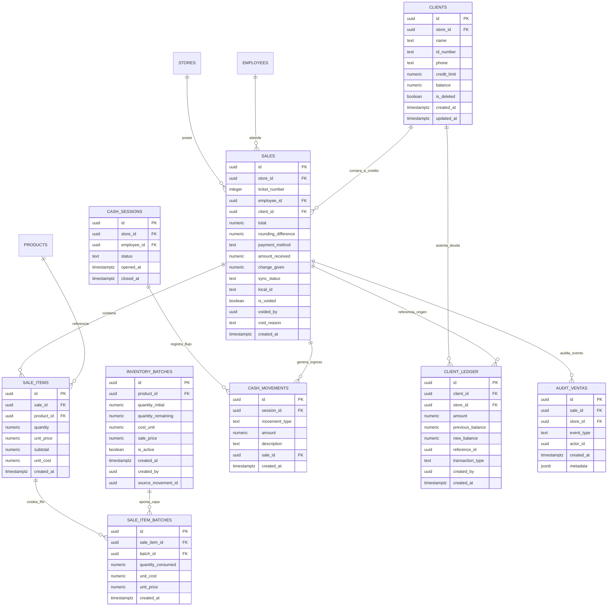

# SDD-007-01: Núcleo del Punto de Venta (POS) Desacoplado y Contratos de Checkout Multicanal

> **Asociado a:** [FRD-007-01](../FRD/FRD_007_01_NUCLEO_POS.md)  
> **Fase del Plan:** Ola 3: Ventas, POS y Clientes (Ítem 2)  
> **Estado:** 🟠 Aprobado con Deuda Técnica Documentada (Post PAC-SDD v2.0)
> **Última Actualización:** 2026-10-17
> **Última Actualización:** 2026-10-15  

---

## 0. Auditoría Contextual PAC-SDD (Etapa 1.5 - Mapa de Dependencias)

### 0.1 Políticas Globales Activadas (ARQ-002)

| Política ID | Dominio | Mandato Arquitectónico Concreto |
|---|---|---|
| **POL-AUTH-01** | Seguridad | Aislamiento multi-tenant estricto. La primera instrucción de `rpc_procesar_venta_v3` debe ser `PERFORM assert_store_access(p_store_id);`. Aislamiento en RLS mediante `get_current_store_id()`. |
| **POL-AUD-01** | Auditoría | Inviolabilidad histórica append-only. Ninguna venta ni despiece de lotes se muta ni elimina tras su consolidación transaccional. |
| **POL-AUD-02** | Auditoría | Inmutabilidad de turnos cerrados. Todo cobro comercial exige sesión activa (`status = 'open'`) imputando al `session_id` del turno corriente; turnos cerrados permanecen sellados. Totalización previa al `INSERT INTO sales` para que `trg_audit_sale_created` capture el monto real (> $0). |
| **POL-FIN-01** | Financiero | Fidelidad absoluta de flujo de efectivo. Ventas fiadas (`p_payment_method = 'fiado'`) registran estrictamente $0 en la caja diaria. Prohibido sumar fiados como efectivo virtual. |
| **POL-FIN-02** | Financiero | Prevención de desbalance y sobregiro. Cobros en efectivo y transferencias digitales ingresan de forma atómica a `cash_movements` vinculados a la sesión de caja abierta. |
| **POL-FIN-03** | Financiero | Límite estricto de endeudamiento. La venta fiada valida bajo bloqueo pesimista que `balance + total <= credit_limit`. Si excede, aborta la venta completa. |
| **POL-LOG-01** | Logística | Consumo FIFO y trazabilidad de lotes. Toda salida de mercancía consume capas cronológicas en `inventory_batches` mediante `consume_stock_fifo`, sellando `sale_items.unit_cost` y `sale_item_batches`. |
| **POL-LOG-02** | Logística | Bloqueo logístico preventivo. Si el inventario disponible es insuficiente para cubrir la demanda, el motor rechaza la adición al carrito o el checkout abortando la transacción atómica. |
| **POL-SEC-01** | Seguridad | Ceguera financiera en el punto de venta. Los cajeros y terminales POS tienen prohibido conocer o recibir el costo de adquisición de los productos (`unit_cost`). |
| **SPEC-010** | Financiero | Redondeo comercial a $50 COP. Subtotales de pesables calculados en backend con `FLOOR(subtotal / 50.0) * 50`. Total de venta suma subtotales ya redondeados. Vueltas con algoritmo híbrido de empate hacia abajo. |
| **SPEC-011** | Datos | Formato y precisión numérica. Importes en moneda legal entera COP sin decimales. Cantidades de productos unitarios enteras; pesables con máximo 2 decimales. Persistencia de `rounding_difference`. |

---

### 0.2 Restricciones Transversales Inyectadas (Fase 0)

| SDD Origen | Restricción Inyectada | Impacto en el Punto de Venta (POS) |
|---|---|---|
| **SDD_007 (Núcleo de Ventas Padre)** | Contrato canónico de checkout transaccional y cabecera de venta. | `rpc_procesar_venta_v3` implementa la consolidación atómica con numeración secuencial única por tienda (`ticket_number`), sellado de auditoría y rollback integral. |
| **SDD_004 / SDD_020 (Caja Diaria y Multicanal)** | Turno de caja abierto mandatorio (`status = 'open'`) y menor a 24 horas. | Si no existe turno activo, el POS bloquea el checkout de pagos de contado (efectivo y transferencias) con código `NO_OPEN_CASH_SESSION`. |
| **SDD_006 / SDD_010_016 (Lotes y Valoración FIFO)** | Descuento atómico por capas cronológicas mediante `consume_stock_fifo`. | El carrito no interactúa directamente con los lotes; el backend despieza las capas en `sale_item_batches` y estampa el costo promedio ponderado en `sale_items.unit_cost`. |
| **SDD_006_02 (Gestor de Reembolsos)** | Trazabilidad por ítem vendido y prevención de doble restitución. | Cada ítem consolidado en `sale_items` constituye la base inmutable para eventuales reembolsos parciales posteriores. |
| **SDD_007_02 (Ticket de Venta)** | Secuencia transaccional segura `COALESCE(MAX(ticket_number), 0) + 1`. | El POS recibe del backend el entero secuencial oficial para presentarlo en pantalla, absteniéndose de calcular consecutivos locales. |
| **SDD_009 / SDD_024 (Cartera y Fiados)** | Validación de cupo bajo `SELECT ... FOR UPDATE` y $0 efectivo en caja. | El POS evalúa solvencia crediticia y registra el cargo en `client_ledger`, omitiendo la columna calculada `new_balance`. |
| **SDD_005 (Auditoría Forense)** | Inviolabilidad append-only y trazabilidad de eventos. | La inserción en `sales` activa el trigger `trg_audit_sale_created` en `audit_ventas` capturando el payload y monto total real. |
| **SDD_018 (Control Operacional y P&L)** | Exclusión de ventas anuladas y preservación de ingresos comerciales reales. | Mermas y devoluciones a proveedor no generan tickets de venta; se canalizan por inventarios y cuentas por pagar/gastos operativos. |

---

### 0.3 Auditoría de BD contra Realidad (Deudas Técnicas Formalizadas bajo Regla 7)

En cumplimiento de las Reglas 2, 4, 6, 7 y 9 de `AGENTS.md`, se identificaron y formalizaron **N = 5** deudas técnicas sobre el esquema físico de producción (`ihtjocmhzuliwwvdzfnz`):

| ID | Hallazgo / Brecha en Esquema Real | Qué se Decidió | Por qué (Trade-off Concreto) | Condición de Revisión Futura |
|:--:|---|---|---|---|
| **D-1** | **Ausencia física de `idempotency_key` en tabla `sales`.** La tabla en producción cuenta con `local_id (text)`, pero carece de `idempotency_key (uuid unique)`. | Definir `idempotency_key` en el contrato canónico de V3 y convivir transitoriamente con `local_id` para trazabilidad de peticiones offline. | Previene doble cobro por reintentos de red sin ejecutar DDL en caliente sobre la tabla más crítica del sistema en producción. | Despliegue de la migración DDL de Ola 3 (`ALTER TABLE sales ADD COLUMN idempotency_key UUID UNIQUE;`). |
| **D-2** | **Constraint físico `sales_payment_method_check` limitado a 4 valores.** En producción solo admite `['efectivo', 'nequi', 'daviplata', 'fiado']`, excluyendo `'llave_bre'`. | Restringir contractualmente los métodos de pago de `rpc_procesar_venta_v3` a los 4 métodos admitidos por el CHECK físico. | Garantiza estabilidad inmediata y previene fallos transaccionales con error PostgreSQL `23514 (check_violation)`. | Despliegue de la migración multicanal en la Ola 4 (`WO_MIGRATION_OLA4_PAYMENTS`). |
| **D-3** | **Desacoplamiento de Cierres No Comerciales (Mermas y Devoluciones a Proveedor).** El texto original de FRD-007-01 proyectaba canalizar mermas por el POS. | Enrutar mermas y devoluciones a proveedor exclusivamente mediante `inventory_movements` (`'merma'`, `'devolucion'` con `supplier_id`) y módulos contables, prohibiendo filas en `sales`. | Protege la pureza de ingresos comerciales brutos, ticket promedio y cálculo de utilidad bruta en el P&L operacional de `SDD_018`. | Consolidación del módulo de inventario y bajas logísticas en Ola 2/3. |
| **D-4** | **Restricción de columna física generada `client_ledger.new_balance`.** En PostgreSQL real, `new_balance` está definida como `GENERATED ALWAYS AS (previous_balance + amount)`. | Prohibir explícitamente incluir `new_balance` en sentencias `INSERT INTO client_ledger` dentro del procedimiento de venta fiada. | Cumplimiento estricto del estándar de PostgreSQL evitando el error fatal `428C9 (cannot insert into a generated column)`. | Invariante arquitectónico permanente de esquema físico en la base de datos. |
| **D-5** | **Dependencia de retrocompatibilidad de `rpc_force_sale`.** La función de auditoría administrativa `rpc_force_sale` invoca directamente en producción a `rpc_procesar_venta_v2`. | Mantener intacta la función `rpc_procesar_venta_v2` en PostgreSQL durante el despliegue de V3 como capa de compatibilidad. | Evita la rotura inmediata del subsistema de auditoría de ventas forzadas mientras se completa la migración integral. | Refactorización de `rpc_force_sale` en el marco de `SDD_014_VENTA_FORZADA_Y_AUDITORIA` (Ola 5). |

---

## 1. Glosario Técnico y Entidades

| Término / Entidad | Definición en el Contexto de este SDD |
|---|---|
| **Terminal POS (Punto de Venta)** | Interfaz desacoplada y reactiva operada por cajeros o administradores, responsable de capturar la intención de compra, validar existencias y disparar el cobro atómico. |
| **Carrito In-Memory** | Estructura temporal y volátil en el frontend que almacena los ítems seleccionados, cantidades y modo de pago sin calcular costos ni realizar cierres fiscales locales. |
| **Embudo Universal de Egresos Comerciales** | Principio por el cual toda venta rutinaria que reste inventario y genere ingresos comerciales debe canalizarse obligatoriamente a través del motor de cobro del POS. |
| **Desacoplamiento Contable** | Separación estricta de responsabilidades según el medio de pago: el efectivo/digital imputa a caja diaria; el fiado imputa a cuentas por cobrar; las mermas se desvían al kardex logístico sin tocar ventas. |
| **Bloqueo Logístico** | Mecanismo preventivo que impide agregar productos al carrito o procesar el cobro si el inventario disponible en catálogo o lotes es insuficiente. |
| **Ceguera Financiera** | Restricción de seguridad (`POL-SEC-01`) que oculta totalmente el costo de compra (`unit_cost`) al rol cajero para proteger márgenes y confidencialidad. |
| **Venta Consolidada** | Estado final irreversible de una venta en base de datos (`sales`), donde el comprobante adquiere consecutivo seguro, sella su COGS en lotes y genera contrapartida de caja o cartera. |

---

## 2. Modelado de Flujos y Ciclos de Vida

### 2.1 Flujo Transaccional de Checkout Desacoplado

El procesamiento de una venta en el POS desacoplado sigue una secuencia estricta de validaciones y doble asiento atómico gobernada exclusivamente por el backend:



---

### 2.2 Diagrama de Estados del Carrito y la Venta



---

### 2.3 Regla de Cero Cálculos en Frontend (Flujo Unidireccional y Frontera Online/Offline)

1. **El Frontend NO Calcula Importes Financieros Oficiales:** El cliente tiene estrictamente prohibido computar subtotales, impuestos, descuentos o el total oficial de la venta en el payload de checkout online. Su responsabilidad se limita a acumular `{ product_id, quantity }` en memoria.
2. **Visualización Previa en Carrito vs. Verdad Contable (`SPEC-011`):** Cualquier subtotal o total desplegado en la vista previa del carrito (`stores/cart.ts`, `POSView.vue`) es exclusivamente una **estimación cosmética pre-vuelo** para orientación visual del cajero. Dicho cálculo provisional jamás se envía como parámetro autoritativo al backend en ventas online.
3. **El Frontend NO Calcula Vueltas ni Redondeos Oficiales:** Los redondeos comerciales al múltiplo inferior de $50 COP, el cambio exacto (`change_given`) y la diferencia fiscal (`rounding_difference`) son calculados y certificados exclusivamente por el motor de base de datos en `rpc_procesar_venta_v3`.
4. **Exclusión de Pago Mixto en POS Actual:** En estricto cumplimiento de `FRD_004` (Caso B: Pago Mixto clasificado como `Próximamente POS`), se prohíbe en la interfaz del POS (`CheckoutModal.vue`) y en el repositorio (`saleRepository.ts`) exponer o enviar `payment_method = 'mixed'`. Los únicos métodos permitidos en POS son `'efectivo'`, `'nequi'`, `'daviplata'`, `'fiado'`.
5. **El Frontend NO Conoce Costos ni Lotes:** La interfaz de usuario opera bajo ceguera financiera total (`POL-SEC-01`). No recibe ni presenta costos de lote (`unit_cost`) ni capas FIFO.
6. **Frontera de Sincronización Desconectada (`SDD_012`):** La única excepción donde el cliente congela importes unitarios es en la cola local de ventas offline (`OfflineSaleRecord`), donde captura `historical_unit_price` para garantizar que la venta respete el precio vigente en el momento en que se pactó desconectado (`RN-012-04`).

---

## 3. Seguridad y Multi-Tenant

### 3.1 Aislamiento Multi-Tenant (Reglas 4 y 8)

- **Instrucción #1 Mandatoria:** Todo procedimiento de checkout o consulta del POS ejecuta como primera sentencia:
  `PERFORM assert_store_access(p_store_id);`
  garantizando que ninguna venta se procese ni se consulte fuera de la tienda del usuario autenticado.
- **Políticas RLS en Tablas del Módulo:**
  - `sales`: `store_id = get_current_store_id()`.
  - `sale_items`: `EXISTS (SELECT 1 FROM sales s WHERE s.id = sale_items.sale_id AND s.store_id = get_current_store_id())`.
  - `sale_item_batches`: Vinculada mediante JOIN jerárquico hasta `sales.store_id = get_current_store_id()`.
  - `clients` y `client_ledger`: `store_id = get_current_store_id()`.
  - `cash_sessions` y `cash_movements`: `store_id = get_current_store_id()`.
  - `audit_ventas`: Homogeneizada con `store_id = get_current_store_id()`.
- **Privilegios Base de Esquema (Regla 8):** Todas las tablas del módulo cuentan con `GRANT ALL` otorgado a los roles `anon`, `authenticated` y `postgres`, delegando la seguridad a nivel de fila exclusivamente a las políticas RLS y los RPCs `SECURITY DEFINER`.

---

### 3.2 Matriz de Control de Acceso (RBAC) y Permisos

| Acción del Sistema | Administrador | Cajero con `canSell` | Cajero sin `canSell` | Mecanismo de Seguridad |
|---|:---:|:---:|:---:|---|
| **Acceso a Terminal POS** | ✅ | ✅ | ❌ | Bloqueado en UI y en RPC (`STORE_ACCESS_DENIED`). |
| **Venta Contado (Efectivo / Transferencia)** | ✅ | ✅ | ❌ | Exige sesión de caja activa (`status = 'open'`). |
| **Venta Fiado (Crédito a Cliente)** | ✅ | ✅ | ❌ | Valida cupo bajo `FOR UPDATE` en `clients`. |
| **Cierre Logístico (Mermas / Devolución)** | ✅ | ❌ | ❌ | Enrutado por `inventory_movements`, restringido a Admin. |
| **Anulación de Venta Consolidada** | ✅ | ❌ | ❌ | Prohibido para cajeros; validado en `rpc_anular_venta`. |
| **Visualización de Costos (`unit_cost`)** | ✅ | ❌ | ❌ | Oculto en frontend y omitido en payloads de cajero. |

---

### 3.3 Inviolabilidad Contable (Append-Only)

- Las tablas `sales`, `sale_items`, `sale_item_batches` y `client_ledger` no exponen políticas de `UPDATE` ni `DELETE` a clientes de PostgREST.
- Una vez confirmada una venta, los registros son permanentes e inmutables.
- Errores operativos se corrigen exclusivamente mediante el procedimiento administrativo formal de anulación (`rpc_anular_venta`), el cual sella la cabecera mediante `is_voided = true` y genera contra-asientos inmutables.

---

## 4. Casos Límite y Concurrencia (Regla 5 de AGENTS.md)

| ID | Escenario de Caso Límite | Comportamiento del Motor / Backend | Código de Excepción / Error | Respuesta Visual en UI |
|---|---|---|---|---|
| **CL-01** | **Venta de Contado con Caja Cerrada** | El motor verifica `cash_sessions`. Al no encontrar turno abierto y vigente (< 24H), aborta la transacción sin tocar inventario. | `NO_OPEN_CASH_SESSION` | Modal de bloqueo: *"Para registrar ventas en efectivo o digital, primero debe abrir el turno de caja."* Redirige a Apertura. |
| **CL-02** | **Venta Fiado con Cupo Excedido** | Evalúa bajo `SELECT ... FOR UPDATE` si `balance + total > credit_limit`. Si se supera el límite de crédito, aborta la transacción completa. | `CREDIT_LIMIT_EXCEEDED` | Toast de advertencia: *"Cupo insuficiente. Saldo actual: $X, Cupo total: $Y, Total venta: $Z."* |
| **CL-03** | **Déficit de Stock en Consumo FIFO** | `consume_stock_fifo` detecta que la suma de remanentes en `inventory_batches` es inferior a la cantidad solicitada. Rollback total. | `INSUFFICIENT_STOCK` | Alerta roja: *"Stock insuficiente para completar la venta del producto [Nombre]. Disponible: X unidades."* |
| **CL-04** | **Venta Concurrente del Mismo Producto** | Dos cajas intentan cobrar el último ítem simultáneamente. El cursor `FOR UPDATE` sobre `inventory_batches` serializa el consumo. | Serialización Transaccional | La primera venta descuenta el stock; la segunda recibe `INSUFFICIENT_STOCK` sin generar saldos negativos. |
| **CL-05** | **Venta Fiado Simultánea al Mismo Cliente** | Dos terminales cargan ventas a crédito al mismo cliente. El bloqueo pesimista en `clients` previene carreras sobre el saldo. | Serialización Transaccional | Ambas ventas evalúan el cupo secuencialmente, bloqueando la que supere el límite sin desincronizar `balance`. |
| **CL-06** | **Producto Vendido Sin Costo Registrado** | El producto fue creado sin costo o ingresó con costo cero. El motor asigna `unit_cost = 0` y completa la venta sin abortar (FRD-016 Regla 4). | Transacción Exitosa | Venta concretada con normalidad. Margen de ganancia bruta no calculable para ese ítem. |
| **CL-07** | **Límite de Carrito Superado (> 50 Ítems)** | El cajero intenta ingresar más de 50 ítems al carrito. El sistema emite advertencia de contención operativa. | `CART_LIMIT_EXCEEDED` | Mensaje informativo: *"Máximo 50 productos por venta. Procese este ticket e inicie una nueva transacción."* |
| **CL-08** | **Reintento Idempotente por Latencia de Red** | El cliente reenvía la petición con la misma `idempotency_key` o `local_id`. El motor detecta el ticket ya existente y retorna el comprobante. | Retorno Idempotente (HTTP 200) | La interfaz recupera el comprobante oficial sin duplicar cobros, stock ni deuda. |

---

## 5. Contrato de Interfaz

### 5.0 Operación Previa de Catálogo y Búsqueda Unificada en POS (`buscar_producto_pos`)

> **Trazabilidad H1 / H2 (`v1.5.8`):** Antes de ejecutar el checkout, la terminal POS resuelve la búsqueda unificada de productos (lookup instantáneo por código numérico `plu` exacto o búsqueda parcial alfabética `p_search` de mínimo 2 caracteres filtrando `current_stock > 0` y ocultando `cost_price`) consumiendo el contrato canónico **`buscar_producto_pos`** especificado en la Sección `§5.1` de [`SDD_006_03_CODIGO_PRODUCTO.md`](./SDD_006_03_CODIGO_PRODUCTO.md) y en [`SDD_006_NUCLEO_INVENTARIO_PADRE.md`](./SDD_006_NUCLEO_INVENTARIO_PADRE.md).

### 5.1 Operación: `rpc_procesar_venta_v3` (Procesamiento de Venta Atómica)

- **Tipo:** RPC Postgres / Acción (WRITE)
- **Propósito:** Consolidar una transacción de venta en el POS, descontando inventario en cascada FIFO, generando consecutivo seguro y asentando la contrapartida en caja o cartera.
- **Entrada (Request JSON):**
  ```json
  {
    "p_store_id": "UUID (Obligatorio)",
    "p_client_id": "UUID (Opcional, obligatorio si p_payment_method = 'fiado')",
    "p_payment_method": "TEXT (Obligatorio: 'efectivo', 'nequi', 'daviplata', 'fiado'. Prohibido 'mixed')",
    "p_amount_received": "NUMERIC >= 0 (Opcional, requerido si p_payment_method = 'efectivo')",
    "p_idempotency_key": "UUID (Opcional, identificador único de transacción para reintentos seguros)",
    "p_local_id": "TEXT (Opcional, identificador local de sincronización offline)",
    "p_is_offline_sync": "BOOLEAN (Opcional, default false. Si true, el backend honra/audita precios históricos congelados)",
    "p_items": [
      {
        "product_id": "UUID (Obligatorio)",
        "quantity": "NUMERIC > 0 (Obligatorio, entero en unitarios, máx 2 decimales en pesables)",
        "unit_price": "NUMERIC > 0 (Opcional, solo transmitido en sincronización offline diferida p_is_offline_sync = true)"
      }
    ]
  }
  ```
- **Salida Exitosa (HTTP 200 - Response JSON):**
  ```json
  {
    "success": true,
    "data": {
      "sale_id": "UUID",
      "ticket_number": 1045,
      "total": 35000,
      "rounding_difference": 0,
      "amount_received": 50000,
      "change_given": 15000,
      "payment_method": "efectivo",
      "items_count": 3,
      "created_at": "2026-10-15T14:30:00Z"
    }
  }
  ```
- **Salida de Error (Excepciones Tipificadas):**
  ```json
  {
    "success": false,
    "error": "Mensaje técnico descriptivo de la falla",
    "code": "NO_OPEN_CASH_SESSION | CREDIT_LIMIT_EXCEEDED | INSUFFICIENT_STOCK | STORE_ACCESS_DENIED | INVALID_PAYMENT_METHOD | CART_LIMIT_EXCEEDED"
  }
  ```

---

### 5.2 Operación: `get_active_cash_session` (Verificación Previa de Turno para POS)

- **Tipo:** RPC Postgres / Lectura (READ)
- **Propósito:** Validar el estado del turno de caja previo a habilitar el cobro en efectivo o transferencias en la terminal POS.
- **Entrada (Request JSON):**
  ```json
  {
    "p_store_id": "UUID (Obligatorio)"
  }
  ```
- **Salida Exitosa (HTTP 200 - Response JSON):**
  ```json
  {
    "success": true,
    "data": {
      "session_id": "UUID",
      "status": "open",
      "opened_at": "2026-10-15T08:00:00Z",
      "opened_by": "UUID",
      "cashier_name": "Carlos Cajero",
      "is_expired": false
    }
  }
  ```
- **Salida Sin Turno Abierto (HTTP 200):**
  ```json
  {
    "success": true,
    "data": null
  }
  ```

---

### 5.3 Operación: `get_client_credit_status` (Consulta de Cupo de Fiado para POS)

- **Tipo:** RPC Postgres / Lectura (READ)
- **Propósito:** Consultar el saldo adeudado y cupo disponible de un cliente antes de autorizar el cierre a crédito.
- **Entrada (Request JSON):**
  ```json
  {
    "p_store_id": "UUID (Obligatorio)",
    "p_client_id": "UUID (Obligatorio)"
  }
  ```
- **Salida Exitosa (HTTP 200 - Response JSON):**
  ```json
  {
    "success": true,
    "data": {
      "client_id": "UUID",
      "name": "María González",
      "credit_limit": 200000,
      "current_balance": 85000,
      "available_credit": 115000,
      "is_blocked": false
    }
  }
  ```

---

## 6. Matriz de Trazabilidad y Políticas Globales

| Código de Política | Dominio | Mandato Arquitectónico | Implementación en SDD-007-01 |
|---|---|---|---|
| **POL-AUTH-01** | Seguridad | Multi-tenant estricto por tienda | Invocación mandatoria de `assert_store_access(p_store_id)` en la línea #1 de `rpc_procesar_venta_v3`; políticas RLS gobernadas por `get_current_store_id()`. |
| **POL-AUD-01** | Auditoría | Inviolabilidad append-only absoluta | `sales`, `sale_items`, `sale_item_batches` y `client_ledger` no poseen políticas de `UPDATE` ni `DELETE`. |
| **POL-AUD-02** | Auditoría | Inmutabilidad de turnos cerrados | Todo ingreso comercial se imputa a la sesión de caja activa actual; totalización previa al `INSERT INTO sales` para poblar `audit_ventas` con el monto real (> $0). |
| **POL-FIN-01** | Financiero | Fidelidad absoluta de caja | Ventas fiadas registran estrictamente $0 en los movimientos de efectivo de la caja diaria. |
| **POL-FIN-02** | Financiero | Prevención de desbalance por canal | Asiento atómico en `cash_movements` vinculando `sale_id`, monto oficial y canal recibido. |
| **POL-FIN-03** | Financiero | Límite estricto de endeudamiento | Validación pesimista de solvencia (`balance + total <= credit_limit`) bajo `FOR UPDATE` en `clients`. |
| **POL-LOG-01** | Logística | Despiece FIFO por capas de lote | Descuento atómico mediante `consume_stock_fifo`, sellando capas en `sale_item_batches` y costo promedio ponderado en `sale_items.unit_cost`. |
| **POL-LOG-02** | Logística | Bloqueo logístico preventivo | Control de existencias impidiendo el despacho si el inventario disponible es insuficiente. |
| **POL-SEC-01** | Seguridad | Ceguera financiera en el POS | Los cajeros tienen prohibido conocer o recibir el costo de adquisición de los productos (`unit_cost`). |
| **SPEC-010** | Financiero | Redondeo comercial a $50 COP | Redondeo forzado en servidor: pesables al múltiplo inferior de $50, vueltas con redondeo híbrido y persistencia de `rounding_difference`. |
| **SPEC-011** | Datos | Precisión de enteros y decimales | Importes monetarios en enteros COP; unitarios enteros, pesables con máximo 2 decimales. |

---

## 7. Modelo de Datos Lógico

### 7.1 Diagrama Entidad-Relación (Mermaid erDiagram)



---

### 7.2 Diccionario de Entidades y Columnas Físicas Verificadas

| Entidad Física en BD | Columna Física | Tipo de Dato | Nullable | Restricción / Invariante Arquitectónico |
|---|---|---|:---:|---|
| **`sales`** | `id` | `uuid` | NO | Clave primaria (`gen_random_uuid()`). |
| | `store_id` | `uuid` | NO | Clave foránea a `stores(id)`. Partición multi-tenant. |
| | `ticket_number` | `integer` | NO | Consecutivo numérico seguro. `UNIQUE(store_id, ticket_number)`. |
| | `employee_id` | `uuid` | NO | Clave foránea a `employees(id)`. Cajero responsable. |
| | `client_id` | `uuid` | SÍ | Clave foránea a `clients(id)`. Obligatorio si fiado. |
| | `total` | `numeric` | NO | Total oficial consolidado en backend. Moneda entera COP. |
| | `rounding_difference` | `numeric` | NO | Diferencia entre total matemático y redondeado (`SPEC-010`). |
| | `payment_method` | `text` | NO | CHECK: `'efectivo'`, `'nequi'`, `'daviplata'`, `'fiado'`. |
| | `amount_received` | `numeric` | SÍ | Dinero entregado por el cliente en efectivo. |
| | `change_given` | `numeric` | SÍ | Vueltas calculadas con algoritmo de empate hacia abajo. |
| | `sync_status` | `text` | NO | CHECK: `'synced'`, `'pending'`, `'failed'`. Default `'synced'`. |
| | `local_id` | `text` | SÍ | Identificador local temporal para sincronización offline. |
| | `is_voided` | `boolean` | NO | Marca lógica de anulación. Default `false`. |
| | `voided_by` | `uuid` | SÍ | Administrador que ejecutó la anulación. |
| | `void_reason` | `text` | SÍ | Motivo explícito de la anulación (mínimo 5 caracteres). |
| | `created_at` | `timestamptz` | NO | Marca temporal de consolidación transaccional. |
| **`sale_items`** | `id` | `uuid` | NO | Clave primaria (`gen_random_uuid()`). |
| | `sale_id` | `uuid` | NO | Clave foránea a `sales(id)` con `ON DELETE CASCADE`. |
| | `product_id` | `uuid` | NO | Clave foránea a `products(id)`. |
| | `quantity` | `numeric` | NO | Cantidad vendida (> 0, entero en unidades, máx 2 decimales pesables). |
| | `unit_price` | `numeric` | NO | Precio de venta congelado al momento del cobro. |
| | `subtotal` | `numeric` | NO | Subtotal con redondeo a $50 aplicado en pesables. |
| | `unit_cost` | `numeric` | SÍ | Costo promedio ponderado congelado de los lotes FIFO. |
| | `created_at` | `timestamptz` | NO | Marca temporal de inserción. |
| **`sale_item_batches`** | `id` | `uuid` | NO | Clave primaria (`gen_random_uuid()`). |
| | `sale_item_id` | `uuid` | NO | Clave foránea a `sale_items(id)` con `ON DELETE CASCADE`. |
| | `batch_id` | `uuid` | NO | Clave foránea a `inventory_batches(id)`. |
| | `quantity_consumed` | `numeric` | NO | Unidades descontadas de la capa específica del lote. |
| | `unit_cost` | `numeric` | NO | Costo de adquisición de la capa del lote consumida. |
| | `unit_price` | `numeric` | NO | Precio de venta asignado a la capa del lote. |
| | `created_at` | `timestamptz` | NO | Marca temporal de despiece inmutable. |
| **`clients`** | `id` | `uuid` | NO | Clave primaria (`gen_random_uuid()`). |
| | `store_id` | `uuid` | NO | Clave foránea a `stores(id)`. |
| | `name` | `text` | NO | Nombre o razón social del cliente. |
| | `id_number` | `text` | SÍ | Documento de identidad fiscal. |
| | `phone` | `text` | SÍ | Teléfono de contacto. |
| | `credit_limit` | `numeric` | NO | Cupo máximo de crédito autorizado. |
| | `balance` | `numeric` | NO | Saldo deudor acumulado actual. Default `0`. |
| | `is_deleted` | `boolean` | NO | Eliminación lógica del cliente. Default `false`. |
| | `created_at` | `timestamptz` | NO | Fecha de registro. |
| | `updated_at` | `timestamptz` | NO | Fecha de última actualización de perfil. |
| **`client_ledger`** | `id` | `uuid` | NO | Clave primaria (`gen_random_uuid()`). |
| | `client_id` | `uuid` | NO | Clave foránea a `clients(id)`. |
| | `store_id` | `uuid` | NO | Clave foránea a `stores(id)`. |
| | `amount` | `numeric` | NO | Importe de la transacción (positivo cargo, negativo abono). |
| | `previous_balance` | `numeric` | NO | Saldo anterior congelado antes de la operación. |
| | `new_balance` | `numeric` | NO | **GENERATED ALWAYS AS (`previous_balance + amount`)**. |
| | `reference_id` | `uuid` | SÍ | Referencia al `sale_id` en ventas fiadas. |
| | `transaction_type` | `text` | NO | CHECK: `'venta_fiado'`, `'abono'`, `'anulacion_fiado'`, etc. |
| | `created_by` | `uuid` | SÍ | Empleado que registró la transacción de cartera. |
| | `created_at` | `timestamptz` | NO | Marca temporal inmutable del asiento. |
