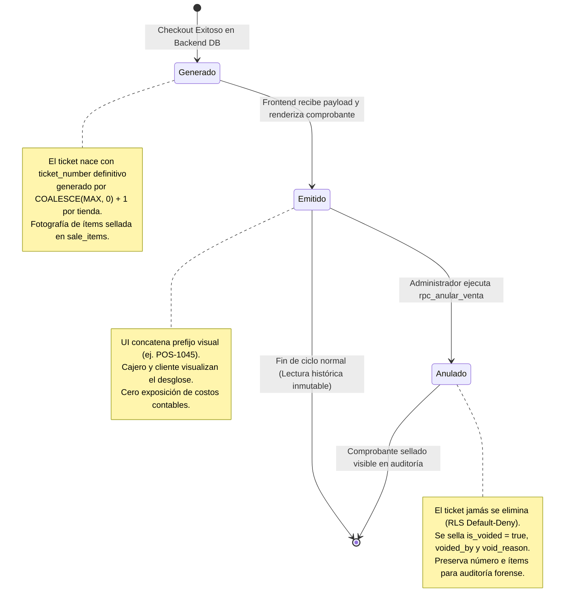
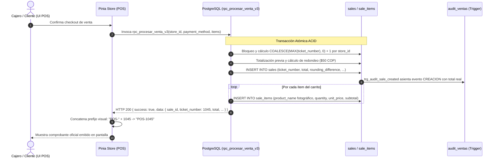
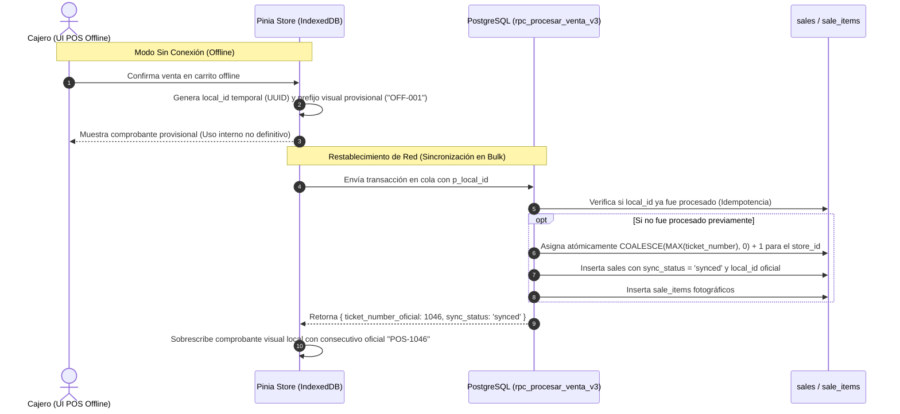
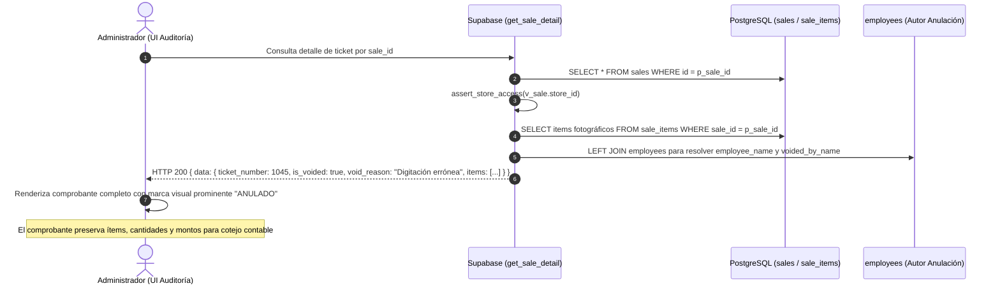
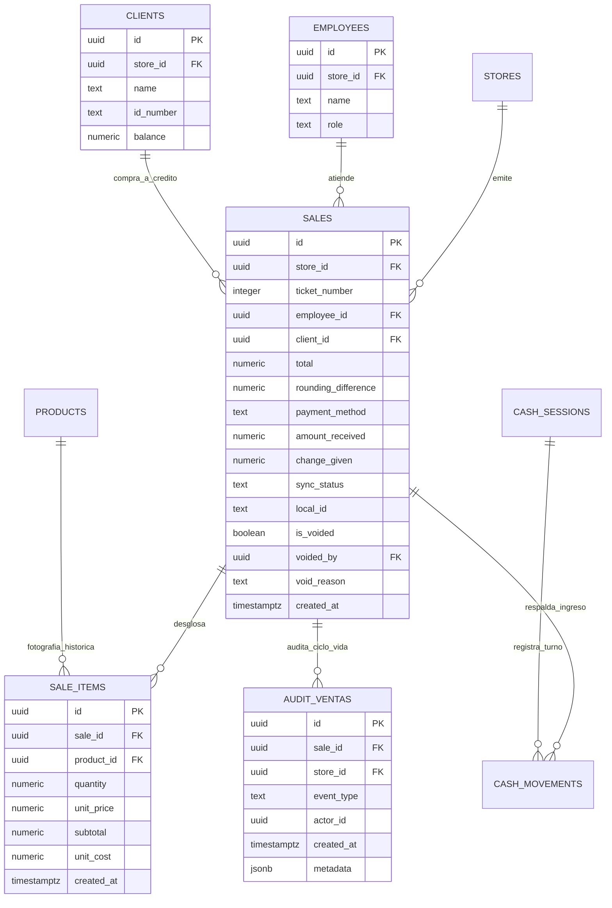

# SDD-007-02: Ticket de Venta (Trazabilidad y Comprobante)

> **Asociado a:** [FRD-007-02](../FRD/FRD_007_02_TICKET_DE_VENTA.md)  
> **Fase del Plan:** Ola 3: Ventas, POS y Clientes (Ítem 3)  
> **Estado:** 🟠 Aprobado con Deuda Técnica Documentada (Protocolo PAC-SDD v2.0)
> **Última Actualización:** 2026-10-15  

---

## 0. Auditoría Contextual PAC-SDD (Etapa 1.5 - Mapa de Dependencias)

### 0.1 Políticas Globales Activadas (ARQ-002)

| Política ID | Dominio | Mandato Arquitectónico Concreto |
|---|---|---|
| **POL-AUTH-01** | Seguridad | Aislamiento multi-tenant estricto. La consulta de detalle de cualquier ticket ejecuta mandatoriamente `PERFORM assert_store_access(v_sale.store_id);`. Aislamiento en RLS mediante `get_current_store_id()`. |
| **POL-AUD-01** | Auditoría | Inviolabilidad histórica append-only. Todo comprobante emitido es estrictamente inmutable; queda prohibida su eliminación física o reutilización de numeración (`ticket_number`). La anulación sella `is_voided = true`, reteniendo autor, motivo y desglose fotográfico. |
| **POL-AUD-02** | Auditoría | Huella de auditoría indeleble e inmutabilidad de turnos cerrados. Todo ticket registra la identidad del cajero (`employee_id`), timestamp del servidor, canal de pago y desglose fotográfico de ítems. Triggers `trg_audit_sale_created` y `trg_audit_sale_voided` en `audit_ventas`. |
| **POL-FIN-01** | Financiero | Fidelidad absoluta de caja. El ticket refleja con exactitud el medio de pago utilizado. Ventas fiadas reflejan $0 en caja y vinculan a la cartera del cliente. |
| **POL-FIN-02** | Financiero | Prevención de desbalance. Comprobantes de ventas en efectivo o transferencias digitales respaldan los ingresos asentados en `cash_movements`. |
| **POL-FIN-03** | Financiero | Límite crediticio. En tickets a crédito (fiado), se registra el cliente deudor cuya solvencia fue validada contra su límite de crédito disponible. |
| **POL-LOG-01** | Logística | Desacoplamiento de capas contables de inventario. El ticket refleja los productos despachados (PLU, nombre, cantidad, precio de venta) sin acoplarse ni exponer capas FIFO. |
| **POL-SEC-01** | Seguridad | Ceguera financiera en el comprobante. Tanto el ticket entregado al cliente como la consulta del cajero en el POS tienen terminantemente prohibido exponer el costo de adquisición (`unit_cost`) o capas de lote. |
| **SPEC-010** | Financiero | Redondeo comercial a $50 COP. El ticket refleja subtotales y totales calculados por el backend con redondeo al múltiplo inferior de $50 en pesables, persistiendo la diferencia fiscal (`rounding_difference`). |
| **SPEC-011** | Datos | Formato y precisión numérica. Importes en moneda legal entera COP sin decimales. Cantidades de productos unitarios enteras; pesables con máximo 2 decimales. |

---

### 0.2 Restricciones Transversales Inyectadas (Fase 0)

| SDD Origen | Restricción Inyectada | Impacto en el Ticket de Venta |
|---|---|---|
| **SDD_007 (Núcleo de Ventas Padre)** | Cabecera oficial de venta y contrato canónico de consulta `get_sale_detail`. | El ticket representa la vista de lectura fotográfica de la cabecera `sales` y el detalle `sale_items`, gobernado por `assert_store_access`. |
| **SDD_007_01 (Núcleo POS Desacoplado)** | Asignación secuencial centralizada en backend y formato de prefijo en UI. | El backend genera y retorna el secuencial entero puro (`ticket_number integer`). El prefijo visual ("POS-", "TK-") es formateo exclusivo de la vista (Frontend/UX). |
| **SDD_004 / SDD_020 (Caja Diaria y Multicanal)** | Trazabilidad con sesión de caja activa. | El pago de contado se vincula al `session_id` del turno corriente a través de `cash_movements(session_id, sale_id)`. |
| **SDD_006 / SDD_010_016 (Lotes y FIFO)** | Ceguera financiera total (`POL-SEC-01`). | El comprobante no expone ni transfiere `unit_cost` ni despiece de lotes; opera únicamente con `unit_price`, `quantity` y `subtotal`. |
| **SDD_009 / SDD_024 (Cartera y Fiados)** | Identificación del cliente en ventas a crédito. | El ticket refleja `client_name` para respaldo de cuentas por cobrar en ventas fiadas. |
| **SDD_005 (Auditoría Forense)** | Inviolabilidad append-only y no repudio. | El borrado directo de tickets está bloqueado por ausencia de políticas `DELETE` en RLS (`relrowsecurity = true`). |
| **SDD_018 (Control Operacional y P&L)** | Naturaleza estrictamente operativa (no fiscal). | El ticket es un control interno para tiendas de barrio. Los reportes financieros de ingresos excluyen ventas anuladas (`sales.is_voided = false`). |

---

### 0.3 Auditoría de BD contra Realidad (Deudas Técnicas Formalizadas bajo Regla 7)

En cumplimiento de las Reglas 2, 3, 4, 7 y 9 de `AGENTS.md`, se identificaron y formalizaron **N = 6** deudas técnicas sobre el esquema físico de producción (`ihtjocmhzuliwwvdzfnz`):

| ID | Hallazgo / Brecha en Esquema Real | Qué se Decidió | Por qué (Trade-off Concreto) | Condición de Revisión Futura |
|:--:|---|---|---|---|
| **D-1** | **Discrepancia histórica de nombres de atributos en contrato de comprobante.** Borradores anteriores usaban `cashier_name` y `historical_price`. | Homogeneizar el contrato adoptando estrictamente los nombres físicos reales de `get_sale_detail`: `employee_name`, `unit_price` y `subtotal`. | Garantiza alineación 100% con las columnas físicas de `employees`, `sale_items` y el contrato canónico de `SDD_007 §5.4`. | Invariante permanente de documentación e interfaz. |
| **D-2** | **Inexistencia física de columna `session_id` en tabla `sales`.** CA-FRD-007-02-04 proyectaba anclar `session_id` directamente al ticket. | Tratar `session_id` como atributo opcional/nulo en la lectura del comprobante, reconociendo que `sales` carece físicamente de esta columna y que fiados no generan `cash_movements`. | Sincera el esquema físico de BD sin alucinar columnas inexistentes ni bloquear la lectura de comprobantes de fiados. | Migración multicanal integral de la Ola 4 (`WO_MIGRATION_OLA4_PAYMENTS`). |
| **D-3** | **Discrepancia estructural de payload en `get_sale_detail` de producción.** El RPC actual en BD retorna un JSON plano sin envoltorio canónico `{ data: { ... } }`, omitiendo `id` y `rounding_difference`. | Especificar `{ success: true, data: { ... } }` con `id` y `rounding_difference` como contrato canónico objetivo enriquecido. | Unifica el contrato con el estándar global de interfaz (Regla 4) gestionando la coexistencia sin romper clientes legacy en caliente. | Refactorización de RPCs de lectura en la Ola 3. |
| **D-4** | **Violación de Regla 3 por swallow de excepciones con `WHEN OTHERS` en `get_sale_detail`.** El procedimiento en BD captura cualquier error y devuelve un JSON genérico ('Error interno'). | Normar la eliminación del bloque `WHEN OTHERS` swallow en `get_sale_detail` y su sustitución por propagación con `RAISE` tipificado. | Cumplimiento estricto de la Regla 3 (Prohibición de Fallos Silenciosos), permitiendo al cliente diagnosticar errores reales (ej. `STORE_ACCESS_DENIED`). | Despliegue de migración de RPCs en la Ola 3. |
| **D-5** | **Residuo de `NEXTVAL()` en diagramas de sincronización offline.** Borradores preliminares contenían `NEXTVAL()` contradiciendo la numeración acotada por tienda. | Purgar definitivamente toda mención de `NEXTVAL()` y estandarizar la asignación secuencial `COALESCE(MAX(ticket_number), 0) + 1` acotada por `store_id`. | Garantiza numeración continua por tienda sin gaps provocados por secuencias globales en entornos multi-tenant. | Corrección documental inmediata en Bloque 7. |
| **D-6** | **Restricción de métodos de pago en comprobantes por CHECK físico.** En BD real `sales_payment_method_check` admite únicamente 4 valores. | Limitar los medios de pago soportados en el ticket a `['efectivo', 'nequi', 'daviplata', 'fiado']`. | Garantiza consistencia con la base de datos de producción y previene errores PostgreSQL `23514 (check_violation)`. | Despliegue de pagos multicanal en la Ola 4. |

---

## 1. Glosario Técnico y Entidades

| Término / Entidad | Definición en el Contexto de este SDD |
|---|---|
| **Ticket de Venta (Comprobante)** | Entidad de solo lectura que representa la fotografía inmutable de una venta completada en el POS. Comprobante de control interno y garantía operativa, no sujeto a validación fiscal formal. |
| **Secuencia Segura Centralizada** | Mecanismo exclusivo del motor de base de datos (`COALESCE(MAX(ticket_number), 0) + 1`) que garantiza numeración estrictamente consecutiva por tienda, respaldada por `UNIQUE(store_id, ticket_number)`. Prohibido calcularlo en el cliente. |
| **Ticket Anulado** | Comprobante cuya venta fue revertida logística y financieramente. El registro físico jamás se borra; se sella con `is_voided = true`, reteniendo autor, motivo y desglose fotográfico para fines de auditoría forense. |
| **Prefijo Configurable (`P_TICKET_PREFIX`)** | Regla de presentación visual de la capa Frontend/UX (ej. "POS-", "TK-"). No existe en la base de datos física; el cliente concatena el prefijo sobre el secuencial numérico entero retornado por el servidor. |
| **Fotografía Inmutable de Ítems** | Registro estático de los productos vendidos (`product_name`, `quantity`, `unit_price`, `subtotal`) congelado al momento del cobro. Inmune a posteriores modificaciones de precios en el catálogo. |
| **Desacoplamiento Fiscal Asíncrono** | Principio arquitectónico que separa las operaciones del punto de venta de la facturación electrónica oficial, permitiendo la futura emisión fiscal mediante escuchas asíncronas de eventos sin detener el POS. |

---

## 2. Ciclo de Vida del Ticket (Estados de Inmutabilidad)

### 2.1 Máquina de Estados del Comprobante

A diferencia de la transacción de checkout que atraviesa estados efímeros de validación, el Ticket nace formalmente sellado e inmutable en el motor de base de datos:



---

### 2.2 Regla de Cero Cálculos en Frontend (Flujo Unidireccional)

1. **El Frontend NO Genera Números de Ticket:** El cliente tiene estrictamente prohibido inventar o calcular números secuenciales de comprobante. Todo número oficial proviene de la respuesta del procedimiento transaccional del servidor.
2. **El Frontend NO Calcula Importes del Comprobante:** Los subtotales por ítem, el total consolidado, la diferencia fiscal (`rounding_difference`) y el cambio entregado (`change_given`) son provistos por el backend.
3. **Formateo Cosmético Exclusivo:** El frontend únicamente concatena el prefijo visual ("POS-") y aplica formato de separador de miles en pesos colombianos sin decimales.
4. **Ceguera Financiera en Comprobantes:** Ningún componente visual del ticket solicita, recibe ni renderiza información de costos de adquisición (`unit_cost`) o capas FIFO (`POL-SEC-01`).

---

## 3. Modelado de Flujos (Secuencia de Eventos)

### 3.1 Generación Segura del Ticket (Online)

En modo conectado, la base de datos es la única fuente de verdad para la numeración y el sellado de los ítems fotográficos:



---

### 3.2 Operación Offline y Sincronización en Servidor

Durante contingencias de conectividad, el cliente emite comprobantes provisionales cosméticos. Al restablecerse la red, el servidor asigna el secuencial definitivo sin generar colisiones ni huecos inter-tienda:



---

### 3.3 Auditoría de Ticket Anulado (Caso B)

El comprobante anulado retiene su número secuencial y su desglose fotográfico original, impidiendo la manipulación de la trazabilidad:



---

## 4. Casos Límite y Concurrencia (Regla 5 de AGENTS.md)

| ID | Escenario de Caso Límite | Comportamiento del Motor / Backend | Código de Excepción / Error | Respuesta Visual en UI |
|---|---|---|---|---|
| **CL-01** | **Colisión Concurrente en Consecutivo de Ticket** | Dos terminales intentan cobrar en el mismo milisegundo. Una transacción comitea; la otra es rechazada por el constraint `UNIQUE (store_id, ticket_number)`. | `23505 (unique_violation)` | El cliente reintenta automáticamente la transacción asignando el siguiente número secuencial de forma transparente. |
| **CL-02** | **Intento de Borrado de Ticket (`DELETE`)** | Un usuario o script intenta ejecutar `DELETE FROM sales WHERE ticket_number = 1045`. | Bloqueo por RLS Default-Deny (0 filas afectadas / error 42501) | Acción bloqueada. El comprobante histórico permanece intacto e inmutable. |
| **CL-03** | **Consulta de Ticket de Otra Tienda** | Un usuario intenta consultar un comprobante con un `sale_id` perteneciente a otra tienda. `assert_store_access` valida tenant. | `STORE_ACCESS_DENIED` | Alerta bloqueante: *"Permisos insuficientes. No tiene acceso a comprobantes de esta tienda."* |
| **CL-04** | **Auditoría de Ticket Anulado** | Administrador consulta un ticket con `is_voided = true`. El motor retorna el comprobante original íntegro con autor y motivo de anulación. | Transacción Exitosa | Renderiza comprobante original completo con marca de agua prominente *"ANULADO"* y datos de anulación. |
| **CL-05** | **Producto Vendido Sin Precio de Catálogo Posterior** | El producto en catálogo fue modificado de precio o eliminado lógicamente tras la venta. El ticket mantiene `unit_price` congelado. | Transacción Exitosa | El ticket muestra el precio fotográfico histórico exacto registrado al momento de la venta. |
| **CL-06** | **Ticket Emitido en Modo Offline** | Cajero emite ticket sin conexión. El comprobante muestra número temporal con prefijo provisional ("OFF-001"). | Modo Offline Local | Notificación informativa: *"Comprobante provisional emitido sin conexión. Consecutivo oficial asignado al reconectar."* |
| **CL-07** | **Inexistencia de Sesión de Caja en Cobros Fiados** | Venta a crédito procesada sin turno de caja física. Al consultar el ticket, `session_id` retorna `null` sin romper el contrato. | Transacción Exitosa | Comprobante emitido con normalidad reflejando método de pago *"Fiado"* y nombre del cliente. |

---

## 5. Contrato de Interfaz

### 5.1 Operación: `get_sale_detail` (Detalle y Auditoría del Comprobante)

- **Tipo:** RPC Postgres / Lectura (READ)
- **Propósito:** Proveer la fotografía inmutable y completa de una venta y sus ítems para renderizado del ticket de cliente o auditoría de comprobantes anulados.
- **Entrada (Request JSON):**
  ```json
  {
    "p_sale_id": "UUID (Obligatorio, identificador único de la venta)"
  }
  ```
- **Salida Exitosa (HTTP 200 - Response JSON Canónico):**
  ```json
  {
    "success": true,
    "data": {
      "id": "UUID",
      "ticket_number": 1045,
      "total": 35000,
      "rounding_difference": 0,
      "payment_method": "efectivo",
      "amount_received": 50000,
      "change_given": 15000,
      "employee_name": "Carlos Cajero",
      "client_name": null,
      "is_voided": false,
      "void_reason": null,
      "voided_by_name": null,
      "created_at": "2026-10-15T14:30:00Z",
      "items": [
        {
          "product_name": "Arroz Diana 1kg",
          "quantity": 2,
          "unit_price": 4500,
          "subtotal": 9000
        },
        {
          "product_name": "Aceite Premier 1000ml",
          "quantity": 1,
          "unit_price": 26000,
          "subtotal": 26000
        }
      ],
      "items_count": 2
    }
  }
  ```
- **Salida de Error (Excepciones Tipificadas):**
  ```json
  {
    "success": false,
    "error": "Venta no encontrada | Permisos insuficientes para operar en esta tienda",
    "code": "SALE_NOT_FOUND | STORE_ACCESS_DENIED"
  }
  ```

---

### 5.2 Estructura del Comprobante Renderizado en UI (Payload Formateado en Frontend)

El cliente Vue/Pinia toma la respuesta oficial de la base de datos y compone la vista visual del ticket aplicando las reglas de presentación:

```json
{
  "$schema": "http://json-schema.org/draft-07/schema#",
  "title": "FormattedTicketPresentation",
  "type": "object",
  "required": [
    "ticket_visual_id",
    "ticket_number_raw",
    "store_name",
    "total_formatted",
    "payment_method_label",
    "is_voided",
    "items"
  ],
  "properties": {
    "ticket_visual_id": {
      "type": "string",
      "description": "Número concatenado en frontend con prefijo configurable (ej. 'POS-1045')"
    },
    "ticket_number_raw": {
      "type": "integer",
      "description": "Entero puro provisto por el backend (ej. 1045)"
    },
    "store_name": { "type": "string" },
    "created_at_formatted": { "type": "string", "description": "Fecha y hora legible (DD/MM/YYYY HH:mm)" },
    "cashier_name": { "type": "string", "description": "Nombre resuelto del cajero (employee_name de la BD)" },
    "client_name": { "type": ["string", "null"], "description": "Nombre del cliente si fue venta fiada" },
    "payment_method_label": { "type": "string", "enum": ["Efectivo", "Nequi", "Daviplata", "Fiado"] },
    "total_formatted": { "type": "string", "description": "Importe total formateado en COP (ej. '$35.000')" },
    "rounding_difference_formatted": { "type": "string", "description": "Diferencia de redondeo legal (ej. '$0')" },
    "amount_received_formatted": { "type": ["string", "null"] },
    "change_given_formatted": { "type": ["string", "null"] },
    "is_voided": { "type": "boolean" },
    "void_watermark": { "type": ["string", "null"], "description": "'ANULADO' si is_voided es true" },
    "void_reason": { "type": ["string", "null"] },
    "items": {
      "type": "array",
      "items": {
        "type": "object",
        "required": ["product_name", "quantity", "unit_price_formatted", "subtotal_formatted"],
        "properties": {
          "product_name": { "type": "string" },
          "quantity": { "type": "number", "description": "Entero en unitarios, máx 2 decimales en pesables" },
          "unit_price_formatted": { "type": "string", "description": "Precio unitario histórico de venta" },
          "subtotal_formatted": { "type": "string", "description": "Subtotal de la línea de venta" }
        }
      }
    }
  }
}
```

---

## 6. Matriz de Trazabilidad y Políticas Globales

| Código de Política | Dominio | Mandato Arquitectónico | Implementación en SDD-007-02 |
|---|---|---|---|
| **POL-AUTH-01** | Seguridad | Multi-tenant estricto por tienda | Invocación mandatoria de `assert_store_access(v_sale.store_id)` en `get_sale_detail`; políticas RLS gobernadas por `get_current_store_id()`. |
| **POL-AUD-01** | Auditoría | Inviolabilidad histórica append-only | `sales` y `sale_items` no poseen políticas de `DELETE`. Comprobantes anulados sellan `is_voided = true` preservando registros y números. |
| **POL-AUD-02** | Auditoría | Inmutabilidad de turnos cerrados | Huella indeleble con autor, timestamp y canal de pago. Triggers forenses `trg_audit_sale_created` y `trg_audit_sale_voided` en `audit_ventas`. |
| **POL-FIN-01** | Financiero | Fidelidad absoluta de caja | El ticket refleja el canal real recibido. Tickets de ventas fiadas reflejan $0 en caja y cargan a la cuenta por cobrar. |
| **POL-FIN-02** | Financiero | Prevención de desbalance | Respaldos de flujos de efectivo vinculados mediante `cash_movements(session_id, sale_id)`. |
| **POL-FIN-03** | Financiero | Límite crediticio | Comprobantes a crédito reflejan el cliente deudor cuya solvencia fue certificada bajo bloqueo pesimista en `clients`. |
| **POL-LOG-01** | Logística | Despiece fotográfico de productos | Captura inmutable de `product_name`, `quantity`, `unit_price`, `subtotal` sin acoplar capas de stock. |
| **POL-LOG-02** | Logística | Cero exposición de inventario | El comprobante no interactúa con remanentes de lotes ni estados de inventario de almacén. |
| **POL-SEC-01** | Seguridad | Ceguera financiera en comprobantes | Prohibición absoluta de exponer `unit_cost` o márgenes en tickets entregados al cliente o cajero. |
| **SPEC-010** | Financiero | Redondeo comercial a $50 COP | Totales y subtotales calculados por backend; persistencia y reflejo oficial de `rounding_difference`. |
| **SPEC-011** | Datos | Precisión de enteros y decimales | Moneda entera legal COP; unitarios enteros, pesables con máximo 2 decimales. |

---

## 7. Modelo de Datos Lógico

### 7.1 Diagrama Entidad-Relación (Mermaid erDiagram)



---

### 7.2 Diccionario de Entidades y Columnas Físicas Verificadas

| Entidad Física en BD | Columna Física | Tipo de Dato | Nullable | Restricción / Invariante de Trazabilidad |
|---|---|---|:---:|---|
| **`sales`** | `id` | `uuid` | NO | Clave primaria (`gen_random_uuid()`). Identificador inmutable de venta. |
| | `store_id` | `uuid` | NO | Clave foránea a `stores(id)`. Partición multi-tenant. |
| | `ticket_number` | `integer` | NO | Secuencial numérico seguro. `UNIQUE(store_id, ticket_number)`. |
| | `employee_id` | `uuid` | NO | Clave foránea a `employees(id)`. Cajero responsable que emitió el comprobante. |
| | `client_id` | `uuid` | SÍ | Clave foránea a `clients(id)`. Requerido en comprobantes de venta fiada. |
| | `total` | `numeric` | NO | Total oficial consolidado en backend. Moneda entera COP. |
| | `rounding_difference` | `numeric` | SÍ | Diferencia fiscal entre total matemático y redondeado (`SPEC-010`). |
| | `payment_method` | `text` | NO | CHECK: `'efectivo'`, `'nequi'`, `'daviplata'`, `'fiado'`. |
| | `amount_received` | `numeric` | SÍ | Dinero recibido en efectivo. Null en pagos digitales/crédito. |
| | `change_given` | `numeric` | SÍ | Vueltas calculadas por el backend con algoritmo de empate hacia abajo. |
| | `sync_status` | `text` | SÍ | CHECK: `'synced'`, `'pending'`, `'failed'`. Default `'synced'`. |
| | `local_id` | `text` | SÍ | Identificador local temporal para sincronización de tickets offline. |
| | `is_voided` | `boolean` | SÍ | Marca de anulación. Default `false`. Marca visual "ANULADO" si `true`. |
| | `voided_by` | `uuid` | SÍ | Clave foránea a `employees(id)`. Administrador que ejecutó la anulación. |
| | `void_reason` | `text` | SÍ | Justificación explícita de la anulación (mínimo 5 caracteres). |
| | `created_at` | `timestamptz` | NO | Marca temporal inmutable generada por el servidor PostgreSQL. |
| **`sale_items`** | `id` | `uuid` | NO | Clave primaria (`gen_random_uuid()`). |
| | `sale_id` | `uuid` | NO | Clave foránea a `sales(id)` con `ON DELETE CASCADE`. |
| | `product_id` | `uuid` | NO | Clave foránea a `products(id)`. |
| | `quantity` | `numeric` | NO | Cantidad despachada (> 0, entero en unidades, máx 2 decimales pesables). |
| | `unit_price` | `numeric` | NO | Precio unitario histórico de venta congelado en el comprobante. |
| | `subtotal` | `numeric` | NO | Subtotal de la línea de venta congelado con redondeo aplicado. |
| | `unit_cost` | `numeric` | SÍ | Costo promedio ponderado (confidencial; omitido en el comprobante). |
| | `created_at` | `timestamptz` | NO | Marca temporal de inserción. |
| **`employees`** | `id` | `uuid` | NO | Clave primaria. |
| | `name` | `text` | NO | Nombre del empleado renderizado como `employee_name` en el comprobante. |
| **`clients`** | `id` | `uuid` | NO | Clave primaria. |
| | `name` | `text` | NO | Nombre del cliente renderizado como `client_name` en tickets fiados. |
| **`audit_ventas`** | `id` | `uuid` | NO | Clave primaria (`gen_random_uuid()`). |
| | `sale_id` | `uuid` | NO | Clave foránea a `sales(id)`. |
| | `event_type` | `text` | NO | `'CREACION'` o `'ANULACION'`. |
| | `metadata` | `jsonb` | SÍ | Snapshot forense del evento. |
