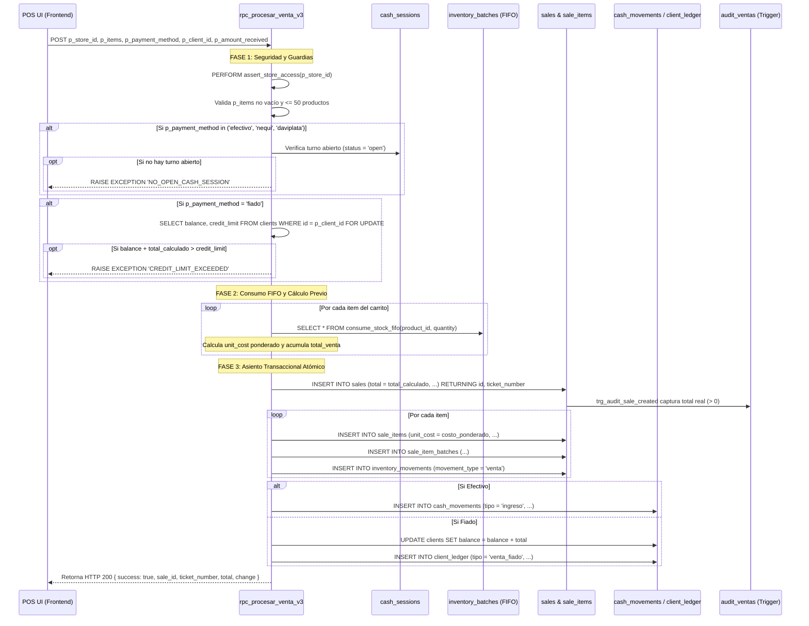
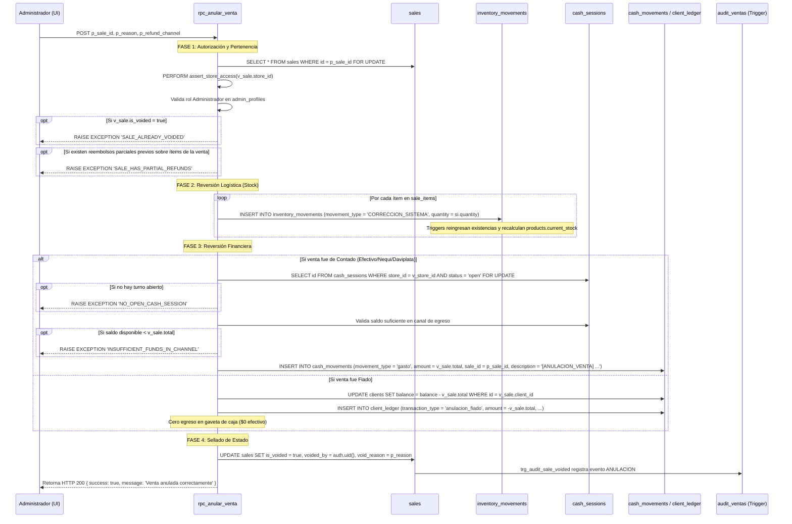
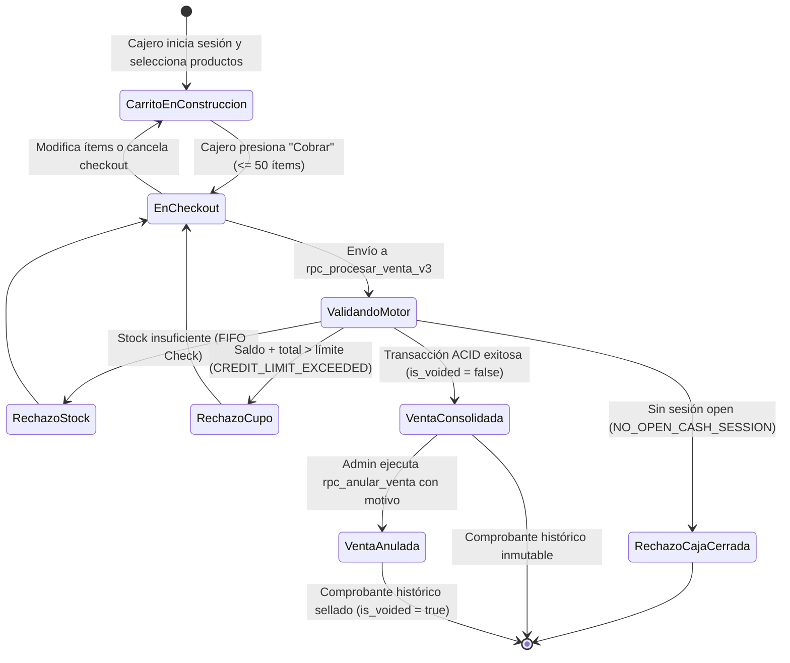
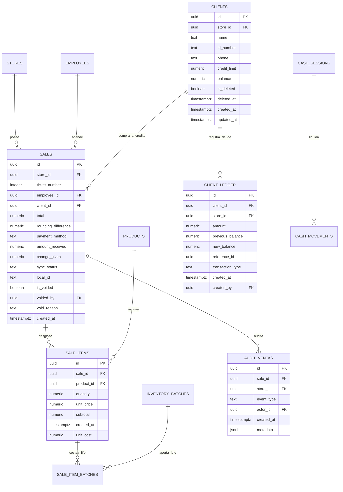

# SDD-007: Núcleo Transaccional de Ventas, Anulación y Consulta de Historial

> **Asociado a:** [FRD-007: Sistema de Ventas (Módulo Primario)](../FRD/FRD_007_VENTAS.md)  
> **Fase del Plan:** Ola 3: Ventas, POS y Clientes (Ítem 1)  
> **Estado:** 🟢 Aprobado con Certificación PAC-SDD (Protocolo Estricto v2.0)  
> **Última Actualización:** 2026-10-15  

---

## 0. Auditoría Contextual PAC-SDD (Evidencia de Esquema y Contratos Vecinos)

En cumplimiento de las Reglas 2, 4, 6 y 7 de `AGENTS.md`, este documento se redacta a partir de la evidencia verificada en la base de datos de producción (`ihtjocmhzuliwwvdzfnz`) y los contratos vecinos de Fase 0, 1 y 2.

### 0.1 Verificación de Esquema Real (Regla 2 Anti-Alucinación)
- **`sales` (16 columnas físicas):** `id` (uuid PK), `store_id` (uuid FK stores), `ticket_number` (integer, `UNIQUE(store_id, ticket_number)`), `employee_id` (uuid FK employees), `client_id` (uuid FK clients, nullable), `total` (numeric), `rounding_difference` (numeric), `payment_method` (text, check `['efectivo', 'nequi', 'daviplata', 'fiado']`), `amount_received` (numeric, nullable), `change_given` (numeric, nullable), `sync_status` (text, check `['synced', 'pending', 'failed']`), `local_id` (text, nullable), `is_voided` (boolean, default false), `voided_by` (uuid FK employees, nullable), `void_reason` (text, nullable), `created_at` (timestamptz).
- **`sale_items` (8 columnas físicas):** `id` (uuid PK), `sale_id` (uuid FK sales ON DELETE CASCADE), `product_id` (uuid FK products), `quantity` (numeric), `unit_price` (numeric), `subtotal` (numeric), `created_at` (timestamptz), `unit_cost` (numeric, nullable).
- **`clients` (11 columnas físicas):** `id` (uuid PK), `store_id` (uuid FK stores), `name` (text), `id_number` (text), `phone` (text), `credit_limit` (numeric), `balance` (numeric), `is_deleted` (boolean), `deleted_at` (timestamptz), `created_at` (timestamptz), `updated_at` (timestamptz). La tabla `customers` no existe en la base de datos; la entidad oficial es `clients`, la clave foránea en ventas es `client_id` y el saldo adeudado reside en `balance`.
- **`client_ledger` (10 columnas físicas):** `id` (uuid PK), `client_id` (uuid FK clients), `store_id` (uuid FK stores), `amount` (numeric), `previous_balance` (numeric), `new_balance` (numeric, `GENERATED ALWAYS AS (previous_balance + amount)`), `reference_id` (uuid, nullable), `transaction_type` (text, check `['venta_fiado', 'abono', 'anulacion_fiado']`), `created_at` (timestamptz), `created_by` (uuid FK employees, nullable).
- **`audit_ventas` (7 columnas físicas):** `id` (uuid PK), `sale_id` (uuid FK sales), `store_id` (uuid FK stores), `event_type` (text), `actor_id` (uuid FK employees), `created_at` (timestamptz), `metadata` (jsonb). Poblada reactivamente por los triggers `trg_audit_sale_created` y `trg_audit_sale_voided`.

### 0.2 Funciones de Seguridad Centralizadas (Regla 4)
- **`assert_store_access(p_store_id uuid)`:** Instrucción #1 obligatoria en todos los RPCs del módulo (`rpc_procesar_venta_v3`, `rpc_anular_venta`, `get_history_ventas`, `get_sale_detail`).
- **`get_current_store_id()`:** Función autoritativa que rige el aislamiento multi-tenant en todas las políticas RLS.
- **`get_employee_id_from_session()`:** Resuelve la autoría de la transacción para `sales.employee_id` y `client_ledger.created_by`.

### 0.3 Registro Formal de Deudas Técnicas y Trade-offs (Regla 7)

Conforme a la Regla 7 de `AGENTS.md`, se formalizan exactamente N=7 deudas técnicas identificadas durante la auditoría:

1. **D-1 (H-1): Omisión de `assert_store_access` en `rpc_anular_venta` en producción.**
   - *Decisión:* Normar contractualmente que el nuevo `rpc_anular_venta` invoque `PERFORM assert_store_access(v_sale.store_id);` como instrucción #1.
   - *Trade-off:* Blindaje de seguridad inter-tienda sin requerir una alteración en caliente de funciones activas en horario operativo.
   - *Condición de revisión:* Despliegue de la migración de ventas de la Ola 3.
2. **D-2 (H-2): Swallow de excepciones con `EXCEPTION WHEN OTHERS` en RPCs legacy.**
   - *Decisión:* Erradicar el bloque `WHEN OTHERS` que devuelve `{ success: false }` y sustituirlo por `RAISE EXCEPTION` tipificado (cumplimiento estricto de Regla 3).
   - *Trade-off:* Requiere ajuste coordinado en los stores de Pinia del frontend para capturar errores de red/RPC como rechazos de promesas reales.
   - *Condición de revisión:* Despliegue del cliente y RPCs refactorizados en la Ola 3.
3. **D-3 (H-3): Falla silenciosa si no hay sesión abierta y falta de validación de fondos en anulación de contado.**
   - *Decisión:* Incorporar guardias obligatorias que aborten con `NO_OPEN_CASH_SESSION` si no existe turno de caja abierto para la tienda, y con `INSUFFICIENT_FUNDS_IN_CHANNEL` si el canal de egreso no tiene liquidez.
   - *Trade-off:* Impide la inserción de 0 filas en `cash_movements` protegiendo la gaveta física, a costa de exigir turno abierto para cualquier reversión monetaria.
   - *Condición de revisión:* Despliegue del motor de anulación en la Ola 3.
4. **D-4 (H-4): Ambigüedad de `'devolucion'` en `bridge_movement_to_batch`.**
   - *Decisión:* Normar que la reversión logística de stock en `rpc_anular_venta` utilice `movement_type = 'CORRECCION_SISTEMA'` (o entrada debidamente discriminada), reingresando mercancía a `inventory_batches` y recalculando `products.current_stock` sin activar la rama de consumo a proveedores.
   - *Trade-off:* Previene la deducción indebida de existencias en base de datos mientras se unifica el trigger de inventario.
   - *Condición de revisión:* Migración consolidada de triggers de inventario en Ola 3.
5. **D-5 (H-5): Desincronización de `sale_items.unit_cost` y orden transaccional en `sales`.**
   - *Decisión:* Normar en `rpc_procesar_venta_v3` el cálculo previo del total antes de insertar `sales` (evitando que `audit_ventas` selle `total: 0`) y estampar el costo promedio ponderado de los lotes consumidos en `sale_items.unit_cost`.
   - *Trade-off:* Provee métricas reales para funciones analíticas (`get_inventory_health`, `get_top_selling_products`) eliminando discrepancias históricas.
   - *Condición de revisión:* Despliegue del motor V3 en la Ola 3.
6. **D-6 (H-6): Salvaguarda bidireccional contra anulación de ventas con reembolsos parciales.**
   - *Decisión:* Exigir que `rpc_anular_venta` verifique si el ticket posee registros de devolución parcial previos; de existir, debe rechazar la anulación integral con código `SALE_HAS_PARTIAL_REFUNDS`.
   - *Trade-off:* Fuerza a gestionar los ítems remanentes mediante el Gestor de Reembolsos (FRD-006-02), impidiendo duplicaciones contables y logísticas.
   - *Condición de revisión:* Despliegue de la suite de devoluciones en la Ola 3.
7. **D-7 (H-7): Restricción de medios de pago físicos y soporte de `'llave_bre'`.**
   - *Decisión:* El backend opera contractualmente con los 4 métodos permitidos por el constraint físico `sales_payment_method_check` (`'efectivo'`, `'nequi'`, `'daviplata'`, `'fiado'`).
   - *Trade-off:* Previene errores Postgres 23514 en tiempo de ejecución mientras se programa la ampliación multicanal en el DDL.
   - *Condición de revisión:* Migración multicanal en la Ola 4.

---

## 1. Glosario Técnico y Entidades

- **Venta Transaccional:** Registro inmutable en `sales` y `sale_items` que documenta la salida comercial de mercancía, su imputación financiera (efectivo, digital o cuenta por cobrar) y su valoración de costo de salida.
- **Anulación de Venta:** Operación correctiva excepcional, reservada al Administrador, que invalida un ticket completo (`is_voided = true`), reingresa el inventario total y genera el contra-movimiento financiero correspondiente (egreso en turno activo o reversión de deuda en cliente).
- **Consecutivo Seguro:** Número secuencial entero (`ticket_number`) asignado de forma atómica por tienda mediante `COALESCE(MAX(ticket_number), 0) + 1` dentro de la transacción de venta.
- **Venta Fiada (Crédito):** Modalidad de venta respaldada por la cartera del cliente (`clients.balance`). No genera egreso ni ingreso monetario en caja ($0 efectivo), quedando registrada en `client_ledger`.
- **Inmutabilidad de Turnos Cerrados:** Principio contable (`POL-AUD-01`) que estipula que los turnos de caja cerrados no se alteran; todo desembolso por anulación de ventas pasadas se imputa obligatoriamente al turno activo corriente.
- **Búsqueda Unificada POS:** Estrategia de búsqueda en un solo campo que discrimina entradas exclusivamente numéricas (PLU exacto) de entradas alfabéticas (búsqueda parcial por nombre >= 2 caracteres con 10 sugerencias iniciales).
- **Evidence Hub de Ventas:** Interfaz de consulta del historial de ventas con filtros combinables por fecha, método de pago, estado (`is_voided`) y búsqueda por ticket exacto (con o sin prefijo visual).

---

## 2. Arquitectura y Flujos de Datos

### 2.1 Flujo Secuencial: Procesamiento de Venta V3 (`rpc_procesar_venta_v3`)



### 2.2 Flujo Secuencial: Anulación de Venta (`rpc_anular_venta`)



### 2.3 Diagrama de Estados de la Venta



### 2.4 Regla de Cero Cálculos en Frontend (Flujo Unidireccional)
1. **El Frontend NO Calcula Totales ni Costos:** El cliente envía únicamente los identificadores de producto, cantidades y canal seleccionado.
2. **El Frontend NO Calcula Vueltas ni Redondeos Oficiales:** Los subtotales de pesables, el total consolidado, la diferencia de redondeo fiscal (`rounding_difference`) y el cambio exacto (`change_given`) son calculados y certificados por el backend.
3. **El Frontend Solo Presenta:** La interfaz renderiza el comprobante utilizando los valores oficiales provistos en la respuesta del RPC.

---

## 3. Seguridad y Multi-Tenant

### 3.1 Aislamiento Multi-Tenant (Reglas 4 y 8)
- **Instrucción #1 Mandatoria:** Todo RPC del módulo ejecuta como primera instrucción:
  `PERFORM assert_store_access(v_store_id);`
  Si el usuario no pertenece a la tienda de la venta o sesión, se lanza de inmediato la excepción `STORE_ACCESS_DENIED`.
- **Aislamiento en RLS:**
  - `sales`: `store_id = get_current_store_id()`.
  - `sale_items`: `EXISTS (SELECT 1 FROM sales s WHERE s.id = sale_items.sale_id AND s.store_id = get_current_store_id())`.
  - `clients` y `client_ledger`: `store_id = get_current_store_id()`.
  - `audit_ventas`: Homogeneizada con `store_id = get_current_store_id()`.
- **Privilegios Base (Regla 8):** Todas las tablas del módulo disponen de `GRANT SELECT, INSERT, UPDATE, DELETE` a `anon`, `authenticated` y `postgres`, delegando la seguridad a las políticas RLS.

### 3.2 Matriz de Control de Acceso (RBAC) y Permisos

| Acción del Sistema | Administrador | Empleado con `canSell` | Empleado sin `canSell` | Restricción de Seguridad |
|---|:---:|:---:|:---:|---|
| **Acceso a Terminal POS** | ✅ | ✅ | ❌ | Bloqueado en UI y en RPC (`PERMISSION_DENIED`). |
| **Registrar Venta Contado / Fiado** | ✅ | ✅ | ❌ | Exige sesión de caja activa (`status = 'open'`) para contado. |
| **Consultar Historial Turno Activo** | ✅ | ✅ | ❌ | Filtrado por `session_id` del turno corriente. |
| **Consultar Historial Turnos Previos** | ✅ | ❌ | ❌ | Restringido exclusivamente al Administrador. |
| **Anular Venta Completa** | ✅ | ❌ | ❌ | Botón oculto para cajeros; validación estricta en `rpc_anular_venta`. |

### 3.3 Inviolabilidad Contable (Append-Only)
- No existen políticas RLS de `UPDATE` ni `DELETE` expuestas a clientes en `sales`, `sale_items` ni `client_ledger`.
- La anulación de una venta jamás borra filas; sella la cabecera mediante `is_voided = true` y asienta contra-movimientos inmutables.

---

## 4. Casos Límite y Concurrencia (Regla 5 de AGENTS.md)

| ID | Escenario de Caso Límite | Comportamiento del Motor / Backend | Código de Excepción / Error | Respuesta Visual en UI |
|---|---|---|---|---|
| **CL-01** | **Venta de Contado con Caja Cerrada** | El motor verifica `cash_sessions`. Al no encontrar turno abierto con `status = 'open'`, aborta inmediatamente sin descontar stock. | `NO_OPEN_CASH_SESSION` | Alerta modal: *"Para vender en efectivo, primero debe abrir el turno de caja."* Redirige a Apertura. |
| **CL-02** | **Venta Fiado con Cupo Excedido** | Evalúa bajo `SELECT ... FOR UPDATE` si `balance + total > credit_limit`. Si excede, aborta la transacción completa. | `CREDIT_LIMIT_EXCEEDED` | Toast rojo: *"Cupo de crédito insuficiente. Disponible: $X, Total venta: $Y."* |
| **CL-03** | **Venta con Stock Insuficiente en FIFO** | `consume_stock_fifo` detecta que la suma de lotes activos es menor a la requerida. Rollback total de la transacción. | `INSUFFICIENT_STOCK` | Mensaje de advertencia: *"Stock insuficiente para el producto [Nombre]. Disponible: X."* |
| **CL-04** | **Anulación de Contado con Caja Cerrada** | `rpc_anular_venta` detecta que no hay turno abierto para registrar la salida física del dinero. Aborta de inmediato. | `NO_OPEN_CASH_SESSION` | Mensaje instructivo: *"Para devolver el dinero, primero debe abrir el turno de caja de hoy."* |
| **CL-05** | **Fondos Insuficientes en Canal de Devolución** | El canal de egreso seleccionado no dispone de saldo en el turno activo. Aborta antes de asentar el reverso. | `INSUFFICIENT_FUNDS_IN_CHANNEL` | Modal de advertencia: *"Fondos insuficientes en [Canal]. Saldo: $X. Seleccione un canal alternativo."* |
| **CL-06** | **Anulación de Venta con Reembolsos Parciales** | Detecta devoluciones de ítems previas asociadas a la venta. Aborta para prevenir duplicación de saldo devuelto. | `SALE_HAS_PARTIAL_REFUNDS` | Alerta bloqueante: *"Esta venta tiene reembolsos parciales previos. Gestione los ítems restantes individualmente."* |
| **CL-07** | **Intento de Re-Anulación de Venta** | `rpc_anular_venta` detecta `is_voided = true`. Aborta la operación sin mutar registros. | `SALE_ALREADY_VOIDED` | Toast informativo: *"Esta venta ya fue anulada previamente."* |
| **CL-08** | **Anulación de Venta Fiada (Sin Dinero Físico)** | La venta original fue a crédito. El motor revierte la cuenta por cobrar en `client_ledger` y PROHÍBE registrar egreso en caja. | Operación Exitosa | Notificación: *"Venta fiada anulada. Se ha descontado la deuda en la cuenta del cliente (sin impacto en caja)."* |

---

## 5. Contrato de Interfaz

### 5.1 Operación: `rpc_procesar_venta_v3` (Procesamiento de Venta Atómica)
- **Tipo:** RPC Postgres / Acción (WRITE)
- **Entrada:**
  ```json
  {
    "p_store_id": "UUID (Obligatorio)",
    "p_client_id": "UUID (Opcional, obligatorio si p_payment_method = 'fiado')",
    "p_payment_method": "TEXT (Obligatorio: 'efectivo', 'nequi', 'daviplata', 'fiado')",
    "p_amount_received": "NUMERIC >= 0 (Opcional, requerido si p_payment_method = 'efectivo')",
    "p_items": [
      {
        "product_id": "UUID (Obligatorio)",
        "quantity": "NUMERIC > 0 (Obligatorio, máx 2 decimales en pesables, entero en unitarios)"
      }
    ]
  }
  ```
- **Salida Exitosa (HTTP 200):**
  ```json
  {
    "success": true,
    "data": {
      "sale_id": "UUID",
      "ticket_number": 1045,
      "total": 35000,
      "rounding_difference": 0,
      "change_given": 15000,
      "payment_method": "efectivo",
      "items_count": 3,
      "created_at": "2026-10-15T14:30:00Z"
    }
  }
  ```
- **Salida de Error (Excepciones tipificadas):**
  ```json
  {
    "success": false,
    "error": "Mensaje técnico descriptivo",
    "code": "NO_OPEN_CASH_SESSION | CREDIT_LIMIT_EXCEEDED | INSUFFICIENT_STOCK | STORE_ACCESS_DENIED"
  }
  ```

---

### 5.2 Operación: `rpc_anular_venta` (Anulación Completa de Comprobante)
- **Tipo:** RPC Postgres / Acción (WRITE)
- **Entrada:**
  ```json
  {
    "p_sale_id": "UUID (Obligatorio)",
    "p_reason": "TEXT (Obligatorio, >= 5 caracteres)",
    "p_refund_channel": "TEXT (Opcional, canal de egreso real para ventas de contado: 'efectivo', 'nequi', 'daviplata')"
  }
  ```
- **Salida Exitosa (HTTP 200):**
  ```json
  {
    "success": true,
    "data": {
      "sale_id": "UUID",
      "ticket_number": 1045,
      "is_voided": true,
      "voided_by": "UUID",
      "void_reason": "Error de digitación en caja",
      "refunded_amount": 35000,
      "refund_channel": "efectivo",
      "voided_at": "2026-10-15T15:10:00Z"
    }
  }
  ```
- **Salida de Error:**
  ```json
  {
    "success": false,
    "error": "Mensaje técnico descriptivo",
    "code": "SALE_ALREADY_VOIDED | SALE_HAS_PARTIAL_REFUNDS | NO_OPEN_CASH_SESSION | INSUFFICIENT_FUNDS_IN_CHANNEL | UNAUTHORIZED"
  }
  ```

---

### 5.3 Operación: `get_history_ventas` (Consulta de Historial con Filtros)
- **Tipo:** RPC Postgres / Lectura (READ)
- **Entrada:**
  ```json
  {
    "p_store_id": "UUID (Obligatorio)",
    "p_start_date": "DATE (Opcional, default: hoy - 7 días)",
    "p_end_date": "DATE (Opcional, default: hoy)",
    "p_employee_id": "UUID (Opcional, obligatorio para rol empleado limitado a turno)",
    "p_payment_method": "TEXT (Opcional: 'todos', 'efectivo', 'nequi', 'daviplata', 'fiado')",
    "p_status": "TEXT (Opcional: 'todas', 'activas', 'anuladas')",
    "p_ticket_number": "INTEGER (Opcional, búsqueda por número exacto)",
    "p_limit": "INTEGER (Opcional, default: 20)",
    "p_offset": "INTEGER (Opcional, default: 0)"
  }
  ```
- **Salida Exitosa (HTTP 200):**
  ```json
  {
    "data": [
      {
        "id": "UUID",
        "ticket_number": 1045,
        "created_at": "2026-10-15T14:30:00Z",
        "total": 35000,
        "payment_method": "efectivo",
        "employee_name": "Carlos Cajero",
        "client_name": null,
        "is_voided": false,
        "void_reason": null,
        "items_count": 3
      }
    ],
    "count": 142
  }
  ```

---

### 5.4 Operación: `get_sale_detail` (Detalle de Comprobante e Ítems)
- **Tipo:** RPC Postgres / Lectura (READ)
- **Entrada:**
  ```json
  {
    "p_sale_id": "UUID (Obligatorio)"
  }
  ```
- **Salida Exitosa (HTTP 200):**
  ```json
  {
    "success": true,
    "data": {
      "id": "UUID",
      "ticket_number": 1045,
      "total": 35000,
      "rounding_difference": 0,
      "payment_method": "efectivo",
      "amount_received": 50000,
      "change_given": 15000,
      "employee_name": "Carlos Cajero",
      "client_name": null,
      "is_voided": false,
      "void_reason": null,
      "created_at": "2026-10-15T14:30:00Z",
      "items": [
        {
          "product_name": "Arroz Diana 1kg",
          "quantity": 2,
          "unit_price": 4500,
          "subtotal": 9000
        }
      ],
      "items_count": 1
    }
  }
  ```

---

## 6. Matriz de Trazabilidad y Políticas Globales

| Código de Política | Dominio | Mandato Arquitectónico | Implementación en SDD-007 |
|---|---|---|---|
| **POL-AUTH-01** | Seguridad | Multi-tenant estricto por tienda | `assert_store_access(v_store_id)` invocado como primera instrucción en todos los RPCs; RLS gobernada por `get_current_store_id()`. |
| **POL-AUD-01** | Auditoría | Inviolabilidad histórica append-only | `sales` y `sale_items` no poseen políticas de `DELETE`. La anulación utiliza marcas booleanas y triggers forenses en `audit_ventas`. |
| **POL-AUD-02** | Auditoría | Inmutabilidad de turnos cerrados | Todo reverso financiero de ventas pasadas se imputa al `session_id` del turno activo en curso; turnos cerrados permanecen sellados. |
| **POL-FIN-01** | Financiero | Fidelidad absoluta de caja | Ventas fiadas no inyectan efectivo virtual a caja ($0). Anulaciones fiadas tienen prohibido egresar dinero monetario de gaveta. |
| **POL-FIN-02** | Financiero | Prevención de sobregiro por canal | Validación obligatoria de fondos antes de asentar egresos por anulación (`INSUFFICIENT_FUNDS_IN_CHANNEL`). |
| **POL-LOG-01** | Logística | Consumo FIFO y reingreso de existencias | Consumo atómico por capas vía `consume_stock_fifo`; reversión en inventario con `CORRECCION_SISTEMA` incrementando stock. |
| **POL-SEC-01** | Seguridad | Separación de funciones (RBAC) | Venta y POS habilitados para `canSell = true`; anulación restringida estrictamente a administradores (`admin_profiles`). |
| **SPEC-010** | Financiero | Redondeo comercial a $50 COP | Redondeo en backend de subtotales pesables al múltiplo inferior de $50; vueltas calculadas con redondeo híbrido. |
| **SPEC-011** | Datos | Estándar de decimales y enteros | Cantidades enteras en unitarios, máximo 2 decimales en pesables; importes en enteros COP sin decimales. |

---

## 7. Modelo de Datos Lógico

### 7.1 Diagrama Entidad-Relación (ERD Mermaid)



### 7.2 Diccionario de Datos Físico

#### Tabla: `sales`
| Columna | Tipo de Dato | Nulo | Default / Constraint | Descripción |
|---|---|:---:|---|---|
| `id` | `UUID` | NO | `gen_random_uuid()` | Identificador único de la venta. |
| `store_id` | `UUID` | NO | FK `stores(id) ON DELETE CASCADE` | Tienda propietaria de la transacción. |
| `ticket_number` | `INTEGER` | NO | `UNIQUE(store_id, ticket_number)` | Consecutivo secuencial de comprobante. |
| `employee_id` | `UUID` | NO | FK `employees(id)` | Empleado o cajero que registró la venta. |
| `client_id` | `UUID` | SÍ | FK `clients(id)` | Cliente asociado (obligatorio si fiado). |
| `total` | `NUMERIC` | NO | Valor >= 0 | Monto total oficial cobrado. |
| `rounding_difference` | `NUMERIC` | SÍ | `0` | Diferencia entre total exacto y redondeado. |
| `payment_method` | `TEXT` | NO | `CHECK (payment_method IN ('efectivo', 'nequi', 'daviplata', 'fiado'))` | Medio de pago utilizado. |
| `amount_received` | `NUMERIC` | SÍ | Nullable | Dinero recibido en efectivo. |
| `change_given` | `NUMERIC` | SÍ | Nullable | Vueltas entregadas al cliente. |
| `sync_status` | `TEXT` | SÍ | `CHECK (sync_status IN ('synced', 'pending', 'failed'))` | Estado de sincronización offline. |
| `local_id` | `TEXT` | SÍ | Nullable | Identificador provisional en modo offline. |
| `is_voided` | `BOOLEAN` | SÍ | `false` | Bandera lógica de anulación. |
| `voided_by` | `UUID` | SÍ | FK `employees(id)` | Administrador que ejecutó la anulación. |
| `void_reason` | `TEXT` | SÍ | Nullable | Justificación obligatoria de anulación. |
| `created_at` | `TIMESTAMPTZ` | NO | `NOW()` | Timestamp de creación inmutable. |

#### Tabla: `sale_items`
| Columna | Tipo de Dato | Nulo | Default / Constraint | Descripción |
|---|---|:---:|---|---|
| `id` | `UUID` | NO | `gen_random_uuid()` | Identificador único del renglón de venta. |
| `sale_id` | `UUID` | NO | FK `sales(id) ON DELETE CASCADE` | Venta padre asociada. |
| `product_id` | `UUID` | NO | FK `products(id)` | Producto vendido. |
| `quantity` | `NUMERIC` | NO | Valor > 0 | Unidades vendidas (peso o unitarias). |
| `unit_price` | `NUMERIC` | NO | Valor >= 0 | Precio unitario congelado de venta. |
| `subtotal` | `NUMERIC` | NO | Valor >= 0 | Subtotal del renglón (`quantity * unit_price`). |
| `created_at` | `TIMESTAMPTZ` | NO | `NOW()` | Timestamp de registro inmutable. |
| `unit_cost` | `NUMERIC` | SÍ | Valor >= 0 | Costo promedio ponderado FIFO de salida. |

#### Tabla: `clients`
| Columna | Tipo de Dato | Nulo | Default / Constraint | Descripción |
|---|---|:---:|---|---|
| `id` | `UUID` | NO | `gen_random_uuid()` | Identificador único del cliente. |
| `store_id` | `UUID` | NO | FK `stores(id)` | Tienda a la que pertenece el cliente. |
| `name` | `TEXT` | NO | Nombre no vacío | Nombre completo o razón social. |
| `id_number` | `TEXT` | NO | `UNIQUE(store_id, id_number)` | Cédula, NIT o documento de identidad. |
| `phone` | `TEXT` | SÍ | Nullable | Teléfono de contacto. |
| `credit_limit` | `NUMERIC` | NO | `0` | Cupo máximo de crédito autorizado. |
| `balance` | `NUMERIC` | SÍ | `0` | Deuda acumulada actual del cliente. |
| `is_deleted` | `BOOLEAN` | SÍ | `false` | Borrado lógico del cliente. |
| `deleted_at` | `TIMESTAMPTZ` | SÍ | Nullable | Timestamp de eliminación lógica. |
| `created_at` | `TIMESTAMPTZ` | NO | `NOW()` | Timestamp de creación. |
| `updated_at` | `TIMESTAMPTZ` | NO | `NOW()` | Timestamp de última modificación. |

#### Tabla: `client_ledger`
| Columna | Tipo de Dato | Nulo | Default / Constraint | Descripción |
|---|---|:---:|---|---|
| `id` | `UUID` | NO | `gen_random_uuid()` | Identificador del movimiento de cartera. |
| `client_id` | `UUID` | NO | FK `clients(id)` | Cliente asociado. |
| `store_id` | `UUID` | NO | FK `stores(id)` | Tienda asociada. |
| `amount` | `NUMERIC` | NO | Positivo (cargo) o Negativo (abono/anulación) | Monto que incrementa o reduce la deuda. |
| `previous_balance` | `NUMERIC` | NO | `0` | Saldo anterior antes del movimiento. |
| `new_balance` | `NUMERIC` | NO | `GENERATED ALWAYS AS (previous_balance + amount)` | Saldo resultante calculado automáticamente. |
| `reference_id` | `UUID` | SÍ | Nullable | ID de la venta (`sale_id`) o recibo asociado. |
| `transaction_type` | `TEXT` | NO | `CHECK (transaction_type IN ('venta_fiado', 'abono', 'anulacion_fiado'))` | Tipo de movimiento en cartera. |
| `created_at` | `TIMESTAMPTZ` | SÍ | `NOW()` | Timestamp de registro inmutable. |
| `created_by` | `UUID` | SÍ | FK `employees(id)` | Usuario responsable de la transacción. |
