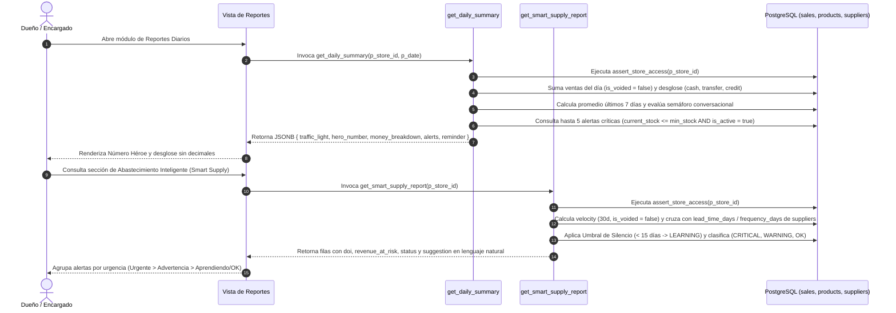
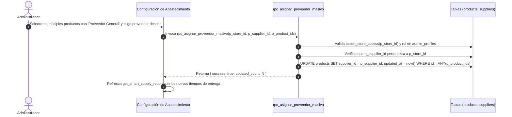
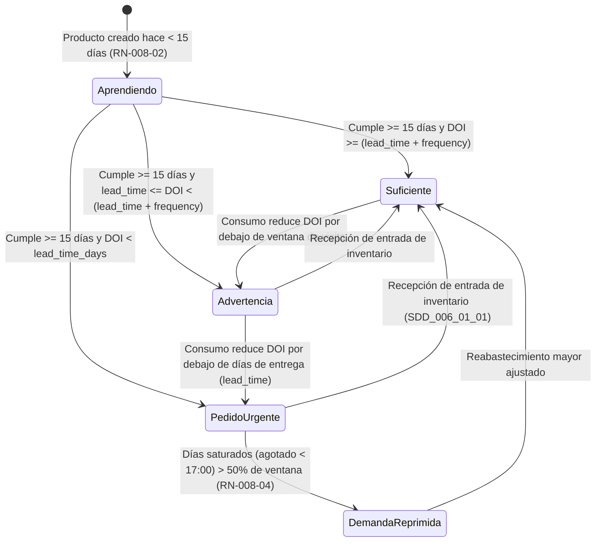
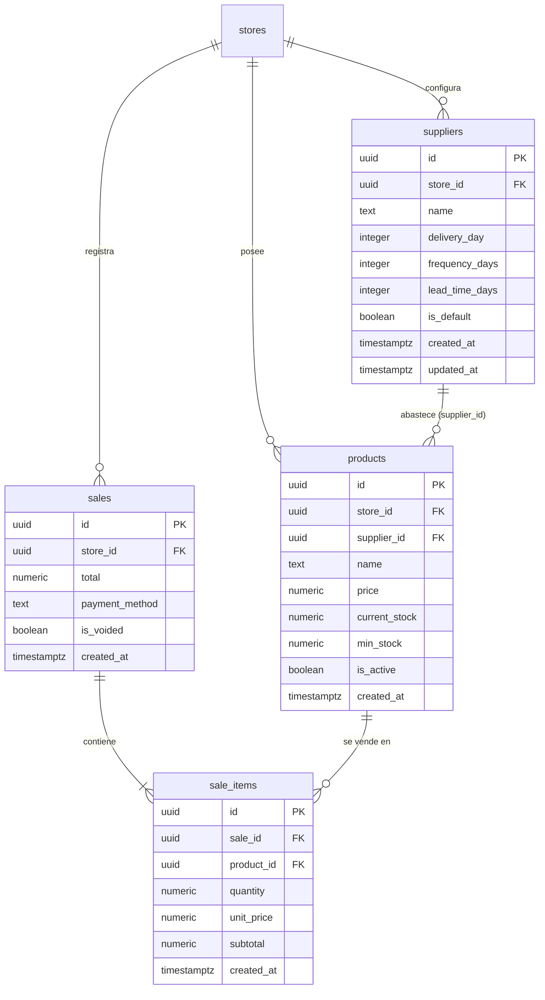

# SDD-008: Resumen Diario y Abastecimiento Inteligente (Reportes)

> **Asociado a:** [FRD-008](../FRD/FRD_008_REPORTES.md) (Resumen Diario y Abastecimiento Inteligente)  
> **Fase del Plan:** Ola 4 — Reportes, Auditoría y Cuentas por Pagar (Saneamiento Pre-Código)  
> **Estado:** 🟠 Aprobado con Deuda Técnica Documentada (Protocolo PAC-SDD v2.0)  
> **Última Actualización:** 2026-10-17  

---

## 0. Contexto y Restricciones Aplicables

### 0.1 Políticas Globales Activadas (ARQ-002)

| Política ID | Dominio | Impacto Concreto en este SDD |
| :--- | :--- | :--- |
| **POL-DATA-01** | Arquitectura | **Autoridad del Servidor (Frontend Tonto):** Todo cálculo de ingresos diarios (`hero_number`), promedios semanales, desglose por canal, velocidad de venta (`velocity`), días de autonomía (`doi`) y riesgo de ingresos (`revenue_at_risk`) se resuelve 100% en PostgreSQL. El cliente tiene prohibido sumar o proyectar en interfaz. |
| **SPEC-011** | Financiero | **Moneda Entera sin Decimales:** Los importes monetarios principales del resumen diario y pérdidas estimadas se entregan y muestran como enteros en pesos colombianos (COP) sin centavos. |
| **RN-008-01** | Usabilidad | **Lenguaje Humano Obligatorio:** Los mensajes devueltos por el servidor (`traffic_light.message`, `suggestion`) emplean frases conversacionales directas, prohibiendo términos técnicos como *"ROI"*, *"Lead Time"* o *"Forecast"*. |
| **RN-008-02** | Analítica | **Política de Verdad Tangible (Umbral de Silencio):** Si un producto tiene menos de 15 días de antigüedad en el catálogo (`created_at > NOW() - INTERVAL '15 days'`), el motor omite alertas de color y devuelve el estado gris *"Aprendiendo de tus ventas..."* / *"Recopilando información"*. |
| **POL-AUTH-01** | Seguridad | **Aislamiento Multi-Tenant:** `get_daily_summary` y `get_smart_supply_report` ejecutan `PERFORM public.assert_store_access(p_store_id);` como su primera instrucción inmutable. |

### 0.2 Contratos Vecinos que Limitan el Diseño

| SDD Vecino | Restricción que Impone | Impacto en Reportes |
| :--- | :--- | :--- |
| **SDD_006 (Inventario Padre)** | Ciclo de vida de `products` (`is_active = true`) y vínculo con `suppliers` (`supplier_id`). | Todo producto nuevo se asocia por defecto al `'Proveedor General'` (`is_default = true`). Las consultas de abastecimiento deben excluir productos dados de baja lógica (`is_active = false`). |
| **SDD_007 / SDD_007_01 (Ventas y POS)** | Tabla `sales` (`is_voided = false`) y `sale_items`. | Tanto el resumen diario como el cálculo de velocidad de venta a 30 días deben excluir obligatoriamente las ventas anuladas (`is_voided = false`). |
| **SDD_018 (Control Operacional)** | Reporte financiero ejecutivo de 4 Pilares para el Administrador. | `SDD_008` provee la vista operativa rápida (< 2s) de resumen diario y alertas de pedido, sin exponer costos confidenciales (`cost_price` / `unit_cost`) a terminales no administrativas (`POL-SEC-01`). |
| **SDD_020 / SDD_023 (Caja Multicanal)** | Segregación de efectivo, transferencias digitales y fiados. | El `money_breakdown` de `get_daily_summary` agrupa separadamente `cash`, `transfer` (`nequi`, `daviplata`) y `credit` (`fiado`). |

### 0.3 Auditoría de BD contra Realidad (Deuda Técnica Formalizada)

En cumplimiento de las Reglas 2, 4, 6, 7 y 9 de `AGENTS.md`, la inspección empírica en Supabase producción (`ihtjocmhzuliwwvdzfnz`) sobre `pg_proc` e `information_schema.columns` identifica **N = 5 deudas técnicas**:

| ID | Hallazgo en Esquema / Función Real | 1. Qué se Decidió | 2. Por qué (Trade-off Concreto) | 3. Condición de Revisión Futura |
| :---: | :--- | :--- | :--- | :--- |
| **D-1** | **Omisión del Umbral de Silencio de 15 días en `get_smart_supply_report` (`RN-008-02`).** En producción, el RPC clasifica por `velocity = 0` sin verificar si `products.created_at > NOW() - INTERVAL '15 days'`. | Especificar en la migración de remediación de `get_smart_supply_report` la condición prioritaria: si `NOW() - p.created_at < INTERVAL '15 days'`, retornar `status = 'LEARNING'` y `suggestion = 'Aprendiendo de tus ventas...'`. | Evita disparar falsas alertas rojas o amarillas sobre productos recién creados que aún no acumulan historia estadística (`Caso D` de `FRD-008`). | Migración de analítica de abastecimiento en Ola 4. |
| **D-2** | **Ausencia de detección de "Días Saturados" (`RN-008-04`) y filtro `is_voided = FALSE` en `get_smart_supply_report`.** El CTE `sales_stats` actual en producción no filtra `s.is_voided = FALSE` ni evalúa quiebres tempranos antes de las 17:00. | Incorporar `AND s.is_voided = FALSE` en `sales_stats` y añadir el cálculo de días con agotamiento temprano (> 50% de la ventana) para emitir la alerta azul de *"Pérdida de Ventas"*. | Impide que ventas anuladas inflen artificialmente la velocidad de venta y cumple el criterio funcional de demanda reprimida. | Migración de analítica de abastecimiento en Ola 4. |
| **D-3** | **Falta de filtro `p.is_active = TRUE` en `get_smart_supply_report` y en las alertas de `get_daily_summary`.** Ambas funciones en producción consultan `products WHERE store_id = p_store_id` incluyendo productos eliminados lógicamente. | Añadir `AND p.is_active = TRUE` en las consultas sobre `products` dentro de `get_daily_summary` y `get_smart_supply_report`. | Previene que el tendero reciba alertas de agotamiento sobre productos dados de baja (`SDD_006`). | Migración de remediación de reportes en Ola 4. |
| **D-4** | **Ausencia física de RPC para Asignación Masiva de Proveedores (`Caso C` de `FRD-008`).** No existe en `pg_proc` una función atómica para reasignar el `supplier_id` de múltiples productos simultáneamente. | Especificar el contrato `rpc_asignar_proveedor_masivo(p_store_id, p_supplier_id, p_product_ids)` con validación `assert_store_access` y guardia administrativa en `admin_profiles`. | Permite reasignar en lote los productos del `'Proveedor General'` hacia un proveedor específico recalculando inmediatamente su autonomía (`RN-008-03`). | Creación de RPC en migración de Ola 4. |
| **D-5** | **Sincronización de nombres reales de RPC en BD.** El borrador anterior citaba `rpc_get_daily_summary_v2` y `rpc_get_smart_supply`, mientras que en `pg_proc` existen `get_daily_summary(p_store_id, p_date)` y `get_smart_supply_report(p_store_id)`. | Adoptar en este SDD los nombres físicos exactos que residen en producción (`get_daily_summary` y `get_smart_supply_report`). | Cumple la Regla 2 de Anti-Alucinación de Nombres y mantiene compatibilidad con los clientes existentes. | Cerrado normativamente en esta versión v2.0. |

---

## 1. Glosario Local

- **Número Héroe (`hero_number`):** Indicador principal del resumen diario que representa la suma total de ventas válidas (`is_voided = false`) registradas en la fecha consultada, expresado en pesos enteros.
- **Semáforo de Desempeño (`traffic_light`):** Comparador automático en servidor entre el `hero_number` del día y el promedio diario de los últimos 7 días (`green` si >= +5% o estable, `red` si <= -5%, `gray` si aún no hay historial).
- **Días de Autonomía (`doi` — Days of Inventory):** Estimación en servidor de cuántos días durará el `current_stock` actual dividiéndolo por la velocidad de venta diaria (`velocity`) de los últimos 30 días.
- **Umbral de Silencio (`RN-008-02`):** Periodo de gracia de 15 días desde la creación de un producto durante el cual el sistema se abstiene de emitir alertas de reabastecimiento.
- **Día Saturado (`RN-008-04`):** Jornada operativa en la que un producto de alta rotación llega a stock cero antes de la hora de corte vespertina (17:00), señalando demanda reprimida.

---

## 2. Diagramas de Secuencia

### 2.1 Consulta de Resumen Diario y Abastecimiento Inteligente (Casos A, B y D)



### 2.2 Asignación Masiva de Proveedores (Caso C)



---

## 3. Diagramas de Estado



---

## 4. Especificación Detallada de Casos de Uso

### 4.1 Caso A: Consultar el Estado del Negocio (`RN-008-01`, `SPEC-011`)
- **Actor:** Dueño de Tienda / Encargado autenticado.
- **Precondición:** Usuario con acceso válido a la tienda (`assert_store_access`).
- **Flujo Principal:**
  1. El usuario abre el resumen del día (`p_date`, por defecto fecha actual).
  2. El servidor ejecuta `get_daily_summary(p_store_id, p_date)`, totalizando las ventas no anuladas del día (`hero_number`), el desglose por grupo de pago (`cash`, `transfer`, `credit`) y la comparación porcentual contra los 7 días previos.
  3. La interfaz presenta el Número Héroe, el mensaje conversacional del semáforo y las tarjetas de medios de pago sin decimales.
- **Flujo Alternativo:** Si no existen ventas en los 7 días previos (`v_avg_sales_7d = 0`), el semáforo retorna estado `'gray'` con mensaje *"Recopilando datos históricos..."*.
- **Postcondición:** El actor conoce en menos de 2 segundos el desempeño del día y los totales por modalidad de cobro.

### 4.2 Caso B: Gestión de Reabastecimiento Crítico (`RN-008-01`, `RN-008-03`, `RN-008-04`)
- **Actor:** Dueño de Tienda.
- **Precondición:** Productos activos asociados a un proveedor en `suppliers`.
- **Flujo Principal:**
  1. El sistema invoca `get_smart_supply_report(p_store_id)`.
  2. Para cada producto activo con antigüedad `>= 15 días`, el servidor calcula `velocity` (unidades vendidas en 30 días / 30) y `doi` (`current_stock / velocity`).
  3. Si `doi < lead_time_days`, clasifica el producto como `'CRITICAL'` (*"Pedir urgente: se agotará antes de la próxima entrega"*). Si `doi < (lead_time_days + frequency_days)`, lo clasifica como `'WARNING'` (*"Incluir en próximo pedido"*).
  4. Si detecta agotamientos tempranos reiterados (> 50% de días saturados), señala alerta de pérdida de ventas (`RN-008-04`).
- **Postcondición:** El tendero visualiza la lista priorizada de compras preventivas en lenguaje natural.

### 4.3 Caso C: Asignación Masiva de Proveedores (`RN-008-03`)
- **Actor:** Administrador.
- **Precondición:** Existen productos vinculados al `'Proveedor General'` (`is_default = true`).
- **Flujo Principal:**
  1. El Administrador selecciona un conjunto de productos y elige el proveedor específico destino.
  2. El servidor ejecuta `rpc_asignar_proveedor_masivo(p_store_id, p_supplier_id, p_product_ids)`.
  3. Tras actualizar `products.supplier_id`, el reporte recalcula los días de autonomía usando `frequency_days` y `lead_time_days` del nuevo proveedor.
- **Postcondición:** Los productos quedan vinculados a la cadencia real de visita y entrega de su proveedor.

### 4.4 Caso D: Análisis de Producto Nuevo — Silencio Prudente (`RN-008-02`)
- **Actor:** Motor Analítico de Base de Datos.
- **Precondición:** Producto creado hace menos de 15 días (`NOW() - created_at < INTERVAL '15 days'`).
- **Flujo Principal:**
  1. Durante la ejecución de `get_smart_supply_report`, el servidor detecta que el producto no cumple la ventana mínima de 15 días.
  2. El motor suprime cualquier alerta `'CRITICAL'` o `'WARNING'` y asigna estado `'LEARNING'` / `'UNKNOWN'` con mensaje *"Aprendiendo de tus ventas..."*.
- **Postcondición:** Se evitan recomendaciones prematuras o ruidosas sin respaldo estadístico.

---

## 5. Contrato de Interfaz

### 5.1 Resumen Diario Operativo: `get_daily_summary`
- **Parámetros de Entrada:**
  - `p_store_id` (`UUID`, obligatorio)
  - `p_date` (`DATE`, obligatorio)
- **Salida Exitosa (`JSONB`):**
  ```json
  {
    "traffic_light": {
      "status": "green",
      "message": "🚀 ¡Vas un 12% arriba de tu promedio!"
    },
    "hero_number": 450000,
    "money_breakdown": {
      "cash": 300000,
      "transfer": 100000,
      "credit": 50000
    },
    "alerts": [
      {
        "type": "stock_critical",
        "message": "⚠️ Bajo stock: Leche Entera 1L",
        "target_id": "uuid-producto",
        "stock": 3
      }
    ],
    "reminder": {
      "message": "Recuerda hacer el cierre de caja al final del turno."
    }
  }
  ```

### 5.2 Reporte de Abastecimiento Inteligente: `get_smart_supply_report`
- **Parámetros de Entrada:** `p_store_id` (`UUID`, obligatorio).
- **Salida Exitosa (`TABLE / SETOF RECORD`):**
  | Campo | Tipo | Descripción |
  | :--- | :--- | :--- |
  | `id` | `UUID` | Identificador del producto (`products.id`). |
  | `name` | `TEXT` | Nombre comercial del producto. |
  | `current_stock` | `NUMERIC` | Existencia física actual. |
  | `velocity` | `NUMERIC` | Promedio de unidades vendidas por día en la ventana de 30 días. |
  | `doi` | `NUMERIC` | Días de autonomía estimados (`current_stock / velocity`). |
  | `revenue_at_risk` | `NUMERIC` | Venta estimada en riesgo durante el tiempo de espera del proveedor (entero COP). |
  | `status` | `TEXT` | `'CRITICAL'`, `'WARNING'`, `'OK'`, `'LEARNING'` / `'UNKNOWN'`. |
  | `suggestion` | `TEXT` | Recomendación en lenguaje humano (`RN-008-01`). |

### 5.3 Asignación Masiva de Proveedor: `rpc_asignar_proveedor_masivo`
- **Parámetros de Entrada:**
  - `p_store_id` (`UUID`, obligatorio)
  - `p_supplier_id` (`UUID`, obligatorio)
  - `p_product_ids` (`UUID[]`, obligatorio)
- **Salida Exitosa (`JSONB`):** `{ "success": true, "updated_count": 15 }`.

### 5.4 Catálogo de Errores del Módulo

| Código de Error | Condición de Disparo | Comportamiento Esperado en Cliente |
| :--- | :--- | :--- |
| `STORE_ACCESS_DENIED` | El usuario no pertenece a `p_store_id` (`assert_store_access`). | Bloquear vista y redirigir a inicio de sesión / error 403. |
| `UNAUTHORIZED_ROLE` | Un empleado no administrador intenta ejecutar `rpc_asignar_proveedor_masivo`. | Rechazar operación e informar que requiere permisos de Administrador. |
| `SUPPLIER_NOT_FOUND` | El `p_supplier_id` no existe o pertenece a otra tienda. | Abortar transacción con `RAISE EXCEPTION` y notificar al usuario. |
| `EMPTY_PRODUCT_LIST` | El arreglo `p_product_ids` se envía vacío. | Impedir envío en interfaz y rechazar en servidor con error de validación. |

---

## 6. Análisis de Seguridad

1. **Reutilización de Funciones Centralizadas (Regla 4):**
   - `public.assert_store_access(p_store_id)` se ejecuta obligatoriamente en la primera línea de `get_daily_summary`, `get_smart_supply_report` y `rpc_asignar_proveedor_masivo`.
   - Las tablas base (`sales`, `sale_items`, `products`, `suppliers`) mantienen activas sus políticas RLS gobernadas por `public.get_current_store_id()`.
2. **Protección de Costos (`POL-SEC-01`):**
   - Ninguno de los payloads de `SDD_008` expone `cost_price`, `unit_cost` ni márgenes de ganancia bruta/neta, preservando la confidencialidad financiera del propietario frente a operadores que consulten alertas de stock.

---

## 7. Modelo de Datos Lógico

### 7.1 Diagrama Entidad-Relación (Esquema Verificado)



### 7.2 Diccionario de Datos Físico Verificado (`suppliers` y Columnas Analíticas de `products`)

| Tabla | Columna | Tipo | Nullable | Estado en BD Real | Rol en Reportes y Abastecimiento |
| :--- | :--- | :--- | :---: | :---: | :--- |
| `suppliers` | `id` | `uuid` | NO | 🟢 Existente | Identificador único del proveedor. |
| `suppliers` | `store_id` | `uuid` | NO | 🟢 Existente | Tienda propietaria del registro. |
| `suppliers` | `name` | `text` | NO | 🟢 Existente | Nombre del proveedor (incluye `'Proveedor General'`). |
| `suppliers` | `delivery_day` | `integer` | SÍ | 🟢 Existente | Día habitual de entrega. |
| `suppliers` | `frequency_days` | `integer` | NO | 🟢 Existente | Frecuencia de visita en días (default `7`). |
| `suppliers` | `lead_time_days` | `integer` | NO | 🟢 Existente | Días de espera entre pedido y entrega (default `1`). |
| `suppliers` | `is_default` | `boolean` | NO | 🟢 Existente | Marca al `'Proveedor General'` por defecto de la tienda. |
| `products` | `supplier_id` | `uuid` | SÍ | 🟢 Existente | FK hacia `suppliers(id)` para cálculo de autonomía. |
| `products` | `current_stock` | `numeric` | SÍ | 🟢 Existente | Stock actual comparado contra velocidad de venta y `min_stock`. |
| `products` | `min_stock` | `numeric` | SÍ | 🟢 Existente | Umbral de alerta rápida en `get_daily_summary`. |
| `products` | `is_active` | `boolean` | NO | 🟢 Existente | Filtro obligatorio para excluir productos dados de baja. |
| `products` | `created_at` | `timestamptz` | NO | 🟢 Existente | Fecha de alta usada para evaluar el Umbral de Silencio de 15 días (`RN-008-02`). |
