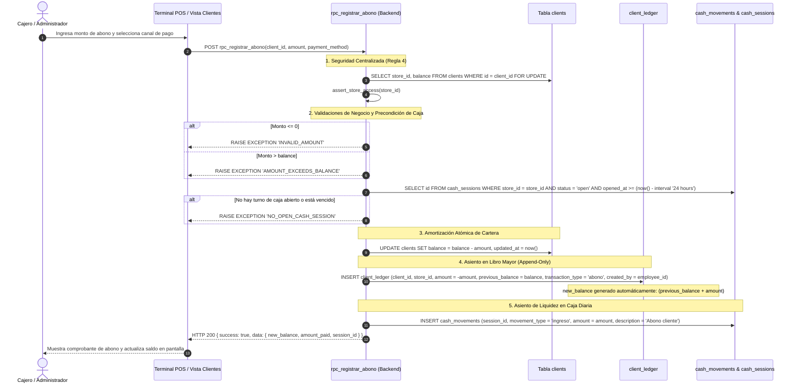

# SDD-009: Gestión de Clientes y Cartera (Módulo Secundario)

> **Asociado a:** [FRD-009](../FRD/FRD_009_CLIENTES.md)  
> **Módulo:** Clientes, Cartera y Fiados  
> **Fase del Plan:** Ola 3 (Ítem 5)  
> **Estado:** 🟢 Rectificado y Sanitizado (Protocolo PAC-SDD v2.0 / Auditoría QA Aprobada)  
> **Políticas Aplicables:** ARQ-002 (POL-AUTH-01, POL-AUD-01/02, POL-FIN-01/02/03, POL-LOG-01/02, POL-SEC-01, SPEC-010, SPEC-011)

---

## 0. Control de Versiones

| Versión | Fecha | Autor | Descripción del Cambio |
| :--- | :--- | :--- | :--- |
| 1.0.0 | 2026-03-29 | Arquitecto de Software | Creación inicial del documento de diseño para clientes y fiados. |
| 2.0.0 | 2026-10-15 | Orquestador / Auditor QA | Rectificación integral bajo protocolo PAC-SDD v2.0. Erradicación de código fuente embebido, adopción estricta de nombres físicos de PostgreSQL (`id_number`, `is_deleted`, `deleted_at`), formalización de N=6 deudas técnicas bajo Regla 7, canalización obligatoria de abonos a `cash_movements` con validación de caja abierta, protección de columna generada `client_ledger.new_balance` y contratos JSON canónicos en Sección 5. |

---

## 1. Resumen Ejecutivo y Alcance

El presente documento define la arquitectura transaccional, invariantes de persistencia y contratos de interfaz del **Módulo de Gestión de Clientes y Cartera**.

En el comercio minorista de barrio, el crédito informal de confianza ("fiado") representa un pilar comercial esencial. Para controlar el riesgo crediticio sin distorsionar la contabilidad de la tienda, este módulo implementa un libro mayor de clientes desacoplado pero estrechamente coordinado con los módulos de Ventas (POS) y Caja Diaria bajo las siguientes premisas fundamentales:

1. **Invariante Crítica de Saldo No Negativo (POL-FIN-03):** El saldo deudor de un cliente (`clients.balance`) representa el dinero vivo que adeuda a la tienda. Por diseño y restricción física de PostgreSQL (`clients_balance_check: CHECK (balance >= 0)`), el saldo **NUNCA puede ser menor a cero**. Cualquier intento de abono que exceda la deuda actual es rechazado de forma atómica en el backend con la excepción `AMOUNT_EXCEEDS_BALANCE`.
2. **Fidelidad de Caja y Desacoplamiento Monetario (POL-FIN-01):**
   - **Venta Fiada:** El POS autoriza la salida física del inventario vía FIFO, incrementa `clients.balance` e inserta un asiento en `client_ledger` (`transaction_type = 'venta_fiado'`). **Queda terminantemente prohibido generar ingresos monetarios en caja.** El impacto en el flujo diario de caja es exactamente **$0**.
   - **Abono a Cartera:** Todo abono representa un recaudo real de liquidez. Exige obligatoriamente seleccionar un canal monetario válido (`'efectivo'`, `'nequi'`, `'daviplata'`) y comprobar la existencia de una sesión de caja activa (`status = 'open'`) con antigüedad menor a 24 horas. El backend decrementa la deuda e inyecta de forma indivisible un movimiento de entrada en `cash_movements` (`movement_type = 'ingreso'`).
3. **Inviolabilidad Append-Only y Trazabilidad Histórica (POL-AUD-01 / POL-AUD-02):** La tabla `client_ledger` es estrictamente append-only. No expone permisos de `UPDATE` ni `DELETE` a clientes de API (Default-Deny en RLS). La columna `new_balance` es calculada por el motor como columna generada almacenada (`ALWAYS GENERATED AS (previous_balance + amount)`).
4. **Política de Borrado Lógico (Soft Delete):** La eliminación de clientes se restringe exclusivamente al Administrador y está bloqueada si el cliente registra deuda pendiente (`balance > 0`). El borrado marca `is_deleted = true` y sella `deleted_at = now()`, preservando la integridad referencial de comprobantes de venta y auditorías tributarias.

---

## 2. Diagrama de Secuencia y Arquitectura



---

## 3. Reglas de Negocio e Invariantes Técnicos

| Identificador | Regla / Invariante Técnico | Severidad | Módulo / Componente Afectado |
| :--- | :--- | :--- | :--- |
| **RN-009-01** | **Invariante Crítica de Saldo No Negativo:** El campo `clients.balance` jamás puede ser menor a cero (`balance >= 0`). Si un abono intenta reducir el balance por debajo de $0, la operación es abortada atómicamente por el motor de base de datos con `AMOUNT_EXCEEDS_BALANCE` y respaldada por la constraint física `clients_balance_check`. | Inviolable | `clients` / `rpc_registrar_abono` |
| **RN-009-02** | **Bloqueo por Cupo Excedido:** Al intentar procesar una venta "Fiado" desde el POS, el sistema evalúa `total_venta <= (credit_limit - balance)` bajo bloqueo pesimista `FOR UPDATE`. Si el total supera el cupo disponible, la venta se bloquea con `CREDIT_LIMIT_EXCEEDED` impidiendo el checkout. | Bloqueante | POS Frontend / `rpc_procesar_venta_v3` |
| **RN-009-03** | **Canalización Monetaria de Abonos:** Todo abono a cartera debe asociarse a un método de pago válido (`'efectivo'`, `'nequi'`, `'daviplata'`). Requiere de forma obligatoria que la tienda posea una sesión de caja activa (`status = 'open'`) con antigüedad menor a 24 horas e inyecta un movimiento de tipo `'ingreso'` en `cash_movements`. | Bloqueante | `cash_movements` / `cash_sessions` |
| **RN-009-04** | **Fidelidad de Caja en Ventas Fiadas ($0 Efectivo):** Toda transacción de venta donde el pago sea 'fiado' tiene prohibido registrar entradas de dinero en `cash_movements` (`POL-FIN-01`). El ingreso en caja es exactamente $0. | Inviolable | POS / `cash_movements` |
| **RN-009-05** | **Precondición Estricta de Soft Delete:** Un cliente solo puede ser eliminado lógicamente (`is_deleted = true`, `deleted_at = now()`) si su saldo actual es estrictamente cero (`balance = 0`). Si posee deuda viva (`balance > 0`), el botón de la interfaz permanece deshabilitado y cualquier intento directo a la API aborta con `CLIENT_HAS_DEBT`. | Bloqueante | UI Clientes / `rpc_soft_delete_client` |
| **RN-009-06** | **Matriz de Permisos RBAC:** Los empleados operativos pueden consultar clientes y registrar abonos en caja abierta; crear clientes, editar datos, modificar cupos de crédito (individual o por defecto) y ejecutar borrado lógico son facultades exclusivas del Administrador (`role IN ('admin', 'owner')`). | Seguridad | `admin_profiles` / API PostgREST |
| **RN-009-07** | **Inviolabilidad Append-Only de Transacciones:** Toda mutación de saldo genera un asiento en `client_ledger`. Queda terminantemente prohibido modificar o eliminar filas de `client_ledger`. Las compras a crédito registran `amount > 0`; los abonos y anulaciones registran `amount < 0`. La columna `new_balance` se calcula de forma automática por PostgreSQL. | Inviolable | `client_ledger` / `SDD_005` |
| **RN-009-08** | **Paginación Progresiva del Historial:** La consulta del historial de transacciones de un cliente individual implementa paginación progresiva en bloques de 20 registros ordenados cronológicamente de forma descendente (`created_at DESC`), retornando la estructura `{ data, count }`. | Rendimiento | UI Detalle Cliente / `client_ledger` |

---

## 4. Esquema de Datos y Modelado

Las entidades físicas de Supabase Producción que sustentan la gestión de clientes y cartera son las siguientes:

### 4.1 Tabla `clients` (Esquema Físico Verificado)
Tabla maestra de cartera y clientes de la tienda:

| Columna | Tipo de Dato | Nulable | Descripción y Restricciones Físicas |
| :--- | :--- | :--- | :--- |
| `id` | `uuid` | No | Clave primaria generada por servidor (`gen_random_uuid()`). |
| `store_id` | `uuid` | No | Clave foránea hacia `stores(id) ON DELETE CASCADE`. |
| `name` | `text` | No | Nombre completo del cliente. Constraint `clients_name_check: CHECK (length(name) >= 3)`. |
| `id_number` | `text` | No | Número de cédula o identificación oficial. Constraint `clients_store_id_id_number_key: UNIQUE (store_id, id_number)`. |
| `phone` | `text` | Sí | Teléfono de contacto para notificaciones y búsqueda. |
| `credit_limit` | `numeric` | No | Límite máximo de crédito asignado (default `100000`). Entero COP sin decimales. |
| `balance` | `numeric` | Sí | Saldo deudor actual (default `0`). Constraint `clients_balance_check: CHECK (balance >= 0)`. |
| `is_deleted` | `boolean` | Sí | Bandera de borrado lógico (default `false`). |
| `deleted_at` | `timestamptz` | Sí | Timestamp de borrado lógico (nulo mientras esté activo). |
| `created_at` | `timestamptz` | No | Fecha de creación del registro (`now()`). |
| `updated_at` | `timestamptz` | No | Fecha de última actualización de saldo o datos (`now()`). |

### 4.2 Tabla `client_ledger` (Esquema Físico Verificado)
Libro mayor inmutable (append-only) de cartera de clientes:

| Columna | Tipo de Dato | Nulable | Descripción y Restricciones Físicas |
| :--- | :--- | :--- | :--- |
| `id` | `uuid` | No | Clave primaria inmutable (`gen_random_uuid()`). |
| `client_id` | `uuid` | No | Clave foránea hacia `clients(id)`. |
| `store_id` | `uuid` | No | Clave foránea hacia `stores(id)`. |
| `amount` | `numeric` | No | Impacto aritmético en la deuda (+deuda para compras, -deuda para abonos/anulaciones). |
| `previous_balance` | `numeric` | No | Saldo del cliente inmediatamente anterior a la transacción (default `0`). |
| `new_balance` | `numeric` | No | Saldo resultante. **Columna GENERATED ALWAYS AS (previous_balance + amount) STORED.** Prohibido incluir en `INSERT`. |
| `reference_id` | `uuid` | Sí | Identificador foráneo a la transacción originadora (`sales.id` para ventas/anulaciones). |
| `transaction_type` | `text` | No | Constraint `client_ledger_transaction_type_check: CHECK (transaction_type = ANY (ARRAY['venta_fiado', 'abono', 'anulacion_fiado']))`. |
| `created_at` | `timestamptz` | Sí | Timestamp del asiento (`now()`). |
| `created_by` | `uuid` | Sí | Clave foránea hacia `employees(id)` resolviendo autoría con `get_employee_id_from_session()`. |

---

## 5. Contratos de Interfaz (Payloads)

### 5.1 Procedimiento Almacenado Canónico: `rpc_registrar_abono`

#### 5.1.1 Payload de Solicitud (Request)
Invocado por el cajero o administrador al recibir un pago de deuda de cliente:

```json
{
  "p_client_id": "c1f7a244-1234-4567-89ab-cdef01234567",
  "p_amount": 25000,
  "p_payment_method": "efectivo"
}
```

#### 5.1.2 Payload de Respuesta Exitosa (Response Success)
Retornado tras reducir el balance, generar el asiento en `client_ledger` y asentar el ingreso en caja:

```json
{
  "success": true,
  "data": {
    "client_id": "c1f7a244-1234-4567-89ab-cdef01234567",
    "previous_balance": 45000,
    "amount_paid": 25000,
    "new_balance": 20000,
    "payment_method": "efectivo",
    "cash_movement_id": "d4e5f6a7-8901-2345-bcde-fa1234567890",
    "session_id": "a1b2c3d4-e5f6-7890-abcd-ef1234567890",
    "created_at": "2026-10-15T02:15:00.000Z"
  }
}
```

### 5.2 Consulta Administrativa de Clientes con Filtros: `rpc_admin_get_clients`

#### 5.2.1 Payload de Solicitud (Request)
Permite al administrador consultar clientes activos o eliminados lógicamente, filtrando por estado de deuda:

```json
{
  "p_store_id": "a0eebc99-9c0b-4ef8-bb6d-6bb9bd380a11",
  "p_filter_debt": "con_deuda",
  "p_include_deleted": false,
  "p_search_query": "Garcia",
  "p_order_by": "balance_desc",
  "p_limit": 20,
  "p_offset": 0
}
```

#### 5.2.2 Payload de Respuesta Exitosa (Response Success)
Retorna la lista de clientes junto con el conteo total para paginación:

```json
{
  "success": true,
  "data": [
    {
      "id": "c1f7a244-1234-4567-89ab-cdef01234567",
      "name": "Maria Garcia",
      "id_number": "1098765432",
      "phone": "3109876543",
      "credit_limit": 100000,
      "balance": 20000,
      "credit_available": 80000,
      "credit_usage_pct": 20,
      "is_deleted": false,
      "deleted_at": null,
      "created_at": "2026-03-29T10:00:00.000Z"
    }
  ],
  "count": 1
}
```

### 5.3 Consulta de Historial Paginado de Transacciones de Cliente

#### 5.3.1 Solicitud PostgREST sobre `client_ledger` (Headers y Parámetros)
```http
GET /rest/v1/client_ledger?client_id=eq.c1f7a244-1234-4567-89ab-cdef01234567&select=id,amount,previous_balance,new_balance,transaction_type,reference_id,created_at&order=created_at.desc&limit=20&offset=0
Prefer: count=exact
```

#### 5.3.2 Payload de Respuesta (JSON)
```json
{
  "data": [
    {
      "id": "e5f6a7b8-9012-3456-cdef-ab1234567890",
      "amount": -25000,
      "previous_balance": 45000,
      "new_balance": 20000,
      "transaction_type": "abono",
      "reference_id": null,
      "created_at": "2026-10-15T02:15:00.000Z"
    },
    {
      "id": "f6a7b8c9-0123-4567-defa-bc2345678901",
      "amount": 45000,
      "previous_balance": 0,
      "new_balance": 45000,
      "transaction_type": "venta_fiado",
      "reference_id": "b2c3d4e5-f6a7-8901-bcde-f12345678901",
      "created_at": "2026-10-14T18:30:00.000Z"
    }
  ],
  "count": 2
}
```

---

## 6. Manejo de Errores y Casos Límite

| Código de Error / Excepción | Condición de Activación | Comportamiento del Sistema y Acción de Recuperación |
| :--- | :--- | :--- |
| `STORE_ACCESS_DENIED` | El usuario intenta operar sobre un cliente de una tienda ajena a su sesión (`assert_store_access`). | Aborta inmediatamente con `RAISE EXCEPTION`. Retorna HTTP 403 al cliente. |
| `CLIENT_NOT_FOUND` | El `p_client_id` no existe en la tienda activa o fue eliminado. | Aborta con `RAISE EXCEPTION`. La interfaz debe refrescar la lista de clientes. |
| `INVALID_AMOUNT` | El monto del abono es menor o igual a cero (`p_amount <= 0`). | Aborta con `RAISE EXCEPTION`. El frontend debe validar positividad antes de enviar. |
| `AMOUNT_EXCEEDS_BALANCE` | El monto del abono supera la deuda viva actual del cliente (`p_amount > v_client.balance`). | Aborta con `RAISE EXCEPTION`. Muestra al usuario: "El abono ($X) supera la deuda actual ($Y)". |
| `NO_OPEN_CASH_SESSION` | Intento de registrar un abono monetario sin turno de caja abierto (`status = 'open'`) o caducado (> 24h). | Aborta con `RAISE EXCEPTION`. El cajero debe realizar la apertura de turno de caja antes de recibir dinero. |
| `INVALID_PAYMENT_METHOD` | El canal de pago no corresponde a `'efectivo'`, `'nequi'` o `'daviplata'`. | Aborta con `RAISE EXCEPTION`. El frontend restringe los canales mediante combo cerrado. |
| `CREDIT_LIMIT_EXCEEDED` | En checkout POS, el total de la venta fiada supera el cupo disponible (`balance + total > credit_limit`). | Aborta con `RAISE EXCEPTION`. El cajero debe solicitar aumento de cupo al Administrador o cambiar a contado. |
| `CLIENT_HAS_DEBT` | El Administrador intenta eliminar lógicamente un cliente con `balance > 0`. | Aborta con `RAISE EXCEPTION`. El cliente debe saldar su deuda en su totalidad antes de ser eliminado. |
| `DUPLICATE_ID_NUMBER` | Intento de registrar o actualizar un cliente con una cédula ya existente en la tienda (`clients_store_id_id_number_key`). | Aborta con violación de unicidad PostgreSQL `23505`. La interfaz alerta duplicidad. |

---

## 7. Trazabilidad y Deuda Técnica Formalizada (Regla 7)

A continuación se formalizan con rigor las **N=6 deudas técnicas y trade-offs** identificados y auditados durante el análisis de este módulo:

| ID Deuda | Dimensión Afectada | 1. Qué se Decidió | 2. Por qué (Trade-off Concreto) | 3. Condición de Revisión Futura |
| :--- | :--- | :--- | :--- | :--- |
| **D-1** | Transición de Contrato de Abonos (`registrar_abono`) | Normar en SDD-009 el contrato canónico `rpc_registrar_abono(p_client_id, p_amount, p_payment_method)` exigiendo turno de caja activo e inyección a `cash_movements`, manteniendo transitoriamente la función legacy en producción. | **Trade-off:** Preservar la compatibilidad operativa del frontend actual (`clients.ts`) sin forzar caídas en caliente mientras se despliega la suite multicanal. | Despliegue de la migración de caja multicanal de la Ola 3/4. |
| **D-2** | Sinceramiento de Esquema Físico en `clients` | Adoptar de forma estricta los nombres físicos reales de PostgreSQL (`id_number`, `is_deleted`, `deleted_at`) en lugar de los nombres conceptuales del FRD (`cedula`, `deleted`, `deletedAt`). | **Trade-off:** Erradicar alucinaciones de nombres y prevenir errores de columna inexistente (`42703`) sin requerir alteraciones destructivas de DDL en producción. | Permanente / Invariante estructural. |
| **D-3** | Invariante de Columna Generada en `client_ledger` | Prohibir categóricamente suministrar `new_balance` en los `INSERT` sobre `client_ledger`, adoptando la convención de signos (`amount > 0` para fiados, `amount < 0` para abonos y anulaciones). | **Trade-off:** Respetar la arquitectura física de base de datos (`ALWAYS GENERATED`), evitando el error fatal PostgreSQL `428C9`. | Permanente / Invariante estructural. |
| **D-4** | Filtro Administrativo de Clientes Eliminados | Especificar la operación administrativa `rpc_admin_get_clients` (`SECURITY DEFINER`) con validación de `admin_profiles` y `assert_store_access` para consultar eliminados. | **Trade-off:** Satisfacer el requerimiento de auditoría de FRD-009 sin debilitar la política RLS pública `clients_select_store` que protege la privacidad de registros inactivos. | Migración de funciones administrativas de Ola 3/5. |
| **D-5** | Corrección de Bug Latente en `get_history_creditos` | Documentar y normar la corrección de `get_history_creditos` para erradicar la referencia a la columna inexistente `cl.description`. | **Trade-off:** Prevenir el fallo de runtime `42703 (column cl.description does not exist)` al ejecutar consultas históricas de crédito. | Migración de remediación de analítica en Ola 3. |
| **D-6** | Seguridad Multi-Tenant en Resumen de Cartera | Normar la inclusión mandatoria de `PERFORM public.assert_store_access(p_store_id);` como instrucción #1 en `get_client_ledger_summary`. | **Trade-off:** Blindar la función `SECURITY DEFINER` contra ataques de enumeración e IDOR inter-tienda sin alterar el payload de salida. | Próxima migración de seguridad en Ola 3/4. |
