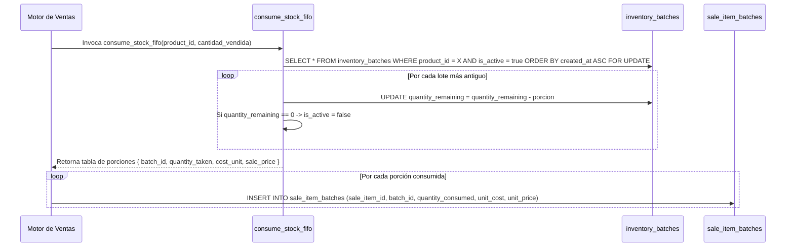
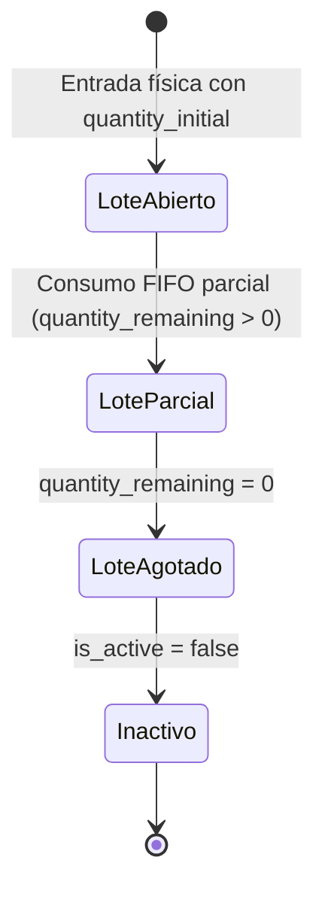
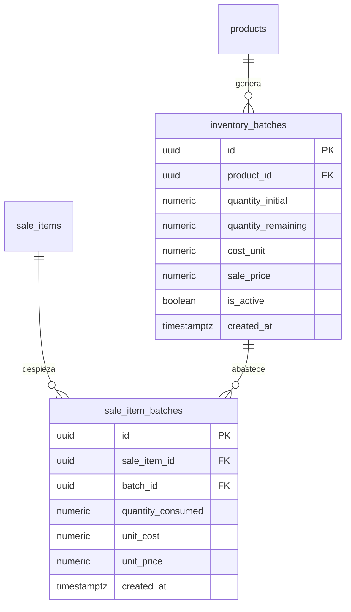

# SDD-010-016: Motor Contable de Valoración FIFO

> **Asociado a:** [FRD-010](../FRD/FRD_010_VALORACION_INVENTARIO_FIFO.md) y [FRD-016](../FRD/FRD_016_CORRECCION_COSTO_VENTAS.md)  
> **Fase del Plan:** Ola 2 — Inventario, Lotes y Proveedores  
> **Estado:** 🟡 Validado Localmente (Post Alineación v1.5.8)  
> **Última Actualización:** 2026-10-11  

---

## 0. Contexto y Restricciones Aplicables

### 0.1 Políticas Globales Activadas (ARQ-002)
| Política ID | Dominio | Impacto Concreto en este SDD |
|-------------|---------|------------------------------|
| **POL-AUD-01** | Auditoría | **Inviolabilidad del Costo de Venta (COGS):** El costo unitario de un lote queda sellado al ingresar. La alteración posterior del precio de catálogo o costo referencial de un producto jamás recalcula las ventas pasadas. |
| **SPEC-011** | Financiero | **Conservación Numérica:** Multiplicación exacta de cantidades pesables y fraccionadas por costo unitario sin pérdida de precisión. |
| **POL-LOG-02** | Logística | **FIFO Estricto (Primero en Entrar, Primero en Salir):** El inventario se consume priorizando los lotes activos más antiguos según `created_at`. |

### 0.2 Contratos Vecinos que Limitan el Diseño
| SDD Origen | Restricción Inyectada | Impacto en Motor FIFO |
|------------|-----------------------|-----------------------|
| **SDD_007_01 (POS Engine)** | Procesamiento de ventas V2/V3. | La venta invoca `consume_stock_fifo` para descontar de los lotes e insertar en `sale_item_batches`. |
| **SDD_006_01_01 (Entradas)** | Inyección de lotes. | Cada entrada física genera un nuevo lote activo en `inventory_batches`. |
| **SDD_018 (Control Operacional)** | Reporte financiero de márgenes. | El Costo de Mercancía Vendida (COGS) se consolida a partir de `sale_item_batches.unit_cost * quantity_consumed`. |

### 0.3 Auditoría de BD contra Realidad (Deuda Técnica Declarada)
*Evidencia cruda obtenida de Supabase Producción (`ihtjocmhzuliwwvdzfnz`):*

```sql
-- Columnas en inventory_batches:
-- id (uuid), product_id (uuid), quantity_initial (numeric), quantity_remaining (numeric),
-- cost_unit (numeric), sale_price (numeric), is_active (boolean), created_at (timestamptz),
-- created_by (uuid), source_movement_id (uuid)

-- Columnas en sale_item_batches:
-- id (uuid), sale_item_id (uuid), batch_id (uuid), quantity_consumed (numeric),
-- unit_cost (numeric), unit_price (numeric), created_at (timestamptz)

-- Función real verificada en producción:
-- consume_stock_fifo(p_product_id UUID, p_quantity_needed NUMERIC)
--   RETURNS TABLE(batch_id UUID, quantity_taken NUMERIC, cost_unit NUMERIC, sale_price NUMERIC)
```

| Hallazgo / Componente | Brecha Real Detectada | Solución Normativa y Trade-off | Condición de Revisión |
|-----------------------|-----------------------|---------------------------------|-----------------------|
| 🟡 **Venta con déficit / Venta Forzada** | Si `current_stock` no alcanza o está en cero, FIFO tradicional se detiene. En Venta Forzada (FRD-014), se permite déficit controlado. | **Decisión:** `rpc_force_sale` crea un lote virtual o movimiento de ajuste que se concilia en la siguiente entrada física. | Monitoreo del saldo de lotes negativos en auditoría. |
| 🟡 **Trigger sincronizador de stock** | La función trigger `sync_product_stock_from_batches()` mantiene `products.current_stock` alineado con `SUM(quantity_remaining)`. | **Decisión:** Mantener el trigger activo para asegurar consistencia automática entre el catálogo y los lotes. | Auditoría de integridad referencial periódica. |

---

## 1. Glosario Local

- **Lote FIFO (`inventory_batches`):** Capa contable y física de inventario que asocia existencias reales con su costo de adquisición unitario inmutable.
- **Detalle Puente (`sale_item_batches`):** Vínculo relacional que asocia una línea de venta con las porciones específicas de lotes consumidas para garantizar el cálculo exacto del Costo de Venta.
- **COGS (Cost of Goods Sold):** Sumatoria del costo unitario real de cada fracción de lote multiplicada por la cantidad consumida en la transacción comercial.

---

## 2. Diagramas de Secuencia



---

## 3. Diagramas de Estado



---

## 4. Especificación Detallada de Casos de Uso

### Caso A: Consumo de Stock Monolote
- **Actor:** Motor transaccional de ventas POS.
- **Precondición:** Existe un lote activo con `quantity_remaining >= cantidad_vendida`.
- **Flujo Principal:**
  1. El cliente adquiere 3 unidades de un producto.
  2. `consume_stock_fifo` localiza el lote más antiguo (ej. con 10 unidades remanentes a costo $2.500).
  3. Descuenta 3 unidades, dejando `quantity_remaining = 7`.
  4. Retorna una única fila de consumo con costo unitario $2.500.
  5. Se inserta una fila en `sale_item_batches` con `quantity_consumed = 3` y `unit_cost = 2500`.
- **Postcondición:** Lote descontado; costo de venta fijado con precisión milimétrica.

### Caso B: Consumo Fraccionado Multilote
- **Actor:** Motor transaccional de ventas POS.
- **Precondición:** El lote más antiguo no cubre la cantidad total; se requiere consumir múltiples lotes.
- **Flujo Principal:**
  1. El cliente adquiere 5 unidades.
  2. El lote A (más antiguo) solo tiene 2 unidades remanentes (costo $2.000).
  3. El lote B (siguiente en antigüedad) tiene 10 unidades (costo $2.400).
  4. `consume_stock_fifo` agota las 2 unidades del lote A (`quantity_remaining = 0`, `is_active = false`).
  5. Toma las 3 unidades restantes del lote B (`quantity_remaining = 7`).
  6. Retorna 2 registros de consumo: {Lote A: 2 un a $2.000} y {Lote B: 3 un a $2.400}.
  7. Se insertan 2 filas en `sale_item_batches` preservando el despiece contable exacto.
- **Postcondición:** COGS calculado de forma ponderada real: `(2 * 2000) + (3 * 2400) = $11.200`.

---

## 5. Contrato de Interfaz

### Operación: `consume_stock_fifo`
- **Tipo:** Función Interna Postgres / Consumo de Motor
- **Entradas:**
  ```json
  {
    "p_product_id": "UUID (Obligatorio)",
    "p_quantity_needed": "NUMERIC > 0 (Obligatorio)"
  }
  ```
- **Salida Exitosa:**
  ```json
  [
    {
      "batch_id": "UUID_LOTE_1",
      "quantity_taken": 2.00,
      "cost_unit": 2000.00,
      "sale_price": 3000.00
    },
    {
      "batch_id": "UUID_LOTE_2",
      "quantity_taken": 3.00,
      "cost_unit": 2400.00,
      "sale_price": 3500.00
    }
  ]
  ```
- **Catálogo de Errores:**
  | Código de Error | Causa | Mensaje Técnico |
  |-----------------|-------|-----------------|
  | `INSUFFICIENT_STOCK` | La sumatoria de lotes es menor a `p_quantity_needed` | Stock insuficiente para satisfacer el consumo FIFO |
  | `INVALID_QUANTITY` | Cantidad solicitada <= 0 | La cantidad demandada debe ser mayor a cero |

---

## 6. Análisis de Seguridad

- **Ejecución Encapsulada:** `consume_stock_fifo` opera con privilegios `SECURITY DEFINER` e invocación restringida a funciones transaccionales del servidor; clientes externos no pueden invocarla directamente.
- **Protección de Exclusión Mutua (`FOR UPDATE`):** Las filas de lotes se bloquean transaccionalmente durante la lectura para evitar condiciones de carrera entre ventas simultáneas.
- **Inmutabilidad Absoluta:** `sale_item_batches` prohíbe `UPDATE` y `DELETE` para garantizar la integridad forense del costo histórico de ventas.

---

## 7. Modelo de Datos Lógico



### Diccionario de Datos
| Tabla | Atributo | Tipo | Nullable | Estado en BD | Descripción |
|-------|----------|------|----------|--------------|-------------|
| `inventory_batches` | `id` | UUID | NO | ✅ Sí | Identificador único del lote |
| `inventory_batches` | `product_id` | UUID | NO | ✅ Sí | Producto asociado |
| `inventory_batches` | `quantity_initial` | NUMERIC | NO | ✅ Sí | Cantidad original de entrada |
| `inventory_batches` | `quantity_remaining`| NUMERIC | NO | ✅ Sí | Existencias aún no consumidas |
| `inventory_batches` | `cost_unit` | NUMERIC | NO | ✅ Sí | Costo de adquisición unitario inmutable |
| `inventory_batches` | `sale_price` | NUMERIC | SÍ | ✅ Sí | Precio de venta asignado al lote |
| `inventory_batches` | `is_active` | BOOLEAN | NO | ✅ Sí | `true` si tiene saldo disponible |
| `sale_item_batches` | `id` | UUID | NO | ✅ Sí | Identificador de la fracción consumida |
| `sale_item_batches` | `sale_item_id` | UUID | NO | ✅ Sí | Línea de venta despachada |
| `sale_item_batches` | `batch_id` | UUID | NO | ✅ Sí | Lote específico de donde salió el stock |
| `sale_item_batches` | `quantity_consumed`| NUMERIC | NO | ✅ Sí | Unidades extraídas de este lote |
| `sale_item_batches` | `unit_cost` | NUMERIC | NO | ✅ Sí | Costo unitario real aplicado a la venta |
