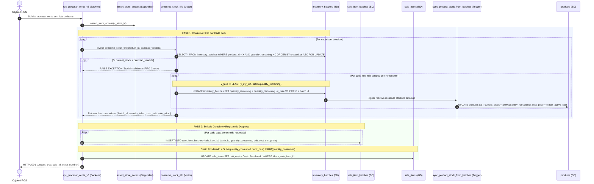
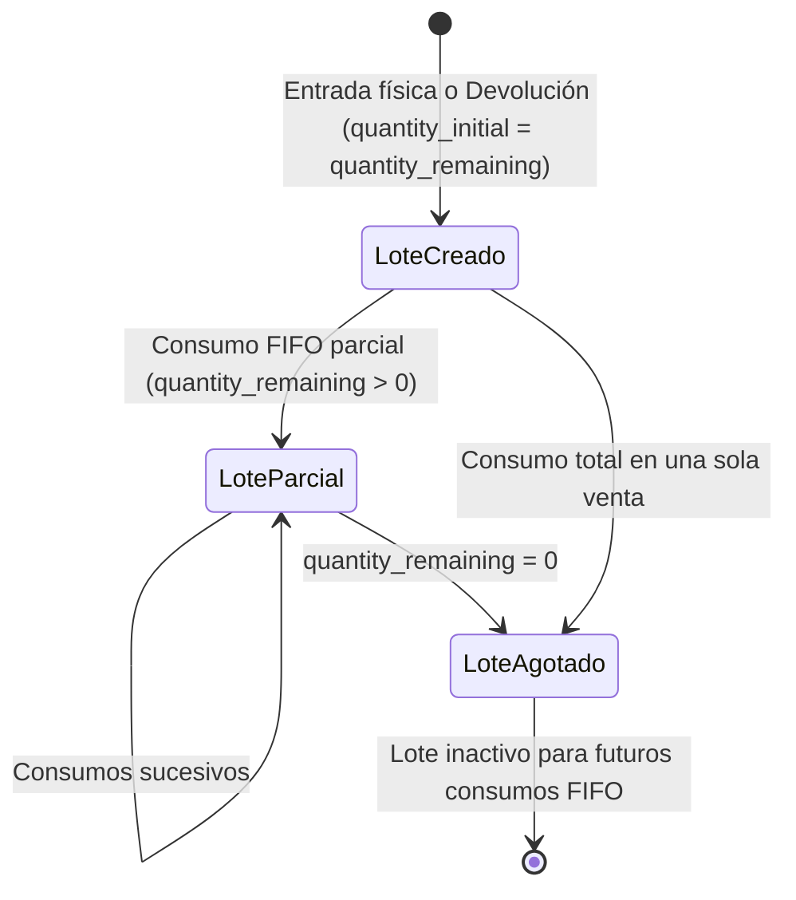

# SDD-010-016: Motor Contable de Valoración FIFO

> **Asociado a:** [FRD-010](../FRD/FRD_010_VALORACION_INVENTARIO_FIFO.md) y [FRD-016](../FRD/FRD_016_CORRECCION_COSTO_VENTAS.md)  
> **Módulo Primario:** [SDD-006: Núcleo de Inventario y Catálogo Padre](SDD_006_NUCLEO_INVENTARIO_PADRE.md)  
> **Fase del Plan Maestro:** Ola 2 — Inventario, Lotes y Proveedores  
> **Estado:** 🟠 Aprobado con Deuda Técnica Documentada (Protocolo PAC-SDD v2.0)
> **Última Actualización:** 2026-10-14  

---

## 0. Contexto y Restricciones Aplicables

### 0.1 Políticas Globales Activadas (ARQ-002)

| Política ID | Dominio | Mandato Arquitectónico e Impacto en este SDD |
|-------------|---------|-----------------------------------------------|
| **POL-AUTH-01** | Autenticación | **Aislamiento Multi-tenant Centralizado:** Toda operación que altere o consuma lotes se ejecuta bajo el contexto estricto de la tienda (`get_current_store_id()`). Las funciones RPC padre deben invocar `assert_store_access(v_store_id)` como instrucción #1 obligatoria. |
| **POL-AUD-01 / POL-AUD-02** | Auditoría | **Inviolabilidad del Costo de Ventas (COGS) y Append-Only:** El costo unitario de cada lote queda sellado de forma inmutable al ingresar. Al efectuarse una venta, el despiece exacto por capa se almacena en `sale_item_batches` y su costo unitario promedio ponderado se congela en `sale_items.unit_cost`. Cualquier cambio posterior en el catálogo o en el precio de reposición jamás recalcula ventas pasadas. Queda prohibido `UPDATE` o `DELETE` sobre `sale_item_batches`. |
| **POL-LOG-01 / POL-LOG-02** | Logística | **FIFO Estricto (Primero en Entrar, Primero en Salir):** El inventario se consume priorizando cronológicamente las capas de lotes activas más antiguas según `created_at ASC` que mantengan `quantity_remaining > 0`. El catálogo (`products.current_stock`) es un acumulador denormalizado reactivo gobernado por la sumatoria de remanentes. |
| **POL-SEC-01** | Seguridad | **Protección de Márgenes y Costos:** Los costos unitarios de adquisición (`cost_unit`, `unit_cost`) son datos financieros protegidos reservados para reportes administrativos y P&L. Los cajeros y terminales POS operan con ceguera de costos durante el cobro. La función interna `consume_stock_fifo` es `SECURITY DEFINER` y restringe su ejecución a llamadas internas del servidor. |
| **SPEC-010 / SPEC-011** | Moneda y Formato | **Conservación Numérica y Redondeo:** Multiplicación exacta de cantidades pesables y fraccionadas por costo unitario sin pérdida de precisión. Precios de venta expresados en moneda entera colombiana (COP) con redondeo al múltiplo de $50 inferior. Cantidades y costos son estrictamente mayores o iguales a cero (`>= 0`). |

---

### 0.2 Contratos Vecinos que Limitan el Diseño

| SDD Vecino | Interfaces / Operaciones Involucradas | Restricción Inyectada en Motor FIFO |
|------------|---------------------------------------|--------------------------------------|
| **SDD_006 (Inventario Padre)** | `products.current_stock`, `products.cost_price`, `trg_sync_batches` | **Invariante de Stock Reactivo:** Prohibido actualizar `products.current_stock` con sentencias directas. El trigger `sync_product_stock_from_batches()` mantiene `current_stock` alineado con `COALESCE(SUM(quantity_remaining), 0)` y sincroniza `cost_price` con el costo del lote más antiguo activo. |
| **SDD_006_01_01 (Entradas)** | `rpc_registrar_entrada`, `bridge_movement_to_batch` | **Inyección de Capas FIFO:** Toda entrada física aprobada crea atómicamente un lote en `inventory_batches` con `quantity_initial = quantity_remaining = quantity`, `cost_unit = purchase_price`, `sale_price = sale_price`, `is_active = true` y vínculo `source_movement_id`. |
| **SDD_006_02 (Reembolsos)** | `rpc_procesar_reembolso_item`, `bridge_movement_to_batch` | **Reincorporación por Devolución:** Las devoluciones de clientes reingresan existencias creando una nueva capa en `inventory_batches` con el costo unitario histórico restaurado, distinguiéndose de devoluciones a proveedores en el trigger puente. |
| **SDD_010 (Historial de Precios)** | `rpc_actualizar_precio_lote`, `inventory_batches` | **Aislamiento de Remanentes:** La actualización administrativa de precios de lote afecta exclusivamente a las existencias aún disponibles (`quantity_remaining > 0`), sin alterar retroactivamente los consumos históricos en `sale_item_batches`. |
| **SDD_007 / SDD_007_01 (Ventas POS)** | `rpc_procesar_venta_v2` / `v3`, `sale_item_batches` | **Despiece Atómico de Ventas:** El checkout invoca `consume_stock_fifo`, despieza porciones en `sale_item_batches` y congela `sale_items.unit_cost` y `sale_items.unit_price`. |
| **SDD_018 (Control Operacional)** | `rpc_get_comprehensive_financial_report` | **Consolidación de COGS:** El Costo de Mercancía Vendida en el Estado de Resultados se calcula sumando `quantity_consumed * unit_cost` de `sale_item_batches`, filtrando ventas con `sales.is_voided = FALSE`. La valuación de inventario activo suma `quantity_remaining * cost_unit`. |
| **SDD_005 (Auditoría y Trazabilidad)** | `sale_item_batches`, `inventory_batches` | **Evidence Hub Inmutable:** Inviolabilidad append-only absoluta que preserva la pista forense del costo real asociado a cada transacción comercial. |

---

### 0.3 Auditoría de Base de Datos Real y Deuda Técnica Declarada (Regla 7)

La verificación empírica directa ejecutada en Supabase Producción (`ihtjocmhzuliwwvdzfnz`) constató la realidad física del motor:

- **Tabla `inventory_batches` (10 columnas físicas):** `id` (UUID PK), `product_id` (UUID FK), `quantity_initial` (NUMERIC), `quantity_remaining` (NUMERIC), `cost_unit` (NUMERIC), `is_active` (BOOLEAN), `created_at` (TIMESTAMPTZ), `created_by` (UUID FK), `sale_price` (NUMERIC), `source_movement_id` (UUID FK).
- **Tabla `sale_item_batches` (7 columnas físicas):** `id` (UUID PK), `sale_item_id` (UUID FK), `batch_id` (UUID FK), `quantity_consumed` (NUMERIC), `unit_cost` (NUMERIC), `unit_price` (NUMERIC), `created_at` (TIMESTAMPTZ).
- **Tabla `sale_items` (8 columnas físicas):** `id` (UUID PK), `sale_id` (UUID FK), `product_id` (UUID FK), `quantity` (NUMERIC), `unit_price` (NUMERIC), `subtotal` (NUMERIC), `created_at` (TIMESTAMPTZ), `unit_cost` (NUMERIC).
- **Procedimiento Core `consume_stock_fifo` en `pg_proc`:**
  - Firma: `consume_stock_fifo(p_product_id uuid, p_quantity_needed numeric) RETURNS TABLE(batch_id uuid, quantity_taken numeric, cost_unit numeric, sale_price numeric)`.
  - Declara `SECURITY DEFINER` y `SET search_path TO 'public'`.
  - Aplica bloqueo pesimista `SELECT ... FOR UPDATE` sobre `inventory_batches` ordenado por `created_at ASC` y filtrando `quantity_remaining > 0`. Descuenta `quantity_remaining = quantity_remaining - v_take`.
- **Triggers Verificados:**
  - `trg_sync_batches` sobre `inventory_batches`: ejecuta `sync_product_stock_from_batches()`, recalculando `products.current_stock` y sincronizando `products.cost_price` con el costo del lote más antiguo activo.
  - `trg_bridge_movement_to_batch` sobre `inventory_movements`: enlaza entradas físicas con `inventory_batches`.

Con base en esta verificación, se formalizan las siguientes 5 deudas técnicas bajo los tres elementos obligatorios de la Regla 7:

| # | Deuda Técnica / Brecha Real | Qué se Decidió | Por Qué (Trade-off Concreto) | Condición de Revisión Futura |
|---|-----------------------------|----------------|------------------------------|------------------------------|
| **1** | **Omisión de Privilegios Base en `sale_item_batches` (Regla 8)**: La tabla física solo posee permisos para `postgres`; roles `anon`, `authenticated` y `service_role` carecen de permisos en `role_table_grants`, provocando error 42501 (Permission Denied) en lecturas directas. | Normar e incluir en la migración DDL el otorgamiento mandatorio de `GRANT ALL ON TABLE public.sale_item_batches TO anon, authenticated, service_role;`. | La función opera porque es `SECURITY DEFINER`, pero cualquier consulta directa de lectura de despiece contable vía PostgREST falla. Se resuelve ordenadamente en migración versionada. | Aplicación de la migración DDL consolidada de la Ola 2. |
| **2** | **Discrepancia en `consume_stock_fifo` sin UPDATE de `is_active = false`**: En BD actual, `consume_stock_fifo` descuenta `quantity_remaining` pero no ejecuta `SET is_active = false` al llegar a cero, operando exclusivamente con la condición `quantity_remaining > 0`. | Documentar que el motor opera evaluando `quantity_remaining > 0` tanto en el cursor `FOR UPDATE` como en índices parciales, preservando la coherencia matemática sin alterar la función en caliente. | Previene introducir modificaciones en PL/pgSQL que pudieran desestabilizar el checkout de ventas v2 en producción antes del despliegue integral de la V3. | Refactorización del motor de ventas V3 en la Ola 3 (`SDD-007`). |
| **3** | **Gate DDL en `bridge_movement_to_batch` para Devoluciones de Clientes**: El trigger actual redirige `'devolucion'` a `consume_stock_fifo` (decremento de existencias para proveedores). | Establecer como precondición obligatoria de despliegue que la migración del gestor de reembolsos exige adaptar `bridge_movement_to_batch` para que devoluciones de clientes (`supplier_id IS NULL`) creen una capa de lote y reingresen existencias. | Frena la ejecución de reembolsos de clientes hasta que el trigger diferencie el origen, impidiendo la corrupción de existencias por consumo erróneo de mercancía devuelta. | Despliegue de la migración de inventario y lotes en la Ola 2 (`SDD-006-02`). |
| **4** | **Coexistencia de Índices Duplicados en `sale_item_batches`**: Existen dos índices btree idénticos sobre la misma columna: `idx_sale_item_batches_sale_item_id` e `idx_sale_item_batches_item_id`. | Programar la eliminación del índice redundante mediante `DROP INDEX IF EXISTS public.idx_sale_item_batches_item_id;` preservando el índice canónico. | Elimina la sobrecarga de doble indexación en disco durante cada inserción de línea de venta sin degradar el rendimiento de las consultas. | Migración DDL de limpieza de índices en la Ola 2. |
| **5** | **Desincronización de `sale_items.unit_cost` en el Checkout de Ventas**: En BD histórica existen registros donde `sale_items.unit_cost = NULL`, delegando el desglose a `sale_item_batches`. | Normar que la versión V3 de ventas (`SDD-007`) calcule y asigne obligatoriamente el costo promedio ponderado de los lotes consumidos en `sale_items.unit_cost` al registrar la transacción. | Permite reportes analíticos rápidos a nivel de ítem sin obligar a consultas recursivas sobre lotes, cumpliendo cabalmente el requerimiento de FRD-016. | Despliegue del motor POS V3 en la Ola 3 (`SDD-007`). |

---

## 1. Mandato del Negocio (Traducción del FRD)

El modelo contable FIFO unifica los mandatos de [FRD-010](../FRD/FRD_010_VALORACION_INVENTARIO_FIFO.md) y [FRD-016](../FRD/FRD_016_CORRECCION_COSTO_VENTAS.md):

### 1.1 Reglas de Negocio (Citas Textuales)

#### De FRD-010: Valoración de Inventario FIFO (Lotes)
1. **Regla de Entrada (Compra/Ajuste Positivo):**
   > *- "Toda entrada de inventario genera un **Nuevo Lote** en `inventory_batches`."*  
   > *- "No se modifica ningún "costo promedio" en el producto padre (este queda solo como referencia o precio de reposición)."*

2. **Regla de Salida (Venta/Ajuste Negativo):**
   > *- "El sistema debe buscar los lotes activos (`quantity_remaining > 0`) de ese producto."*  
   > *- "Ordenarlos por antigüedad (`created_at ASC`)."*  
   > *- "Descontar la cantidad requerida del primer lote."*  
   > *- "Si el primer lote se agota, continuar con el siguiente (Consumo en cascada)."*

3. **Valoración Financiera:**
   > *- "El "Valor Total del Inventario" es la suma de `(quantity_remaining * cost_unit)` de todos los lotes."*

4. **Riesgos y Consideraciones:**
   > *- Complejidad: "La lógica de venta pasa de una resta simple (`stock - qty`) a un algoritmo recursivo o iterativo sobre múltiples filas."*  
   > *- Performance: "Consultar saldo requiere sumar lotes. Se recomienda mantener `current_stock` en `products` como campo cacheado (denormalizado) para lectura rápida, pero que la verdad financiera resida en `inventory_batches`."*

#### De FRD-016: Registro de Costo en Ventas
1. **Regla 1: Inmutabilidad Histórica del Costo:**
   > *"El costo registrado en cada venta DEBE reflejar el costo real conocido en el momento preciso en que se ejecutó la transacción. Los futuros cambios de precio del producto NUNCA DEBEN modificar el costo ya registrado en ventas históricas."*

2. **Regla 2: Origen del Costo — Primera Iteración:**
   > *"En la primera implementación, el sistema DEBE usar el costo estándar del producto (costo de referencia registrado en la ficha del producto) como el valor de costo a registrar en la venta."*

3. **Regla 3: Origen del Costo — Segunda Iteración (Objetivo Final):**
   > *"En una implementación posterior, el sistema DEBE calcular el costo preciso de cada ítem vendido usando el método FIFO, promediando los costos de los lotes consumidos en la transacción. Este es el objetivo arquitectónico final."*

4. **Regla 4: No Interrupción de Venta:**
   > *"Si el costo estándar de un producto es cero o no está disponible, el sistema DEBE registrar cero como costo, sin interrumpir ni cancelar la venta bajo ninguna circunstancia."*

5. **Regla 5: Alcance Restringido:**
   > *"Esta regla aplica únicamente al registro de ventas. Los ajustes de inventario, devoluciones y entradas de mercancía tienen sus propias reglas de costeo definidas en sus módulos correspondientes."*

---

### 1.2 Casos de Uso del Negocio

#### Caso A: Venta con Producto Costeado (FRD-016)
- **Actor:** Tendero / Empleado (operando el Punto de Venta).
- **Precondición:** El producto tiene existencias en lotes con costo unitario mayor a cero.
- **Flujo Principal:**
  1. El empleado agrega productos al carrito y completa el proceso de cobro.
  2. El sistema procesa la venta e invoca `consume_stock_fifo`.
  3. Por cada ítem vendido, el sistema consume las capas más antiguas cronológicamente.
  4. El sistema registra el despiece en `sale_item_batches` y asigna el costo unitario a la línea de venta.
  5. La venta queda registrada con su precio de venta y su costo unitario real.
- **Postcondición:** Registro de venta contiene el costo unitario real inmutable. El cálculo de ganancia bruta es exacto.

#### Caso B: Venta con Producto Sin Costo Registrado (FRD-016)
- **Actor:** Tendero / Empleado.
- **Precondición:** El producto tiene lotes con costo cero o producto sin costo configurado.
- **Flujo Principal:**
  1. El empleado agrega el producto al carrito y completa el cobro.
  2. El sistema procesa la venta normalmente.
  3. El sistema detecta que el costo es cero o nulo.
  4. El sistema registra cero como costo unitario.
  5. La venta se completa sin interrupción.
- **Postcondición:** La venta queda registrada con costo unitario cero. La transacción comercial es válida sin bloquear la caja.

---

### 1.3 Criterios de Aceptación (Citas Textuales)

- **CA-016-01:** *"Tras ejecutar una venta, cada línea de venta tiene un valor de costo unitario registrado (puede ser cero si el producto no tiene costo configurado)."*
- **CA-016-02:** *"El costo registrado en ventas históricas NO se modifica cuando el costo estándar del producto cambia posteriormente."*
- **CA-016-03:** *"La implementación de este registro no interrumpe ni altera la lógica existente de validación de caja abierta, ventas fiadas ni reducción de inventario FIFO."*
- **CA-016-04:** *"El sistema acepta y registra correctamente un costo de cero sin tratar esta condición como un error."*
- **Requisito Atómico de Datos:** *"El costo unitario DEBE capturarse dentro del mismo proceso atómico de registro de venta. No debe ser un proceso posterior. La captura y el registro de la venta son una sola operación indivisible."*

---

## 2. Arquitectura del Flujo y Estado

### 2.1 Flujo Transaccional de Consumo FIFO en Venta (Mermaid)



---

### 2.2 Diagrama de Estados de una Capa de Lote (`inventory_batches`)



---

### 2.3 Regla de Cero Cálculos en Frontend (Flujo Unidireccional)

1. **El Frontend NO Conoce ni Calcula Lotes:** El terminal POS desconoce de qué lotes físicos saldrá la mercancía. Solo envía la intención comercial con el `product_id` y la `quantity` solicitada.
2. **El Servidor es la Autoridad Contable:** El backend ejecuta `consume_stock_fifo` bajo transacción atómica, localiza las capas cronológicamente, descuenta los remanentes con bloqueo pesimista y sella el COGS en `sale_item_batches`.
3. **El Frontend NO Calcula Márgenes:** Todo reporte de ganancia bruta o margen de utilidad es computado y provisto directamente por las funciones financieras del servidor (`rpc_get_comprehensive_financial_report`).

---

## 3. Seguridad y Multi-Tenant

### 3.1 Aislamiento Multi-Tenant y Encapsulamiento de Motor (Regla 4)

- **Instrucción #1 Mandatoria:** Toda operación transaccional de venta o ajuste que active el motor FIFO debe ejecutar como primera sentencia:
  `PERFORM assert_store_access(v_store_id);`
  garantizando que ninguna venta pueda consumir existencias ni lotes de una tienda ajena.
- **Políticas RLS en Tablas Afectadas:**
  - `inventory_batches`: Protegida por `batches_select_store` con filtro `(EXISTS (SELECT 1 FROM products p WHERE p.id = inventory_batches.product_id AND p.store_id = get_current_store_id()))`.
  - `sale_item_batches`: Protegida por `Users can view sale item batches of their store` con filtro `(EXISTS (SELECT 1 FROM sales s JOIN sale_items si ON si.sale_id = s.id WHERE si.id = sale_item_batches.sale_item_id AND s.store_id = get_current_store_id()))`.
- **Encapsulamiento de `consume_stock_fifo`:** Definida como `SECURITY DEFINER` con `SET search_path TO 'public'`. Se revoca explícitamente el privilegio `EXECUTE` para `PUBLIC`, `anon` y `authenticated`, restringiéndolo a llamadas de servidor (`service_role` y RPCs transaccionales).

---

### 3.2 Matriz de Control de Acceso Basada en Perfil (RBAC)

De acuerdo con POL-SEC-01 y FRD-010:

| Rol de Usuario | Invocación Directa de `consume_stock_fifo` | Lectura de `sale_item_batches` (Despiece) | Visualización de `cost_unit` en Lotes |
|----------------|:------------------------------------------:|:-----------------------------------------:|:-------------------------------------:|
| **Administrador / Dueño** | NO (Solo vía RPC de servidor) | SÍ (Auditoría y P&L) | SÍ |
| **Empleado con Inventario** | NO (Solo vía RPC de servidor) | SÍ (Reportes permitidos) | SÍ |
| **Cajero / Punto de Venta** | NO (Bloqueado) | NO (Oculto) | NO (Ceguera financiera total) |

---

## 4. Casos Límite y Concurrencia (Regla 5 de AGENTS.md)

| ID | Escenario de Caso Límite | Comportamiento del Motor / Backend | Código / Excepción en Motor | Respuesta Visual en UI |
|---|---------------------------|-------------------------------------|-----------------------------|------------------------|
| **CL-01** | **Consumo Monolote Regular** | El lote más antiguo tiene `quantity_remaining >= cantidad_vendida`. Descuenta el remanente y retorna 1 registro con el costo unitario exacto. | Operación Exitosa | Venta procesada instantáneamente; stock descontado en UI. |
| **CL-02** | **Consumo Fraccionado Multilote en Cascada** | El lote más antiguo no cubre la demanda total. Agota el lote A (`quantity_remaining = 0`), pasa al lote B, descuenta el saldo y retorna N registros de despiece. | Operación Exitosa | El ticket se despacha con normalidad; el backend registra N filas en `sale_item_batches`. |
| **CL-03** | **Stock Insuficiente en Venta Regular** | La suma de remanentes de todos los lotes activos es menor a la cantidad demandada. `consume_stock_fifo` aborta inmediatamente con rollback total de la venta. | `Stock insuficiente (FIFO Check)` | Mensaje: *"Stock insuficiente para completar la venta del producto [X]."* |
| **CL-04** | **Venta Forzada con Déficit Controlado** | Administrador ejecuta `rpc_force_sale`. El motor inyecta un movimiento `CORRECCION_SISTEMA` creando un lote técnico con el costo de catálogo, permitiendo el consumo sin romper el constraint. | Operación Exitosa con Auditoría | Notificación prominente: *"Venta forzada registrada con ajuste técnico de inventario."* |
| **CL-05** | **Concurrencia en Venta Simultánea del Mismo Lote** | Dos terminales intentan vender simultáneamente el mismo producto. El cursor `FOR UPDATE` en `consume_stock_fifo` serializa las transacciones a nivel de fila. | N/A (Garantía de Consistencia) | Ambas ventas descuentan secuencialmente sin producir saldos negativos ni carreras. |
| **CL-06** | **Producto Vendido Sin Costo Configurado** | El producto fue creado sin costo o ingresó con costo cero. El motor registra `cost_unit = 0` y completa la venta sin abortar (FRD-016 Regla 4). | Operación Exitosa | La venta se concreta con normalidad; ganancia bruta no calculable para ese ítem. |
| **CL-07** | **Anulación de Venta con Despiece Existente** | Se anula una venta vía `rpc_anular_venta`. Los registros en `sale_item_batches` se preservan intactos (inmutables), y los reportes financieros filtran `sales.is_voided = FALSE`. | Operación Exitosa | Venta marcada como anulada; inventario reingresado vía nueva capa reactiva. |

---

## 5. Contratos de Interfaz

### 5.1 Operación: `consume_stock_fifo` (Función Interna Postgres)

Función interna del motor contable invocada exclusivamente por procedimientos transaccionales de venta (`rpc_procesar_venta_v3`).

#### Parámetros de Entrada (Firma de Motor)
- `p_product_id`: `UUID` (Obligatorio, identificador del producto a descontar).
- `p_quantity_needed`: `NUMERIC > 0` (Obligatorio, unidades exactas a consumir).

#### Payload de Retorno (`TABLE`)

```json
{
  "$schema": "http://json-schema.org/draft-07/schema#",
  "title": "ConsumeStockFifoOutput",
  "type": "array",
  "items": {
    "type": "object",
    "required": ["batch_id", "quantity_taken", "cost_unit", "sale_price"],
    "properties": {
      "batch_id": {
        "type": "string",
        "format": "uuid",
        "description": "Identificador único de la capa de lote de donde se extrajo el stock."
      },
      "quantity_taken": {
        "type": "number",
        "minimum": 0.001,
        "description": "Cantidad física extraída de este lote específico."
      },
      "cost_unit": {
        "type": "number",
        "minimum": 0,
        "description": "Costo unitario de adquisición inmutable de este lote."
      },
      "sale_price": {
        "type": "number",
        "minimum": 0,
        "description": "Precio de venta asignado a este lote para cobro en POS."
      }
    },
    "additionalProperties": false
  }
}
```

---

### 5.2 Estructura del Despiece Contable (`sale_item_batches`)

Cada porción retornada por `consume_stock_fifo` se persiste en la tabla relacional `sale_item_batches`:

```json
{
  "$schema": "http://json-schema.org/draft-07/schema#",
  "title": "SaleItemBatchRecord",
  "type": "object",
  "required": [
    "id",
    "sale_item_id",
    "batch_id",
    "quantity_consumed",
    "unit_cost",
    "unit_price",
    "created_at"
  ],
  "properties": {
    "id": {
      "type": "string",
      "format": "uuid"
    },
    "sale_item_id": {
      "type": "string",
      "format": "uuid",
      "description": "Línea específica del ticket de venta."
    },
    "batch_id": {
      "type": "string",
      "format": "uuid",
      "description": "Lote específico que abasteció la cantidad."
    },
    "quantity_consumed": {
      "type": "number",
      "minimum": 0.001,
      "description": "Porción exacta abastecida por este lote."
    },
    "unit_cost": {
      "type": "number",
      "minimum": 0,
      "description": "Costo unitario congelado del lote al momento de la venta."
    },
    "unit_price": {
      "type": "number",
      "minimum": 0,
      "description": "Precio unitario cobrado al cliente."
    },
    "created_at": {
      "type": "string",
      "format": "date-time"
    }
  },
  "additionalProperties": false
}
```

---

## 6. Matriz de Trazabilidad e Impacto

| Requisito FRD / Política | Sección SDD | Elemento en Esquema BD | Impacto en Flujo de Datos y Garantía de Consistencia |
|--------------------------|-------------|------------------------|------------------------------------------------------|
| **FRD-010 Regla 1 (Entrada)** | §0.2, §2.1 | `inventory_batches` | Cada entrada genera un nuevo lote sin promediar costos en el catálogo. |
| **FRD-010 Regla 2 (Salida FIFO)** | §1.1, §2.1 | `consume_stock_fifo` | Ordena lotes activos por `created_at ASC` y descuenta en cascada. |
| **FRD-010 Regla 3 (Valuación)** | §0.1, §5.1 | `quantity_remaining * cost_unit` | Verdad financiera de valuación de existencias en el balance. |
| **FRD-016 Regla 1 (Inmutabilidad)** | §0.1, §2.1 | `sale_item_batches.unit_cost` | Sellado inmutable del costo histórico de ventas; inmune a cambios futuros. |
| **FRD-016 Regla 4 (No Interrupción)** | §1.1, §4 | Manejo de costo cero | Admite productos con costo cero sin interrumpir ni rechazar la venta. |
| **POL-AUTH-01** | §3.1 | `assert_store_access()` | Blindaje multi-tenant en todas las operaciones del motor de ventas. |
| **POL-AUD-01 / POL-AUD-02** | §0.1, §6 | Append-only en `sale_item_batches` | Prohibición absoluta de mutar registros históricos de despiece contable. |
| **Regla 7 (Deuda D-1)** | §0.3, §7.2 | Privilegios en `sale_item_batches` | Regularización de `GRANT ALL` para roles `anon`, `authenticated`. |
| **Regla 7 (Deuda D-3)** | §0.3, §0.2 | Gate en `bridge_movement_to_batch` | Adaptación de trigger para discriminar devoluciones de clientes. |
| **Regla 7 (Deuda D-5)** | §0.3, §2.1 | `sale_items.unit_cost` | Sincronización atómica obligatoria de costo ponderado en el checkout. |

---

## 7. Verificación de Esquema Real

Introspección directa de columnas, tipos, constraints y privilegios verificada en Supabase Producción (`ihtjocmhzuliwwvdzfnz`):

### 7.1 Catálogo Físico de Columnas Involucradas

| Tabla | Columna | Tipo de Dato | Nullable | Rol en Valoración FIFO y Costeo |
|-------|---------|--------------|:--------:|---------------------------------|
| `inventory_batches` | `id` | `uuid` | NO | Clave primaria del lote de mercancía. |
| `inventory_batches` | `product_id` | `uuid` | NO | Clave foránea del producto asociado. |
| `inventory_batches` | `quantity_initial` | `numeric` | NO | Cantidad original recibida al momento de la entrada. |
| `inventory_batches` | `quantity_remaining` | `numeric` | NO | Saldo disponible remanente para consumo FIFO. |
| `inventory_batches` | `cost_unit` | `numeric` | NO | Costo unitario real inmutable de esta remesa. |
| `inventory_batches` | `sale_price` | `numeric` | NO | Precio de venta asignado a este lote en el POS. |
| `inventory_batches` | `is_active` | `boolean` | YES | Bandera de estado del lote. |
| `inventory_batches` | `created_at` | `timestamptz` | NO | Marca temporal indispensable para el ordenamiento cronológico FIFO. |
| `inventory_batches` | `created_by` | `uuid` | YES | Usuario responsable de la creación del lote. |
| `inventory_batches` | `source_movement_id` | `uuid` | YES | Vínculo con el movimiento de Kardex originador. |
| `sale_item_batches` | `id` | `uuid` | NO | Clave primaria del registro de despiece contable. |
| `sale_item_batches` | `sale_item_id` | `uuid` | NO | Clave foránea de la línea de ticket de venta. |
| `sale_item_batches` | `batch_id` | `uuid` | NO | Clave foránea del lote específico consumido. |
| `sale_item_batches` | `quantity_consumed` | `numeric` | NO | Unidades extraídas de este lote específico. |
| `sale_item_batches` | `unit_cost` | `numeric` | NO | Costo unitario real sellado para el cálculo del COGS. |
| `sale_item_batches` | `unit_price` | `numeric` | NO | Precio unitario cobrado al cliente. |
| `sale_item_batches` | `created_at` | `timestamptz` | NO | Fecha y hora exacta del despiece. |
| `sale_items` | `id` | `uuid` | NO | Clave primaria de la línea de venta. |
| `sale_items` | `sale_id` | `uuid` | NO | Clave foránea del ticket de venta. |
| `sale_items` | `product_id` | `uuid` | NO | Producto vendido. |
| `sale_items` | `quantity` | `numeric` | NO | Cantidad total vendida en la línea. |
| `sale_items` | `unit_price` | `numeric` | NO | Precio de venta cobrado. |
| `sale_items` | `subtotal` | `numeric` | NO | Subtotal de la línea de venta. |
| `sale_items` | `unit_cost` | `numeric` | YES | Costo unitario promedio ponderado sellado en la venta. |
| `products` | `current_stock` | `numeric` | YES | Acumulador reactivo sincronizado por `trg_sync_batches`. |
| `products` | `cost_price` | `numeric` | YES | Costo unitario del lote activo más antiguo. |

---

### 7.2 Constraints y Privilegios Base Verificados (Regla 8)

- **Constraints de Integridad Física:**
  - `inventory_batches_quantity_initial_check`: CHECK `(quantity_initial > 0)`.
  - `inventory_batches_quantity_remaining_check`: CHECK `(quantity_remaining >= 0 AND quantity_remaining <= quantity_initial)`.
  - `inventory_batches_cost_unit_check`: CHECK `(cost_unit >= 0)`.
  - `sale_item_batches_quantity_consumed_check`: CHECK `(quantity_consumed > 0)`.
  - `sale_item_batches_unit_cost_check`: CHECK `(unit_cost >= 0)`.
- **Privilegios Base (`GRANT ALL` según Regla 8):**
  - `inventory_batches`: Cuenta con permisos completos otorgados a `anon`, `authenticated`, `service_role`.
  - `sale_item_batches`: **Deuda Técnica D-1.** Actualmente solo tiene permisos otorgados a `postgres`. El SDD-010-016 norma el otorgamiento obligatorio de `GRANT ALL ON TABLE public.sale_item_batches TO anon, authenticated, service_role;`.
