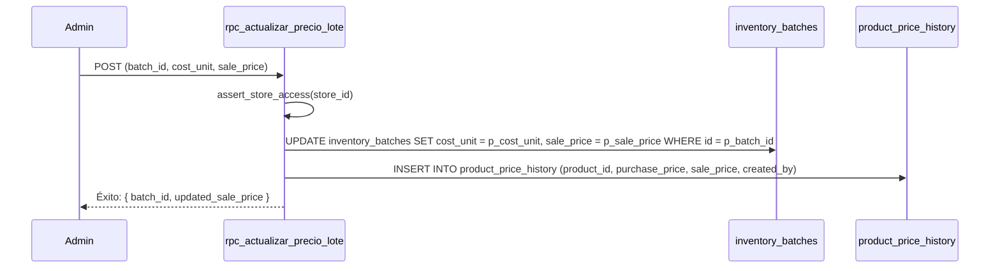
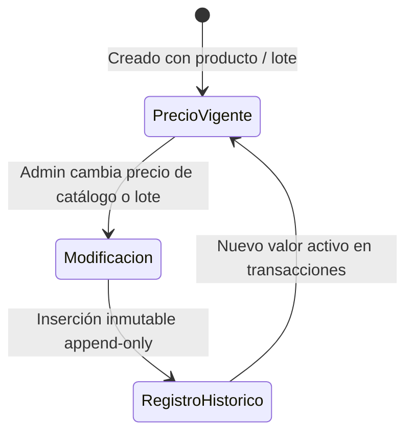
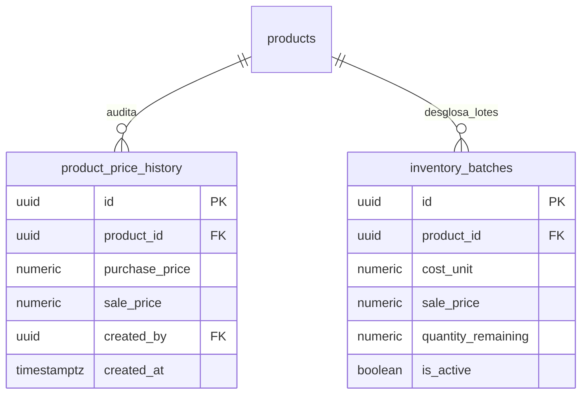

# SDD-010: Historial de Precios y Edición de Lotes

> **Asociado a:** [FRD-010](../FRD/FRD_010_HISTORIAL_PRECIOS.md)  
> **Fase del Plan:** Ola 2 — Inventario, Lotes y Proveedores  
> **Estado:** 🟡 Validado Localmente (Post Alineación v1.5.8)  
> **Última Actualización:** 2026-10-11  

---

## 0. Contexto y Restricciones Aplicables

### 0.1 Políticas Globales Activadas (ARQ-002)
| Política ID | Dominio | Impacto Concreto en este SDD |
|-------------|---------|------------------------------|
| **POL-AUD-01** | Auditoría | **Inmutabilidad de Registros Históricos:** Toda mutación de precio de catálogo o de lote genera un registro inmutable append-only. Prohibido `UPDATE` o `DELETE` sobre el historial. |
| **SPEC-010 / 011** | Financiero | **Redondeo Obligatorio:** Todo precio de venta ingresado debe someterse a redondeo híbrido al múltiplo de $50 más cercano. Formato numérico entero. |
| **POL-SEC-01** | Seguridad | **Protección de Márgenes y Costos:** Solo usuarios con rol Administrador o permiso explícito pueden visualizar el histórico de precios de compra (`purchase_price`). |

### 0.2 Contratos Vecinos que Limitan el Diseño
| SDD Origen | Restricción Inyectada | Impacto en Precios |
|------------|-----------------------|--------------------|
| **SDD_010_016 (FIFO)** | Precios por lote. | Permite actualizar el precio de venta y costo unitario de un lote activo específico (`inventory_batches`) mediante `rpc_actualizar_precio_lote`. |
| **SDD_006 (Inventario Padre)** | Precio sugerido de catálogo. | La tabla `products` mantiene `price` y `cost_price` como valores referenciales para nuevas ventas y compras. |

### 0.3 Auditoría de BD contra Realidad (Deuda Técnica Declarada)
*Evidencia cruda obtenida de Supabase Producción (`ihtjocmhzuliwwvdzfnz`):*

```sql
-- Columnas reales en product_price_history:
-- id (uuid), product_id (uuid), purchase_price (numeric), sale_price (numeric), created_at (timestamptz), created_by (uuid)

-- Columnas reales en inventory_batches:
-- id (uuid), product_id (uuid), quantity_initial (numeric), quantity_remaining (numeric),
-- cost_unit (numeric), sale_price (numeric), is_active (boolean), created_at (timestamptz), created_by (uuid)

-- RPC real en producción:
-- rpc_actualizar_precio_lote(p_batch_id UUID, p_cost_unit NUMERIC, p_sale_price NUMERIC)
```

| Hallazgo / Componente | Brecha Real Detectada | Solución Normativa y Trade-off | Condición de Revisión |
|-----------------------|-----------------------|---------------------------------|-----------------------|
| 🟡 **Estructura de `product_price_history`** | En borradores antiguos se asumían campos `previous_price` y `new_price`. La tabla real almacena instantáneas (`purchase_price`, `sale_price`, `created_at`, `created_by`). | **Decisión:** Modelar las consultas calculando el diferencial sobre la instantánea anterior ordenada cronológicamente (`LAG(sale_price) OVER (...)`). | Resuelto en este SDD. |
| 🟡 **Edición de Precios de Lote FIFO** | Los lotes activos tienen precios de venta independientes (`sale_price`) que consumen las ventas dinámicas v2. | **Decisión:** Formalizar el contrato de `rpc_actualizar_precio_lote` para sincronizar el precio del lote y auditar el cambio. | Resuelto en este SDD. |

---

## 1. Glosario Local

- **Instantánea de Precio (`product_price_history`):** Registro inmutable que almacena los valores de costo y venta vigentes en un instante de tiempo junto al usuario autor.
- **Precio de Lote Activo:** Valor específico de venta asociado a un lote remanente de mercancía (`inventory_batches.sale_price`), permitiendo valorar y vender inventarios adquiridos a diferentes costos.

---

## 2. Diagramas de Secuencia

### 2.1 Actualización de Precio de Lote Activo


---

## 3. Diagramas de Estado



---

## 4. Especificación Detallada de Casos de Uso

### Caso A: Modificación de Precio de Catálogo
- **Actor:** Administrador.
- **Precondición:** Producto activo en catálogo.
- **Flujo Principal:**
  1. El Admin actualiza el precio de venta en la ficha del producto.
  2. El sistema valida el múltiplo de $50 más cercano.
  3. Se actualiza `products.price` y se asienta la instantánea en `product_price_history`.
- **Postcondición:** Nuevas ventas en POS toman el nuevo precio; histórico preservado.

### Caso B: Edición de Precio de Venta por Lote Activo
- **Actor:** Administrador.
- **Precondición:** Lote con existencias disponibles (`quantity_remaining > 0`).
- **Flujo Principal:**
  1. El Admin ingresa al modal de historial de lotes del producto.
  2. Selecciona un lote activo y modifica su `sale_price` o `cost_unit`.
  3. Invoca `rpc_actualizar_precio_lote`.
  4. El servidor actualiza el registro en `inventory_batches` y crea la auditoría en `product_price_history`.
- **Postcondición:** El consumo FIFO valúa las ventas de este lote con el nuevo precio asignado.

---

## 5. Contrato de Interfaz

### 5.1 Operación: `rpc_actualizar_precio_lote`
- **Tipo:** RPC Postgres / Acción (WRITE)
- **Entradas:**
  ```json
  {
    "p_batch_id": "UUID (Obligatorio)",
    "p_cost_unit": "NUMERIC >= 0 (Obligatorio, nuevo costo unitario)",
    "p_sale_price": "NUMERIC >= 0 (Obligatorio, nuevo precio de venta redondeado a $50)"
  }
  ```
- **Salida Exitosa:**
  ```json
  {
    "success": true,
    "data": {
      "batch_id": "UUID",
      "cost_unit": 3200.00,
      "sale_price": 4500.00,
      "updated_at": "TIMESTAMPTZ"
    }
  }
  ```
- **Catálogo de Errores:**
  | Código de Error | Causa | Mensaje Técnico |
  |-----------------|-------|-----------------|
  | `STORE_ACCESS_DENIED` | Sin permisos de Administrador | Solo administradores pueden alterar precios de lotes |
  | `BATCH_NOT_FOUND` | ID de lote inválido | Lote de inventario no encontrado |
  | `BATCH_INACTIVE` | Lote con stock 0 o inactivo | No se puede alterar el precio de un lote agotado |
  | `INVALID_PRICE` | Precio negativo | El precio de venta debe ser mayor o igual a cero |

### 5.2 Operación: Consulta de Historial de Precios
- **Tipo:** Consulta PostgREST / Lectura (READ)
- **Entradas (Query Params):**
  - `product_id`: UUID (Obligatorio)
  - `limit`: Integer (Default: 20)
  - `offset`: Integer (Default: 0)
- **Salida Exitosa:**
  ```json
  {
    "data": [
      {
        "id": "UUID",
        "purchase_price": 3000.00,
        "sale_price": 4500.00,
        "created_at": "TIMESTAMPTZ",
        "created_by": "UUID_USUARIO"
      }
    ],
    "count": 5
  }
  ```

---

## 6. Análisis de Seguridad

- **Restricción de Acceso:** `product_price_history` bloquea `UPDATE` y `DELETE` para todos los roles mediante políticas RLS.
- **Auditoría Estricta:** Toda modificación firma con el `auth.uid()` del usuario autenticado; prohibido saltarse el contexto de sesión.
- **Protección de Costos:** Cajeros solo leen `sale_price`; `purchase_price` está enmascarado para roles operativos.

---

## 7. Modelo de Datos Lógico



### Diccionario de Datos
| Tabla | Atributo | Tipo | Nullable | Estado en BD | Descripción |
|-------|----------|------|----------|--------------|-------------|
| `product_price_history` | `id` | UUID | NO | ✅ Sí | Identificador único de la instantánea |
| `product_price_history` | `product_id` | UUID | NO | ✅ Sí | Producto asociado |
| `product_price_history` | `purchase_price`| NUMERIC | SÍ | ✅ Sí | Costo de adquisición registrado |
| `product_price_history` | `sale_price` | NUMERIC | SÍ | ✅ Sí | Precio de venta registrado |
| `product_price_history` | `created_by` | UUID | SÍ | ✅ Sí | Usuario autor del cambio |
| `product_price_history` | `created_at` | TIMESTAMPTZ | NO | ✅ Sí | Fecha y hora del registro |
