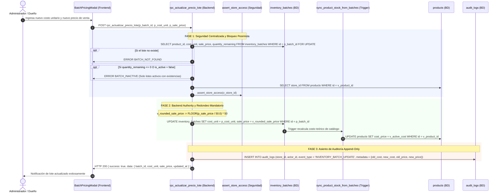
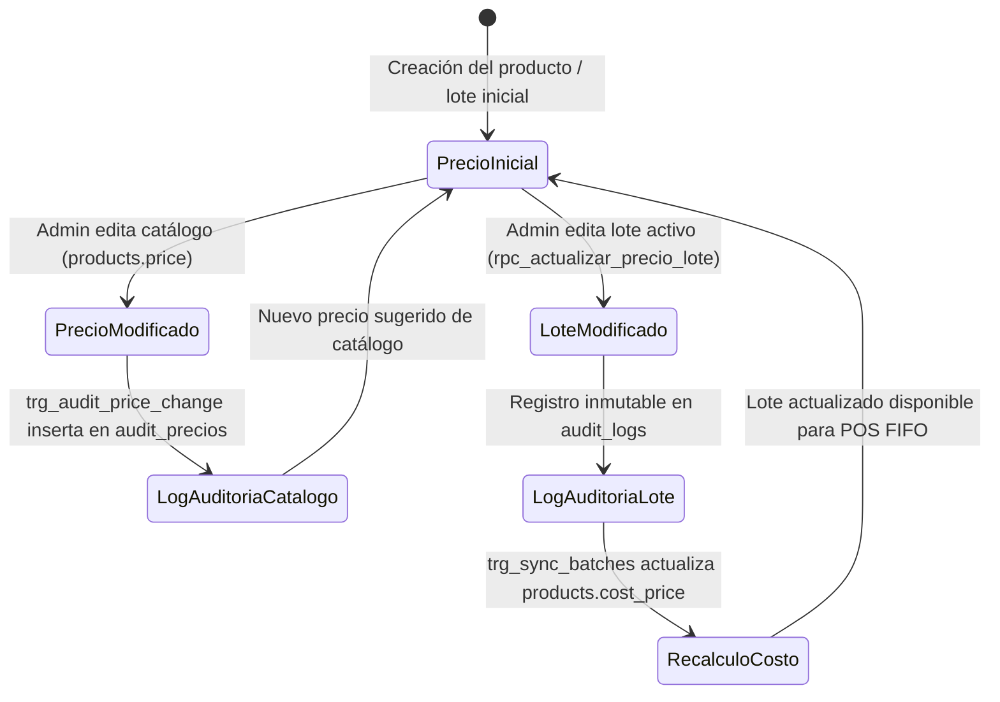

# SDD-010: Historial de Precios y Edición de Lotes

> **Asociado a:** [FRD-010](../FRD/FRD_010_HISTORIAL_PRECIOS.md)  
> **Módulo Primario:** [SDD-006: Núcleo de Inventario y Catálogo Padre](SDD_006_NUCLEO_INVENTARIO_PADRE.md)  
> **Fase del Plan Maestro:** Ola 2 — Inventario, Lotes y Proveedores  
> **Estado:** 🟢 Aprobado Normativamente (Protocolo PAC-SDD v2.0)  
> **Última Actualización:** 2026-10-14  

---

## 0. Contexto y Restricciones Aplicables

### 0.1 Políticas Globales Activadas (ARQ-002)

| Política ID | Dominio | Mandato Arquitectónico e Impacto en este SDD |
|-------------|---------|-----------------------------------------------|
| **POL-AUTH-01** | Autenticación | **Aislamiento Multi-tenant Centralizado:** Toda operación administrativa de edición de precios o consulta de historial exige la invocación de `assert_store_access(v_store_id)` como instrucción #1. La identidad del responsable se resuelve autoritativamente mediante `get_employee_id_from_session()`, erradicando credenciales ad-hoc. |
| **POL-AUD-01 / POL-AUD-02** | Auditoría | **Inviolabilidad Append-Only de Registros Históricos:** Toda mutación de precio de venta o costo (sea en catálogo o en lote específico) genera un asiento inmutable y permanente. Queda terminantemente prohibido ejecutar `UPDATE` o `DELETE` sobre las tablas de auditoría e historial (`product_price_history`, `audit_precios`, `audit_logs`). |
| **POL-SEC-01** | Seguridad | **Protección de Costos y Márgenes:** Los costos unitarios de adquisición (`purchase_price`, `cost_unit`, `cost_price`) constituyen información confidencial restringida exclusivamente a roles con privilegios de inventario (`canViewInventory = true` / `canManageInventory = true`) o Administradores. La interfaz del terminal POS y consultas de cajero omiten de forma absoluta estos atributos. |
| **SPEC-010 / SPEC-011** | Moneda y Formato | **Precisión Numérica y Redondeo Mandatorio:** Todo precio de venta ingresado debe someterse en backend a un redondeo hacia el múltiplo de $50 COP inferior (`sale_price = FLOOR(sale_price / 50.0) * 50`). Precios y costos son estrictamente mayores o iguales a cero (`>= 0`) y se expresan en números enteros para la moneda colombiana. |

---

### 0.2 Contratos Vecinos que Limitan el Diseño

| SDD Vecino | Interfaces / Operaciones Involucradas | Restricción Inyectada en Precios y Lotes |
|------------|---------------------------------------|------------------------------------------|
| **SDD_006 (Inventario Padre)** | `products.price`, `products.cost_price`, `products.current_stock` | **Separación de Precio de Catálogo:** `products.price` representa el precio sugerido de catálogo para nuevas ventas y compras. No altera retroactivamente los precios de lotes FIFO ya existentes en bodega. |
| **SDD_006_01_01 (Entradas de Inventario)** | `rpc_registrar_entrada`, `product_price_history` | **Registro Histórico en Entrada:** Al procesar una entrada de mercancía con precio de compra o venta diferente al catálogo, se asienta obligatoriamente una fila inmutable en `product_price_history(product_id, purchase_price, sale_price, created_by, created_at)`. |
| **SDD_010_016 (Valoración FIFO)** | `inventory_batches`, `consume_stock_fifo` | **Precios por Lote FIFO:** El consumo en ventas descuenta existencias cronológicamente (`created_at ASC`) tomando `inventory_batches.sale_price`. La edición de `cost_unit` en un lote altera la valuación de inventario y activa el trigger `trg_sync_batches` (`sync_product_stock_from_batches`). |
| **SDD_007 / SDD_007_01 (Ventas y POS)** | `sales`, `sale_items`, `sale_item_batches` | **Precio Inmutable en Tickets:** Al concretarse una venta, el precio cobrado se congela de forma inmutable en `sale_items.unit_price`. Cualquier cambio posterior en el catálogo o en el lote no modifica transacciones ya concluidas. |
| **SDD_003 (Gestión de Empleados)** | `employees.permissions` (JSONB) | **Control de Acceso RBAC:** La visualización del historial en ficha de producto requiere la claim `canViewInventory = true`. La edición de precios de lote vía `rpc_actualizar_precio_lote` está restringida a roles `admin` u `owner`. |
| **SDD_005 (Auditoría y Trazabilidad)** | `audit_logs`, `audit_precios`, `product_price_history` | **Custodia Forense:** Toda alteración de lote se registra en `audit_logs` con `event_type = 'INVENTORY_BATCH_UPDATE'`, congelando `old_cost`, `new_cost`, `old_price` y `new_price`. |
| **SDD_018 (Control Operacional)** | `rpc_get_comprehensive_financial_report` | **Afectación de Balance:** La valuación de inventario se calcula como $\sum (\text{quantity\_remaining} \times \text{cost\_unit})$. Modificar el costo unitario de un lote impacta en tiempo real el valor del inventario en el balance. |

---

### 0.3 Auditoría de Base de Datos Real y Deuda Técnica Declarada (Regla 7)

La verificación empírica directa ejecutada en Supabase Producción (`ihtjocmhzuliwwvdzfnz`) constató la realidad física del motor:

- **Tabla `product_price_history` (6 columnas físicas):** `id` (UUID PK), `product_id` (UUID FK), `purchase_price` (NUMERIC), `sale_price` (NUMERIC), `created_at` (TIMESTAMPTZ), `created_by` (UUID FK).
- **Tabla `audit_precios` (9 columnas físicas):** `id` (UUID PK), `product_id` (UUID FK), `store_id` (UUID FK), `old_cost` (NUMERIC), `new_cost` (NUMERIC), `old_price` (NUMERIC), `new_price` (NUMERIC), `changed_by` (UUID FK), `created_at` (TIMESTAMPTZ).
- **Tabla `inventory_batches` (10 columnas físicas):** `id` (UUID PK), `product_id` (UUID FK), `quantity_initial` (NUMERIC), `quantity_remaining` (NUMERIC), `cost_unit` (NUMERIC), `is_active` (BOOLEAN), `created_at` (TIMESTAMPTZ), `created_by` (UUID FK), `sale_price` (NUMERIC), `source_movement_id` (UUID FK).
- **Triggers y Procedimientos en `pg_proc`:**
  - `trg_audit_price_change` en `products`: invoca `fn_audit_price_change()`, insertando en `audit_precios` cuando muta `cost_price` o `price`.
  - Sobrecargas de `rpc_actualizar_precio_lote`: coexisten dos sobrecargas en `pg_proc`:
    * Sobrecarga legacy (2 parámetros: `p_batch_id uuid, p_new_sale_price numeric`): no valida tienda ni roles, no audita y captura errores con `{success: false}`.
    * Sobrecarga oficial (3 parámetros: `p_batch_id uuid, p_cost_unit numeric, p_sale_price numeric`): valida `admin_profiles`, exige `quantity_remaining > 0`, actualiza lote y registra en `audit_logs`.

Con base en esta verificación, se formalizan las siguientes 7 deudas técnicas bajo los tres elementos obligatorios de la Regla 7:

| # | Deuda Técnica / Brecha Real | Qué se Decidió | Por Qué (Trade-off Concreto) | Condición de Revisión Futura |
|---|-----------------------------|----------------|------------------------------|------------------------------|
| **1** | **Sobrecarga Zombi de 2 Parámetros en RPC**: Coexisten dos firmas de `rpc_actualizar_precio_lote` en `pg_proc`. | Formalizar como canónica y exclusiva la firma de 3 parámetros `(p_batch_id, p_cost_unit, p_sale_price)` y normar el `DROP FUNCTION public.rpc_actualizar_precio_lote(uuid, numeric);`. | Ejecutar el DROP en caliente arriesga roturas en clientes antiguos no actualizados; se formaliza la firma canónica para la migración ordenada. | Despliegue de migración DDL consolidada de inventario en la Ola 2. |
| **2** | **Ausencia de `assert_store_access` en RPC (Regla 4)**: `rpc_actualizar_precio_lote` en producción valida `admin_profiles` de forma manual pero omite invocar `assert_store_access(v_store_id)`. | Normar contractualmente la invocación de `PERFORM assert_store_access(v_batch.store_id);` como línea #1 del RPC. | Preservar el RPC en caliente durante la fase documental para evitar parches manuales fuera del ciclo de migraciones del repositorio. | Migración DDL refactorizadora de RPCs en la Ola 2. |
| **3** | **Fallo Silencioso con `EXCEPTION WHEN OTHERS` (Regla 3)**: El RPC en producción captura excepciones con `{success: false, error: SQLERRM}`, enmascarando errores técnicos con código HTTP 200. | Normar la eliminación del swallow de errores y exigir la propagación mediante `RAISE EXCEPTION` con códigos tipificados (`BATCH_NOT_FOUND`, `BATCH_INACTIVE`, etc.). | Coordinar la refactorización con el store Pinia en el cliente para asegurar que procese excepciones reales de red/RPC sin interpretar falsos éxitos. | Refactorización coordinada del RPC y del frontend en la Ola 2. |
| **4** | **Privilegios DDL Base Faltantes (Regla 8)**: `product_price_history` solo otorga permisos a `postgres`; roles `authenticated` y `anon` tienen cero permisos, provocando error 42501 (Permission Denied). | Exigir en este SDD el otorgamiento explícito de `GRANT ALL ON TABLE public.product_price_history TO anon, authenticated, service_role;`. | La función opera porque es `SECURITY DEFINER`, pero cualquier consulta directa de lectura vía PostgREST falla. Se resuelve ordenadamente en migración versionada. | Aplicación de la migración DDL de consolidación en la Ola 2. |
| **5** | **Desincronización Catálogo vs Lotes FIFO**: Modificar `products.price` no altera los `sale_price` de los lotes remanentes en bodega, y modificar un lote no altera el catálogo. | Delimitar conceptualmente: `products.price` es el precio sugerido de catálogo para nuevas ventas/compras; el POS por lotes cobra a `inventory_batches.sale_price`; la edición de lotes se realiza vía `rpc_actualizar_precio_lote`. | Mantiene la trazabilidad y margen por remesa sin mutaciones masivas destructivas en existencias históricas. | Consolidación del motor de ventas V3 en la Ola 3 (SDD-007). |
| **6** | **Fragmentación de Auditoría de Precios**: Coexisten tres destinos: `audit_precios` (catálogo), `product_price_history` (entradas) y `audit_logs` (lotes). | Asignar responsabilidades exactas: `audit_precios` captura cambios de catálogo por trigger, `product_price_history` captura compras, y `audit_logs` registra edición de lotes. La UI de ficha de producto consume `audit_precios`. | Coexistencia armónica sin forzar migraciones destructivas ni sobrecarga de triggers en caliente. | Proyecto de unificación global del subsistema de auditoría en la Ola 4 (SDD-005). |
| **7** | **Ausencia de Redondeo a $50 COP en Backend**: La función actual en BD acepta cualquier valor decimal sin forzar múltiplos de $50 (User Rule 2.1). | Implementar forzamiento matemático en backend: `v_sale_price := FLOOR(p_sale_price / 50.0) * 50;`. | Garantiza el principio de Autoridad del Backend y previene precios no fraccionables en transacciones de efectivo en el POS. | Despliegue de la migración DDL de actualización del RPC en la Ola 2. |

---

## 1. Mandato del Negocio (Traducción del FRD)

El documento [FRD-010](../FRD/FRD_010_HISTORIAL_PRECIOS.md) establece las directrices funcionales y normativas obligatorias para el registro y consulta de la evolución de precios:

### 1.1 Reglas de Negocio (Citas Textuales)

1. **RN-010-01: Registro Automático:**
   > *"Cada vez que se modifica el precio de venta o costo de un producto, el sistema crea un registro en el historial **sin intervención del usuario**."*

2. **RN-010-02: Datos del Registro:**
   > | Campo | Obligatorio | Descripción |
   > |-------|:-----------:|-------------|
   > | `productId` | ✅ | Referencia al producto |
   > | `previousPrice` | ✅ | Precio antes del cambio |
   > | `newPrice` | ✅ | Precio después del cambio |
   > | `changedAt` | ✅ | Fecha y hora exacta del cambio |
   > | `changedBy` | ✅ | ID del usuario que realizó el cambio |
   > | `reason` | ❌ | Motivo del cambio (opcional) |

3. **RN-010-03: Control de Acceso:**
   > *"El historial de precios **solo es visible** para usuarios con permiso de inventario (`canViewInventory = true`)."*  
   > | Rol | Acceso |
   > |-----|:------:|
   > | Admin | ✅ Siempre |
   > | Empleado con permiso inventario | ✅ Sí |
   > | Empleado sin permiso inventario | ❌ No |

4. **RN-010-04: Retención de Datos:**
   > *"Se almacena el **historial completo** de todos los cambios de precio. No hay límite de registros por producto. Esto permite futuros análisis y reportes."*

5. **RN-010-05: Inmutabilidad:**
   > *"Los registros del historial **NO pueden ser editados ni eliminados**. Son un log de auditoría."*

---

### 1.2 Casos de Uso del Negocio

#### Caso A: Ver Historial desde Producto
- **Actor:** Admin o Empleado con permiso de inventario (`canViewInventory = true`).
- **Precondición:** Producto existente con al menos 1 cambio de precio.
- **Flujo Principal:**
  1. Usuario navega a Inventario → Selecciona producto.
  2. Sistema muestra ficha del producto.
  3. Usuario expande sección "Historial de Precios".
  4. Sistema muestra lista cronológica: fecha, precio anterior → precio nuevo, quién cambió.
- **Postcondición:** Usuario informado sobre evolución del precio.

#### Caso B: Cambio de Precio con Motivo
- **Actor:** Administrador.
- **Precondición:** Producto existente.
- **Flujo Principal:**
  1. Admin edita precio de venta de $3,500 → $4,200.
  2. Sistema muestra campo opcional "Motivo del cambio".
  3. Admin ingresa: "Aumento proveedor".
  4. Sistema guarda nuevo precio + crea registro en historial con motivo.
- **Postcondición:** Producto actualizado, historial registrado con contexto.

#### Caso C: Usuario sin Permiso
- **Actor:** Empleado sin permiso de inventario (`canViewInventory = false`).
- **Precondición:** Empleado tiene `canViewInventory = false`.
- **Flujo Principal:**
  1. Empleado intenta acceder a detalle de producto.
  2. Sistema bloquea acceso o no muestra sección de historial.
- **Postcondición:** Historial protegido.

---

### 1.3 Criterios de Aceptación (Citas Textuales)

- **Funcionalidad:**
  - *"Cada cambio de precio crea registro automático en historial."*
  - *"El registro incluye: precio anterior, nuevo, fecha/hora, usuario."*
  - *"Campo "motivo" es opcional y acepta hasta 200 caracteres."*
  - *"Historial NO puede ser editado ni eliminado."*
- **Control de Acceso:**
  - *"Solo usuarios con `canViewInventory = true` ven el historial."*
  - *"Admin siempre tiene acceso."*
- **UX:**
  - *"Historial visible como sección colapsable en ficha de producto."*
  - *"Formato de fecha legible (ej: "15 Ene 2026, 3:45 PM")."*
  - *"Indicador visual de aumento (↑ rojo) o disminución (↓ verde)."*
- **Datos:**
  - *"El registro de cambios creado con estructura definida."*
  - *"Lógica que registra cambios automáticamente."*
  - *"Sin límite de registros (historial completo)."*

---

## 2. Arquitectura del Flujo y Estado

### 2.1 Flujo Transaccional de Actualización de Precio de Lote Activo (Mermaid)



---

### 2.2 Diagrama de Estados del Precio de Producto y Lote



---

### 2.3 Regla de Cero Cálculos en Frontend (Flujo Unidireccional)

1. **El Frontend NO Calcula Redondeos:** La interfaz captura el valor ingresado por el usuario y lo transmite íntegro al backend. El redondeo al múltiplo de $50 COP inferior es potestad exclusiva del servidor (`FLOOR(sale_price / 50.0) * 50`).
2. **El Frontend NO Calcula Variaciones Financieras:** El diferencial histórico (`previousPrice → newPrice`) o indicador visual (↑ rojo / ↓ verde) es formateado para el usuario con base en los campos `old_price` y `new_price` proporcionados directamente por el backend.
3. **El Servidor es la Autoridad:** Valida que costos y precios sean mayores o iguales a cero, valida la liquidez del stock del lote y asienta los registros de auditoría de manera atómica.

---

## 3. Seguridad y Multi-Tenant

### 3.1 Aislamiento Multi-Tenant y Validación de Tienda (Regla 4)

- **Instrucción #1 Mandatoria:** Toda operación en `rpc_actualizar_precio_lote` debe invocar como primera sentencia de verificación de tienda:
  `PERFORM assert_store_access(v_batch.store_id);`
  garantizando que administradores de una tienda no puedan mutar lotes de otra organización.
- **Políticas RLS en Tablas Afectadas:**
  - `product_price_history`: Protegida por `Users can view price history of their store` con filtro `products.store_id = get_current_store_id()`.
  - `audit_precios`: RLS homogéneo mediante vinculación a `store_id = get_current_store_id()`.
  - `inventory_batches`: Protegida por `batches_select_store` con filtro `products.store_id = get_current_store_id()`.
- **Resolución de Autoría:** Se resuelve autoritativamente mediante `get_employee_id_from_session()`, evitando que el cliente falsifique el usuario autor en auditorías.

---

### 3.2 Matriz de Control de Acceso Basada en Perfil (RBAC)

De acuerdo con RN-010-03 y POL-SEC-01:

| Rol de Usuario | Permiso en `employees.permissions` | Visualización Precio Venta | Visualización Costo Compra | Edición de Precios de Lote |
|----------------|------------------------------------|:--------------------------:|:--------------------------:|:--------------------------:|
| **Administrador / Dueño** | N/A (Acceso jerárquico supremo) | SÍ | SÍ | SÍ (`rpc_actualizar_precio_lote`) |
| **Empleado con Inventario** | `"canViewInventory": true` | SÍ | SÍ | NO (Requiere rol Admin) |
| **Cajero / Punto de Venta** | `"canViewInventory": false` | SÍ (Solo en POS) | NO (Oculto / Enmascarado) | NO |

---

## 4. Casos Límite y Concurrencia (Regla 5 de AGENTS.md)

| ID | Escenario de Caso Límite | Comportamiento del Motor / Backend | Código de Error | Respuesta Visual en UI |
|---|---------------------------|-------------------------------------|-----------------|------------------------|
| **CL-01** | **Edición de Lote Inexistente** | La consulta `SELECT ... WHERE id = p_batch_id` no encuentra filas. Lanza excepción tipificada. | `BATCH_NOT_FOUND` | Mensaje: *"El lote de inventario especificado no existe o fue eliminado."* |
| **CL-02** | **Edición de Lote Agotado o Inactivo** | Verifica `quantity_remaining <= 0` o `is_active = false`. Prohíbe mutar precios sobre lotes ya liquidados. | `BATCH_INACTIVE` | Mensaje: *"Solo se pueden editar precios en lotes activos con existencias disponibles."* |
| **CL-03** | **Precio de Venta o Costo Negativo** | El backend valida `p_cost_unit < 0 OR p_sale_price < 0`. Aborta inmediatamente. | `INVALID_PRICE` | Mensaje: *"El costo y el precio de venta deben ser mayores o iguales a cero."* |
| **CL-04** | **Usuario sin Permisos de Tienda** | Falla la validación `assert_store_access`. Lanza excepción. | `STORE_ACCESS_DENIED` | Mensaje: *"Permisos insuficientes para operar o alterar precios en esta tienda."* |
| **CL-05** | **Usuario sin Permiso de Ver Historial** | Empleado con `canViewInventory = false` intenta consultar el historial. La política RLS o el guard de ruta deniegan el payload. | `PERMISSION_DENIED` | La sección colapsable no se renderiza en la ficha del producto. |
| **CL-06** | **Concurrencia entre Venta POS y Edición de Lote** | El RPC aplica bloqueo pesimista `SELECT ... FOR UPDATE` sobre la fila en `inventory_batches`, serializando la edición frente a consumos concurrentes de `consume_stock_fifo`. | N/A (Garantía de Consistencia) | La venta espera la liberación del lock o toma el precio inmediatamente actualizado. |
| **CL-07** | **Precio Decimal sin Redondear** | El cliente envía un valor con centavos o no múltiplo de $50 (ej. $3.245). El backend aplica `FLOOR(3245 / 50.0) * 50 = 3200`. | N/A (Operación Válida) | La UI recibe en la respuesta el valor normalizado a $3.200 COP. |

---

## 5. Contratos de Interfaz

### 5.1 Operación: `rpc_actualizar_precio_lote` (Acción - WRITE)

Permite al administrador actualizar el costo unitario y/o el precio de venta de una capa de lote activa con existencias remanentes.

#### Payload de Entrada (JSON Schema Formal)

```json
{
  "$schema": "http://json-schema.org/draft-07/schema#",
  "title": "ActualizarPrecioLoteRequest",
  "type": "object",
  "required": ["p_batch_id", "p_cost_unit", "p_sale_price"],
  "properties": {
    "p_batch_id": {
      "type": "string",
      "format": "uuid",
      "description": "Identificador único inmutable del lote en inventory_batches."
    },
    "p_cost_unit": {
      "type": "number",
      "minimum": 0,
      "description": "Nuevo costo unitario de adquisición para el remanente del lote."
    },
    "p_sale_price": {
      "type": "number",
      "minimum": 0,
      "description": "Nuevo precio de venta al público asignado a este lote en pesos colombianos (COP)."
    }
  },
  "additionalProperties": false
}
```

#### Payload de Respuesta Exitosa (`ActionResponse`)

```json
{
  "$schema": "http://json-schema.org/draft-07/schema#",
  "title": "ActualizarPrecioLoteResponse",
  "type": "object",
  "required": ["success", "data"],
  "properties": {
    "success": {
      "type": "boolean",
      "enum": [true]
    },
    "data": {
      "type": "object",
      "required": ["batch_id", "cost_unit", "sale_price", "updated_at"],
      "properties": {
        "batch_id": {
          "type": "string",
          "format": "uuid",
          "description": "Identificador del lote actualizado."
        },
        "cost_unit": {
          "type": "number",
          "minimum": 0,
          "description": "Costo unitario persistido."
        },
        "sale_price": {
          "type": "integer",
          "minimum": 0,
          "description": "Precio de venta persistido, redondeado al múltiplo de $50 COP inferior."
        },
        "updated_at": {
          "type": "string",
          "format": "date-time",
          "description": "Marca temporal del servidor al registrar la mutación."
        }
      },
      "additionalProperties": false
    }
  },
  "additionalProperties": false
}
```

#### Catálogo Exhaustivo de Códigos de Error

| Código de Error | Causa Raíz en Motor | Mensaje Técnico Propagado | Acción Correctiva Sugerida en UI |
|-----------------|---------------------|---------------------------|----------------------------------|
| `STORE_ACCESS_DENIED` | Falla en `assert_store_access` | Permiso denegado para operar en esta tienda | Redirigir al selector de tienda autorizada. |
| `PERMISSION_DENIED` | Usuario no es `admin` ni `owner` | Permisos insuficientes para editar precios de lotes | Notificar que la edición de lotes es exclusiva para administradores. |
| `BATCH_NOT_FOUND` | `inventory_batches.id` no existe | Lote de inventario no encontrado | Refrescar la lista de lotes del producto. |
| `BATCH_INACTIVE` | `quantity_remaining <= 0` | Solo se pueden editar precios de lotes activos (con stock) | Informar que no se pueden alterar lotes consumidos en su totalidad. |
| `INVALID_PRICE` | `p_cost_unit < 0` o `p_sale_price < 0` | El costo y el precio de venta deben ser mayores o iguales a cero | Corregir los campos numéricos en el formulario. |

---

### 5.2 Operación: Consulta de Historial de Precios (Lectura - READ)

Consulta la evolución cronológica de precios de un producto para desplegar la sección colapsable en la ficha de producto.

#### Consulta PostgREST (Parámetros GET)
- `product_id`: `eq.<UUID>` (Obligatorio)
- `order`: `created_at.desc`
- `limit`: `20` (Paginación estándar)

#### Payload de Respuesta de Lista (`Response`)

```json
{
  "$schema": "http://json-schema.org/draft-07/schema#",
  "title": "HistorialPreciosListResponse",
  "type": "object",
  "required": ["data", "count"],
  "properties": {
    "data": {
      "type": "array",
      "items": {
        "type": "object",
        "required": ["id", "product_id", "old_price", "new_price", "created_at"],
        "properties": {
          "id": {
            "type": "string",
            "format": "uuid"
          },
          "product_id": {
            "type": "string",
            "format": "uuid"
          },
          "old_price": {
            "type": ["number", "null"],
            "description": "Precio de venta antes de la modificación."
          },
          "new_price": {
            "type": "number",
            "description": "Precio de venta después de la modificación."
          },
          "old_cost": {
            "type": ["number", "null"],
            "description": "Costo de compra anterior (enmascarado si el usuario es cajero)."
          },
          "new_cost": {
            "type": ["number", "null"],
            "description": "Costo de compra nuevo (enmascarado si el usuario es cajero)."
          },
          "changed_by": {
            "type": ["string", "null"],
            "format": "uuid",
            "description": "Identificador del usuario responsable del cambio."
          },
          "created_at": {
            "type": "string",
            "format": "date-time",
            "description": "Fecha y hora exacta del cambio."
          }
        },
        "additionalProperties": false
      }
    },
    "count": {
      "type": "integer",
      "minimum": 0,
      "description": "Total de cambios registrados para paginación."
    }
  },
  "additionalProperties": false
}
```

---

## 6. Matriz de Trazabilidad e Impacto

| Requisito FRD / Política | Sección SDD | Elemento en Esquema BD | Impacto en Flujo de Datos y Garantía de Consistencia |
|--------------------------|-------------|------------------------|------------------------------------------------------|
| **RN-010-01 (Registro Automático)** | §2.1, §5.2 | `trg_audit_price_change` / `audit_precios` | Todo cambio en catálogo genera fila sin intervención del usuario. |
| **RN-010-02 (Datos del Registro)** | §5.2, §7.1 | `audit_precios.old_price`, `new_price`, etc. | Almacena precio previo, nuevo, fecha, usuario y producto. |
| **RN-010-03 (Control de Acceso)** | §3.2, §5.1 | `employees.permissions` (`canViewInventory`) | Protege la visualización frente a usuarios sin autorización. |
| **RN-010-04 (Retención Completa)** | §0.1, §7.1 | Append-only en `audit_precios` | Sin límite de registros por producto, permitiendo trazabilidad histórica. |
| **RN-010-05 (Inmutabilidad)** | §0.1, §7.2 | RLS sin políticas `UPDATE`/`DELETE` | Prohibición absoluta de mutar registros históricos de precios. |
| **POL-AUTH-01** | §3.1 | `assert_store_access()` | Blindaje multi-tenant en la línea 1 del RPC. |
| **POL-SEC-01** | §0.1, §3.2 | Filtro / Enmascaramiento de costos | Protege `cost_price` y `cost_unit` frente a roles cajero en POS. |
| **SPEC-010 / SPEC-011** | §0.1, §2.3 | `FLOOR(sale_price / 50.0) * 50` | Redondeo forzado en backend a múltiplos de $50 COP inferior. |
| **Regla 7 (Deuda D-1)** | §0.3 | Sobrecarga de `rpc_actualizar_precio_lote` | Firma de 3 parámetros canónica; plan de DROP para sobrecarga de 2 parámetros. |
| **Regla 8 (Deuda D-4)** | §0.3, §7.2 | `product_price_history` grants | Regularización de `GRANT ALL` para roles `anon`, `authenticated`. |

---

## 7. Verificación de Esquema Real

Introspección directa de columnas, tipos, constraints y privilegios verificada en Supabase Producción (`ihtjocmhzuliwwvdzfnz`):

### 7.1 Catálogo Físico de Columnas Involucradas

| Tabla | Columna | Tipo de Dato | Nullable | Rol en Historial de Precios y Lotes |
|-------|---------|--------------|:--------:|-------------------------------------|
| `products` | `id` | `uuid` | NO | Clave primaria del artículo. |
| `products` | `store_id` | `uuid` | NO | Clave foránea multi-tenant. |
| `products` | `price` | `numeric` | NO | Precio sugerido de venta vigente en catálogo. |
| `products` | `cost_price` | `numeric` | YES | Costo unitario teórico recalculado por lotes FIFO. |
| `audit_precios` | `id` | `uuid` | NO | Clave primaria del asiento de auditoría de catálogo. |
| `audit_precios` | `product_id` | `uuid` | YES | Producto cuyo precio mutó. |
| `audit_precios` | `store_id` | `uuid` | NO | Tienda propietaria del registro. |
| `audit_precios` | `old_cost` | `numeric` | YES | Costo anterior antes de la mutación. |
| `audit_precios` | `new_cost` | `numeric` | YES | Costo nuevo después de la mutación. |
| `audit_precios` | `old_price` | `numeric` | YES | Precio de venta anterior antes de la mutación. |
| `audit_precios` | `new_price` | `numeric` | YES | Precio de venta nuevo después de la mutación. |
| `audit_precios` | `changed_by` | `uuid` | YES | Empleado responsable de la mutación. |
| `audit_precios` | `created_at` | `timestamptz` | NO | Fecha y hora exacta de la modificación. |
| `product_price_history` | `id` | `uuid` | NO | Clave primaria de la instantánea de entrada. |
| `product_price_history` | `product_id` | `uuid` | NO | Producto asociado a la entrada. |
| `product_price_history` | `purchase_price` | `numeric` | NO | Costo de adquisición registrado en la entrada. |
| `product_price_history` | `sale_price` | `numeric` | NO | Precio de venta registrado en la entrada. |
| `product_price_history` | `created_at` | `timestamptz` | NO | Fecha y hora del registro de entrada. |
| `product_price_history` | `created_by` | `uuid` | YES | Usuario autor de la entrada de inventario. |
| `inventory_batches` | `id` | `uuid` | NO | Clave primaria del lote de mercancía. |
| `inventory_batches` | `product_id` | `uuid` | NO | Producto al que pertenece el lote. |
| `inventory_batches` | `quantity_initial` | `numeric` | NO | Cantidad original recibida en el lote. |
| `inventory_batches` | `quantity_remaining` | `numeric` | NO | Existencias remanentes disponibles para venta. |
| `inventory_batches` | `cost_unit` | `numeric` | NO | Costo unitario específico de esta capa FIFO. |
| `inventory_batches` | `sale_price` | `numeric` | NO | Precio de venta asignado a este lote para cobro en POS. |
| `inventory_batches` | `is_active` | `boolean` | YES | Estado activo/inactivo del lote. |

---

### 7.2 Constraints y Privilegios Base Verificados (Regla 8)

- **Constraints de Integridad Física:**
  - `products_price_check`: CHECK `(price > 0)`.
  - `inventory_batches_quantity_remaining_check`: CHECK `(quantity_remaining >= 0 AND quantity_remaining <= quantity_initial)`.
  - `inventory_batches_cost_unit_check`: CHECK `(cost_unit >= 0)`.
- **Privilegios Base (`GRANT ALL` según Regla 8):**
  - `inventory_batches`: Cuenta con permisos completos otorgados a `anon`, `authenticated`, `service_role`.
  - `audit_precios`: Otorga `SELECT` a `authenticated`.
  - `product_price_history`: **Deuda Técnica D-4.** Solo tiene privilegios otorgados a `postgres`. El SDD-010 norma el otorgamiento obligatorio de `GRANT ALL ON TABLE public.product_price_history TO anon, authenticated, service_role;`.
