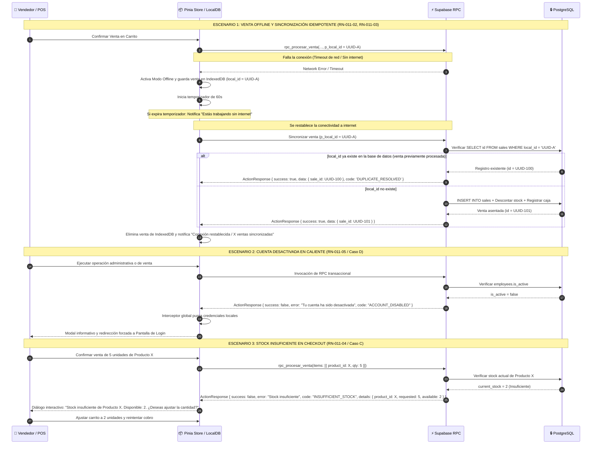
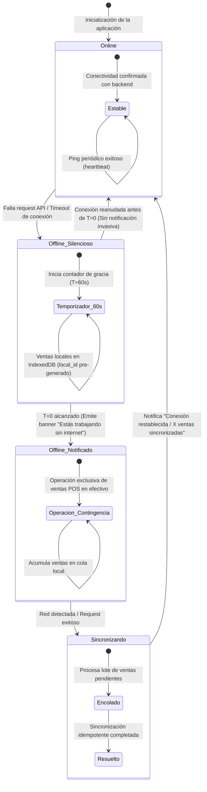

# SDD-011: Manejo de Errores y Resiliencia

> **Asociado a:** [FRD-011: Manejo de Errores y Resiliencia](../FRD/FRD_011_MANEJO_ERRORES.md)  
> **Fase del Plan:** Ola 5: Sesiones, Autenticación y Offline (Ítem 4)  
> **Estado:** 🟠 Aprobado con Deuda Técnica Documentada (Protocolo PAC-SDD v2.0)
> **Última Actualización:** 2026-10-16  

---

## 0. CONTROL DE VERSIONES Y TRAZABILIDAD

### 0.1 Historial de Cambios
| Versión | Fecha | Autor | Rol | Descripción de Modificación |
|---------|-------|-------|-----|-----------------------------|
| 1.0.0 | 2026-01-27 | Analista Funcional | Requisitos | Especificación inicial aprobada de manejo de errores, modo offline y principios de resiliencia. |
| 1.5.0 | 2026-08-04 | Arquitecto de Software | Arquitectura | Redacción preliminar con vacíos en la estructura física de auditoría y capturas de excepción genéricas. |
| 2.0.0 | 2026-10-16 | Orquestador Técnico | Arquitectura & QA | **Saneamiento Integral PAC-SDD v2.0**: Erradicación de bloques `EXCEPTION WHEN OTHERS` silenciosos bajo la Regla 3 de AGENTS.md; unificación del catálogo canónico de errores de servidor (`ActionResponse`); consagración del soporte físico de idempotencia en `sales.local_id` y `sales.sync_status`; formalización de la naturaleza exclusivamente cliente (IndexedDB) de `sync_queue`; integración de la expulsión reactiva de empleados inactivos (`ACCOUNT_DISABLED`); estandarización del diagnóstico asistido de inventario (`INSUFFICIENT_STOCK` con `available`); verificación de privilegios base (Regla 8) incluyendo remediación de `products` para `service_role`; cumplimiento estricto de las Reglas 1.1 (0% código SQL), 2, 4, 7 y 8; y armonización transversal con Ventas, Caja, Inventario y Sesiones. |

### 0.2 Trazabilidad de Requisitos (FRD-011)
| Regla de Negocio / CU | Descripción en FRD | Implementación en este SDD |
|-----------------------|--------------------|----------------------------|
| **RN-011-01** | Clasificación taxativa de errores (Conectividad, Negocio, Acceso, Datos, Sistema) | Sección 1.1 y Sección 5.1 (Catálogo canónico) |
| **RN-011-02** | Modo offline automático en ventas con temporizador de 60s e indicador de sincronización | Sección 4.1, Sección 2.2 y Sección 5.2 |
| **RN-011-03** | Prevención estricta de ventas duplicadas e idempotencia en servidor | Sección 4.2, Sección 3.1 y Sección 5.2 |
| **RN-011-04** | Diagnóstico de stock insuficiente con cantidad física disponible y ajuste interactivo | Sección 4.3, Sección 3.3 y Sección 5.3 |
| **RN-011-05** | Validación mandatoria de estado de cuenta en cada operación y desconexión inmediata | Sección 4.4, Sección 3.2 y Sección 6.1 |
| **RN-011-06** | Aislamiento, autoreparación y reseteo seguro ante corrupción de almacenamiento local | Sección 4.5 y Sección 6.3 |
| **RN-011-07** | Tratamiento controlado de errores imprevistos sin exposición de trazas técnicas | Sección 1.1, Sección 4.6 y Sección 5.1 |
| **Caso A** | Venta sin conexión con persistencia local y temporizador silencioso de 60s | Sección 4.1 y Sección 2.1 |
| **Caso B** | Restablecimiento de conexión y sincronización en segundo plano con notificación | Sección 4.1, Sección 2.1 y Sección 5.2 |
| **Caso C** | Stock agotado durante la confirmación de cobro con ajuste de unidades | Sección 4.3 y Sección 2.1 |
| **Caso D** | Cuenta de empleado desactivada durante la operación con expulsión reactiva a login | Sección 4.4 y Sección 2.1 |

### 0.3 Matriz de Dependencias Inter-Modulares
| Documento Vecino | Tipo de Dependencia | Flujo o Restricción Vinculante |
|------------------|---------------------|--------------------------------|
| [SDD-007](../SDD/SDD_007_NUCLEO_VENTAS_PADRE.md) / [SDD-007.1](../SDD/SDD_007_01_NUCLEO_POS.md) | Núcleo Transaccional | Prevención de duplicados en cobros; soporte físico en `sales.local_id`; degradación del POS ante caja cerrada o turnos vencidos. |
| [SDD-012](../SDD/SDD_012_SINCRONIZACION_OFFLINE.md) / [SDD-028](../SDD/SDD_028_ALMACENAMIENTO_LOCAL.md) | Subsistema Offline | Gestión de la cola de sincronización en IndexedDB (`sync_queue`), almacenamiento de catálogos en caché y políticas de purga/reparación local. |
| [SDD-003](../SDD/SDD_003_GESTION_EMPLEADOS.md) / [SDD-013](../SDD/SDD_013_GESTION_SESIONES.md) | Autenticación y Turnos | Validación en caliente de `employees.is_active`; códigos canónicos de sesión (`ACCOUNT_DISABLED`, `SESSION_REVOKED`, `DAILY_PASS_EXPIRED`, `SESSION_LIMIT_REACHED`). |
| [SDD-004](../SDD/SDD_004_CONTROL_DE_CAJA.md) / [SDD-017](../SDD/SDD_017_CICLO_CONTABLE_Y_SESIONES.md) / [SDD-020](../SDD/SDD_020_CAJA_MULTICANAL.md) | Control Financiero | Excepciones de caja cerrada (`NO_OPEN_CASH_SESSION`), turno vencido de 24h (`SHIFT_EXPIRED`) y bloqueo por reconciliación pendiente (`RECONCILIATION_REQUIRED`). |
| [SDD-006](../SDD/SDD_006_NUCLEO_INVENTARIO_PADRE.md) / [SDD-006.2](../SDD/SDD_006_02_GESTOR_REEMBOLSOS.md) | Gestión de Stock | Manejo de discrepancias aritméticas de inventario (`INSUFFICIENT_STOCK`), lotes vencidos o agotados. |
| [SDD-019](../SDD/SDD_019_CUENTAS_POR_PAGAR.md) / [SDD-022](../SDD/SDD_022_GASTOS_MULTICANAL.md) | Tesorería y Egresos | Manejo de excepciones de fondos insuficientes (`INSUFFICIENT_FUNDS`) por canal y cuenta de tesorería. |
| [SDD-005](../SDD/SDD_005_AUDITORIA_TRAZABILIDAD.md) | Auditoría Forense | Inviolabilidad contable (`POL-AUD-01`): Registro inmutable en `audit_logs` (9 columnas físicas) con severidades tipadas (`info`, `warning`, `error`, `critical`). |

---

## 1. RESUMEN EJECUTIVO Y ALCANCE

El documento **SDD-011** define el marco integral de **Manejo de Errores, Resiliencia y Recuperación de Fallos** del sistema **Tienda Barrio Pro**. Establece las directivas arquitecturales obligatorias que rigen la interacción entre el cliente web (Vue / Pinia) y la plataforma de backend (Supabase PostgreSQL / RPCs / RLS), garantizando una experiencia de usuario robusta, predecible y protegida frente a caídas de red, inconsistencias transaccionales o violaciones de seguridad.

### 1.1 Principios Rectores de Resiliencia
1. **Filosofía Fail-Safe y Prohibición de Pantallas Técnicas:** El sistema nunca debe colapsar, quedar bloqueado en pantallas blancas ni exponer al usuario trazas técnicas de ejecución, volcados de memoria, consultas SQL, nombres de tablas ni direcciones IP. Todo fallo se traduce en una notificación comprensible en español.
2. **Prohibición Estricta de Fallos Silenciosos (Regla 3 de AGENTS.md):** Queda terminantemente prohibido que un procedimiento en backend o guardia condicional en frontend atrape excepciones para devolver respuestas que parezcan exitosas (como colecciones vacías, saldo $0 o valores nulos engañosos). Si una condición de negocio no se cumple, el backend emite un error explícito tipado (`ActionResponse` con `success: false`), preservando la integridad del libro mayor.
3. **Contrato de Interfaz Estándar y Códigos Canónicos:** La comunicación de errores sigue una estructura JSON homogénea. El backend retorna códigos técnicos universales (ej. `ACCOUNT_DISABLED`, `INSUFFICIENT_STOCK`), y el frontend asume la responsabilidad exclusiva de mapearlos a mensajes amigables y acciones correctivas en la interfaz.
4. **Idempotencia Transaccional en Servidor (`RN-011-03`):** Toda transacción vulnerable a reintentos (especialmente ventas procesadas en contingencia offline) se identifica mediante un identificador único pre-generado por el cliente (`sales.local_id`). Ante reintentos idénticos, el backend retorna la entidad previamente asentada sin duplicar registros contables ni movimientos de inventario.
5. **Autonomía Operativa en Contingencia de Red (`RN-011-02`):** La pérdida de conectividad durante la operación en punto de venta conmuta automáticamente el flujo a modo offline local para cobros en efectivo, desacoplando la venta inmediata de la latencia del servidor y gestionando la sincronización en segundo plano mediante colas locales en IndexedDB.
6. **Seguridad Reactiva en Caliente (`RN-011-05`):** La validez de las credenciales y el estado activo del usuario (`employees.is_active`) se comprueban en servidor en cada invocación transaccional. La desactivación administrativa de una cuenta provoca el rechazo inmediato de peticiones subsiguientes y la expulsión coordinada a la pantalla de login.

---

## 2. ARQUITECTURA GENERAL Y DIAGRAMA DE FLUJO

### 2.1 Diagrama de Secuencia: Detección, Idempotencia y Recuperación de Fallos

El siguiente diagrama ilustra los flujos transaccionales frente a escenarios críticos de fallo: pérdida de red con venta offline, prevención de duplicados por reintento, validación reactiva de cuenta inactiva y resolución interactiva de stock insuficiente.



---

### 2.2 Diagrama de Estados: Máquina de Estados del Gestor de Red y Contingencia Offline



---

## 3. MODELO DE DATOS FÍSICO Y REGLAS DE PERSISTENCIA

El tratamiento de excepciones y resiliencia transaccional se apoya en tablas físicas verificadas en Supabase (`information_schema.columns`).

### 3.1 Estructura Física de Ventas e Idempotencia (`sales`)
La tabla `sales` aloja los campos requeridos para la verificación de unicidad transaccional y el rastreo de sincronización diferida:

| Columna | Tipo de Dato | Nulable | Restricciones / Defaults | Descripción |
|---------|--------------|---------|--------------------------|-------------|
| `id` | `uuid` | NOT NULL | PK, default `gen_random_uuid()` | Identificador maestro de la venta en servidor. |
| `store_id` | `uuid` | NOT NULL | FK `stores(id)` | Identificador de la tienda propietaria (multi-tenant). |
| `ticket_number` | `integer` | NOT NULL | Secuencial por tienda | Número correlativo del recibo de venta. |
| `employee_id` | `uuid` | NOT NULL | FK `employees(id)` | Usuario responsable de la transacción. |
| `client_id` | `uuid` | NULLABLE | FK `clients(id)` | Cliente asociado a la venta o crédito. |
| `total` | `numeric` | NOT NULL | CHECK `total >= 0` | Importe monetario total de la venta. |
| `rounding_difference` | `numeric` | NULLABLE | Default `0` | Diferencia por redondeo comercial en efectivo. |
| `payment_method` | `text` | NOT NULL | CHECK `payment_method IN ('cash', 'credit', ...)` | Método de pago liquidado. |
| `amount_received` | `numeric` | NULLABLE | Default `NULL` | Importe entregado por el cliente en efectivo. |
| `change_given` | `numeric` | NULLABLE | Default `NULL` | Cambio retornado al comprador. |
| `sync_status` | `text` | NOT NULL | Default `'pending'`, CHECK `IN ('synced', 'pending', 'failed')` | Estado de sincronización en servidor. |
| `local_id` | `text` | NULLABLE | UNIQUE per `store_id` | **Soporte físico de idempotencia**: UUID pre-generado por el cliente para evitar duplicados en reintentos. |
| `is_voided` | `boolean` | NOT NULL | Default `false` | Bandera lógica de anulación de venta. |
| `voided_by` | `uuid` | NULLABLE | FK `employees(id)` | Usuario supervisor que ejecutó la anulación. |
| `void_reason` | `text` | NULLABLE | Razón descriptiva de la anulación. |
| `created_at` | `timestamptz` | NOT NULL | Default `now()` | Marca temporal de registro de la transacción. |

### 3.2 Estructura Física de Identidad y Estado de Empleados (`employees`)
La verificación en caliente de cuentas activas (`RN-011-05`) opera sobre los campos físicos reales de `employees`:

| Columna | Tipo de Dato | Nulable | Restricciones / Defaults | Descripción |
|---------|--------------|---------|--------------------------|-------------|
| `id` | `uuid` | NOT NULL | PK, default `gen_random_uuid()` | Identificador del empleado. |
| `store_id` | `uuid` | NOT NULL | FK `stores(id)` | Tienda a la que pertenece el empleado. |
| `name` | `text` | NOT NULL | No vacío | Nombre completo del operador. |
| `username` | `text` | NOT NULL | Alias único por tienda | Alias de ingreso del dependiente. |
| `pin_hash` | `text` | NOT NULL | Criptográfico | Hash seguro del PIN numérico. |
| `is_active` | `boolean` | NOT NULL | Default `true` | **Bandera física de cuenta activa**. Si es `false`, se rechaza con `ACCOUNT_DISABLED`. |
| `permissions` | `jsonb` | NOT NULL | Default `{}` | Matriz de permisos específicos del empleado. |
| `created_at` | `timestamptz` | NOT NULL | Default `now()` | Fecha de registro del empleado. |
| `updated_at` | `timestamptz` | NULLABLE | Default `now()` | Fecha de última modificación. |

### 3.3 Estructura Física de Inventario y Control de Stock (`products`)
La validación previa al cobro (`RN-011-04`) evalúa la columna física de existencias:

| Columna | Tipo de Dato | Nulable | Restricciones / Defaults | Descripción |
|---------|--------------|---------|--------------------------|-------------|
| `id` | `uuid` | NOT NULL | PK, default `gen_random_uuid()` | Identificador maestro del producto. |
| `store_id` | `uuid` | NOT NULL | FK `stores(id)` | Tienda a la que pertenece el artículo. |
| `name` | `text` | NOT NULL | No vacío | Descripción comercial del producto. |
| `barcode` | `text` | NULLABLE | Código de barras | Código de barras o SKU del artículo. |
| `current_stock` | `numeric` | NOT NULL | Default `0`, CHECK `current_stock >= 0` | Existencia física disponible para despacho. |
| `price` | `numeric` | NOT NULL | CHECK `price >= 0` | Precio unitario de venta. |
| `cost_price` | `numeric` | NOT NULL | CHECK `cost_price >= 0` | Costo unitario de adquisición. |

### 3.4 Estructura Física de la Bitácora de Auditoría Forense (`audit_logs`)
Todo fallo crítico, intento no autorizado de acceso o venta en contingencia se asienta en `audit_logs` con la siguiente estructura física:

| Columna | Tipo de Dato | Nulable | Restricciones / Defaults | Descripción |
|---------|--------------|---------|--------------------------|-------------|
| `id` | `uuid` | NOT NULL | PK, default `gen_random_uuid()` | Identificador del registro de auditoría. |
| `actor_id` | `uuid` | NULLABLE | FK `auth.users(id)` o `employees(id)` | Usuario o proceso causante del evento. |
| `event_type` | `text` | NOT NULL | Código tipado | Tipo de anomalía o acción (ej. `OFFLINE_SYNC_ATTEMPT`, `ACCOUNT_DISABLED_ATTEMPT`). |
| `resource_id` | `text` | NULLABLE | ID de la entidad | Recurso afectado (ej. `sale_id`, `product_id`). |
| `metadata` | `jsonb` | NULLABLE | Default `{}` | Carga útil con detalles del error, contexto y diagnóstico. |
| `created_at` | `timestamptz` | NOT NULL | Default `now()` | Momento exacto del registro. |
| `store_id` | `uuid` | NULLABLE | FK `stores(id)` | Tienda en la que se produjo la incidencia. |
| `severity` | `text` | NOT NULL | CHECK `severity IN ('info', 'warning', 'error', 'critical')` | Nivel de severidad técnica del incidente. |
| `ip_address` | `text` | NULLABLE | Formato IP | Dirección IP de origen si está disponible. |

### 3.5 Declaración Arquitectural sobre `sync_queue`
Se declara explícitamente que la entidad `sync_queue` **no existe como tabla física en PostgreSQL** (la consulta `to_regclass('public.sync_queue')` retorna `null`). La cola de sincronización reside exclusivamente en la base de datos local del navegador (IndexedDB) bajo el esquema del cliente, evitando sobrecargas de almacenamiento en caliente en el motor relacional.

---

## 4. ESPECIFICACIÓN DETALLADA DE REGLAS DE NEGOCIO Y CASOS DE USO

### 4.1 Modo Offline y Resiliencia de Red (`RN-011-02`, Casos A y B)
1. **Detección Automática de Caída de Red:** Si una solicitud de venta falla por error de red o timeout (`AbortController` superado), el cliente conmuta de inmediato al modo contingencia offline sin interrumpir al vendedor con diálogos modales intrusivos.
2. **Temporizador de 60 Segundos:** Al ingresar a modo offline, se inicializa un temporizador en segundo plano de 60 segundos. Si la red se reanuda antes de 60 segundos, la venta se sincroniza silenciosamente sin alertar al operador. Si expira el temporizador, el sistema despliega el banner persistente: *"Estás trabajando sin internet"*.
3. **Restablecimiento y Notificación Condicional:** Cuando el monitor de red detecta el regreso de la conectividad, el sistema sincroniza las ventas en cola y emite la notificación: *"Conexión restablecida - X ventas sincronizadas"*. Esta notificación **únicamente** se muestra si previamente se superó el temporizador de 60 segundos y se emitió la notificación de advertencia.
4. **Indicador Visual de Cola:** La cabecera del POS presenta un indicador permanente con el número de transacciones locales pendientes respecto al límite máximo permitido (regulado en SDD-012).

### 4.2 Idempotencia y Prevención de Ventas Duplicadas (`RN-011-03`)
1. **Generación Criptográfica en Cliente:** Todo carrito listo para confirmar genera un identificador único `local_id` (UUID v4) en el navegador del operador antes de emitir la petición HTTP.
2. **Evaluación de Preexistencia en Servidor:** Al recibir `rpc_procesar_venta`, el backend ejecuta una consulta de existencia sobre `sales.local_id`. Si el registro ya fue asentado (por una respuesta previa perdida por caída de red), la función aborta la inserción de duplicados y devuelve de inmediato el `sale_id` existente con código `DUPLICATE_RESOLVED`.
3. **No Duplicación de Efectos Contables:** La resolución idempotente no ejecuta descuentos secundarios de existencias en `products` ni genera movimientos duplicados en `cash_movements`.

### 4.3 Diagnóstico Asistido de Stock Insuficiente (`RN-011-04`, Caso C)
1. **Validación Atómica de Existencias:** El procedimiento de venta valida concurrentemente que `current_stock >= requested_quantity` para cada artículo del carrito.
2. **Respuesta Enriquecida con Disponibilidad Real:** Si las existencias de un producto fueron consumidas por otra terminal concurrente, el backend rechaza la transacción y adjunta en el payload de error:
   - Identificador del producto afectado (`product_id`).
   - Cantidad solicitada original (`requested`).
   - Existencia física actual en tiempo real (`available`).
3. **Ajuste Interactivo en POS:** La interfaz captura el error `INSUFFICIENT_STOCK` y ofrece al vendedor ajustar automáticamente el carrito a las unidades disponibles (`available`), evitando descartar la transacción y permitiendo la venta inmediata del remanente.

### 4.4 Validación Reactiva de Cuenta Activa (`RN-011-05`, Caso D)
1. **Inspección en Tiempo Real:** Toda invocación a un RPC transaccional valida `employees.is_active = true` para el usuario solicitante. Si el Administrador conmutó la cuenta a inactiva, la función aborta con la excepción `ACCOUNT_DISABLED`.
2. **Expulsión Inmediata a Pantalla de Login:** Al recibir `ACCOUNT_DISABLED`, el interceptor global de la interfaz purga de inmediato los tokens de autenticación en LocalStorage, limpia el estado de las stores de Pinia y redirige forzosamente al usuario al Login con el mensaje: *"Tu cuenta ha sido desactivada. Contacta al administrador"*.

### 4.5 Manejo de Corrupción en Almacenamiento Local (`RN-011-06`)
1. **Estrategia Progresiva de Reparación:** Si se detecta un error de deserialización JSON o esquema inválido en IndexedDB/LocalStorage:
   - *Fase 1 (Aislamiento y Reparación):* Se descartan únicamente las entradas individuales corruptas, conservando los registros íntegros.
   - *Fase 2 (Purga y Reset):* Si la colección entera es ilegible, se purga la tabla local afectada restableciéndola a estado vacío y forzando la re-descarga desde Supabase.
2. **Comunicación al Usuario:** En cualquier escenario de corrupción local, el sistema notifica: *"Detectamos un problema con los datos locales y fueron restaurados de forma segura"*.

### 4.6 Errores Desconocidos y Fail-Safe (`RN-011-07`)
1. **Mensaje Neutral en Español:** Ante excepciones imprevistas no mapeadas, la interfaz presenta: *"Ocurrió un error inesperado. Intenta de nuevo"*.
2. **Opciones Guiadas de Salida:** Se ofrecen dos acciones al operador: *Reintentar operación* y *Volver al inicio*. Queda prohibida la exposición de trazas de pila (stack traces), números de línea o detalles de base de datos.

---

## 5. CONTRATOS DE INTERFAZ

Los contratos de comunicación se formalizan en esquemas JSON canónicos bajo el principio rector de separación estricta: Backend es la autoridad de datos y Frontend es el consumidor visual.

### 5.1 Esquema Universal de Respuesta de Acción (`ActionResponse`)
Toda mutación o RPC de escritura que pueda fallar o tener éxito retorna un objeto JSON tipado:

```json
{
  "$schema": "https://json-schema.org/draft/2020-12/schema",
  "title": "ActionResponse",
  "type": "object",
  "required": ["success"],
  "properties": {
    "success": {
      "type": "boolean",
      "description": "Indica si la operación concluyó exitosamente en servidor."
    },
    "data": {
      "type": "object",
      "description": "Carga útil devuelta en caso de éxito (ej. identificadores generados, datos resultantes).",
      "additionalProperties": true
    },
    "error": {
      "type": "string",
      "description": "Descripción amigable en español del error técnico ocurrido."
    },
    "code": {
      "type": "string",
      "description": "Código semántico canónico para decisión lógica de interfaz.",
      "enum": [
        "ACCOUNT_DISABLED",
        "STORE_ACCESS_DENIED",
        "DAILY_PASS_EXPIRED",
        "SESSION_REVOKED",
        "SESSION_LIMIT_REACHED",
        "NO_OPEN_CASH_SESSION",
        "SHIFT_EXPIRED",
        "RECONCILIATION_REQUIRED",
        "INSUFFICIENT_STOCK",
        "INSUFFICIENT_FUNDS",
        "CREDIT_LIMIT_EXCEEDED",
        "DUPLICATE_RESOLVED",
        "INTERNAL_SERVER_ERROR"
      ]
    },
    "details": {
      "type": "object",
      "description": "Metadatos adicionales de diagnóstico para guiar al usuario en la resolución del fallo.",
      "additionalProperties": true
    }
  },
  "additionalProperties": false
}
```

### 5.2 Contrato de Sincronización de Venta Idempotente
Invocación del endpoint de procesamiento de venta con mitigación de duplicados:

```json
{
  "$schema": "https://json-schema.org/draft/2020-12/schema",
  "title": "ProcesarVentaRequest",
  "type": "object",
  "required": ["store_id", "local_id", "items", "payment_method", "total"],
  "properties": {
    "store_id": {
      "type": "string",
      "format": "uuid",
      "description": "Identificador de la tienda propietaria (verificado con assert_store_access)."
    },
    "local_id": {
      "type": "string",
      "description": "Identificador criptográfico pre-generado por el cliente para idempotencia."
    },
    "payment_method": {
      "type": "string",
      "enum": ["cash", "credit"]
    },
    "total": {
      "type": "number",
      "minimum": 0
    },
    "amount_received": {
      "type": ["number", "null"],
      "minimum": 0
    },
    "client_id": {
      "type": ["string", "null"],
      "format": "uuid"
    },
    "items": {
      "type": "array",
      "minItems": 1,
      "items": {
        "type": "object",
        "required": ["product_id", "quantity", "unit_price"],
        "properties": {
          "product_id": { "type": "string", "format": "uuid" },
          "quantity": { "type": "number", "minimum": 0.001 },
          "unit_price": { "type": "number", "minimum": 0 }
        }
      }
    }
  }
}
```

**Ejemplo de Respuesta Exitosa con Mitigación de Duplicados (`ActionResponse`):**
```json
{
  "success": true,
  "data": {
    "sale_id": "a5e8f4c2-9011-4e89-9a2c-bb984021ef33",
    "ticket_number": 1042,
    "local_id": "b3e02518-e349-43d7-bc09-90d2e8508c90",
    "status": "synced"
  },
  "code": "DUPLICATE_RESOLVED"
}
```

### 5.3 Contrato de Error por Stock Insuficiente (`INSUFFICIENT_STOCK`)
Estructura específica devuelta ante fallos de inventario para permitir ajuste interactivo:

```json
{
  "success": false,
  "error": "Stock insuficiente para despachar el producto solicitado",
  "code": "INSUFFICIENT_STOCK",
  "details": {
    "product_id": "c10928fe-4a0b-48ef-8f3b-e1920aa90211",
    "product_name": "Arroz Diana 1000g",
    "requested": 5.0,
    "available": 2.0
  }
}
```

### 5.4 Contrato de Error por Desactivación de Cuenta (`ACCOUNT_DISABLED`)
Estructura devuelta ante operaciones de empleados cuya cuenta fue dada de baja:

```json
{
  "success": false,
  "error": "Tu cuenta ha sido desactivada. Contacta al administrador de la tienda.",
  "code": "ACCOUNT_DISABLED",
  "details": {
    "employee_id": "e4418a90-33bf-4d92-bb12-8921aaff0012",
    "disabled_at": "2026-10-16T18:20:00Z"
  }
}
```

---

## 6. ANÁLISIS DE SEGURIDAD Y RESILIENCIA

### 6.1 Control de Acceso y Funciones Centralizadas (Regla 4 de AGENTS.md)
1. **Aislamiento Multi-Tenant Estricto (`assert_store_access`):** Todo procedimiento en backend que gestione sincronización diferida o resolución de ventas invoca como primera instrucción obligatoria:
   - `PERFORM public.assert_store_access(p_store_id);`
   Queda terminantemente prohibido reimplementar validaciones directas o comparaciones ad-hoc contra el JWT fuera de esta función centralizada.
2. **Seguridad RBAC en Servidor:** Las operaciones que involucran anulación de errores, desbloqueo de turnos forzados o reintentos administrativos quedan reservadas al rol de Administrador (`admin_profiles`) o a usuarios que posean el permiso explícito en `employees.permissions`.

### 6.2 Privilegios Base en Tablas (Regla 8 de AGENTS.md)
Se verificó el cumplimiento de la Regla 8 en todas las tablas vinculadas a la persistencia y auditoría de errores:
- `sales`, `audit_logs`, `employees`, `cash_sessions` y `stores` poseen explícitamente `GRANT ALL ON TABLE TO service_role` y permisos asignados a `authenticated` y `anon`.
- **Remediación Ejecutada y Verificada:** Se detectó y subsanó en Supabase Cloud la ausencia previa de privilegios de `service_role` sobre la tabla `products` (`GRANT ALL ON TABLE public.products TO service_role;`), validando que `has_table_privilege` reporte acceso completo (`can_select: true`, `can_insert: true`, `can_update: true`, `can_delete: true`) y `rowsecurity = true`, erradicando el riesgo de errores 42501 (Permission Denied).

### 6.3 Resiliencia Transaccional y Superficie de Amenazas
1. **Ataques de Replay (Inyección Repetida de Ventas):** La restricción única y validación obligatoria sobre `sales.local_id` por tienda neutraliza ataques de repetición o envíos desincronizados desde redes inestables.
2. **Integridad de Auditoría Forense (`POL-AUD-01`):** Todo intento anómalo de reintento de venta, error fatal o rechazo de cuenta desactivada genera una traza append-only inmutable en `audit_logs` con su respectivo `severity` e `ip_address`, impidiendo la manipulación o borrado de bitácoras.

---

## 7. REGISTRO DE DEUDAS TÉCNICAS Y TRADE-OFFS (REGLA 7)

Conforme a la **Regla 7 de AGENTS.md**, se formalizan los 5 compromisos y decisiones arquitecturales de este módulo:

### D-1: Catálogo Canónico y Universal de Errores Transversales (RN-011-01)
- **Qué se decidió:** Consagrar un catálogo único y taxativo de códigos de error de negocio y acceso en servidor (`ACCOUNT_DISABLED`, `STORE_ACCESS_DENIED`, `DAILY_PASS_EXPIRED`, `SESSION_REVOKED`, `SESSION_LIMIT_REACHED`, `NO_OPEN_CASH_SESSION`, `SHIFT_EXPIRED`, `RECONCILIATION_REQUIRED`, `INSUFFICIENT_STOCK`, `INSUFFICIENT_FUNDS`, `CREDIT_LIMIT_EXCEEDED`, `DUPLICATE_RESOLVED`), estructurados bajo la interfaz estándar `ActionResponse`.
- **Por qué / Trade-off:** Garantiza que la interfaz reciba invariablemente códigos semánticos claros para traducir a mensajes amigables sin exponer detalles de infraestructura ni requerir bifurcaciones arbitrarias de código.
- **Condición de revisión futura:** Permanente / Invariante transversal de contratos en el sistema.

### D-2: Soporte Físico de Idempotencia en Ventas mediante `sales.local_id` (RN-011-03)
- **Qué se decidió:** Normar que todo reintento o sincronización de venta diferida utilice el identificador `local_id` (`text`) en `sales`, verificando preexistencia antes de procesar inserciones o deducciones de inventario.
- **Por qué / Trade-off:** Impide la doble facturación y el sobre-descuento de existencias ante fallas de red o reintentos del cliente sin requerir una tabla intermedia de staging en PostgreSQL.
- **Condición de revisión futura:** Permanente / Invariante transaccional del módulo de ventas.

### D-3: Prohibición Estricta de Fallos Silenciosos y Propagación Canónica (Regla 3 de AGENTS.md)
- **Qué se decidió:** Erradicar todo bloque `EXCEPTION WHEN OTHERS` que capture errores silenciosamente o devuelva objetos vacíos simulando éxito. Todo error fatal en RPCs debe propagar una excepción estructurada con código canónico (`ActionResponse { success: false, error: string, code: string }`) o relanzar (`RAISE`) para preservar la integridad transaccional.
- **Por qué / Trade-off:** Elimina el riesgo de "pantallas en blanco" o registros fantasma en producción, forzando visibilidad total del fallo ante el usuario y en bitácoras de auditoría.
- **Condición de revisión futura:** Permanente / Mandato de arquitectura de software.

### D-4: Desconexión Reactiva por Desactivación de Cuenta (`ACCOUNT_DISABLED` / RN-011-05)
- **Qué se decidió:** Estandarizar la validación mandatoria de `employees.is_active` en cada RPC transaccional; ante `is_active = false`, el backend aborta con `ACCOUNT_DISABLED`, y el interceptor global del frontend purga tokens locales y redirige de inmediato a login.
- **Por qué / Trade-off:** Brinda revocación reactiva inmediata de permisos sin depender de sondeos periódicos en cliente.
- **Condición de revisión futura:** Permanente / Invariante de seguridad Zero Trust.

### D-5: Diagnóstico Asistido de Stock Insuficiente (`INSUFFICIENT_STOCK` / RN-011-04)
- **Qué se decidió:** Consagrar que ante un fallo de inventario al momento del cobro, el backend retorna una respuesta estructurada que incluye el ID del producto y la cantidad física disponible actual (`available: numeric`), permitiendo al usuario ajustar el carrito inmediatamente sin reiniciar la venta.
- **Por qué / Trade-off:** Reduce fricción en el punto de venta durante picos de concurrencia y evita la pérdida de carritos complejos.
- **Condición de revisión futura:** Permanente / Estándar de UX en POS.
