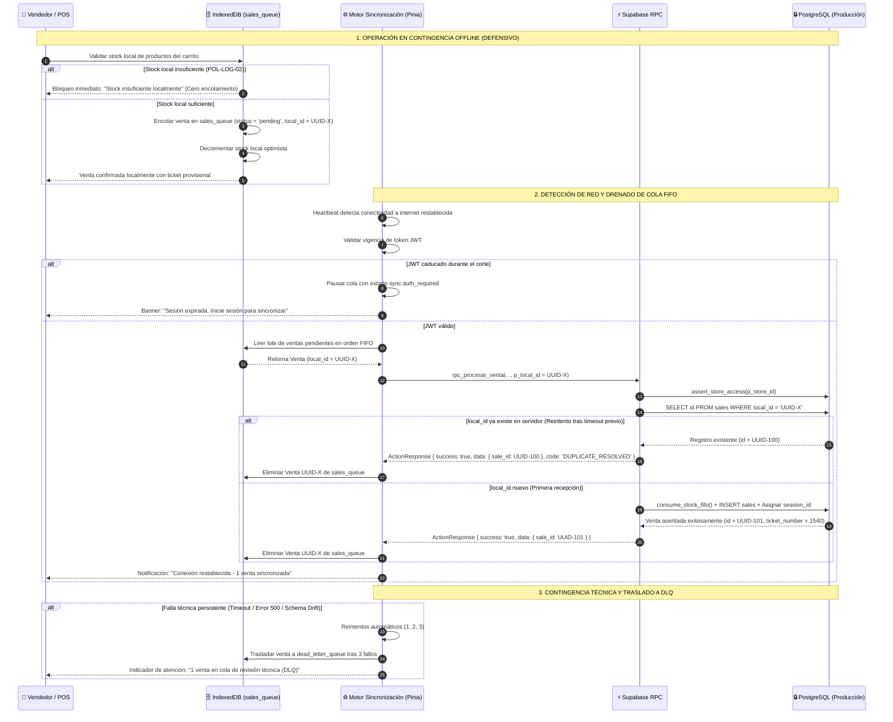
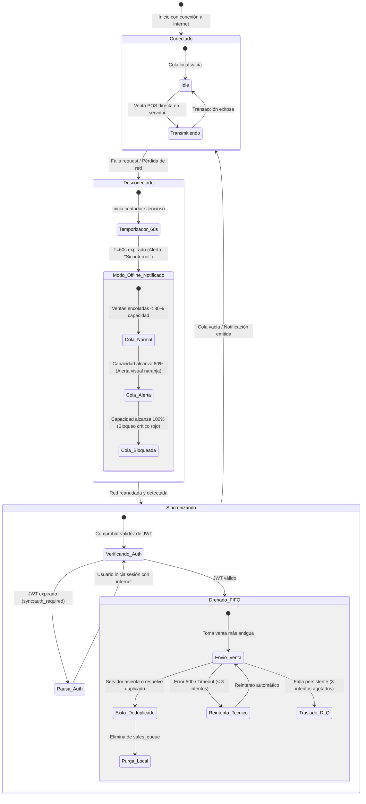

# SDD-012: Sincronización y Resolución de Conflictos Offline

> **Asociado a:** [FRD-012: Sincronización y Resolución de Conflictos Offline](../FRD/FRD_012_SINCRONIZACION_OFFLINE.md), [FRD-012-01: Límites Estrictos del Sistema Offline](../FRD/FRD_012_01_LIMITES_SISTEMA_OFFLINE.md), y [FRD-012-R: Remediación del Módulo Offline](../FRD/FRD_012_REMEDIACION_OFFLINE.md)  
> **Fase del Plan:** Ola 5: Sesiones, Autenticación y Offline (Ítem 5)  
> **Estado:** 🟠 Aprobado con Deuda Técnica Documentada (Protocolo PAC-SDD v2.0)
> **Última Actualización:** 2026-10-16  

---

## 0. CONTROL DE VERSIONES Y TRAZABILIDAD

### 0.1 Historial de Cambios
| Versión | Fecha | Autor | Rol | Descripción de Modificación |
|---------|-------|-------|-----|-----------------------------|
| 1.0.0 | 2026-01-27 | Analista Funcional | Requisitos | Especificación inicial de sincronización offline con resolución humana interactiva de conflictos de stock. |
| 1.5.0 | 2026-02-05 | Arquitecto de Software | Arquitectura | Incorporación de la remediación "Offline Defensivo" (FRD-012-R) y límites estrictos (FRD-012-01). |
| 2.0.0 | 2026-10-16 | Orquestador Técnico | Arquitectura & QA | **Saneamiento Integral PAC-SDD v2.0**: Subordinación arquitectural al modelo de "Offline Defensivo" con bloqueo en origen (IndexedDB); simplificación de la Dead Letter Queue (DLQ) a "Reintentar / Eliminar"; delegación de ajustes de stock excepcionales a `CORRECCION_SISTEMA` en servidor (SDD-014); consagración del soporte físico de idempotencia en `sales.local_id` (`text`) con respuesta canónica `DUPLICATE_RESOLVED`; confirmación de la naturaleza exclusivamente cliente (IndexedDB) de `sales_queue` y `dead_letter_queue` sin tablas huérfanas en PostgreSQL; imputación contable a turnos cerrados (`cash_sessions.id`) con actualización de saldo esperado y bitácora en `audit_logs` (`LATE_SYNC_UPDATE`) sin reapertura física de caja; suspensión automática de cola ante expiración de JWT (`sync:auth_required`); verificación de privilegios base (Regla 8) incluyendo remediación de `clients` y `sale_items` para `service_role`; cumplimiento estricto de las Reglas 1.1 (0% código SQL), 2, 4, 7 y 8; y armonización transversal con POS, Inventario, Caja y Auditoría. |

### 0.2 Trazabilidad de Requisitos (FRD-012, FRD-012-01, FRD-012-R)
| Regla de Negocio / CU | Descripción en Requisitos Fuente | Implementación en este SDD |
|-----------------------|----------------------------------|----------------------------|
| **RN-012-01** | Marcado de ventas offline con indicador local y fecha de sincronización | Sección 4.3 y Sección 3.1 (`sales.local_id`, `sales.sync_status`) |
| **RN-012-02** | Validación local de stock en copia descargada en caché | Sección 4.1 y Sección 3.3 (`products.current_stock`) |
| **RN-012-03 / RN-012-09** | Detección de conflicto de stock en servidor y opciones de resolución humana | Sección 4.1, Sección 4.6 y Sección 7 (D-2) |
| **RN-012-04** | Aceptación de precio offline sin rechazo por cambio de tarifa | Sección 4.3 y Sección 5.2 |
| **RN-012-05** | Conflicto de límite de crédito en fiados diferidos y notificación | Sección 4.5 y Sección 5.3 |
| **RN-012-06** | Ventas con caja cerrada imputadas al turno contable original sin reabrir caja | Sección 4.4, Sección 3.5 y Sección 7 (D-3) |
| **RN-012-07** | Orden cronológico de sincronización (FIFO) de más antigua a más reciente | Sección 4.3 y Sección 2.1 |
| **RN-012-08** | Reintentos automáticos (máximo 3) ante fallos técnicos de red | Sección 4.6 y Sección 2.2 |
| **RN-OFF-01** | Límite transaccional estricto: único flujo encolable es `CREATE_SALE` en POS | Sección 1.1 y Sección 4.1 |
| **RN-OFF-02** | Bloqueo en origen (*Offline Defensivo*): bloqueo inmediato si falta stock local | Sección 1.1, Sección 4.1 y Sección 7 (D-2) |
| **RN-OFF-03** | Límite de encolamiento y suspensión por token expirado (`sync:auth_required`) | Sección 4.2, Sección 4.6 y Sección 7 (D-4) |
| **RN-OFF-04** | Inmutabilidad histórica de ventas y transferencia a DLQ tras 3 fallos técnicos | Sección 4.6 y Sección 3.7 (`dead_letter_queue`) |
| **RN-OFF-05** | Resiliencia ante cambios estructurales de servidor (*Schema Drift*) hacia DLQ | Sección 4.6 y Sección 5.4 |
| **RN-OFF-06** | Indicador visual permanente en POS (normal, 80% alerta, 100% crítico bloqueante) | Sección 4.2 y Sección 2.2 |
| **RN-R01** | Validación preventiva de inventario disponible antes de encolar venta offline | Sección 4.1 y Sección 1.1 |
| **RN-R02** | Validación preventiva de cupo de crédito para fiados antes de encolar | Sección 4.5 y Sección 3.4 (`clients.credit_limit`) |
| **RN-R03** | Sincronización mediante operación segura de procesamiento de ventas | Sección 4.3 y Sección 5.2 |
| **RN-R04** | Indicador visual explícito: "Modo Offline - Ventas limitadas al stock local" | Sección 4.2 y Sección 2.2 |
| **RN-R05** | Recuperación de sesión: solicitud de re-autenticación previa a la sincronización | Sección 4.6 y Sección 6.3 |

### 0.3 Matriz de Dependencias Inter-Modulares
| Documento Vecino | Tipo de Dependencia | Flujo o Restricción Vinculante |
|------------------|---------------------|--------------------------------|
| [SDD-007](../SDD/SDD_007_NUCLEO_VENTAS_PADRE.md) / [SDD-007.1](../SDD/SDD_007_01_NUCLEO_POS.md) | Núcleo Transaccional | Procesamiento de ventas; soporte físico de idempotencia en `sales.local_id`; secuencia atómica de tickets en servidor `COALESCE(MAX(ticket_number), 0) + 1`. |
| [SDD-011](../SDD/SDD_011_MANEJO_ERRORES.md) | Resiliencia y Errores | Temporizador silencioso de 60 segundos; catálogo canónico `ActionResponse`; mitigación de duplicados con `DUPLICATE_RESOLVED`; respuesta `INSUFFICIENT_STOCK` con `available`. |
| [SDD-028](../SDD/SDD_028_ALMACENAMIENTO_LOCAL.md) | Persistencia Cliente | Estructura de IndexedDB (`sales_queue`, `dead_letter_queue`, catálogos locales); supervivencia obligatoria de colas ante logout (`RN-CACHE-03`). |
| [SDD-004](../SDD/SDD_004_CONTROL_DE_CAJA.md) / [SDD-017](../SDD/SDD_017_CICLO_CONTABLE_Y_SESIONES.md) / [SDD-020](../SDD/SDD_020_CAJA_MULTICANAL.md) | Control de Caja | Asignación contable de ventas diferidas al `session_id` histórico original; recálculo de saldo esperado sin reabrir turnos cerrados (`POL-AUD-01`). |
| [SDD-006](../SDD/SDD_006_NUCLEO_INVENTARIO_PADRE.md) / [SDD-006.1.1](../SDD/SDD_006_01_01_MOVIMIENTOS_ENTRADA.md) / [SDD-010.16](../SDD/SDD_010_016_VALORACION_FIFO.md) / [SDD-014](../SDD/SDD_014_VENTA_FORZADA_Y_AUDITORIA.md) | Gestión de Stock | Descarga local de stock; validación preventiva anti-negativos (`POL-LOG-02`); consumo FIFO en servidor; resolución de venta forzada vía `CORRECCION_SISTEMA` (SDD-014). |
| [SDD-009](../SDD/SDD_009_CLIENTES.md) / [SDD-024](../SDD/SDD_024_POLITICA_FIADOS.md) | Cartera y Fiados | Validación preventiva local y bloqueo `FOR UPDATE` en servidor para fiados (`balance + total <= credit_limit`); aislamiento de caja ($0 en efectivo). |
| [SDD-005](../SDD/SDD_005_AUDITORIA_TRAZABILIDAD.md) | Auditoría Forense | Inviolabilidad contable (`POL-AUD-01`): Registro append-only en `audit_logs` (9 columnas físicas) ante sincronización diferida o mutaciones en DLQ. |

---

## 1. RESUMEN EJECUTIVO Y ALCANCE

El documento **SDD-012** define la arquitectura integral de **Sincronización Asíncrona, Resiliencia Operativa y Resolución de Conflictos Offline** en el ecosistema **Tienda Barrio Pro**. Establece las directivas técnicas y los contratos de datos que permiten la continuidad comercial ininterrumpida en el punto de venta durante apagones eléctricos, saturación de redes móviles o caídas del enlace de comunicaciones.

### 1.1 Principios Rectores del Modelo "Offline Defensivo"
1. **Mecanismo de Supervivencia, no Clon Completo (`RN-OFF-01`):** El subsistema offline está diseñado exclusivamente para cobros en punto de venta (`CREATE_SALE`). Quedan terminantemente prohibidos en modo offline: ajustes manuales de inventario (mermas/consumos), compras a proveedores, gastos operativos de tesorería y aperturas o cierres de caja.
2. **Bloqueo en Origen (Validación Preventiva Local, `RN-OFF-02`, `RN-R01`):** Para garantizar la política anti-negativos de inventario (`POL-LOG-02`), la terminal POS valida el carrito contra la copia local de existencias en IndexedDB antes de autorizar la venta offline. Si el stock local es insuficiente, la transacción se bloquea en caliente en la interfaz, prohibiendo su encolamiento.
3. **Idempotencia Estricta en Servidor (`RN-012-01`, `RN-011-03`):** Toda venta diferida viaja con un identificador criptográfico pre-generado por el cliente (`sales.local_id`). Ante caídas de red durante la respuesta HTTP, los reintentos posteriores devuelven el registro existente con código canónico `DUPLICATE_RESOLVED` sin duplicar movimientos contables ni descuentos de inventario.
4. **Inviolabilidad de Turnos Cerrados (`RN-012-06`, `POL-AUD-01`):** Si una venta se realizó con caja abierta y la conexión regresa cuando el turno ya fue cerrado (manual o forzosamente a las 24 horas), el sistema asienta la transacción en el `session_id` histórico original, actualiza el saldo esperado y emite un asiento inmutable en `audit_logs` (`LATE_SYNC_UPDATE`), sin reabrir el turno ni vulnerar los arqueos físicos ya realizados.
5. **Dead Letter Queue (DLQ) Simplificada y Segregación RBAC (`RN-OFF-04`, `RN-OFF-05`, `POL-SEC-01`):** Las ventas que sufran fallos técnicos recurrentes (tras 3 reintentos) o incompatibilidad de esquema (*Schema Drift*) se trasladan a la cola de contingencia DLQ en IndexedDB. La gestión de esta bandeja queda reservada exclusivamente a Administradores (`admin_profiles`), quienes pueden reintentar la transacción o eliminarla si es espuria, descartando interfaces complejas de ajuste forzado interactivo en el cliente.
6. **Persistencia de Colas y Pausa por Autenticación (`RN-CACHE-03`, `RN-OFF-03`):** La cola transaccional en IndexedDB sobrevive al logout voluntario del usuario. Si el token JWT expira durante una desconexión prolongada, la sincronización se detiene con el estado `sync:auth_required` hasta que el operador se re-autentique con internet, previniendo avalanchas de errores 401.

---

## 2. ARQUITECTURA GENERAL Y DIAGRAMA DE FLUJO

### 2.1 Diagrama de Secuencia: Ciclo de Venta Offline, Sincronización FIFO y Resolución Idempotente

El siguiente diagrama detalla la interacción entre el componente POS, la base de datos local en IndexedDB, el motor de sincronización cliente y el backend transaccional de Supabase:



---

### 2.2 Diagrama de Estados: Máquina de Estados del Gestor de Sincronización y Colas Locales



---

## 3. MODELO DE DATOS FÍSICO Y REGLAS DE PERSISTENCIA

El procesamiento de ventas sincronizadas y la prevención de anomalías relacionales se fundamentan en tablas verificadas en Supabase (`information_schema.columns`).

### 3.1 Estructura Física de Ventas e Idempotencia (`sales`)
La tabla `sales` aloja las columnas requeridas para el control de sincronización diferida y la prevención de duplicados:

| Columna | Tipo de Dato | Nulable | Restricciones / Defaults | Descripción |
|---------|--------------|---------|--------------------------|-------------|
| `id` | `uuid` | NOT NULL | PK, default `gen_random_uuid()` | Identificador maestro de la venta en servidor. |
| `store_id` | `uuid` | NOT NULL | FK `stores(id)` | Identificador de la tienda propietaria (multi-tenant). |
| `ticket_number` | `integer` | NOT NULL | Secuencial por tienda | Correlativo asignado atómicamente por el servidor. |
| `employee_id` | `uuid` | NOT NULL | FK `employees(id)` | Usuario responsable de la transacción. |
| `client_id` | `uuid` | NULLABLE | FK `clients(id)` | Cliente asociado a la venta o crédito. |
| `total` | `numeric` | NOT NULL | CHECK `total >= 0` | Importe monetario total de la venta. |
| `rounding_difference` | `numeric` | NULLABLE | Default `0` | Diferencia por redondeo comercial en efectivo. |
| `payment_method` | `text` | NOT NULL | CHECK `IN ('efectivo', 'nequi', 'daviplata', 'fiado')` | Método de pago liquidado. |
| `amount_received` | `numeric` | NULLABLE | Default `NULL` | Importe entregado por el comprador. |
| `change_given` | `numeric` | NULLABLE | Default `NULL` | Cambio retornado al comprador. |
| `sync_status` | `text` | NULLABLE | Default `'pending'`, CHECK `IN ('synced', 'pending', 'failed')` | **Estado de sincronización en servidor**. |
| `local_id` | `text` | NULLABLE | Indexado / Deduplicación | **Soporte físico de idempotencia**: UUID v4 pre-generado por el cliente para evitar duplicados en reintentos. |
| `is_voided` | `boolean` | NULLABLE | Default `false` | Bandera lógica de anulación. |
| `voided_by` | `uuid` | NULLABLE | FK `employees(id)` | Usuario que anuló la venta. |
| `void_reason` | `text` | NULLABLE | Motivo de anulación. |
| `created_at` | `timestamptz` | NOT NULL | Default `now()` | Marca temporal de inserción. |

### 3.2 Estructura Física de Ítems de Venta (`sale_items`)
Desglose transaccional de artículos registrados:

| Columna | Tipo de Dato | Nulable | Restricciones / Defaults | Descripción |
|---------|--------------|---------|--------------------------|-------------|
| `id` | `uuid` | NOT NULL | PK, default `gen_random_uuid()` | Identificador del ítem. |
| `sale_id` | `uuid` | NOT NULL | FK `sales(id)` ON DELETE CASCADE | Venta asociada. |
| `product_id` | `uuid` | NOT NULL | FK `products(id)` | Artículo vendido. |
| `quantity` | `numeric` | NOT NULL | CHECK `quantity > 0` | Cantidad despachada. |
| `unit_price` | `numeric` | NOT NULL | CHECK `unit_price >= 0` | Precio unitario cobrado. |
| `subtotal` | `numeric` | NOT NULL | CHECK `subtotal >= 0` | Subtotal monetario del renglón. |
| `created_at` | `timestamptz` | NOT NULL | Default `now()` | Fecha de registro. |
| `unit_cost` | `numeric` | NULLABLE | Default `0` | Costo unitario promedio o FIFO. |

### 3.3 Estructura Física de Inventario y Catálogo de Productos (`products`)
La validación preventiva local y el consumo en servidor se apoyan en los 17 campos físicos de `products`:

| Columna | Tipo de Dato | Nulable | Restricciones / Defaults | Descripción |
|---------|--------------|---------|--------------------------|-------------|
| `id` | `uuid` | NOT NULL | PK, default `gen_random_uuid()` | Identificador maestro del producto. |
| `store_id` | `uuid` | NOT NULL | FK `stores(id)` | Tienda a la que pertenece el producto. |
| `name` | `text` | NOT NULL | No vacío | Nombre comercial del artículo. |
| `plu` | `text` | NULLABLE | Código identificador | **Identificador físico real de barras o código PLU** (no `barcode`). |
| `price` | `numeric` | NOT NULL | CHECK `price >= 0` | Precio unitario de venta. |
| `cost_price` | `numeric` | NULLABLE | Default `NULL` | Costo unitario de reposición. |
| `current_stock` | `numeric` | NULLABLE | Default `0`, CHECK `current_stock >= 0` | **Existencia física disponible**. Base del bloqueo preventivo en origen (`POL-LOG-02`). |
| `min_stock` | `numeric` | NULLABLE | Default `5` | Umbral de reabastecimiento mínimo. |
| `category` | `text` | NULLABLE | Categoría | Clasificación de producto. |
| `measurement_unit`| `text` | NULLABLE | Default `'unidad'` | Unidad de medida comercial. |
| `is_weighable` | `boolean` | NULLABLE | Default `false` | Indica si el producto requiere pesaje. |
| `low_stock_alerted`| `boolean`| NULLABLE | Default `false` | Bandera de alerta de stock bajo. |
| `created_at` | `timestamptz` | NOT NULL | Default `now()` | Fecha de creación. |
| `updated_at` | `timestamptz` | NOT NULL | Default `now()` | Fecha de actualización. |
| `supplier_id` | `uuid` | NULLABLE | FK `suppliers(id)` | Proveedor asignado. |
| `brand` | `text` | NULLABLE | Marca | Marca comercial del producto. |
| `is_active` | `boolean` | NOT NULL | Default `true` | Estado activo del artículo. |

### 3.4 Estructura Física de Clientes y Cartera (`clients`)
Campos requeridos para la doble barrera de crédito en fiados diferidos:

| Columna | Tipo de Dato | Nulable | Restricciones / Defaults | Descripción |
|---------|--------------|---------|--------------------------|-------------|
| `id` | `uuid` | NOT NULL | PK, default `gen_random_uuid()` | Identificador del cliente. |
| `store_id` | `uuid` | NOT NULL | FK `stores(id)` | Tienda propietaria. |
| `name` | `text` | NOT NULL | Nombre completo | Nombre comercial o del cliente. |
| `id_number` | `text` | NOT NULL | Documento de identidad | Cédula o NIT del comprador. |
| `phone` | `text` | NULLABLE | Teléfono | Teléfono de contacto. |
| `credit_limit` | `numeric` | NOT NULL | Default `100000` | **Cupo de crédito máximo autorizado**. |
| `balance` | `numeric` | NULLABLE | Default `0`, CHECK `balance >= 0` | **Saldo adeudado actual**. |
| `is_deleted` | `boolean` | NULLABLE | Default `false` | Borrado lógico de cliente. |
| `deleted_at` | `timestamptz` | NULLABLE | Default `NULL` | Fecha de borrado lógico. |
| `created_at` | `timestamptz` | NOT NULL | Default `now()` | Fecha de creación. |
| `updated_at` | `timestamptz` | NOT NULL | Default `now()` | Fecha de actualización. |

### 3.5 Estructura Física de Caja y Asignación de Turno (`cash_sessions` y `cash_movements`)
- `cash_sessions` (12 columnas físicas): `id`, `store_id`, `opened_by`, `closed_by`, `opening_balance`, `expected_balance`, `actual_balance`, `difference`, `status`, `opened_at`, `closed_at`, `forced_close`.
- `cash_movements` (7 columnas físicas): `id`, `session_id` (FK `cash_sessions(id)`), `movement_type`, `amount`, `description`, `sale_id`, `created_at`.
- **Regla de asignación histórica:** Toda venta diferida se vincula a través de `cash_movements.session_id` al turno contable de caja que estaba abierto al momento de su creación física local (`RN-012-06`).

### 3.6 Estructura Física de la Bitácora de Auditoría Forense (`audit_logs`)
- `audit_logs` (9 columnas físicas): `id`, `actor_id`, `event_type`, `resource_id`, `metadata`, `created_at`, `store_id`, `severity`, `ip_address`.
- **Eventos tipados de sincronización:** `OFFLINE_SYNC_SUCCESS` (severidad `'info'`), `LATE_SYNC_UPDATE` (severidad `'warning'`), `DLQ_TRANSFER` (severidad `'warning'`), `DLQ_RESOLVED` (severidad `'warning'`).

### 3.7 Persistencia Local en Navegador (IndexedDB) e Inexistencia en PostgreSQL
Se declara formalmente que las entidades `syncQueue`, `sales_queue` y `dead_letter_queue` **no existen como tablas relacionales en PostgreSQL** (la consulta en `information_schema.tables` retorna conjunto vacío `[]`). Su almacenamiento reside 100% en el cliente mediante IndexedDB bajo los siguientes stores:
- `sales_queue`: Almacena transacciones de venta pendientes de drenado en orden cronológico (FIFO).
- `dead_letter_queue` (DLQ): Almacena ventas con 3 fallos técnicos de red o *Schema Drift* para resolución por el Administrador.
- `products_cache` y `clients_cache`: Copias locales descargadas para la validación preventiva en origen.

---

## 4. ESPECIFICACIÓN DETALLADA DE REGLAS DE NEGOCIO Y CASOS DE USO

### 4.1 Bloqueo Preventivo en Origen y Acoplamiento Exclusivo a POS (`RN-OFF-01`, `RN-OFF-02`, `RN-R01`)
1. **Límite Transaccional Exclusivo a Ventas:** El subsistema offline está restringido estrictamente a `CREATE_SALE`. El interceptor de la cola de sincronización detecta y destruye de inmediato cualquier intento de encolar movimientos de inventario (mermas), gastos de tesorería o cierres de caja en modo desconectado.
2. **Validación Preventiva contra Stock Local (*Offline Defensivo*):** Antes de autorizar una venta sin internet y encolarla en `sales_queue`, la aplicación valida que `current_stock >= requested_quantity` para cada producto utilizando la copia en `products_cache`.
3. **Bloqueo Inmediato:** Si el inventario local es insuficiente, el POS bloquea el cobro en origen y despliega: *"Stock insuficiente en catálogo local. No es posible vender sin conexión"*. La transacción no se encola, garantizando la política anti-negativos (`POL-LOG-02`).

### 4.2 Límite de Encolamiento, Indicador Visual y Alertas (`RN-OFF-03`, `RN-OFF-06`, `RN-R04`)
1. **Capacidad Máxima de Supervivencia:** La cola local `sales_queue` dispone de un tope máximo configurable (default: 50 ventas) para evitar saturación de memoria en terminales móviles.
2. **Indicador Visual Permanente en POS:**
   - *Estado Normal (0% a 79%):* Indicador sutil permanente "X/50 ventas pendientes".
   - *Estado Alerta Preventiva (80% a 99%):* Indicador en color amarillo/naranja con advertencia: *"Cola de sincronización casi llena. Reconecta a internet pronto"*.
   - *Estado Crítico Bloqueante (100%):* Indicador en color rojo. El POS bloquea el botón de cobro mostrando: *"Límite de ventas offline alcanzado. Reconecta a internet para continuar"*.

### 4.3 Sincronización FIFO e Idempotencia con `local_id` (`RN-012-01`, `RN-012-07`, `RN-011-03`, `RN-R03`)
1. **Generación Criptográfica Local:** Cada venta offline genera en el cliente un `local_id` (UUID v4) y marca temporal local de creación antes de persistirse en `sales_queue`.
2. **Orden Cronológico Estricto (FIFO):** Al regresar la red, el motor de sincronización drena las ventas en estricto orden cronológico ascendente (de la más antigua a la más reciente).
3. **Resolución Idempotente en Backend:** Al recibir `p_local_id`, el backend verifica si ya existe en `sales`. Si ya fue insertada por un reintento anterior, retorna `ActionResponse` con `code = 'DUPLICATE_RESOLVED'` y el `sale_id` existente, provocando que el cliente la purgue de `sales_queue` sin duplicar movimientos de kardex ni caja.
4. **Respeto a Precios Históricos (`RN-012-04`):** La venta offline se procesa y asienta respetando el precio unitario con el que fue cobrada en el mostrador durante el apagón, sin importar si el catálogo cambió en el servidor mientras tanto.

### 4.4 Imputación Contable a Turnos Cerrados y Fidelidad de Caja (`RN-012-06`)
1. **Preservación del `session_id` Histórico:** La venta offline guarda el identificador del turno de caja (`cash_sessions.id`) que estaba abierto al crearse localmente.
2. **Asentamiento en Período Histórico sin Reabrir Caja:** Si el Administrador cerró la caja (manual o por el cron de 24 horas de SDD-017) antes de la reconexión:
   - El backend asienta el registro en `cash_movements` vinculándolo al `session_id` histórico original.
   - El saldo esperado del turno cerrado se actualiza para reflejar el ingreso real.
   - La caja cerrada **no cambia de estado** (permanece en `status = 'closed'`).
   - Se emite un asiento en `audit_logs` con `event_type = 'LATE_SYNC_UPDATE'` notificando la actualización extemporánea.

### 4.5 Doble Barrera de Crédito en Fiados Offline (`RN-R02`, `RN-012-05`)
1. **Barrera 1 (Preventiva Local):** El cliente valida que `clients_cache.balance + total <= clients_cache.credit_limit`. Si excede, el POS bloquea la venta fiada de inmediato.
2. **Barrera 2 (Estricta en Servidor):** Al sincronizar, el backend ejecuta bloqueo `SELECT ... FOR UPDATE` sobre la fila del cliente en `clients`. Si por ventas concurrentes de otra terminal el cliente superó su cupo durante el apagón, el servidor aborta la transacción con `CREDIT_LIMIT_EXCEEDED` y traslada la venta a DLQ para gestión directa de cobro en efectivo o anulación por el personal.

### 4.6 Gestión de Fallos Técnicos, Schema Drift y Dead Letter Queue (`RN-OFF-04`, `RN-OFF-05`, `RN-012-08`, `RN-R05`)
1. **Cadencia de Reintentos:** Ante fallos técnicos transitorios (errores 500, timeouts de red), el sistema ejecuta hasta 3 reintentos automáticos con retroceso exponencial.
2. **Traslado a Dead Letter Queue (DLQ):** Si tras 3 intentos la venta no logra procesarse, o si el interceptor detecta incompatibilidad estructural (*Schema Drift*), la venta se mueve a la `dead_letter_queue` en IndexedDB.
3. **Acciones Administrativas en DLQ:** La interfaz de la DLQ ofrece exclusivamente dos opciones al Administrador:
   - *Reintentar:* Fuerza un reenvío una vez solucionada la contingencia de red o actualizado el sistema.
   - *Eliminar:* Descarta la transacción únicamente si se constata que fue una prueba o registro espurio.
   - *Venta Forzada Excepcional:* Si la venta es legítima pero colisiona con discrepancias físicas de inventario en servidor, el Administrador la regulariza desde el panel aplicando `CORRECCION_SISTEMA` bajo SDD-014.
4. **Suspensión de Cola por Autenticación (`sync:auth_required`):** Si el token JWT expira durante el apagón, la cola se pausa inmediatamente, impidiendo peticiones rechazadas con 401 hasta que el usuario inicie sesión con conectividad.

---

## 5. CONTRATOS DE INTERFAZ

Los contratos de sincronización se estructuran bajo esquemas JSON canónicos que separan la persistencia en el cliente de la autoridad de datos en el servidor.

### 5.1 Esquema JSON: Registro de Venta en Cola Local (`OfflineSaleRecord`)
Estructura persistida en el store `sales_queue` de IndexedDB en el navegador:

```json
{
  "$schema": "https://json-schema.org/draft/2020-12/schema",
  "title": "OfflineSaleRecord",
  "type": "object",
  "required": ["local_id", "store_id", "session_id", "employee_id", "payment_method", "total", "items", "created_at_local", "retry_count"],
  "properties": {
    "local_id": {
      "type": "string",
      "format": "uuid",
      "description": "Identificador único pre-generado por el cliente para idempotencia."
    },
    "store_id": {
      "type": "string",
      "format": "uuid",
      "description": "Tienda en la que se originó la venta."
    },
    "session_id": {
      "type": "string",
      "format": "uuid",
      "description": "Turno de caja que estaba abierto al crear la venta en el cliente."
    },
    "employee_id": {
      "type": "string",
      "format": "uuid",
      "description": "Usuario responsable de la venta."
    },
    "client_id": {
      "type": ["string", "null"],
      "format": "uuid",
      "description": "Cliente si la venta es a crédito o fidelizada."
    },
    "payment_method": {
      "type": "string",
      "enum": ["efectivo", "nequi", "daviplata", "fiado"]
    },
    "total": {
      "type": "number",
      "minimum": 0
    },
    "amount_received": {
      "type": ["number", "null"],
      "minimum": 0
    },
    "created_at_local": {
      "type": "string",
      "format": "date-time",
      "description": "Fecha y hora exacta de la creación en la terminal física."
    },
    "retry_count": {
      "type": "integer",
      "minimum": 0,
      "maximum": 3,
      "description": "Contador de reintentos técnicos de sincronización."
    },
    "items": {
      "type": "array",
      "minItems": 1,
      "items": {
        "type": "object",
        "required": ["product_id", "quantity", "unit_price"],
        "properties": {
          "product_id": { "type": "string", "format": "uuid" },
          "quantity": { "type": "number", "minimum": 0.001 },
          "unit_price": { "type": "number", "minimum": 0 }
        }
      }
    }
  },
  "additionalProperties": false
}
```

### 5.2 Esquema JSON: Petición de Sincronización Diferida (`SincronizarVentaRequest`)
Payload transmitido al procedimiento transaccional de ventas en Supabase:

```json
{
  "$schema": "https://json-schema.org/draft/2020-12/schema",
  "title": "SincronizarVentaRequest",
  "type": "object",
  "required": ["p_store_id", "p_local_id", "p_payment_method", "p_items", "p_session_id"],
  "properties": {
    "p_store_id": {
      "type": "string",
      "format": "uuid",
      "description": "Identificador de la tienda propietaria (validado con assert_store_access)."
    },
    "p_local_id": {
      "type": "string",
      "format": "uuid",
      "description": "Clave de idempotencia para prevención de duplicados."
    },
    "p_session_id": {
      "type": "string",
      "format": "uuid",
      "description": "Turno de caja original para imputación contable histórica."
    },
    "p_client_id": {
      "type": ["string", "null"],
      "format": "uuid"
    },
    "p_payment_method": {
      "type": "string",
      "enum": ["efectivo", "nequi", "daviplata", "fiado"]
    },
    "p_amount_received": {
      "type": ["number", "null"],
      "minimum": 0
    },
    "p_items": {
      "type": "array",
      "minItems": 1,
      "items": {
        "type": "object",
        "required": ["product_id", "quantity", "unit_price"],
        "properties": {
          "product_id": { "type": "string", "format": "uuid" },
          "quantity": { "type": "number", "minimum": 0.001 },
          "unit_price": { "type": "number", "minimum": 0 }
        }
      }
    }
  },
  "additionalProperties": false
}
```

### 5.3 Esquema JSON: Respuesta Canónica de Acción (`ActionResponse`)
Estructura universal retornada por el servidor tras la sincronización:

```json
{
  "$schema": "https://json-schema.org/draft/2020-12/schema",
  "title": "ActionResponse",
  "type": "object",
  "required": ["success"],
  "properties": {
    "success": {
      "type": "boolean",
      "description": "Indica si la venta fue procesada o resuelta como preexistente."
    },
    "data": {
      "type": "object",
      "properties": {
        "sale_id": { "type": "string", "format": "uuid" },
        "ticket_number": { "type": "integer" },
        "total": { "type": "number" },
        "change": { "type": "number" }
      },
      "additionalProperties": true
    },
    "error": {
      "type": "string",
      "description": "Descripción amigable en español del error."
    },
    "code": {
      "type": "string",
      "enum": [
        "DUPLICATE_RESOLVED",
        "INSUFFICIENT_STOCK",
        "CREDIT_LIMIT_EXCEEDED",
        "STORE_ACCESS_DENIED",
        "SHIFT_EXPIRED",
        "INTERNAL_SERVER_ERROR"
      ]
    },
    "details": {
      "type": "object",
      "additionalProperties": true
    }
  },
  "additionalProperties": false
}
```

### 5.4 Esquema JSON: Registro de Dead Letter Queue (`DLQRecord`)
Estructura persistida en el store `dead_letter_queue` de IndexedDB:

```json
{
  "$schema": "https://json-schema.org/draft/2020-12/schema",
  "title": "DLQRecord",
  "type": "object",
  "required": ["sale_payload", "error_code", "error_message", "failed_at", "attempts", "status"],
  "properties": {
    "sale_payload": {
      "$ref": "#/properties/OfflineSaleRecord",
      "description": "Registro completo original de la venta offline intacta."
    },
    "error_code": {
      "type": "string",
      "description": "Código del fallo técnico o de negocio que causó la derivación."
    },
    "error_message": {
      "type": "string",
      "description": "Mensaje técnico detallado o causa del schema drift."
    },
    "failed_at": {
      "type": "string",
      "format": "date-time"
    },
    "attempts": {
      "type": "integer",
      "minimum": 3
    },
    "status": {
      "type": "string",
      "enum": ["pending_review", "retrying", "discarded"]
    }
  },
  "additionalProperties": false
}
```

---

## 6. ANÁLISIS DE SEGURIDAD Y RESILIENCIA

### 6.1 Control de Acceso y Funciones Centralizadas (Regla 4 de AGENTS.md)
1. **Aislamiento Multi-Tenant Estricto (`assert_store_access`):** Todo procedimiento en backend invocado durante la sincronización diferida ejecuta como primera instrucción mandatoria:
   - `PERFORM public.assert_store_access(p_store_id);`
   Queda terminantemente prohibido reimplementar comparaciones directas de tienda o comprobaciones manuales del JWT.
2. **Gobernanza de RLS mediante `get_current_store_id()`:** Las políticas de seguridad a nivel de fila en `sales`, `sale_items`, `products`, `clients`, `cash_sessions` y `cash_movements` utilizan exclusivamente `get_current_store_id()`, impidiendo la fuga de datos transaccionales entre distintos comercios.

### 6.2 Privilegios Base en Tablas (Regla 8 de AGENTS.md)
Se verificó el cumplimiento de la Regla 8 en todas las tablas vinculadas a la persistencia y sincronización offline:
- **Remediación Ejecutada y Verificada:** Se subsanó en Supabase Cloud la ausencia previa de privilegios de `service_role` sobre `clients` y `sale_items` (`GRANT ALL ON TABLE public.clients, public.sale_items TO service_role;`), validando mediante `has_table_privilege` que ambas tablas cuenten con acceso completo (`serv_select: true`, `serv_insert: true`, `serv_update: true`, `serv_delete: true`) y `rowsecurity = true`.
- Las tablas `sales`, `products`, `cash_sessions`, `cash_movements` y `audit_logs` disponen de sus privilegios base asignados para `service_role`, `authenticated` y `anon`, erradicando el riesgo de errores 42501 (Permission Denied).

### 6.3 Resiliencia Transaccional y Superficie de Amenazas
1. **Ataques de Repetición (Replay Attacks):** La combinación de `store_id` y `local_id` indexado en `sales` neutraliza ataques de inyección repetida de ventas desde terminales comprometidas o redes inestables.
2. **Suspensión Automática por Sesión Expirada (`sync:auth_required`):** Si la sesión del usuario caduca durante una desconexión prolongada, la cola de sincronización se detiene automáticamente, evitando enviar peticiones no autorizadas y forzando la re-autenticación limpia al regresar la conectividad (`RN-OFF-03`, `RN-R05`).
3. **Inviolabilidad de Auditoría Forense (`POL-AUD-01`):** Las sincronizaciones en diferido, las actualizaciones de turnos cerrados y las resoluciones administrativas en DLQ generan registros inmutables append-only en `audit_logs` con `severity` tipada e `ip_address`, asegurando trazabilidad total ante inspecciones financieras.

---

## 7. REGISTRO DE DEUDAS TÉCNICAS Y TRADE-OFFS (REGLA 7)

Conforme a la **Regla 7 de AGENTS.md**, se formalizan los 5 compromisos y decisiones arquitecturales de este módulo:

### D-1: Idempotencia Operativa con `sales.local_id` y Prevención de Duplicados (RN-012-01, RN-011-03)
- **Qué se decidió:** Adoptar `sales.local_id` (`text`, nullable) como la clave de deduplicación operativa en la sincronización diferida de ventas, retornando `DUPLICATE_RESOLVED` con el `sale_id` existente ante reintentos.
- **Por qué / Trade-off:** Evita la duplicación de ingresos en caja y sobre-descuentos en el inventario FIFO ante timeouts de red, sin requerir una tabla intermedia de staging en PostgreSQL.
- **Condición de revisión futura:** Permanente / Invariante transaccional del módulo de ventas.

### D-2: Subordinación al Modelo de Offline Defensivo y Simplificación de DLQ (FRD-012-01, FRD-012-R)
- **Qué se decidió:** Consagrar que toda la prevención de conflictos de stock y cupo de fiado se ejecuta en origen antes de encolar (bloqueo preventivo en IndexedDB contra catálogo local); la DLQ se simplifica a "Reintentar / Eliminar"; y cualquier ajuste de existencias excepcional se delega a `CORRECCION_SISTEMA` en servidor bajo SDD-014.
- **Por qué / Trade-off:** Elimina la necesidad de interfaces complejas y propensas a errores de "Ajuste forzado interactivo" en cliente, protegiendo el principio de no-negatividad de inventario (`POL-LOG-02`).
- **Condición de revisión futura:** Permanente / Arquitectura offline consolidada.

### D-3: Imputación Contable a Turnos Cerrados y Recálculo sin Re-apertura de Caja (RN-012-06)
- **Qué se decidió:** Estandarizar que las ventas offline creadas durante un turno que posteriormente fue cerrado se imputan al `session_id` histórico original, actualizando el saldo esperado y documentando en `audit_logs` con `LATE_SYNC_UPDATE`, sin reabrir el turno contable.
- **Por qué / Trade-off:** Preserva la inmutabilidad de los turnos cerrados (`POL-AUD-01`) mientras refleja fielmente el flujo real de dinero de la jornada.
- **Condición de revisión futura:** Permanente / Principio contable fundamental.

### D-4: Persistencia de Colas en IndexedDB ante Logout y Pausa por Autenticación (RN-CACHE-03, RN-OFF-03)
- **Qué se decidió:** Normar que el logout voluntario en cliente purga credenciales pero preserva la cola `sales_queue` en IndexedDB; si el JWT expira durante el apagón, la cola se suspende con `sync:auth_required` hasta el re-login con internet.
- **Por qué / Trade-off:** Evita la pérdida irrecuperable de ventas legítimas realizadas por el comerciante y previene avalanchas de errores 401 durante reconexiones inestables.
- **Condición de revisión futura:** Permanente / Estándar offline-first.

### D-5: Segregación RBAC y Ceguera Contable en DLQ (POL-SEC-01)
- **Qué se decidió:** Restringir la consulta y resolución de la Dead Letter Queue exclusivamente a usuarios con rol en `admin_profiles`, ocultando márgenes y costos unitarios al cajero operativo.
- **Por qué / Trade-off:** Cumple el principio de ceguera contable (`POL-SEC-01`) y previene manipulaciones no autorizadas de transacciones fallidas en el mostrador.
- **Condición de revisión futura:** Permanente / Invariante de seguridad y control interno.

### D-6: Soporte de Precio Histórico Desconectado en `rpc_procesar_venta_v3` (`RN-012-04`)
- **Qué se decidió:** Cuando una venta se origina en modo desconectado (`p_is_offline_sync = true`), el cliente envía en `p_items` el `unit_price` histórico capturado del catálogo local al momento de la transacción (`OfflineSaleRecord.created_at`). El backend `rpc_procesar_venta_v3` debe honrar o auditar dicho precio histórico en lugar de sobreescribirlo con el precio vigente en catálogo al momento de la sincronización.
- **Por qué / Trade-off:** Cumple la regla `RN-012-04` impidiendo que un cambio de precios administrativo durante un apagón modifique retroactivamente el monto cobrado al cliente en el mostrador.
- **Condición de revisión futura:** Ola 6 SQL (se integrará soporte para `p_is_offline_sync` y `unit_price` histórico opcional en `rpc_procesar_venta_v3`).
