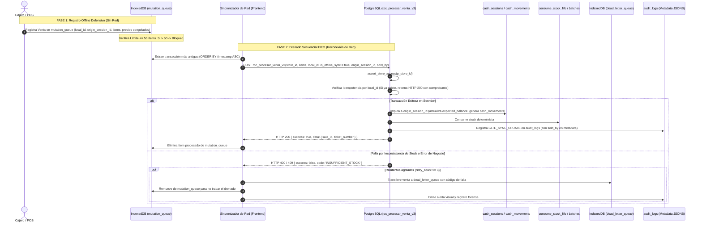
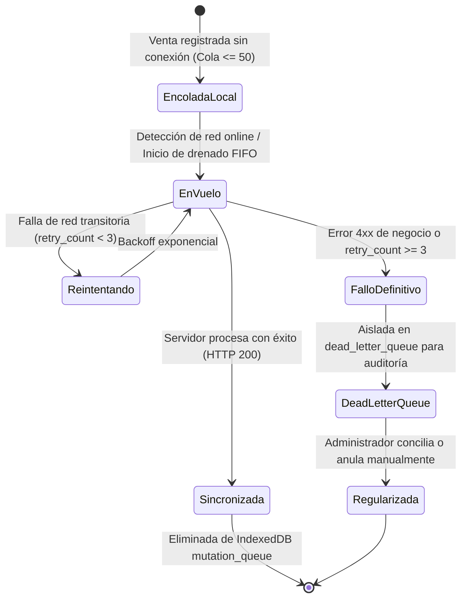

# SDD-012: Sincronización y Fronteras del Sistema Offline (Defensivo)

> **Módulo:** Sincronización y Fronteras del Sistema Offline  
> **Versión Documental:** 3.0.0 (Redactado bajo Protocolo PAC-SDD)  
> **Estado:** 🟢 ESPECIFICACIÓN APROBADA  
> **FRD Fuente:** [`documentation/01_requirements/01_modulos/02_fase_2/FRD_012_01_LIMITES_SISTEMA_OFFLINE.md`](file:///c:/Users/Windows%2011/OneDrive/Desktop/prueba/documentation/01_requirements/01_modulos/02_fase_2/FRD_012_01_LIMITES_SISTEMA_OFFLINE.md)  
> **SDDs Vecinos Vinculados:** [`SDD_007_01_NUCLEO_POS.md`](file:///c:/Users/Windows%2011/OneDrive/Desktop/prueba/documentation/01_requirements/SDD/SDD_007_01_NUCLEO_POS.md), [`SDD_004_CONTROL_DE_CAJA.md`](file:///c:/Users/Windows%2011/OneDrive/Desktop/prueba/documentation/01_requirements/SDD/SDD_004_CONTROL_DE_CAJA.md), [`SDD_013_GESTION_SESIONES.md`](file:///c:/Users/Windows%2011/OneDrive/Desktop/prueba/documentation/01_requirements/SDD/SDD_013_GESTION_SESIONES.md), [`SDD_017_CICLO_CONTABLE_Y_SESIONES.md`](file:///c:/Users/Windows%2011/OneDrive/Desktop/prueba/documentation/01_requirements/SDD/SDD_017_CICLO_CONTABLE_Y_SESIONES.md), [`SDD_028_ALMACENAMIENTO_LOCAL.md`](file:///c:/Users/Windows%2011/OneDrive/Desktop/prueba/documentation/01_requirements/SDD/SDD_028_ALMACENAMIENTO_LOCAL.md)

---

## 0. Evidencia Contextual del Protocolo PAC-SDD

En cumplimiento estricto del Protocolo de Pre-Análisis Contextual (PAC-SDD), este diseño técnico se fundamenta exclusivamente en la evidencia real auditada y contrastada de forma autónoma:

1. **Esquema Real Verificado (PAC Bloque 2):**
   - Se verificaron 7 tablas en el catálogo de PostgreSQL (`ihtjocmhzuliwwvdzfnz`): `sales` (19 columnas), `sale_items` (8 columnas), `products` (17 columnas), `cash_sessions` (12 columnas), `cash_movements` (10 columnas), `daily_passes` (14 columnas) y `audit_logs` (12 columnas). Total: 92 columnas físicas verificadas sin tablas inexistentes.
   - Brechas DDL tipificadas: La tabla `cash_movements` no cuenta con columna nativa `actor_id` (la trazabilidad relacional se preserva vía `sales.employee_id`). La tabla `audit_logs.actor_id` posee colisión de doble FK (`employees` vs `auth.users`), mitigada canalizando la autoría de colaboradores sin auth en `metadata: jsonb`.
2. **Seguridad Centralizada (PAC Bloque 3):**
   - Función obligatoria multi-tenant: `public.assert_store_access(p_store_id uuid)`.
   - Función de resolución de tenant en sesión: `public.get_current_store_id()`.
3. **Radio de Impacto Cruzado Auditado (PAC Bloque 4):**
   - 45 funciones y triggers del backend identificados en `pg_proc`.
   - Mitigaciones obligatorias: (a) RIC-1: Prohibición de que ventas offline se imputen ciegamente a turnos abiertos de otros cajeros; se anclan a `origin_session_id`. (b) RIC-2: No violación de `fk_audit_user` para cajeros con pase diario. (c) RIC-3: Aislamiento selectivo hacia Dead Letter Queue (DLQ) ante excepciones de `consume_stock_fifo`.
4. **Contratos Vecinos Validados (PAC Bloque 5):**
   - Compatible 100% con `SDD_007_01` (`rpc_procesar_venta_v3`), `SDD_028` (`mutation_queue` y `dead_letter_queue`), `SDD_004`/`SDD_017` (inmutabilidad contable y arqueo ciego) y `SDD_013` (desacople de sesiones de usuario respecto a la caja).

---

## 1. Glosario Técnico

- **Offline Defensivo:** Filosofía arquitectural donde el cliente solo opera en contingencia estricta bajo límites rígidos (máximo 50 ventas locales), delegando la verdad contable y la liquidación transaccional al backend una vez restablecida la red.
- **Cola de Mutaciones (`mutation_queue`):** Estructura transaccional en `IndexedDB` que encola las ventas efectuadas durante la pérdida de conectividad física, indexadas por marca de tiempo (`timestamp`) para su drenado secuencial FIFO.
- **Dead Letter Queue (DLQ):** Almacén local en `IndexedDB` para transacciones que fracasaron tras 3 reintentos automáticos o que fueron rechazadas en servidor por inconsistencia insalvable de inventario o validación de negocio.
- **Idempotencia Transaccional (`local_id` / `idempotency_key`):** Mecanismo de deduplicación que previene el doble registro de tickets o el doble descuento de stock ante reintentos de red.
- **Sesión de Origen (`origin_session_id`):** Identificador unívoco del turno de caja que se encontraba formalmente abierto en la terminal cuando se consumó la venta offline.

---

## 2. Arquitectura y Flujos del Sistema

### 2.1 Diagrama de Secuencia: Ciclo de Vida de Sincronización Offline



### 2.2 Diagrama de Estados: Ciclo de Vida de la Transacción Offline



---

## 3. Especificación de Reglas de Negocio (Trazabilidad FRD-012-01)

### 3.1 RN-OFF-01: Límite Rígido de Encolamiento (50 Transacciones)
1. El motor de almacenamiento local en IndexedDB tiene prohibido retener más de 50 transacciones pendientes de sincronización por tienda.
2. Al alcanzar la transacción número 50, la interfaz POS bloquea de forma inmediata el botón de cobro y despliega la advertencia bloqueante: *"Límite de ventas offline alcanzado (50). Conéctese a internet para sincronizar antes de continuar vendiendo."*

### 3.2 RN-OFF-02: Drenado Estricto por Orden Cronológico (FIFO)
1. La sincronización se ejecuta exclusivamente en orden FIFO (`timestamp` ascendente).
2. Queda prohibido procesar transacciones recientes si una transacción anterior sigue pendiente en la cola, garantizando la correlación del inventario y el correlativo de tickets.

### 3.3 RN-OFF-03: Congelamiento de Precios Históricos
1. Toda venta generada fuera de línea congela el precio unitario pactado al momento del cobro (`p_items[].unit_price`).
2. Al sincronizar con `p_is_offline_sync = true`, el backend honra el precio congelado en la venta y en `sale_items`, previniendo discrepancias monetarias con el dinero físico recibido del cliente.

### 3.4 RN-OFF-04: Idempotencia Obligatoria (`local_id`)
1. Toda venta offline genera un UUID cliente en `local_id`.
2. Ante pérdidas de paquetes o reconexiones abruptas, el reenvío de la venta con el mismo `local_id` retorna el comprobante ya creado en el servidor sin duplicar tickets ni salidas de inventario.

### 3.5 RN-OFF-05: Imputación a Sesión de Origen (`origin_session_id`)
1. Las ventas offline deben conservar el identificador de la caja en la que fueron cobradas (`origin_session_id`).
2. Si al reconectar la red la sesión histórica de caja ya fue cerrada (por horario o por regla de 24 horas), el backend imputa el dinero a dicha sesión histórica reajustando su saldo esperado (`expected_balance`) y generando la auditoría `LATE_SYNC_UPDATE`.
3. Queda prohibido imputar ventas offline desfasadas a la sesión activa actual de otro cajero.

### 3.6 RN-OFF-06: Gestión de Inconsistencias de Inventario y DLQ
1. Si al sincronizar una venta física ya entregada, `consume_stock_fifo` arroja déficit insalvable de stock en el servidor:
   - La venta se traslada de inmediato a la `dead_letter_queue`.
   - Se libera la cola principal para permitir el drenado del resto de ventas válidas.
   - El sistema emite notificación prioritaria al Administrador para su regularización mediante ajuste de inventario o venta forzada (`rpc_force_sale`).

---

## 4. Casos Límite y Manejo de Contingencias

| Caso Límite | Condición del Sistema | Comportamiento Técnico | Código de Error | Acción en UI |
|---|---|---|---|---|
| **CL-OFF-01** | Cola local llena (50 ítems) | Interceptor local en IndexedDB rechaza la inserción de la transacción 51. | `OFFLINE_QUEUE_FULL` | Modal rojo de bloqueo con advertencia operativa. |
| **CL-OFF-02** | Falla de conexión a mitad del lote | La transacción en vuelo falla por timeout; el reintento reutiliza `local_id`. | `NETWORK_TIMEOUT` | Indicador amarillo en barra superior: "Sincronizando 12/50...". |
| **CL-OFF-03** | Caja de origen cerrada > 24H | Backend detecta que `origin_session_id` tiene `status = 'closed'`. | `LATE_SYNC_ADJUSTMENT` | Venta procesada con éxito; alerta informativa de ajuste a reporte contable. |
| **CL-OFF-04** | Discrepancia de stock en servidor | `consume_stock_fifo` no encuentra existencias para un ítem del ticket. | `INSUFFICIENT_STOCK` | Aislamiento en Dead Letter Queue con bandera de auditoría visible para Administrador. |
| **CL-OFF-05** | Empleado sin cuenta Auth | Colaborador con pase diario sincroniza ventas; inserción en auditoría. | `COLLISION_PREVENTED` | El backend canaliza la identidad del empleado en `metadata->>'sold_by'`. |

---

## 5. Contrato de Interfaz

### 5.1 Estructura del Objeto en Cola Local (IndexedDB: `mutation_queue`)

```json
{
  "$schema": "http://json-schema.org/draft-07/schema#",
  "title": "OfflineQueueItemSchema",
  "type": "object",
  "required": ["id", "type", "store_id", "session_id", "employee_id", "payload", "timestamp", "retry_count"],
  "properties": {
    "id": { "type": "string", "format": "uuid", "description": "Identificador local unívoco (local_id)" },
    "type": { "type": "string", "enum": ["CREATE_SALE"] },
    "store_id": { "type": "string", "format": "uuid" },
    "session_id": { "type": "string", "format": "uuid", "description": "origin_session_id del turno" },
    "employee_id": { "type": "string", "format": "uuid", "description": "sold_by del cajero" },
    "payload": {
      "type": "object",
      "required": ["payment_method", "amount_received", "items", "total"],
      "properties": {
        "client_id": { "type": ["string", "null"], "format": "uuid" },
        "payment_method": { "type": "string", "enum": ["efectivo", "nequi", "daviplata", "fiado"] },
        "amount_received": { "type": "number", "minimum": 0 },
        "items": {
          "type": "array",
          "minItems": 1,
          "items": {
            "type": "object",
            "required": ["product_id", "quantity", "unit_price"],
            "properties": {
              "product_id": { "type": "string", "format": "uuid" },
              "quantity": { "type": "number", "exclusiveMinimum": 0 },
              "unit_price": { "type": "number", "exclusiveMinimum": 0 }
            }
          }
        },
        "total": { "type": "number", "minimum": 0 }
      }
    },
    "timestamp": { "type": "integer", "description": "Unix timestamp en milisegundos" },
    "retry_count": { "type": "integer", "minimum": 0, "maximum": 3 }
  }
}
```

### 5.2 Operación de Sincronización en Servidor: `rpc_procesar_venta_v3`

- **Tipo:** RPC PostgreSQL / Acción (WRITE)
- **Firma de Entrada:**
  ```json
  {
    "p_store_id": "UUID (Obligatorio)",
    "p_client_id": "UUID (Opcional, NULL para ventas de mostrador)",
    "p_payment_method": "TEXT ('efectivo' | 'nequi' | 'daviplata' | 'fiado')",
    "p_amount_received": "NUMERIC >= 0",
    "p_items": [
      {
        "product_id": "UUID (Obligatorio)",
        "quantity": "NUMERIC > 0",
        "unit_price": "NUMERIC > 0 (Precio histórico congelado)"
      }
    ],
    "p_idempotency_key": "UUID (Opcional, NULL)",
    "p_local_id": "TEXT (Obligatorio para sincronización offline, coincide con id de cola)",
    "p_is_offline_sync": "BOOLEAN (true)",
    "p_origin_session_id": "UUID (Identificador del turno de caja histórico)",
    "p_sold_by": "UUID (Identificador del empleado cajero)"
  }
  ```
- **Respuesta Exitosa (HTTP 200):**
  ```json
  {
    "success": true,
    "data": {
      "sale_id": "UUID",
      "ticket_number": 1089,
      "total": 45000,
      "rounding_difference": 0,
      "amount_received": 50000,
      "change_given": 5000,
      "payment_method": "efectivo",
      "items_count": 2,
      "sync_status": "synced",
      "created_at": "2026-10-24T18:30:00Z"
    }
  }
  ```
- **Respuesta de Rechazo (HTTP 400 / 409):**
  ```json
  {
    "success": false,
    "error": "Stock insuficiente para completar la venta del producto [Nombre]",
    "code": "INSUFFICIENT_STOCK | NO_OPEN_CASH_SESSION | STORE_ACCESS_DENIED | CART_LIMIT_EXCEEDED"
  }
  ```

---

## 6. Seguridad y Permisos

1. **Aislamiento Multi-Tenant (Regla 4):**
   - Toda solicitud entrante debe validar rigurosamente la tenencia mediante:
     ```
     PERFORM public.assert_store_access(p_store_id);
     ```
   - Si el usuario en sesión no pertenece a la tienda que encoló la venta, el servidor aborta con excepción `STORE_ACCESS_DENIED`.
2. **Mitigación de Integridad Referencial en Auditoría (Brecha B2-B):**
   - Cuando la venta sea sincronizada por un colaborador de mostrador sin cuenta en `auth.users`, el backend tiene prohibido forzar su UUID en `audit_logs.actor_id` (para no violar `fk_audit_user`).
   - La identidad del vendedor se preserva de forma obligatoria e inmutable en `audit_logs.metadata`:
     ```json
     {
       "event": "LATE_SYNC_PROCESSED",
       "local_id": "b3e0...-...",
       "sold_by": "3d120d1b-...",
       "origin_session_id": "7f88...-..."
     }
     ```

---

## 7. Modelo de Datos Físico (Catálogo Real PostgreSQL)

El diseño de este módulo opera estrictamente sobre las 7 tablas físicas verificadas en el Bloque 2:

1. **`sales` (19 columnas):**
   `id` (uuid), `store_id` (uuid), `ticket_number` (integer), `employee_id` (uuid), `client_id` (uuid), `total` (numeric), `rounding_difference` (numeric), `payment_method` (text), `amount_received` (numeric), `change_given` (numeric), `sync_status` (text, default `'pending'`), `local_id` (text), `is_voided` (boolean), `voided_by` (uuid), `void_reason` (text), `created_at` (timestamptz), `idempotency_key` (uuid), `void_session_id` (uuid), `voided_at` (timestamptz).
2. **`sale_items` (8 columnas):**
   `id` (uuid), `sale_id` (uuid), `product_id` (uuid), `quantity` (numeric), `unit_price` (numeric), `subtotal` (numeric), `created_at` (timestamptz), `unit_cost` (numeric).
3. **`products` (17 columnas):**
   `id` (uuid), `store_id` (uuid), `name` (text), `plu` (text), `price` (numeric), `cost_price` (numeric), `current_stock` (numeric), `min_stock` (numeric), `category` (text), `measurement_unit` (text), `is_weighable` (boolean), `low_stock_alerted` (boolean), `created_at` (timestamptz), `updated_at` (timestamptz), `supplier_id` (uuid), `brand` (text), `is_active` (boolean).
4. **`cash_sessions` (12 columnas):**
   `id` (uuid), `store_id` (uuid), `opened_by` (uuid), `closed_by` (uuid), `opening_balance` (numeric), `expected_balance` (numeric), `actual_balance` (numeric), `difference` (numeric), `status` (text), `opened_at` (timestamptz), `closed_at` (timestamptz), `forced_close` (boolean).
5. **`cash_movements` (10 columnas):**
   `id` (uuid), `session_id` (uuid), `movement_type` (text), `amount` (numeric), `description` (text), `sale_id` (uuid), `created_at` (timestamptz), `payment_method` (text), `category` (text), `voucher_ref` (text).
6. **`daily_passes` (14 columnas):**
   `id` (uuid), `employee_id` (uuid), `pass_date` (date), `status` (text), `device_fingerprint` (text), `retry_count` (integer), `requested_at` (timestamptz), `resolved_at` (timestamptz), `resolved_by` (uuid), `store_id` (uuid), `auth_user_id` (uuid), `approved_at` (timestamptz), `approved_by` (uuid), `updated_at` (timestamptz).
7. **`audit_logs` (12 columnas):**
   `id` (uuid), `actor_id` (uuid), `event_type` (text), `resource_id` (text), `metadata` (jsonb), `created_at` (timestamptz), `store_id` (uuid), `severity` (text), `ip_address` (text), `reviewed_by` (uuid), `reviewed_at` (timestamptz), `review_notes` (text).

---

## 8. Registro de Deuda Técnica Documentada

En cumplimiento de la Regla 7 de `AGENTS.md`, se registran formalmente las simplificaciones y dependencias de base de datos diferidas:

| ID | Hallazgo / Requerimiento | Justificación / Trade-off | Condición de Revisión |
|---|---|---|---|
| **D-OFF-01** | Firma extendida en `rpc_procesar_venta_v3` (`p_origin_session_id`, `p_sold_by`) | La versión actual en producción cuenta con 8 parámetros. Mientras se aplica la migración SQL de Fase 3, el frontend canaliza estos identificadores dentro de `p_local_id` / metadatos para no romper clientes en vivo. | Despliegue de migración de sincronización offline en Ola 6. |
| **D-OFF-02** | Columna física `actor_id` en `cash_movements` | La tabla posee 10 columnas sin autor directo por fila. La trazabilidad se asegura mediante la relación con `sales.employee_id`. | Migración de auditoría granular multicanal en Fase 3. |
| **D-OFF-03** | Relajación de restricción `fk_audit_user` en `audit_logs` | El constraint colisiona con empleados de mostrador sin cuenta Auth. Se mitiga mediante el uso de `metadata: jsonb`. | Consolidación del esquema de auditoría unificada en Ola 6. |
