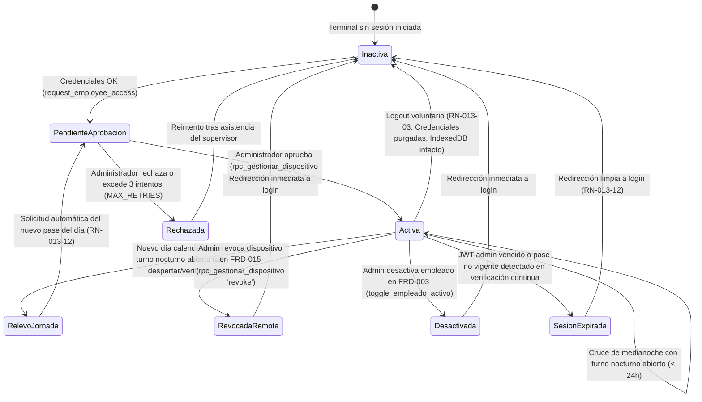

# SDD-013: Gestión de Sesiones y Control de Concurrencia

> **Módulo:** Autenticación / Gestión de Sesiones y Control de Concurrencia  
> **Versión Documental:** 3.1.0 (Enmienda: Verificación Continua de Sesión, Unificación de Criterio de Vigencia y Defensa en Profundidad — Redactado bajo Protocolo PAC-SDD)  
> **Estado:** 🟢 ESPECIFICACIÓN APROBADA  
> **FRD Fuente:** [`documentation/01_requirements/FRD/FRD_013_GESTION_SESIONES.md`](file:///c:/Users/Windows%2011/OneDrive/Desktop/prueba/documentation/01_requirements/FRD/FRD_013_GESTION_SESIONES.md) (v2.1)  
> **SDDs Vecinos Vinculados:** [`SDD_001_SEGURIDAD_DIARIA.md`](file:///c:/Users/Windows%2011/OneDrive/Desktop/prueba/documentation/01_requirements/SDD/SDD_001_SEGURIDAD_DIARIA.md), [`SDD_003_GESTION_EMPLEADOS.md`](file:///c:/Users/Windows%2011/OneDrive/Desktop/prueba/documentation/01_requirements/SDD/SDD_003_GESTION_EMPLEADOS.md), [`SDD_004_CONTROL_DE_CAJA.md`](file:///c:/Users/Windows%2011/OneDrive/Desktop/prueba/documentation/01_requirements/SDD/SDD_004_CONTROL_DE_CAJA.md), [`SDD_012_SINCRONIZACION_OFFLINE.md`](file:///c:/Users/Windows%2011/OneDrive/Desktop/prueba/documentation/01_requirements/SDD/SDD_012_SINCRONIZACION_OFFLINE.md), [`SDD_015_GESTION_DISPOSITIVOS.md`](file:///c:/Users/Windows%2011/OneDrive/Desktop/prueba/documentation/01_requirements/SDD/SDD_015_GESTION_DISPOSITIVOS.md), [`SDD_017_CICLO_CONTABLE_Y_SESIONES.md`](file:///c:/Users/Windows%2011/OneDrive/Desktop/prueba/documentation/01_requirements/SDD/SDD_017_CICLO_CONTABLE_Y_SESIONES.md), [`SDD_028_ALMACENAMIENTO_LOCAL.md`](file:///c:/Users/Windows%2011/OneDrive/Desktop/prueba/documentation/01_requirements/SDD/SDD_028_ALMACENAMIENTO_LOCAL.md)

---

## 0. Evidencia Contextual del Protocolo PAC-SDD

En cumplimiento estricto del Protocolo de Pre-Análisis Contextual (PAC-SDD), este diseño técnico se fundamenta exclusivamente en la evidencia real auditada y contrastada de forma autónoma:

1. **Esquema Real Verificado (PAC Bloque 2):**
   - Se verificaron 7 tablas en el catálogo de PostgreSQL (`ihtjocmhzuliwwvdzfnz`): `daily_passes` (14 columnas), `employees` (9 columnas), `admin_profiles` (5 columnas), `cash_sessions` (12 columnas), `audit_logs` (12 columnas), `audit_seguridad` (8 columnas) y `stores` (9 columnas). Total: 69 columnas físicas verificadas.
   - Constatación anti-alucinación: Las tablas hipotéticas `active_devices` o `user_sessions` NO existen en `public`. La persistencia y el control de concurrencia de dispositivos residen de forma nativa en la entidad viva `daily_passes`.
   - Nomenclatura confirmada: La columna física para el alias numérico del colaborador es `employees.username`.
2. **Seguridad Centralizada (PAC Bloque 3):**
   - Funciones multi-tenant obligatorias verificadas: `public.assert_store_access(p_store_id uuid)` y `public.get_current_store_id()`.
   - Funciones de resolución de identidad de sesión: `public.get_employee_id_from_session()` y `public.is_authorized_employee()`.
   - Reutilización estricta: Toda nueva operación de sesión (`rpc_verificar_estado_sesion`) delega en `get_current_store_id()` y `assert_store_access()` sin duplicar comprobaciones aisladas (Regla 4).
3. **Radio de Impacto Cruzado Auditado (PAC Bloque 4):**
   - Exactamente 8 funciones físicas identificadas en `pg_proc` que referencian `daily_passes`: `check_daily_pass_status`, `check_my_pass_status`, `get_current_store_id`, `get_employee_id_from_session`, `request_employee_access`, `rpc_gestionar_dispositivo`, `solicitar_pase_diario` y `toggle_empleado_activo`.
   - **Hallazgo Crítico H-1:** `check_daily_pass_status` evalúa una ventana móvil de 24 horas (`requested_at > now() - interval '24 hours'`), violando la `RN-013-11`. Provoca que el dispositivo crea que el pase está vigente al día siguiente, mientras el backend lo rechaza con error 42501. Debe ser unificada canónicamente con `pass_date = v_today` / turno nocturno.
   - Desacople comprobado: Se verificó la inexistencia del trigger `trg_expire_passes_on_cash_close` (eliminado en Wave 5); el cierre de caja ordinario o forzado NO altera el estado de `daily_passes`.
   - Concurrencia atómica: `rpc_gestionar_dispositivo` aplica `SELECT FOR UPDATE` y valida `v_active_employees >= 5` arrojando `SESSION_LIMIT_REACHED`.
4. **Contratos Vecinos Validados (PAC Bloque 5):**
   - Compatible 100% con `SDD-001` (solicitud y aprobación diaria), `SDD-003` (límite de 5 colaboradores activos y desactivación vía `toggle_empleado_activo`), `SDD-015` (`rpc_gestionar_dispositivo(p_pass_id UUID, p_action TEXT)`), `SDD-004`/`SDD-017` (independencia logística y cruce de medianoche en turnos < 24h) y `SDD-028` (§4.3 `RN-CACHE-03`: preservación de IndexedDB y colas en logout).
   - Defensa en profundidad: La verificación continua actúa como salvaguarda complementaria ante apagados de pantalla o suspensiones sin sustituir al canal Realtime WebSocket (`H15`, `< 2s`).

---

## 1. Glosario Técnico

- **Pase Diario (`daily_passes`):** Token transaccional de autorización temporal emitido por el Administrador que habilita a un colaborador de mostrador a operar en el sistema para una fecha calendario determinada (`pass_date`).
- **Concurrencia de Dispositivos (`P_MAX_EMPLOYEES_PER_STORE`):** Parámetro de arquitectura que restringe la capacidad simultánea por tienda a un máximo estricto de 1 Administrador y hasta 5 colaboradores con Pase Diario aprobado (`status = 'approved'`).
- **Desacople Caja-Sesión:** Principio arquitectural (`POL-LOG-01`) según el cual el estado contable de la caja física (`cash_sessions`) no interfiere con la vigencia de la sesión ni del pase diario del colaborador para tareas logísticas no monetarias (toma de inventario, consulta de catálogo).
- **Logout Selectivo:** Procedimiento de desautenticación voluntaria que destruye credenciales y tokens JWT volátiles, pero preserva de forma obligatoria los catálogos en caché y las colas de sincronización offline pendientes (`sync_queue` / DLQ).
- **Huella de Dispositivo (`device_fingerprint`):** Descriptor legible generado en el cliente que combina identificadores del navegador, sistema operativo y terminal física para el reconocimiento visual por parte del Administrador.

---

## 2. Arquitectura y Flujos del Sistema

### 2.1 Diagrama de Secuencia: Ciclo de Vida de la Sesión y Concurrencia

```mermaid
sequenceDiagram
    autonumber
    actor C as Colaborador (Dispositivo)
    actor A as Administrador (Dueño)
    participant UI as Cliente Vue (Auth)
    participant RPC as Backend PostgreSQL
    participant DP as daily_passes (DB)
    participant AUD as audit_logs / audit_seguridad

    Note over C, RPC: 1. SOLICITUD DE ACCESO DIARIO (RN-013-01)
    C->>UI: Ingresa Alias Numérico + PIN
    UI->>RPC: POST request_employee_access(username, pin, device_fingerprint)
    RPC->>RPC: Valida credenciales contra employees (crypt Blowfish)
    
    alt Pase del día ya aprobado previamente
        RPC-->>UI: HTTP 200 { success: true, status: 'approved', employee }
        UI->>UI: Habilita navegación operativa inmediata
    else Sin pase previo
        RPC->>DP: INSERT INTO daily_passes (status = 'pending', pass_date = CURRENT_DATE)
        RPC-->>UI: HTTP 200 { success: true, status: 'pending', pass_id }
        UI->>UI: Transiciona a Sala de Espera reactiva
    end

    Note over A, DP: 2. GESTIÓN DE CONCURRENCIA Y APROBACIÓN (RN-013-02)
    A->>RPC: POST rpc_gestionar_dispositivo(p_pass_id, p_action = 'approve')
    RPC->>DP: SELECT * FROM daily_passes WHERE id = p_pass_id FOR UPDATE
    RPC->>RPC: assert_store_access(v_pass.store_id)
    RPC->>DP: SELECT COUNT(*) WHERE status = 'approved' AND pass_date = CURRENT_DATE
    
    alt Cupo de 5 colaboradores alcanzado
        RPC-->>A: ERROR SESSION_LIMIT_REACHED (Excepción bloqueante)
    else Cupo disponible (< 5)
        RPC->>DP: UPDATE daily_passes SET status = 'approved', approved_by = auth.uid()
        RPC->>AUD: Registra evento DEVICE_ACCESS_APPROVE
        RPC-->>A: HTTP 200 { success: true, data: { status: 'approved' } }
        DP-->>UI: Notificación Realtime / Polling (check_my_pass_status)
        UI->>UI: Desbloquea acceso al menú según permissions
    end

    Note over C, UI: 3. TAREAS NO MONETARIAS CON CAJA CERRADA (RN-013-04 / RN-013-06)
    Note over C, UI: El Administrador cierra caja física (cash_sessions.status = 'closed')
    C->>UI: Realiza conteo físico de inventario (pantalla apagada por intervalos)
    Note over UI: Sesión permanece activa; prohibido emitir alertas GHOST o cierre forzado

    Note over C, RPC: 4. VERIFICACIÓN CONTINUA Y EXPULSIÓN REACTIVA (RN-013-09 a RN-013-15)
    Note over UI: Disparadores: onFocus / onOnline / Intervalo 5m / Error 401 ó STORE_ACCESS_DENIED
    UI->>RPC: POST rpc_verificar_estado_sesion()
    RPC->>RPC: assert_store_access + get_current_store_id()
    
    alt Sesión Válida en Servidor
        RPC-->>UI: HTTP 200 { status: 'active', store_id, role, employee_id }
        Note over UI: Operación continúa sin parpadeos
    else Sesión Expirada / Pase de ayer sin nocturno / Revocada
        RPC-->>UI: HTTP 200 { status: 'requires_login | requires_daily_pass | revoked', reason }
        Note over UI: 1. Oculta datos de negocio inmediatamente
        Note over UI: 2. Vacía carrito en curso (preserva colas offline)
        Note over UI: 3. Un solo aviso y una sola transición (RN-013-12)
        UI->>AUD: Registra evento en audit_seguridad (RN-013-15)
        UI->>UI: BroadcastChannel notifica a todas las pestañas (RN-013-14)
        UI->>UI: Redirección limpia a /login o /daily-waiting-room
    end
```

### 2.2 Diagrama de Estados: Ciclo de Vida de la Sesión



---

## 3. Especificación de Reglas de Negocio (Trazabilidad FRD-013)

### 3.1 RN-013-01: Duración de Sesión y Relevo Automático de Jornada
1. La identidad autenticada persiste en el almacenamiento local del dispositivo del usuario sin expirar por inactividad.
2. Al iniciar la aplicación en un nuevo día calendario astronómico:
   - **Administrador:** Si la sesión maestra de Supabase Auth expiró, el interceptor redirige a login con email y password.
   - **Colaborador:** Si el Pase Diario registrado corresponde a una fecha anterior y la tienda NO cuenta con un turno de caja nocturno abierto, la aplicación transiciona automáticamente a la pantalla de solicitud de Pase Diario del día, teniendo estrictamente prohibido cargar pantallas operativas con datos obsoletos en caché.
3. La sesión de un colaborador finaliza únicamente por:
   - Cierre de sesión voluntario explícito.
   - Desactivación de la cuenta por el Administrador.
   - Revocación remota del dispositivo por el Administrador.

### 3.2 RN-013-02: Límite Estricto de Concurrencia (5 Colaboradores + 1 Admin)
1. El sistema restringe la concurrencia simultánea por tienda a un máximo de:
   - 1 Administrador / Dueño autenticado.
   - Hasta 5 colaboradores con Pase Diario en estado `approved` para la jornada en curso.
2. Si se intenta aprobar un pase que superaría los 5 colaboradores simultáneos, el procedimiento `rpc_gestionar_dispositivo` aborta la transacción con la excepción tipificada `SESSION_LIMIT_REACHED`.
3. La interfaz administrativa presenta el mensaje explícito: *"Límite de dispositivos alcanzado (5). Cierre sesión o revoque un dispositivo para continuar."*

### 3.3 RN-013-03: Comportamiento del Logout Voluntario y Preservación de Datos
1. Cuando cualquier usuario presiona voluntariamente "Cerrar Sesión":
   - Se destruyen inmediatamente los tokens JWT y llaves de acceso en memoria.
   - Se vacía incondicionalmente el carrito de compras en vuelo.
   - En colaboradores, el pase diario actual en el dispositivo es marcado como cerrado.
2. **Gobernanza de Persistencia (Inviolabilidad Contable - `SDD-028` §4.3):**
   - Queda terminantemente prohibido ejecutar `localStorage.clear()` indiscriminado o purgar las bases de datos de `IndexedDB`.
   - Los catálogos locales (`products`, `clients`) se preservan intactos para optimización de ancho de banda.
   - Las colas de sincronización offline (`sync_queue` / `mutation_queue` y `dead_letter_queue`) se mantienen íntegras para que las transacciones pendientes puedan sincronizarse en la siguiente jornada sin pérdida económica.

### 3.4 RN-013-04: Continuidad Operativa e Inmunidad ante Inactividad
1. El sistema no implementa temporizadores de cierre de sesión por inactividad (`idle timeout`).
2. El sistema tiene prohibido clasificar como abandono o emitir alertas de seguridad (`GHOST`) cuando la pantalla de un colaborador se apague o permanezca sin interacción mientras realiza labores no monetarias (conteo físico de inventario en bodega).

### 3.5 RN-013-05: Desactivación Reactiva en Tiempo Real
1. Cuando el Administrador conmuta el estado de un colaborador a inactivo (`toggle_empleado_activo(p_employee_id, false)`):
   - El procedimiento actualiza de forma atómica los pases diarios vigentes del empleado en `daily_passes` fijando `status = 'rejected'`.
   - Las peticiones transaccionales subsecuentes son repudiadas inmediatamente en el servidor.
   - El cliente expulsa al usuario al login con el mensaje: *"Tu cuenta ha sido desactivada. Contacta al administrador."*

### 3.6 RN-013-06: Desacople Absoluto entre Caja y Pases Diarios
1. El cierre de un turno de caja (`cash_sessions.status = 'closed'`), sea regular o forzado por la regla de 24 horas, **no invalida ni expira los Pases Diarios** de los colaboradores.
2. El estado cerrado de la caja inhabilita exclusivamente las operaciones monetarias (cobros POS, egresos, gastos en efectivo).
3. Los colaboradores con Pase Diario vigente continúan facultados para ejecutar todas las labores logísticas y de consulta autorizadas en sus permisos.

### 3.7 RN-013-07: Continuidad de Turno Nocturno en Cruce de Medianoche
1. Si una tienda mantiene un turno de caja abierto a la medianoche (`opened_at` menor a 24 horas y `status = 'open'`), los pases diarios aprobados del día anterior conservan plena vigencia operativa tras las 00:00:00.
2. El sistema prohíbe interrumpir las ventas o expulsar al personal de mostrador durante el cruce de fecha si el turno contable permanece abierto y activo.

### 3.8 RN-013-08: Revocación Remota Administrativa
1. El Administrador puede revocar en caliente el dispositivo de un colaborador mediante `rpc_gestionar_dispositivo(p_pass_id, 'revoke')`.
2. El procedimiento actualiza `status = 'rejected'`, liberando de inmediato un slot en el cupo de concurrencia.
3. El dispositivo afectado recibe la notificación y redirige a login informando: *"Tu sesión fue cerrada por el administrador"*.

### 3.9 RN-013-09: Verificación Continua de Sesión con la Aplicación Abierta
1. El sistema evalúa la vigencia del acceso durante toda la permanencia de la aplicación abierta, sin límite de duración, y no solo al arrancar.
2. La evaluación es obligatoria en:
   - Carga o apertura de la aplicación.
   - Retorno a primer plano (`visibilitychange === 'visible'`) o despertar de suspensión.
   - Reconexión de red (`window.online`).
   - Disparo de eventos de cambio de autenticación (`onAuthStateChange`).
   - Rechazo de cualquier RPC con `401 Unauthorized` o `STORE_ACCESS_DENIED`.
   - Periódicamente cada `P_INTERVALO_VERIFICACION_SESION` (5 minutos) mientras la app esté visible.
3. Esta comprobación es reactiva y defensiva; NO es un temporizador de inactividad (`RN-013-04`).

### 3.10 RN-013-10: Autoridad Única del Servidor sobre la Vigencia
1. El servidor es la única autoridad sobre si una sesión es vigente. El cliente tiene prohibido deducir vigencia de flags locales en `localStorage`.
2. La consulta responde uno de cuatro estados canónicos: `active`, `requires_login`, `requires_daily_pass`, `revoked_or_disabled`.
3. Aplica a Administradores y a Colaboradores sin excepción.

### 3.11 RN-013-11: Definición Única de "Acceso Vigente"
1. **Administrador:** Sesión maestra de Supabase Auth activa con perfil en `admin_profiles`.
2. **Colaborador:** Pase Diario aprobado para `pass_date = v_today` (Bogotá), o `pass_date = v_today - 1` si existe turno nocturno con caja abierta `< 24h`.
3. Coexistencia prohibida: La función de verificación (`rpc_verificar_estado_sesion`) y los procedimientos de autorización backend aplican exactamente este mismo predicado.

### 3.12 RN-013-12: Respuesta Ante la Pérdida de Acceso Detectada con la App Abierta
1. Ocultamiento inmediato de datos sensibles de negocio.
2. Vaciado del carrito de venta en curso; preservación estricta de ventas confirmadas en cola offline (`sync_queue` / DLQ).
3. Redirección al destino según motivo:
   - Admin vencido o Colaborador desactivado/revocado → `/login`.
   - Colaborador sin pase del día → `/daily-waiting-room` (Solicitud a 1 toque).
4. Unificación de experiencia: Un solo aviso y una sola transición aunque fallen múltiples consultas concurrentes.

### 3.13 RN-013-13: La Pérdida de Acceso Nunca es Silenciosa
1. Prohibido mostrar paneles vacíos, ceros o pantallas en blanco ante pérdida de sesión.
2. Distinción offline: Sin red, el sistema opera normalmente en modo offline sin expulsar al usuario. La verificación se posterga hasta la reconexión.

### 3.14 RN-013-14: Coherencia entre Pestañas y Ventanas del Mismo Dispositivo
Al detectarse pérdida de acceso en una pestaña, se transmite un pulso por `BroadcastChannel('tienda-auth-sync')` expulsando sincrónicamente a todas las ventanas abiertas en el mismo navegador.

### 3.15 RN-013-15: Trazabilidad de la Pérdida de Acceso
Inserción de un único registro de seguridad en `audit_seguridad` con `event_type = 'SESSION_EXPIRED'` o `'ACCESS_REVOKED'` consolidando la causa técnica.

---

## 4. Casos Límite y Manejo de Contingencias

| Caso Límite | Condición del Sistema | Comportamiento Técnico | Código de Retorno | Acción en UI |
|---|---|---|---|---|
| **CL-SES-01** | Intento de 6ta terminal activa | Admin intenta aprobar pase excediendo el cupo de 5 empleados activos. | `SESSION_LIMIT_REACHED` | Modal de advertencia con lista de dispositivos para revocar. |
| **CL-SES-02** | Reingreso al día siguiente | Colaborador abre la app tras finalizar jornada previa sin haber hecho logout. | `PASS_EXPIRED_CALENDAR` | Redirección automática a la solicitud de Pase Diario del nuevo día. |
| **CL-SES-03** | Caja cerrada con pase activo | Colaborador con pase aprobado intenta registrar venta POS con caja cerrada. | `NO_OPEN_CASH_SESSION` | Toast bloqueante: "Caja cerrada para cobros. Módulos logísticos disponibles." |
| **CL-SES-04** | Inactividad prolongada en bodega | Dispositivo apaga pantalla durante 45 minutos mientras cuenta estanterías. | Sesión Intacta | Al encender pantalla, el usuario continúa en la misma vista sin recarga. |
| **CL-SES-05** | Empleado desactivado en nómina | Administrador apaga toggle de empleado activo mientras el colaborador opera. | `ACCOUNT_DISABLED` | Expulsión defensiva inmediata al login con banner explicativo. |
| **CL-SES-06** | Cruce de 00:00 con caja abierta | Turno de caja continúa abierto a las 00:15 AM y colaborador procesa venta. | Transacción Aceptada | Venta procesada normalmente imputada al turno abierto nocturno. |
| **CL-SES-07** | Admin abierto varios días | Sesión maestra vencida en Supabase; frontend despierta tras suspensión. | `ADMIN_SESSION_EXPIRED` | Un solo aviso: "Tu sesión terminó. Inicia sesión nuevamente" y redirección a `/login`. |
| **CL-SES-08** | Colaborador abierta toda la noche | App abierta sin turno nocturno; amanece un nuevo día calendario. | `REQUIRES_DAILY_PASS` | Redirección automática a `/daily-waiting-room` sin parches ni errores técnicos. |
| **CL-SES-09** | Avalancha de errores 400 por sesión | 4 o más RPCs paralelos devuelven `STORE_ACCESS_DENIED`. | `STORE_ACCESS_DENIED` | El interceptor deduplica las llamadas, ejecuta `rpc_verificar_estado_sesion` 1 sola vez y muestra 1 solo aviso. |
| **CL-SES-10** | Pérdida de red vs pérdida de sesión | Petición falla por `TypeError: Failed to fetch`. | Modo Offline | Se conserva la pantalla actual; no se confunde caída de red con revocación de credenciales. |
| **CL-SES-11** | Multiventana en misma tablet | Usuario pierde sesión en pestaña A. | `SESSION_BROADCAST_SYNC` | Pestaña B recibe señal vía `BroadcastChannel` y redirige a login inmediatamente. |

---

## 5. Contrato de Interfaz

### 5.1 Operación: `request_employee_access` (Solicitud de Acceso Inicial)

- **Tipo:** RPC PostgreSQL / Acción (WRITE)
- **Firma de Entrada:**
  ```json
  {
    "p_username": "TEXT (Obligatorio, alias numérico del colaborador)",
    "p_pin": "TEXT (Obligatorio, PIN numérico de 4 dígitos)",
    "p_device_fingerprint": "TEXT (Opcional, huella legible del dispositivo)"
  }
  ```
- **Respuesta Exitosa (HTTP 200 - Ya Aprobado):**
  ```json
  {
    "success": true,
    "status": "approved",
    "pass_id": "UUID",
    "employee": {
      "id": "UUID",
      "name": "Carlos Mostrador",
      "role": "employee",
      "store_id": "UUID",
      "permissions": {
        "canSell": true,
        "canFiar": false,
        "canViewReports": false,
        "canOpenCloseCash": false,
        "canViewInventory": true
      }
    }
  }
  ```
- **Respuesta Exitosa (HTTP 200 - Solicitud Pendiente Creada):**
  ```json
  {
    "success": true,
    "status": "pending",
    "pass_id": "UUID",
    "employee": {
      "id": "UUID",
      "name": "Carlos Mostrador",
      "role": "employee",
      "store_id": "UUID",
      "permissions": { ... }
    }
  }
  ```
- **Respuesta de Rechazo (Excepciones Tipificadas):**
  ```json
  {
    "success": false,
    "code": "INVALID_CREDENTIALS | USER_NOT_FOUND | MAX_RETRIES | ALREADY_PROCESSED",
    "message": "Descripción técnica del rechazo"
  }
  ```

---

### 5.2 Operación: `check_my_pass_status` (Sondeo Reactivo de Estado de Pase)

- **Tipo:** RPC PostgreSQL / Lectura (READ)
- **Firma de Entrada:**
  ```json
  {
    "p_pass_id": "UUID (Obligatorio, identificador de la solicitud de pase)"
  }
  ```
- **Respuesta Exitosa (HTTP 200 - Aprobado):**
  ```json
  {
    "status": "approved",
    "employee": {
      "id": "UUID",
      "name": "Carlos Mostrador",
      "role": "employee",
      "store_id": "UUID",
      "username": "10203040",
      "permissions": { ... }
    }
  }
  ```
- **Respuesta Exitosa (HTTP 200 - Pendiente / Rechazado):**
  ```json
  {
    "status": "pending | rejected | expired | not_found"
  }
  ```

---

### 5.3 Operación: `solicitar_pase_diario` (Reintento de Solicitud de Pase)

- **Tipo:** RPC PostgreSQL / Acción (WRITE)
- **Firma de Entrada:**
  ```json
  {
    "p_employee_id": "UUID (Obligatorio)",
    "p_device_fingerprint": "TEXT (Opcional)"
  }
  ```
- **Respuesta Exitosa (HTTP 200):**
  ```json
  {
    "success": true,
    "status": "pending",
    "pass_id": "UUID",
    "retry_count": 1
  }
  ```
- **Respuesta de Rechazo:**
  ```json
  {
    "success": false,
    "code": "MAX_RETRIES | INVALID_CREDENTIALS | ALREADY_PROCESSED",
    "error": "Límite de intentos alcanzado. Contacte a su supervisor."
  }
  ```

---

### 5.4 Operación: `rpc_gestionar_dispositivo` (Aprobación / Rechazo / Revocación Administrativa)

- **Tipo:** RPC PostgreSQL / Acción Administrativa (WRITE)
- **Seguridad:** Invocable exclusivamente por usuarios en `admin_profiles` de la tienda correspondiente (`assert_store_access`).
- **Firma de Entrada:**
  ```json
  {
    "p_pass_id": "UUID (Obligatorio, identificador del pase a gestionar)",
    "p_action": "TEXT (Obligatorio: 'approve' | 'reject' | 'revoke')"
  }
  ```
- **Respuesta Exitosa (HTTP 200):**
  ```json
  {
    "success": true,
    "data": {
      "pass_id": "UUID",
      "employee_id": "UUID",
      "status": "approved | rejected",
      "resolved_at": "2026-10-24T18:00:00Z",
      "resolved_by": "UUID"
    }
  }
  ```
- **Errores como Excepciones (Regla 3 `AGENTS.md`):**
  - `PASS_NOT_FOUND (P0002)`: El pase especificado no existe.
  - `UNAUTHORIZED_ACTOR (42501)`: Solo el Administrador de la tienda puede gestionar dispositivos.
  - `EXPIRED_PASS_DATE (P0001)`: No se puede aprobar un pase con fecha diferente al día en curso.
  - `SESSION_LIMIT_REACHED (P0001)`: Se alcanzó el límite máximo de 5 terminales de colaboradores autorizadas simultáneamente.
  - `INVALID_ACTION (22023)`: Acción no reconocida.

---

### 5.5 Operación: `toggle_empleado_activo` (Desactivación Reactiva con Revocación Atómica)

- **Tipo:** RPC PostgreSQL / Acción Administrativa (WRITE)
- **Firma de Entrada:**
  ```json
  {
    "p_employee_id": "UUID (Obligatorio)",
    "p_new_status": "BOOLEAN (true para reactivar, false para desactivar)"
  }
  ```
- **Respuesta Exitosa (HTTP 200):**
  ```json
  {
    "success": true,
    "data": {
      "new_status": false
    }
  }
  ```

---

### 5.6 Operación: `rpc_verificar_estado_sesion` (Verificación Continua de Sesión Reactiva)

- **Tipo:** RPC PostgreSQL / Consulta Centralizada de Acceso (READ - `SECURITY DEFINER`)
- **Firma de Entrada:** Ninguna (`{}`) — opera sobre el contexto de autenticación de Supabase (`auth.uid()`, `auth.jwt()`).
- **Seguridad (Regla 4 `AGENTS.md`):**
  - Invocable por roles `anon` y `authenticated`.
  - Reutiliza de forma obligatoria las funciones centrales:
    ```sql
    v_store_id := public.get_current_store_id();
    v_employee_id := public.get_employee_id_from_session();
    ```
  - Si `v_store_id IS NOT NULL`, ejecuta:
    ```sql
    PERFORM public.assert_store_access(v_store_id);
    ```
- **Respuesta Exitosa (HTTP 200 - Sesión Vigente en Servidor):**
  ```json
  {
    "success": true,
    "status": "active",
    "store_id": "UUID",
    "role": "admin | employee",
    "employee_id": "UUID | null",
    "reason": "SESSION_VALID"
  }
  ```
- **Respuesta Exitosa (HTTP 200 - Pérdida de Acceso Tipificada sin Excepción Bloqueante):**
  > **Nota Arquitectural:** Para evitar que el sondeo defensivo arroje errores `400 Bad Request` en la consola del navegador, la consulta devuelve `success: false` estructurado cuando detecta que la sesión no es válida, permitiendo al cliente orquestar la transición limpia sin generar ruido en los registros.
  ```json
  {
    "success": false,
    "status": "requires_login | requires_daily_pass | revoked_or_disabled",
    "code": "AUTH_EXPIRED | PASS_EXPIRED_CALENDAR | DEVICE_REVOKED | ACCOUNT_DISABLED",
    "message": "Descripción técnica amigable",
    "redirect_to": "login | daily_waiting_room"
  }
  ```

---

## 6. Seguridad y Permisos

1. **Aislamiento Multi-Tenant (Regla 4 `AGENTS.md`):**
   - Todas las funciones y RPCs administrativas invocan obligatoriamente:
     ```
     PERFORM public.assert_store_access(v_store_id);
     ```
   - La identidad del colaborador anónimo se asocia a su tienda mediante el paso 4 de `get_current_store_id()`.
2. **Defensa contra Condiciones de Carrera en Concurrencia:**
   - Para garantizar que jamás se autoricen más de 5 colaboradores en la misma tienda, `rpc_gestionar_dispositivo` ejecuta obligatoriamente un bloqueo de fila pesimista:
     ```
     SELECT * FROM public.daily_passes WHERE id = p_pass_id FOR UPDATE;
     ```
   - El conteo de terminales activas se evalúa dentro de la misma transacción atómica antes de conmutar el estado a `'approved'`.
3. **Auditoría Forense Inmutable (`POL-AUD-02`):**
   - Toda aprobación, rechazo o revocación de dispositivo inserta un registro atómico en `audit_logs` con `event_type = 'DEVICE_ACCESS_' || UPPER(p_action)` y en `audit_seguridad`.

---

## 7. Modelo de Datos Físico (Catálogo Real PostgreSQL)

El diseño opera estrictamente sobre las 7 tablas físicas verificadas en el Bloque 2:

1. **`daily_passes` (14 columnas):**
   `id` (uuid, PK), `employee_id` (uuid, FK), `pass_date` (date), `status` (text), `device_fingerprint` (text), `retry_count` (integer), `requested_at` (timestamptz), `resolved_at` (timestamptz), `resolved_by` (uuid), `store_id` (uuid), `auth_user_id` (uuid), `approved_at` (timestamptz), `approved_by` (uuid), `updated_at` (timestamptz).
2. **`employees` (9 columnas):**
   `id` (uuid, PK), `store_id` (uuid, FK), `name` (text), `username` (text, alias numérico), `pin_hash` (text), `is_active` (boolean), `permissions` (jsonb), `created_at` (timestamptz), `updated_at` (timestamptz).
3. **`admin_profiles` (5 columnas):**
   `id` (uuid, PK), `store_id` (uuid, FK), `role` (text), `is_verified` (boolean), `created_at` (timestamptz).
4. **`cash_sessions` (12 columnas):**
   `id` (uuid, PK), `store_id` (uuid), `opened_by` (uuid), `closed_by` (uuid), `opening_balance` (numeric), `expected_balance` (numeric), `actual_balance` (numeric), `difference` (numeric), `status` (text), `opened_at` (timestamptz), `closed_at` (timestamptz), `forced_close` (boolean).
5. **`audit_logs` (12 columnas):**
   `id` (uuid, PK), `actor_id` (uuid), `event_type` (text), `resource_id` (text), `metadata` (jsonb), `created_at` (timestamptz), `store_id` (uuid), `severity` (text), `ip_address` (text), `reviewed_by` (uuid), `reviewed_at` (timestamptz), `review_notes` (text).
6. **`audit_seguridad` (8 columnas):**
   `id` (uuid, PK), `actor_id` (uuid), `store_id` (uuid), `event_type` (text), `ip_address` (text), `user_agent` (text), `created_at` (timestamptz), `metadata` (jsonb).
7. **`stores` (9 columnas):**
   `id` (uuid, PK), `name` (text), `slug` (text), `subscription_plan` (text), `store_pin_hash` (text), `created_at` (timestamptz), `updated_at` (timestamptz), `pin_hash` (text), `crypto_salt` (text).

---

## 8. Registro de Deuda Técnica Documentada

En cumplimiento de la Regla 7 de `AGENTS.md`, se registran las decisiones y adaptaciones técnicas:

| ID | Hallazgo / Requerimiento | Justificación / Trade-off | Condición de Revisión |
|---|---|---|---|
| **D-SES-01** | Cruce de medianoche en usuarios anónimos | `get_current_store_id()` evalúa `pass_date = (now() AT TIME ZONE 'America/Bogota')::date`. Los colaboradores que operan turnos nocturnos con caja abierta del día anterior cuentan con fallback de tolerancia `< 24h` ya integrado en BD. | Consolidación en Ola 6 SQL. |
| **D-SES-02** | Dualidad de columnas de aprobación en `daily_passes` | Coexisten `(resolved_at, resolved_by)` y `(approved_at, approved_by)`. `rpc_gestionar_dispositivo` actualiza ambos pares simultáneamente para no romper compatibilidad. | Limpieza de esquema en consolidación final. |
| **D-SES-03** | Preservación de colas en logout selectivo | Se norma a nivel de composables en frontend (`authStore.logout()`) la destrucción exclusiva de tokens sin tocar `IndexedDB` para cumplir con `POL-AUD-01` y `SDD-028`. | Verificación con tests E2E de logout. |
| **D-SES-04** | Discrepancia temporal en `check_daily_pass_status` (PAC Bloque 4 H-1) | `check_daily_pass_status` evalúa ventana móvil de 24 horas (`requested_at > now() - interval '24 hours'`), violando `RN-013-11`. Debe alinearse canónicamente con `pass_date = v_today` / turno nocturno. | Migración de sesión unificada en Ola 6 SQL. |
| **D-SES-05** | Deprecación y purga de `useSessionManager.ts` | El archivo `useSessionManager.ts` es código muerto no importado que implementa un timeout de 30 minutos por inactividad (`SESSION_TIMEOUT_MS`), en abierta contradicción con `RN-013-04`. | Purga física en la orden de trabajo WO de frontend. |
