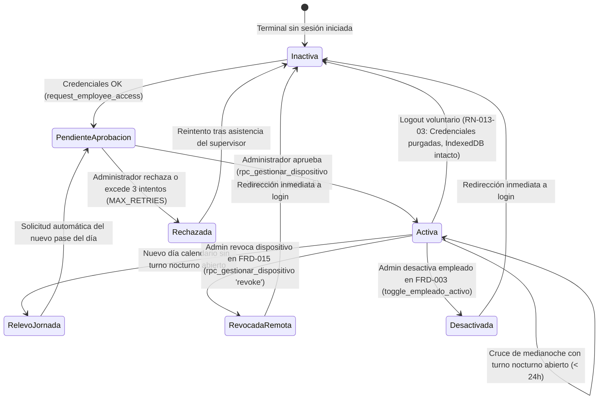

# SDD-013: Gestión de Sesiones y Control de Concurrencia

> **Módulo:** Autenticación / Gestión de Sesiones y Control de Concurrencia  
> **Versión Documental:** 3.0.0 (Redactado bajo Protocolo PAC-SDD)  
> **Estado:** 🟢 ESPECIFICACIÓN APROBADA  
> **FRD Fuente:** [`documentation/01_requirements/FRD/FRD_013_GESTION_SESIONES.md`](file:///c:/Users/Windows%2011/OneDrive/Desktop/prueba/documentation/01_requirements/FRD/FRD_013_GESTION_SESIONES.md)  
> **SDDs Vecinos Vinculados:** [`SDD_001_SEGURIDAD_DIARIA.md`](file:///c:/Users/Windows%2011/OneDrive/Desktop/prueba/documentation/01_requirements/SDD/SDD_001_SEGURIDAD_DIARIA.md), [`SDD_003_GESTION_EMPLEADOS.md`](file:///c:/Users/Windows%2011/OneDrive/Desktop/prueba/documentation/01_requirements/SDD/SDD_003_GESTION_EMPLEADOS.md), [`SDD_004_CONTROL_DE_CAJA.md`](file:///c:/Users/Windows%2011/OneDrive/Desktop/prueba/documentation/01_requirements/SDD/SDD_004_CONTROL_DE_CAJA.md), [`SDD_012_SINCRONIZACION_OFFLINE.md`](file:///c:/Users/Windows%2011/OneDrive/Desktop/prueba/documentation/01_requirements/SDD/SDD_012_SINCRONIZACION_OFFLINE.md), [`SDD_015_GESTION_DISPOSITIVOS.md`](file:///c:/Users/Windows%2011/OneDrive/Desktop/prueba/documentation/01_requirements/SDD/SDD_015_GESTION_DISPOSITIVOS.md), [`SDD_017_CICLO_CONTABLE_Y_SESIONES.md`](file:///c:/Users/Windows%2011/OneDrive/Desktop/prueba/documentation/01_requirements/SDD/SDD_017_CICLO_CONTABLE_Y_SESIONES.md), [`SDD_028_ALMACENAMIENTO_LOCAL.md`](file:///c:/Users/Windows%2011/OneDrive/Desktop/prueba/documentation/01_requirements/SDD/SDD_028_ALMACENAMIENTO_LOCAL.md)

---

## 0. Evidencia Contextual del Protocolo PAC-SDD

En cumplimiento estricto del Protocolo de Pre-Análisis Contextual (PAC-SDD), este diseño técnico se fundamenta exclusivamente en la evidencia real auditada y contrastada de forma autónoma:

1. **Esquema Real Verificado (PAC Bloque 2):**
   - Se verificaron 5 tablas en el catálogo de PostgreSQL (`ihtjocmhzuliwwvdzfnz`): `daily_passes` (14 columnas), `employees` (9 columnas), `admin_profiles` (5 columnas), `cash_sessions` (12 columnas) y `audit_logs` (12 columnas). Total: 52 columnas físicas verificadas.
   - Constatación anti-alucinación: Las tablas hipotéticas `active_devices` o `user_sessions` NO existen en `public`. La persistencia y el control de concurrencia de dispositivos residen de forma nativa en la entidad viva `daily_passes`.
   - Nomenclatura confirmada: La columna física para el alias numérico del colaborador es `employees.username`.
2. **Seguridad Centralizada (PAC Bloque 3):**
   - Funciones multi-tenant obligatorias: `public.assert_store_access(p_store_id uuid)` y `public.get_current_store_id()`.
   - Funciones de resolución de identidad de sesión: `public.get_employee_id_from_session()` y `public.is_authorized_employee()`.
3. **Radio de Impacto Cruzado Auditado (PAC Bloque 4):**
   - 9 funciones y procedimientos identificados en `pg_proc` que gobiernan el ciclo de vida de `daily_passes`.
   - Desacople comprobado: Se verificó la inexistencia del trigger `trg_expire_passes_on_cash_close` (eliminado en Wave 5); el cierre de caja ordinario o forzado NO altera el estado de `daily_passes`.
   - Concurrencia atómica: `rpc_gestionar_dispositivo` aplica `SELECT FOR UPDATE` y valida `v_active_employees >= 5` arrojando `SESSION_LIMIT_REACHED`.
4. **Contratos Vecinos Validados (PAC Bloque 5):**
   - Compatible 100% con `SDD-001` (solicitud y aprobación diaria), `SDD-003` (límite de 5 colaboradores activos y desactivación vía `toggle_empleado_activo`), `SDD-015` (`rpc_gestionar_dispositivo(p_pass_id UUID, p_action TEXT)`), `SDD-004`/`SDD-017` (independencia logística y cruce de medianoche en turnos < 24h) y `SDD-028` (§4.3 `RN-CACHE-03`: preservación de IndexedDB y colas en logout).

---

## 1. Glosario Técnico

- **Pase Diario (`daily_passes`):** Token transaccional de autorización temporal emitido por el Administrador que habilita a un colaborador de mostrador a operar en el sistema para una fecha calendario determinada (`pass_date`).
- **Concurrencia de Dispositivos (`P_MAX_EMPLOYEES_PER_STORE`):** Parámetro de arquitectura que restringe la capacidad simultánea por tienda a un máximo estricto de 1 Administrador y hasta 5 colaboradores con Pase Diario aprobado (`status = 'approved'`).
- **Desacople Caja-Sesión:** Principio arquitectural (`POL-LOG-01`) según el cual el estado contable de la caja física (`cash_sessions`) no interfiere con la vigencia de la sesión ni del pase diario del colaborador para tareas logísticas no monetarias (toma de inventario, consulta de catálogo).
- **Logout Selectivo:** Procedimiento de desautenticación voluntaria que destruye credenciales y tokens JWT volátiles, pero preserva de forma obligatoria los catálogos en caché y las colas de sincronización offline pendientes (`sync_queue` / DLQ).
- **Huella de Dispositivo (`device_fingerprint`):** Descriptor legible generado en el cliente que combina identificadores del navegador, sistema operativo y terminal física para el reconocimiento visual por parte del Administrador.

---

## 2. Arquitectura y Flujos del Sistema

### 2.1 Diagrama de Secuencia: Ciclo de Vida de la Sesión y Concurrencia

```mermaid
sequenceDiagram
    autonumber
    actor C as Colaborador (Dispositivo)
    actor A as Administrador (Dueño)
    participant UI as Cliente Vue (Auth)
    participant RPC as Backend PostgreSQL
    participant DP as daily_passes (DB)
    participant AUD as audit_logs / audit_seguridad

    Note over C, RPC: 1. SOLICITUD DE ACCESO DIARIO (RN-013-01)
    C->>UI: Ingresa Alias Numérico + PIN
    UI->>RPC: POST request_employee_access(username, pin, device_fingerprint)
    RPC->>RPC: Valida credenciales contra employees (crypt Blowfish)
    
    alt Pase del día ya aprobado previamente
        RPC-->>UI: HTTP 200 { success: true, status: 'approved', employee }
        UI->>UI: Habilita navegación operativa inmediata
    else Sin pase previo
        RPC->>DP: INSERT INTO daily_passes (status = 'pending', pass_date = CURRENT_DATE)
        RPC-->>UI: HTTP 200 { success: true, status: 'pending', pass_id }
        UI->>UI: Transiciona a Sala de Espera reactiva
    end

    Note over A, DP: 2. GESTIÓN DE CONCURRENCIA Y APROBACIÓN (RN-013-02)
    A->>RPC: POST rpc_gestionar_dispositivo(p_pass_id, p_action = 'approve')
    RPC->>DP: SELECT * FROM daily_passes WHERE id = p_pass_id FOR UPDATE
    RPC->>RPC: assert_store_access(v_pass.store_id)
    RPC->>DP: SELECT COUNT(*) WHERE status = 'approved' AND pass_date = CURRENT_DATE
    
    alt Cupo de 5 colaboradores alcanzado
        RPC-->>A: ERROR SESSION_LIMIT_REACHED (Excepción bloqueante)
    else Cupo disponible (< 5)
        RPC->>DP: UPDATE daily_passes SET status = 'approved', approved_by = auth.uid()
        RPC->>AUD: Registra evento DEVICE_ACCESS_APPROVE
        RPC-->>A: HTTP 200 { success: true, data: { status: 'approved' } }
        DP-->>UI: Notificación Realtime / Polling (check_my_pass_status)
        UI->>UI: Desbloquea acceso al menú según permissions
    end

    Note over C, UI: 3. TAREAS NO MONETARIAS CON CAJA CERRADA (RN-013-04 / RN-013-06)
    Note over C, UI: El Administrador cierra caja física (cash_sessions.status = 'closed')
    C->>UI: Realiza conteo físico de inventario (pantalla apagada por intervalos)
    Note over UI: Sesión permanece activa; prohibido emitir alertas GHOST o cierre forzado
```

### 2.2 Diagrama de Estados: Ciclo de Vida de la Sesión



---

## 3. Especificación de Reglas de Negocio (Trazabilidad FRD-013)

### 3.1 RN-013-01: Duración de Sesión y Relevo Automático de Jornada
1. La identidad autenticada persiste en el almacenamiento local del dispositivo del usuario sin expirar por inactividad.
2. Al iniciar la aplicación en un nuevo día calendario astronómico:
   - **Administrador:** Si la sesión maestra de Supabase Auth expiró, el interceptor redirige a login con email y password.
   - **Colaborador:** Si el Pase Diario registrado corresponde a una fecha anterior y la tienda NO cuenta con un turno de caja nocturno abierto, la aplicación transiciona automáticamente a la pantalla de solicitud de Pase Diario del día, teniendo estrictamente prohibido cargar pantallas operativas con datos obsoletos en caché.
3. La sesión de un colaborador finaliza únicamente por:
   - Cierre de sesión voluntario explícito.
   - Desactivación de la cuenta por el Administrador.
   - Revocación remota del dispositivo por el Administrador.

### 3.2 RN-013-02: Límite Estricto de Concurrencia (5 Colaboradores + 1 Admin)
1. El sistema restringe la concurrencia simultánea por tienda a un máximo de:
   - 1 Administrador / Dueño autenticado.
   - Hasta 5 colaboradores con Pase Diario en estado `approved` para la jornada en curso.
2. Si se intenta aprobar un pase que superaría los 5 colaboradores simultáneos, el procedimiento `rpc_gestionar_dispositivo` aborta la transacción con la excepción tipificada `SESSION_LIMIT_REACHED`.
3. La interfaz administrativa presenta el mensaje explícito: *"Límite de dispositivos alcanzado (5). Cierre sesión o revoque un dispositivo para continuar."*

### 3.3 RN-013-03: Comportamiento del Logout Voluntario y Preservación de Datos
1. Cuando cualquier usuario presiona voluntariamente "Cerrar Sesión":
   - Se destruyen inmediatamente los tokens JWT y llaves de acceso en memoria.
   - Se vacía incondicionalmente el carrito de compras en vuelo.
   - En colaboradores, el pase diario actual en el dispositivo es marcado como cerrado.
2. **Gobernanza de Persistencia (Inviolabilidad Contable - `SDD-028` §4.3):**
   - Queda terminantemente prohibido ejecutar `localStorage.clear()` indiscriminado o purgar las bases de datos de `IndexedDB`.
   - Los catálogos locales (`products`, `clients`) se preservan intactos para optimización de ancho de banda.
   - Las colas de sincronización offline (`sync_queue` / `mutation_queue` y `dead_letter_queue`) se mantienen íntegras para que las transacciones pendientes puedan sincronizarse en la siguiente jornada sin pérdida económica.

### 3.4 RN-013-04: Continuidad Operativa e Inmunidad ante Inactividad
1. El sistema no implementa temporizadores de cierre de sesión por inactividad (`idle timeout`).
2. El sistema tiene prohibido clasificar como abandono o emitir alertas de seguridad (`GHOST`) cuando la pantalla de un colaborador se apague o permanezca sin interacción mientras realiza labores no monetarias (conteo físico de inventario en bodega).

### 3.5 RN-013-05: Desactivación Reactiva en Tiempo Real
1. Cuando el Administrador conmuta el estado de un colaborador a inactivo (`toggle_empleado_activo(p_employee_id, false)`):
   - El procedimiento actualiza de forma atómica los pases diarios vigentes del empleado en `daily_passes` fijando `status = 'rejected'`.
   - Las peticiones transaccionales subsecuentes son repudiadas inmediatamente en el servidor.
   - El cliente expulsa al usuario al login con el mensaje: *"Tu cuenta ha sido desactivada. Contacta al administrador."*

### 3.6 RN-013-06: Desacople Absoluto entre Caja y Pases Diarios
1. El cierre de un turno de caja (`cash_sessions.status = 'closed'`), sea regular o forzado por la regla de 24 horas, **no invalida ni expira los Pases Diarios** de los colaboradores.
2. El estado cerrado de la caja inhabilita exclusivamente las operaciones monetarias (cobros POS, egresos, gastos en efectivo).
3. Los colaboradores con Pase Diario vigente continúan facultados para ejecutar todas las labores logísticas y de consulta autorizadas en sus permisos.

### 3.7 RN-013-07: Continuidad de Turno Nocturno en Cruce de Medianoche
1. Si una tienda mantiene un turno de caja abierto a la medianoche (`opened_at` menor a 24 horas y `status = 'open'`), los pases diarios aprobados del día anterior conservan plena vigencia operativa tras las 00:00:00.
2. El sistema prohíbe interrumpir las ventas o expulsar al personal de mostrador durante el cruce de fecha si el turno contable permanece abierto y activo.

### 3.8 RN-013-08: Revocación Remota Administrativa
1. El Administrador puede revocar en caliente el dispositivo de un colaborador mediante `rpc_gestionar_dispositivo(p_pass_id, 'revoke')`.
2. El procedimiento actualiza `status = 'rejected'`, liberando de inmediato un slot en el cupo de concurrencia.
3. El dispositivo afectado recibe la notificación y redirige a login informando: *"Tu sesión fue cerrada por el administrador"*.

---

## 4. Casos Límite y Manejo de Contingencias

| Caso Límite | Condición del Sistema | Comportamiento Técnico | Código de Retorno | Acción en UI |
|---|---|---|---|---|
| **CL-SES-01** | Intento de 6ta terminal activa | Admin intenta aprobar pase excediendo el cupo de 5 empleados activos. | `SESSION_LIMIT_REACHED` | Modal de advertencia con lista de dispositivos para revocar. |
| **CL-SES-02** | Reingreso al día siguiente | Colaborador abre la app tras finalizar jornada previa sin haber hecho logout. | `PASS_EXPIRED_CALENDAR` | Redirección automática a la solicitud de Pase Diario del nuevo día. |
| **CL-SES-03** | Caja cerrada con pase activo | Colaborador con pase aprobado intenta registrar venta POS con caja cerrada. | `NO_OPEN_CASH_SESSION` | Toast bloqueante: "Caja cerrada para cobros. Módulos logísticos disponibles." |
| **CL-SES-04** | Inactividad prolongada en bodega | Dispositivo apaga pantalla durante 45 minutos mientras cuenta estanterías. | Sesión Intacta | Al encender pantalla, el usuario continúa en la misma vista sin recarga. |
| **CL-SES-05** | Empleado desactivado en nómina | Administrador apaga toggle de empleado activo mientras el colaborador opera. | `ACCOUNT_DISABLED` | Expulsión defensiva inmediata al login con banner explicativo. |
| **CL-SES-06** | Cruce de 00:00 con caja abierta | Turno de caja continúa abierto a las 00:15 AM y colaborador procesa venta. | Transacción Aceptada | Venta procesada normalmente imputada al turno abierto nocturno. |

---

## 5. Contrato de Interfaz

### 5.1 Operación: `request_employee_access` (Solicitud de Acceso Inicial)

- **Tipo:** RPC PostgreSQL / Acción (WRITE)
- **Firma de Entrada:**
  ```json
  {
    "p_username": "TEXT (Obligatorio, alias numérico del colaborador)",
    "p_pin": "TEXT (Obligatorio, PIN numérico de 4 dígitos)",
    "p_device_fingerprint": "TEXT (Opcional, huella legible del dispositivo)"
  }
  ```
- **Respuesta Exitosa (HTTP 200 - Ya Aprobado):**
  ```json
  {
    "success": true,
    "status": "approved",
    "pass_id": "UUID",
    "employee": {
      "id": "UUID",
      "name": "Carlos Mostrador",
      "role": "employee",
      "store_id": "UUID",
      "permissions": {
        "canSell": true,
        "canFiar": false,
        "canViewReports": false,
        "canOpenCloseCash": false,
        "canViewInventory": true
      }
    }
  }
  ```
- **Respuesta Exitosa (HTTP 200 - Solicitud Pendiente Creada):**
  ```json
  {
    "success": true,
    "status": "pending",
    "pass_id": "UUID",
    "employee": {
      "id": "UUID",
      "name": "Carlos Mostrador",
      "role": "employee",
      "store_id": "UUID",
      "permissions": { ... }
    }
  }
  ```
- **Respuesta de Rechazo (Excepciones Tipificadas):**
  ```json
  {
    "success": false,
    "code": "INVALID_CREDENTIALS | USER_NOT_FOUND | MAX_RETRIES | ALREADY_PROCESSED",
    "message": "Descripción técnica del rechazo"
  }
  ```

---

### 5.2 Operación: `check_my_pass_status` (Sondeo Reactivo de Estado de Pase)

- **Tipo:** RPC PostgreSQL / Lectura (READ)
- **Firma de Entrada:**
  ```json
  {
    "p_pass_id": "UUID (Obligatorio, identificador de la solicitud de pase)"
  }
  ```
- **Respuesta Exitosa (HTTP 200 - Aprobado):**
  ```json
  {
    "status": "approved",
    "employee": {
      "id": "UUID",
      "name": "Carlos Mostrador",
      "role": "employee",
      "store_id": "UUID",
      "username": "10203040",
      "permissions": { ... }
    }
  }
  ```
- **Respuesta Exitosa (HTTP 200 - Pendiente / Rechazado):**
  ```json
  {
    "status": "pending | rejected | expired | not_found"
  }
  ```

---

### 5.3 Operación: `solicitar_pase_diario` (Reintento de Solicitud de Pase)

- **Tipo:** RPC PostgreSQL / Acción (WRITE)
- **Firma de Entrada:**
  ```json
  {
    "p_employee_id": "UUID (Obligatorio)",
    "p_device_fingerprint": "TEXT (Opcional)"
  }
  ```
- **Respuesta Exitosa (HTTP 200):**
  ```json
  {
    "success": true,
    "status": "pending",
    "pass_id": "UUID",
    "retry_count": 1
  }
  ```
- **Respuesta de Rechazo:**
  ```json
  {
    "success": false,
    "code": "MAX_RETRIES | INVALID_CREDENTIALS | ALREADY_PROCESSED",
    "error": "Límite de intentos alcanzado. Contacte a su supervisor."
  }
  ```

---

### 5.4 Operación: `rpc_gestionar_dispositivo` (Aprobación / Rechazo / Revocación Administrativa)

- **Tipo:** RPC PostgreSQL / Acción Administrativa (WRITE)
- **Seguridad:** Invocable exclusivamente por usuarios en `admin_profiles` de la tienda correspondiente (`assert_store_access`).
- **Firma de Entrada:**
  ```json
  {
    "p_pass_id": "UUID (Obligatorio, identificador del pase a gestionar)",
    "p_action": "TEXT (Obligatorio: 'approve' | 'reject' | 'revoke')"
  }
  ```
- **Respuesta Exitosa (HTTP 200):**
  ```json
  {
    "success": true,
    "data": {
      "pass_id": "UUID",
      "employee_id": "UUID",
      "status": "approved | rejected",
      "resolved_at": "2026-10-24T18:00:00Z",
      "resolved_by": "UUID"
    }
  }
  ```
- **Errores como Excepciones (Regla 3 `AGENTS.md`):**
  - `PASS_NOT_FOUND (P0002)`: El pase especificado no existe.
  - `UNAUTHORIZED_ACTOR (42501)`: Solo el Administrador de la tienda puede gestionar dispositivos.
  - `EXPIRED_PASS_DATE (P0001)`: No se puede aprobar un pase con fecha diferente al día en curso.
  - `SESSION_LIMIT_REACHED (P0001)`: Se alcanzó el límite máximo de 5 terminales de colaboradores autorizadas simultáneamente.
  - `INVALID_ACTION (22023)`: Acción no reconocida.

---

### 5.5 Operación: `toggle_empleado_activo` (Desactivación Reactiva con Revocación Atómica)

- **Tipo:** RPC PostgreSQL / Acción Administrativa (WRITE)
- **Firma de Entrada:**
  ```json
  {
    "p_employee_id": "UUID (Obligatorio)",
    "p_new_status": "BOOLEAN (true para reactivar, false para desactivar)"
  }
  ```
- **Respuesta Exitosa (HTTP 200):**
  ```json
  {
    "success": true,
    "data": {
      "new_status": false
    }
  }
  ```

---

## 6. Seguridad y Permisos

1. **Aislamiento Multi-Tenant (Regla 4 `AGENTS.md`):**
   - Todas las funciones y RPCs administrativas invocan obligatoriamente:
     ```
     PERFORM public.assert_store_access(v_store_id);
     ```
   - La identidad del colaborador anónimo se asocia a su tienda mediante el paso 4 de `get_current_store_id()`.
2. **Defensa contra Condiciones de Carrera en Concurrencia:**
   - Para garantizar que jamás se autoricen más de 5 colaboradores en la misma tienda, `rpc_gestionar_dispositivo` ejecuta obligatoriamente un bloqueo de fila pesimista:
     ```
     SELECT * FROM public.daily_passes WHERE id = p_pass_id FOR UPDATE;
     ```
   - El conteo de terminales activas se evalúa dentro de la misma transacción atómica antes de conmutar el estado a `'approved'`.
3. **Auditoría Forense Inmutable (`POL-AUD-02`):**
   - Toda aprobación, rechazo o revocación de dispositivo inserta un registro atómico en `audit_logs` con `event_type = 'DEVICE_ACCESS_' || UPPER(p_action)` y en `audit_seguridad`.

---

## 7. Modelo de Datos Físico (Catálogo Real PostgreSQL)

El diseño opera estrictamente sobre las 5 tablas físicas verificadas en el Bloque 2:

1. **`daily_passes` (14 columnas):**
   `id` (uuid, PK), `employee_id` (uuid, FK), `pass_date` (date), `status` (text), `device_fingerprint` (text), `retry_count` (integer), `requested_at` (timestamptz), `resolved_at` (timestamptz), `resolved_by` (uuid), `store_id` (uuid), `auth_user_id` (uuid), `approved_at` (timestamptz), `approved_by` (uuid), `updated_at` (timestamptz).
2. **`employees` (9 columnas):**
   `id` (uuid, PK), `store_id` (uuid, FK), `name` (text), `username` (text, alias numérico), `pin_hash` (text), `is_active` (boolean), `permissions` (jsonb), `created_at` (timestamptz), `updated_at` (timestamptz).
3. **`admin_profiles` (5 columnas):**
   `id` (uuid, PK), `store_id` (uuid, FK), `role` (text), `is_verified` (boolean), `created_at` (timestamptz).
4. **`cash_sessions` (12 columnas):**
   `id` (uuid, PK), `store_id` (uuid), `opened_by` (uuid), `closed_by` (uuid), `opening_balance` (numeric), `expected_balance` (numeric), `actual_balance` (numeric), `difference` (numeric), `status` (text), `opened_at` (timestamptz), `closed_at` (timestamptz), `forced_close` (boolean).
5. **`audit_logs` (12 columnas):**
   `id` (uuid, PK), `actor_id` (uuid), `event_type` (text), `resource_id` (text), `metadata` (jsonb), `created_at` (timestamptz), `store_id` (uuid), `severity` (text), `ip_address` (text), `reviewed_by` (uuid), `reviewed_at` (timestamptz), `review_notes` (text).

---

## 8. Registro de Deuda Técnica Documentada

En cumplimiento de la Regla 7 de `AGENTS.md`, se registran las decisiones y adaptaciones técnicas:

| ID | Hallazgo / Requerimiento | Justificación / Trade-off | Condición de Revisión |
|---|---|---|---|
| **D-SES-01** | Cruce de medianoche en usuarios anónimos | `get_current_store_id()` evalúa `pass_date = (now() AT TIME ZONE 'America/Bogota')::date`. Los colaboradores que operan turnos nocturnos con caja abierta del día anterior requieren una ventana de gracia o resolución de tienda en backend. | Migración de seguridad nocturna en Ola 6. |
| **D-SES-02** | Dualidad de columnas de aprobación en `daily_passes` | Coexisten `(resolved_at, resolved_by)` y `(approved_at, approved_by)`. `rpc_gestionar_dispositivo` actualiza ambos pares simultáneamente para no romper compatibilidad. | Limpieza de esquema en consolidación final. |
| **D-SES-03** | Preservación de colas en logout selectivo | Se norma a nivel de composables en frontend (`authStore.logout()`) la destrucción exclusiva de tokens sin tocar `IndexedDB` para cumplir con `POL-AUD-01`. | Verificación con tests E2E de logout. |
