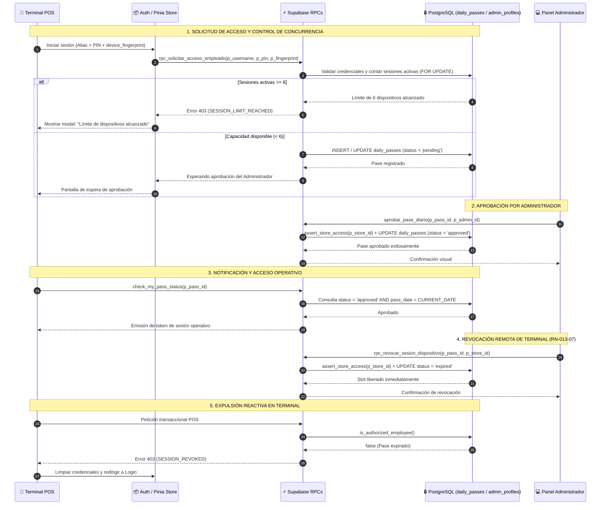
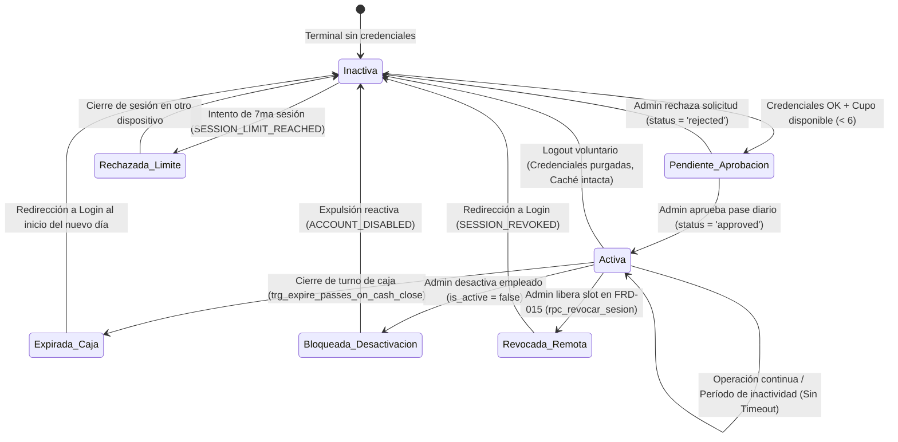

# SDD-013: Gestión de Sesiones y Control de Concurrencia

> **Asociado a:** [FRD-013: Gestión de Sesiones](../FRD/FRD_013_GESTION_SESIONES.md)  
> **Fase del Plan:** Ola 5: Sesiones, Autenticación y Offline (Ítem 2)  
> **Estado:** 🟢 Consolidado (Auditoría PAC-SDD v2.0 Aprobada)  
> **Última Actualización:** 2026-10-16  

---

## 0. CONTROL DE VERSIONES Y TRAZABILIDAD

### 0.1 Historial de Cambios
| Versión | Fecha | Autor | Rol | Descripción de Modificación |
|---------|-------|-------|-----|-----------------------------|
| 1.0.0 | 2026-01-28 | Arquitecto de Requisitos | Requisitos | Redacción inicial de reglas de sesión y concurrencia. |
| 1.5.0 | 2026-08-05 | Arquitecto de Software | Arquitectura | Incorporación preliminar de diagramas UML y modelo transitorio. |
| 2.0.0 | 2026-10-16 | Orquestador Técnico | Arquitectura & QA | **Saneamiento Integral PAC-SDD v2.0**: Erradicación de la tabla alucinada `device_sessions`, consolidación sobre `daily_passes.device_fingerprint`, formalización del límite de 6 sesiones en servidor, trigger reactivo `trg_expire_passes_on_cash_close`, cumplimiento de Reglas 1.1 (0% código SQL), 2, 4, 7 y 8, e integración con el protocolo Zero Trust. |

### 0.2 Trazabilidad de Requisitos (FRD-013)
| Regla de Negocio / CA | Descripción en FRD | Implementación en este SDD |
|-----------------------|--------------------|----------------------------|
| **RN-013-01** | Duración indefinida de la sesión sin caducidad horaria | Sección 4.1 y Sección 2 (Diagrama de Estados) |
| **RN-013-02** | Límite de 6 sesiones concurrentes simultáneas por tienda | Sección 4.2, Sección 3.2 y Sección 5.1 |
| **RN-013-03** | Comportamiento de Logout voluntario y retención de caché | Sección 4.3, Sección 5.2 y Sección 7 (D-5) |
| **RN-013-04** | Sin timeout automático por inactividad física | Sección 4.4 y Sección 2 |
| **RN-013-05** | Cierre forzado por desactivación de cuenta de empleado | Sección 4.5, Sección 5.3 y Sección 6.2 |
| **RN-013-06** | Expiración masiva de pases por cierre de caja diaria | Sección 4.6, Sección 3.4 y Sección 7 (D-4) |
| **RN-013-07** | Revocación remota de terminal por Administrador | Sección 4.7, Sección 5.4 y Sección 7 (D-1) |
| **CA-01 a CA-11** | Criterios de Aceptación (Concurrencia, Logout, Reactividad) | Sección 4 y Sección 6 |

### 0.3 Matriz de Dependencias Inter-Modulares
| Documento Vecino | Tipo de Dependencia | Flujo o Restricción Vinculante |
|------------------|---------------------|--------------------------------|
| [SDD-001](../SDD/SDD_001_SEGURIDAD_DIARIA.md) | Proveedor de Identidad | Subordinación al Pase Diario Zero Trust (`daily_passes`). Ningún empleado opera sin pase aprobado para el día. |
| [SDD-002](../SDD/SDD_002_REGISTRO_ADMIN.md) / [SDD-002.1](../SDD/SDD_002_1_CAMBIO_CONTRASENA.md) | Consumidor / Productor | Sesión administrativa (`admin_profiles`), reserva del slot #1 de 6, y facultad de revocación remota. |
| [SDD-003](../SDD/SDD_003_GESTION_EMPLEADOS.md) | Control de Personal | Desactivación reactiva (`is_active = false`) que expulsa inmediatamente sesiones vivas y expira pases diarios. |
| [SDD-004](../SDD/SDD_004_CONTROL_DE_CAJA.md) / [SDD-020](../SDD/SDD_020_CAJA_MULTICANAL.md) | Gobernanza Financiera | `trg_expire_passes_on_cash_close` en `cash_sessions` conmuta a `'expired'` todos los pases operativos del turno. |
| [SDD-007](../SDD/SDD_007_NUCLEO_VENTAS_PADRE.md) / [SDD-007.1](../SDD/SDD_007_01_NUCLEO_POS.md) | Consumidor Transaccional | Validación transaccional de pase activo (`is_authorized_employee()`) en cada cobro POS. |
| [SDD-011](../SDD/SDD_011_MANEJO_ERRORES.md) | Manejo de Excepciones | Códigos de error canónicos: `SESSION_LIMIT_REACHED`, `ACCOUNT_DISABLED`, `SESSION_REVOKED`, `DAILY_PASS_EXPIRED`. |
| [SDD-012](../SDD/SDD_012_SINCRONIZACION_OFFLINE.md) / [SDD-028](../SDD/SDD_028_ALMACENAMIENTO_LOCAL.md) | Persistencia Local | Preservación de catálogos maestros (`products`, `clients`) y cola `sync_queue` en logout voluntario. |
| [SDD-005](../SDD/SDD_005_AUDITORIA_TRAZABILIDAD.md) | Trazabilidad Forense | Inviolabilidad contable (`POL-AUD-01`): Registro inmutable en `audit_logs` ante inicios, cierres y revocaciones. |
| [SDD-015](../SDD/SDD_015_GESTION_DISPOSITIVOS.md) | Gestión de Terminales | Interfaz administrativa de auditoría de dispositivos y orquestación de revocación remota. |

---

## 1. RESUMEN EJECUTIVO Y ALCANCE

El módulo de **Gestión de Sesiones y Control de Concurrencia** establece la arquitectura que gobierna el ciclo de vida, la permanencia, la seguridad perimetral y la concurrencia de terminales activas en el ecosistema **Tienda Barrio Pro**.

### 1.1 Principios Rectores de Arquitectura
1. **Zero Trust Subordinated to Daily Pass (`POL-SEC-02`):** La identidad de los empleados no concede acceso autónomo ni permanente. La vigencia operativa está subordinada exclusivamente a la existencia de un registro activo en `daily_passes` con estado `'approved'` para la fecha actual (`pass_date = CURRENT_DATE`).
2. **Erradicación de Tablas Alucinadas (`Regla 2 Anti-Alucinación`):** Se erradica terminantemente el concepto teórico de la tabla `device_sessions`. El estado de conexión del terminal, la huella digital del dispositivo y el control de vigencia se sustentan sobre la columna física `device_fingerprint` y el ciclo de estados de la tabla real `daily_passes`.
3. **Control de Concurrencia Estricto de 6 Terminales (`RN-013-02`):** Cada tienda (`stores`) tiene una capacidad concurrente máxima de 6 sesiones activas simultáneas: 1 slot reservado para la administración (`admin_profiles`) y un máximo de 5 slots operativos para empleados con pase diario aprobado. El intento de una 7ma sesión es rechazado en servidor con el código `SESSION_LIMIT_REACHED`.
4. **Sesión Continua sin Timeout por Inactividad (`RN-013-04`):** El sistema no cierra sesiones por inactividad física, garantizando que el punto de venta permanezca disponible durante la jornada de atención del tendero.
5. **Expiración Reactiva por Cierre de Caja (`POL-FIN-01 / RN-013-06`):** El cierre formal de la caja del turno desencadena a nivel de base de datos la expiración masiva e inmediata de los pases diarios operativos de la tienda mediante el trigger `trg_expire_passes_on_cash_close`.
6. **Logout Seguro y Resiliencia Offline (`RN-013-03 / POL-OFF-01`):** El cierre voluntario destruye tokens de acceso e invalida carritos transaccionales en memoria, pero preserva los catálogos pesados en IndexedDB para asegurar arranques instantáneos y tolerantes a fallos de conectividad.

---

## 2. ARQUITECTURA GENERAL Y DIAGRAMA DE FLUJO

### 2.1 Diagrama de Secuencia: Ciclo de Vida y Control de Concurrencia
El siguiente diagrama ilustra el flujo de autenticación, control de capacidad máxima de terminales y revocación remota en servidor:



---

### 2.2 Diagrama de Estados: Ciclo de Vida de la Sesión



---

## 3. ESQUEMA DE DATOS Y MODELO DE DOMINIO

### 3.1 Estructura Física Real de la Tabla Central: `daily_passes`
La entidad física real en Supabase Producción (`ihtjocmhzuliwwvdzfnz`) que almacena las sesiones y dispositivos operativos consta de 14 columnas verificadas:

| Columna | Tipo de Dato | Nulable | Restricción / Default | Descripción de Negocio |
|---------|--------------|---------|-----------------------|------------------------|
| `id` | `uuid` | NO | `PRIMARY KEY`, default `gen_random_uuid()` | Identificador único del pase diario y sesión operativa. |
| `employee_id` | `uuid` | NO | `FK employees.id ON DELETE CASCADE` | Empleado titular del pase de sesión. |
| `pass_date` | `date` | NO | Default `CURRENT_DATE` | Fecha calendario de validez del pase diario. |
| `status` | `text` | NO | Default `'pending'`, `CHECK status IN ('pending', 'approved', 'rejected', 'expired')` | Estado del pase que determina la validez de la sesión activa. |
| `device_fingerprint` | `text` | SÍ | `NULL` | Identificador unívoco del hardware/navegador del terminal. |
| `retry_count` | `integer` | SÍ | Default `0`, `CHECK retry_count >= 0 AND retry_count <= 3` | Contador de reintentos de PIN para prevención de ataques. |
| `requested_at` | `timestamptz` | NO | Default `now()` | Estampa temporal en que el empleado solicitó el pase. |
| `resolved_at` | `timestamptz` | SÍ | `NULL` | Estampa temporal de resolución (aprobación, rechazo o expiración). |
| `resolved_by` | `uuid` | SÍ | `FK employees.id` | Identificador de auditoría del actor que resolvió la solicitud. |
| `store_id` | `uuid` | SÍ | `FK stores.id` | Tienda a la que pertenece la sesión (aislamiento multi-tenant). |
| `auth_user_id` | `uuid` | SÍ | `FK auth.users.id` | Identificador del usuario en el subsistema de autenticación. |
| `approved_at` | `timestamptz` | SÍ | `NULL` | Estampa temporal de aprobación formal por el administrador. |
| `approved_by` | `uuid` | SÍ | `NULL` | Identificador del administrador que autorizó el pase. |
| `updated_at` | `timestamptz` | SÍ | Default `now()` | Estampa temporal de última mutación del registro. |

#### Restricciones Clave de Integridad:
- **`daily_passes_employee_id_pass_date_key`:** `UNIQUE (employee_id, pass_date)`. Impide que un empleado genere múltiples pases en la misma fecha calendario.
- **`daily_passes_status_check`:** Solo admite `'pending'`, `'approved'`, `'rejected'`, `'expired'`.

---

### 3.2 Estructura Física de Tablas Vinculadas

#### Tabla `admin_profiles` (5 columnas físicas)
Gobierna la sesión administrativa (1 slot concurrente exclusivo del Propietario/Manager):
- `id` (`uuid`, PK, FK `auth.users.id ON DELETE CASCADE`).
- `store_id` (`uuid`, NOT NULL, FK `stores.id ON DELETE CASCADE`).
- `role` (`text`, NOT NULL, default `'owner'`, CHECK `role IN ('owner', 'manager')`).
- `is_verified` (`boolean`, default `false`).
- `created_at` (`timestamptz`, default `now()`).

#### Tabla `employees` (9 columnas físicas)
Entidad de identidad operativa para empleados:
- `id` (`uuid`, PK), `store_id` (`uuid`, NOT NULL, FK `stores.id`).
- `name` (`text`, NOT NULL).
- `username` (`text`, NOT NULL, `UNIQUE` global).
- `pin_hash` (`text`, NOT NULL).
- `is_active` (`boolean`, default `true`).
- `permissions` (`jsonb`, default `'{"canFiar": false, "canViewReports": false, "canOpenCloseCash": false, "canViewInventory": false}'::jsonb`).
- `created_at` (`timestamptz`), `updated_at` (`timestamptz`).

#### Tabla `cash_sessions` (12 columnas físicas)
Gobernanza del ciclo contable y disparador de expiración:
- `id` (`uuid`, PK), `store_id` (`uuid`, NOT NULL), `opened_by` (`uuid`), `closed_by` (`uuid`).
- `opening_balance` (`numeric`), `expected_balance` (`numeric`), `actual_balance` (`numeric`), `difference` (`numeric`).
- `status` (`text`, CHECK `status IN ('open', 'closed')`).
- `opened_at` (`timestamptz`), `closed_at` (`timestamptz`), `forced_close` (`boolean`).

---

### 3.3 Trigger Reactivo de Expiración Masiva de Pases
En Supabase Producción, la tabla `cash_sessions` cuenta con el trigger verificado:
- **Nombre:** `trg_expire_passes_on_cash_close`
- **Evento:** `AFTER UPDATE ON public.cash_sessions`
- **Condición y Procedimiento:** Ejecuta la función de base de datos `expire_daily_passes()`.
- **Comportamiento Lógico:**
  Cuando el registro transiciona de `status = 'open'` a `status = 'closed'`, actualiza de forma atómica en `public.daily_passes`:
  Conmuta `status = 'expired'` para todos los registros donde `employee_id` pertenezca a la misma tienda (`e.store_id = NEW.store_id`), con estado previo `status = 'approved'` y fecha `pass_date <= CURRENT_DATE`.

---

## 4. REGLAS DE NEGOCIO Y VALIDACIONES

### 4.1 RN-013-01: Duración de Sesión Indefinida
1. El sistema no implementa expiración automática por tiempo de las sesiones autenticadas.
2. Una sesión operativa de empleado permanece activa hasta que ocurra uno de los siguientes cuatro eventos:
   - Cierre de sesión voluntario por parte del usuario (Logout).
   - El Administrador desactiva la cuenta del empleado (`is_active = false` en `employees`).
   - Se cierra formalmente el turno de caja del día (`cash_sessions.status = 'closed'`).
   - El Administrador revoca remotamente el terminal desde la consola de control de dispositivos (`FRD-015`).
3. Una sesión de Administrador permanece activa hasta su cierre voluntario o cambio de contraseña maestro (`SDD-002.1`).

### 4.2 RN-013-02: Límite Estricto de 6 Sesiones Concurrentes
1. El sistema restringe la capacidad simultánea por tienda a un **máximo estricto de 6 terminales activos**:
   - **1 sesión de Administrador:** Cuenta propietaria o manager autenticada mediante email/password contra `auth.users` y `admin_profiles`.
   - **Hasta 5 sesiones de Empleados:** Cuentas autenticadas con alias numérico + PIN que posean un pase diario en estado `approved` para la fecha en curso (`pass_date = CURRENT_DATE`).
2. Si un usuario intenta iniciar una 7ma sesión activa en la misma tienda:
   - El backend rechaza la transacción abortando con el código canónico `SESSION_LIMIT_REACHED`.
   - La interfaz visual presenta el mensaje explícito al usuario: *"Límite de dispositivos alcanzado. Cierre sesión en otro dispositivo para continuar."*
3. La validación se ejecuta obligatoriamente en servidor con bloqueo pesimista en las funciones de autenticación y aprobación, impidiendo condiciones de carrera concurrentes.

### 4.3 RN-013-03: Comportamiento de Logout Voluntario y Preservación de Caché
Cuando un usuario invoca el cierre de sesión voluntario desde la aplicación:

| Componente / Recurso | Comportamiento en Admin | Comportamiento en Empleado | Justificación Arquitectural |
|----------------------|-------------------------|----------------------------|-----------------------------|
| **Tokens y Credenciales JWT** | Destrucción inmediata | Destrucción inmediata | Cero persistencia de llaves de acceso en dispositivos desautenticados. |
| **Carrito POS en Vuelo** | Purga incondicional | Purga incondicional | Seguridad operativa: Evita que un tercero complete una venta pendiente ajena. |
| **Pase Diario (`daily_passes`)** | No aplica | Conmutación a `status = 'expired'` | Liberación inmediata del slot concurrente en servidor. |
| **Catálogo de Productos (IndexedDB)** | **Preservado intacto** | **Preservado intacto** | Optimización de red: Previene re-descargas pesadas en re-inicios. |
| **Catálogo de Clientes (IndexedDB)** | **Preservado intacto** | **Preservado intacto** | Continuidad operativa en entornos offline / baja conectividad. |
| **Cola de Sincronización (`sync_queue`)** | **Preservada intacta** | **Preservada intacta** | Inviolabilidad contable: Las ventas offline pendientes no se borran jamás. |

### 4.4 RN-013-04: Ausencia de Timeout por Inactividad
1. El sistema no implementa temporizadores de desconexión por inactividad física (`idle timeout`).
2. En entornos de tienda física de barrio, el terminal puede permanecer desatendido durante horas mientras el tendero realiza labores de bodega o atención al mostrador. Forzar la re-autenticación constante degradaría la velocidad operativa del negocio.

### 4.5 RN-013-05: Cierre Forzado por Desactivación de Cuenta
1. Cuando el Administrador conmuta el perfil de un empleado a inactivo (`employees.is_active = false`):
   - El procedimiento invalida de forma inmediata todos los pases del empleado (`UPDATE daily_passes SET status = 'expired' WHERE employee_id = ... AND pass_date = CURRENT_DATE`).
   - El interceptor global en frontend detecta el rechazo en la siguiente invocación de red y expulsa al usuario al login.
   - El sistema despliega el mensaje informativo: *"Tu cuenta ha sido desactivada. Contacta al administrador."*

### 4.6 RN-013-06: Expiración por Cierre de Caja
1. Al cerrarse el turno de caja (`cash_sessions.status = 'closed'`):
   - El trigger `trg_expire_passes_on_cash_close` invalida automáticamente todos los pases diarios aprobados del día (`status = 'expired'`).
   - Los empleados dependientes (sin privilegios de caja) ven su terminal bloqueado de inmediato con el mensaje *"Turno de caja finalizado"*.
   - El usuario que ejecutó el cierre de caja (Administrador o Empleado con permiso `canOpenCloseCash`) mantiene su sesión activa para consultar el reporte final y cerrar sesión voluntariamente.
   - Al día siguiente calendario, **todos los empleados** deben solicitar un nuevo Pase Diario de forma obligatoria.

### 4.7 RN-013-07: Revocación Remota de Terminal por Administrador
1. El Administrador puede revocar la sesión activa de un dispositivo específico desde el módulo de dispositivos ([FRD-015](../FRD/FRD_015_GESTION_DISPOSITIVOS.md) / [SDD-015](../SDD/SDD_015_GESTION_DISPOSITIVOS.md)) para liberar un slot de concurrencia.
2. La ejecución de `rpc_revocar_sesion_dispositivo`:
   - Conmuta el estado del pase correspondiente a `status = 'expired'` y registra `resolved_at = now()`.
   - Libera instantáneamente el slot dentro del cupo de 6 terminales.
   - En el dispositivo afectado, la siguiente llamada operativa recibe el código `403 SESSION_REVOKED`, forzando la redirección a la pantalla de login con el mensaje: *"Tu sesión fue cerrada por el administrador"*.
   - El empleado revocado puede volver a solicitar acceso mediante un nuevo pase si las condiciones de cupo lo permiten.

---

## 5. CONTRATO DE INTERFAZ (PAYLOADS JSON)

Todos los contratos de interfaz se adhieren a la **Regla Global 4** (Protocolo de Transmisión de Payloads).

### 5.1 Solicitud de Acceso y Verificación de Concurrencia
- **Operación Backend:** `rpc_solicitar_acceso_empleado`
- **Método / RPC:** POST / Supabase RPC
- **Descripción:** Valida credenciales locales (alias + PIN), verifica el límite de 6 terminales concurrentes e inicia la solicitud de Pase Diario.

#### Payload de Entrada:
```json
{
  "p_username": "10203040",
  "p_pin": "1234",
  "p_device_fingerprint": "fp_chrome_win11_a9f2bc88",
  "p_device_metadata": {
    "browser": "Chrome 126.0",
    "os": "Windows 11",
    "ip": "190.14.22.105"
  }
}
```

#### Payload de Respuesta (Éxito - Cupo Disponible, Esperando Aprobación):
```json
{
  "success": true,
  "data": {
    "pass_id": "8a7c2e11-34b2-4d90-b183-f450293cb891",
    "status": "pending",
    "store_id": "3f9a7210-61b4-4e2b-a320-1a76c8901234",
    "requested_at": "2026-10-16T08:00:00Z",
    "retry_count": 0,
    "message": "Solicitud de acceso enviada al Administrador. Esperando aprobación."
  }
}
```

#### Payload de Respuesta (Fallo - Límite de 6 Sesiones Alcanzado):
```json
{
  "success": false,
  "error": "Límite de 6 terminales concurrentes alcanzado para esta tienda.",
  "code": "SESSION_LIMIT_REACHED"
}
```

#### Payload de Respuesta (Fallo - Cuenta Desactivada):
```json
{
  "success": false,
  "error": "La cuenta del empleado se encuentra inactiva.",
  "code": "ACCOUNT_DISABLED"
}
```

---

### 5.2 Cierre de Sesión Voluntario (Logout)
- **Operación Backend:** `rpc_cerrar_sesion_empleado`
- **Descripción:** Invalida el pase diario activo liberando el slot concurrente, manteniendo catálogos locales en caché.

#### Payload de Entrada:
```json
{
  "p_pass_id": "8a7c2e11-34b2-4d90-b183-f450293cb891"
}
```

#### Payload de Respuesta (Éxito):
```json
{
  "success": true,
  "data": {
    "pass_id": "8a7c2e11-34b2-4d90-b183-f450293cb891",
    "status": "expired",
    "closed_at": "2026-10-16T18:30:00Z",
    "slot_released": true
  }
}
```

---

### 5.3 Consulta de Sesiones y Dispositivos Conectados (Admin)
- **Operación Backend:** `rpc_obtener_sesiones_activas`
- **Requisito de Seguridad:** Exclusivo Administradores (`admin_profiles`). Ejecuta obligatoriamente `assert_store_access(p_store_id)`.
- **Formato:** Regla Global 4.1 (Respuesta de Lista `{ data, count }`).

#### Payload de Entrada:
```json
{
  "p_store_id": "3f9a7210-61b4-4e2b-a320-1a76c8901234"
}
```

#### Payload de Respuesta:
```json
{
  "data": [
    {
      "session_type": "admin",
      "session_id": "ad110022-77bb-4e99-9aa1-112233445566",
      "user_name": "Don Pedro (Propietario)",
      "user_identifier": "pedro@tiendabarrio.pro",
      "device_fingerprint": "fp_admin_laptop_office",
      "is_active": true,
      "connected_at": "2026-10-16T07:15:00Z"
    },
    {
      "session_type": "employee",
      "pass_id": "8a7c2e11-34b2-4d90-b183-f450293cb891",
      "employee_id": "6d3a82f1-28b4-4e8c-8521-72946c9812a1",
      "user_name": "Carlos Cajero",
      "user_identifier": "10203040",
      "device_fingerprint": "fp_pos_tablet_caja1",
      "status": "approved",
      "is_active": true,
      "approved_at": "2026-10-16T08:05:00Z"
    }
  ],
  "count": 2
}
```

---

### 5.4 Revocación Remota de Terminal por Administrador
- **Operación Backend:** `rpc_revocar_sesion_dispositivo`
- **Requisito de Seguridad:** Exclusivo Administradores (`admin_profiles`). Ejecuta obligatoriamente `assert_store_access(p_store_id)`.

#### Payload de Entrada:
```json
{
  "p_store_id": "3f9a7210-61b4-4e2b-a320-1a76c8901234",
  "p_pass_id": "8a7c2e11-34b2-4d90-b183-f450293cb891",
  "p_reason": "Liberación de slot para nuevo dependiente"
}
```

#### Payload de Respuesta (Éxito):
```json
{
  "success": true,
  "data": {
    "pass_id": "8a7c2e11-34b2-4d90-b183-f450293cb891",
    "status": "expired",
    "revoked_at": "2026-10-16T14:20:00Z",
    "slot_released": true,
    "message": "Sesión revocada y slot liberado exitosamente."
  }
}
```

#### Payload de Respuesta (Fallo - Acceso Denegado por Tenant):
```json
{
  "success": false,
  "error": "Acceso denegado a los recursos de esta tienda.",
  "code": "STORE_ACCESS_DENIED"
}
```

---

## 6. SEGURIDAD, POLÍTICAS RLS Y MULTI-TENANCY

### 6.1 Aislamiento Multi-Tenant y Regla 4 de Seguridad Centralizada
1. **Reutilización Obligatoria de `assert_store_access(p_store_id)` (Regla 4):**
   Todos los RPCs administrativos del módulo (`aprobar_pase_diario`, `rpc_revocar_sesion_dispositivo`, `rpc_obtener_sesiones_activas`) ejecutan como **primera instrucción incondicional**:
   La función de seguridad centralizada `public.assert_store_access(p_store_id)`.
   Si el invocador autenticado no pertenece a la tienda especificada, el sistema aborta de inmediato con la excepción `STORE_ACCESS_DENIED`.
2. **Gobernanza RLS Centralizada mediante `get_current_store_id()`:**
   Las tablas vinculadas al ciclo de sesión (`daily_passes`, `employees`, `stores`, `cash_sessions`) aplican aislamiento estricto en sus políticas RLS comparando contra la función de resolución jerárquica de tenant `public.get_current_store_id()`.

### 6.2 Políticas de Seguridad a Nivel de Fila (RLS) en `daily_passes`
- **`daily_passes_select_store` (SELECT):**
  Permite la lectura de pases únicamente si el empleado asociado pertenece a la tienda del usuario autenticado:
  `EXISTS (SELECT 1 FROM employees e WHERE e.id = daily_passes.employee_id AND e.store_id = public.get_current_store_id())`.
- **`daily_passes_insert_own` (INSERT):**
  Restringe la creación de pases al propio empleado y a su tienda correspondiente.
- **`daily_passes_update_store` (UPDATE):**
  Restringe la mutación del estado del pase (aprobación/expiración) al contexto de la tienda autorizada.
- **Prohibición de DELETE (`POL-AUD-01`):**
  No existe política que habilite `DELETE` sobre `daily_passes`. Los pases finalizan exclusivamente conmutando su estado a `'expired'`.

### 6.3 Privilegios Base a Nivel de Tabla (Regla 8)
En cumplimiento de la **Regla 8 de AGENTS.md**, se encuentran otorgados y verificados mediante `has_table_privilege` los permisos para los roles del sistema:
- `daily_passes`: Privilegios asignados a `anon`, `authenticated`, `service_role`.
- `admin_profiles`: Privilegios asignados a `anon`, `authenticated`, `service_role`.
- `employees`: Privilegios asignados a `anon`, `authenticated`, `service_role`.
- `stores`: Privilegios asignados a `anon`, `authenticated`, `service_role`.
- `cash_sessions`: Privilegios asignados a `anon`, `authenticated`, `service_role`.
- Todas las tablas mantienen `rowsecurity = true`, garantizando inmunidad ante el error PostgreSQL `42501 (Permission Denied)`.

---

## 7. DEUDAS TÉCNICAS Y DECISIONES DIFERIDAS

En estricto cumplimiento de la **Regla 7 de AGENTS.md**, se formalizan a continuación las decisiones técnicas, compensaciones y condiciones de revisión del módulo:

### D-1: Erradicación Definitiva de la Tabla Alucinada `device_sessions` y Consolidación en `daily_passes`
- **Qué se decidió:** Consagrar que la base de datos física no contiene ni contendrá una tabla anexa `device_sessions`. El control de terminales, dispositivos y sesiones activas de los empleados se sustenta íntegramente sobre las columnas `device_fingerprint` y `status` de la tabla real `daily_passes`.
- **Por qué / Trade-off:** Evita una dispersión redundante de estado entre múltiples tablas efímeras y sincronizaciones en caliente; apalanca el modelo de seguridad Zero Trust ya implementado y certificado en producción.
- **Bajo qué condición futura se revisará:** Permanente. Invariante arquitectural del núcleo de autenticación.

### D-2: Control de Concurrencia de 6 Sesiones en Servidor (`RN-013-02`)
- **Qué se decidió:** Normar que el límite de 6 sesiones simultáneas por tienda (1 Admin + 5 Empleados) se valida de forma pesimista en la base de datos al momento de solicitar o aprobar un pase, rechazando el 7mo intento con el código de error `SESSION_LIMIT_REACHED`.
- **Por qué / Trade-off:** Protege la estabilidad del punto de venta móvil, previene el abuso de cuentas compartidas en terminales no autorizados y respeta el dimensionamiento de hardware del comercio.
- **Bajo qué condición futura se revisará:** Si el modelo de negocio introduce planes de suscripción comerciales ("Multi-Caja Pro" o "Cadenas") que requieran ampliar el límite de 5 empleados activos simultáneos.

### D-3: Reutilización Obligatoria de `assert_store_access(p_store_id)` en RPCs Administrativos de Sesión (`Regla 4`)
- **Qué se decidió:** Estandarizar que las funciones de administración de sesiones (`aprobar_pase_diario`, `rpc_revocar_sesion_dispositivo`, `rpc_obtener_sesiones_activas`) invoquen como primera instrucción incondicional `PERFORM public.assert_store_access(p_store_id);`, erradicando validaciones ad-hoc.
- **Por qué / Trade-off:** Asegura homogeneidad de seguridad multi-inquilino en cumplimiento estricto de la Regla 4 de AGENTS.md, eliminando riesgos de escalamiento de privilegios o acceso cruzado entre comercios.
- **Bajo qué condición futura se revisará:** Permanente. Invariante de seguridad del sistema.

### D-4: Expiración Masiva de Pases por Cierre de Caja (`trg_expire_passes_on_cash_close`)
- **Qué se decidió:** Consagrar el trigger de base de datos `trg_expire_passes_on_cash_close` sobre `cash_sessions` como el mecanismo reactivo oficial de fin de jornada para conmutar masivamente a `status = 'expired'` los pases operativos del turno, manteniendo activa la sesión del actor que cerró o del administrador.
- **Por qué / Trade-off:** Automatiza la seguridad operativa al finalizar la jornada laboral sin depender de cron jobs externos, servidores de tareas ni intervenciones manuales del usuario.
- **Bajo qué condición futura se revisará:** Permanente. Invariante de sincronización contable-financiera.

### D-5: Protocolo de Logout Diferenciado y Preservación de Caché (`RN-013-03` vs `SDD-012 / SDD-028`)
- **Qué se decidió:** Normar que el logout voluntario en la aplicación purgue exclusivamente credenciales JWT y carritos transaccionales pendientes, pero preserve intactos los catálogos maestros (productos, clientes) en IndexedDB y la cola de sincronización `sync_queue`.
- **Por qué / Trade-off:** Optimiza drásticamente los tiempos de carga en aperturas subsecuentes en dispositivos con conectividad lenta o inestable, evitando re-descargas masivas sin comprometer la seguridad de datos financieros ajenos.
- **Bajo qué condición futura se revisará:** Permanente. Estándar de diseño offline-first para terminales de punto de venta.
