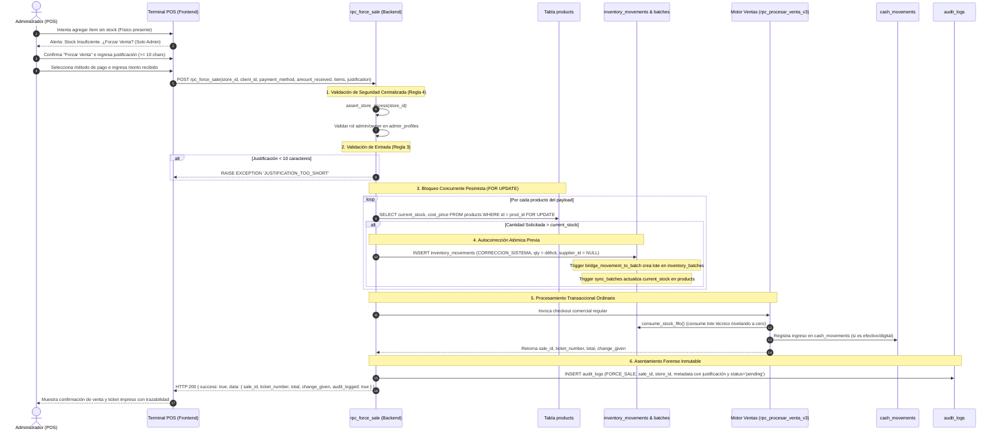
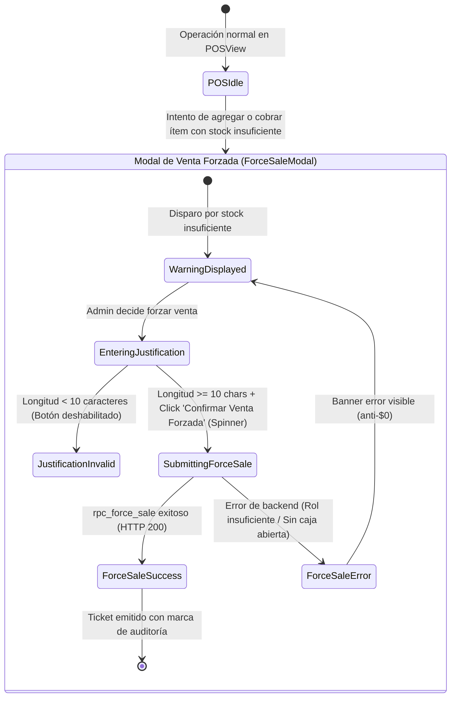

# SDD-014: Venta Forzada y Auditoría (Protocolo de Excepción)

> **Asociado a:** [FRD-014](../FRD/FRD_014_VENTA_FORZADA_Y_AUDITORIA.md)  
> **Módulo:** Ventas, POS y Auditoría  
> **Fase del Plan:** Ola 3 (Ítem 4)  
> **Estado:** 🟠 Aprobado con Deuda Técnica Documentada (Protocolo PAC-SDD v2.0)
> **Última Actualización:** 2026-10-17
> **Políticas Aplicables:** ARQ-002 (POL-AUTH-01, POL-AUD-01/02, POL-FIN-01/02/03, POL-LOG-01/02, POL-SEC-01, SPEC-010, SPEC-011)

---

## 0. Contexto y Restricciones Aplicables

### 0.1 Políticas Globales Activadas (ARQ-002)

| Política ID | Dominio | Impacto Concreto en este SDD |
| :--- | :--- | :--- |
| **POL-AUTH-01 / SEC-01** | Seguridad | Ejecución exclusiva para identidades verificadas en `admin_profiles` (`owner` o `admin`) tras invocar `assert_store_access(p_store_id)`. |
| **POL-LOG-01 / 02** | Logística | Autocorrección atómica previa inyectando entrada `CORRECCION_SISTEMA` en `inventory_movements` para evitar stock negativo antes del consumo FIFO. |
| **POL-FIN-03** | Financiero | Prohibición física de asociar proveedor (`chk_correccion_no_supplier: supplier_id IS NULL`), evitando pasivos ficticios en `supplier_invoices`. |
| **POL-AUD-01 / 02** | Auditoría | Justificación obligatoria (`>= 10` caracteres) y registro inmutable en `audit_logs` (`event_type = 'FORCE_SALE'`, `severity = 'warning'`). |

### 0.2 Contratos Vecinos que Limitan el Diseño

| SDD Vecino | Restricción que Impone |
| :--- | :--- |
| **SDD_007 / SDD_007_01 (POS)** | La venta forzada pasa obligatoriamente por el checkout estándar multicanal (`rpc_procesar_venta_v3` / `v2`) tras nivelar el stock (Hallazgo H16). |
| **SDD_010_016 (Valoración FIFO)** | El trigger `bridge_movement_to_batch` crea el lote técnico con `products.cost_price` para que `consume_stock_fifo` lo consuma inmediatamente. |
| **SDD_005 (Auditoría Forense)** | El evento `FORCE_SALE` se expone en el Evidence Hub bajo el dominio de auditoría operativa. |

### 0.3 Auditoría de BD contra Realidad (Deuda Técnica Formalizada)

Se declaran las **N=5 deudas técnicas** verificadas contra `information_schema` y `pg_proc` en producción (`ihtjocmhzuliwwvdzfnz`), detalladas en la Sección 7:
- **D-1:** Inyección de `PERFORM public.assert_store_access(p_store_id);` como instrucción #1 en `rpc_force_sale`.
- **D-2:** Validación estricta de rol administrativo sobre `public.admin_profiles` (`auth.uid()`).
- **D-3:** Transición coordinada de la llamada interna de `rpc_force_sale` desde `rpc_procesar_venta_v2` hacia `rpc_procesar_venta_v3` (soportando `p_amount_received` y métodos multicanal según Hallazgo H16).
- **D-4:** Preservación del constraint físico `chk_correccion_no_supplier` en `inventory_movements`.
- **D-5:** Registro de estado de revisión del evento `FORCE_SALE` dentro de `audit_logs.metadata->>'review_status'` dada la estructura física de 9 columnas de `audit_logs`.

---

## 1. Resumen Ejecutivo y Alcance

El presente documento define la arquitectura transaccional, invariantes de base de datos y contratos de interfaz del **Protocolo de Excepción de Venta Forzada**.

En el flujo operacional habitual del punto de venta (normado en `FRD-007` y `SDD_007_01`), el sistema aplica un bloqueo logístico inflexible impidiendo agregar o cobrar productos con stock insuficiente (`current_stock <= 0` o menor a la cantidad solicitada). Sin embargo, en el comercio de barrio se presentan discrepancias operacionales inevitables donde la mercancía física se encuentra visible en góndola o mostrador pese a que el sistema computa stock cero (por desfaces de digitación o demoras en remisiones).

Para garantizar la continuidad operativa sin violar el principio contable de no negatividad de inventario ni falsear estados financieros, este protocolo permite al usuario con privilegios administrativos (`role IN ('admin', 'owner')`) forzar la venta bajo las siguientes premisas estructurales:

1. **Autocorrección Atómica Previa (RN-014-03):** El motor calcula el déficit exacto (`cantidad_solicitada - current_stock`) e inyecta inmediatamente una entrada técnica de inventario con tipología `CORRECCION_SISTEMA`. Un trigger de base de datos (`bridge_movement_to_batch`) genera el lote técnico correspondiente al costo de catálogo (`products.cost_price`).
2. **Cero Pasivo Ficticio con Proveedores (POL-FIN-03):** Por restricción física de base de datos (`chk_correccion_no_supplier`), la corrección de sistema tiene estrictamente prohibido referenciar proveedores (`supplier_id IS NULL`), asegurando que no se creen cuentas por pagar ficticias en `supplier_invoices`.
3. **Paso por Checkout Estándar y Multicanal (RN-014-06):** La venta forzada no es un bypass contable ni de caja. Pasa forzosamente por el motor de ventas regular, registra comprobante en `sales`, descuenta el lote técnico recién inyectado vía FIFO (`consume_stock_fifo`) y asienta el dinero en la sesión de caja activa según el método de pago seleccionado.
4. **Trazabilidad Forense e Inviolabilidad Append-Only (RN-014-01 / POL-AUD-02):** La transacción exige justificación explícita de al menos 10 caracteres y asienta un registro indeleble en `audit_logs` (`event_type = 'FORCE_SALE'`, `severity = 'warning'`) con el identificador de la venta, el autor de la excepción y el estado de revisión.

---

## 2. Diagrama de Secuencia y Arquitectura



### 2.2 Diagrama de Estados de Interfaz y Venta Forzada (stateDiagram-v2)



---

## 3. Reglas de Negocio e Invariantes Técnicos

| Identificador | Regla / Invariante Técnico | Severidad | Módulo / Componente Afectado |
| :--- | :--- | :--- | :--- |
| **RN-014-01** | **Jurisdicción Exclusiva de Excepción:** Únicamente usuarios con registro activo en `admin_profiles` (`role IN ('admin', 'owner')`) y vinculados a la tienda corriente tienen autorización para ejecutar ventas forzadas. Los empleados operativos se rigen estrictamente por el bloqueo logístico de `FRD-007`. | Bloqueante | POS Frontend / `rpc_force_sale` |
| **RN-014-02** | **Justificación Forense Obligatoria:** La justificación textual debe tener una longitud mínima estricta de 10 caracteres legibles. Todo intento con justificación vacía o insuficiente debe ser rechazado inmediatamente con excepción de base de datos (`JUSTIFICATION_TOO_SHORT`), sin fallos silenciosos (Regla 3). | Bloqueante | `rpc_force_sale` / `audit_logs` |
| **RN-014-03** | **Autocorrección Previa y No Negatividad:** El inventario lógico nunca puede quedar en valores negativos (`current_stock < 0`). El backend calcula el déficit exacto e inserta un movimiento `CORRECCION_SISTEMA` en `inventory_movements` previo al cobro. | Bloqueante | `inventory_movements` / `inventory_batches` |
| **RN-014-04** | **Aislamiento Contable de Proveedores:** Todo movimiento `CORRECCION_SISTEMA` debe registrar obligatoriamente `supplier_id IS NULL` y `invoice_reference IS NULL`, respaldado por la constraint física `chk_correccion_no_supplier`. Se prohíbe generar pasivos en cuentas por pagar (`supplier_invoices`). | Inviolable | `inventory_movements` / Cuentas por Pagar |
| **RN-014-05** | **Valoración Estándar de Lote Técnico:** El lote generado automáticamente por la corrección adopta el costo de catálogo vigente (`products.cost_price`) y el precio de venta (`products.price`). Al consumirse por FIFO durante la venta, el margen contable se liquida de forma neutral en el P&L operacional (`SDD_018`). | Consistencia | `inventory_batches` / `SDD_010_016` |
| **RN-014-06** | **Checkout Estándar y Fidelidad de Caja:** La venta forzada no evade el circuito comercial. Debe registrarse en `sales`, generar consecutivo seguro en `sales.ticket_number`, recibir `p_amount_received` para liquidar vueltas exactas (`change_given`) y asentar ingresos en `cash_movements` vinculados a la sesión de caja abierta corriente (`session_id`). | Consistencia | `sales` / `cash_movements` |
| **RN-014-07** | **Inmutabilidad y Visado de Cierre:** Toda venta forzada se asienta en `audit_logs` con `severity = 'warning'` y estado inicial `'pending'`. El cierre contable del turno de caja (`cerrar_caja`) debe verificar que todas las ventas forzadas de la jornada cuenten con visado administrativo (`status = 'reviewed'`). | Auditoría | `audit_logs` / `SDD_004` (Caja) |

---

## 4. Esquema de Datos y Modelado

Las entidades físicas de Supabase Producción que soportan el circuito de venta forzada y auditoría son las siguientes:

### 4.1 Tabla `inventory_movements` (Esquema Físico Verificado)
Bitácora de movimientos de stock. Canaliza la inyección técnica de autocorrección:

| Columna | Tipo de Dato | Nulable | Descripción y Restricciones Físicas |
| :--- | :--- | :--- | :--- |
| `id` | `uuid` | No | Clave primaria generada por servidor. |
| `product_id` | `uuid` | No | Clave foránea hacia `products(id)`. |
| `movement_type` | `text` | No | Tipo de movimiento. Admite `'CORRECCION_SISTEMA'` según constraint `inventory_movements_movement_type_check`. |
| `quantity` | `numeric` | No | Cantidad inyectada (déficit exacto calculado por el servidor). |
| `reason` | `text` | Sí | Justificación administrativa capturada en el frontend. |
| `created_by` | `uuid` | Sí | ID del usuario autenticado (`auth.uid()`). |
| `created_at` | `timestamptz` | Sí | Timestamp de inserción en servidor. |
| `supplier_id` | `uuid` | Sí | Proveedor asociado. **Restricción `chk_correccion_no_supplier`:** Exige estrictamente `supplier_id IS NULL` cuando `movement_type = 'CORRECCION_SISTEMA'`. |
| `invoice_reference` | `text` | Sí | Nulo en correcciones de sistema. |
| `payment_type` | `text` | Sí | Nulo en correcciones de sistema. |
| `reference_invoice_id`| `uuid` | Sí | Nulo en correcciones de sistema. |
| `unit_cost` | `numeric` | Sí | Costo de catálogo asignado al movimiento (`products.cost_price`). |

### 4.2 Tabla `inventory_batches` (Esquema Físico Verificado)
Lotes de valoración FIFO. Alimentada reactivamente por el trigger `bridge_movement_to_batch`:

| Columna | Tipo de Dato | Nulable | Descripción y Restricciones Físicas |
| :--- | :--- | :--- | :--- |
| `id` | `uuid` | No | Clave primaria del lote. |
| `product_id` | `uuid` | No | Referencia al producto regularizado. |
| `quantity_initial` | `numeric` | No | Cantidad inicial del lote (igual a la cantidad corregida). |
| `quantity_remaining`| `numeric` | No | Saldo remanente del lote (consumido inmediatamente a 0 por el checkout). |
| `cost_unit` | `numeric` | No | Costo unitario fotográfico del catálogo (`products.cost_price`). |
| `is_active` | `boolean` | Sí | Bandera de vigencia para consumo FIFO. |
| `created_at` | `timestamptz` | Sí | Timestamp de creación del lote. |
| `created_by` | `uuid` | Sí | Creador del lote (`auth.uid()`). |
| `sale_price` | `numeric` | Sí | Precio de venta comercial (`products.price`). |
| `source_movement_id`| `uuid` | Sí | Clave foránea al movimiento originador en `inventory_movements(id)`. |

### 4.3 Tabla `audit_logs` (Esquema Físico Verificado)
Bitácora de auditoría forense del sistema:

| Columna | Tipo de Dato | Nulable | Descripción y Restricciones Físicas |
| :--- | :--- | :--- | :--- |
| `id` | `uuid` | No | Clave primaria inmutable. |
| `actor_id` | `uuid` | Sí | Administrador que ejecutó la venta forzada (`auth.uid()`). |
| `event_type` | `text` | No | Tipo de evento: `'FORCE_SALE'`. |
| `resource_id` | `text` | Sí | Identificador de la venta generada (`sales.id::text`). |
| `store_id` | `uuid` | Sí | Tienda propietaria de la transacción para aislamiento multi-tenant. |
| `severity` | `text` | Sí | Nivel de severidad operacional: `'warning'`. |
| `metadata` | `jsonb` | Sí | Payload con: justificación (`reason`), ítems corregidos (`items_adjusted`), estado (`status: 'pending'/'reviewed'`), autor y timestamp de visado. |
| `created_at` | `timestamptz` | Sí | Timestamp del evento en servidor. |
| `ip_address` | `text` | Sí | Dirección IP o metadata de conexión del cliente. |

### 4.4 Tabla `admin_profiles` (Esquema Físico Verificado)
Tabla de control RBAC administrativo:

| Columna | Tipo de Dato | Nulable | Descripción y Restricciones Físicas |
| :--- | :--- | :--- | :--- |
| `id` | `uuid` | No | Clave primaria referenciando a `auth.users(id)`. |
| `store_id` | `uuid` | No | Tienda bajo jurisdicción del administrador. |
| `role` | `text` | No | Rol asignado (`'admin'`, `'owner'`). |
| `is_verified` | `boolean` | Sí | Estado de verificación del perfil. |
| `created_at` | `timestamptz` | Sí | Fecha de registro. |

---

## 5. Contratos de Interfaz (Payloads)

### 5.1 Procedimiento Almacenado: `rpc_force_sale`

#### 5.1.1 Payload de Solicitud (Request)
Invocado exclusivamente desde la terminal POS cuando un administrador aprueba el forzado de ítems en déficit:

```json
{
  "p_store_id": "a0eebc99-9c0b-4ef8-bb6d-6bb9bd380a11",
  "p_client_id": null,
  "p_payment_method": "efectivo",
  "p_amount_received": 20000,
  "p_items": [
    {
      "product_id": "c1f7a244-1234-4567-89ab-cdef01234567",
      "quantity": 3
    }
  ],
  "p_justification": "Mercancia fisica presente en mostrador recien desempacada sin registro de remision"
}
```

#### 5.1.2 Payload de Respuesta Exitosa (Response Success)
Retornado tras ejecutar la inyección previa atómica, la venta comercial y el asiento en auditoría:

```json
{
  "success": true,
  "data": {
    "sale_id": "b2c3d4e5-f6a7-8901-bcde-f12345678901",
    "ticket_number": 1048,
    "total": 15000,
    "rounding_difference": 0,
    "change_given": 5000,
    "payment_method": "efectivo",
    "items_count": 1,
    "adjusted_products": [
      {
        "product_id": "c1f7a244-1234-4567-89ab-cdef01234567",
        "deficit_injected": 3,
        "cost_unit": 3500
      }
    ],
    "audit_logged": true,
    "created_at": "2026-10-15T01:45:00.000Z"
  }
}
```

#### 5.1.3 Estructura de Registro en `audit_logs.metadata`
Estructura persistida en la bitácora forense de auditoría:

```json
{
  "reason": "Mercancia fisica presente en mostrador recien desempacada sin registro de remision",
  "payment_method": "efectivo",
  "total": 15000,
  "status": "pending",
  "reviewed_by": null,
  "reviewed_at": null,
  "items_adjusted": [
    {
      "product_id": "c1f7a244-1234-4567-89ab-cdef01234567",
      "quantity_injected": 3,
      "previous_stock": 0,
      "cost_unit": 3500
    }
  ]
}
```

#### 5.1.4 Procedimiento de Visado Administrativo: `rpc_review_force_sale` (Request / Response)

Solicitud:
```json
{
  "p_audit_log_id": "e7f8a9b0-1234-5678-90ab-cdef12345678",
  "p_store_id": "a0eebc99-9c0b-4ef8-bb6d-6bb9bd380a11"
}
```

Respuesta Exitosa:
```json
{
  "success": true,
  "data": {
    "audit_log_id": "e7f8a9b0-1234-5678-90ab-cdef12345678",
    "status": "reviewed",
    "reviewed_by": "f3b2a1c0-4321-8765-ba09-fedcba987654",
    "reviewed_at": "2026-10-15T22:30:00.000Z"
  }
}
```

---

## 6. Manejo de Errores y Casos Límite

| Código de Error / Excepción | Condición de Activación | Comportamiento del Sistema y Acción de Recuperación |
| :--- | :--- | :--- |
| `STORE_ACCESS_DENIED` | El usuario autenticado intenta ejecutar forzado en una tienda ajena a su perfil (`get_current_store_id() <> p_store_id`). | Aborta inmediatamente con `RAISE EXCEPTION`. Retorna HTTP 403 al cliente. |
| `UNAUTHORIZED_ROLE` | El usuario no posee registro en `admin_profiles` con rol `'admin'` o `'owner'`. | Aborta la transacción. Los empleados operativos no pueden invocar este procedimiento. |
| `JUSTIFICATION_TOO_SHORT` | La justificación textual enviada en `p_justification` tiene menos de 10 caracteres legibles (excluyendo espacios periféricos). | Aborta con `RAISE EXCEPTION`. La terminal POS debe obligar al administrador a redactar una justificación sustancial. |
| `PRODUCT_NOT_FOUND` | Alguno de los `product_id` del payload no existe en la tienda especificada. | Aborta con `RAISE EXCEPTION`. Impide la inyección de movimientos huérfanos. |
| `NO_OPEN_CASH_SESSION` | El método de pago seleccionado es `'efectivo'` o digital y no existe sesión de caja activa (`status = 'open'`) o tiene más de 24 horas de antigüedad. | Aborta en el motor de ventas. El administrador debe aperturar caja antes de forzar transacciones con movimiento de dinero. |
| `PAYMENT_METHOD_INVALID` | El medio de pago especificado no cumple el constraint `sales_payment_method_check` (`'efectivo'`, `'nequi'`, `'daviplata'`, `'fiado'`). | Aborta con `RAISE EXCEPTION`. El POS debe restringir la selección a métodos válidos. |
| `CONCURRENT_STOCK_MUTATION` | La concurrencia de dos terminales intentando forzar el mismo ítem colisiona. | El bloqueo pesimista `SELECT ... FOR UPDATE` sobre `products` serializa la evaluación; el segundo proceso recalcula el déficit real con el stock recién inyectado. |

---

## 7. Trazabilidad y Deuda Técnica Formalizada (Regla 7)

A continuación se formalizan con rigor las **N=5 deudas técnicas y trade-offs** identificados y auditados durante el análisis de este módulo:

| ID Deuda | Dimensión Afectada | 1. Qué se Decidió | 2. Por qué (Trade-off Concreto) | 3. Condición de Revisión Futura |
| :--- | :--- | :--- | :--- | :--- |
| **D-1** | Seguridad Multi-Tenant (`rpc_force_sale`) | Normar en el SDD la invocación mandatoria de `PERFORM assert_store_access(p_store_id);` como instrucción #1 obligatoria y filtrar `admin_profiles.store_id = p_store_id`. | **Trade-off:** Blindar el aislamiento multi-tenant contra escalada lateral de administradores de otras tiendas sin forzar un parche DDL de emergencia en caliente durante la fase documental. | Despliegue de la migración DDL de seguridad de funciones transaccionales de la Ola 3. |
| **D-2** | Supresión de Fallos Silenciosos (Regla 3) | Normar que la validación de justificación (`length(p_justification) < 10`) lance `RAISE EXCEPTION 'JUSTIFICATION_TOO_SHORT'` en lugar de retornar un JSON con `success: false`. | **Trade-off:** Cumplimiento irrestricto de la Regla 3 de AGENTS.md, garantizando que los errores se propaguen como excepciones reales de PostgreSQL y no se enmascaren en respuestas procesables como válidas. | Próxima migración de refactorización de `rpc_force_sale`. |
| **D-3** | Fidelidad Financiera y Vueltas en Caja | Extender la firma y contrato de `rpc_force_sale` para recibir `p_amount_received` y pasarlo al motor de ventas (`rpc_procesar_venta_v3` o `v2`). | **Trade-off:** Permite calcular de forma exacta el vuelto (`change_given`) y registrar la denominación real en efectivo en `sales` y `cash_movements`, eliminando el hardcodeo histórico de `amount_received = 0`. | Migración unificada al motor de ventas canónico V3 en la Ola 3. |
| **D-4** | Concurrencia y Carrera en Inyección | Normar un bloqueo pesimista `SELECT current_stock FROM products WHERE id = v_product_id AND store_id = p_store_id FOR UPDATE` antes de calcular el déficit e inyectar stock técnico. | **Trade-off:** Previene la sobre-inyección de stock ficticio por condiciones de carrera cuando múltiples administradores fuerzan el mismo producto casi simultáneamente. | Implementación física en el cuerpo de la función SQL de `rpc_force_sale`. |
| **D-5** | Bloqueo de Cierre de Caja (RN-014-05) | Formalizar que en producción actual `audit_logs` no tiene columna física `status` y `cerrar_caja` no valida ventas forzadas; el diseño norma el uso del atributo JSONB `audit_logs.metadata->>'status'` (`'pending'`/`'reviewed'`) y el bloqueo condicional en `cerrar_caja`. | **Trade-off:** Permite especificar el flujo funcional completo de visado sin imponer alteraciones destructivas al DDL de `audit_logs` ni bloquear intempestivamente el cierre de turnos en cajas de producción en frío. | Refactorización y migración DDL del procedimiento `cerrar_caja` en la Ola 4. |
