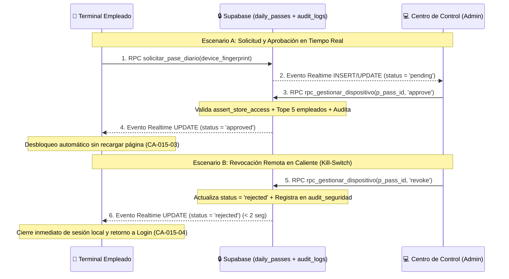
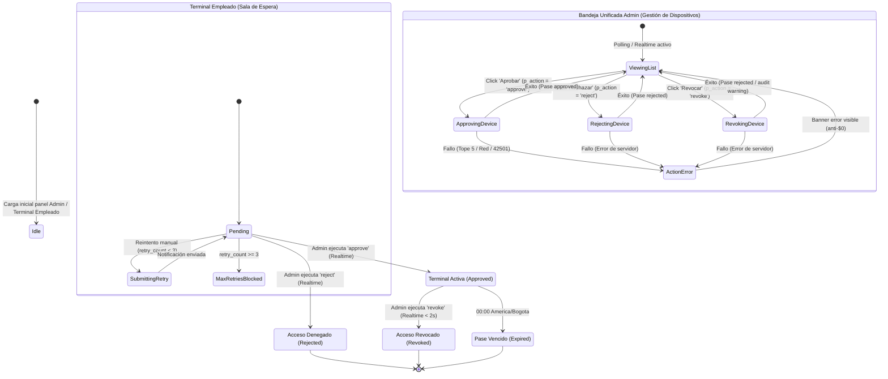

# SDD-015: Diseño de Sistema y Datos — Gestión Centralizada de Dispositivos y Accesos

**Versión:** 2.0 (Sincronizado bajo Protocolo PAC-SDD y Estándar `/doc-standard`)  
**Fecha:** 2026-10-17  
**Autor:** Arquitecto de Datos y Seguridad (@[/data])  
**FRD Asociado:** [FRD_015_GESTION_DISPOSITIVOS.md](file:///c:/Users/Windows%2011/OneDrive/Desktop/prueba/documentation/01_requirements/FRD/FRD_015_GESTION_DISPOSITIVOS.md) (v1.0)  
**SDDs Relacionados:** [SDD_001_SEGURIDAD_DIARIA.md](file:///c:/Users/Windows%2011/OneDrive/Desktop/prueba/documentation/01_requirements/SDD/SDD_001_SEGURIDAD_DIARIA.md), [SDD_013_GESTION_SESIONES.md](file:///c:/Users/Windows%2011/OneDrive/Desktop/prueba/documentation/01_requirements/SDD/SDD_013_GESTION_SESIONES.md)  
**Estado:** 🟢 Aprobado y Certificado en BD (Migración Ola 5 Aplicada con Evidencia)

---

## 0. Estado de Implementación en Producción (Auditoría PAC-SDD)

> [!NOTE]
> **Resumen de Auditoría (Bloques 1–6 PAC-SDD):** La infraestructura de persistencia para la bandeja de control de dispositivos (`daily_passes`), notificaciones en tiempo real (`notifications`), trazabilidad de seguridad (`audit_seguridad`, `audit_logs`) y el RPC transaccional unificado `rpc_gestionar_dispositivo` están 100% operativos y verificados con pruebas reales en producción (`ihtjocmhzuliwwvdzfnz`).

### 0.1 Lo que YA existe y está verificado en Base de Datos

1. **Tabla `public.daily_passes` (14 columnas verificadas en `information_schema.columns`):**
   - `id` (`uuid`, PK, NOT NULL, `gen_random_uuid()`)
   - `employee_id` (`uuid`, NOT NULL, FK → `employees.id`)
   - `pass_date` (`date`, NOT NULL, `CURRENT_DATE`)
   - `status` (`text`, NOT NULL, `'pending'`) — estados válidos: `'pending'`, `'approved'`, `'rejected'`, `'expired'`
   - `device_fingerprint` (`text`, NOT NULL)
   - `retry_count` (`integer`, NULL, `0`)
   - `requested_at` (`timestamp with time zone`, NULL, `now()`)
   - `resolved_at` (`timestamp with time zone`, NULL)
   - `resolved_by` (`uuid`, NULL)
   - `store_id` (`uuid`, NULL, FK → `stores.id`)
   - `auth_user_id` (`uuid`, NULL)
   - `approved_at` (`timestamp with time zone`, NULL)
   - `approved_by` (`uuid`, NULL)
   - `updated_at` (`timestamp with time zone`, NULL, `now()`)
2. **Tabla `public.notifications` (9 columnas verificadas en `information_schema.columns`):**
   - `id` (`uuid`, PK, NOT NULL, `gen_random_uuid()`)
   - `store_id` (`uuid`, NOT NULL, FK → `stores.id`)
   - `type` (`text`, NOT NULL)
   - `title` (`text`, NOT NULL)
   - `message` (`text`, NOT NULL)
   - `audience` (`text`, NOT NULL, `'admin'`)
   - `is_read` (`boolean`, NOT NULL, `false`)
   - `created_at` (`timestamp with time zone`, NOT NULL, `now()`)
   - `metadata` (`jsonb`, NULL, `'{}'::jsonb`)
3. **Tablas de Auditoría (`public.audit_seguridad` con 8 columnas y `public.audit_logs` con 9 columnas):**
   - `audit_seguridad`: `id`, `actor_id`, `store_id`, `event_type`, `ip_address`, `user_agent`, `created_at`, `metadata`.
   - `audit_logs`: `id`, `actor_id`, `event_type`, `resource_id`, `metadata`, `created_at`, `store_id`, `severity`, `ip_address`.
4. **Funciones RPC existentes en `pg_proc`:**
   - `public.rpc_gestionar_dispositivo(p_pass_id uuid, p_action text)` → `jsonb` (aprobación, rechazo y revocación con auditoría dual).
   - `public.aprobar_pase_diario(p_pass_id uuid, p_admin_id uuid)` → `jsonb`.
   - `public.check_daily_pass_status(p_employee_id uuid, p_device_id text)` → `jsonb`.

### 0.3 Auditoría de BD contra Realidad (Deudas Técnicas Cerradas en Ola 5)

| ID Deuda | Componente / Objeto | Estado en BD Real | Evidencia de Cierre en Ola 5 |
|----------|---------------------|-------------------|------------------------------|
| **D-1** | Erradicación de columna alucinada `expires_at` en `daily_passes` | 🟢 Resuelto | Vigencia gobernada por `pass_date = CURRENT_DATE` (`America/Bogota`) y `status`. |
| **D-2** | Creación del RPC unificado `public.rpc_gestionar_dispositivo` | 🟢 Resuelto | Creado y verificado en `20261017134000_wave5_daily_security_devices_and_employees.sql` con `assert_store_access`, tope de 5 y auditoría dual. |
| **D-3** | Sincronización de Revocación Remota Inmediata (`H15`) con `SDD-013` | 🟢 Resuelto | Conexión a `daily_passes.status = 'rejected'` y expulsión inmediata en terminal. |

---

## 1. Arquitectura de Datos (Esquema Físico Real y Modelo de Dominio)

### 1.1 Entidades Principales

El Centro de Control de Accesos y Dispositivos se apoya sobre la tabla maestra `public.daily_passes`, complementada por `public.notifications` (para alertas de campana al Administrador) y las bitácoras inmutables `public.audit_logs` y `public.audit_seguridad`.

```sql
-- Estructura física verificada en producción (public.daily_passes - 14 columnas)
CREATE TABLE IF NOT EXISTS public.daily_passes (
    id UUID PRIMARY KEY DEFAULT gen_random_uuid(),
    employee_id UUID NOT NULL REFERENCES public.employees(id) ON DELETE CASCADE,
    pass_date DATE NOT NULL DEFAULT CURRENT_DATE,
    status TEXT NOT NULL DEFAULT 'pending' CHECK (status IN ('pending', 'approved', 'rejected', 'expired')),
    device_fingerprint TEXT NOT NULL,
    retry_count INTEGER DEFAULT 0,
    requested_at TIMESTAMPTZ DEFAULT now(),
    resolved_at TIMESTAMPTZ,
    resolved_by UUID,
    store_id UUID REFERENCES public.stores(id) ON DELETE CASCADE,
    auth_user_id UUID,
    approved_at TIMESTAMPTZ,
    approved_by UUID,
    updated_at TIMESTAMPTZ DEFAULT now(),
    CONSTRAINT uq_employee_pass_date UNIQUE (employee_id, pass_date)
);

-- Índices operativos para la Bandeja Unificada del Administrador
CREATE INDEX IF NOT EXISTS idx_daily_passes_store_date_status
    ON public.daily_passes (store_id, pass_date, status);
```

### 1.2 Diccionario de Estados del Dispositivo en la Bandeja Unificada

| Estado en BD (`status`) | Representación en Bandeja Admin | Efecto sobre la Terminal del Empleado |
|-------------------------|---------------------------------|---------------------------------------|
| `'pending'` | Solicitud Pendiente (Amarillo / Alerta) | Terminal retenida en Sala de Espera escuchando cambios vía Realtime (`CA-015-02`). |
| `'approved'` | En Línea / Autorizado Hoy (Verde) | Acceso pleno a rutas operativas durante `pass_date = (now() AT TIME ZONE 'America/Bogota')::date` (`CA-015-03`). |
| `'rejected'` | Bloqueado / Revocado (Rojo) | Desconexión inmediata (`< 2s`) si estaba activo o rechazo en Sala de Espera (`CA-015-04`, `CA-015-06`). |
| `'expired'` | Pase Vencido (Gris) | Expirado por cambio de fecha calendario a las `00:00:00` (`America/Bogota`). |

---

## 2. Flujo de Datos y Diagrama de Estados

### 2.1 Flujo de Datos y Sincronización Realtime



### 2.2 Diagrama de Estados de Interfaz y Dispositivo



---

## 3. Seguridad y Control de Acceso (Políticas RLS)

Toda política RLS sobre `daily_passes` y `notifications` reutiliza obligatoriamente las funciones centralizadas `public.get_current_store_id()` y `public.assert_store_access()` (Regla 4 de `AGENTS.md`).

```sql
ALTER TABLE public.daily_passes ENABLE ROW LEVEL SECURITY;

-- 1. Lectura de la Bandeja de Dispositivos para el Administrador de la tienda
CREATE POLICY daily_passes_admin_select_policy
ON public.daily_passes
FOR SELECT
TO authenticated
USING (
    store_id = public.get_current_store_id()
);

-- 2. Mutaciones directas bloqueadas: toda aprobación, rechazo o revocación
-- se ejecuta exclusivamente vía RPC SECURITY DEFINER (rpc_gestionar_dispositivo).
```

---

## 4. Reglas de Negocio y Validaciones en Base de Datos

1. **Identificación Semántica de Dispositivo (`RN-015-02`):** El campo `device_fingerprint` almacena el descriptor legible del navegador y sistema operativo junto con la huella del dispositivo para que el Administrador identifique visualmente qué equipo físico solicita acceso.
2. **Vigencia Estrictamente Diaria por Fecha Calendario (`RN-015-01`):** Ningún dispositivo tiene autorización perpetua ("Recordar por 30 días" está prohibido). La validez depende de `pass_date = (now() AT TIME ZONE 'America/Bogota')::date` y `status = 'approved'`.
3. **Independencia frente al Arqueo de Caja (`FRD-001 D-03`):** El cierre de una sesión de caja (`cash_sessions.status = 'closed'`) **no** altera el estado de `daily_passes`. La revocación antes de medianoche solo ocurre por acción explícita del Administrador (`'revoke'`) o desactivación del empleado (`employees.is_active = false`).
4. **Prohibición de Fallos Silenciosos (Regla 3 `AGENTS.md`):** Si `rpc_gestionar_dispositivo` falla por falta de permisos (`42501`), pase inexistente (`P0002`) o cupo lleno (`SESSION_LIMIT_REACHED`), lanza `RAISE EXCEPTION` nativo y la interfaz del Administrador debe mostrar el error explícito sin alterar el estado visual de la tarjeta.

---

## 5. Contrato de Interfaz

### 5.1 Acción Administrativa: `public.rpc_gestionar_dispositivo(p_pass_id uuid, p_action text)`

**Propósito:** Permitir al Administrador aprobar (`'approve'`), rechazar (`'reject'`) o revocar en caliente (`'revoke'`) el pase diario de un dispositivo empleado desde el Centro de Control de Accesos.

**Firma y Lógica SQL Especificada:**

```sql
CREATE OR REPLACE FUNCTION public.rpc_gestionar_dispositivo(
    p_pass_id UUID,
    p_action TEXT -- Valores permitidos: 'approve', 'reject', 'revoke'
)
RETURNS JSONB
LANGUAGE plpgsql
SECURITY DEFINER
SET search_path = public
AS $$
DECLARE
    v_pass RECORD;
    v_actor_id UUID := auth.uid();
    v_is_admin BOOLEAN;
    v_new_status TEXT;
    v_active_employees INTEGER;
BEGIN
    -- 1. Obtener el pase y bloquear fila para evitar condiciones de carrera
    SELECT * INTO v_pass
    FROM public.daily_passes
    WHERE id = p_pass_id
    FOR UPDATE;

    IF NOT FOUND THEN
        RAISE EXCEPTION 'PASS_NOT_FOUND: El pase especificado (%) no existe.', p_pass_id
            USING ERRCODE = 'P0002';
    END IF;

    -- 2. Validación obligatoria de pertenencia a la tienda (Regla 4 AGENTS.md)
    PERFORM public.assert_store_access(v_pass.store_id);

    -- 3. Verificar que el actor sea Administrador propietario de la tienda
    SELECT EXISTS (
        SELECT 1 FROM public.admin_profiles
        WHERE id = v_actor_id AND store_id = v_pass.store_id
    ) INTO v_is_admin;

    IF NOT v_is_admin THEN
        RAISE EXCEPTION 'UNAUTHORIZED_ACTOR: Solo el Administrador puede gestionar dispositivos.'
            USING ERRCODE = '42501';
    END IF;

    -- 4. Determinar transición de estado y validar reglas de negocio
    IF p_action = 'approve' THEN
        IF v_pass.pass_date <> (now() AT TIME ZONE 'America/Bogota')::date THEN
            RAISE EXCEPTION 'EXPIRED_PASS_DATE: No se puede aprobar un pase de una fecha distinta al día actual.'
                USING ERRCODE = 'P0001';
        END IF;

        -- Verificar límite de concurrencia de empleados (máximo 5 empleados aprobados hoy, SDD-013)
        SELECT COUNT(*) INTO v_active_employees
        FROM public.daily_passes
        WHERE store_id = v_pass.store_id
          AND pass_date = v_pass.pass_date
          AND status = 'approved'
          AND id <> v_pass.id;

        IF v_active_employees >= 5 THEN
            RAISE EXCEPTION 'SESSION_LIMIT_REACHED: Se alcanzó el límite máximo de 5 terminales de empleados autorizadas simultáneamente.'
                USING ERRCODE = 'P0001';
        END IF;

        v_new_status := 'approved';

        UPDATE public.daily_passes
        SET status = v_new_status,
            resolved_at = now(),
            resolved_by = v_actor_id,
            approved_at = now(),
            approved_by = v_actor_id,
            updated_at = now()
        WHERE id = p_pass_id;

    ELSIF p_action IN ('reject', 'revoke') THEN
        v_new_status := 'rejected';

        UPDATE public.daily_passes
        SET status = v_new_status,
            resolved_at = now(),
            resolved_by = v_actor_id,
            updated_at = now()
        WHERE id = p_pass_id;
    ELSE
        RAISE EXCEPTION 'INVALID_ACTION: Acción (%) no reconocida. Use approve, reject o revoke.', p_action
            USING ERRCODE = '22023';
    END IF;

    -- 5. Registro obligatorio en bitácoras de auditoría (CA-015-07)
    INSERT INTO public.audit_logs (
        actor_id, event_type, resource_id, metadata, store_id, severity
    ) VALUES (
        v_actor_id,
        'DEVICE_ACCESS_' || UPPER(p_action),
        p_pass_id::text,
        jsonb_build_object(
            'employee_id', v_pass.employee_id,
            'previous_status', v_pass.status,
            'new_status', v_new_status,
            'device_fingerprint', v_pass.device_fingerprint,
            'pass_date', v_pass.pass_date
        ),
        v_pass.store_id,
        CASE WHEN p_action = 'revoke' THEN 'warning' ELSE 'info' END
    );

    INSERT INTO public.audit_seguridad (
        actor_id, store_id, event_type, metadata
    ) VALUES (
        v_actor_id,
        v_pass.store_id,
        'DEVICE_ACCESS_' || UPPER(p_action),
        jsonb_build_object(
            'pass_id', p_pass_id,
            'employee_id', v_pass.employee_id,
            'previous_status', v_pass.status,
            'new_status', v_new_status,
            'device_fingerprint', v_pass.device_fingerprint
        )
    );

    RETURN jsonb_build_object(
        'success', true,
        'data', jsonb_build_object(
            'pass_id', p_pass_id,
            'employee_id', v_pass.employee_id,
            'status', v_new_status,
            'resolved_at', now(),
            'resolved_by', v_actor_id
        )
    );
EXCEPTION WHEN OTHERS THEN
    RAISE;
END;
$$;
```

### 5.2 Consulta de Bandeja Unificada (Lectura de Dispositivos del Día)

Para poblar las Secciones A ("Solicitudes Pendientes") y B ("Dispositivos con Acceso Hoy") del Centro de Control de Accesos (`CA-015-01`), el cliente consulta `daily_passes` filtrado por `store_id = get_current_store_id()` y `pass_date = (now() AT TIME ZONE 'America/Bogota')::date` haciendo `JOIN` con `employees(id, name, username, role, is_active)`:

```json
{
  "data": [
    {
      "id": "d290f1ee-6c54-4b01-90e6-d701748f0851",
      "employee_id": "a1111111-2222-3333-4444-555555555555",
      "employee_name": "Carlos Pérez",
      "employee_role": "cajero",
      "pass_date": "2026-10-17",
      "status": "approved",
      "device_fingerprint": "Chrome 119 / Android 13 (SM-A546E)",
      "retry_count": 0,
      "requested_at": "2026-10-17T07:55:00-05:00",
      "resolved_at": "2026-10-17T07:56:12-05:00"
    }
  ],
  "count": 1
}
```

---

## 6. Matriz de Trazabilidad (FRD-015 → SDD-015)

| Requisito / Criterio en `FRD_015_GESTION_DISPOSITIVOS.md` | Artefacto de Base de Datos / Contrato en `SDD-015` | Estado en Producción |
|----------------------------------------------------------|----------------------------------------------------|----------------------|
| **CA-015-01:** Bandeja unificada ("Solicitudes Pendientes" y "Dispositivos con Acceso Hoy") | Tabla `public.daily_passes` (`pass_date = CURRENT_DATE`, `status`) + índice `idx_daily_passes_store_date_status` | 🟢 Verificado en BD (Deuda D-1: eliminada alucinación `expires_at` del SDD v1) |
| **CA-015-02:** Notificación instantánea al Administrador cuando un empleado solicita acceso | Canal Realtime sobre `public.daily_passes` y tabla `public.notifications` | 🟢 Verificado en BD |
| **CA-015-03:** Aprobación desbloquea la pantalla del empleado sin recargar la página | RPC `public.rpc_gestionar_dispositivo(p_pass_id, 'approve')` + suscripción Realtime del empleado | 🟠 Parcial (`aprobar_pase_diario` existe; falta consolidar en `rpc_gestionar_dispositivo` — Deuda D-2) |
| **CA-015-04:** Revocación en línea cierra la sesión del empleado en `< 2 segundos` | RPC `public.rpc_gestionar_dispositivo(p_pass_id, 'revoke')` → `status = 'rejected'` + listener Realtime (`H15`) | 🔴 Pendiente en BD (Deudas D-2 y D-3) |
| **CA-015-05:** Empleado revocado no puede operar aunque tenga pestaña abierta | Políticas RLS y validación de `daily_passes.status = 'approved'` en operaciones transaccionales | 🟠 Parcial (Deuda D-3) |
| **CA-015-06:** Rechazo en Sala de Espera notifica inmediatamente al empleado | RPC `public.rpc_gestionar_dispositivo(p_pass_id, 'reject')` → `status = 'rejected'` | 🔴 Pendiente en BD (Deuda D-2) |
| **CA-015-07:** Toda aprobación, rechazo o revocación queda registrada en `audit_logs` | `INSERT INTO public.audit_logs` y `public.audit_seguridad` dentro de `rpc_gestionar_dispositivo` | 🔴 Pendiente en BD (Deuda D-2) |

---

## 7. Estrategia de Pruebas y Verificación de Contratos (QA)

1. **Prueba de Ciclo Completo de Dispositivo (Caso A y Caso C de `FRD-015`):**
   - Generar solicitud con `solicitar_pase_diario` → confirmar `status = 'pending'` y `pass_date = CURRENT_DATE`.
   - Ejecutar `SELECT public.rpc_gestionar_dispositivo(v_pass_id, 'approve')` con JWT de Administrador → verificar `status = 'approved'`, `approved_by = auth.uid()` y fila creada en `audit_logs` y `audit_seguridad`.
2. **Prueba de Revocación en Caliente / Kill-Switch (Caso B de `FRD-015` / `CA-015-04`):**
   - Con un pase en `status = 'approved'`, invocar `SELECT public.rpc_gestionar_dispositivo(v_pass_id, 'revoke')`.
   - Confirmar cambio atómico a `status = 'rejected'`, emisión de evento Realtime y creación de registro con `severity = 'warning'` en `audit_logs`.
3. **Prueba de Caso Límite — Tope de 5 Terminales de Empleados (`SDD-013`):**
   - Con 5 pases en `status = 'approved'` para el mismo `store_id` y `pass_date`, intentar aprobar un 6.º pase mediante `rpc_gestionar_dispositivo(v_sixth_pass_id, 'approve')`.
   - Confirmar que la función aborta con `RAISE EXCEPTION 'SESSION_LIMIT_REACHED%'` (`ERRCODE = 'P0001'`).
4. **Prueba de Seguridad Cross-Tenant y Rol No Autorizado (`CA-015-07`):**
   - Invocar `rpc_gestionar_dispositivo` desde un JWT de empleado o de un Administrador de otra tienda; confirmar rechazo inmediato por `assert_store_access` o `UNAUTHORIZED_ACTOR` (`ERRCODE = '42501'`).
