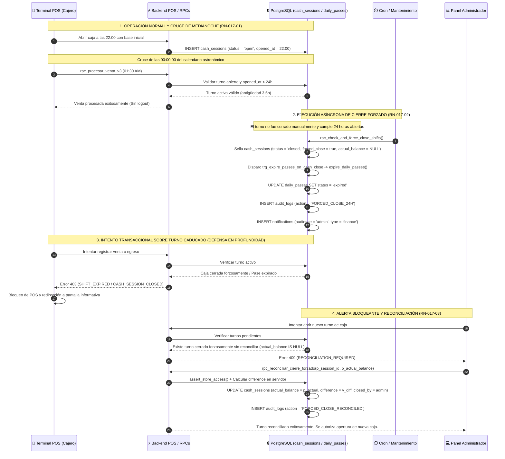
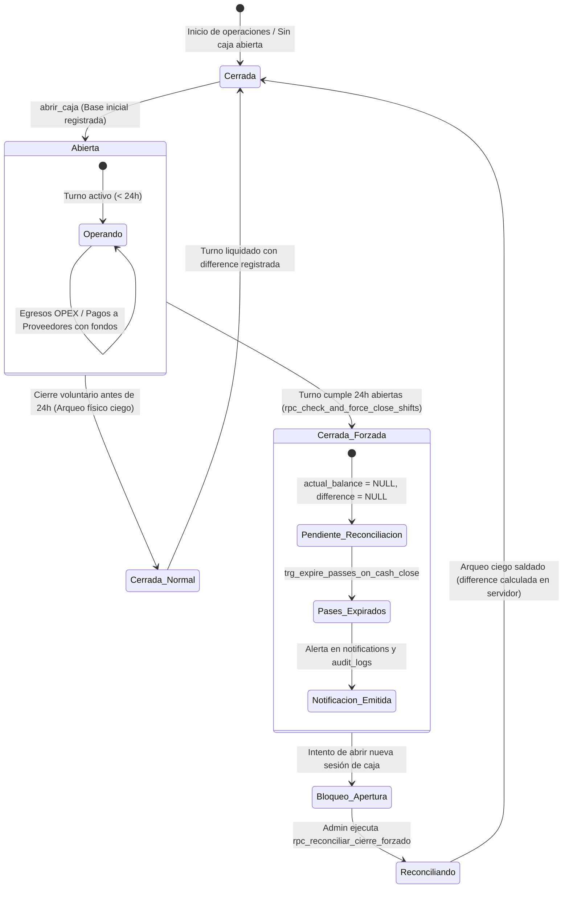

# SDD-017: Alineación del Ciclo Contable de Caja y Ciclo de Vida de Sesiones

> **Asociado a:** [FRD-017: Alineación del Ciclo Contable de Caja y Ciclo de Vida de Sesiones](../FRD/FRD_017_CICLO_CONTABLE_Y_SESIONES.md)  
> **Fase del Plan:** Ola 5: Sesiones, Autenticación y Offline (Ítem 3)  
> **Estado:** 🟠 Aprobado con Deuda Técnica Documentada (Protocolo PAC-SDD v2.0)
> **Última Actualización:** 2026-10-16  

---

## 0. CONTROL DE VERSIONES Y TRAZABILIDAD

### 0.1 Historial de Cambios
| Versión | Fecha | Autor | Rol | Descripción de Modificación |
|---------|-------|-------|-----|-----------------------------|
| 1.0.0 | 2026-07-25 | Desarrollador-Economista Senior | Requisitos | Especificación aprobada de ciclo contable y límite de 24 horas. |
| 1.5.0 | 2026-08-04 | Arquitecto de Software | Arquitectura | Redacción preliminar con alucinaciones de cuadre en cero (`difference = 0`). |
| 2.0.0 | 2026-10-16 | Orquestador Técnico | Arquitectura & QA | **Saneamiento Integral PAC-SDD v2.0**: Erradicación de cuadres ficticios ($0 descuadre); consagración de la realidad física de producción (`actual_balance = NULL`, `difference = NULL` en cierre forzado); vinculación reactiva con el trigger de expiración de pases `trg_expire_passes_on_cash_close`; formalización del procedimiento de reconciliación administrativa a ciegas `rpc_reconciliar_cierre_forzado`; integración con el subsistema de notificaciones (`notifications`); cumplimiento estricto de las Reglas 1.1 (0% código SQL), 2, 4, 7 y 8; y armonización transversal con POS, Gastos y Devengo (SDD-018). |

### 0.2 Trazabilidad de Requisitos (FRD-017)
| Regla de Negocio / CU | Descripción en FRD | Implementación en este SDD |
|-----------------------|--------------------|----------------------------|
| **RN-017-01** | Continuidad del Turno (Cruce libre de medianoche sin deslogueo) | Sección 4.1 y Sección 2 (Diagrama de Estados) |
| **RN-017-02** | Cierre forzado estricto al cumplir 24 horas de apertura | Sección 4.2, Sección 3.3 y Sección 5.1 |
| **RN-017-03** | Auditoría y notificación administrativa de cierre forzado | Sección 4.3, Sección 3.4 y Sección 5.2 |
| **RN-017-04** | Inmutabilidad contable de la asignación al turno (`session_id`) | Sección 4.4, Sección 3.2 y Sección 7 (D-5) |
| **CU-017-A** | Operación nocturna continua a través de medianoche | Sección 4.1 y Sección 2.1 |
| **CU-017-B** | Olvido de cierre de caja, ejecución forzada y regularización | Sección 4.2, Sección 4.3 y Sección 5.2 |

### 0.3 Matriz de Dependencias Inter-Modulares
| Documento Vecino | Tipo de Dependencia | Flujo o Restricción Vinculante |
|------------------|---------------------|--------------------------------|
| [SDD-004](../SDD/SDD_004_CONTROL_DE_CAJA.md) / [SDD-020](../SDD/SDD_020_CAJA_MULTICANAL.md) | Núcleo Financiero | Esquema físico de `cash_sessions` (12 columnas), `cash_movements` (7 columnas), fórmula de saldo esperado y principio de arqueo ciego (`POL-SEG-01`). |
| [SDD-013](../SDD/SDD_013_GESTION_SESIONES.md) / [SDD-001](../SDD/SDD_001_SEGURIDAD_DIARIA.md) | Gobernanza de Sesiones | Subordinación de pases diarios (`daily_passes`); expiración reactiva masiva vía trigger `trg_expire_passes_on_cash_close` al pasar la caja a `'closed'`. |
| [SDD-007](../SDD/SDD_007_NUCLEO_VENTAS_PADRE.md) / [SDD-007.1](../SDD/SDD_007_01_NUCLEO_POS.md) | Consumidor Transaccional | Precondición de turno abierto con antigüedad menor a 24 horas (`opened_at >= NOW() - INTERVAL '24 hours'`) para procesar cobros de contado en POS. |
| [SDD-019](../SDD/SDD_019_CUENTAS_POR_PAGAR.md) / [SDD-022](../SDD/SDD_022_GASTOS_MULTICANAL.md) | Egresos de Tesorería | Precondición de turno abierto `< 24h` para registrar pagos a proveedores y gastos OPEX, previniendo sobregiros por canal (`INSUFFICIENT_FUNDS`). |
| [SDD-023](../SDD/SDD_023_IMPACTO_CRUZADO_MULTICANAL.md) | Consistencia Transversal | Procedimiento atómico de reconciliación post-cierre forzado (`rpc_reconciliar_cierre_forzado`) y preservación de columnas escalares. |
| [SDD-018](../SDD/SDD_018_CONTROL_OPERACIONAL.md) | Inteligencia Financiera | Principio de Devengo contable: imputación inmutable de ingresos y egresos al `session_id` del turno original sin distorsión por cierres forzados. |
| [SDD-005](../SDD/SDD_005_AUDITORIA_TRAZABILIDAD.md) | Auditoría Forense | Inviolabilidad contable (`POL-AUD-01`): Registro inmutable en `audit_logs` con acciones `FORCED_CLOSE_24H` y `FORCED_CLOSE_RECONCILED`. |

---

## 1. RESUMEN EJECUTIVO Y ALCANCE

El documento **SDD-017** establece la alineación arquitectural definitiva entre el **Ciclo Contable de Caja** y el **Ciclo de Vida de las Sesiones de Usuario** en el ecosistema **Tienda Barrio Pro**.

### 1.1 Principios Rectores Económico-Contables
1. **Prevalencia del Hecho Económico sobre el Reloj Astronómico (`RN-017-01`):** La unidad contable de caja es el turno continuo de trabajo del tendero. Las 00:00:00 del calendario no constituyen un corte contable ni fuerzan la expulsión (`logout`) de los cajeros en turnos nocturnos legítimos (ej. de 10:00 PM a 02:00 AM).
2. **Techo Temporal Inviolable de 24 Horas (`RN-017-02`):** Para prevenir la negligencia operativa de cajas abandonadas indefinidamente y el arrastre de descuadres desapercibidos, el sistema impone un límite estricto de 24 horas a partir del momento exacto de apertura (`cash_sessions.opened_at`).
3. **Erradicación de Falsedades Contables (Cero Cuadres Ficticios):** El cierre forzado asíncrono **nunca** asume un descuadre de $0 ni inventa un dinero físico inexistente. El sistema sella la sesión calculando matemáticamente el saldo esperado (`expected_balance`), fijando el saldo real físico en `NULL` (`actual_balance = NULL`) y la diferencia en `NULL` (`difference = NULL`), documentando que el turno quedó pendiente de arqueo humano supervisado.
4. **Expiración Reactiva y Cascada de Sesiones (`POL-SEC-02`):** El sellado de la caja (manual o forzado a las 24 horas) desencadena a nivel de base de datos el trigger físico `trg_expire_passes_on_cash_close`, conmutando a `'expired'` todos los pases diarios operativos de la tienda en `daily_passes`.
5. **Alerta Bloqueante y Reconciliación Obligatoria (`RN-017-03`):** Un turno cerrado forzosamente bloquea la apertura de una nueva caja en la tienda hasta que un usuario autorizado (con permiso `canOpenCloseCash` o rol de Administrador) acuse recibo de la notificación, efectúe el arqueo físico a ciegas mediante `rpc_reconciliar_cierre_forzado` y liquide la diferencia en el libro de auditoría.
6. **Defensa en Profundidad Transaccional (`Defense in Depth`):** Si un turno de caja rebasa las 24 horas y el cron job de mantenimiento aún no se ha ejecutado, las funciones transaccionales de cobro en POS (`rpc_procesar_venta_v3`) y egreso de fondos (`rpc_pay_supplier_invoice`, `rpc_registrar_gasto`) evalúan en tiempo real la antigüedad del turno, abortando de inmediato con el código `SHIFT_EXPIRED`.

---

## 2. ARQUITECTURA GENERAL Y DIAGRAMA DE FLUJO

### 2.1 Diagrama de Secuencia: Ciclo de Turno Nocturno y Cierre Forzado a las 24 Horas
El siguiente diagrama detalla la interacción entre la terminal POS, el motor transaccional de Supabase, el proceso asíncrono de cierre forzado de 24 horas, el trigger reactivo y la reconciliación administrativa:



---

### 2.2 Diagrama de Estados: Máquina de Estados del Ciclo Contable de Caja



---

## 3. ESQUEMA DE DATOS Y MODELO DE DOMINIO

### 3.1 Estructura Física Real de la Tabla `cash_sessions`
La entidad física real en Supabase Producción (`ihtjocmhzuliwwvdzfnz`) que gobierna el ciclo contable consta de 12 columnas verificadas:

| Columna | Tipo de Dato | Nulable | Restricción / Default | Descripción de Negocio |
|---------|--------------|---------|-----------------------|------------------------|
| `id` | `uuid` | NO | `PRIMARY KEY`, default `gen_random_uuid()` | Identificador único e inmutable del turno contable. |
| `store_id` | `uuid` | NO | `FK stores.id` | Tienda propietaria del turno (aislamiento multi-tenant). |
| `opened_by` | `uuid` | NO | `FK employees.id` | Empleado o administrador que realizó la apertura física. |
| `closed_by` | `uuid` | SÍ | `FK employees.id` | Actor que ejecutó el cierre o la reconciliación del turno. |
| `opening_balance` | `numeric` | NO | Importe monetario COP entero | Saldo base inicial en efectivo al momento de la apertura. |
| `expected_balance` | `numeric` | SÍ | Calculado en backend | Saldo teórico esperado calculado por agregación contable. |
| `actual_balance` | `numeric` | SÍ | `NULL` en cierre forzado | Dinero físico contado en arqueo ciego por el operador. |
| `difference` | `numeric` | SÍ | `NULL` en cierre forzado | Descuadre contable calculado exclusivamente en servidor. |
| `status` | `text` | NO | Default `'open'`, `CHECK status IN ('open', 'closed')` | Estado operativo del turno de caja. |
| `opened_at` | `timestamptz` | NO | Default `now()` | **Estampa temporal de apertura** (base del techo de 24h). |
| `closed_at` | `timestamptz` | SÍ | `NULL` mientras esté abierta | Estampa temporal de cierre formal o cierre forzado. |
| `forced_close` | `boolean` | NO | Default `false` | **Bandera física** que identifica turnos cerrados por límite de 24h. |

---

### 3.2 Estructura Física de la Tabla `cash_movements`
Asignación contable inmutable (`session_id`) por cada hecho económico:

| Columna | Tipo de Dato | Nulable | Restricción / Default | Descripción de Negocio |
|---------|--------------|---------|-----------------------|------------------------|
| `id` | `uuid` | NO | `PRIMARY KEY`, default `gen_random_uuid()` | Identificador del movimiento de tesorería. |
| `session_id` | `uuid` | NO | `FK cash_sessions.id ON DELETE CASCADE` | **Vinculación irrevocable al turno contable** (`RN-017-04`). |
| `movement_type` | `text` | NO | `CHECK movement_type IN ('ingreso', 'gasto', 'pago_proveedor')` | Clasificación contable del flujo de caja. |
| `amount` | `numeric` | NO | `CHECK amount > 0` | Importe monetario en enteros COP sin centavos. |
| `description` | `text` | NO | Texto no vacío | Descripción del concepto (con tag de canal ej. `[Efectivo]`). |
| `sale_id` | `uuid` | SÍ | `FK sales.id` | Llave foránea a la venta originaria (en cobros POS). |
| `created_at` | `timestamptz` | NO | Default `now()` | Estampa temporal del asiento contable. |

---

### 3.3 Procedimiento de Cierre Forzado: `rpc_check_and_force_close_shifts()`
Procedimiento almacenado en producción ejecutado de forma asíncrona por cron job de mantenimiento:
1. **Criterio de Selección:** Itera sobre `cash_sessions` donde `status = 'open'` y `opened_at < (NOW() - INTERVAL '24 hours')`.
2. **Cálculo de Saldo Esperado Unificado:**
   Calcula `v_ingresos` sumando `amount` de `cash_movements` con `movement_type = 'ingreso'`.
   Calcula `v_gastos` sumando `amount` de `cash_movements` con `movement_type IN ('gasto', 'pago_proveedor')`.
   Calcula `v_expected = r.opening_balance + v_ingresos - v_gastos`.
3. **Sellado Atómico de la Sesión:**
   Actualiza la fila fijando `status = 'closed'`, `forced_close = true`, `expected_balance = v_expected`, `actual_balance = NULL`, `difference = NULL`, y `closed_at = NOW()`.
4. **Disparo Reactivo del Trigger de Pases:**
   La transición de `'open'` a `'closed'` acciona automáticamente `trg_expire_passes_on_cash_close`, expirando los pases diarios aprobados de la tienda (`daily_passes.status = 'expired'`).
5. **Auditoría Forense y Notificación Administrativa:**
   Inserta asiento en `audit_logs` con `action = 'FORCED_CLOSE_24H'`.
   Inserta registro en `notifications` con `type = 'finance'`, `audience = 'admin'`, y título `⚠️ Cierre Forzado de Caja (24 Horas)`.

---

### 3.4 Procedimiento de Reconciliación: `rpc_reconciliar_cierre_forzado()`
Procedimiento almacenado para saldar la cuenta tras un cierre forzado:
1. **Validaciones de Entrada:** Exige `p_actual_balance >= 0`.
2. **Seguridad RBAC en Servidor:** Valida que el empleado o administrador posea el permiso `canOpenCloseCash = true`.
3. **Validación de Estado:** Localiza la sesión verificando que cumpla estrictamente `id = p_session_id`, `status = 'closed'`, `forced_close = true` y `actual_balance IS NULL`.
4. **Aislamiento Multi-Tenant (Regla 4):** Valida que el invocador pertenezca a la tienda de la sesión (`assert_store_access`).
5. **Cálculo de Diferencia en Servidor:** Computa `v_difference = v_session.expected_balance - p_actual_balance`.
6. **Liquidación:** Actualiza `actual_balance = p_actual_balance`, `difference = v_difference` y `closed_by = p_employee_id`.
7. **Asiento Inmutable:** Inserta en `audit_logs` el evento `FORCED_CLOSE_RECONCILED`.

---

## 4. REGLAS DE NEGOCIO Y VALIDACIONES

### 4.1 RN-017-01: Continuidad del Turno (Cruce de Medianoche)
1. Un turno de caja activo puede cruzar libremente la medianoche astronómica (00:00:00) sin corte forzado ni pérdida de estado.
2. Las sesiones operativas de usuario y los pases diarios se mantienen activos mientras el turno de caja permanezca abierto y no se haya alcanzado el techo temporal estricto de 24 horas.
3. El frontend y el backend tienen prohibido ejecutar `logout()`, descartar tokens o invalidar pases únicamente por el cambio de fecha calendario del reloj local o del servidor.

### 4.2 RN-017-02: Cierre Forzado por Techo de 24 Horas
1. Si un turno de caja permanece abierto exactamente 24 horas después de su apertura (`opened_at < NOW() - INTERVAL '24 hours'`):
   - El sistema conmuta el estado de la caja a `closed` marcando `forced_close = true`.
   - El sistema sella el turno con el saldo esperado calculado matemáticamente hasta ese instante.
   - El saldo real (`actual_balance`) y la diferencia (`difference`) se establecen obligatoriamente en `NULL`. Queda estrictamente prohibido asumir un cuadre en cero ($0 de diferencia).
   - Todos los pases diarios operativos de la tienda caducan inmediatamente por la acción reactiva del trigger de base de datos.

### 4.3 RN-017-03: Auditoría y Alerta Bloqueante Post-Cierre Forzado
1. **Auditoría Forense:** El cierre forzado genera automáticamente un registro inmutable en `audit_logs` documentando que la acción fue ejecutada por el sistema debido a negligencia temporal del operador.
2. **Notificación Persistente:** Se genera una notificación en `notifications` dirigida a la audiencia `'admin'`.
3. **Alerta Bloqueante:** El sistema impide la apertura de un NUEVO turno de caja en la tienda mientras exista un turno con `forced_close = true AND actual_balance IS NULL`.
4. **Reconciliación Humana Obligatoria:** Antes de iniciar un nuevo ciclo contable, el Administrador o un operador con permiso `canOpenCloseCash` debe realizar el arqueo físico a ciegas, acusar recibo de la notificación y ejecutar `rpc_reconciliar_cierre_forzado`. El sistema se exime de responsabilidad por el dinero físico no supervisado durante el tiempo de abandono.

### 4.4 RN-017-04: Inmutabilidad de la Asignación Contable (Principio de Devengo)
1. Todas las transacciones de venta (`sales`), items y movimientos de tesorería (`cash_movements`) registrados durante un turno quedan irrevocablemente asociados al `session_id` de ese turno.
2. Ni el cierre forzado asíncrono ni la reconciliación administrativa posterior mutan retrospectivamente las transacciones, las ventas devengadas ni el costo de ventas (COGS FIFO) en el estado de resultados (`SDD-018`).

### 4.5 Defensa en Profundidad Transaccional (< 24h)
1. Las funciones transaccionales de venta en POS (`rpc_procesar_venta_v3`), pago a proveedores (`rpc_pay_supplier_invoice`) y registro de gastos (`rpc_registrar_gasto`) evalúan en tiempo real la antigüedad del turno abierto.
2. Si un turno abierto rebasó las 24 horas y el cron job aún no ha ejecutado el cierre batch, la transacción es rechazada con el código canónico `SHIFT_EXPIRED`, forzando la expulsión defensiva del punto de venta y evitando la contaminación de registros contables caducados.

---

## 5. CONTRATO DE INTERFAZ (PAYLOADS JSON)

Los contratos de interfaz se adhieren a la **Regla Global 4** del proyecto.

### 5.1 Ejecución Batch de Cierre Forzado de 24 Horas
- **Operación Backend:** `rpc_check_and_force_close_shifts`
- **Método / RPC:** Supabase RPC (Invocado por Cron o Servicio de Mantenimiento con rol `service_role`).

#### Payload de Entrada:
```json
{}
```

#### Payload de Respuesta (Éxito):
```json
{
  "success": true,
  "closed_shifts": 1
}
```

---

### 5.2 Reconciliación Administrativa de Cierre Forzado
- **Operación Backend:** `rpc_reconciliar_cierre_forzado`
- **Requisito de Seguridad:** Exclusivo personal con permiso `canOpenCloseCash = true` o rol `admin`. Ejecuta `assert_store_access(v_session.store_id)`.

#### Payload de Entrada:
```json
{
  "p_session_id": "a1b2c3d4-e5f6-4a7b-8c9d-0e1f2a3b4c5d",
  "p_employee_id": "8f7e6d5c-4b3a-2109-8765-4321fedcba98",
  "p_actual_balance": 1850000
}
```

#### Payload de Respuesta (Éxito - Arqueo Conciliado con Diferencia):
```json
{
  "success": true,
  "expected_balance": 1870000,
  "actual_balance": 1850000,
  "difference": 20000
}
```

#### Payload de Respuesta (Fallo - Sesión Ya Reconciliada o Inválida):
```json
{
  "success": false,
  "error": "La sesión no existe, no fue cerrada forzosamente, o ya fue reconciliada.",
  "code": "SESSION_NOT_RECONCILIABLE"
}
```

#### Payload de Respuesta (Fallo - Permisos Insuficientes):
```json
{
  "success": false,
  "error": "Sin permiso para reconciliar cierres de caja.",
  "code": "INSUFFICIENT_PERMISSIONS"
}
```

---

### 5.3 Consulta de Estado del Turno y Validación de Antigüedad
- **Operación Backend:** `get_active_cash_session`
- **Formato:** Regla Global 4.1.

#### Payload de Entrada:
```json
{
  "p_store_id": "3f9a7210-61b4-4e2b-a320-1a76c8901234"
}
```

#### Payload de Respuesta (Turno Activo Válido < 24h):
```json
{
  "isOpen": true,
  "sessionId": "a1b2c3d4-e5f6-4a7b-8c9d-0e1f2a3b4c5d",
  "openingAmount": 200000,
  "openedBy": "8f7e6d5c-4b3a-2109-8765-4321fedcba98",
  "openedAt": "2026-10-16T08:00:00Z"
}
```

#### Payload de Respuesta (Sin Turno Activo):
```json
{
  "isOpen": false
}
```

---

## 6. SEGURIDAD, POLÍTICAS RLS Y MULTI-TENANCY

### 6.1 Aislamiento Multi-Tenant y Regla 4 de Seguridad Centralizada
1. **Reutilización Obligatoria de `assert_store_access(p_store_id)` (Regla 4):**
   Las funciones administrativas de conciliación de turno ejecutan como primera instrucción incondicional:
   `PERFORM public.assert_store_access(v_session.store_id);`
   Si el invocador autenticado no pertenece a la tienda titular de la sesión de caja, la ejecución aborta con la excepción `STORE_ACCESS_DENIED`.
2. **Gobernanza RLS Centralizada mediante `get_current_store_id()`:**
   Las tablas `cash_sessions`, `cash_movements`, `notifications` y `daily_passes` aplican aislamiento de inquilinos en sus políticas RLS comparando estrictamente contra la función centralizada `public.get_current_store_id()`.

### 6.2 Políticas de Seguridad a Nivel de Fila (RLS)
- **`cash_sessions`:**
  - `cash_sessions_select_store`: `store_id = get_current_store_id()`.
  - `cash_sessions_insert_store`: `WITH CHECK (store_id = get_current_store_id())`.
  - `cash_sessions_update_store`: `store_id = get_current_store_id()`.
- **`cash_movements`:**
  - `cash_movements_select_store` / `cash_movements_insert_store`: Delegan mediante `EXISTS` hacia `cash_sessions.store_id = get_current_store_id()`.
- **`notifications`:**
  - Lectura y actualización restringidas a la tienda propia (`store_id = get_current_store_id()`) y a la audiencia correspondiente (`admin`, `employee`, `all`).
- **Inviolabilidad Contable (`POL-AUD-01`):**
  Queda prohibido cualquier `DELETE` físico sobre `cash_sessions`, `cash_movements` y `audit_logs`.

### 6.3 Privilegios Base a Nivel de Tabla (Regla 8)
En estricto cumplimiento de la **Regla 8 de AGENTS.md**, se encuentran verificados los privilegios mediante `has_table_privilege`:
- `cash_sessions`: Otorgados para `anon`, `authenticated`, `service_role`.
- `cash_movements`: Otorgados para `anon`, `authenticated`, `service_role`.
- `daily_passes`: Otorgados para `anon`, `authenticated`, `service_role`.
- `notifications`: Otorgados para `authenticated`, `service_role`.
- `audit_logs`: Otorgados para `authenticated` (lectura) y `service_role` (escritura).
- Todas las tablas mantienen `rowsecurity = true`, garantizando inmunidad ante errores PostgreSQL `42501 (Permission Denied)`.

---

## 7. DEUDAS TÉCNICAS Y DECISIONES DIFERIDAS

En estricto cumplimiento de la **Regla 7 de AGENTS.md**, se formalizan a continuación las decisiones técnicas, compromisos y condiciones de revisión del módulo:

### D-1: Continuidad Contable del Turno vs Reloj Astronómico (`RN-017-01` vs `SDD-001 / SDD-013`)
- **Qué se decidió:** Consagrar que el período contable de caja se rige por el Hecho Económico continuo y el límite temporal de 24 horas, suprimiendo deslogueos y expiraciones de pase a medianoche (00:00:00). La expiración de pases se supedita exclusivamente al cierre formal de caja vía trigger `trg_expire_passes_on_cash_close`.
- **Por qué / Trade-off:** Otorga flexibilidad operativa para turnos nocturnos sin interrumpir las ventas en el mostrador, manteniendo intacta la disciplina de conciliación física al finalizar la jornada.
- **Bajo qué condición futura se revisará:** Permanente. Invariante de diseño contable-financiero.

### D-2: Ejecución Atómica del Cierre Forzado a las 24 Horas (`rpc_check_and_force_close_shifts`)
- **Qué se decidió:** Normar que el cierre forzado sella el turno fijando `status = 'closed'`, `forced_close = true`, `expected_balance = v_expected`, `actual_balance = NULL` y `difference = NULL`, disparando automáticamente la expiración de pases operativos vía trigger y emitiendo auditoría y alerta administrativa.
- **Por qué / Trade-off:** Protege la caja contra el abandono operativo sin generar cuadres falsos ($0 de descuadre) que oculten pérdidas de dinero real o impidan la rendición de cuentas.
- **Bajo qué condición futura se revisará:** Permanente. Invariante contable de la plataforma.

### D-3: Reconciliación Administrativa Obligatoria Post-Cierre Forzado (`rpc_reconciliar_cierre_forzado`)
- **Qué se decidió:** Estandarizar que toda caja cerrada forzosamente bloquee la apertura de un nuevo turno en la tienda hasta que un usuario con `canOpenCloseCash` ejecute `rpc_reconciliar_cierre_forzado` ingresando el arqueo físico real a ciegas.
- **Por qué / Trade-off:** Impone responsabilidad y supervisión humana obligatoria sobre turnos abandonados, impidiendo el arrastre de faltantes no justificados hacia nuevas jornadas.
- **Bajo qué condición futura se revisará:** Permanente. Invariante de control interno y auditoría.

### D-4: Precondición Defensiva `< 24h` en Transacciones POS y Egresos (`SDD-007 / SDD-019 / SDD-022`)
- **Qué se decidió:** Normar que las funciones transaccionales (`rpc_procesar_venta_v3`, `rpc_pay_supplier_invoice`, `rpc_registrar_gasto`) validen en tiempo real que el turno abierto tenga antigüedad menor a 24 horas, rechazando operaciones con `SHIFT_EXPIRED` si el turno rebasó el límite temporal.
- **Por qué / Trade-off:** Elimina la ventana de vulnerabilidad entre el cumplimiento de las 24 horas y la ejecución asíncrona del cron job de mantenimiento, asegurando defensa en profundidad.
- **Bajo qué condición futura se revisará:** Permanente. Estándar de integridad transaccional.

### D-5: Integridad Contable Inmutable y Devengo (`RN-017-04` / Devengo / `SDD-018`)
- **Qué se decidió:** Consagrar que todos los movimientos de caja (`cash_movements`) permanecen inmutablemente atados a su `session_id` original; ni el cierre forzado ni la reconciliación administrativa mutan retrospectivamente las ventas, los cobros ni el P&L devengado en SDD-018.
- **Por qué / Trade-off:** Garantiza la inviolabilidad del estado de resultados y el costo de ventas FIFO ante contingencias o negligencias operativas en el turno de caja.
- **Bajo qué condición futura se revisará:** Permanente. Principio contable fundamental del sistema.
