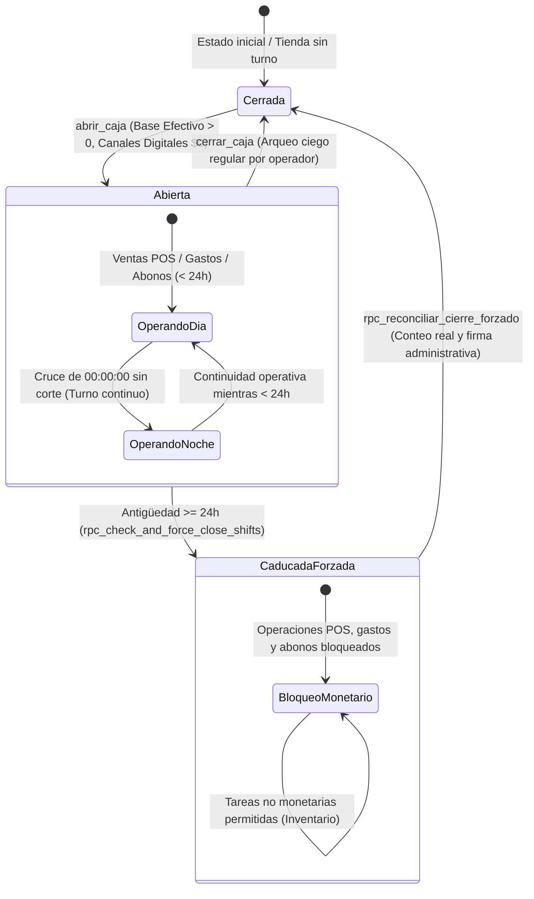

# SDD-017: Alineación del Ciclo Contable de Caja y Ciclo de Vida de Sesiones

> **Módulo:** Contabilidad / Control de Caja / Autenticación  
> **Versión Documental:** 3.0.0 (Redactado bajo Protocolo PAC-SDD)  
> **Estado:** 🟢 ESPECIFICACIÓN APROBADA  
> **FRD Fuente:** [`documentation/01_requirements/FRD/FRD_017_CICLO_CONTABLE_Y_SESIONES.md`](file:///c:/Users/Windows%2011/OneDrive/Desktop/prueba/documentation/01_requirements/FRD/FRD_017_CICLO_CONTABLE_Y_SESIONES.md) (Versión 4.0)  
> **SDDs Vecinos Vinculados:** [`SDD_004_CONTROL_DE_CAJA.md`](file:///c:/Users/Windows%2011/OneDrive/Desktop/prueba/documentation/01_requirements/SDD/SDD_004_CONTROL_DE_CAJA.md), [`SDD_007_01_NUCLEO_POS.md`](file:///c:/Users/Windows%2011/OneDrive/Desktop/prueba/documentation/01_requirements/SDD/SDD_007_01_NUCLEO_POS.md), [`SDD_012_SINCRONIZACION_OFFLINE.md`](file:///c:/Users/Windows%2011/OneDrive/Desktop/prueba/documentation/01_requirements/SDD/SDD_012_SINCRONIZACION_OFFLINE.md), [`SDD_013_GESTION_SESIONES.md`](file:///c:/Users/Windows%2011/OneDrive/Desktop/prueba/documentation/01_requirements/SDD/SDD_013_GESTION_SESIONES.md), [`SDD_020_CAJA_MULTICANAL.md`](file:///c:/Users/Windows%2011/OneDrive/Desktop/prueba/documentation/01_requirements/SDD/SDD_020_CAJA_MULTICANAL.md), [`SDD_027_02_LIMITE_24_HORAS.md`](file:///c:/Users/Windows%2011/OneDrive/Desktop/prueba/documentation/01_requirements/SDD/SDD_027_02_LIMITE_24_HORAS.md)

---

## 0. Evidencia Contextual del Protocolo PAC-SDD

En cumplimiento estricto del Protocolo de Pre-Análisis Contextual (PAC-SDD), este diseño técnico se fundamenta exclusivamente en la evidencia real auditada y contrastada de forma autónoma:

1. **Esquema Real Verificado (PAC Bloque 2):**
   - Se verificaron 6 tablas en el catálogo de PostgreSQL (`ihtjocmhzuliwwvdzfnz`): `cash_sessions` (12 columnas), `cash_movements` (10 columnas), `daily_passes` (14 columnas), `sales` (19 columnas), `audit_logs` (12 columnas) y `notifications` (9 columnas). Total: 76 columnas físicas verificadas en schema `public`.
   - Brechas DDL identificadas: La tabla `cash_movements` cuenta con 10 columnas y carece de la columna física `actor_id` en producción (Deuda D-2). En `sales`, la única referencia a sesiones es `void_session_id`.
   - Restricción de integridad en `audit_logs`: La columna `actor_id` posee colisión por doble Foreign Key (`employees` y `auth.users`), mitigada canalizando la autoría de colaboradores en `metadata: jsonb` (Deuda D-1).
2. **Seguridad Centralizada (PAC Bloque 3):**
   - Funciones multi-tenant obligatorias: `public.assert_store_access(p_store_id uuid)` y `public.get_current_store_id()`.
   - Funciones de identidad operativa: `public.get_employee_id_from_session()` y `public.is_authorized_employee()`.
   - Corrección de compuerta: Se erradica la vulnerabilidad de `abrir_caja` legacy que no ejecutaba `assert_store_access` y devolvía fallos silenciosos.
3. **Radio de Impacto Cruzado Auditado (PAC Bloque 4):**
   - 12 funciones en `pg_proc` impactan directamente `cash_sessions` y 9 funciones impactan `cash_movements`.
   - Erradicación de fallos silenciosos: Se elimina la cláusula `IF EXISTS` sobre `information_schema.tables` en `rpc_check_and_force_close_shifts` para inserciones en `notifications`.
   - Compuerta obligatoria contra reaperturas fraudulentas (RIC-5 / Deuda D-7): `abrir_caja` debe abortar con excepción si existe un turno caducado con `forced_close = true AND actual_balance IS NULL`.
4. **Contratos Vecinos Validados (PAC Bloque 5):**
   - Armonizado con `SDD-004` (arqueo ciego), `SDD-007_01` (excepciones `NO_OPEN_CASH_SESSION` y `SHIFT_EXPIRED_24H`), `SDD-012` (sincronización tardía con `LATE_SYNC_UPDATE` - Deuda D-6), `SDD-013` (desacople total caja-pases) y `SDD-020` (segregación multicanal).

---

## 1. Glosario Técnico

- **Hecho Económico Continuo:** Período operativo ininterrumpido gobernado por un solo turno de caja, cuya validez contable no está delimitada por la medianoche astronómica sino por el acto físico de apertura y cierre.
- **Techo Temporal de Turno (`P_MAX_HORAS_TURNO`):** Parámetro de arquitectura (24 horas) que define el límite temporal máximo que un turno de caja puede permanecer abierto antes de ser sellado automáticamente por el servidor.
- **Cierre Forzado por Caducidad:** Transición automática ejecutada por el sistema que conmuta una sesión a `status = 'closed'` fijando `forced_close = true`, sellando el saldo esperado matemático y dejando el saldo real en `NULL`.
- **Reconciliación de Turno Caducado (`rpc_reconciliar_cierre_forzado`):** Procedimiento administrativo obligatorio que exige el conteo físico a ciegas del dinero en gaveta para liquidar la diferencia contable (`actual_balance - expected_balance`) antes de permitir la apertura de un nuevo turno.
- **Principio de Devengo e Imputación Tardía:** Norma contable (`RN-017-04`) que exige que toda venta offline generada durante un turno cerrado se impute retrospectivamente a dicho turno (`origin_session_id`), recalculando su saldo esperado y emitiendo el evento forense `LATE_SYNC_UPDATE`.

---

## 2. Arquitectura y Flujos del Ciclo Contable

### 2.1 Diagrama de Secuencia: Ciclo Contable de 24 Horas y Reconciliación

```mermaid
sequenceDiagram
    autonumber
    actor C as Colaborador / Cajero
    actor A as Administrador / Dueño
    participant CRON as Sistema / Cron Batch
    participant RPC as PostgreSQL (RPCs Contables)
    participant CS as cash_sessions (DB)
    participant CM as cash_movements (DB)
    participant AUD as audit_logs (DB)
    participant NOTIF as notifications (DB)

    Note over C, CS: FASE 1: Operación Diurna y Cruce de Medianoche (RN-017-01)
    C->>RPC: POST abrir_caja(store_id, employee_id, opening_balance)
    RPC->>RPC: assert_store_access(p_store_id)
    RPC->>CS: Valida que no existan sesiones abiertas ni forzadas pendientes (Deuda D-7)
    RPC->>CS: INSERT INTO cash_sessions (status = 'open', forced_close = false)
    Note over C, CM: Jornada cruza las 00:00:00. Caja sigue abierta (< 24h)
    C->>RPC: Ventas y movimientos asentados con trazabilidad individual

    Note over CRON, CS: FASE 2: Cierre Forzado a las 24 Horas (RN-017-02)
    CRON->>RPC: POST rpc_check_and_force_close_shifts()
    RPC->>CS: SELECT WHERE status = 'open' AND opened_at < NOW() - INTERVAL '24h'
    RPC->>CM: Calcula v_expected = opening_balance + ingresos - egresos
    RPC->>CS: UPDATE status = 'closed', forced_close = true, actual_balance = NULL
    RPC->>AUD: INSERT evento 'FORCED_CLOSE_24H' (warning)
    RPC->>NOTIF: INSERT alerta prioritaria para Administrador

    Note over A, CS: FASE 3: Alerta Bloqueante y Reconciliación (RN-017-03)
    A->>RPC: Intenta abrir_caja para nuevo día
    RPC-->>A: ERROR RECONCILIATION_REQUIRED (Bloqueo activo por turno forzado)
    A->>RPC: POST rpc_reconciliar_cierre_forzado(session_id, employee_id, actual_balance)
    RPC->>RPC: assert_store_access(v_session.store_id)
    RPC->>RPC: Valida permiso canOpenCloseCash y rol admin
    RPC->>CS: Calcula difference = actual_balance - expected_balance
    RPC->>CS: UPDATE actual_balance = p_actual_balance, difference = v_difference, closed_by = p_employee_id
    RPC->>AUD: INSERT evento 'FORCED_CLOSE_RECONCILED'
    RPC-->>A: HTTP 200 { success: true, difference: v_difference }
    Note over A, CS: Tienda desbloqueada; autorizada la apertura del nuevo turno
```

### 2.2 Diagrama de Estados: Ciclo de Vida del Turno Contable



---

## 3. Especificación de Reglas de Negocio (Trazabilidad FRD-017)

### 3.1 RN-017-01: Continuidad del Turno en Cruce de Medianoche
1. Un turno de caja activo puede cruzar la medianoche (00:00:00) sin corte artificial de transacciones.
2. Los pases diarios de los colaboradores aprobados en el día calendario anterior conservan plena vigencia operativa después de las 00:00 mientras el turno de caja de la tienda continúe abierto y no haya superado `P_MAX_HORAS_TURNO`.
3. El frontend y backend tienen terminantemente prohibido cerrar turnos o desautenticar cajeros a las 00:00 si existe un turno nocturno abierto.

### 3.2 RN-017-02: Cierre Forzado por Techo Temporal (`P_MAX_HORAS_TURNO`)
1. Todo turno con antigüedad exactamente igual o superior a 24 horas (`opened_at < NOW() - INTERVAL '24 hours'`) es transicionado automáticamente por el servidor al estado `closed` fijando `forced_close = true`.
2. El saldo esperado se sella con la sumatoria matemática de las transacciones registradas hasta ese instante.
3. El saldo real (`actual_balance`) y la diferencia (`difference`) quedan obligatoriamente en `NULL`. Queda prohibido asumir cuadres en cero ($0).
4. Todas las operaciones monetarias quedan bloqueadas en la tienda; los colaboradores amparados en el pase del día anterior ven expirada su autorización monetaria, pero quienes posean pase del día corriente conservan acceso pleno a labores no monetarias.

### 3.3 RN-017-03: Auditoría y Desbloqueo mediante Reconciliación
1. El cierre forzado genera automáticamente un registro inmutable en `audit_logs` con `event_type = 'FORCED_CLOSE_24H'` y severidad `warning`.
2. Se genera una alerta prioritaria en `notifications` dirigida a la audiencia `'admin'`.
3. **Compuerta Bloqueante de Reapertura (Deuda D-7):** Queda prohibido abrir un nuevo turno de caja en la tienda mientras exista una sesión con `forced_close = true AND actual_balance IS NULL`.
4. El desbloqueo exige que el Administrador o colaborador con permiso `canOpenCloseCash` ejecute `rpc_reconciliar_cierre_forzado`, declarando el dinero físico en mano.

### 3.4 RN-017-04: Inmutabilidad Contable y Trazabilidad Multi-Actor
1. Toda transacción monetaria queda irrevocablemente vinculada a la sesión en que se originó.
2. Cada movimiento de tesorería debe registrar individualmente el colaborador que ejecutó la operación (`POL-AUD-02`).
3. **Sincronización Tardía de Ventas Offline (Deuda D-6):** Cuando ventas offline con `origin_session_id` arriban a un turno cerrado:
   - Se imputan al turno histórico original.
   - El servidor recalcula el balance esperado (`expected_balance`) de ese turno.
   - Se estampa en `audit_logs` el evento `LATE_SYNC_UPDATE`.
   - Queda prohibido imputar ventas offline desfasadas al turno contemporáneo activo de otro cajero.

### 3.5 RN-017-05: Independencia de Labores No Monetarias
1. El estado de la caja rige de forma exclusiva sobre operaciones con flujo de dinero.
2. Los módulos de Inventario, Proveedores, Cuentas por Pagar y Reportes operan con total independencia del estado de la caja (*POL-LOG-01*).
3. El sistema prohíbe bloquear o forzar la redirección a la pantalla de caja a colaboradores que ejecutan toma física de inventario o que carecen de permisos de arqueo.

---

## 4. Casos Límite y Manejo de Contingencias

| Caso Límite | Condición del Sistema | Comportamiento Técnico | Código de Retorno | Acción en UI |
|---|---|---|---|---|
| **CL-017-01** | Cruce de 00:00 con caja abierta | Turno abierto a las 22:00 del viernes; venta POS procesada a las 00:15 del sábado. | Transacción Aceptada | Venta procesada con normalidad e imputada a la sesión del viernes. |
| **CL-017-02** | Turno supera las 24 horas | Cron detecta turno con más de 24h sin cierre manual. | `FORCED_CLOSE_APPLIED` | Caja transicionada a `closed` con `forced_close = true`; alerta emitida. |
| **CL-017-03** | Intento de cobro en turno caducado | Cajero intenta registrar venta en turno abierto con > 24h antes del cron. | `SHIFT_EXPIRED_24H` | Toast rojo bloqueante: "Turno superó 24 horas. Debe reconciliar caja." |
| **CL-017-04** | Intento de apertura con forzado pendiente | Admin intenta abrir caja existiendo sesión caducada sin reconciliar. | `RECONCILIATION_REQUIRED` | Redirección forzosa al modal de Reconciliación de Arqueo. |
| **CL-017-05** | Reconciliación con faltante o sobrante | Arqueo físico difiere del saldo esperado (`actual <> expected`). | `FORCED_CLOSE_RECONCILED` | Cierre liquidado con diferencia; registro en auditoría con severidad `warning`. |
| **CL-017-06** | Venta offline arriba a turno cerrado | Cola offline transmite venta generada durante un turno ya cerrado forzosamente. | `LATE_SYNC_UPDATE` | Imputación al turno histórico original; recálculo de saldo esperado. |

---

## 5. Contrato de Interfaz

### 5.1 Operación: `rpc_check_and_force_close_shifts` (Cierre Forzado Batch)

- **Tipo:** RPC PostgreSQL / Tarea Batch de Mantenimiento
- **Invocador:** Tarea Cron de Sistema o servicio backend autenticado con rol `service_role`.
- **Firma de Entrada:** Ninguna (`void`).
- **Respuesta Exitosa (HTTP 200):**
  ```json
  {
    "success": true,
    "data": {
      "closed_shifts": 2
    }
  }
  ```
- **Comportamiento en Base de Datos:**
  - Actualiza en `cash_sessions`: `status = 'closed'`, `forced_close = true`, `expected_balance = v_expected`, `actual_balance = NULL`, `difference = NULL`, `closed_at = NOW()`.
  - Inserta en `audit_logs`: `event_type = 'FORCED_CLOSE_24H'`, severidad `'warning'`, asociando en `metadata` los totales esperados.
  - Inserta en `notifications`: Alerta prioritaria para la audiencia `'admin'`.

---

### 5.2 Operación: `rpc_reconciliar_cierre_forzado` (Reconciliación y Desbloqueo)

- **Tipo:** RPC PostgreSQL / Acción Administrativa (WRITE)
- **Firma Canónica de Entrada (Verificada en BD):**
  ```json
  {
    "p_session_id": "UUID (Obligatorio, identificador de la sesión forzada)",
    "p_employee_id": "UUID (Obligatorio, identificador del operador que realiza el arqueo)",
    "p_actual_balance": "NUMERIC >= 0 (Obligatorio, monto físico real en efectivo)"
  }
  ```
- **Respuesta Exitosa (HTTP 200):**
  ```json
  {
    "success": true,
    "data": {
      "session_id": "UUID",
      "expected_balance": 350000,
      "actual_balance": 348000,
      "difference": -2000
    }
  }
  ```
- **Errores como Excepciones (Regla 3 `AGENTS.md`):**
  - `INVALID_BALANCE (22023)`: El balance real debe ser mayor o igual a cero.
  - `SESSION_NOT_FOUND (P0002)`: La sesión de caja no existe.
  - `STORE_ACCESS_DENIED`: El usuario no tiene acceso a la tienda de la sesión.
  - `EMPLOYEE_NOT_FOUND (P0002)`: El colaborador no existe en la tienda.
  - `INSUFFICIENT_PERMISSIONS (P0001)`: Sin permiso para reconciliar cierres de caja.
  - `AUDIT_ACTOR_UNRESOLVABLE (P0001)`: El operador no posee identidad auth para firmar auditoría.
  - `SESSION_NOT_RECONCILABLE (P0001)`: La sesión no fue cerrada forzosamente o ya fue reconciliada.

---

### 5.3 Operaciones de Apertura y Cierre Ternarias (Conforme a Postgres Real)

#### `abrir_caja` (Apertura con Compuerta Anti-Negligencia D-7)
- **Firma de Entrada:**
  ```json
  {
    "p_store_id": "UUID (Obligatorio)",
    "p_employee_id": "UUID (Obligatorio, actor de la apertura)",
    "p_opening_balance": "NUMERIC >= 0 (Obligatorio, base en efectivo)"
  }
  ```
- **Validaciones Mandatorias en Servidor:**
  1. `PERFORM public.assert_store_access(p_store_id);`
  2. **Compuerta D-7:** `IF EXISTS (SELECT 1 FROM public.cash_sessions WHERE store_id = p_store_id AND forced_close = true AND actual_balance IS NULL) THEN RAISE EXCEPTION 'RECONCILIATION_REQUIRED';`
  3. Comprueba que no exista turno en `status = 'open'`.

#### `cerrar_caja` (Cierre Ordinario con Arqueo Ciego)
- **Firma de Entrada:**
  ```json
  {
    "p_session_id": "UUID (Obligatorio)",
    "p_employee_id": "UUID (Obligatorio, actor del cierre)",
    "p_actual_balance": "NUMERIC >= 0 (Monto real contado)"
  }
  ```

---

## 6. Seguridad y Permisos

1. **Aislamiento Multi-Tenant (Regla 4 `AGENTS.md`):**
   - Invocación obligatoria de `public.assert_store_access(v_session.store_id)` en toda operación de apertura, cierre y reconciliación.
2. **Control Pesimista de Concurrencia:**
   - `rpc_reconciliar_cierre_forzado` ejecuta `SELECT * FROM public.cash_sessions WHERE id = p_session_id FOR UPDATE;` para impedir dobles liquidaciones simultáneas del mismo turno caducado.
3. **Auditoría Dual y Mitigación de Llave Foránea (Deuda D-1):**
   - Para no colisionar con el constraint `fk_audit_user` en eventos batch de cierre forzado disparados por empleados sin cuenta Auth, la autoría se preserva de forma canónica en `metadata: jsonb`:
     ```json
     {
       "reason": "Shift exceeded 24 hours without manual closure",
       "opened_by_employee": "3d120d1b-...",
       "expected_balance": 250000
     }
     ```

---

## 7. Modelo de Datos Físico (Catálogo Real PostgreSQL)

El diseño opera estrictamente sobre las 6 tablas físicas verificadas en el Bloque 2:

1. **`cash_sessions` (12 columnas):**
   `id` (uuid, PK), `store_id` (uuid, FK), `opened_by` (uuid), `closed_by` (uuid), `opening_balance` (numeric), `expected_balance` (numeric), `actual_balance` (numeric), `difference` (numeric), `status` (text), `opened_at` (timestamptz), `closed_at` (timestamptz), `forced_close` (boolean).
2. **`cash_movements` (10 columnas):**
   `id` (uuid, PK), `session_id` (uuid, FK), `movement_type` (text), `amount` (numeric), `description` (text), `sale_id` (uuid), `created_at` (timestamptz), `payment_method` (text), `category` (text), `voucher_ref` (text).
3. **`daily_passes` (14 columnas):**
   `id` (uuid, PK), `employee_id` (uuid), `pass_date` (date), `status` (text), `device_fingerprint` (text), `retry_count` (integer), `requested_at` (timestamptz), `resolved_at` (timestamptz), `resolved_by` (uuid), `store_id` (uuid), `auth_user_id` (uuid), `approved_at` (timestamptz), `approved_by` (uuid), `updated_at` (timestamptz).
4. **`sales` (19 columnas):**
   `id` (uuid, PK), `store_id` (uuid), `ticket_number` (integer), `employee_id` (uuid), `client_id` (uuid), `total` (numeric), `rounding_difference` (numeric), `payment_method` (text), `amount_received` (numeric), `change_given` (numeric), `sync_status` (text), `local_id` (text), `is_voided` (boolean), `voided_by` (uuid), `void_reason` (text), `created_at` (timestamptz), `idempotency_key` (uuid), `void_session_id` (uuid), `voided_at` (timestamptz).
5. **`audit_logs` (12 columnas):**
   `id` (uuid, PK), `actor_id` (uuid), `event_type` (text), `resource_id` (text), `metadata` (jsonb), `created_at` (timestamptz), `store_id` (uuid), `severity` (text), `ip_address` (text), `reviewed_by` (uuid), `reviewed_at` (timestamptz), `review_notes` (text).
6. **`notifications` (9 columnas):**
   `id` (uuid, PK), `store_id` (uuid), `type` (text), `title` (text), `message` (text), `audience` (text), `is_read` (boolean), `created_at` (timestamptz), `metadata` (jsonb).

---

## 8. Registro de Deuda Técnica Documentada

En cumplimiento de la Regla 7 de `AGENTS.md`, se registran formalmente las simplificaciones y dependencias de base de datos diferidas:

| ID | Hallazgo / Requerimiento | Justificación / Trade-off | Condición de Revisión |
|---|---|---|---|
| **D-17-01 (D-1)** | Doble FK restrictiva en `audit_logs.actor_id` | Colisión entre `employees` y `auth.users`. Se canaliza `opened_by` dentro de `metadata` en el cierre batch para no violar `fk_audit_user`. | Consolidación del esquema de auditoría en Ola 6. |
| **D-17-02 (D-2)** | Columna física `actor_id` en `cash_movements` | La tabla posee 10 columnas en producción. La autoría se deduce de la venta (`sales.employee_id`) o sesión. | Migración DDL de trazabilidad granular en Fase 3. |
| **D-17-03 (D-6)** | Extensión de firma en `rpc_procesar_venta_v3` (`p_origin_session_id`, `p_sold_by`) | Se mantiene la versión de 8 parámetros en producción; la imputación tardía a turnos cerrados se registra transitoriamente en el cliente. | Despliegue de migración de sincronización offline en Ola 6. |
| **D-17-04 (D-7)** | Compuerta de reconciliación forzada en `abrir_caja` | Bloqueo de apertura ante sesiones con `forced_close = true AND actual_balance IS NULL`. | Despliegue del contrato endurecido de apertura en Ola 6. |
