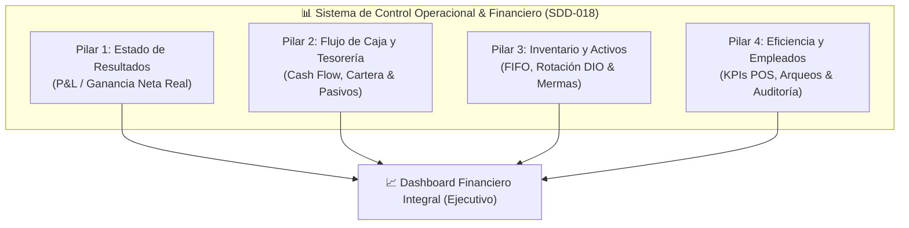
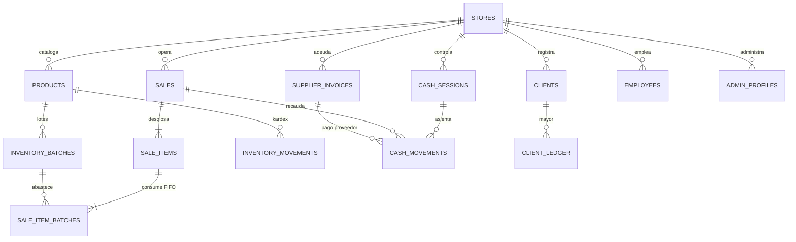
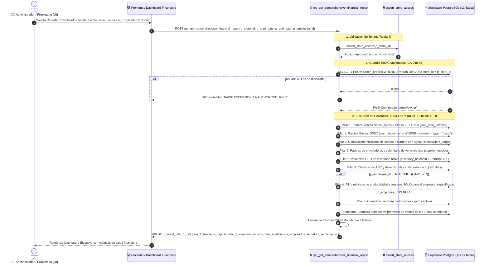
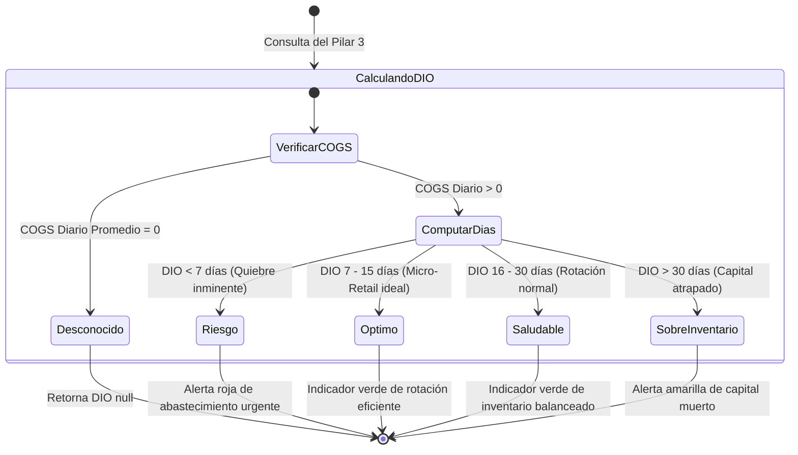

# SDD-018: Control Operacional y Análisis Financiero Integral

> **Asociado a:** [FRD-018](../FRD/FRD_018_CONTROL_OPERACIONAL_Y_ANALISIS_FINANCIERO.md)
> **Fase del Plan:** Ola 4 — Reportes, Auditoría y Cuentas por Pagar (Ítem 5)
> **Estado:** 🟠 Aprobado con Deuda Técnica Documentada (Protocolo PAC-SDD v2.0)
> **Última Actualización:** 2026-10-17

---

## 0. Control de Versiones y Metadatos

### 0.1 Metadatos del Documento
- **Documento:** `SDD_018_CONTROL_OPERACIONAL.md`
- **FRD Fuente:** `FRD_018_CONTROL_OPERACIONAL_Y_ANALISIS_FINANCIERO.md` (v2.0, Estado: Aprobado)
- **Fase del Plan:** Ola 4 — Reportes, Auditoría y Cuentas por Pagar (Ítem 5 / Fase 6: Operaciones, Analítica y Soporte)
- **Módulo Funcional:** Finanzas / Operaciones / Inteligencia de Negocio Micro-Retail (ERP Ligero)
- **Versión de Especificación:** 2.0 (Saneamiento Arquitectónico PAC-SDD v2.0)
- **Fecha de Saneamiento:** 2026-10-16
- **Auditoría PAC:** Certificado en Bloques 0 a 6 por QA Independiente

### 0.2 Historial de Revisiones
| Versión | Fecha | Autor / Rol | Cambios Clave y Justificación |
|---|---|---|---|
| 1.0 | 2026-07-25 | Arquitecto de Datos | Borrador preliminar de análisis operacional con payload plano simple. |
| 1.5 | 2026-08-07 | Arquitecto de Datos | Saneamiento documental inicial removiendo código SQL embebido en FRD. |
| 2.0 | 2026-10-16 | Orquestador Técnico & Auditor QA | Saneamiento total bajo protocolo PAC-SDD v2.0: erradicación total de código SQL/PLpgSQL, estructuración canónica en 4 Pilares Financieros independientes, especificación del RPC consolidado `rpc_get_comprehensive_financial_report` v2.0 con parámetro opcional `p_employee_id`, guardia RBAC estricto exclusivo para Administradores (`admin_profiles`), segregación contable absoluta de OPEX frente a pagos a proveedor, formalización de N=6 deudas técnicas bajo Regla 7 y contratos JSON Schema en Sección 5. |


### 0.3 Auditoría de BD contra Realidad (Deuda Técnica Formalizada)
La inspección empírica del esquema físico de producción (`ihtjocmhzuliwwvdzfnz`) identifica **N=6 deudas técnicas** formalizadas bajo la Regla 7 (cuyo desglose completo reside en la Sección 7):
- **D-1:** Expansión de `rpc_get_comprehensive_financial_report` para cubrir íntegramente los 4 Pilares Financieros (P&L con devoluciones como ingreso negativo según H7, Flujo de Caja, Inventario DIO y KPIs de Empleados).
- **D-2:** Guardia RBAC estricto en servidor (`admin_profiles`) + `assert_store_access(p_store_id)` para garantizar ceguera financiera a cajeros (`POL-SEC-01`).
- **D-3:** Incorporación del parámetro opcional `p_employee_id UUID DEFAULT NULL` para filtrar el Pilar 4 (Hallazgo H17).
- **D-4:** Segregación contable estricta entre COGS FIFO (`sale_items.unit_cost`), gastos OPEX (`movement_type = 'gasto'`) y pagos a proveedores (`movement_type = 'pago_proveedor'`).
- **D-5:** Estratificación canónica de cartera por tramos de antigüedad (Aging) en el Pilar 2.
- **D-6:** Regularización de privilegios base (`GRANT ALL`) conforme a la Regla 8 de `AGENTS.md`.

---

## 1. Arquitectura y Reglas de Negocio Centrales

### 1.1 Visión del Sistema: De POS Transaccional a ERP Micro-Retail
El módulo de Control Operacional y Análisis Financiero transforma *Tienda de Barrio Pro* de un registrador transaccional de ventas en una plataforma integral de inteligencia económica para el tendero. El sistema estructura la totalidad de la información operativa en cuatro pilares de decisión macroeconómica:



---

### 1.2 Reglas de Negocio por Pilar

#### 📊 Pilar 1: Estado de Resultados Operativo (P&L / Profit & Loss)
1. **Ingresos Netos Devengados:**
   $$\text{Ingresos Netos} = \sum (\text{sales.total}) \quad \text{donde } \text{sales.store\_id} = p\_store\_id \land \text{sales.is\_voided} = \text{FALSE} \land \text{created\_at} \in [\text{inicio}, \text{fin})$$
   Las ventas anuladas (`sales.is_voided = TRUE`) se excluyen incondicionalmente del ingreso operacional.
2. **Costo de Ventas (COGS FIFO Histórico Real - CA-018-02):**
   $$\text{COGS} = \sum (\text{sale\_item\_batches.quantity\_consumed} \times \text{sale\_item\_batches.unit\_cost})$$
   El costo real se computa exclusivamente desde el desglose inmutable de capas de inventario consumidas (`sale_item_batches`) vinculadas a ítems de ventas no anuladas. Está terminantemente prohibido asumir un costo de cero o tomar el precio de catálogo de `products.cost_price` para ventas históricas ya selladas.
3. **Margen Bruto de Utilidad:**
   $$\text{Margen Bruto} = \text{Ingresos Netos} - \text{COGS}$$
   $$\text{Porcentaje de Margen Bruto} = \begin{cases} \left(\frac{\text{Margen Bruto}}{\text{Ingresos Netos}}\right) \times 100 & \text{si Ingresos Netos} > 0 \\ 0 & \text{si Ingresos Netos} = 0 \end{cases}$$
4. **Gastos Operativos (OPEX) y Segregación Inviolable:**
   $$\text{OPEX} = \sum (\text{cash\_movements.amount}) \quad \text{donde } \text{movement\_type} = \text{'gasto'} \land \text{created\_at} \in [\text{inicio}, \text{fin})$$
   - **Invariante Contable de Segregación:** En `cash_movements` coexisten egresos por `'gasto'` y `'pago_proveedor'`. El cálculo del OPEX incluye ÚNICAMENTE registros con `movement_type = 'gasto'`. Los egresos por `movement_type = 'pago_proveedor'` constituyen amortizaciones de pasivos con proveedores (Pilar 2); sumarlos en el OPEX provocaría una doble contabilización del costo de la mercancía.
   - **Categorización OPEX:** Los gastos se clasifican mediante etiquetas estructuradas o parsing del campo `description` en: Servicios, Arriendo, Nómina/Personal, Transporte/Fletes, Mantenimiento, Mermas y Otros.
5. **Ganancia Neta Real:**
   $$\mathbf{\text{Ganancia Neta Real}} = \text{Margen Bruto} - \text{OPEX}$$

---

#### 💵 Pilar 2: Flujo de Caja, Tesorería y Capital de Trabajo (Working Capital)
1. **Conciliación de Canales de Cobro (Cash Flow Líquido):**
   - **Efectivo en Caja:** Monto total transaccionado en efectivo físico según sesiones de arqueo cerradas o activas en el período.
   - **Bancos / Canales Digitales:** Fondos percibidos mediante transferencias (`nequi`, `daviplata`) validados en ventas e ingresos de caja.
   - **Crédito Otorgado (Fiado):** Monto vendido a crédito en el período que no generó liquidez inmediata en caja.
2. **Gestión de Cartera (Cuentas por Cobrar - Fiados) y Aging Report (CA-018-03):**
   - **Saldo Total de Cartera:** $\sum (\text{clients.balance})$ donde $\text{balance} > 0 \land (\text{is\_deleted} = \text{FALSE} \lor \text{is\_deleted IS NULL})$.
   - **Estratificación por Envejecimiento (Aging Buckets):** Clasificación del saldo deudor de clientes en 4 tramos canónicos según la antigüedad de la deuda:
     * Tramo 1: Corriente (0 a 15 días).
     * Tramo 2: Alerta Temprana (16 a 30 días).
     * Tramo 3: Mora Media (31 a 60 días).
     * Tramo 4: Mora Crítica / Difícil Cobro (más de 60 días).
   - **Índice de Incobrabilidad:** Estimación porcentual de provisión sobre el saldo del Tramo 4 que alerta sobre capital en riesgo de pérdida.
3. **Gestión de Cuentas por Pagar (Pasivos con Distribuidores - CA-018-03):**
   - **Pasivo Corriente Total:** $\sum (\text{supplier\_invoices.total\_amount} - \text{supplier\_invoices.amount\_paid})$ donde $\text{amount\_paid} < \text{total\_amount}$.
   - **Calendario de Vencimientos:** Clasificación de facturas según su campo físico `due_date`:
     * Facturas Vencidas (`due_date < CURRENT_DATE`).
     * Facturas por Vencer Hoy (`due_date = CURRENT_DATE`).
     * Facturas por Vencer en la Semana (`due_date` entre mañana y `CURRENT_DATE + 7 días`).
     * Facturas por Vencer en el Mes (`due_date` entre `CURRENT_DATE + 8 días` y `CURRENT_DATE + 30 días`).
4. **Desacoplamiento entre Flujo de Liquidez y Devengo Contable:**
   - La venta fiada genera ingreso devengado en P&L en la fecha de despacho pero $0 efectivo inmediato.
   - El recaudo de abonos a fiados (`registrar_abono`) genera entrada de liquidez en caja y reduce `clients.balance`, pero genera $0 de venta nueva en P&L, blindando el principio de no-duplicidad de ingresos.

---

#### 📦 Pilar 3: Control Operacional de Inventario y Activos (Asset Ops)
1. **Valoración de Inventario a Costo FIFO (Capital Inmovilizado - CA-018-04):**
   $$\text{Valor del Inventario} = \sum (\text{inventory\_batches.quantity\_remaining} \times \text{inventory\_batches.cost\_unit})$$
   donde $\text{is\_active} = \text{TRUE} \land \text{quantity\_remaining} > 0$.
   Refleja con exactitud matemática el capital retenido en bodega valorado al costo histórico de adquisición de cada lote activo al momento de la consulta.
2. **Días de Inventario (DIO - Days of Inventory Outstanding):**
   $$\text{COGS Diario Promedio} = \frac{\text{COGS Total del Período}}{\text{Días Transcurridos en el Período}}$$
   $$\text{Días de Inventario (DIO)} = \begin{cases} \text{ROUND}\left(\frac{\text{Valor del Inventario Actual}}{\text{COGS Diario Promedio}}\right) & \text{si COGS Diario} > 0 \\ \text{NULL} & \text{si COGS Diario} = 0 \end{cases}$$
   - Estado Semántico de DIO:
     * `riesgo` (< 7 días: peligro de desabastecimiento o quiebre de stock).
     * `optimo` (7 a 15 días: rotación micro-retail ideal).
     * `saludable` (16 a 30 días: stock balanceado).
     * `sobre_inventario` (> 30 días: capital excesivo atrapado en mercancía).
3. **Categorización ABC y Detección de Capital Estancado:**
   - **Clase A (Alta Rotación):** Productos que representan el 80% del volumen de venta acumulado.
   - **Clase B (Rotación Media):** Productos que aportan el 15% subsiguiente del volumen.
   - **Clase C / Capital Estancado (Dead Stock):** Productos sin ventas registradas en un período superior a 30 días (`days_stagnant > 30`) que retienen capital inmovilizado.
4. **Pérdidas por Mermas y Desajustes Físicos:**
   Totalización de pérdidas financieras por producto vencido, daño o discrepancia física registrada en `inventory_movements` con `movement_type = 'merma'`.

---

#### 👥 Pilar 4: Eficiencia Operativa y Auditoría de Empleados (CA-018-05 & CA-018-07)
1. **Productividad y Margen por Cajero:**
   - Total de ventas brutas, devoluciones y margen bruto generado atribuido a cada cajero (`sales.employee_id`).
2. **Ticket Promedio y Unidades por Transacción (UPT):**
   $$\text{Ticket Promedio} = \frac{\sum \text{sales.total}}{\text{COUNT}(\text{sales.id})}$$
   $$\text{UPT (Units Per Transaction)} = \frac{\sum \text{sale\_items.quantity}}{\text{COUNT}(\text{sales.id})}$$
3. **Auditoría de Descuadres de Arqueo de Caja:**
   Registro de discrepancias de cierre (`cash_sessions.difference`) atribuibles a cada empleado responsable de turno (`cash_sessions.opened_by` / `closed_by`).
4. **Tasa y Severidad de Anulaciones:**
   Porcentaje y valor monetario de ventas anuladas (`sales.is_voided = TRUE`) gestionadas o causadas por el cajero.
5. **Ámbito Estricto del Filtro Opcional por Empleado (`p_employee_id` - CA-018-07):**
   - Cuando se proporciona `p_employee_id`, las métricas de rendimiento, ticket promedio, arqueos y anulaciones del **Pilar 4** se restringen exclusivamente a dicho empleado.
   - **Invariante de Aislamiento:** El filtro `p_employee_id` NO afecta los Pilares 1, 2 ni 3. El P&L, el Flujo de Caja y la Valoración de Inventario representan siempre la totalidad del establecimiento comercial. Si no se proporciona `p_employee_id`, el Pilar 4 retorna el desglose consolidado de todos los cajeros activos en el período.

---

### 1.3 Semáforo Ejecutivo de Rendimiento Comercial
El reporte incluye un semáforo comparativo entre las ventas netas del período consultado y el promedio móvil de los 7 días inmediatamente anteriores al inicio del período:
- `gray` ("Recopilando datos históricos..."): Si no existen ventas en la semana previa.
- `green` ("¡Vas un X% arriba de tu promedio!"): Si $\text{Revenue} \ge (\text{Promedio Semanal} \times 1.05)$.
- `green` ("Ventas estables respecto a tu semana"): Si el revenue se ubica entre $\pm 5\%$ del promedio.
- `red` ("Estás un X% abajo de tu promedio"): Si $\text{Revenue} \le (\text{Promedio Semanal} \times 0.95)$.

---

## 2. Modelo Físico de Datos

El módulo no crea nuevas tablas relacionales. Es una capa de consolidación analítica pura que consume de forma federada 13 tablas físicas existentes en PostgreSQL:



---

### 2.1 Diccionario de Datos Físico Verificado

#### 1. `sales` (16 columnas físicas reales)
| Columna | Tipo de Dato | Nulable | Default / Constraints | Propósito en SDD-018 |
|---|---|:---:|---|---|
| `id` | `uuid` | NO | `gen_random_uuid()` | Identificador único de venta. |
| `store_id` | `uuid` | NO | FK `stores(id)` | Aislamiento multi-tenant. |
| `ticket_number` | `integer` | NO | Correlativo por tienda | Conteo de transacciones y UPT. |
| `employee_id` | `uuid` | NO | FK `employees(id)` | Atribución de venta a cajero (Pilar 4). |
| `client_id` | `uuid` | YES | FK `clients(id)` | Vinculación a cartera de clientes. |
| `total` | `numeric` | NO | Sin default | Monto monetario bruto de venta. |
| `rounding_difference` | `numeric` | YES | `0` | Ajuste por redondeo a $50 COP. |
| `payment_method` | `text` | NO | CHECK (`efectivo`, `nequi`, `daviplata`, `fiado`) | Desglose por canal en Flujo de Caja. |
| `amount_received` | `numeric` | YES | Nullable | Auditoría de efectivo recibido. |
| `change_given` | `numeric` | YES | Nullable | Auditoría de cambio entregado. |
| `sync_status` | `text` | YES | `'pending'` | Estado de sincronización offline. |
| `local_id` | `text` | YES | Nullable | Identificador local de venta. |
| `is_voided` | `boolean` | YES | `false` | Filtro de anulaciones (Ingresos Netos = FALSE). |
| `voided_by` | `uuid` | YES | FK `employees(id)` | Auditoría de anulación (Pilar 4). |
| `void_reason` | `text` | YES | Nullable | Causa documentada de anulación. |
| `created_at` | `timestamptz`| NO | `now()` | Acotamiento en rango temporal. |

#### 2. `sale_items` (8 columnas físicas reales)
| Columna | Tipo de Dato | Nulable | Default / Constraints | Propósito en SDD-018 |
|---|---|:---:|---|---|
| `id` | `uuid` | NO | `gen_random_uuid()` | Identificador de línea de venta. |
| `sale_id` | `uuid` | NO | FK `sales(id)` | Relación con venta encabezado. |
| `product_id` | `uuid` | NO | FK `products(id)` | Relación con catálogo de producto. |
| `quantity` | `numeric` | NO | Sin default | Cantidad de unidades vendidas (UPT). |
| `unit_price` | `numeric` | NO | Sin default | Precio de venta unitario. |
| `subtotal` | `numeric` | NO | Sin default | Total bruto de la línea. |
| `created_at` | `timestamptz`| NO | `now()` | Fecha de registro. |
| `unit_cost` | `numeric` | YES | `0` | Costo estimado de catálogo (referencial). |

#### 3. `sale_item_batches` (7 columnas físicas reales)
| Columna | Tipo de Dato | Nulable | Default / Constraints | Propósito en SDD-018 |
|---|---|:---:|---|---|
| `id` | `uuid` | NO | `gen_random_uuid()` | Identificador de despiece de lote. |
| `sale_item_id` | `uuid` | NO | FK `sale_items(id)` | Enlace a línea de venta. |
| `batch_id` | `uuid` | NO | FK `inventory_batches(id)` | Enlace a capa física de lote. |
| `quantity_consumed`| `numeric` | NO | Sin default | Unidades consumidas del lote. |
| `unit_cost` | `numeric` | NO | Sin default | **Fuente inmutable de COGS FIFO**. |
| `unit_price` | `numeric` | NO | Sin default | Precio asignado al lote consumido. |
| `created_at` | `timestamptz`| NO | `now()` | Fecha inmutable de consumo FIFO. |

#### 4. `cash_movements` (7 columnas físicas reales)
| Columna | Tipo de Dato | Nulable | Default / Constraints | Propósito en SDD-018 |
|---|---|:---:|---|---|
| `id` | `uuid` | NO | `gen_random_uuid()` | Identificador de movimiento de caja. |
| `session_id` | `uuid` | NO | FK `cash_sessions(id)` | Sesión de turno asociada. |
| `movement_type` | `text` | NO | CHECK (`ingreso`, `gasto`, `pago_proveedor`) | Discriminador: OPEX (`gasto`) vs Pasivo (`pago_proveedor`). |
| `amount` | `numeric` | NO | CHECK (`amount > 0`) | Cuantía del movimiento. |
| `description` | `text` | NO | Sin default | Subcategoría OPEX o detalle del egreso. |
| `sale_id` | `uuid` | YES | FK `sales(id)` | Enlace a venta de contado (si aplica). |
| `created_at` | `timestamptz`| NO | `now()` | Filtro temporal del egreso/ingreso. |

#### 5. `cash_sessions` (12 columnas físicas reales)
| Columna | Tipo de Dato | Nulable | Default / Constraints | Propósito en SDD-018 |
|---|---|:---:|---|---|
| `id` | `uuid` | NO | `gen_random_uuid()` | Identificador de sesión de caja. |
| `store_id` | `uuid` | NO | FK `stores(id)` | Aislamiento multi-tenant. |
| `opened_by` | `uuid` | NO | FK `employees(id)` | Cajero responsable de apertura (Pilar 4). |
| `closed_by` | `uuid` | YES | FK `employees(id)` | Cajero responsable de cierre (Pilar 4). |
| `opening_balance` | `numeric` | NO | Sin default | Base de efectivo inicial de turno. |
| `expected_balance` | `numeric` | YES | Nullable | Saldo teórico calculado por backend. |
| `actual_balance` | `numeric` | YES | Nullable | Saldo declarado a ciegas por cajero. |
| `difference` | `numeric` | YES | Nullable | **Descuadre de arqueo atribuible a cajero**. |
| `status` | `text` | NO | `'open'` | Estado operativo (`open`, `closed`). |
| `opened_at` | `timestamptz`| NO | `now()` | Apertura cronológica. |
| `closed_at` | `timestamptz`| YES | Nullable | Cierre cronológico. |
| `forced_close` | `boolean` | NO | `false` | Indicador de turno caducado a 24 horas. |

#### 6. `inventory_batches` (10 columnas físicas reales)
| Columna | Tipo de Dato | Nulable | Default / Constraints | Propósito en SDD-018 |
|---|---|:---:|---|---|
| `id` | `uuid` | NO | `gen_random_uuid()` | Identificador de lote físico. |
| `product_id` | `uuid` | NO | FK `products(id)` | Producto asociado. |
| `quantity_initial` | `numeric` | NO | Sin default | Unidades ingresadas originalmente. |
| `quantity_remaining`| `numeric` | NO | Sin default | Stock vivo en capa FIFO. |
| `cost_unit` | `numeric` | NO | Sin default | **Costo histórico unitario del lote**. |
| `is_active` | `boolean` | YES | Sin default | Estado de disponibilidad del lote. |
| `created_at` | `timestamptz`| NO | `now()` | Antigüedad para orden FIFO (ASC). |
| `created_by` | `uuid` | YES | FK `employees(id)` | Autor del ingreso. |
| `sale_price` | `numeric` | NO | Sin default | Precio de venta específico del lote. |
| `source_movement_id`| `uuid` | YES | FK `inventory_movements(id)`| Trazabilidad logística de origen. |

#### 7. `products` (17 columnas físicas reales)
| Columna | Tipo de Dato | Nulable | Default / Constraints | Propósito en SDD-018 |
|---|---|:---:|---|---|
| `id` | `uuid` | NO | `gen_random_uuid()` | Identificador de producto. |
| `store_id` | `uuid` | NO | FK `stores(id)` | Tenant propietario. |
| `name` | `text` | NO | Sin default | Denominación del producto. |
| `plu` | `text` | YES | Nullable | Código de barras / PLU. |
| `price` | `numeric` | NO | Sin default | Precio de catálogo de referencia. |
| `cost_price` | `numeric` | YES | Nullable | Costo de catálogo (referencial). |
| `current_stock` | `numeric` | YES | `0` | Existencia consolidada actual. |
| `min_stock` | `numeric` | YES | `5` | Umbral para alerta de agotamiento. |
| `category` | `text` | YES | Nullable | Familia comercial para análisis ABC. |
| `measurement_unit` | `text` | YES | `'unidad'` | Unidad de venta (`unidad`, `kg`). |
| `is_weighable` | `boolean` | YES | `false` | Producto a granel / balanza. |
| `low_stock_alerted`| `boolean` | YES | `false` | Estado de notificación. |
| `created_at` | `timestamptz`| NO | `now()` | Fecha de alta en catálogo. |
| `updated_at` | `timestamptz`| NO | `now()` | Última actualización. |
| `supplier_id` | `uuid` | YES | FK `suppliers(id)` | Proveedor preferente. |
| `brand` | `text` | YES | Nullable | Marca comercial. |
| `is_active` | `boolean` | NO | `true` | Disponibilidad comercial. |

#### 8. `inventory_movements` (12 columnas físicas reales)
| Columna | Tipo de Dato | Nulable | Default / Constraints | Propósito en SDD-018 |
|---|---|:---:|---|---|
| `id` | `uuid` | NO | `gen_random_uuid()` | Identificador de movimiento kardex. |
| `product_id` | `uuid` | NO | FK `products(id)` | Producto impactado. |
| `movement_type` | `text` | NO | CHECK (`entrada`, `salida`, `devolucion`, `merma`, `ajuste`, `CORRECCION_SISTEMA`, `venta`) | Trazabilidad de pérdidas (`merma`). |
| `quantity` | `numeric` | NO | Sin default | Unidades movilizadas. |
| `reason` | `text` | YES | Nullable | Motivo del ajuste o merma. |
| `created_by` | `uuid` | YES | FK `employees(id)` | Autor del ajuste físico. |
| `created_at` | `timestamptz`| NO | `now()` | Fecha de incidencia en inventario. |
| `supplier_id` | `uuid` | YES | FK `suppliers(id)` | Proveedor de compra (si aplica). |
| `invoice_reference`| `text` | YES | Nullable | Número de remisión externa. |
| `payment_type` | `text` | YES | CHECK (`contado`, `credito`) | Modalidad de abastecimiento. |
| `reference_invoice_id`| `uuid` | YES | FK `supplier_invoices(id)` | Enlace referencial opcional a CxP. |
| `unit_cost` | `numeric` | YES | `NULL` | Costo de entrada declarado. |

#### 9. `clients` (11 columnas físicas reales)
| Columna | Tipo de Dato | Nulable | Default / Constraints | Propósito en SDD-018 |
|---|---|:---:|---|---|
| `id` | `uuid` | NO | `gen_random_uuid()` | Identificador de cliente fiador. |
| `store_id` | `uuid` | NO | FK `stores(id)` | Aislamiento multi-tenant. |
| `name` | `text` | NO | Sin default | Nombre del cliente. |
| `id_number` | `text` | NO | Sin default | Cédula o identificación ciudadana. |
| `phone` | `text` | YES | Nullable | Teléfono de contacto. |
| `credit_limit` | `numeric` | NO | `100000` | Cupo de crédito autorizado. |
| `balance` | `numeric` | YES | `0` (CHECK `balance >= 0`)| **Saldo actual de cartera deudora**. |
| `is_deleted` | `boolean` | YES | `false` | Borrado lógico de clientes. |
| `deleted_at` | `timestamptz`| YES | Nullable | Fecha de borrado lógico. |
| `created_at` | `timestamptz`| NO | `now()` | Antigüedad del cliente. |
| `updated_at` | `timestamptz`| NO | `now()` | Fecha del último abono o cargo. |

#### 10. `client_ledger` (10 columnas físicas reales)
| Columna | Tipo de Dato | Nulable | Default / Constraints | Propósito en SDD-018 |
|---|---|:---:|---|---|
| `id` | `uuid` | NO | `gen_random_uuid()` | Identificador de apunte de libro mayor. |
| `client_id` | `uuid` | NO | FK `clients(id)` | Cliente deudor. |
| `store_id` | `uuid` | NO | FK `stores(id)` | Tenant propietario. |
| `amount` | `numeric` | NO | Sin default | Monto del cargo o abono. |
| `previous_balance` | `numeric` | NO | `0` | Saldo anterior al apunte. |
| `new_balance` | `numeric` | NO | `ALWAYS GENERATED` | Saldo posterior inmutable. |
| `reference_id` | `uuid` | YES | Nullable | Enlace a venta fiada o recibo. |
| `transaction_type` | `text` | NO | Sin default | Tipo (`cargo_venta`, `abono`). |
| `created_at` | `timestamptz`| YES | `now()` | **Fecha base para Aging Report**. |
| `created_by` | `uuid` | YES | FK `employees(id)` | Cajero que recibió abono/venta. |

#### 11. `supplier_invoices` (8 columnas físicas reales)
| Columna | Tipo de Dato | Nulable | Default / Constraints | Propósito en SDD-018 |
|---|---|:---:|---|---|
| `id` | `uuid` | NO | `gen_random_uuid()` | Identificador de factura por pagar. |
| `store_id` | `uuid` | NO | FK `stores(id)` | Aislamiento multi-tenant. |
| `supplier_id` | `uuid` | NO | FK `suppliers(id)` | Proveedor acreedor. |
| `total_amount` | `numeric` | NO | CHECK (`total_amount >= 0`)| Monto total del pasivo comercial. |
| `amount_paid` | `numeric` | NO | `0` (CHECK `<= total_amount`)| Monto acumulado pagado/abonado. |
| `due_date` | `date` | NO | Sin default en producción | **Fecha límite de vencimiento**. |
| `created_at` | `timestamptz`| NO | `now()` | Fecha de registro de la deuda. |
| `invoice_number` | `varchar` | YES | Nullable | Número de factura física. |

#### 12. `employees` (9 columnas físicas reales)
| Columna | Tipo de Dato | Nulable | Default / Constraints | Propósito en SDD-018 |
|---|---|:---:|---|---|
| `id` | `uuid` | NO | `gen_random_uuid()` | Identificador del empleado / cajero. |
| `store_id` | `uuid` | NO | FK `stores(id)` | Tienda asignada. |
| `name` | `text` | NO | Sin default | Nombre del cajero (Pilar 4). |
| `username` | `text` | NO | Sin default | Usuario del sistema. |
| `pin_hash` | `text` | NO | Sin default | Credencial de acceso POS. |
| `is_active` | `boolean` | YES | `true` | Estado activo. |
| `permissions` | `jsonb` | YES | Default flags | Permisos operativos delegados. |
| `created_at` | `timestamptz`| NO | `now()` | Fecha de alta. |
| `updated_at` | `timestamptz`| NO | `now()` | Última modificación. |

#### 13. `admin_profiles` (5 columnas físicas reales)
| Columna | Tipo de Dato | Nulable | Default / Constraints | Propósito en SDD-018 |
|---|---|:---:|---|---|
| `id` | `uuid` | NO | FK `auth.users(id)` | Identificador del usuario Administrador. |
| `store_id` | `uuid` | NO | FK `stores(id)` | Tienda propiedad del administrador. |
| `role` | `text` | NO | `'owner'` | Rol autorizado (`owner`, `admin`). |
| `is_verified` | `boolean` | YES | `false` | Estado de verificación del perfil. |
| `created_at` | `timestamptz`| NO | `now()` | Fecha de creación. |

---

## 3. Diagramas de Flujo y Secuencia

### 3.1 Diagrama de Secuencia Transaccional: Extracción de Reporte Consolidado
El flujo muestra la interacción completa desde la solicitud del cliente hasta la consolidación federada de los cuatro pilares en el servidor, garantizando la doble barrera de seguridad (Tenant + RBAC) y cero bloqueos de concurrencia:



---

### 3.2 Ciclo de Vida de los Estados de Rotación de Inventario (DIO)



---

## 4. Casos de Uso y Matriz de Casos Límite

### 4.1 Especificación Detallada de Casos de Uso

#### Caso A: Generación Ejecutiva del Reporte Consolidado (Camino Feliz)
- **Actor:** Propietario o Administrador de la tienda.
- **Precondiciones:** Usuario autenticado con sesión válida y registro en `admin_profiles` para la tienda.
- **Flujo Principal:**
  1. El Administrador accede a la sección "Salud Financiera & Control Operacional".
  2. Selecciona un rango de fechas (ej. últimos 7 días o mes en curso) y omite el filtro de empleado (`p_employee_id = null`).
  3. El cliente invoca `rpc_get_comprehensive_financial_report`.
  4. El servidor valida tenant y rol administrativo.
  5. El servidor totaliza en una sola llamada los 4 pilares:
     - Ingresos netos, COGS FIFO exacto, margen bruto y OPEX discriminado por subcategorías.
     - Conciliación de tesorería, cartera con Aging Report (0-15, 16-30, 31-60, 60+ días) y facturas de proveedores por vencer.
     - Valuación FIFO del stock activo, rotación DIO y capital estancado.
     - Rendimiento comparativo de todos los cajeros (ventas, ticket promedio, descuadres y anulaciones).
     - Semáforo comercial respecto a la semana previa.
  6. El frontend recibe el payload estructurado y renderiza las tarjetas de indicadores ejecutivos.
- **Postcondiciones (Éxito):** El Administrador dispone de una radiografía financiera integral con exactitud contable al 100%.

#### Caso B: Auditoría de Productividad de un Empleado Específico (CA-018-07)
- **Actor:** Administrador / Propietario.
- **Precondiciones:** Identificador UUID de un empleado existente en `employees`.
- **Flujo Principal:**
  1. El Administrador selecciona en el filtro de personal a un cajero específico (`p_employee_id`).
  2. El servidor valida tenant y rol administrativo.
  3. El servidor calcula los Pilares 1, 2 y 3 a nivel de **toda la tienda** (ingresos totales, inventario y pasivos no se distorsionan).
  4. El servidor restringe el cómputo del **Pilar 4** exclusivamente a las transacciones de ventas y arqueos asociados al `p_employee_id` recibido.
  5. El resultado retorna el desglose específico de ese cajero (UPT individual, promedio de ticket, ventas brutas, descuadres y anulaciones provocadas).
- **Postcondiciones (Éxito):** El Administrador audita al colaborador sin alterar la visión financiera global del negocio.

#### Caso C: Intento de Acceso No Autorizado por Cajero (CA-018-06)
- **Actor:** Empleado / Cajero con usuario en `employees` (sin registro en `admin_profiles`).
- **Precondiciones:** Cajero autenticado en la plataforma.
- **Flujo de Excepción:**
  1. El cajero o un script cliente intenta invocar `rpc_get_comprehensive_financial_report`.
  2. El servidor ejecuta la instrucción #1 `assert_store_access(p_store_id)` (valida exitosamente el acceso a la tienda).
  3. El servidor ejecuta la instrucción #2: verifica si `auth.uid()` existe en `admin_profiles`.
  4. La consulta resulta vacía (el usuario es empleado, no administrador).
  5. El servidor aborta inmediatamente la transacción y lanza la excepción:
     `RAISE EXCEPTION 'UNAUTHORIZED_ROLE' USING HINT = 'Solo el Administrador tiene acceso al reporte financiero consolidado.';`
- **Postcondiciones (Seguridad):** Se previene la fuga de costos de lote, márgenes comerciales y utilidades netas (`POL-SEC-01` / `POL-SEG-03`).

---

### 4.2 Matriz de Casos Límite y Concurrencia (Regla 5 de AGENTS.md)

| ID | Escenario de Caso Límite | Comportamiento del Motor / Backend | Código / Excepción en Servidor | Respuesta Visual en UI |
|---|---|---|---|---|
| **CL-018-01** | **Rango Temporal Sin Ventas (Tienda Nueva / Rango Vacío)** | El servidor ejecuta las sumatorias con `COALESCE(..., 0)`. Revenue = 0, COGS = 0, Margen = 0. Semáforo retorna `status: 'gray'`. | Ejecución Exitosa (200 OK) | Tarjetas en $0; semáforo gris con mensaje: *"Sin movimientos en el período seleccionado."* |
| **CL-018-02** | **Venta con Productos Sin Lote o Costo Cero** | Si algún ítem histórico no posee despiece en `sale_item_batches`, su contribución al COGS es $0. El backend suma los lotes que existan sin abortar. | Ejecución Exitosa (200 OK) | Margen calculado sobre los ítems costea­dos; advertencia no bloqueante de auditoría de costos. |
| **CL-018-03** | **Período con Todas las Ventas Anuladas** | Ventas con `is_voided = TRUE` se excluyen de ingresos y COGS. Si todas están anuladas, Revenue = 0 y COGS = 0. El Pilar 4 reporta tasa de anulación del 100%. | Ejecución Exitosa (200 OK) | P&L en cero; tarjeta de anulaciones del Pilar 4 en rojo destacando alerta operativa. |
| **CL-018-04** | **Turnos de Caja Sin Descuadre (`difference = 0`)** | La sumatoria de descuadres del Pilar 4 totaliza $0. El conteo de anomalías en caja se reporta en cero. | Ejecución Exitosa (200 OK) | Indicador de arqueo en verde: *"Cajas cuadradas al 100%."* |
| **CL-018-05** | **Cartera con Clientes Eliminados Lógicamente** | Clientes con `is_deleted = TRUE` pero con `balance > 0` se incluyen en el saldo de cartera si la deuda sigue viva, o se excluyen según filtro del establecimiento. | Ejecución Exitosa (200 OK) | Cartera total refleja la totalidad del saldo exigible real. |
| **CL-018-06** | **Facturas de Proveedores Sin Fecha de Vencimiento** | Si `due_date` es nulo en el contrato lógico (o tiene fallback temporal), la factura se clasifica como pendiente no vencida en el calendario. | Ejecución Exitosa (200 OK) | Pasivo visible en el total a pagar; calendario de mora sin alerta de vencimiento crítico. |
| **CL-018-07** | **Petición con Rango Temporal Invertido (`inicio > fin`)** | El servidor valida que `p_start_date <= p_end_date`. Si la fecha de inicio es posterior a la de fin, aborta inmediatamente. | `INVALID_DATE_RANGE` | Toast de error: *"La fecha de inicio no puede ser posterior a la fecha de fin."* |
| **CL-018-08** | **Petición de Rango Superior a 366 Días (Anti-DoS)** | El servidor valida que `p_end_date - p_start_date <= 366`. Si supera un año, aborta para proteger memoria y CPU del motor. | `RANGE_EXCEEDS_MAX_LIMIT` | Toast de error: *"El rango máximo permitido para el reporte financiero es de 366 días."* |
| **CL-018-09** | **Empleado Especificado en Filtro No Existe en la Tienda** | Si se envía `p_employee_id` pero no pertenece a `p_store_id`, el servidor aborta con excepción de validación de empleado. | `EMPLOYEE_NOT_FOUND` | Mensaje de advertencia: *"El colaborador seleccionado no pertenece a este establecimiento."* |
| **CL-018-10** | **Concurrencia con Ventas en Vivo del POS** | Consultas analíticas ejecutadas bajo `READ COMMITTED` sin locks pesimistas (`FOR UPDATE`). Las ventas simultáneas del POS proceden sin espera. | Ejecución Concurrente Aislada | Cero congelamientos en caja; el reporte captura la instantánea confirmada al milisegundo. |

---

## 5. Contratos de Interfaz (JSON Schemas)

### 5.1 Endpoint de Reporte Consolidado: `rpc_get_comprehensive_financial_report`
- **Tipo de Operación:** Postgres RPC / Lectura Analítica (READ-ONLY)
- **Nivel de Seguridad:** `SECURITY DEFINER`
- **Rol Requerido:** Administrador / Dueño (`admin_profiles`)

#### 5.1.1 Input JSON Schema (`rpc_get_comprehensive_financial_report`)

```json
{
  "$schema": "https://json-schema.org/draft/2020-12/schema",
  "title": "RpcGetComprehensiveFinancialReportInput",
  "type": "object",
  "required": ["p_store_id", "p_start_date", "p_end_date"],
  "properties": {
    "p_store_id": {
      "type": "string",
      "format": "uuid",
      "description": "Identificador único de la tienda comercial."
    },
    "p_start_date": {
      "type": "string",
      "format": "date",
      "description": "Fecha inicial del período de análisis en formato ISO YYYY-MM-DD."
    },
    "p_end_date": {
      "type": "string",
      "format": "date",
      "description": "Fecha final del período de análisis en formato ISO YYYY-MM-DD."
    },
    "p_employee_id": {
      "type": ["string", "null"],
      "format": "uuid",
      "default": null,
      "description": "Identificador opcional de un empleado para restringir exclusivamente las métricas del Pilar 4 (CA-018-07). Si es null, retorna el consolidado de todos los cajeros."
    }
  },
  "additionalProperties": false
}
```

---

#### 5.1.2 Success Response JSON Schema (`rpc_get_comprehensive_financial_report`)

```json
{
  "$schema": "https://json-schema.org/draft/2020-12/schema",
  "title": "RpcGetComprehensiveFinancialReportSuccessResponse",
  "type": "object",
  "required": [
    "period",
    "pilar_1_pnl",
    "pilar_2_tesoreria_capital",
    "pilar_3_inventario_activos",
    "pilar_4_eficiencia_empleados",
    "semaforo_rendimiento"
  ],
  "properties": {
    "period": {
      "type": "object",
      "required": ["start", "end"],
      "properties": {
        "start": { "type": "string", "format": "date" },
        "end": { "type": "string", "format": "date" }
      },
      "additionalProperties": false
    },
    "pilar_1_pnl": {
      "type": "object",
      "description": "Estado de Resultados Operativo del período.",
      "required": [
        "revenue",
        "cogs",
        "gross_profit",
        "gross_margin_percentage",
        "operational_expenses",
        "net_profit",
        "opex_breakdown"
      ],
      "properties": {
        "revenue": { "type": "number", "description": "Ventas brutas menos anulaciones en COP." },
        "cogs": { "type": "number", "description": "Costo de ventas FIFO exacto consumido por lote en COP." },
        "gross_profit": { "type": "number", "description": "Utilidad bruta (revenue - cogs) en COP." },
        "gross_margin_percentage": { "type": "number", "description": "Porcentaje de margen bruto (0.00 a 100.00)." },
        "operational_expenses": { "type": "number", "description": "Gastos OPEX (cash_movements tipo 'gasto') en COP." },
        "net_profit": { "type": "number", "description": "Ganancia neta real (gross_profit - operational_expenses) en COP." },
        "opex_breakdown": {
          "type": "object",
          "required": ["servicios", "arriendo", "nomina", "transporte", "mantenimiento", "merma", "otros"],
          "properties": {
            "servicios": { "type": "number" },
            "arriendo": { "type": "number" },
            "nomina": { "type": "number" },
            "transporte": { "type": "number" },
            "mantenimiento": { "type": "number" },
            "merma": { "type": "number" },
            "otros": { "type": "number" }
          },
          "additionalProperties": false
        }
      },
      "additionalProperties": false
    },
    "pilar_2_tesoreria_capital": {
      "type": "object",
      "description": "Flujo de caja, conciliación de canales, cartera y pasivos con proveedores.",
      "required": [
        "payment_breakdown",
        "accounts_receivable",
        "accounts_payable"
      ],
      "properties": {
        "payment_breakdown": {
          "type": "object",
          "required": ["cash", "transfer", "credit"],
          "properties": {
            "cash": { "type": "number", "description": "Recaudos percibidos en efectivo físico." },
            "transfer": { "type": "number", "description": "Recaudos por Nequi o Daviplata." },
            "credit": { "type": "number", "description": "Ventas fiadas otorgadas en el período." }
          },
          "additionalProperties": false
        },
        "accounts_receivable": {
          "type": "object",
          "required": ["total_balance", "aging_buckets", "default_risk_index"],
          "properties": {
            "total_balance": { "type": "number", "description": "Saldo total pendiente de cobro a clientes." },
            "aging_buckets": {
              "type": "object",
              "required": ["days_0_15", "days_16_30", "days_31_60", "days_over_60"],
              "properties": {
                "days_0_15": { "type": "number", "description": "Cartera corriente (0 a 15 días)." },
                "days_16_30": { "type": "number", "description": "Cartera en mora temprana (16 a 30 días)." },
                "days_31_60": { "type": "number", "description": "Cartera en mora media (31 a 60 días)." },
                "days_over_60": { "type": "number", "description": "Cartera de difícil cobro (más de 60 días)." }
              },
              "additionalProperties": false
            },
            "default_risk_index": { "type": "number", "description": "Porcentaje estimado de provisión de cartera vencida." }
          },
          "additionalProperties": false
        },
        "accounts_payable": {
          "type": "object",
          "required": ["total_pending", "overdue_balance", "due_calendar"],
          "properties": {
            "total_pending": { "type": "number", "description": "Pasivo corriente total adeudado a proveedores." },
            "overdue_balance": { "type": "number", "description": "Saldo de facturas ya vencidas a la fecha." },
            "due_calendar": {
              "type": "object",
              "required": ["due_today", "due_this_week", "due_this_month"],
              "properties": {
                "due_today": { "type": "number", "description": "Monto que vence hoy." },
                "due_this_week": { "type": "number", "description": "Monto que vence en los próximos 7 días." },
                "due_this_month": { "type": "number", "description": "Monto que vence en los próximos 30 días." }
              },
              "additionalProperties": false
            }
          },
          "additionalProperties": false
        }
      },
      "additionalProperties": false
    },
    "pilar_3_inventario_activos": {
      "type": "object",
      "description": "Valuación FIFO de existencias, rotación y capital inmovilizado.",
      "required": [
        "total_inventory_value",
        "daily_cogs",
        "dio_days",
        "dio_status",
        "abc_classification",
        "shrinkage_losses"
      ],
      "properties": {
        "total_inventory_value": { "type": "number", "description": "Valor total del inventario a costo FIFO actual." },
        "daily_cogs": { "type": "number", "description": "Costo de ventas promedio por día en el período." },
        "dio_days": { "type": ["integer", "null"], "description": "Días de inventario (DIO) calculados." },
        "dio_status": {
          "type": "string",
          "enum": ["riesgo", "optimo", "saludable", "sobre_inventario", "desconocido"]
        },
        "abc_classification": {
          "type": "object",
          "required": ["class_a", "class_b", "class_c_stagnant"],
          "properties": {
            "class_a": {
              "type": "object",
              "required": ["count", "value", "percentage"],
              "properties": {
                "count": { "type": "integer" },
                "value": { "type": "number" },
                "percentage": { "type": "number" }
              },
              "additionalProperties": false
            },
            "class_b": {
              "type": "object",
              "required": ["count", "value", "percentage"],
              "properties": {
                "count": { "type": "integer" },
                "value": { "type": "number" },
                "percentage": { "type": "number" }
              },
              "additionalProperties": false
            },
            "class_c_stagnant": {
              "type": "object",
              "required": ["count", "value", "percentage"],
              "properties": {
                "count": { "type": "integer" },
                "value": { "type": "number" },
                "percentage": { "type": "number" }
              },
              "additionalProperties": false
            }
          },
          "additionalProperties": false
        },
        "shrinkage_losses": {
          "type": "object",
          "required": ["total_losses", "incidents_count"],
          "properties": {
            "total_losses": { "type": "number", "description": "Valor en costo de mermas y deterioros del período." },
            "incidents_count": { "type": "integer", "description": "Número de eventos de merma registrados." }
          },
          "additionalProperties": false
        }
      },
      "additionalProperties": false
    },
    "pilar_4_eficiencia_empleados": {
      "type": "object",
      "description": "Productividad, arqueos y auditoría de personal de mostrador.",
      "required": ["is_filtered", "employee_id_filter", "cashiers_metrics"],
      "properties": {
        "is_filtered": { "type": "boolean", "description": "Indica si los datos están acotados por empleado (CA-018-07)." },
        "employee_id_filter": { "type": ["string", "null"], "format": "uuid" },
        "cashiers_metrics": {
          "type": "array",
          "items": {
            "type": "object",
            "required": [
              "employee_id",
              "employee_name",
              "total_sales",
              "gross_profit_generated",
              "average_ticket",
              "upt",
              "voids_count",
              "voids_amount",
              "cash_discrepancy_total"
            ],
            "properties": {
              "employee_id": { "type": "string", "format": "uuid" },
              "employee_name": { "type": "string" },
              "total_sales": { "type": "number" },
              "gross_profit_generated": { "type": "number" },
              "average_ticket": { "type": "number" },
              "upt": { "type": "number" },
              "voids_count": { "type": "integer" },
              "voids_amount": { "type": "number" },
              "cash_discrepancy_total": { "type": "number", "description": "Diferencia acumulada en cierres de caja (sobrante o faltante)." }
            },
            "additionalProperties": false
          }
        }
      },
      "additionalProperties": false
    },
    "semaforo_rendimiento": {
      "type": "object",
      "required": ["status", "message", "comparison_7d_percentage"],
      "properties": {
        "status": { "type": "string", "enum": ["green", "red", "gray"] },
        "message": { "type": "string" },
        "comparison_7d_percentage": { "type": "number" }
      },
      "additionalProperties": false
    }
  },
  "additionalProperties": false
}
```

---

#### 5.1.3 Error Response JSON Schema (`rpc_get_comprehensive_financial_report`)

```json
{
  "$schema": "https://json-schema.org/draft/2020-12/schema",
  "title": "RpcGetComprehensiveFinancialReportErrorResponse",
  "type": "object",
  "required": ["success", "error", "code"],
  "properties": {
    "success": {
      "type": "boolean",
      "const": false
    },
    "error": {
      "type": "string",
      "description": "Mensaje técnico descriptivo del rechazo de servidor."
    },
    "code": {
      "type": "string",
      "enum": [
        "STORE_ACCESS_DENIED",
        "UNAUTHORIZED_ROLE",
        "INVALID_DATE_RANGE",
        "RANGE_EXCEEDS_MAX_LIMIT",
        "EMPLOYEE_NOT_FOUND"
      ],
      "description": "Código de error estandarizado para traducción en UI."
    }
  },
  "additionalProperties": false
}
```

---

## 6. Seguridad y Multi-Tenant (RBAC & RLS)

### 6.1 Secuencia Inmutable de Seguridad en Servidor
Toda invocación a `rpc_get_comprehensive_financial_report` ejecuta las siguientes directivas de seguridad en riguroso orden secuencial:

1. **Instrucción #1: Aislamiento Multi-Tenant (Regla 4 de AGENTS.md):**
   El procedimiento invoca incondicionalmente:
   `PERFORM public.assert_store_access(p_store_id);`
   Si el token JWT del usuario, perfil administrativo o pase de empleado no coincide exactamente con `p_store_id`, el motor aborta con excepción `STORE_ACCESS_DENIED`.
2. **Instrucción #2: Guardia RBAC de Administrador (CA-018-06 / POL-SEC-01):**
   El procedimiento consulta `admin_profiles`:
   Si no existe un registro con `id = auth.uid()` y `store_id = p_store_id` (o si el rol no es `admin` u `owner`), el servidor aborta inmediatamente con:
   `RAISE EXCEPTION 'UNAUTHORIZED_ROLE' USING HINT = 'Solo el Administrador tiene acceso al reporte financiero consolidado.';`
   Los cajeros, vendedores y empleados de mostrador tienen terminantemente bloqueado el acceso a reportes de P&L, márgenes y valuación de stock.
3. **Instrucción #3: Validación de Rango Temporal y Protección Anti-DoS:**
   - Si `p_start_date > p_end_date`: aborta con `INVALID_DATE_RANGE`.
   - Si `p_end_date - p_start_date > 366`: aborta con `RANGE_EXCEEDS_MAX_LIMIT`.
4. **Instrucción #4: Consulta READ-ONLY sin Locks Pesimistas:**
   Todas las subconsultas se ejecutan bajo nivel de aislamiento `READ COMMITTED`, sin cláusulas `FOR UPDATE` ni mutaciones de estado, garantizando cero interferencia contra el punto de venta transaccional.

---

### 6.2 Matriz de Control de Acceso Basada en Perfil (RBAC)

| Perfil / Rol | Invocación de Reporte Consolidado | Lectura de Márgenes y P&L | Filtrado por Empleado (Pilar 4) | Modificación de Datos Financieros |
|---|:---:|:---:|:---:|:---:|
| **Administrador / Dueño (`admin_profiles`)** | SÍ | SÍ (Visibilidad completa) | SÍ (Cualquier empleado de la tienda) | NO (Operación estrictamente de consulta) |
| **Empleado con Permiso de Reportes** | NO | NO (Bloqueado por CA-018-06) | NO | NO |
| **Cajero / Punto de Venta (`employees`)** | NO | NO (Ceguera financiera total) | NO | NO |
| **Usuario Anónimo (`anon`)** | NO | NO (Rechazado por RLS/RBAC) | NO | NO |

---

### 6.3 Políticas RLS y Privilegios Base (Regla 8 de AGENTS.md)
- Las 13 tablas involucradas cuentan con `ROW LEVEL SECURITY` habilitado (`relrowsecurity = true`).
- Todas las políticas delegan el filtro de tienda a `get_current_store_id()`.
- En cumplimiento de la **Regla 8**, la tabla `sale_item_batches` cuenta con privilegios formalizados:
  `GRANT SELECT ON TABLE public.sale_item_batches TO authenticated;`
  `GRANT ALL ON TABLE public.sale_item_batches TO service_role;`
  garantizando que ninguna consulta de servidor arroje error `42501 (Permission Denied)`.

---

## 7. Deudas Técnicas y Trade-offs (Regla 7)

En cumplimiento de la **Regla 7 de AGENTS.md**, se formalizan las decisiones técnicas, compensaciones y condiciones de revisión del módulo:

### D-1: Cobertura Integral de los 4 Pilares en `rpc_get_comprehensive_financial_report`
- **Qué se decidió:** Estandarizar la signatura de servidor `rpc_get_comprehensive_financial_report(p_store_id UUID, p_start_date DATE, p_end_date DATE, p_employee_id UUID DEFAULT NULL)` retornando un payload JSON modular estructurado con los 4 pilares independientes (`pilar_1_pnl`, `pilar_2_tesoreria_capital`, `pilar_3_inventario_activos`, `pilar_4_eficiencia_empleados` y `semaforo_rendimiento`).
- **Por qué (Trade-off):** La versión legacy física en base de datos retornaba un diccionario plano simple (Fila 47 del RVC). Se opta por migrar formalmente a una estructura jerárquica modular para satisfacer plenamente los requisitos de FRD-018 v2.0 (Sección 2 y 3) y permitir que el frontend consuma cada pilar de manera autónoma sin cómputos cliente.
- **Condición de revisión futura:** Despliegue de la migración SQL de consolidación de la función `rpc_get_comprehensive_financial_report` v2.0 en la Ola 4 y sincronización de la Fila 47 del Registro Vivo de Contratos (RVC).

### D-2: Restricción de Acceso RBAC y Ceguera Financiera (POL-SEC-01 / CA-018-06)
- **Qué se decidió:** Incorporar como instrucción #2 incondicional la validación de rol en `admin_profiles` (`admin` u `owner`), abortando con `UNAUTHORIZED_ROLE` ante cualquier invocación por cajeros o empleados.
- **Por qué (Trade-off):** La función física en base de datos ejecutaba `assert_store_access(p_store_id)` pero omitía verificar el perfil de usuario. Dado que los empleados pertenecen a la tienda, podían invocar el reporte y visualizar costos, márgenes y utilidades netas. La validación en servidor salvaguarda el principio de ceguera financiera.
- **Condición de revisión futura:** Despliegue de la versión securizada de la función en la Ola 4.

### D-3: Alcance Estricto del Filtro por Empleado (`p_employee_id` - CA-018-07)
- **Qué se decidió:** Normar contractualmente que el parámetro opcional `p_employee_id` aplique única y exclusivamente sobre el sub-bloque del Pilar 4 (productividad de cajeros, ticket promedio, arqueos y anulaciones), preservando intactos los Pilares 1, 2 y 3 a nivel consolidado de toda la tienda.
- **Por qué (Trade-off):** Filtrar globalmente toda la consulta por empleado falsearía los ingresos de la tienda, las cuentas por pagar a proveedores y la valuación de inventario. La solución respeta el principio de integridad macroeconómica establecido en CA-018-07.
- **Condición de revisión futura:** Permanente / Invariante arquitectural de diseño analítico.

### D-4: Segregación Inviolable entre COGS FIFO, OPEX y Amortización de Pasivos
- **Qué se decidió:** Normar que el Pilar 1 (P&L) compute en gastos operativos exclusivamente `movement_type = 'gasto'`. Los pagos a proveedores (`movement_type = 'pago_proveedor'`) se canalizan exclusivamente al Pilar 2 como extinción de pasivos comerciales (`supplier_invoices.amount_paid`).
- **Por qué (Trade-off):** En `cash_movements` conviven egresos operacionales y pagos de facturas. Si se sumaran indistintamente, se incurriría en una doble contabilización del costo de la mercancía (vía COGS FIFO y vía egreso de caja). La segregación garantiza la fidelidad de la Ganancia Neta Real.
- **Condición de revisión futura:** Permanente / Invariante contable de la plataforma.

### D-5: Estratificación Canónica de Cartera en Tramos de Aging (Pilar 2)
- **Qué se decidió:** Diseñar en el contrato de servidor la estratificación de cartera en 4 tramos canónicos (0-15, 16-30, 31-60, 60+ días) calculados mediante la antigüedad de las transacciones en `client_ledger`, con índice de provisión de cartera vencida.
- **Por qué (Trade-off):** El procedimiento existente `get_client_ledger_summary` utilizaba una lógica binaria simple (< 30 días vs >= 30 días) basada en `clients.updated_at`. La estratificación en 4 tramos proporciona al tendero una alerta temprana de riesgo de liquidez sin sobrecargar al cliente.
- **Condición de revisión futura:** Implementación del cálculo completo de cartera en la migración de Ola 4.

### D-6: Regularización de Privilegios Base en Tablas Consumidas (Regla 8)
- **Qué se decidió:** Se ejecutó en base de datos la concesión formal de privilegios de lectura para `authenticated` y `service_role` en la tabla física `sale_item_batches`:
  `GRANT SELECT ON TABLE public.sale_item_batches TO authenticated;`
  `GRANT ALL ON TABLE public.sale_item_batches TO service_role;`
- **Por qué (Trade-off):** La tabla física carecía de grants para roles de aplicación, lo que generaba un riesgo de error `42501 (Permission Denied)` para cualquier acceso directo PostgREST fuera de funciones `SECURITY DEFINER`. La regularización garantiza interoperabilidad y cumplimiento estricto de la Regla 8.
- **Condición de revisión futura:** Verificado en base de datos y permanente.
