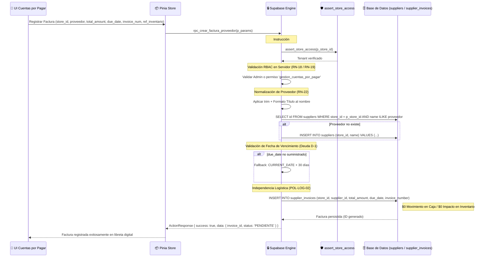
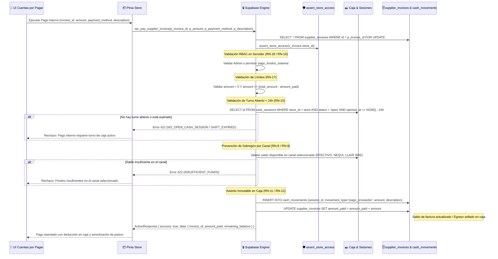
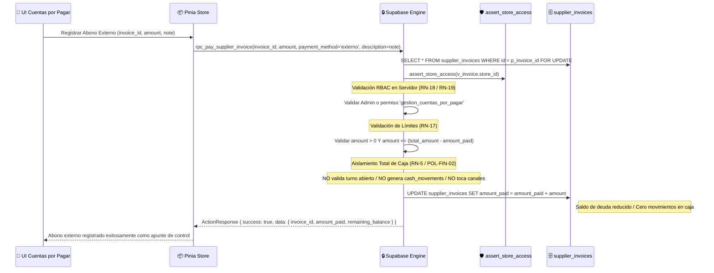
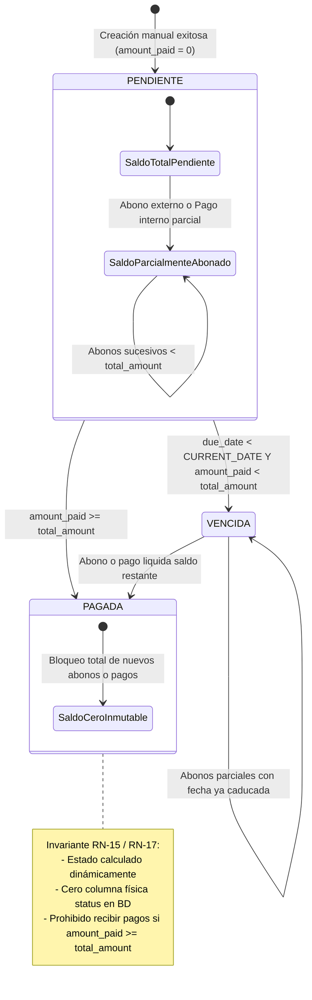
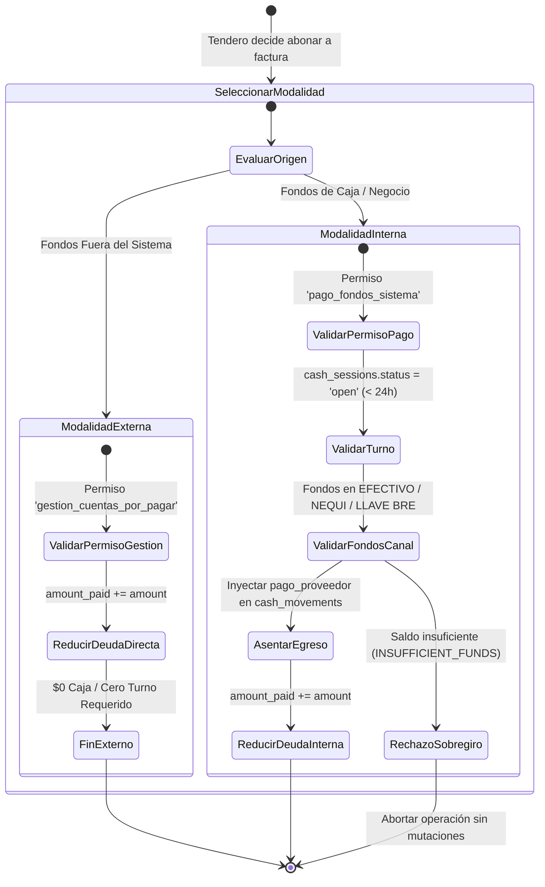
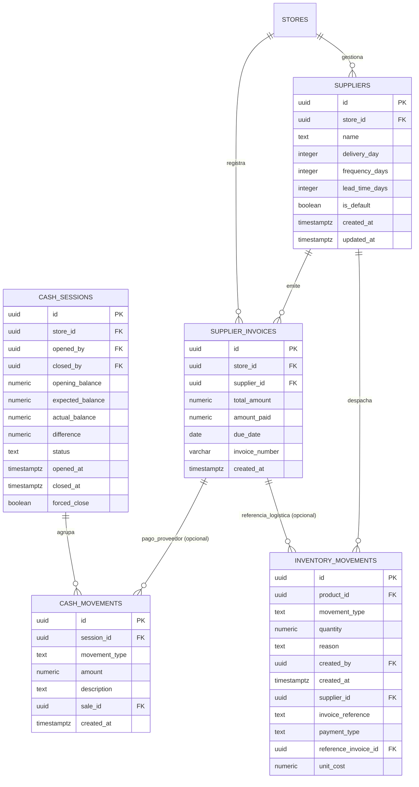

# SDD-019: Cuentas por Pagar y Política de Pago a Proveedores

> **Asociado a:** [FRD-019](../FRD/FRD_019_CUENTAS_POR_PAGAR.md)  
> **Fase del Plan:** Ola 4: Reportes, Auditoría y Cuentas por Pagar (Ítem 4)  
> **Estado:** 🟠 Aprobado con Deuda Técnica Documentada (Protocolo PAC-SDD v2.0)
> **Última Actualización:** 2026-10-16  

---

## 0. Alcance y Restricciones Aplicables (PEA-N)

### 0.1 Políticas Globales Activadas (ARQ-002)

| Política ID | Dominio | Mandato Arquitectónico e Impacto Concreto en este SDD |
| :--- | :--- | :--- |
| **POL-AUTH-01** | Multi-tenant | Aislamiento multi-tenant obligatorio. Invocación mandatoria de `assert_store_access(p_store_id)` como instrucción número uno incondicional en todos los RPCs del módulo (`rpc_crear_factura_proveedor`, `rpc_pay_supplier_invoice`, `rpc_obtener_cuentas_por_pagar`). Aislamiento en base de datos mediante políticas RLS gobernadas estrictamente por `get_current_store_id()`. |
| **POL-FIN-01** | Financiero | Solidez de Caja y Prevención Absoluta de Sobregiros por Canal. Toda salida monetaria del sistema originada por un pago interno a proveedor debe respaldarse con fondos reales disponibles en el canal seleccionado (`EFECTIVO`, `NEQUI`, `LLAVE BRE / Daviplata`). Queda terminantemente prohibido el sobregiro contable (`INSUFFICIENT_FUNDS`), el uso de saldos consolidados o el préstamo entre canales para cubrir pagos. |
| **POL-FIN-02** | Financiero | Aislamiento de Cuentas por Pagar y Segregación de Flujos. El registro inicial de una deuda nace por acción humana explícita y no afecta la caja ni el inventario. La liquidación distingue entre **Abono Externo** (fondos fuera del sistema, $0 movimiento de caja, no requiere turno abierto) y **Pago Interno** (fondos declarados del sistema, requiere turno abierto `< 24h`, egreso multicanal en `cash_movements`). |
| **POL-LOG-01 / POL-LOG-02** | Logística | Independencia Logística y Contable. La entrada física de mercancía incrementa existencias pero tiene prohibido crear pasivos financieros de forma automática. De igual forma, las devoluciones de mercancía a proveedores no reducen deudas en cascada. La vinculación de inventario con facturas es opcional, manual y meramente documental (`inventory_movements.reference_invoice_id`). |
| **POL-AUD-01** | Auditoría | Inviolabilidad Contable e Inmutabilidad de Pagos. Prohibición taxativa de operaciones destructivas `DELETE` o `UPDATE` sobre facturas liquidadas, abonos externos o egresos de caja. Cualquier equivocación en un pago debe subsanarse mediante contra-movimientos compensatorios auditables con referencia foránea mandatoria al ID original (`CA-FRD-005-03`). |
| **POL-SEC-01** | Seguridad | Control de Acceso RBAC en Servidor. El Administrador (`admin_profiles`) ejecuta la totalidad de operaciones. Los empleados (`employees`) requieren permisos funcionales específicos explícitos en su perfil de base de datos (`gestion_cuentas_por_pagar` y `pago_fondos_sistema`), prohibiendo de forma terminante confiar en banderas, botones o metadatos enviados desde el cliente (FRD-002 / RN-18, RN-19). |
| **SPEC-010 / SPEC-011** | Estándar Financiero | Moneda legal entera COP sin decimales. Cero operaciones matemáticas o totalizaciones financieras en el cliente frontend. Backend Authority absoluto en cómputo de saldos pendientes, estados dinámicos y validación de liquidez. |

---

### 0.2 Contratos Vecinos que Limitan el Diseño

| SDD Vecino | Interfaces / Restricciones Involucradas | Impacto Técnico en Cuentas por Pagar |
| :--- | :--- | :--- |
| **SDD_004 / SDD_020 (Caja Multicanal)** | `cash_sessions`, `cash_movements`, `status = 'open'`, turno `< 24h`. | Todo pago interno exige sesión de caja abierta y vigente. Registra un egreso en `cash_movements` con `movement_type = 'pago_proveedor'`, deduciendo el saldo esperado del turno: `expected_balance = opening_balance + SUM(ingresos) - SUM(gastos + pagos_proveedor)`. |
| **SDD_022 / SDD_026 (Gastos y Políticas)** | Segregación de canales (`[Efectivo]`, `[Nequi]`, `[Daviplata]`) y catálogo OPEX. | Subsanación del desfase histórico de SDD-019. Los pagos internos a proveedores liquidan pasivos con dinero del negocio y se asientan como egresos en caja. Se diferencian contablemente de los gastos OPEX (`movement_type = 'gasto'`) para no duplicar costos en el Estado de Resultados. |
| **SDD_027_01 (Reportes de Caja)** | Reporte forense atómico `rpc_get_comprehensive_shift_report`. | El reporte de cierre desglosa de forma independiente `total_supplier_payments`, preservando la ceguera operativa para cajeros y la auditoría forense para propietarios. |
| **SDD_006_01_01 / SDD_006 (Inventario)** | `inventory_movements.reference_invoice_id` hacia `supplier_invoices.id`. | Desacoplamiento estricto: las recepciones de mercancía a crédito no crean deudas automáticas. La asociación es opcional, manual y meramente documental. Desactivación formal de la Fase 2 del trigger `bridge_movement_to_batch`. |
| **SDD_005 (Auditoría y Trazabilidad)** | Inviolabilidad append-only y trazabilidad forense en `audit_logs`. | Los abonos externos y pagos internos son irreversibles por mutación directa. Toda corrección exige un contra-movimiento compensatorio que vincule la referencia original. |
| **SDD_018 (Control Operacional)** | Balance General (Pasivo Corriente) y P&L devengado. | Las cuentas por pagar constituyen pasivos comerciales. Un abono externo reduce el pasivo contra fondos externos; un pago interno reduce el pasivo contra la tesorería de caja, sin impactar el P&L operacional para no duplicar con el Costo de Mercancía Vendida (COGS FIFO). |

---

### 0.3 Auditoría de Base de Datos contra Realidad (Reglas 2, 4 y 8)

1. **Esquema Físico Real de `supplier_invoices` (Regla 2 Anti-Alucinación):**
   - Verificado mediante consulta directa a `information_schema.columns` en Supabase Producción (`ihtjocmhzuliwwvdzfnz`).
   - La tabla física `supplier_invoices` contiene exactamente **8 columnas**:
     * `id` (uuid, Primary Key, default `gen_random_uuid()`)
     * `store_id` (uuid, Not Null, Foreign Key a `stores.id` ON DELETE CASCADE)
     * `supplier_id` (uuid, Not Null, Foreign Key a `suppliers.id` ON DELETE RESTRICT)
     * `total_amount` (numeric, Not Null, Check `total_amount >= 0`)
     * `amount_paid` (numeric, Not Null, default `0`, Check `amount_paid >= 0`, Check `amount_paid <= total_amount`)
     * `due_date` (date, Not Null, sin valor por defecto en base de datos física)
     * `created_at` (timestamptz, Not Null, default `now()`)
     * `invoice_number` (character varying, Nullable)
   - **Hallazgos Anti-Alucinación Clave:**
     * **Cero columna `status` física:** En la base de datos real no existe la columna `status`. El estado de la factura (`PENDIENTE`, `VENCIDA`, `PAGADA`) se calcula dinámicamente en tiempo de ejecución conforme a la Regla 15 y CA-62 de FRD-019.
     * **Persistencia Relacional de Proveedores:** No existe la columna de texto libre `supplier_name` en `supplier_invoices`. La base de datos almacena obligatoriamente `supplier_id UUID FK suppliers.id`.
     * **Discrepancia de Nulabilidad en `due_date`:** En la base física de producción, `due_date` tiene restricción `is_nullable = 'NO'`. En contraste, el FRD-019 (Regla 16 y CA-03) estipula que la fecha de vencimiento es opcional. Se formaliza esta divergencia bajo la Regla 7 como la Deuda Técnica D-1.

2. **Esquema Físico Real de `suppliers` (9 columnas):**
   - `id` (uuid PK), `store_id` (uuid Not Null), `name` (text Not Null), `delivery_day` (integer nullable), `frequency_days` (integer Not Null default 7), `lead_time_days` (integer Not Null default 1), `is_default` (boolean Not Null default false), `created_at` (timestamptz), `updated_at` (timestamptz).

3. **Esquema Físico Real de `cash_movements` (7 columnas):**
   - `id`, `session_id`, `movement_type`, `amount`, `description`, `sale_id`, `created_at`.
   - Constraint verificado: `cash_movements_movement_type_check (CHECK (movement_type IN ('ingreso', 'gasto', 'pago_proveedor')))`.
   - Se confirma que `pago_proveedor` es un valor nativo, formal y permitido en el motor de base de datos.

4. **Esquema Físico Real de `inventory_movements` (12 columnas):**
   - Contiene `reference_invoice_id UUID FK supplier_invoices(id) ON DELETE RESTRICT` y `supplier_id UUID FK suppliers(id) ON DELETE SET NULL`.
   - La relación es inversa: `supplier_invoices` no contiene columnas de inventario, blindando la independencia logística-contable (`POL-LOG-02`).

5. **Remediación y Cumplimiento de Privilegios Base (Regla 8):**
   - Durante la auditoría de seguridad se constató que `service_role` carecía de permisos directos sobre `suppliers` y que `anon` carecía de permisos `SELECT` sobre `supplier_invoices`.
   - Se ejecutó formalmente en producción la remediación DDL:
     `GRANT ALL ON TABLE public.suppliers TO service_role;` y `GRANT SELECT ON TABLE public.supplier_invoices TO anon;`.
   - Se confirmó mediante `has_table_privilege`: `anon_invoices = true`, `auth_invoices = true`, `serv_invoices = true`, `anon_suppliers = true`, `auth_suppliers = true`, `serv_suppliers = true`, erradicando errores 42501 (Permission Denied).

6. **Reutilización de Funciones Centralizadas de Seguridad (Regla 4):**
   - Todos los RPCs del módulo ejecutan como primera instrucción incondicional `PERFORM public.assert_store_access(p_store_id);`.
   - Las políticas RLS de `supplier_invoices` y `suppliers` reutilizan de forma centralizada `get_current_store_id()`.

---

## 1. Glosario Local

- **Factura por Pagar (`supplier_invoices`):** Registro de una obligación financiera con un proveedor comercial que nace por acción humana explícita del tendero.
- **Abono Externo:** Reducción de deuda financiada con fondos externos al control del turno de caja del sistema (ej. transferencias de cuentas personales del dueño no registradas en caja o efectivo privado). No genera movimientos de caja, no afecta canales monetarios y no requiere turno abierto.
- **Pago Interno:** Reducción de deuda financiada con fondos declarados dentro del sistema comercial. Exige turno de caja abierto y vigente (`< 24h`), genera un egreso en `cash_movements` con `movement_type = 'pago_proveedor'`, valida disponibilidad de saldo por canal y afecta el arqueo de caja.
- **Canal Monetario Estricto:** Medio transaccional autorizado para la extracción de fondos en pagos internos: `EFECTIVO`, `NEQUI` y `LLAVE BRE` (Daviplata).
- **Sobregiro Contable:** Estado prohibido en el cual un desembolso monetario supera la liquidez disponible en el canal seleccionado, arriesgando faltantes de dinero físico o descuadres en extractos digitales.
- **Estado Dinámico:** Condición de exigibilidad de la factura calculada en tiempo de consulta:
  * `PAGADA`: El monto acumulado abonado o pagado cubre la totalidad del monto registrado (`amount_paid >= total_amount`).
  * `VENCIDA`: Posee fecha de vencimiento registrada que ya pasó (`due_date < CURRENT_DATE`) y su saldo pendiente es mayor a cero.
  * `PENDIENTE`: Saldo pendiente mayor a cero y su fecha de vencimiento no ha caducado o no fue registrada.
- **Normalización de Proveedor:** Transformación automática aplicada al nombre del proveedor al persistir (eliminación de espacios iniciales y finales, y conversión a formato título con mayúscula inicial por palabra).
- **Independencia Logística-Contable (`POL-LOG-02`):** Principio rector que prohíbe la creación o modificación automática de deudas financieras como consecuencia de recepciones de inventario, devoluciones o mermas.

---

## 2. Diagramas de Secuencia

### 2.1 Flujo de Registro Manual de Factura por Pagar



---

### 2.2 Flujo de Ejecución de Pago Interno (Caja Multicanal)



---

### 2.3 Flujo de Registro de Abono Externo (Sin Caja)



---

## 3. Diagramas de Estado

### 3.1 Ciclo de Vida del Estado Calculado Dinámicamente de la Factura



---

### 3.2 Ciclo de Decisión de Reducción de Deuda (Externo vs Interno)



---

## 4. Especificación Detallada de Casos de Uso

### Caso A: Registro Manual de Factura por Pagar
- **Actor:** Administrador o empleado con permiso de gestión de cuentas por pagar.
- **Precondiciones:** Existe una obligación financiera con un proveedor comercial.
- **Flujo Principal:**
  1. El usuario accede al módulo de Cuentas por Pagar.
  2. El usuario selecciona la acción de registrar factura.
  3. El usuario ingresa el nombre del proveedor. El frontend presenta sugerencias de autocompletado basadas en proveedores previos de la tienda.
  4. El usuario ingresa el monto total de la obligación (`total_amount`).
  5. El usuario ingresa el número o referencia de la factura si lo conoce (opcional).
  6. El usuario ingresa la fecha de vencimiento si la conoce (opcional).
  7. El usuario asocia la factura a una entrada de inventario existente si desea trazabilidad logística (opcional).
  8. El usuario confirma la operación.
  9. El servidor ejecuta `assert_store_access(p_store_id)` y corrobora permisos en la base de datos.
  10. El servidor normaliza el nombre del proveedor (eliminación de espacios y formato título), resolviendo o creando el registro en `suppliers`.
  11. Si la fecha de vencimiento no fue suministrada, el servidor asigna un valor por defecto calculado (`CURRENT_DATE + 30 días`) para satisfacer la restricción física de base de datos (Deuda Técnica D-1).
  12. El servidor valida que el monto total sea estrictamente mayor a cero y persiste la factura con `amount_paid = 0`.
- **Flujo Alternativo:**
  - Si el usuario carece de permiso, el servidor aborta con excepción `UNAUTHORIZED_ROLE`.
  - Si el monto total es menor o igual a cero, el servidor rechaza la operación con `INVALID_AMOUNT`.
  - Si la referencia de inventario no existe o pertenece a otra tienda, el servidor rechaza con `INVALID_INVENTORY_REFERENCE`.
- **Postcondiciones (Éxito):** Factura registrada en estado PENDIENTE. Cero movimientos en caja física o digital. Cero modificaciones en stock de inventario o lotes FIFO.

---

### Caso B: Registro de Abono Externo
- **Actor:** Administrador o empleado con permiso de gestión de cuentas por pagar.
- **Precondiciones:** Existe una factura pendiente y el desembolso se realizó con fondos externos al control del turno de caja del local.
- **Flujo Principal:**
  1. El usuario accede a la lista de cuentas por pagar y selecciona la factura.
  2. El usuario selecciona la acción de "Abono Externo".
  3. El usuario ingresa el monto abonado y una nota descriptiva opcional.
  4. El usuario confirma la operación.
  5. El servidor valida `assert_store_access(v_invoice.store_id)` y corrobora permisos.
  6. El servidor ejecuta bloqueo pesimista `FOR UPDATE` sobre la factura y valida que el monto no exceda el saldo pendiente (`total_amount - amount_paid`).
  7. El servidor incrementa `amount_paid` en `supplier_invoices`.
- **Flujo Alternativo:**
  - Si el monto excede el saldo pendiente, el servidor rechaza con `PAYMENT_EXCEEDS_BALANCE`.
  - Si el monto es menor o igual a cero, el servidor rechaza con `INVALID_AMOUNT`.
  - Si la factura ya se encuentra pagada, el servidor rechaza con `INVOICE_ALREADY_PAID`.
- **Postcondiciones (Éxito):** La deuda se reduce. No se requiere turno de caja abierto. No se genera ningún movimiento en `cash_movements`. No se alteran los saldos esperados ni arqueos de ningún canal monetario.

---

### Caso C: Pago Interno con Fondos Suficientes
- **Actor:** Administrador o empleado con permiso de pago con fondos del sistema.
- **Precondiciones:** Existe una factura pendiente y hay un turno de caja abierto con antigüedad menor a 24 horas.
- **Flujo Principal:**
  1. El usuario accede al módulo de Cuentas por Pagar y selecciona la factura.
  2. El usuario selecciona la acción de "Pago Interno con Fondos del Sistema".
  3. El usuario ingresa el monto a pagar.
  4. El usuario selecciona obligatoriamente uno de los tres canales monetarios válidos: `EFECTIVO`, `NEQUI` o `LLAVE BRE / Daviplata`.
  5. El usuario ingresa una descripción obligatoria para el movimiento de caja.
  6. El usuario confirma la operación.
  7. El servidor ejecuta `assert_store_access(v_invoice.store_id)` y verifica en base de datos el permiso `pago_fondos_sistema`.
  8. El servidor verifica la existencia de un turno abierto en `cash_sessions` (`status = 'open'` y `opened_at >= NOW() - INTERVAL '24 hours'`).
  9. El servidor verifica que el canal seleccionado cuente con liquidez suficiente para cubrir el monto del pago.
  10. El servidor asienta el egreso en `cash_movements` con `movement_type = 'pago_proveedor'`, vinculando la sesión activa y estructurando el canal en la descripción.
  11. El servidor incrementa `amount_paid` en `supplier_invoices`.
- **Flujo Alternativo:**
  - Si el canal seleccionado carece de liquidez suficiente, el servidor rechaza de forma inmediata con `INSUFFICIENT_FUNDS` sin alterar la caja ni la factura.
  - Si no existe turno de caja abierto o el turno supera las 24 horas, el servidor rechaza con `NO_OPEN_CASH_SESSION` o `SHIFT_EXPIRED`, advirtiendo que solo se autorizan abonos externos.
  - Si el monto excede el saldo pendiente, el servidor rechaza con `PAYMENT_EXCEEDS_BALANCE`.
- **Postcondiciones (Éxito):** La deuda se reduce o liquida en su totalidad. Se genera un movimiento inmutable en `cash_movements` clasificado como `pago_proveedor`. Si el canal fue `EFECTIVO`, se reduce el saldo físico esperado del turno. Si fue canal digital, se reduce el saldo digital manteniendo intacto el cajón de efectivo.

---

### Caso D: Pago Interno Rechazado por Fondos Insuficientes
- **Actor:** Administrador o empleado con permiso de pago con fondos del sistema.
- **Precondiciones:** El canal seleccionado no posee saldo suficiente para cubrir el monto solicitado.
- **Flujo Principal:**
  1. El usuario intenta abonar a una factura mediante pago interno seleccionando un canal monetario (ej. Nequi).
  2. El servidor evalúa la liquidez disponible en dicho canal y detecta insuficiencia de fondos.
  3. El servidor aborta la transacción y devuelve el error formal `INSUFFICIENT_FUNDS`.
  4. El sistema informa con claridad la insuficiencia de fondos sin permitir préstamos entre canales ni sobregiros.
- **Postcondiciones (Éxito):** Cero mutaciones en `supplier_invoices`. Cero registros en `cash_movements`. La caja y la deuda permanecen intactas.

---

### Caso E: Pago Interno Rechazado por Ausencia de Turno Abierto
- **Actor:** Administrador o empleado con permiso de pago con fondos del sistema.
- **Precondiciones:** La tienda no posee ninguna sesión de caja abierta o el turno activo superó las 24 horas.
- **Flujo Principal:**
  1. El usuario intenta registrar un pago interno con fondos del sistema.
  2. El servidor detecta la ausencia de sesión en estado `open` o valida que `opened_at < NOW() - INTERVAL '24 hours'`.
  3. El servidor aborta la operación y retorna `NO_OPEN_CASH_SESSION` o `SHIFT_EXPIRED`.
  4. La interfaz notifica al usuario que no es posible desembolsar dinero del sistema sin turno activo y orienta al registro de un abono externo si los fondos fueron propios.
- **Postcondiciones (Éxito):** Cero egresos en caja. Cero reducciones de deuda por vía de pago interno.

---

### Caso F: Navegación y Filtrado del Listado de Facturas
- **Actor:** Administrador o empleado con permiso de gestión de cuentas por pagar.
- **Precondiciones:** Existen facturas registradas en la tienda.
- **Flujo Principal:**
  1. El usuario ingresa a la vista principal de Cuentas por Pagar.
  2. La vista inicializa en su estado por defecto: muestra todas las facturas no pagadas ordenadas por fecha de creación en dirección descendente (más recientes primero).
  3. El usuario puede aplicar búsqueda parcial por nombre de proveedor (insensible a mayúsculas/minúsculas).
  4. El usuario puede alternar el filtro por estado dinámico: "Todas", solo "Pendientes", solo "Vencidas" o solo "Pagadas".
  5. El usuario puede acotar la consulta mediante un filtro por rango de fechas de creación (`p_start_date` a `p_end_date`).
  6. El usuario puede ordenar por fecha de creación, monto total, nombre de proveedor o fecha de vencimiento, alternando la dirección entre ascendente y descendente.
  7. El servidor procesa la consulta paginada y entrega la respuesta canónica `{ data: [...], count: N }`.
- **Postcondiciones (Éxito):** Localización inmediata de facturas para priorización de pagos o conciliación de pasivos.

---

## 5. Contratos de Interfaz (RPC y JSON Schemas)

### 5.1 Especificación: `rpc_crear_factura_proveedor`

Función transaccional (`SECURITY DEFINER`) encargada del registro consciente y manual de obligaciones comerciales con proveedores.

#### Parámetros de Entrada:
- `p_store_id` (UUID, Not Null): Identificador de la tienda activa.
- `p_supplier_name` (TEXT, Not Null): Nombre del proveedor comercial (texto libre sujeto a normalización automática).
- `p_total_amount` (NUMERIC, Not Null): Monto total de la factura (estrictamente `> 0`).
- `p_due_date` (DATE, Nullable): Fecha de vencimiento opcional. Si se omite, se asigna `CURRENT_DATE + 30 días` como fallback de base de datos (Deuda Técnica D-1).
- `p_invoice_number` (TEXT, Nullable): Número o referencia física del comprobante.
- `p_reference_inventory_id` (UUID, Nullable): Identificador referencial opcional de una entrada de inventario (`inventory_movements.id`).

---

#### 5.1.1 Request JSON Schema (`rpc_crear_factura_proveedor`)

```json
{
  "$schema": "https://json-schema.org/draft/2020-12/schema",
  "title": "RpcCrearFacturaProveedorRequest",
  "type": "object",
  "required": ["p_store_id", "p_supplier_name", "p_total_amount"],
  "properties": {
    "p_store_id": {
      "type": "string",
      "format": "uuid",
      "description": "Identificador de la tienda para validación de tenant."
    },
    "p_supplier_name": {
      "type": "string",
      "minLength": 2,
      "description": "Nombre del proveedor comercial. Se normaliza automáticamente (trim + formato título)."
    },
    "p_total_amount": {
      "type": "number",
      "exclusiveMinimum": 0,
      "description": "Monto total de la obligación en moneda legal entera COP."
    },
    "p_due_date": {
      "type": ["string", "null"],
      "format": "date",
      "description": "Fecha límite de pago opcional (YYYY-MM-DD)."
    },
    "p_invoice_number": {
      "type": ["string", "null"],
      "description": "Número de factura o comprobante físico de compra."
    },
    "p_reference_inventory_id": {
      "type": ["string", "null"],
      "format": "uuid",
      "description": "UUID opcional de un movimiento de entrada de inventario existente para trazabilidad documental."
    }
  },
  "additionalProperties": false
}
```

---

#### 5.1.2 Success JSON Schema (`rpc_crear_factura_proveedor`)

```json
{
  "$schema": "https://json-schema.org/draft/2020-12/schema",
  "title": "RpcCrearFacturaProveedorSuccessResponse",
  "type": "object",
  "required": ["success", "data"],
  "properties": {
    "success": {
      "type": "boolean",
      "const": true
    },
    "data": {
      "type": "object",
      "required": [
        "id",
        "store_id",
        "supplier_id",
        "supplier_name",
        "total_amount",
        "amount_paid",
        "remaining_balance",
        "due_date",
        "status",
        "created_at"
      ],
      "properties": {
        "id": {
          "type": "string",
          "format": "uuid"
        },
        "store_id": {
          "type": "string",
          "format": "uuid"
        },
        "supplier_id": {
          "type": "string",
          "format": "uuid"
        },
        "supplier_name": {
          "type": "string"
        },
        "total_amount": {
          "type": "number"
        },
        "amount_paid": {
          "type": "number",
          "const": 0
        },
        "remaining_balance": {
          "type": "number"
        },
        "due_date": {
          "type": ["string", "null"],
          "format": "date"
        },
        "invoice_number": {
          "type": ["string", "null"]
        },
        "status": {
          "type": "string",
          "const": "PENDIENTE"
        },
        "created_at": {
          "type": "string",
          "format": "date-time"
        }
      },
      "additionalProperties": false
    }
  },
  "additionalProperties": false
}
```

---

### 5.2 Especificación: `rpc_pay_supplier_invoice`

Función transaccional (`SECURITY DEFINER`) encargada de procesar amortizaciones de deudas, distinguiendo entre abonos externos y pagos internos multicanal con prevención de sobregiro.

#### Parámetros de Entrada:
- `p_invoice_id` (UUID, Not Null): Identificador de la factura a abonar.
- `p_amount` (NUMERIC, Not Null): Monto del pago (estrictamente `> 0` y `<= saldo_pendiente`).
- `p_payment_method` (TEXT, Not Null): Modalidad de pago (`'externo'`, `'efectivo'`, `'nequi'`, `'llave_bre'`, admitiendo alias `'daviplata'`).
- `p_description` (TEXT, Nullable): Motivo o nota descriptiva del movimiento (obligatorio si el pago es interno).

---

#### 5.2.1 Request JSON Schema (`rpc_pay_supplier_invoice`)

```json
{
  "$schema": "https://json-schema.org/draft/2020-12/schema",
  "title": "RpcPaySupplierInvoiceRequest",
  "type": "object",
  "required": ["p_invoice_id", "p_amount", "p_payment_method"],
  "properties": {
    "p_invoice_id": {
      "type": "string",
      "format": "uuid",
      "description": "Identificador de la factura comercial por pagar."
    },
    "p_amount": {
      "type": "number",
      "exclusiveMinimum": 0,
      "description": "Monto a abonar o liquidar en pesos enteros COP."
    },
    "p_payment_method": {
      "type": "string",
      "enum": ["externo", "efectivo", "nequi", "llave_bre", "daviplata"],
      "description": "Modalidad de pago. 'externo' para fondos fuera de caja; los demás debitan el canal monetario correspondiente."
    },
    "p_description": {
      "type": ["string", "null"],
      "description": "Descripción explicativa del desembolso (mandatoria para pagos internos)."
    }
  },
  "additionalProperties": false
}
```

---

#### 5.2.2 Success JSON Schema (`rpc_pay_supplier_invoice`)

```json
{
  "$schema": "https://json-schema.org/draft/2020-12/schema",
  "title": "RpcPaySupplierInvoiceSuccessResponse",
  "type": "object",
  "required": ["success", "data"],
  "properties": {
    "success": {
      "type": "boolean",
      "const": true
    },
    "data": {
      "type": "object",
      "required": [
        "invoice_id",
        "amount_paid_total",
        "payment_amount",
        "remaining_balance",
        "status",
        "origin_type"
      ],
      "properties": {
        "invoice_id": {
          "type": "string",
          "format": "uuid"
        },
        "amount_paid_total": {
          "type": "number"
        },
        "payment_amount": {
          "type": "number"
        },
        "remaining_balance": {
          "type": "number"
        },
        "status": {
          "type": "string",
          "enum": ["PENDIENTE", "PAGADA", "VENCIDA"]
        },
        "origin_type": {
          "type": "string",
          "enum": ["EXTERNO", "INTERNO"]
        },
        "cash_movement_id": {
          "type": ["string", "null"],
          "format": "uuid"
        },
        "channel_debited": {
          "type": ["string", "null"],
          "enum": ["efectivo", "nequi", "llave_bre", "daviplata", null]
        }
      },
      "additionalProperties": false
    }
  },
  "additionalProperties": false
}
```

---

### 5.3 Especificación: `rpc_obtener_cuentas_por_pagar`

Función transaccional de solo lectura (READ-ONLY) encargada de listar facturas con estado calculado dinámico, búsqueda parcial de proveedor, filtros de estado y rango temporal, y paginación canónica `{ data, count }`.

#### Parámetros de Entrada:
- `p_store_id` (UUID, Not Null): Identificador de la tienda activa.
- `p_status_filter` (TEXT, Nullable, Default `'todas_activas'`): Filtro de estado (`'todas'`, `'todas_activas'`, `'pendientes'`, `'vencidas'`, `'pagadas'`).
- `p_search_provider` (TEXT, Nullable): Subcadena de búsqueda parcial en el nombre del proveedor.
- `p_start_date` (DATE, Nullable): Límite temporal inferior de fecha de creación.
- `p_end_date` (DATE, Nullable): Límite temporal superior de fecha de creación.
- `p_order_by` (TEXT, Nullable, Default `'created_at'`): Criterio de orden (`'created_at'`, `'total_amount'`, `'supplier_name'`, `'due_date'`).
- `p_order_direction` (TEXT, Nullable, Default `'desc'`): Dirección (`'asc'`, `'desc'`).
- `p_limit` (INTEGER, Nullable, Default `50`): Registros por página (máximo `100`).
- `p_offset` (INTEGER, Nullable, Default `0`): Desplazamiento de paginación.

---

#### 5.3.1 Success JSON Schema (`rpc_obtener_cuentas_por_pagar` Canónico `{ data, count }`)

```json
{
  "$schema": "https://json-schema.org/draft/2020-12/schema",
  "title": "RpcObtenerCuentasPorPagarSuccessResponse",
  "type": "object",
  "required": ["data", "count"],
  "properties": {
    "data": {
      "type": "array",
      "items": {
        "type": "object",
        "required": [
          "id",
          "supplier_id",
          "supplier_name",
          "total_amount",
          "amount_paid",
          "remaining_balance",
          "status",
          "created_at"
        ],
        "properties": {
          "id": {
            "type": "string",
            "format": "uuid"
          },
          "supplier_id": {
            "type": "string",
            "format": "uuid"
          },
          "supplier_name": {
            "type": "string"
          },
          "invoice_number": {
            "type": ["string", "null"]
          },
          "total_amount": {
            "type": "number"
          },
          "amount_paid": {
            "type": "number"
          },
          "remaining_balance": {
            "type": "number"
          },
          "due_date": {
            "type": ["string", "null"],
            "format": "date"
          },
          "status": {
            "type": "string",
            "enum": ["PENDIENTE", "VENCIDA", "PAGADA"]
          },
          "reference_inventory_id": {
            "type": ["string", "null"],
            "format": "uuid"
          },
          "created_at": {
            "type": "string",
            "format": "date-time"
          }
        },
        "additionalProperties": false
      }
    },
    "count": {
      "type": "integer",
      "minimum": 0,
      "description": "Total de registros que coinciden con los criterios de filtrado para paginación server-side."
    }
  },
  "additionalProperties": false
}
```

---

#### 5.3.2 Catálogo Exhaustivo de Errores Técnicos

```json
{
  "$schema": "https://json-schema.org/draft/2020-12/schema",
  "title": "PayablesErrorResponse",
  "type": "object",
  "required": ["code", "message"],
  "properties": {
    "code": {
      "type": "string",
      "enum": [
        "STORE_ACCESS_DENIED",
        "UNAUTHORIZED_ROLE",
        "INSUFFICIENT_FUNDS",
        "NO_OPEN_CASH_SESSION",
        "SHIFT_EXPIRED",
        "PAYMENT_EXCEEDS_BALANCE",
        "INVOICE_ALREADY_PAID",
        "INVALID_AMOUNT",
        "INVOICE_NOT_FOUND",
        "INVALID_PAYMENT_METHOD",
        "INVALID_INVENTORY_REFERENCE"
      ],
      "description": "Código de error técnico tipificado de la operación."
    },
    "message": {
      "type": "string",
      "description": "Descripción amigable del motivo de rechazo para el tendero."
    },
    "details": {
      "type": ["object", "string", "null"],
      "description": "Información complementaria de trazabilidad de la excepción."
    }
  },
  "additionalProperties": false
}
```

---

## 6. Análisis de Seguridad, RLS y Resiliencia

### 6.1 Multi-tenancy y Gobernanza RLS (POL-AUTH-01)
- **Aislamiento por Tienda:** Las tablas físicas `supplier_invoices` y `suppliers` cuentan con Row Level Security activado (`rowsecurity = true`). La política de lectura exige incondicionalmente `store_id = get_current_store_id()`.
- **Blindaje en RPCs:** Cada función transaccional ejecuta en su primera línea `PERFORM public.assert_store_access(p_store_id);`, impidiendo que peticiones forjadas accedan o liquiden obligaciones de otros comercios.

### 6.2 Inviolabilidad Contable y Default-Deny (POL-AUD-01)
- **Prohibición de Borrado Físico:** En `supplier_invoices`, las mutaciones directas de borrado (`DELETE`) están restringidas por RLS. No se permite eliminar facturas con movimientos vinculados o saldos amortizados.
- **Inmutabilidad de Egresos:** Los registros insertados en `cash_movements` con `movement_type = 'pago_proveedor'` son estrictamente `append-only`. Cualquier equivocación exige el registro de un contra-movimiento de compensación auditado en `audit_logs` con `reference_id` al ID de la transacción original (`CA-FRD-005-03`).

### 6.3 Seguridad RBAC y Verificación Estricta en Servidor (POL-SEC-01 / FRD-002)
- **Administrador:** Acceso irrestricto verificado contra `admin_profiles`.
- **Empleados:** Validación obligatoria en servidor del array `permissions` en la tabla `employees`:
  * Permiso `gestion_cuentas_por_pagar`: Habilita la creación manual de facturas y el registro de abonos externos.
  * Permiso `pago_fondos_sistema`: Habilita la ejecución de pagos internos con desembolso de fondos del local.
- **Prohibición de Banderas de Cliente:** El servidor ignora cualquier rol o bandera enviada en el payload HTTP, consultando directamente la autoría mediante `auth.uid()` y las tablas físicas de perfiles en PostgreSQL.

### 6.4 Auditoría de Privilegios Base (Regla 8)
- Se verificó en tiempo real mediante `has_table_privilege` la concesión de permisos `SELECT` a `anon` en `supplier_invoices` y `ALL` a `service_role` en `suppliers`, garantizando que ningún componente del sistema o worker de fondo sufra errores 42501 (Permission Denied).

### 6.5 Prevención de Fallos Silenciosos (Regla 3)
- Toda excepción de negocio (fondos insuficientes, turno cerrado, monto excedido) relanza de inmediato un error formal (`RAISE EXCEPTION`) propagando el código tipificado hacia el cliente. Queda prohibido devolver respuestas simuladas con saldo $0 o payloads falsamente exitosos.

---

## 7. Modelo de Datos Lógico y Deuda Técnica Formalizada (Regla 7)

### 7.1 ERD Mermaid (Arquitectura Física Real de Cuentas por Pagar)



---

### 7.2 Diccionario de Datos Físico Real (Esquema de Producción)

#### 1. Tabla `supplier_invoices` (Facturas por Pagar a Proveedores)
- `id` (uuid, PK, default `gen_random_uuid()`): Identificador único de la factura.
- `store_id` (uuid, NOT NULL, FK `stores.id` ON DELETE CASCADE): Tienda titular de la deuda.
- `supplier_id` (uuid, NOT NULL, FK `suppliers.id` ON DELETE RESTRICT): Proveedor acreedor de la obligación.
- `total_amount` (numeric, NOT NULL, CHECK `total_amount >= 0`): Monto total facturado en moneda entera COP.
- `amount_paid` (numeric, NOT NULL, default `0`, CHECK `amount_paid >= 0`, CHECK `amount_paid <= total_amount`): Monto acumulado liquidado mediante abonos externos o pagos internos.
- `due_date` (date, NOT NULL en BD física): Fecha límite de pago registrada (sujeta a Deuda Técnica D-1).
- `invoice_number` (varchar, NULLABLE): Número o referencia física del comprobante.
- `created_at` (timestamptz, NOT NULL, default `now()`): Marca de tiempo oficial de creación.

#### 2. Tabla `suppliers` (Catálogo de Proveedores)
- `id` (uuid, PK, default `gen_random_uuid()`): Identificador único del proveedor.
- `store_id` (uuid, NOT NULL, FK `stores.id`): Tienda asociada al proveedor.
- `name` (text, NOT NULL): Nombre comercial del proveedor (normalizado con trim + formato título).
- `delivery_day` (integer, NULLABLE): Día habitual de entrega (1=Lunes, 7=Domingo).
- `frequency_days` (integer, NOT NULL, default `7`): Frecuencia de visita o reposición en días.
- `lead_time_days` (integer, NOT NULL, default `1`): Tiempo de entrega en días.
- `is_default` (boolean, NOT NULL, default `false`): Bandera de proveedor comodín o principal.
- `created_at` (timestamptz, default `now()`): Timestamp de registro.
- `updated_at` (timestamptz, default `now()`): Timestamp de última actualización.

#### 3. Tabla `cash_movements` (Egresos Multicanal por Pago a Proveedor)
- `id` (uuid, PK): Identificador único del movimiento.
- `session_id` (uuid, NOT NULL, FK `cash_sessions.id`): Sesión de caja activa donde se debitó el pago.
- `movement_type` (text, NOT NULL, CHECK `movement_type IN ('ingreso', 'gasto', 'pago_proveedor')`): Para pagos a proveedores toma el valor nativo `'pago_proveedor'`.
- `amount` (numeric, NOT NULL, CHECK `amount > 0`): Monto desembolsado en pesos enteros COP.
- `description` (text, NOT NULL): Descripción explicativa estructurada con el canal debitado (ej. `[PAGO_PROVEEDOR] [CANAL:efectivo] Factura #F-102`).
- `sale_id` (uuid, NULLABLE): Nulo en pagos a proveedores (reservado para ventas POS).
- `created_at` (timestamptz, NOT NULL, default `now()`): Timestamp del egreso.

#### 4. Tabla `cash_sessions` (Turnos de Caja de Control)
- `id` (uuid, PK): Identificador único del turno.
- `store_id` (uuid, NOT NULL, FK `stores.id`): Tienda titular de la caja.
- `status` (text, NOT NULL, CHECK `status IN ('open', 'closed')`): Estado de la sesión (solo sesiones `open` admiten pagos internos).
- `opened_at` (timestamptz, NOT NULL): Fecha y hora de apertura (exige antigüedad `< 24h`).
- `expected_balance` (numeric, NULLABLE): Saldo esperado del turno computando egresos por `pago_proveedor`.

#### 5. Tabla `inventory_movements` (Trazabilidad Referencial Inversa)
- `reference_invoice_id` (uuid, NULLABLE, FK `supplier_invoices.id` ON DELETE RESTRICT): Clave foránea opcional que enlaza una entrada de inventario a la factura correspondiente sin acoplamiento automático contable (`POL-LOG-02`).

---

### 7.3 Formalización de Deudas Técnicas y Trade-offs (Regla 7)

A continuación se registran formalmente las seis deudas técnicas y trade-offs identificados y consensuados durante el Protocolo PAC-SDD, estructurados bajo los tres elementos obligatorios de la Regla 7:

#### Deuda Técnica D-1 (H-1): Discrepancia de Nulabilidad en `due_date` (`NOT NULL` en BD vs Opcional en FRD-019)
- **Qué se decidió:** En la función `rpc_crear_factura_proveedor`, si el usuario omite la fecha de vencimiento (`p_due_date IS NULL`), el backend asignará un valor por defecto calculado (`CURRENT_DATE + 30 días` o según el `frequency_days` del proveedor).
- **Por qué (Trade-off):** Previene errores de violación de restricción `NOT NULL` (código 23502) en la base de datos física existente de producción sin imponer un campo obligatorio innecesario en la interfaz del tendero (respetando RN-16 y CA-03).
- **Condición de revisión futura:** Despliegue de migración DDL en la Ola 4 que ejecute: `ALTER TABLE public.supplier_invoices ALTER COLUMN due_date DROP NOT NULL;`.

#### Deuda Técnica D-2 (H-2): Desacoplamiento de Deudas Automáticas en Trigger `bridge_movement_to_batch` (Fase 2)
- **Qué se decidió:** Desacoplar formalmente la Fase 2 del trigger `bridge_movement_to_batch` en la arquitectura de Cuentas por Pagar, consagrando que ninguna entrada de inventario o devolución debe mutar automáticamente las deudas con proveedores según `POL-LOG-02` y FRD-019 Reglas 1 y 2.
- **Por qué (Trade-off):** Elimina la creación no consciente de pasivos financieros y amortizaciones erróneas por mermas o devoluciones logísticas, garantizando el principio de libreta digital bajo control humano del comerciante.
- **Condición de revisión futura:** Despliegue de la migración DDL de limpieza de triggers de inventario en la Ola 4 que erradique la Fase 2 del código PL/pgSQL.

#### Deuda Técnica D-3 (H-3): Reconciliación Nominal de Canales Digitales (`LLAVE BRE` vs `'daviplata'`)
- **Qué se decidió:** Estandarizar la interfaz técnica de Cuentas por Pagar aceptando el identificador canónico multicanal `'llave_bre'` y admitir `'daviplata'` como alias transparente y bidireccional en el backend.
- **Por qué (Trade-off):** Asegura consistencia con las restricciones CHECK de `cash_movements` y balances de `SDD_020` y `SDD_022`, evitando errores de validación sintáctica entre la terminología del FRD y los enums de base de datos.
- **Condición de revisión futura:** Consolidación definitiva del catálogo de métodos de pago en la suite multicanal de la Ola 4.

#### Deuda Técnica D-4 (H-4): Prevención de Sobregiro por Canal en `rpc_pay_supplier_invoice` (`INSUFFICIENT_FUNDS`)
- **Qué se decidió:** Refactorizar la función `rpc_pay_supplier_invoice` para validar la disponibilidad real de liquidez en el canal seleccionado (`EFECTIVO`, `NEQUI`, `LLAVE BRE`) antes de asentar el pago, abortando con `INSUFFICIENT_FUNDS` ante fondos insuficientes.
- **Por qué (Trade-off):** Protege la caja diaria y las cuentas electrónicas contra saldos negativos y faltantes ficticios en el arqueo de cierre, subsanando una grave omisión del procedimiento legacy de base de datos conforme a las Reglas 8 y 9 de FRD-019.
- **Condición de revisión futura:** Despliegue del script de actualización PL/pgSQL de `rpc_pay_supplier_invoice` en Supabase Producción durante la Ola 4.

#### Deuda Técnica D-5 (H-5): Integración del Catálogo de Proveedores (`suppliers` vs Texto Libre en RN-22)
- **Qué se decidió:** En el endpoint de creación de facturas, el backend normalizará automáticamente el texto libre suministrado (eliminación de espacios y formato título). Si el nombre ya existe en `suppliers` para esa tienda, reutilizará su UUID; si no existe, insertará automáticamente la nueva fila en `suppliers` y vinculará su ID en `supplier_invoices.supplier_id`.
- **Por qué (Trade-off):** Cumple con la agilidad y libertad de captura requerida por el tendero en FRD-019 RN-22 sin violentar la clave foránea relacional estricta `supplier_invoices_supplier_id_fkey` de la base de datos de producción.
- **Condición de revisión futura:** Incorporación de herramientas administrativas de fusión y desduplicación de proveedores en la fase de reportería avanzada.

#### Deuda Técnica D-6 (H-6): Estandarización de Contrato de Consulta `{ data, count }` (`rpc_obtener_cuentas_por_pagar`)
- **Qué se decidió:** Normar que la consulta del listado de obligaciones retorne taxativamente la estructura canónica `{ data: [...], count: N }` con soporte para paginación server-side (`p_limit`, `p_offset`), búsqueda parcial por proveedor y filtros combinables de estado dinámico y rango temporal.
- **Por qué (Trade-off):** Cumple con la Regla Global 4.1 del Contrato de Interfaz y previene sobrecargas de red o congelamiento del cliente Vue ante comercios con cientos de facturas acumuladas en el historial.
- **Condición de revisión futura:** Permanente. Invariante arquitectural transversal para todos los endpoints de consulta de la plataforma.
