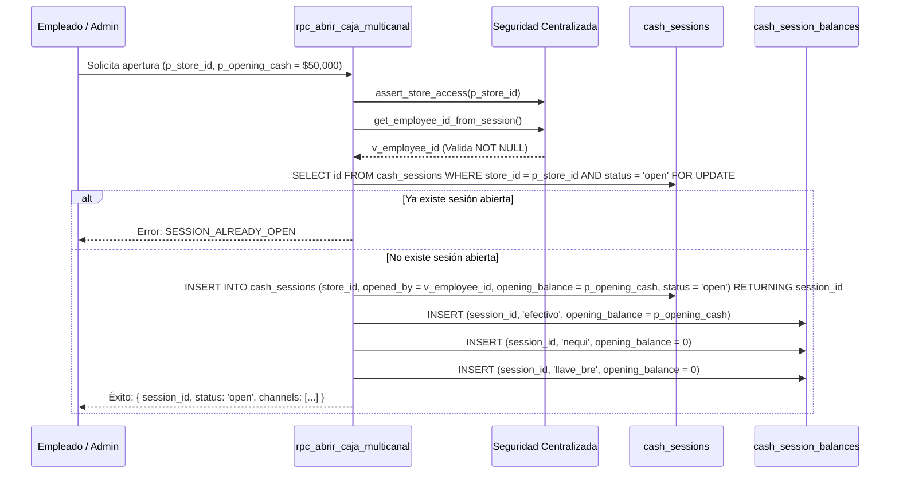
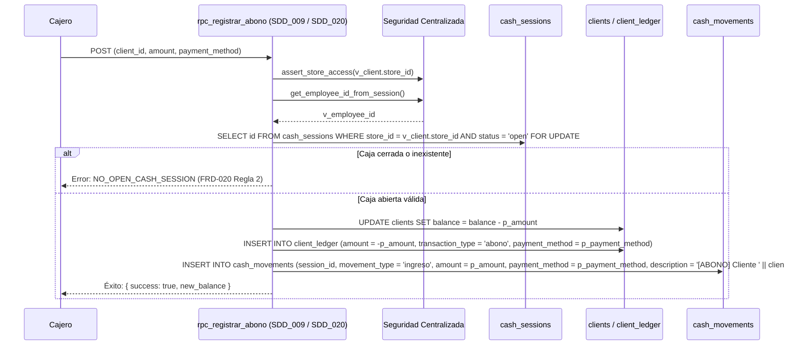
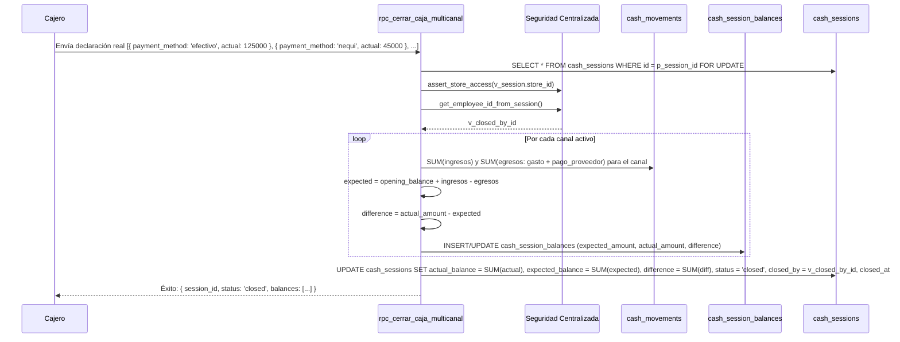
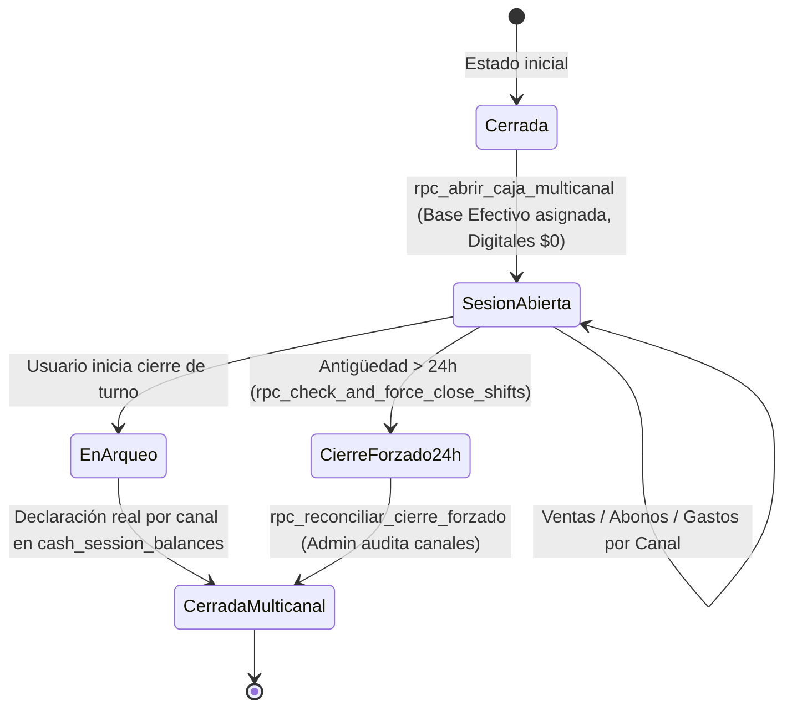
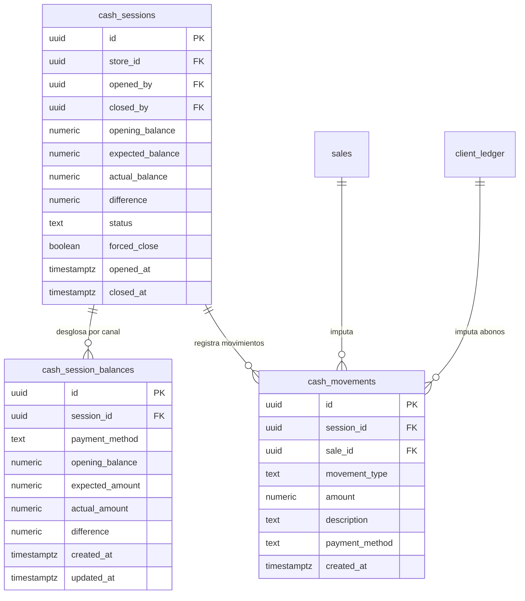

# SDD-020: Control de Caja Multicanal (Físico y Digital)

> **Asociado a:** [FRD-020](../FRD/FRD_020_CAJA_MULTICANAL.md) (Arqueo y Control de Turnos Multicanal; absorbe [FRD_004_CAJA_ESTRICTA_MULTICANAL.md](../FRD/FRD_004_CAJA_ESTRICTA_MULTICANAL.md) y deroga [FRD_004_1_GESTION_PIN_CAJA.md](../FRD/FRD_004_1_GESTION_PIN_CAJA.md))  
> **Fase del Plan:** Ola 1 — Cimientos de Caja y Gastos  
> **Estado:** 🟠 Aprobado con Deuda Técnica Documentada (PAC-SDD Completo 2026-10-14)  
> **Última Actualización:** 2026-10-17

---

## 0. Contexto y Restricciones Aplicables

### 0.1 Políticas Globales Activadas (ARQ-002)
| Política ID | Dominio | Impacto Concreto en este SDD |
|-------------|---------|------------------------------|
| **POL-FIN-01** | Financiero | **Solidez de Caja (Liquidez Real):** Cada canal responde exclusivamente por su liquidez real comprobada. El saldo esperado se calcula como: `Base Canal + Ingresos Canal − Egresos Canal`. No se permite compensación ficticia entre efectivo y cuentas digitales. |
| **POL-FIN-02** | Financiero | **Segregación de Canales Monetarios:** Efectivo, Nequi y Llave BRE se inicializan, calculan y concilian de forma independiente. La base inicial de apertura se asigna 100% al Efectivo; los canales digitales inician estrictamente en $0 sin intervención del usuario. |
| **POL-SEG-01** | Seguridad | **Arqueo Ciego Multicanal:** El sistema no expone el `expected_amount` de ningún canal al usuario antes de registrar los montos reales declarados en mano. Aplica tanto al cierre regular como al cierre forzado por caducidad de 24 horas. |
| **POL-AUD-01** | Auditoría | **Inmutabilidad de Arqueos:** Los balances registrados al cierre son append-only e inmutables. Toda discrepancia queda asentada por canal en `cash_session_balances.difference`. |
| **POL-AUTH-01** | Seguridad | **Autorización Centralizada y Erradicación de PIN (Decisión D-01):** Toda operación valida acceso mediante `assert_store_access` y resolución autoritativa del cajero con `get_employee_id_from_session()`. Queda erradicado el PIN de caja o tienda. |
| **SPEC-010 / 011** | Financiero | **Conservación Numérica y Moneda Entera:** Cero redondeos de punto flotante. Todos los saldos y diferencias se manejan en pesos colombianos como enteros en tipo `NUMERIC`. |

### 0.2 Contratos Vecinos que Limitan el Diseño
| SDD Origen | Restricción Inyectada | Impacto en Caja Multicanal |
|------------|-----------------------|----------------------------|
| **SDD_004 (Control de Caja)** | Unicidad de sesión activa y dualidad operativa. | La apertura y cierre multicanal operan sobre la única sesión `open` activa (`session_id`). Las operaciones escalares de SDD_004 (`abrir_caja`, `cerrar_caja`) actúan como capa de compatibilidad física hasta la migración total. |
| **SDD_007 / SDD_007_01 (Ventas y POS)** | Obligatoriedad de canal en ventas. | Toda venta declara `payment_method` (`efectivo`, `nequi`, etc.) e inyecta automáticamente una contrapartida de tipo `'ingreso'` en `cash_movements` únicamente si involucra liquidez de canal (el fiado no toca caja). |
| **SDD_009 (Clientes / Cartera)** | Abonos de deuda vinculados a caja activa. | Todo abono a crédito exige canal monetario, valida que la tienda tenga sesión de caja abierta e inyecta un ingreso en `cash_movements` imputado a la sesión actual (FRD-020 Regla 2). |
| **SDD_022 / SDD_026 (Gastos OPEX)** | Prevención de sobregiro por canal. | Todo gasto operativo verifica fondos suficientes en su canal específico antes de autorizar el débito en `cash_movements`. |
| **SDD_019 (Cuentas por Pagar)** | Pagos a proveedores en efectivo. | La operación `rpc_pay_supplier_invoice` asienta egresos en `cash_movements` con `movement_type = 'pago_proveedor'`, los cuales deben computarse obligatoriamente al calcular el saldo esperado de Efectivo. |
| **SDD_021 (Historiales Multicanal)** | Consultas filtradas por canal. | Expone `rpc_obtener_historial_caja_multicanal` consumiendo `cash_movements` filtrado por `payment_method`. |

### 0.3 Auditoría de BD contra Realidad (Deuda Técnica Declarada bajo Regla 7)
*Evidencia obtenida de Supabase Producción (`ihtjocmhzuliwwvdzfnz`) mediante consultas a `information_schema` y `pg_proc`:*

- **Tablas reales verificadas:**
  - `cash_sessions`: `id`, `store_id`, `opened_by`, `closed_by`, `opening_balance`, `expected_balance`, `actual_balance`, `difference`, `status`, `opened_at`, `closed_at`, `forced_close`.
  - `cash_movements`: `id`, `session_id`, `movement_type`, `amount`, `description` (NOT NULL), `sale_id`, `created_at`.
  - `client_ledger`: `id`, `client_id`, `store_id`, `amount`, `previous_balance`, `new_balance`, `reference_id`, `transaction_type`, `created_at`, `created_by`.
- **Ausencias físicas comprobadas en BD:**
  - `cash_session_balances`: Inexistente en `pg_tables` (la base de datos opera actualmente con balances monolíticos en `cash_sessions`).
  - `cash_movements`: Carece de la columna `payment_method` (solo 7 columnas existentes).
  - `client_ledger`: Carece de las columnas `payment_method` y `session_id`.

| # | Hallazgo / Componente | Brecha Real Detectada | Solución Normativa y Trade-off (Regla 7) | Condición de Revisión Futura |
|---|-----------------------|-----------------------|------------------------------------------|------------------------------|
| **H-1** | 🟠 **Consenso Arquitectónico Multicanal (`SDD_020` + `SDD_023`)** | En producción no existe `cash_session_balances` y `cash_sessions` posee 12 columnas escalares consumidas por 10 RPCs y 2 triggers de auditoría. | **Decisión Consensuada:** Preservar intactas las 12 columnas escalares de `cash_sessions` (no-regresión) y agregar `payment_method TEXT NOT NULL DEFAULT 'efectivo'` en `cash_movements` (H-2) para calcular y conciliar dinámicamente los saldos por canal al cierre. La creación de una tabla separada `cash_session_balances` se difiere hasta una futura versión mayor si el volumen requiere materialización. | Despliegue de migración DDL de `cash_movements.payment_method` en Ola 1/4. |
| **H-2** | 🔴 **Ausencia de `payment_method` en `cash_movements`** | `cash_movements` solo tiene 7 columnas y carece de discriminación de canal. | **Decisión:** El diseño normativo exige `payment_method TEXT NOT NULL`. Transitoriamente, las ventas se auditan vía join con `sales.payment_method` y los gastos/abonos prefijan el canal en `description`. | Migración DDL: `ALTER TABLE public.cash_movements ADD COLUMN payment_method TEXT NOT NULL DEFAULT 'efectivo'`. |
| **H-3** | 🔴 **Desconexión de `registrar_abono` en BD real** | La función actual en BD (`registrar_abono`) no recibe método de pago, no valida caja abierta ni inserta en `cash_movements`. | **Decisión:** Declarar obsoleta la función física y exigir la adopción de `rpc_registrar_abono` (`SDD_009`), requiriendo `p_payment_method` y caja abierta activa. | Despliegue de la migración de `rpc_registrar_abono` en producción. |
| **H-4** | 🔴 **Omisión de `pago_proveedor` en egresos** | Las funciones legacy (`cerrar_caja`, `get_history_caja`) solo filtran `movement_type = 'gasto'`, ignorando `pago_proveedor`. | **Decisión:** Armonizar la fórmula de egresos para sumar obligatoriamente `movement_type IN ('gasto', 'pago_proveedor')` en el canal efectivo. | Refactorización de las RPCs de cierre y reportes. |
| **H-5** | 🟡 **Convención de signo invertida en BD** | `cerrar_caja` y `rpc_reconciliar_cierre_forzado` en BD calculan `difference := expected - actual`. | **Decisión:** Estandarizar al criterio contable universal `difference := actual - expected` (positivo = sobrante, negativo = faltante). | Despliegue de las nuevas versiones de RPCs de cierre. |
| **H-6** | 🔴 **Trigger zombi `trg_expire_passes_on_cash_close`** | Existe activo en `cash_sessions` el trigger que ejecuta `expire_daily_passes()`, expirando pases al cerrar caja. | **Decisión:** Desacoplar formalmente el cierre de caja de los pases diarios (FRD-001 v3) y registrar el trigger físico como deuda técnica para remoción DDL. | Ejecución de `DROP TRIGGER IF EXISTS trg_expire_passes_on_cash_close ON public.cash_sessions;`. |

---

## 1. Glosario Local

- **Canal de Pago (`payment_method`):** Vía transaccional de liquidez (`efectivo`, `nequi`, `llave_bre` / `daviplata`).
- **Balance por Canal (`cash_session_balances`):** Registro granular por sesión que almacena la base inicial, ingresos, egresos, saldo esperado, saldo real declarado y descuadre de un canal determinado.
- **Arqueo Ciego Multicanal:** Protocolo de verificación independiente por canal ejecutado al cierre regular o al cierre forzado por caducidad de 24 horas, donde el usuario reporta los montos contados sin conocer previamente el cálculo del sistema.
- **Turno Caducado (> 24 Horas):** Sesión que excedió 24 horas continuas sin cierre manual, cerrada automáticamente por el sistema con `forced_close = true` y pendiente de reconciliación multicanal por el Administrador.
- **Reconciliación Multicanal:** Proceso administrativo mediante el cual el Dueño/Admin audita un turno caducado e ingresa los saldos reales verificados para cada canal, sellando las discrepancias definitivas.

---

## 2. Diagramas de Secuencia

### 2.1 Apertura Multicanal con Asignación de Base a Efectivo


### 2.2 Registro de Abono a Cartera con Imputación a Caja


### 2.3 Cierre de Turno Multicanal (Arqueo Ciego y Consolidación)


---

## 3. Diagramas de Estado



---

## 4. Especificación Detallada de Casos de Uso (Conforme a FRD-020)

### Caso A: Cierre de Turno Multicanal Regular
- **Actor:** Empleado con permiso de caja (`canOpenCloseCash`).
- **Precondición:** Caja abierta con movimientos en Efectivo y canales digitales.
- **Flujo Principal:**
  1. El usuario solicita cerrar la sesión activa.
  2. El servidor lista los canales activos que tuvieron base o movimientos en la sesión.
  3. El usuario cuenta el dinero físico e ingresa el monto en el campo "Efectivo Real".
  4. El usuario verifica su aplicación móvil (ej. Nequi, Daviplata) e ingresa los montos reales en los campos digitales respectivos.
  5. El usuario confirma el cierre sin haber visto el saldo esperado (Arqueo Ciego).
  6. El sistema calcula las discrepancias individuales por canal (`difference = actual - expected`), persiste en `cash_session_balances`, consolida en `cash_sessions` y bloquea operaciones monetarias.
- **Flujo Alternativo:** Si la sesión ya fue cerrada previamente, el servidor rechaza con código `SESSION_ALREADY_CLOSED`.
- **Postcondición:** Turno cerrado con detalle de diferencias por canal; operaciones monetarias bloqueadas.

### Caso B: Cierre Forzado de Turno Expirado (> 24 Horas)
- **Actor:** Administrador.
- **Precondición:** Existe un turno expirado cerrado automáticamente por el sistema tras superar las 24 horas (`forced_close = true`).
- **Flujo Principal:**
  1. El Administrador inicia sesión en la tienda y el sistema bloquea la navegación desplegando el modal de auditoría de cierre forzado.
  2. El modal solicita el ingreso de los saldos reales verificados para cada canal.
  3. El Administrador declara los saldos reales de Efectivo y canales digitales.
  4. El servidor ejecuta `rpc_reconciliar_cierre_forzado`, asienta los balances en `cash_session_balances`, consolida en `cash_sessions` y libera el bloqueo.
- **Postcondición:** Sesión caducada regularizada; sistema habilitado para abrir un nuevo turno corriente.

### Caso C: Apertura Multicanal con Asignación de Base
- **Actor:** Administrador o empleado autorizado.
- **Precondición:** Caja cerrada para la tienda.
- **Flujo Principal:**
  1. El usuario envía solicitud de apertura declarando el fondo de cambio físico.
  2. El servidor valida permisos mediante `assert_store_access` y `get_employee_id_from_session`.
  3. El servidor inserta la sesión en `cash_sessions` y crea atómicamente los balances en `cash_session_balances`, asignando la base al canal `efectivo` y `$0.00` a los canales digitales.
- **Postcondición:** Caja abierta con canales segregados y POS habilitado.

### Caso D: Registro de Abono de Cliente con Canal
- **Actor:** Cajero o Administrador.
- **Precondición:** Turno de caja en estado `open`. Cliente con deuda pendiente.
- **Flujo Principal:**
  1. El cajero selecciona registrar abono para un cliente, ingresa el monto y selecciona el canal monetario (`efectivo`, `nequi`, etc.).
  2. El servidor verifica que exista una sesión de caja abierta para la tienda.
  3. El servidor reduce la deuda en `clients`, crea registro en `client_ledger` e inserta atómicamente en `cash_movements` con `movement_type = 'ingreso'`.
  4. El saldo esperado del canal seleccionado en la caja activa se incrementa de inmediato.
- **Flujo Alternativo:** Si la caja está cerrada, el servidor rechaza la transacción con código `NO_OPEN_CASH_SESSION`.
- **Postcondición:** Cartera reducida e ingreso asentado en la caja diaria.

---

## 5. Contrato de Interfaz

### 5.1 Operación: `rpc_abrir_caja_multicanal`
- **Tipo:** RPC Postgres / Acción (WRITE)
- **Entradas:**
  ```json
  {
    "p_store_id": "UUID (Obligatorio)",
    "p_opening_cash": "NUMERIC >= 0 (Obligatorio, asignado a canal efectivo)"
  }
  ```
- **Salida Exitosa:**
  ```json
  {
    "success": true,
    "data": {
      "session_id": "UUID",
      "status": "open",
      "channels": [
        { "payment_method": "efectivo", "opening_balance": 50000.00 },
        { "payment_method": "nequi", "opening_balance": 0.00 },
        { "payment_method": "llave_bre", "opening_balance": 0.00 }
      ]
    }
  }
  ```
- **Catálogo de Errores:**
  | Código de Error | Causa | Mensaje Técnico |
  |-----------------|-------|-----------------|
  | `STORE_ACCESS_DENIED` | Usuario no pertenece a la tienda | Permisos insuficientes para operar en esta tienda |
  | `EMPLOYEE_SESSION_REQUIRED` | No hay sesión de empleado o pase aprobado | Se requiere un empleado activo o pase diario válido para operar la caja |
  | `SESSION_ALREADY_OPEN` | Ya existe una sesión abierta | Ya existe una sesión activa para esta tienda |
  | `INVALID_OPENING_AMOUNT` | Monto negativo | El valor de apertura en efectivo debe ser mayor o igual a cero |

### 5.2 Operación: `rpc_cerrar_caja_multicanal`
- **Tipo:** RPC Postgres / Acción (WRITE)
- **Entradas:**
  ```json
  {
    "p_session_id": "UUID (Obligatorio)",
    "p_balances": [
      { "payment_method": "efectivo", "actual_amount": 125000.00 },
      { "payment_method": "nequi", "actual_amount": 45000.00 },
      { "payment_method": "llave_bre", "actual_amount": 0.00 }
    ]
  }
  ```
- **Salida Exitosa:**
  ```json
  {
    "success": true,
    "data": {
      "session_id": "UUID",
      "status": "closed",
      "closed_at": "TIMESTAMPTZ",
      "consolidated": {
        "expected_balance": 165000.00,
        "actual_balance": 170000.00,
        "difference": 5000.00
      },
      "balances": [
        { "payment_method": "efectivo", "expected_amount": 120000.00, "actual_amount": 125000.00, "difference": 5000.00 },
        { "payment_method": "nequi", "expected_amount": 45000.00, "actual_amount": 45000.00, "difference": 0.00 },
        { "payment_method": "llave_bre", "expected_amount": 0.00, "actual_amount": 0.00, "difference": 0.00 }
      ]
    }
  }
  ```
- **Catálogo de Errores:**
  | Código de Error | Causa | Mensaje Técnico |
  |-----------------|-------|-----------------|
  | `STORE_ACCESS_DENIED` | Usuario no autorizado para la tienda | El usuario no tiene acceso a esta tienda |
  | `SESSION_NOT_FOUND` | ID de sesión inexistente | Sesión de caja no encontrada |
  | `SESSION_ALREADY_CLOSED` | Turno previamente cerrado | La sesión ya fue cerrada previamente |
  | `MISSING_CHANNEL_DECLARATION` | Canal activo omitido en el payload | Debe declarar el saldo de todos los canales activos |
  | `NEGATIVE_ACTUAL_AMOUNT` | Saldo real menor a cero | El monto declarado no puede ser inferior a cero |

### 5.3 Operación: `rpc_reconciliar_cierre_forzado` (Multicanal)
- **Tipo:** RPC Postgres / Acción (WRITE)
- **Entradas:**
  ```json
  {
    "p_session_id": "UUID (Obligatorio)",
    "p_balances": [
      { "payment_method": "efectivo", "actual_amount": 80000.00 },
      { "payment_method": "nequi", "actual_amount": 20000.00 }
    ]
  }
  ```
- **Salida Exitosa:**
  ```json
  {
    "success": true,
    "data": {
      "session_id": "UUID",
      "reconciled": true,
      "balances": [...]
    }
  }
  ```

### 5.4 Dualidad Operativa y Capa de Compatibilidad Física
Mientras se despliega la tabla `cash_session_balances` en producción, el backend mantiene activas las operaciones escalares monolíticas de `SDD_004`:
- `abrir_caja(p_store_id, p_opening_balance)`
- `cerrar_caja(p_session_id, p_actual_balance)`

---

## 6. Análisis de Seguridad

- **Funciones Centralizadas de Autorización:**
  Toda mutación de balance o estado de sesión invoca obligatoriamente la función centralizada de seguridad `assert_store_access(v_store_id)` para garantizar que el usuario autenticado tiene permisos sobre la tienda activa antes de procesar cualquier cambio.
- **Resolución Autoritativa de Identidad y Guardia Anti-Nulos:**
  Para evitar violaciones opacas de llave foránea en `cash_sessions.opened_by` (`NOT NULL`), la resolución de identidad del cajero se realiza autoritativamente mediante `get_employee_id_from_session()`. En caso de retornar `NULL`, se aplica una validación de fallback para verificar si el usuario autenticado figura en `admin_profiles` (asignando `auth.uid()`); de lo contrario, el sistema rechaza la operación de forma explícita lanzando la excepción `EMPLOYEE_SESSION_REQUIRED`.
- **Aislamiento Multi-Tenant y Políticas RLS Centralizadas:**
  Las consultas directas y políticas RLS sobre `cash_sessions`, `cash_movements` y `cash_session_balances` emplean obligatoriamente la función centralizada `get_current_store_id()` para filtrar el acceso por `store_id`, previniendo fugas entre tiendas sin reimplementar subconsultas ad-hoc.
- **Garantía de Privilegios Base en Tablas Nuevas (Regla 8):**
  La migración DDL que cree la tabla `cash_session_balances` debe otorgar explícitamente privilegios completos (`GRANT ALL`) a los roles `anon`, `authenticated` y `service_role` para evitar errores 42501 (Permission Denied) en Supabase Cloud.
- **Protección contra Fuga de Datos de Arqueo:**
  Los cálculos de `expected_amount` se ejecutan exclusivamente dentro de la transacción interna de base de datos durante el cierre o reconciliación; la API pública y PostgREST no exponen endpoints ni vistas que retornen el saldo esperado a los clientes antes de que estos declaren sus montos reales contados.

---

## 7. Modelo de Datos Lógico



### Diccionario de Datos Multicanal
| Tabla | Atributo | Tipo Físico | Nullable | Estado en BD | Descripción |
|-------|----------|-------------|----------|--------------|-------------|
| `cash_session_balances` | `id` | UUID | NO | 🟠 Deuda (Migración pendiente) | Identificador único del balance por canal |
| `cash_session_balances` | `session_id` | UUID | NO | 🟠 Deuda (Migración pendiente) | Sesión de caja vinculada (FK a `cash_sessions`) |
| `cash_session_balances` | `payment_method` | TEXT | NO | 🟠 Deuda (Migración pendiente) | Canal monetario (`efectivo`, `nequi`, `llave_bre`) |
| `cash_session_balances` | `opening_balance`| NUMERIC | NO | 🟠 Deuda (Migración pendiente) | Base inicial asignada (Efectivo >= 0, Digitales = $0) |
| `cash_session_balances` | `expected_amount`| NUMERIC | NO | 🟠 Deuda (Migración pendiente) | Saldo calculado (`base + ingresos - egresos`) |
| `cash_session_balances` | `actual_amount`  | NUMERIC | SÍ | 🟠 Deuda (Migración pendiente) | Saldo real declarado en arqueo ciego (NULL hasta cierre) |
| `cash_session_balances` | `difference`     | NUMERIC | SÍ | 🟠 Deuda (Migración pendiente) | Descuadre (`actual_amount - expected_amount`) |
| `cash_movements`        | `payment_method` | TEXT | NO | 🟠 Deuda (Migración pendiente) | Canal específico por el cual ingresó o egresó el dinero |
| `cash_movements`        | `description`    | TEXT | NO | ✅ Verificado en BD | Motivo descriptivo obligatorio (NOT NULL en BD real) |
