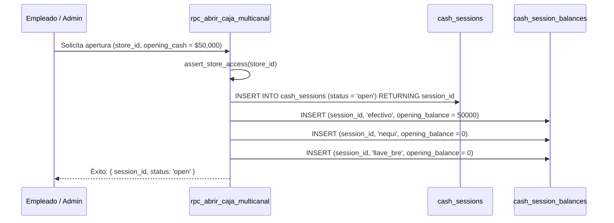
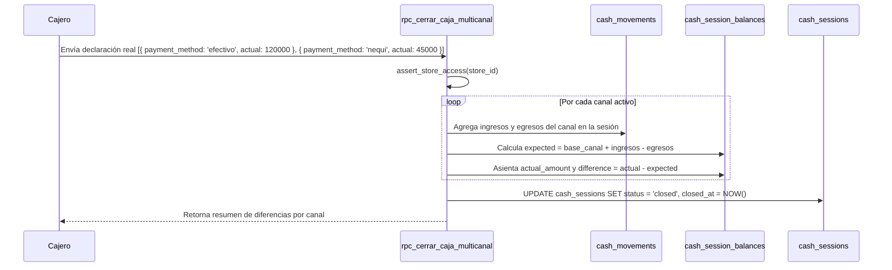
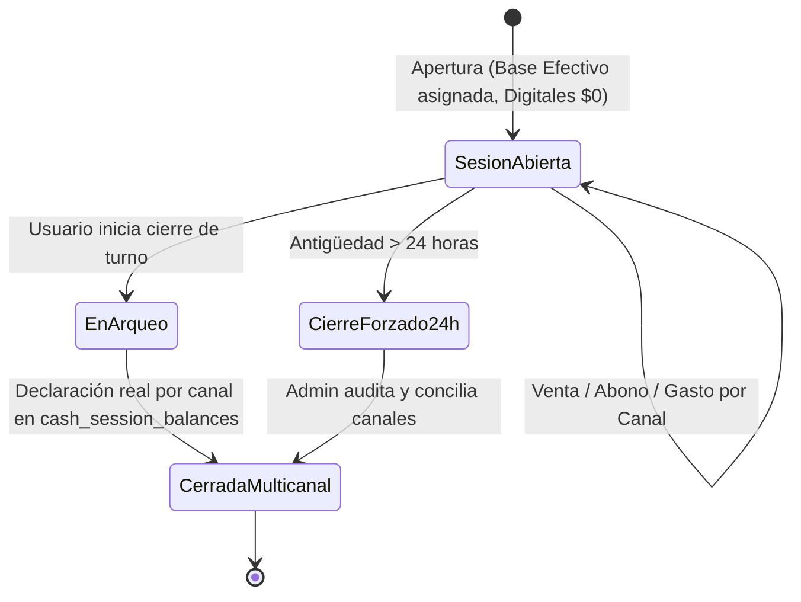
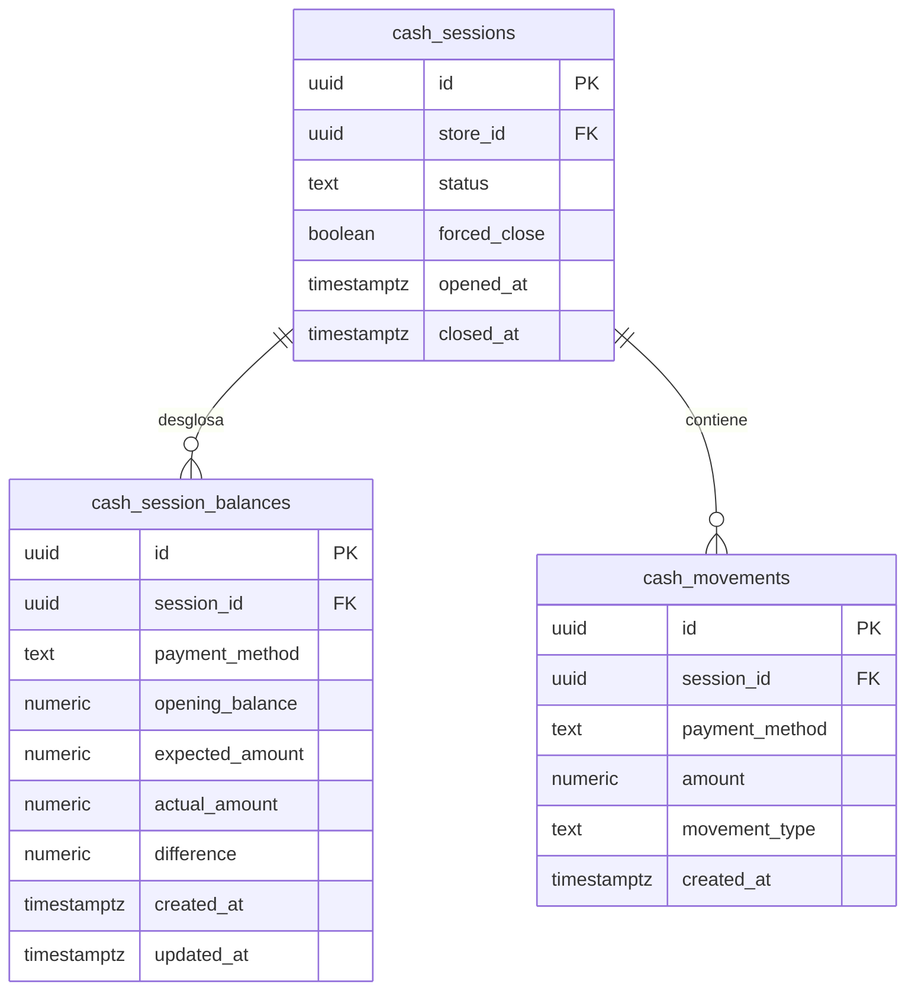

# SDD-020: Control de Caja Multicanal (Físico y Digital)

> **Asociado a:** [FRD-020](../FRD/FRD_020_CAJA_MULTICANAL.md)  
> **Fase del Plan:** Ola 1 — Cimientos de Caja y Gastos  
> **Estado:** 🟠 Aprobado con Deuda Técnica Documentada (Migración `cash_session_balances` pendiente en BD)  
> **Última Actualización:** 2026-10-11  

---

## 0. Contexto y Restricciones Aplicables

### 0.1 Políticas Globales Activadas (ARQ-002)
| Política ID | Dominio | Impacto Concreto en este SDD |
|-------------|---------|------------------------------|
| **POL-FIN-01** | Financiero | **Solidez de Caja:** Cada canal responde exclusivamente por su liquidez real. No se permite compensación ficticia entre efectivo y cuentas digitales. |
| **POL-FIN-02** | Financiero | **Segregación de Canales Monetarios:** Efectivo, Nequi y Llave BRE se inicializan, calculan y concilian de forma independiente. La base inicial de apertura se asigna 100% al Efectivo; canales digitales inician estrictamente en $0. |
| **POL-SEG-01** | Seguridad | **Arqueo Ciego Multicanal:** El sistema no expone el `expected_amount` de ningún canal al usuario antes de registrar los montos reales verificados. |
| **POL-AUTH-01** | Seguridad | **Autorización Centralizada:** Todas las operaciones invocan `assert_store_access` usando el token JWT de Supabase Auth. |

### 0.2 Contratos Vecinos que Limitan el Diseño
| SDD Origen | Restricción Inyectada | Impacto en Caja Multicanal |
|------------|-----------------------|----------------------------|
| **SDD_004 (Control de Caja)** | Unicidad de sesión por tienda. | La apertura y cierre multicanal operan sobre la única sesión `OPEN` activa (`session_id`). |
| **SDD_007 (Ventas y POS)** | Obligatoriedad de canal en ventas. | Toda venta declara `payment_method` e incrementa el canal correspondiente. |
| **SDD_009 (Clientes)** | Abonos con canal obligatorio. | Todo abono a crédito exige canal (`efectivo`, `nequi`, `llave_bre`) e incrementa el saldo esperado de dicho canal en la caja activa. |
| **SDD_026 (Gastos)** | Prevención de sobregiro por canal. | Todo gasto verifica fondos suficientes en su canal específico antes de autorizar el egreso. |

### 0.3 Auditoría de BD contra Realidad (Deuda Técnica Declarada)
*Evidencia cruda obtenida de Supabase Producción (`ihtjocmhzuliwwvdzfnz`):*

```sql
-- Consulta de tablas de balance:
-- SELECT tablename FROM pg_tables WHERE schemaname = 'public' AND tablename LIKE '%balance%'; -> Resultado: []

-- Consulta de columnas en cash_movements:
-- SELECT column_name, data_type FROM information_schema.columns WHERE table_name = 'cash_movements';
-- -> amount (numeric), session_id (uuid), sale_id (uuid), created_at (timestamptz), id (uuid), movement_type (text), description (text)
```

| Hallazgo / Componente | Brecha Real Detectada | Solución Normativa y Trade-off | Condición de Revisión |
|-----------------------|-----------------------|---------------------------------|-----------------------|
| 🔴 **Tabla `cash_session_balances` ausente en BD** | En producción, la migración `20260727000000_multichannel_schema.sql` no ha sido ejecutada. `cash_sessions` opera con un único saldo global. | **Decisión:** Mantener el modelo normativo con `cash_session_balances` para desacoplar canales. Mientras tanto, las RPCs de producción calculan saldo esperado agregando `cash_movements`. | Ejecución formal de la migración `20260727000000_multichannel_schema.sql` en producción. |
| 🔴 **Columna `payment_method` en `cash_movements`** | `cash_movements` en producción no tiene columna `payment_method`. Los pagos se discriminan a través de `sales.payment_method`. | **Decisión:** En el diseño normativo se exige `payment_method` en cada fila de `cash_movements`. El fallback actual vincula `sale_id -> sales.payment_method`. | Adición de columna `payment_method TEXT NOT NULL DEFAULT 'efectivo'` en `cash_movements`. |

---

## 1. Glosario Local

- **Canal de Pago (`payment_method`):** Vía transaccional de liquidez (`efectivo`, `nequi`, `llave_bre`).
- **Balance por Canal (`cash_session_balances`):** Registro granular por sesión que almacena la base inicial, ingresos, egresos, saldo esperado, saldo real y descuadre de un canal determinado.
- **Arqueo Multicanal:** Protocolo de verificación independiente por canal ejecutado al cierre regular o al cierre forzado por caducidad de 24 horas.

---

## 2. Diagramas de Secuencia

### 2.1 Apertura Multicanal con Asignación de Base a Efectivo


### 2.2 Cierre Multicanal (Arqueo Ciego)


---

## 3. Diagramas de Estado



---

## 4. Especificación Detallada de Casos de Uso

### Caso A: Cierre de Turno Multicanal Regular
- **Actor:** Empleado con permiso `canOpenCloseCash`.
- **Precondición:** Sesión de caja en estado `open`. Movimientos registrados en múltiples canales.
- **Flujo Principal:**
  1. El usuario solicita cerrar la sesión activa.
  2. El servidor lista los canales que tuvieron movimientos o saldo base en la sesión.
  3. El usuario reporta el saldo real contado de cada canal de forma independiente sin ver el saldo esperado.
  4. El servidor calcula para cada canal: `expected = opening_balance + ingresos - egresos`.
  5. El servidor calcula la discrepancia individual: `difference = actual - expected`.
  6. Se actualiza el estado de la sesión a `closed` y se guardan los balances en `cash_session_balances`.
- **Postcondición:** Turno cerrado con detalle de diferencias por canal; operaciones monetarias bloqueadas.

### Caso B: Cierre Forzado Multicanal (> 24 Horas)
- **Actor:** Administrador.
- **Precondición:** Turno de caja abierto con antigüedad superior a 24 horas.
- **Flujo Principal:**
  1. El sistema bloquea las ventas y exige conciliación forzada de la sesión caducada.
  2. El Administrador declara los saldos reales verificados para cada canal.
  3. El servidor ejecuta `rpc_reconciliar_cierre_forzado` asentando los balances multicanal con marca `forced_close = true`.
- **Postcondición:** Sesión caducada cerrada y archivada; desbloqueo para abrir nuevo turno.

---

## 5. Contrato de Interfaz

### 5.1 Operación: `rpc_abrir_caja_multicanal`
- **Tipo:** RPC Postgres / Acción (WRITE)
- **Entradas:**
  ```json
  {
    "p_store_id": "UUID (Obligatorio)",
    "p_opening_cash": "NUMERIC >= 0 (Obligatorio, asignado a canal efectivo)"
  }
  ```
- **Salida Exitosa:**
  ```json
  {
    "success": true,
    "data": {
      "session_id": "UUID",
      "status": "open",
      "channels": [
        { "payment_method": "efectivo", "opening_balance": 50000.00 },
        { "payment_method": "nequi", "opening_balance": 0.00 },
        { "payment_method": "llave_bre", "opening_balance": 0.00 }
      ]
    }
  }
  ```
- **Catálogo de Errores:**
  | Código de Error | Causa | Mensaje Técnico |
  |-----------------|-------|-----------------|
  | `STORE_ACCESS_DENIED` | Usuario no pertenece a la tienda | Permisos insuficientes para operar en esta tienda |
  | `SESSION_ALREADY_OPEN` | Ya existe un turno abierto | Ya existe una sesión activa para esta tienda |
  | `INVALID_OPENING_AMOUNT` | Monto negativo | El valor de apertura en efectivo debe ser mayor o igual a cero |

### 5.2 Operación: `rpc_cerrar_caja_multicanal`
- **Tipo:** RPC Postgres / Acción (WRITE)
- **Entradas:**
  ```json
  {
    "p_session_id": "UUID (Obligatorio)",
    "p_balances": [
      { "payment_method": "efectivo", "actual_amount": 125000.00 },
      { "payment_method": "nequi", "actual_amount": 45000.00 },
      { "payment_method": "llave_bre", "actual_amount": 0.00 }
    ]
  }
  ```
- **Salida Exitosa:**
  ```json
  {
    "success": true,
    "data": {
      "session_id": "UUID",
      "status": "closed",
      "closed_at": "TIMESTAMPTZ",
      "balances": [
        { "payment_method": "efectivo", "expected_amount": 120000.00, "actual_amount": 125000.00, "difference": 5000.00 },
        { "payment_method": "nequi", "expected_amount": 45000.00, "actual_amount": 45000.00, "difference": 0.00 },
        { "payment_method": "llave_bre", "expected_amount": 0.00, "actual_amount": 0.00, "difference": 0.00 }
      ]
    }
  }
  ```
- **Catálogo de Errores:**
  | Código de Error | Causa | Mensaje Técnico |
  |-----------------|-------|-----------------|
  | `SESSION_NOT_FOUND` | ID de sesión inválido | Sesión de caja no encontrada |
  | `SESSION_ALREADY_CLOSED` | Turno previamente cerrado | La sesión ya fue cerrada |
  | `MISSING_CHANNEL_DECLARATION` | No se reportó un canal con movimientos | Debe declarar el saldo de todos los canales activos |
  | `NEGATIVE_ACTUAL_AMOUNT` | Saldo real negativo | El monto declarado no puede ser inferior a cero |

---

## 6. Análisis de Seguridad

- **Validación de Acceso:** Uso estricto de `PERFORM public.assert_store_access(v_store_id)`.
- **Protección contra Fuga de Datos de Arqueo:** Los cálculos de `expected_amount` se ejecutan exclusivamente en la transacción de cierre dentro del motor de base de datos; PostgREST no expone endpoints que devuelvan el saldo esperado a clientes antes del cierre.
- **Atomicidad de Conciliación:** La actualización de balances y el sellado de la sesión ocurren en un único bloque de transacción (`BEGIN ... COMMIT`); si falla la escritura de un canal, se ejecuta rollback total.

---

## 7. Modelo de Datos Lógico



### Diccionario de Datos Multicanal
| Tabla | Atributo | Tipo | Nullable | Estado en BD | Descripción |
|-------|----------|------|----------|--------------|-------------|
| `cash_session_balances` | `id` | UUID | NO | 🟠 Deuda (Migración pendiente) | Identificador único del balance por canal |
| `cash_session_balances` | `session_id` | UUID | NO | 🟠 Deuda (Migración pendiente) | Sesión de caja a la que pertenece |
| `cash_session_balances` | `payment_method` | TEXT | NO | 🟠 Deuda (Migración pendiente) | Canal (`efectivo`, `nequi`, `llave_bre`) |
| `cash_session_balances` | `opening_balance`| NUMERIC | NO | 🟠 Deuda (Migración pendiente) | Base inicial (Efectivo > 0, Digitales = 0) |
| `cash_session_balances` | `expected_amount`| NUMERIC | NO | 🟠 Deuda (Migración pendiente) | Saldo calculado por el sistema |
| `cash_session_balances` | `actual_amount`  | NUMERIC | SÍ | 🟠 Deuda (Migración pendiente) | Saldo real declarado en arqueo |
| `cash_session_balances` | `difference`     | NUMERIC | SÍ | 🟠 Deuda (Migración pendiente) | Discrepancia (`actual - expected`) |
| `cash_movements`        | `payment_method` | TEXT | NO | 🟠 Deuda (Migración pendiente) | Canal específico por el cual entró/salió el dinero |
