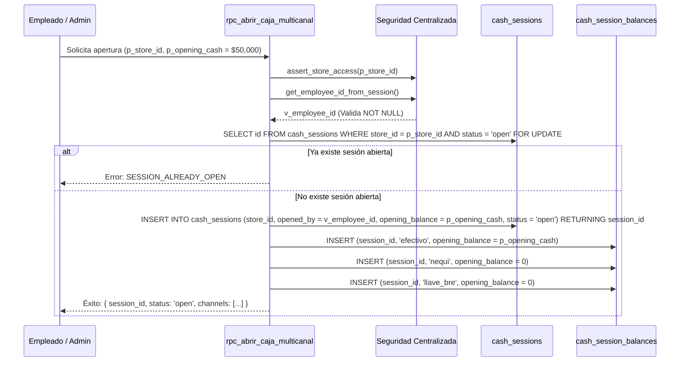
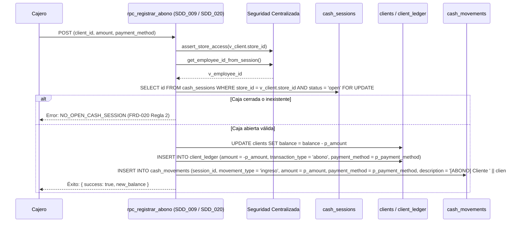
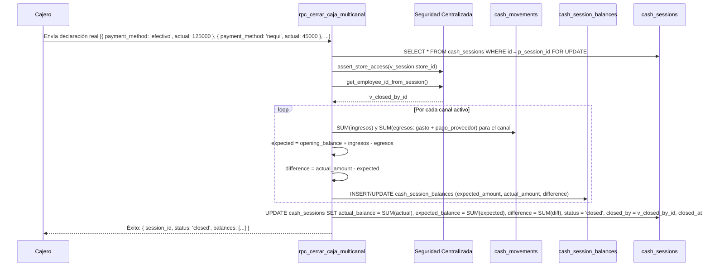
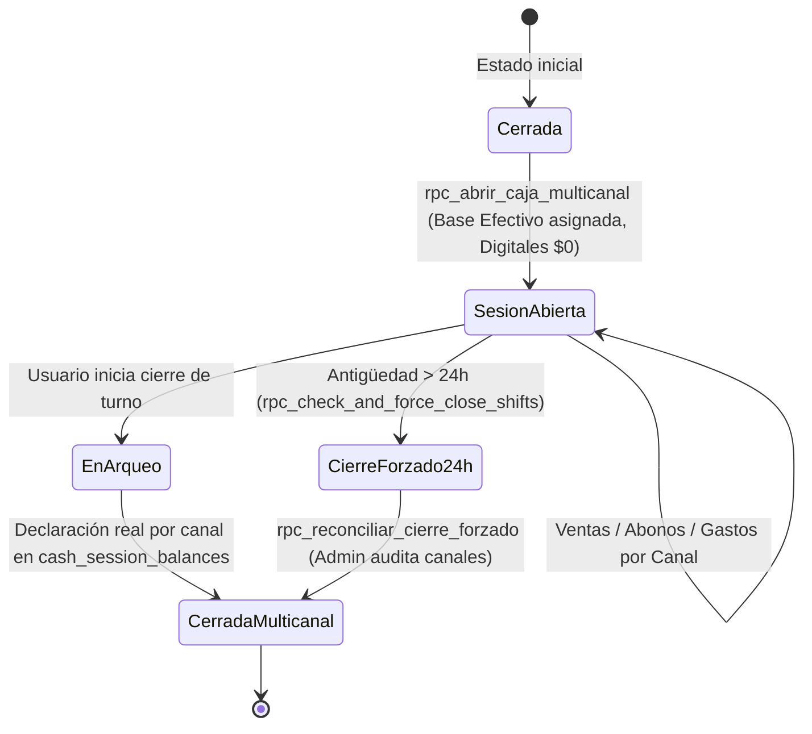
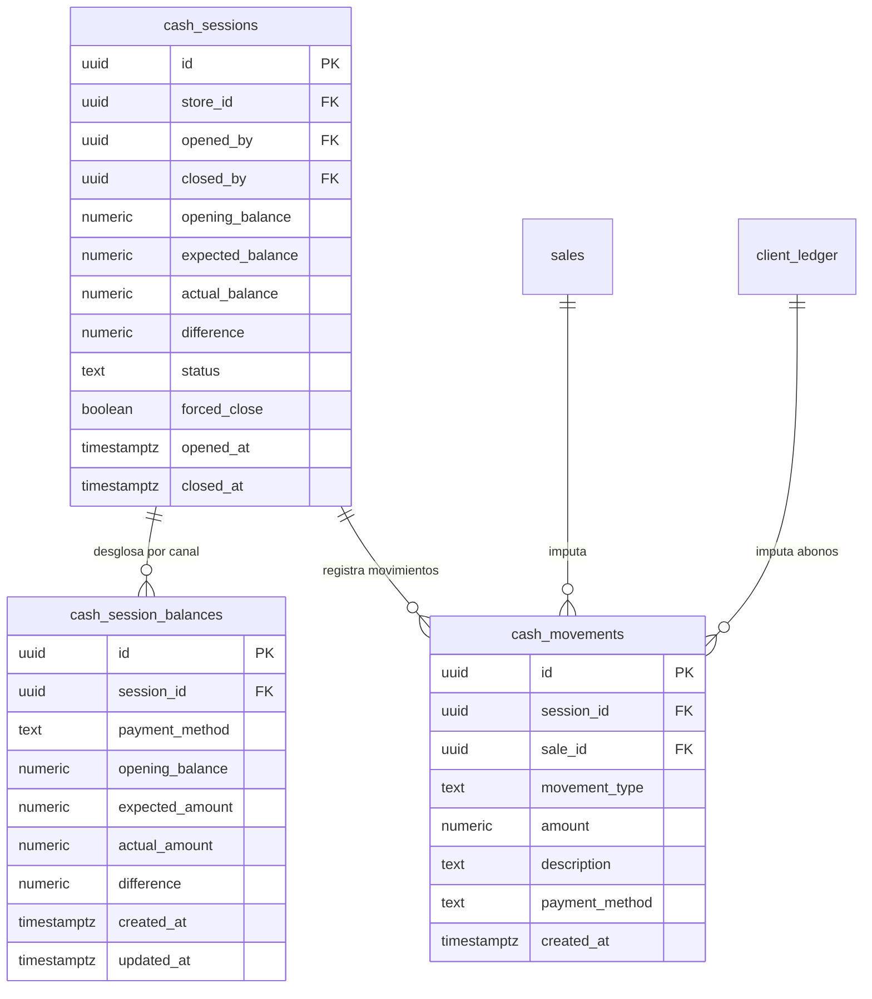

# SDD-020: Control de Caja Multicanal (Físico y Digital)

> **Asociado a:** [FRD-020](../FRD/FRD_020_CAJA_MULTICANAL.md), [FRD-004](../FRD/FRD_004_CONTROL_DE_CAJA.md) y Contrato Marco [SDD-003-01](./SDD_003_01_MATRIZ_PERMISOS_EMPLEADOS.md)  
> **Fase del Plan:** Ola 1 — Cimientos de Caja y Gastos (Alineación `ARQ-002` v1.4)  
> **Estado:** 🟢 Alineado a Contrato Marco `SDD-003-01` (Pendiente migración Fase 3)  
> **Última Actualización:** 2026-11-19  

---

## 0. Contexto y Restricciones Aplicables

### 0.1 Políticas Globales Activadas (`ARQ-002` v1.4)
| Política ID | Dominio | Impacto Concreto en este SDD |
|-------------|---------|------------------------------|
| **POL-FIN-01 / 02** | Financiero | **Caja Dedicada POS y 3 Canales:** Únicos canales válidos: **`efectivo`**, **`nequi`** y **`llave_bre`** (eliminado `'daviplata'` y `'bre'`). Base inicial 100% a `efectivo`; canales digitales inician en `$0`. Pagos fuera de cajón son **"pago externo / fuera de caja"** (`$0` en POS, Admin-only). |
| **POL-SEG-01** | Seguridad | **Arqueo Ciego con Cierre Asistido (3 Intentos):** Prohibido revelar `expected_amount` o `difference` al cajero. Si no coincide, solo avisa que no coincide hasta 3 intentos; al 3.er intento sella y alerta al Admin (`notifications`). |
| **POL-SEG-03** | Seguridad | **Propiedad Estricta del Turno:** Solo el abridor original (`opened_by`) o el Administrador pueden cerrar o conciliar el turno; bloqueado para otros empleados aunque tengan `canOpenCloseCash`. |
| **POL-AUD-01 / 03** | Auditoría | **Inmutabilidad y Snapshot:** Balances y movimientos inmutables con firma histórica (`opened_by_name/role`, `closed_by_name/role`, `actor_name/role`) y alertas de discrepancia al 3.er intento. |
| **SPEC-010 / 011** | Financiero | Enteros COP en `NUMERIC`, cero punto flotante. |

### 0.2 Contratos Vecinos que Limitan el Diseño
| SDD Origen | Restricción Inyectada | Impacto en Caja Multicanal |
|---|---|---|
| **SDD_003_01 / SDD_004** | Propiedad Estricta, Cierre Asistido 3 intentos y snapshot de firma. | Ningún cierre ni respuesta hacia empleados devuelve `expected_amount` ni `difference`. |
| **SDD_007_01 (POS)** | Ventas en `efectivo`, `nequi`, `llave_bre` vs `fiado`/`consumo_personal` (`$0` POS). | Solo ingresos líquidos en los 3 canales válidos alimentan `cash_movements`. |
| **SDD_009 (Cartera)** | Abonos requieren `canFiar` (o Admin) y turno abierto `<24h`. | Imputa ingreso en `cash_movements` con `efectivo`, `nequi` o `llave_bre`. |
| **SDD_022 / 026 (Gastos)** | Gastos menores abiertos a todo usuario activo; 5 categorías OPEX sin `'Reembolso'`. | Valida liquidez por canal (`INSUFFICIENT_CHANNEL_FUNDS`) y estampa `actor_id/name/role`. |
| **SDD_019 (CxP)** | 100% Admin-only; `"pago externo / fuera de caja"` `$0` POS. | Solo pagos internos a proveedor debitan el canal seleccionado en caja. |
| **SDD_021 (Historiales)** | Reportes globales Admin-only; empleado solo ve sus propios movimientos. | `rpc_obtener_historial_caja_multicanal` (Admin) y `rpc_obtener_mis_movimientos_turno` (empleado). |

### 0.3 Auditoría de BD contra Realidad (`SDD-003-01 §0.3`)
- `cash_movements` en producción ya cuenta con `payment_method`, `category`, `voucher_ref` y `actor_id`, pero su `CHECK` usa `('efectivo', 'nequi', 'daviplata', 'bre')` en vez de `('efectivo', 'nequi', 'llave_bre')` (Brecha `B-02`), y carece de `actor_name`/`actor_role` (`B-05`).
- `cash_session_balances` no existe en producción: el desglose por canal se calcula dinámicamente sobre `cash_movements.payment_method`.
- `cash_sessions` requiere `closing_attempts`, `opened_by_name/role`, `closed_by_name/role` y `forced_close_without_count` (`B-03`, `B-05`).

---

## 1. Glosario Local
- **Canales Monetarios Válidos (`payment_method`):** Exclusivamente `'efectivo'`, `'nequi'` y `'llave_bre'`.
- **Propiedad Estricta del Turno:** Solo quien abrió (`opened_by`) o el Administrador pueden cerrar la sesión.
- **Cierre Asistido (3 Intentos):** Validación ciega multicanal hasta 3 intentos con aviso neutro y alerta automática al Admin al 3.er intento fallido.
- **Turno Expirado/Bloqueado (`+24h`):** Resoluble únicamente por el abridor original (Cierre Asistido) o por el Administrador vía Cierre Forzoso (conteo físico opcional).

---

## 2. Diagramas de Secuencia

### 2.1 Apertura Multicanal con Asignación de Base a Efectivo


### 2.2 Registro de Abono a Cartera con Imputación a Caja


### 2.3 Cierre de Turno Multicanal (Arqueo Ciego y Consolidación)


---

## 3. Diagramas de Estado



---

## 4. Especificación Detallada de Casos de Uso (Conforme a FRD-020)

### Caso A: Cierre de Turno Multicanal Regular
- **Actor:** Empleado con permiso de caja (`canOpenCloseCash`).
- **Precondición:** Caja abierta con movimientos en Efectivo y canales digitales.
- **Flujo Principal:**
  1. El usuario solicita cerrar la sesión activa.
  2. El servidor lista los canales activos que tuvieron base o movimientos en la sesión.
  3. El usuario cuenta el dinero físico e ingresa el monto en el campo "Efectivo Real".
  4. El usuario verifica su aplicación móvil (ej. Nequi, Llave Bre-B) e ingresa los montos reales en los campos digitales respectivos.
  5. El usuario confirma el cierre sin haber visto el saldo esperado (Arqueo Ciego).
  6. El sistema calcula las discrepancias individuales por canal (`difference = actual - expected`), persiste en `cash_session_balances`, consolida en `cash_sessions` y bloquea operaciones monetarias.
- **Flujo Alternativo:** Si la sesión ya fue cerrada previamente, el servidor rechaza con código `SESSION_ALREADY_CLOSED`.
- **Postcondición:** Turno cerrado con detalle de diferencias por canal; operaciones monetarias bloqueadas.

### Caso B: Cierre Forzado de Turno Expirado (> 24 Horas)
- **Actor:** Administrador.
- **Precondición:** Existe un turno expirado cerrado automáticamente por el sistema tras superar las 24 horas (`forced_close = true`).
- **Flujo Principal:**
  1. El Administrador inicia sesión en la tienda y el sistema bloquea la navegación desplegando el modal de auditoría de cierre forzado.
  2. El modal solicita el ingreso de los saldos reales verificados para cada canal.
  3. El Administrador declara los saldos reales de Efectivo y canales digitales.
  4. El servidor ejecuta `rpc_reconciliar_cierre_forzado`, asienta los balances en `cash_session_balances`, consolida en `cash_sessions` y libera el bloqueo.
- **Postcondición:** Sesión caducada regularizada; sistema habilitado para abrir un nuevo turno corriente.

### Caso C: Apertura Multicanal con Asignación de Base
- **Actor:** Administrador o empleado autorizado.
- **Precondición:** Caja cerrada para la tienda.
- **Flujo Principal:**
  1. El usuario envía solicitud de apertura declarando el fondo de cambio físico.
  2. El servidor valida permisos mediante `assert_store_access` y `get_employee_id_from_session`.
  3. El servidor inserta la sesión en `cash_sessions` y crea atómicamente los balances en `cash_session_balances`, asignando la base al canal `efectivo` y `$0.00` a los canales digitales.
- **Postcondición:** Caja abierta con canales segregados y POS habilitado.

### Caso D: Registro de Abono de Cliente con Canal
- **Actor:** Cajero o Administrador.
- **Precondición:** Turno de caja en estado `open`. Cliente con deuda pendiente.
- **Flujo Principal:**
  1. El cajero selecciona registrar abono para un cliente, ingresa el monto y selecciona el canal monetario (`efectivo`, `nequi`, etc.).
  2. El servidor verifica que exista una sesión de caja abierta para la tienda.
  3. El servidor reduce la deuda en `clients`, crea registro en `client_ledger` e inserta atómicamente en `cash_movements` con `movement_type = 'ingreso'`.
  4. El saldo esperado del canal seleccionado en la caja activa se incrementa de inmediato.
- **Flujo Alternativo:** Si la caja está cerrada, el servidor rechaza la transacción con código `NO_OPEN_CASH_SESSION`.
- **Postcondición:** Cartera reducida e ingreso asentado en la caja diaria.

---

## 5. Contrato de Interfaz

### 5.1 Operación: `rpc_abrir_caja_multicanal`
- **Tipo:** RPC Postgres / Acción (WRITE)
- **Entradas:**
  ```json
  {
    "p_store_id": "UUID (Obligatorio)",
    "p_opening_cash": "NUMERIC >= 0 (Obligatorio, asignado a canal efectivo)"
  }
  ```
- **Salida Exitosa:**
  ```json
  {
    "success": true,
    "data": {
      "session_id": "UUID",
      "status": "open",
      "channels": [
        { "payment_method": "efectivo", "opening_balance": 50000.00 },
        { "payment_method": "nequi", "opening_balance": 0.00 },
        { "payment_method": "llave_bre", "opening_balance": 0.00 }
      ]
    }
  }
  ```
- **Catálogo de Errores:**
  | Código de Error | Causa | Mensaje Técnico |
  |-----------------|-------|-----------------|
  | `STORE_ACCESS_DENIED` | Usuario no pertenece a la tienda | Permisos insuficientes para operar en esta tienda |
  | `EMPLOYEE_SESSION_REQUIRED` | No hay sesión de empleado o pase aprobado | Se requiere un empleado activo o pase diario válido para operar la caja |
  | `SESSION_ALREADY_OPEN` | Ya existe una sesión abierta | Ya existe una sesión activa para esta tienda |
  | `INVALID_OPENING_AMOUNT` | Monto negativo | El valor de apertura en efectivo debe ser mayor o igual a cero |

### 5.2 Operación: `rpc_cerrar_caja_multicanal`
- **Tipo:** RPC Postgres / Acción (WRITE)
- **Entradas:**
  ```json
  {
    "p_session_id": "UUID (Obligatorio)",
    "p_balances": [
      { "payment_method": "efectivo", "actual_amount": 125000.00 },
      { "payment_method": "nequi", "actual_amount": 45000.00 },
      { "payment_method": "llave_bre", "actual_amount": 0.00 }
    ]
  }
  ```
- **Salida Exitosa:**
  ```json
  {
    "success": true,
    "data": {
      "session_id": "UUID",
      "status": "closed",
      "closed_at": "TIMESTAMPTZ",
      "consolidated": {
        "expected_balance": 165000.00,
        "actual_balance": 170000.00,
        "difference": 5000.00
      },
      "balances": [
        { "payment_method": "efectivo", "expected_amount": 120000.00, "actual_amount": 125000.00, "difference": 5000.00 },
        { "payment_method": "nequi", "expected_amount": 45000.00, "actual_amount": 45000.00, "difference": 0.00 },
        { "payment_method": "llave_bre", "expected_amount": 0.00, "actual_amount": 0.00, "difference": 0.00 }
      ]
    }
  }
  ```
- **Catálogo de Errores:**
  | Código de Error | Causa | Mensaje Técnico |
  |-----------------|-------|-----------------|
  | `STORE_ACCESS_DENIED` | Usuario no autorizado para la tienda | El usuario no tiene acceso a esta tienda |
  | `SESSION_NOT_FOUND` | ID de sesión inexistente | Sesión de caja no encontrada |
  | `SESSION_ALREADY_CLOSED` | Turno previamente cerrado | La sesión ya fue cerrada previamente |
  | `MISSING_CHANNEL_DECLARATION` | Canal activo omitido en el payload | Debe declarar el saldo de todos los canales activos |
  | `NEGATIVE_ACTUAL_AMOUNT` | Saldo real menor a cero | El monto declarado no puede ser inferior a cero |

### 5.3 Operación: `rpc_reconciliar_cierre_forzado` (Multicanal)
- **Tipo:** RPC Postgres / Acción (WRITE)
- **Entradas:**
  ```json
  {
    "p_session_id": "UUID (Obligatorio)",
    "p_balances": [
      { "payment_method": "efectivo", "actual_amount": 80000.00 },
      { "payment_method": "nequi", "actual_amount": 20000.00 }
    ]
  }
  ```
- **Salida Exitosa:**
  ```json
  {
    "success": true,
    "data": {
      "session_id": "UUID",
      "reconciled": true,
      "balances": [...]
    }
  }
  ```

### 5.4 Dualidad Operativa y Capa de Compatibilidad Física
Mientras se despliega la tabla `cash_session_balances` en producción, el backend mantiene activas las operaciones escalares monolíticas de `SDD_004`:
- `abrir_caja(p_store_id, p_opening_balance)`
- `cerrar_caja(p_session_id, p_actual_balance)`

---

## 6. Análisis de Seguridad

- **Funciones Centralizadas de Autorización:**
  Toda mutación de balance o estado de sesión invoca obligatoriamente la función centralizada de seguridad `assert_store_access(v_store_id)` para garantizar que el usuario autenticado tiene permisos sobre la tienda activa antes de procesar cualquier cambio.
- **Resolución Autoritativa de Identidad y Guardia Anti-Nulos:**
  Para evitar violaciones opacas de llave foránea en `cash_sessions.opened_by` (`NOT NULL`), la resolución de identidad del cajero se realiza autoritativamente mediante `get_employee_id_from_session()`. En caso de retornar `NULL`, se aplica una validación de fallback para verificar si el usuario autenticado figura en `admin_profiles` (asignando `auth.uid()`); de lo contrario, el sistema rechaza la operación de forma explícita lanzando la excepción `EMPLOYEE_SESSION_REQUIRED`.
- **Aislamiento Multi-Tenant y Políticas RLS Centralizadas:**
  Las consultas directas y políticas RLS sobre `cash_sessions`, `cash_movements` y `cash_session_balances` emplean obligatoriamente la función centralizada `get_current_store_id()` para filtrar el acceso por `store_id`, previniendo fugas entre tiendas sin reimplementar subconsultas ad-hoc.
- **Garantía de Privilegios Base en Tablas Nuevas (Regla 8):**
  La migración DDL que cree la tabla `cash_session_balances` debe otorgar explícitamente privilegios completos (`GRANT ALL`) a los roles `anon`, `authenticated` y `service_role` para evitar errores 42501 (Permission Denied) en Supabase Cloud.
- **Protección contra Fuga de Datos de Arqueo:**
  Los cálculos de `expected_amount` se ejecutan exclusivamente dentro de la transacción interna de base de datos durante el cierre o reconciliación; la API pública y PostgREST no exponen endpoints ni vistas que retornen el saldo esperado a los clientes antes de que estos declaren sus montos reales contados.

---

## 7. Modelo de Datos Lógico



### Diccionario de Datos Multicanal
| Tabla | Atributo | Tipo Físico | Nullable | Estado en BD | Descripción |
|-------|----------|-------------|----------|--------------|-------------|
| `cash_session_balances` | `id` | UUID | NO | 🟠 Deuda (Migración pendiente) | Identificador único del balance por canal |
| `cash_session_balances` | `session_id` | UUID | NO | 🟠 Deuda (Migración pendiente) | Sesión de caja vinculada (FK a `cash_sessions`) |
| `cash_session_balances` | `payment_method` | TEXT | NO | 🟠 Deuda (Migración pendiente) | Canal monetario (`efectivo`, `nequi`, `llave_bre`) |
| `cash_session_balances` | `opening_balance`| NUMERIC | NO | 🟠 Deuda (Migración pendiente) | Base inicial asignada (Efectivo >= 0, Digitales = $0) |
| `cash_session_balances` | `expected_amount`| NUMERIC | NO | 🟠 Deuda (Migración pendiente) | Saldo calculado (`base + ingresos - egresos`) |
| `cash_session_balances` | `actual_amount`  | NUMERIC | SÍ | 🟠 Deuda (Migración pendiente) | Saldo real declarado en arqueo ciego (NULL hasta cierre) |
| `cash_session_balances` | `difference`     | NUMERIC | SÍ | 🟠 Deuda (Migración pendiente) | Descuadre (`actual_amount - expected_amount`) |
| `cash_movements`        | `payment_method` | TEXT | NO | 🟠 Deuda (Migración pendiente) | Canal específico por el cual ingresó o egresó el dinero |
| `cash_movements`        | `description`    | TEXT | NO | ✅ Verificado en BD | Motivo descriptivo obligatorio (NOT NULL en BD real) |
