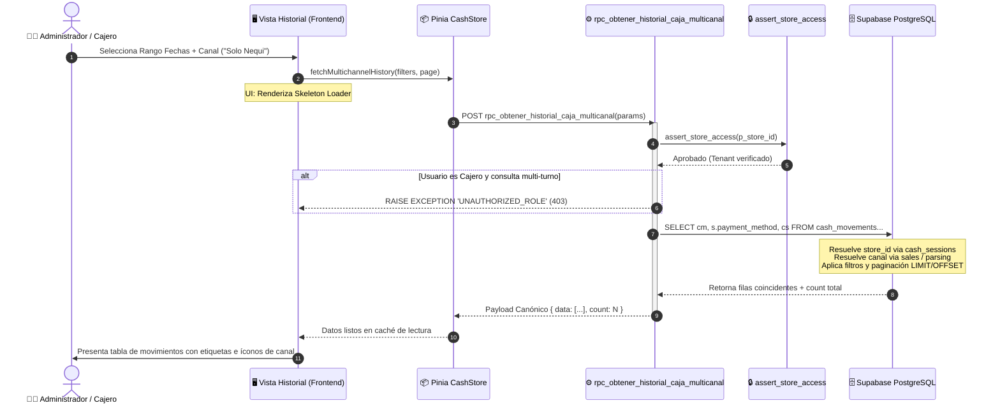
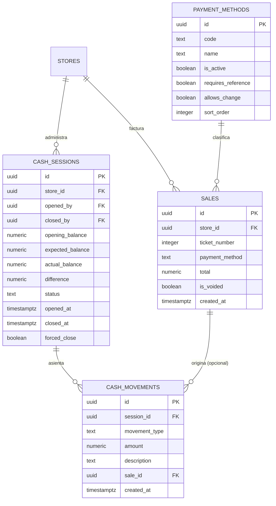

# SDD-021: Auditoría de Movimientos Multicanal (Filtros por Método de Pago en Historiales)

> **Asociado a:** [FRD-021](../FRD/FRD_021_HISTORIALES_MULTICANAL.md)  
> **Fase del Plan:** Ola 4: Reportes, Auditoría y Cuentas por Pagar (Ítem 2)  
> **Estado:** 🟢 Aprobado y Sanitizado (Protocolo PAC-SDD v2.0)  
> **Última Actualización:** 2026-10-16  

---

## 0. Alcance y Restricciones Aplicables (PEA-N)

### 0.1 Políticas Globales Activadas (ARQ-002)

| Política ID | Dominio | Impacto Concreto en este SDD |
| :--- | :--- | :--- |
| **POL-AUTH-01** | Multi-tenant | Aislamiento multi-tenant obligatorio. Invocación mandatoria de `assert_store_access(p_store_id)` como instrucción #1 incondicional en `rpc_obtener_historial_caja_multicanal`, y restricción de consulta mediante predicado `cs.store_id = p_store_id` y políticas RLS gobernadas por `get_current_store_id()`. |
| **POL-AUD-01** | Auditoría | Inviolabilidad Histórica. Todo movimiento asentado en `cash_movements` es de solo lectura (READ-ONLY) y de naturaleza append-only inmutable. El módulo de historiales carece de facultades DML de edición (`UPDATE`) o borrado (`DELETE`). |
| **POL-AUD-02** | Auditoría | Trazabilidad por Canal Monetario. La auditoría de caja debe permitir desglosar y filtrar transacciones según el medio de pago utilizado (`efectivo`, `nequi`, `daviplata`, `digitales`, `all`), garantizando la verificación independiente frente a extractos bancarios. |
| **POL-FIN-01** | Finanzas | Fidelidad al Flujo de Liquidez. El historial de caja audita exclusivamente la liquidez real que ingresó o egresó de la caja. Las ventas a crédito (fiados) aportan $0 al flujo monetario y se omiten de los ingresos de caja hasta que se efectúe un abono. |
| **POL-FIN-02** | Finanzas | Desacoplamiento de Flujo de Caja y P&L Devengado. Para preservar la pureza contable de `SDD_018`, las entradas por abono de cartera se etiquetan con `origin_type = 'abono'`, consolidándose visualmente como ingreso de liquidez en caja sin duplicar las ventas operacionales devengadas. |
| **POL-SEC-01** | Seguridad | Control de Acceso RBAC y Blindaje de Arqueo Ciego. Los cajeros están restringidos estrictamente a consultar los movimientos atómicos de su propio turno activo abierto (`status = 'open'`), sin acceso a métricas globales ni totales esperados. Las consultas multi-turno o rangos históricos amplios son exclusivas de Administradores (`admin_profiles`). |
| **SPEC-010 / SPEC-011** | Estándar Financiero | Moneda entera legal COP sin decimales. Cero cálculos financieros en el cliente frontend. Formateo y redondeo certificado exclusivamente en backend. |

---

### 0.2 Contratos Vecinos que Limitan el Diseño

| SDD Origen | Restricción Inyectada | Impacto Técnico en Historiales Multicanal |
| :--- | :--- | :--- |
| **SDD_004 / SDD_020 (Caja Multicanal)** | `cash_sessions` opera con 12 columnas físicas y `cash_movements` con 7 columnas físicas. Toda transacción monetaria se asienta vinculada a un `session_id`. | Los historiales resuelven la tienda mediante JOIN con `cash_sessions.store_id` y consumen los movimientos físicos de `cash_movements`. |
| **SDD_027_01 (Reportes de Caja)** | Dicotomía Operativo vs Forense y Contrato de Paginación Canónica `{ data, count }`. | `get_history_caja` gobierna la lista macro de turnos agregados; `rpc_obtener_historial_caja_multicanal` proporciona el detalle micro de transacciones por canal. |
| **SDD_027_02 (Límite 24 Horas)** | Caducidad automática de turnos a las 24 horas y marcado `forced_close = true`. | Los movimientos de turnos expirados o forzados quedan sellados e identificados como turnos cerrados en las consultas de auditoría. |
| **SDD_022 / SDD_026 (Gastos Multicanal)** | Egresos OPEX y pagos a proveedores en `cash_movements` (`gasto`, `pago_proveedor`) con etiquetas de canal estructuradas en `description`. | La extracción multicanal parsea la etiqueta de canal en `description` para egresos no vinculados a una venta (`sale_id IS NULL`), con fallback a `'efectivo'`. |
| **SDD_007 / SDD_007_01 (Ventas y POS)** | Ventas de contado y transferencias asientan `sales.payment_method` (`efectivo`, `nequi`, `daviplata`, `fiado`) y generan fila en `cash_movements` con `sale_id`. | El canal de las ventas se extrae directamente mediante LEFT JOIN con `sales.payment_method`. |
| **SDD_009 / SDD_024 (Clientes y Fiados)** | Recaudo de cartera (`rpc_registrar_abono`) asienta `movement_type = 'ingreso'` con `sale_id = NULL` y etiqueta de canal en `description`. | Los abonos aparecen catalogados como ingresos de liquidez con `origin_type = 'abono'`, respetando los filtros de método de pago. |
| **SDD_005 (Trazabilidad)** | Inviolabilidad append-only absoluta de registros históricos. | La consulta de historiales opera exclusivamente bajo modo de lectura (READ-ONLY) sin bloqueos pesimistas. |

---

### 0.3 Auditoría de Base de Datos contra Realidad (Reglas 2, 4 y 8)

1. **Esquema Físico Real de `cash_movements` (Regla 2):**
   - Verificado mediante consulta a `information_schema.columns` en Supabase Producción (`ihtjocmhzuliwwvdzfnz`).
   - La tabla física `cash_movements` contiene exactamente **7 columnas**: `id` (uuid), `session_id` (uuid), `movement_type` (text), `amount` (numeric), `description` (text), `sale_id` (uuid), `created_at` (timestamptz).
   - **Hallazgo Anti-Alucinación Crítico:** La versión preliminar de SDD-021 alucinó la existencia de las columnas físicas `payment_method` y `store_id` en `cash_movements`. La base de datos real carece de ambas columnas.
   - **Resolución Arquitectural:**
     * `store_id` se resuelve mediante `JOIN cash_sessions cs ON cs.id = cm.session_id WHERE cs.store_id = p_store_id`.
     * `payment_method` se resuelve mediante `LEFT JOIN sales s ON s.id = cm.sale_id` para transacciones de venta. Para transacciones sin venta directa (`sale_id IS NULL`), se extrae de la etiqueta estructurada en `cm.description` (ej. `[CANAL:nequi]`), aplicando fallback determinista a `'efectivo'`.
     * Se formaliza bajo la Regla 7 la Deuda Técnica D-1 de persistencia física en `cash_movements`.

2. **Privilegios Base de Esquema (Regla 8):**
   - Se verificó en `information_schema.table_privileges` que la tabla de catálogo `payment_methods` carecía de permisos `SELECT` para los roles `anon` y `authenticated` (error 42501).
   - Se ejecutó remediación en base de datos otorgando `GRANT SELECT ON TABLE public.payment_methods TO anon, authenticated, service_role;` y `GRANT ALL ON TABLE public.payment_methods TO service_role;`.
   - Se confirmó mediante `has_table_privilege`: `anon_select = true`, `auth_select = true`, `service_select = true`.

3. **Reutilización de Funciones Centralizadas de Seguridad (Regla 4):**
   - La función `rpc_obtener_historial_caja_multicanal` incorpora obligatoriamente como instrucción #1:
     `PERFORM public.assert_store_access(p_store_id);`
   - Se erradicó cualquier invocación tautológica del tipo `assert_store_access(get_current_store_id())`, asegurando la verificación explícita del parámetro de tienda suministrado frente al contexto de autenticación.

---

### 0.4 Riesgos de Impacto Cruzado Identificados (Regla 6)

Se evaluaron las 34 funciones de `pg_proc` que referencian `cash_movements`, `cash_sessions`, `payment_methods`, `sales` y `client_ledger`, auditando N=5 riesgos de impacto cruzado:

1. **Riesgo 1 (Coexistencia con `get_history_caja`):** `get_history_caja` opera a nivel macro agregando turnos cerrados (`cash_sessions`). `rpc_obtener_historial_caja_multicanal` opera a nivel micro desglosando transacciones atómicas individuales. No existe conflicto de nombres ni solapamiento destructivo.
2. **Riesgo 2 (Parsing en `description` para Movimientos No-Venta):** Movimientos históricos de gastos o abonos podrían carecer de etiqueta digital. Se mitiga mediante fallback determinista a `'efectivo'`, evitando la pérdida o exclusión accidental de registros.
3. **Riesgo 3 (Desempeño y Carga en Base de Datos):** Consultas amplias con JOINs y parsing textual sobre tablas en crecimiento podrían degradar el servidor. Se mitiga implementando paginación obligatoria (`p_limit`, `p_offset`), scoping primario por `session_id` y restricción RBAC para consultas multi-turno.
4. **Riesgo 4 (Consolidación de Flujo de Caja vs P&L Operacional):** La consolidación de ventas y abonos como ingresos en caja (Regla 1 de FRD-021) no debe distorsionar el P&L devengado de `SDD_018`. Se mitiga etiquetando explícitamente el atributo `origin_type` (`'venta'` vs `'abono'`) en la respuesta.
5. **Riesgo 5 (Heterogeneidad de Códigos de Pago):** Discrepancia entre `payment_methods.code` (`'cash'`) y `sales.payment_method` (`'efectivo'`). Se resuelve mediante normalización canónica bidireccional en el RPC, admitiendo `'all'`, `'efectivo'`, `'digitales'`, `'nequi'` y `'daviplata'`.

---

## 1. Especificación de Requisitos (Derivada de FRD-021)

### 1.1 Reglas de Negocio Vinculantes

1. **RN-021-01 (Visibilidad Total de Ingresos):** La vista de auditoría de caja DEBE consolidar las ventas (en efectivo y transferencias digitales) y los abonos de cartera de clientes bajo la categoría unificada de "ingresos de liquidez", permitiendo auditar la totalidad del dinero que ingresó a la tienda.
2. **RN-021-02 (Filtros Obligatorios por Canal):** El motor de historiales DEBE ofrecer un filtro primario con tres modalidades excluyentes:
   - *"Todos los movimientos":* Consolida transacciones físicas y electrónicas de ingresos y egresos.
   - *"Solo Efectivo":* Filtra exclusivamente transacciones que impactaron el dinero físico de la gaveta.
   - *"Solo Digitales":* Filtra transacciones electrónicas, permitiendo una sub-selección específica: *"Solo Nequi"* o *"Solo Daviplata"*.
3. **RN-021-03 (Identificación Visual y Desglose de Canal):** Cada registro en el historial DEBE identificar de forma inequívoca el método de pago utilizado (`efectivo`, `nequi`, `daviplata`), su tipo de operación (`ingreso`, `gasto`, `pago_proveedor`) y su origen transaccional (`venta`, `abono`, `gasto_opex`, `abono_proveedor`).
4. **RN-021-04 (Filtro Temporal Combinable):** El historial de caja DEBE permitir acotar la consulta a un turno específico (`p_session_id`) o a un rango de fechas (`p_start_date` a `p_end_date`). Los filtros de método de pago y el filtro temporal DEBEN ser combinables de manera simultánea (ej. *"Solo Nequi en los últimos 3 días"*).

---

### 1.2 Casos de Uso del Negocio

#### Caso A: Filtrar Ingresos de Nequi para Conciliación Digital (FRD-021 Caso A)
- **Actor:** Administrador / Propietario.
- **Precondición:** Existen movimientos de efectivo, transferencias digitales y egresos registrados en el historial.
- **Flujo Principal:**
  1. El Administrador ingresa al módulo de auditoría de caja.
  2. Selecciona un rango de fechas (ej. *"Lunes a Miércoles de la semana actual"*).
  3. Selecciona el filtro primario *"Digitales"*.
  4. Selecciona el sub-filtro específico *"Nequi"*.
  5. El sistema ejecuta `rpc_obtener_historial_caja_multicanal` validando permisos administrativos y pertenencia a la tienda.
  6. El sistema retorna la lista paginada de todas las ventas, abonos y egresos pagados mediante Nequi dentro del rango seleccionado, junto con el total de registros para paginación (`count`).
  7. El Administrador contrasta la lista contra el extracto de movimientos en la aplicación móvil de Nequi, verificando la coincidencia de montos y referencias.
- **Postcondición:** Conciliación digital efectuada exitosamente sin interferencia de dinero en efectivo.

#### Caso B: Auditoría de Efectivo de Turno Activo por el Cajero
- **Actor:** Cajero / Usuario Operativo.
- **Precondición:** Turno de caja en estado `open`. El cajero desea revisar los cobros en efectivo realizados durante su jornada.
- **Flujo Principal:**
  1. El cajero accede a la pestaña de movimientos en su terminal de caja.
  2. El sistema detecta su sesión activa y envía `p_session_id` al RPC.
  3. El cajero selecciona el filtro *"Solo Efectivo"*.
  4. El servidor valida que la sesión corresponda al usuario autenticado y retorna únicamente los movimientos de efectivo del turno.
  5. El sistema presenta el desglose sin mostrar saldos teóricos esperados ni acumulados de cuadre (preservación de arqueo ciego).
- **Postcondición:** Cajero visualiza sus cobros individuales en efectivo sin comprometer la seguridad del arqueo ciego.

---

### 1.3 Criterios de Aceptación (Conforme a FRD-021)

- [x] **CA-FRD-021-01:** Existen filtros funcionales en el backend para: "Todo", "Solo Efectivo" y "Solo Digitales" (con subfiltros específicos para "Nequi" y "Daviplata").
- [x] **CA-FRD-021-02:** Los abonos de cartera de clientes aparecen en el historial de caja respetando estrictamente los filtros de método de pago seleccionados.
- [x] **CA-FRD-021-03:** Cada registro del historial incluye la identificación explícita del método de pago, el tipo de movimiento y el subtipo transaccional de origen.
- [x] **CA-FRD-021-04:** El historial de caja ofrece un filtro temporal combinable simultáneamente con los filtros de canal monetario, retornando la estructura canónica paginada `{ data, count }`.

---

## 2. Arquitectura de Datos y Flujo Unidireccional

### 2.1 Diagrama de Secuencia General (Mermaid)



---

### 2.2 Principio de Autoridad del Backend y Flujo Unidireccional

1. **El Frontend NO Clasifica Canales:** El cliente tiene estrictamente prohibido aplicar lógica heurística en memoria para deducir el canal de un movimiento. Toda resolución de canal (`efectivo`, `nequi`, `daviplata`) es computada y sellada por el backend en el payload de salida.
2. **El Frontend NO Calcula Conteos de Paginación:** El cliente no deduce el total de páginas acumulando registros. El cálculo de `count` para paginación es responsabilidad matemática exclusiva de PostgreSQL.
3. **Caché Efímera:** El store de Pinia actúa exclusivamente como una proyección temporal de lectura de la verdad del servidor. Toda alteración de filtros o cambio de página invoca nuevamente al backend.

---

## 3. Seguridad, RBAC y Aislamiento Multi-Tenant

### 3.1 Aislamiento Multi-Tenant (Reglas 4 y 8)

- **Instrucción #1 Mandatoria:** Todo procedimiento de historial de caja ejecuta en su primera línea:
  `PERFORM public.assert_store_access(p_store_id);`
  garantizando que ninguna transacción de otra tienda pueda ser consultada ni enumerada.
- **Scoping Estricto por Tienda:** La consulta cruza `cash_movements` con `cash_sessions` imponiendo la cláusula innegociable `WHERE cs.store_id = p_store_id`.
- **Privilegios de Esquema (Regla 8):** Las tablas consultadas (`cash_movements`, `cash_sessions`, `sales`, `payment_methods`) cuentan con permisos `SELECT` otorgados formalmente a `authenticated` y `service_role`.

---

### 3.2 Matriz de Control de Acceso (RBAC) y Arqueo Ciego

| Operación / Alcance | Cajero Operativo | Administrador / Dueño | Mecanismo de Control |
| :--- | :---: | :---: | :--- |
| **Movimientos de Turno Activo Propio** | ✅ Permitido | ✅ Permitido | Valida que `cs.opened_by = get_employee_id_from_session()` y `cs.status = 'open'`. Oculta saldos esperados. |
| **Movimientos de Turnos Cerrados Propios** | ❌ Denegado | ✅ Permitido | Restringido para preservar la ceguera post-cierre; solo admin audita históricos. |
| **Historial Multi-Turno / Rango de Fechas** | ❌ Denegado | ✅ Permitido | Valida membresía en `admin_profiles` (`admin`, `owner`). Lanza `UNAUTHORIZED_ROLE` si es cajero. |
| **Filtro por Canales Digitales (Nequi/Daviplata)** | ✅ En turno propio | ✅ Histórico global | Filtro normalizado en capa de consulta. |

---

### 3.3 Inviolabilidad Histórica (Append-Only)

- La función `rpc_obtener_historial_caja_multicanal` opera exclusivamente bajo privilegios de LECTURA (READ-ONLY).
- No ejecuta ninguna mutación `INSERT`, `UPDATE` o `DELETE` sobre las tablas del sistema.
- Se ejecuta bajo nivel de aislamiento estándar `READ COMMITTED` sin adquirir bloqueos pesimistas (`FOR UPDATE`), evitando contención con el motor de ventas del POS.

---

## 4. Casos Límite y Concurrencia (Regla 5 de AGENTS.md)

| ID | Escenario de Caso Límite | Comportamiento del Motor / Backend | Código de Excepción / Error | Respuesta Visual en UI |
| :--- | :--- | :--- | :--- | :--- |
| **CL-01** | **Cajero intenta consultar historiales de días pasados** | Detecta que `auth.uid()` no pertenece a `admin_profiles` y que `p_session_id` no coincide con su turno activo. | `UNAUTHORIZED_ROLE` | Toast rojo: *"Acceso restringido. Solo los administradores pueden consultar historiales consolidados o turnos pasados."* |
| **CL-02** | **Movimiento no-venta sin etiqueta de canal en `description`** | El parser detecta `sale_id IS NULL` y ausencia de patrón regex. Aplica fallback automático a `'efectivo'`. | Consulta Exitosa (HTTP 200) | La fila se presenta catalogada como *"Efectivo"* con ícono de gaveta física. |
| **CL-03** | **Rango de fechas invertido (`start_date > end_date`)** | El backend valida la consistencia cronológica de los parámetros temporales antes de ejecutar la consulta. | `INVALID_DATE_RANGE` | Banner de advertencia: *"La fecha inicial no puede ser posterior a la fecha final de consulta."* |
| **CL-04** | **Turno especificado inexistente o de otra tienda** | La consulta filtra por `cs.store_id = p_store_id AND cs.id = p_session_id`. Al no hallar coincidencia, retorna conjunto vacío. | Retorno Vacío `{ data: [], count: 0 }` | Estado vacío amigable: *"No se encontraron movimientos registrados para la sesión seleccionada."* |
| **CL-05** | **Filtro de canal sin transacciones en el periodo** | El filtro `p_payment_method` no encuentra filas coincidentes en el rango temporal consultado. | Retorno Vacío `{ data: [], count: 0 }` | Mensaje informativo: *"No existen transacciones registradas mediante [Canal] en este rango de fechas."* |
| **CL-06** | **Consulta masiva simultánea durante pico de ventas en POS** | La consulta de historial ejecuta `SELECT` puro sin locks. El motor transaccional del POS sigue insertando ventas concurrentemente. | Consulta Exitosa Concurrente | El historial retorna una instantánea consistente en tiempo de ejecución sin ralentizar el cobro en caja. |

---

## 5. Contrato de Interfaz

### 5.1 Operación: `rpc_obtener_historial_caja_multicanal`

- **Tipo:** RPC Postgres / Consulta Paginada (READ)
- **Propósito:** Retornar el listado histórico de movimientos de caja desglosados y filtrados por método de pago y rango temporal o de turno.

#### 5.1.1 Payload de Entrada (Request JSON Schema)

```json
{
  "$schema": "http://json-schema.org/draft-07/schema#",
  "title": "RpcObtenerHistorialCajaMulticanalInput",
  "type": "object",
  "properties": {
    "p_store_id": {
      "type": "string",
      "format": "uuid",
      "description": "Identificador único de la tienda (Obligatorio, validado con assert_store_access)"
    },
    "p_session_id": {
      "type": ["string", "null"],
      "format": "uuid",
      "description": "Identificador de la sesión de caja específica (Opcional, obligatorio si el invocador es cajero)"
    },
    "p_payment_method": {
      "type": ["string", "null"],
      "enum": ["all", "efectivo", "digitales", "nequi", "daviplata", null],
      "default": "all",
      "description": "Filtro de canal monetario. 'digitales' consolida nequi y daviplata."
    },
    "p_start_date": {
      "type": ["string", "null"],
      "format": "date-time",
      "description": "Fecha y hora inicial del rango de auditoría (Opcional, exclusivo de Administrador)"
    },
    "p_end_date": {
      "type": ["string", "null"],
      "format": "date-time",
      "description": "Fecha y hora final del rango de auditoría (Opcional, exclusivo de Administrador)"
    },
    "p_limit": {
      "type": "integer",
      "minimum": 1,
      "maximum": 200,
      "default": 50,
      "description": "Cantidad máxima de movimientos a retornar por página"
    },
    "p_offset": {
      "type": "integer",
      "minimum": 0,
      "default": 0,
      "description": "Desplazamiento de registros para paginación server-side"
    }
  },
  "required": ["p_store_id"],
  "additionalProperties": false
}
```

---

#### 5.1.2 Payload de Respuesta Exitosa (Response Success JSON Schema)

```json
{
  "$schema": "http://json-schema.org/draft-07/schema#",
  "title": "RpcObtenerHistorialCajaMulticanalSuccessResponse",
  "type": "object",
  "properties": {
    "success": {
      "type": "boolean",
      "const": true
    },
    "data": {
      "type": "array",
      "items": {
        "type": "object",
        "properties": {
          "id": {
            "type": "string",
            "format": "uuid",
            "description": "Identificador único del movimiento en cash_movements"
          },
          "session_id": {
            "type": "string",
            "format": "uuid",
            "description": "Identificador de la sesión de caja a la que pertenece el movimiento"
          },
          "movement_type": {
            "type": "string",
            "enum": ["ingreso", "gasto", "pago_proveedor"],
            "description": "Naturaleza contable de liquidez del movimiento"
          },
          "origin_type": {
            "type": "string",
            "enum": ["venta", "abono", "gasto_opex", "abono_proveedor"],
            "description": "Subtipo transaccional de origen para desacoplar liquidez de P&L contable"
          },
          "amount": {
            "type": "integer",
            "minimum": 1,
            "description": "Monto monetario en pesos colombianos enteros (SPEC-010)"
          },
          "payment_method": {
            "type": "string",
            "enum": ["efectivo", "nequi", "daviplata"],
            "description": "Canal monetario resuelto y certificado por el backend"
          },
          "description": {
            "type": "string",
            "description": "Detalle descriptivo estructurado de la transacción"
          },
          "sale_id": {
            "type": ["string", "null"],
            "format": "uuid",
            "description": "Identificador de la venta vinculada, o null si es gasto/abono"
          },
          "ticket_number": {
            "type": ["integer", "null"],
            "description": "Número consecutivo de ticket si proviene de venta en POS"
          },
          "created_at": {
            "type": "string",
            "format": "date-time",
            "description": "Estampa de tiempo inmutable de creación del movimiento"
          }
        },
        "required": [
          "id",
          "session_id",
          "movement_type",
          "origin_type",
          "amount",
          "payment_method",
          "description",
          "created_at"
        ],
        "additionalProperties": false
      }
    },
    "count": {
      "type": "integer",
      "minimum": 0,
      "description": "Total absoluto de registros coincidentes para cálculo de paginación en UI"
    }
  },
  "required": ["success", "data", "count"],
  "additionalProperties": false
}
```

---

#### 5.1.3 Payload de Respuesta de Error (Response Error JSON Schema)

```json
{
  "$schema": "http://json-schema.org/draft-07/schema#",
  "title": "RpcObtenerHistorialCajaMulticanalErrorResponse",
  "type": "object",
  "properties": {
    "success": {
      "type": "boolean",
      "const": false
    },
    "error": {
      "type": "string",
      "description": "Mensaje técnico descriptivo del error"
    },
    "code": {
      "type": "string",
      "enum": [
        "STORE_ACCESS_DENIED",
        "UNAUTHORIZED_ROLE",
        "INVALID_DATE_RANGE",
        "INVALID_PAYMENT_METHOD",
        "SESSION_REQUIRED"
      ],
      "description": "Código de error estandarizado para manejo en UI"
    }
  },
  "required": ["success", "error", "code"],
  "additionalProperties": false
}
```

---

## 6. Manejo de Errores y Excepciones

| Código de Error / Excepción | Condición de Disparo en Backend | Mensaje de Excepción (`RAISE EXCEPTION`) | Tratamiento y Acción en Frontend (UI) |
| :--- | :--- | :--- | :--- |
| `STORE_ACCESS_DENIED` | El usuario autenticado no pertenece a la tienda especificada (`p_store_id`). | `RAISE EXCEPTION 'STORE_ACCESS_DENIED: Permisos insuficientes para operar en esta tienda'` | Redirige al selector de tiendas o desautentica la sesión. |
| `UNAUTHORIZED_ROLE` | Un usuario sin rol en `admin_profiles` intenta consultar turnos cerrados, sin especificar `p_session_id`, o rangos de fechas. | `RAISE EXCEPTION 'UNAUTHORIZED_ROLE: Solo los administradores pueden consultar historiales consolidados o turnos pasados'` | Despliega modal de permisos insuficientes y bloquea los selectores temporales. |
| `SESSION_REQUIRED` | Invocador con rol operativo envía `p_session_id = NULL`. | `RAISE EXCEPTION 'SESSION_REQUIRED: El usuario operativo debe especificar el identificador de su sesión activa'` | El frontend enlaza automáticamente el `session_id` de la tienda activa en el store. |
| `INVALID_DATE_RANGE` | Se proporciona `p_start_date > p_end_date`. | `RAISE EXCEPTION 'INVALID_DATE_RANGE: La fecha inicial no puede ser posterior a la fecha final'` | Destaca en rojo los selectores de fecha en la interfaz. |
| `INVALID_PAYMENT_METHOD` | El canal suministrado no coincide con los valores permitidos en el enum. | `RAISE EXCEPTION 'INVALID_PAYMENT_METHOD: Método de pago no soportado'` | Restringe la entrada a un menú desplegable cerrado. |

---

## 7. Modelo de Datos Lógico y Deuda Técnica Formalizada (Regla 7)

### 7.1 Diagrama ERD Lógico (Mermaid)



---

### 7.2 Diccionario de Datos Físico

#### Entidad: `cash_movements` (Persistencia Base de Movimientos)
| Columna | Tipo de Dato | Nulable | Restricciones / Constraints | Descripción Funcional |
| :--- | :--- | :---: | :--- | :--- |
| `id` | `uuid` | NO | `PRIMARY KEY`, `DEFAULT gen_random_uuid()` | Identificador universal único del movimiento. |
| `session_id` | `uuid` | NO | `FOREIGN KEY REFERENCES cash_sessions(id)` | Turno de caja específico al que pertenece la transacción. |
| `movement_type` | `text` | NO | `CHECK (movement_type IN ('ingreso', 'gasto', 'pago_proveedor'))` | Clasificación del flujo monetario puro en caja. |
| `amount` | `numeric` | NO | `CHECK (amount > 0)` | Magnitud monetaria positiva entera en pesos COP. |
| `description` | `text` | NO | `NOT NULL` | Glosa descriptiva que contiene etiquetas estructuradas de canal. |
| `sale_id` | `uuid` | SÍ | `FOREIGN KEY REFERENCES sales(id)` | Enlace a la venta en POS si el movimiento proviene de facturación. |
| `created_at` | `timestamptz` | NO | `DEFAULT now()` | Marca temporal inmutable de registro en el servidor. |

#### Entidad: `payment_methods` (Catálogo de Métodos de Pago)
| Columna | Tipo de Dato | Nulable | Restricciones / Constraints | Descripción Funcional |
| :--- | :--- | :---: | :--- | :--- |
| `id` | `uuid` | NO | `PRIMARY KEY`, `DEFAULT gen_random_uuid()` | Identificador único del medio de pago. |
| `code` | `text` | NO | `UNIQUE` | Código canónico (`cash`, `nequi`, `fiado`, `card`). |
| `name` | `text` | NO | `NOT NULL` | Nombre descriptivo para presentación visual. |
| `is_active` | `boolean` | NO | `DEFAULT true` | Estado operativo del canal en el ecosistema. |
| `requires_reference` | `boolean` | NO | `DEFAULT false` | Exigencia de número de comprobante o voucher. |
| `allows_change` | `boolean` | NO | `DEFAULT false` | Indica si el canal permite entrega de vueltas físicas. |
| `sort_order` | `integer` | NO | `DEFAULT 0` | Orden de despliegue en interfaces de usuario. |
| `created_at` | `timestamptz` | NO | `DEFAULT now()` | Fecha de registro en el catálogo. |

---

### 7.3 Formalización de Deuda Técnica y Trade-offs (Regla 7)

En estricto cumplimiento de la **Regla 7 de AGENTS.md**, se formalizan con rigor técnico los **N=6 hallazgos y decisiones de diseño diferidas**:

| ID Deuda | Dimensión Afectada | 1. Qué se Decidió | 2. Por qué (Trade-off Concreto) | 3. Condición de Revisión Futura |
| :--- | :--- | :--- | :--- | :--- |
| **D-1** (H-1) | Esquema Físico de `cash_movements` | Resolver `store_id` mediante JOIN con `cash_sessions` y derivar el canal mediante LEFT JOIN con `sales.payment_method` (para ventas) y parsing estructurado en `description` con fallback a `'efectivo'`. | **Trade-off:** Erradica la alucinación de columnas (`payment_method`, `store_id`) detectada en borradores previos sin forzar una migración DDL en caliente sobre la tabla troncal durante la fase documental. | Despliegue de la migración de consolidación multicanal en la Ola 4. |
| **D-2** (H-2) | Formato Canónico de Payload de Salida | Normar que `rpc_obtener_historial_caja_multicanal` reciba `p_limit` y `p_offset` y retorne la estructura estándar `{ data: [...], count: N }`. | **Trade-off:** Satisface la Regla Global 4.1 del Contrato de Interfaz, permitiendo paginación reactiva eficiente en la UI y evitando desbordamientos de memoria por transferencias de arreglos planos sin paginar. | Permanente / Invariante arquitectural del sistema. |
| **D-3** (H-3) | Segregación RBAC y Arqueo Ciego | Restringir las consultas del cajero exclusivamente a los movimientos de su propio turno activo (`session_id`), reservando las consultas de historiales consolidados multi-turno o rangos amplios a `admin_profiles`. | **Trade-off:** Blinda dogmáticamente el Arqueo Ciego (`POL-SEG-01 / POL-SEG-03`), impidiendo que el cajero consulte historiales pasados para inducir o maquillar cuadraturas artificiales en el cierre de turno. | Verificación de guardias en el cuerpo PL/pgSQL durante la Ola 4. |
| **D-4** (H-4) | Desacoplamiento de Granularidad de Historiales | Establecer una jerarquía estricta: `get_history_caja` administra la vista macro de sesiones agregadas, mientras `rpc_obtener_historial_caja_multicanal` gestiona el desglose atómico de movimientos individuales por canal. | **Trade-off:** Elimina la duplicidad y solapamiento de endpoints, clarificando la experiencia UX en frontend y optimizando el consumo de ancho de banda. | Consolidación de vistas de caja en frontend durante la Ola 4. |
| **D-5** (H-5) | Normalización Canónica de Métodos de Pago | Normar que el RPC acepte `'all'`, `'efectivo'`, `'digitales'`, `'nequi'`, `'daviplata'`, e implemente internamente el mapeo bidireccional `'cash'` <-> `'efectivo'`. | **Trade-off:** Resuelve la discrepancia nominal entre `payment_methods.code` ('cash') y el check constraint de `sales.payment_method` ('efectivo') en la capa de lógica sin requerir cambios destructivos de constraints en la base de datos viva. | Migración unificadora de catálogo en la Ola 4. |
| **D-6** (H-6) | Desacoplamiento de Flujo de Liquidez vs P&L | Incluir en el payload de salida el atributo explícito `origin_type` (`'venta'`, `'abono'`, `'gasto_opex'`, `'abono_proveedor'`), etiquetando ventas y abonos como ingresos de liquidez sin alterar el P&L operacional devengado de `SDD_018`. | **Trade-off:** Satisface la Regla 1 de FRD-021 (visibilidad consolidada de entradas en caja) protegiendo al mismo tiempo la pureza de los libros contables frente a duplicaciones de ingresos. | Permanente / Invariante contable del sistema. |
