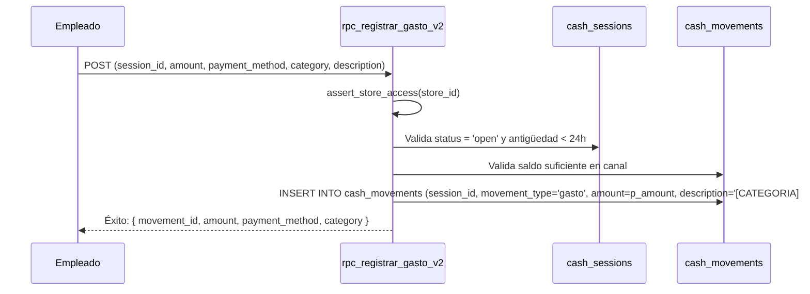
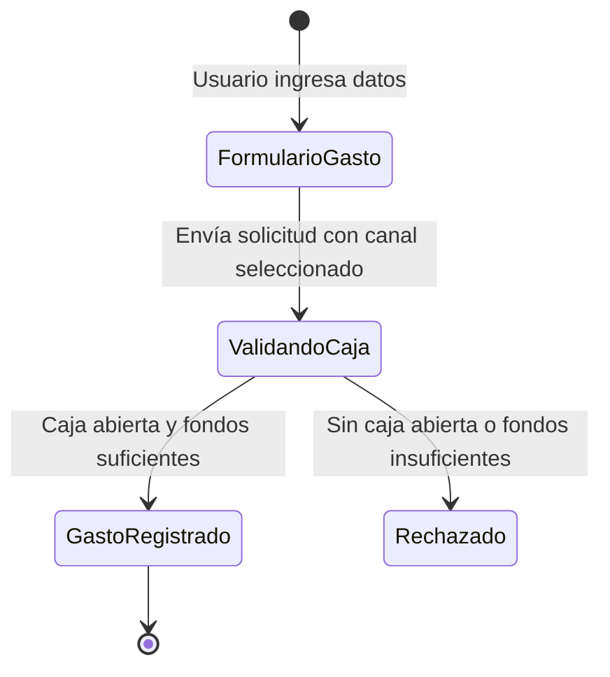
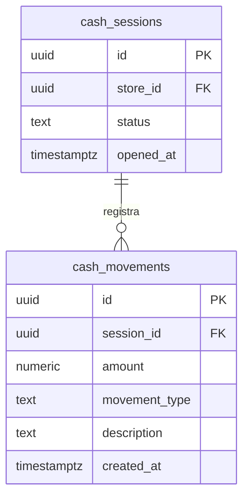

# SDD-022: Gastos Operativos Multicanal

> **Asociado a:** [FRD-022](../FRD/FRD_022_GASTOS_MULTICANAL.md)  
> **Fase del Plan:** Ola 1 — Cimientos de Caja y Gastos  
> **Estado:** 🟡 Validado Localmente (Post Alineación v1.5.8)  
> **Última Actualización:** 2026-10-11  

---

## 0. Contexto y Restricciones Aplicables

### 0.1 Políticas Globales Activadas (ARQ-002)
| Política ID | Dominio | Impacto Concreto en este SDD |
|-------------|---------|------------------------------|
| **POL-FIN-02** | Financiero | **Segregación Estricta de Canales:** Toda salida de dinero por gastos debe imputarse al canal de origen (`payment_method`) y debitar exclusivamente del saldo disponible de ese canal. |
| **POL-FIN-01** | Financiero | **Prohibición de Sobregiros:** Queda vetado extraer más dinero de un canal digital o físico del que haya ingresado en el turno. |
| **POL-AUTH-01** | Seguridad | **Validación Centralizada:** El registro invoca `assert_store_access()` y valida que exista una sesión de caja abierta. |

### 0.2 Contratos Vecinos que Limitan el Diseño
| SDD Origen | Restricción Inyectada | Impacto en Gastos Multicanal |
|------------|-----------------------|------------------------------|
| **SDD_026 (Política de Gastos)** | Ausencia de Pasivos. | Todo gasto es un egreso líquido inmediato con categoría OPEX obligatoria. |
| **SDD_004 (Control de Caja)** | Exigencia de sesión `OPEN`. | Bloquea la inserción si no hay caja abierta o si la sesión tiene más de 24 horas. |
| **SDD_020 (Caja Multicanal)** | Estructura multicanal de balances. | El egreso reduce el saldo esperado del canal correspondiente. |

### 0.3 Auditoría de BD contra Realidad (Deuda Técnica Declarada)
*Evidencia cruda obtenida de Supabase Producción (`ihtjocmhzuliwwvdzfnz`):*

```sql
-- En producción NO existe tabla 'expenses'. Los gastos se asientan exclusivamente en 'cash_movements':
-- id (uuid), session_id (uuid), sale_id (uuid), movement_type (text), amount (numeric), description (text), created_at (timestamptz)
```

| Hallazgo / Componente | Brecha Real Detectada | Solución Normativa y Trade-off | Condición de Revisión |
|-----------------------|-----------------------|---------------------------------|-----------------------|
| 🔴 **Inexistencia de tabla `expenses`** | Versiones preliminares proponían una tabla separada `expenses`. En la base real, todos los movimientos monetarios de salida residen en `cash_movements`. | **Decisión:** Unificar el registro en `cash_movements` con `movement_type = 'gasto'`. Evita redundancia y sincronizaciones bidireccionales frágiles. | Mantener modelo unificado en `cash_movements`. |
| 🔴 **Discriminación de canal en movimientos** | `cash_movements` no tiene columna `payment_method` en la base de datos de producción actual. | **Decisión:** El contrato RPC exige `p_payment_method`. Temporalmente se valida sobre las ventas del canal hasta la migración multicanal. | Migración de adición de columna `payment_method` en `cash_movements`. |

---

## 1. Glosario Local

- **Gasto Operativo Multicanal:** Egreso de liquidez imputado a un canal específico (`efectivo`, `nequi`, `llave_bre`) para cubrir gastos del día.
- **Origen de Fondos:** Medio por el cual se desembolsa el valor del gasto.

---

## 2. Diagramas de Secuencia



---

## 3. Diagramas de Estado



---

## 4. Especificación Detallada de Casos de Uso

### Caso A: Registro de Gasto Pagado con Nequi
- **Actor:** Empleado o Administrador con sesión activa.
- **Precondición:** Sesión de caja en estado `open`. Saldo disponible en Nequi >= monto a pagar.
- **Flujo Principal:**
  1. El usuario ingresa monto ($20.000), selecciona canal "Nequi", categoría OPEX "Servicios" y motivo "Pago de internet".
  2. El servidor verifica que la caja esté abierta y no caducada.
  3. El servidor confirma que el canal Nequi tenga fondos suficientes para cubrir los $20.000.
  4. El servidor asienta el egreso en `cash_movements`.
  5. El saldo en Nequi disminuye inmediatamente. El saldo en Efectivo permanece intacto.
- **Postcondición:** Gasto registrado con trazabilidad de canal; sin afectación cruzada a otros canales.

---

## 5. Contrato de Interfaz

### Operación: `rpc_registrar_gasto_v2`
- **Tipo:** RPC Postgres / Acción (WRITE)
- **Entradas:**
  ```json
  {
    "p_session_id": "UUID (Obligatorio)",
    "p_amount": "NUMERIC > 0 (Obligatorio)",
    "p_payment_method": "TEXT (Obligatorio: 'efectivo', 'nequi', 'llave_bre')",
    "p_category": "TEXT (Obligatorio: 'Servicios', 'Nomina', 'Transporte', 'Mantenimiento', 'Insumos', 'Reembolso')",
    "p_description": "TEXT (Obligatorio, >= 3 caracteres)"
  }
  ```
- **Salida Exitosa:**
  ```json
  {
    "success": true,
    "data": {
      "movement_id": "UUID",
      "amount": 20000.00,
      "payment_method": "nequi",
      "category": "Servicios",
      "created_at": "TIMESTAMPTZ"
    }
  }
  ```
- **Catálogo de Errores:**
  | Código de Error | Causa | Mensaje Técnico |
  |-----------------|-------|-----------------|
  | `NO_OPEN_SESSION` | Caja cerrada o inexistente | No hay una sesión de caja activa |
  | `SESSION_EXPIRED` | Antigüedad mayor a 24 horas | Turno expirado; requiere cierre antes de operar |
  | `INSUFFICIENT_FUNDS` | Saldo menor al monto en canal | Fondos insuficientes en el canal seleccionado |
  | `INVALID_OPEX_CATEGORY` | Categoría no autorizada | Categoría OPEX inválida |
  | `EMPTY_DESCRIPTION` | Descripción menor a 3 caracteres | Motivo de gasto requerido |

---

## 6. Análisis de Seguridad

- **Validación Centralizada:** Requiere `assert_store_access()`.
- **Atomicidad y Rollback:** Fallos de fondos o de validación revierten completamente cualquier intento de inserción.
- **Inmutabilidad:** Movimientos de tipo `'gasto'` son append-only.

---

## 7. Modelo de Datos Lógico



### Diccionario de Datos
| Tabla | Atributo | Tipo | Nullable | Estado en BD | Descripción |
|-------|----------|------|----------|--------------|-------------|
| `cash_movements` | `id` | UUID | NO | ✅ Sí | Identificador único del egreso |
| `cash_movements` | `session_id` | UUID | NO | ✅ Sí | Sesión de caja activa |
| `cash_movements` | `amount` | NUMERIC | NO | ✅ Sí | Monto positivo del gasto |
| `cash_movements` | `movement_type` | TEXT | NO | ✅ Sí | Fijo `'gasto'` |
| `cash_movements` | `description` | TEXT | NO | ✅ Sí | `[CATEGORIA] Motivo` |
| `cash_movements` | `created_at` | TIMESTAMPTZ | NO | ✅ Sí | Marca de tiempo del registro |
