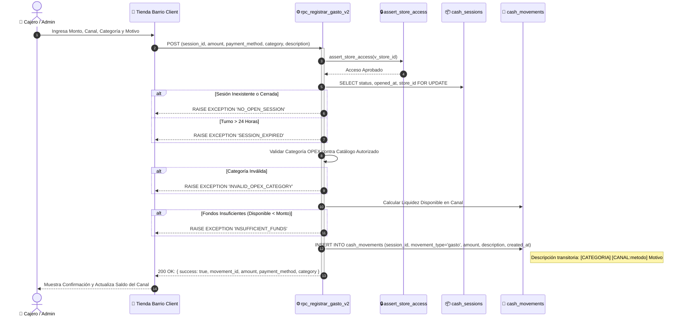
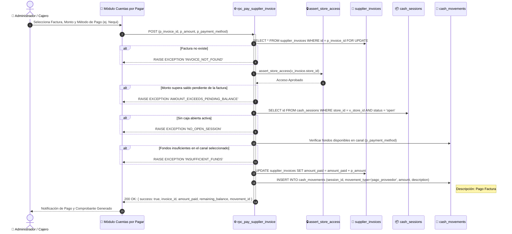
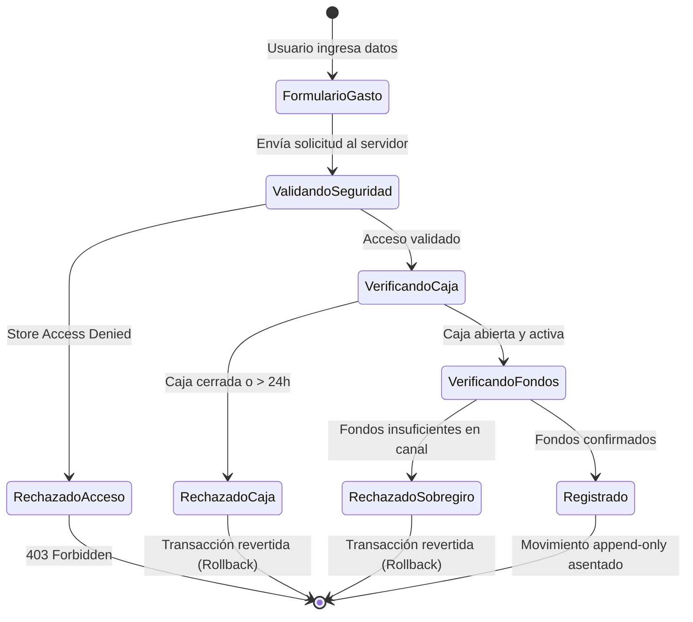
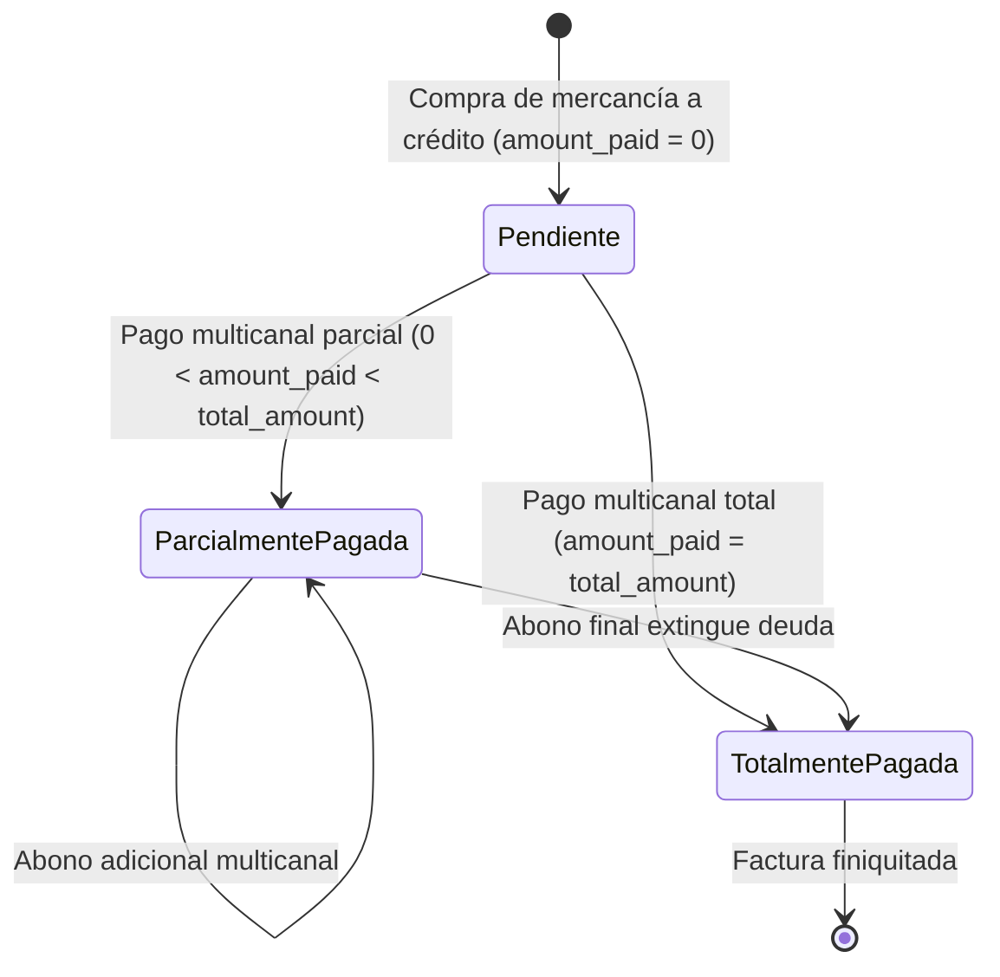
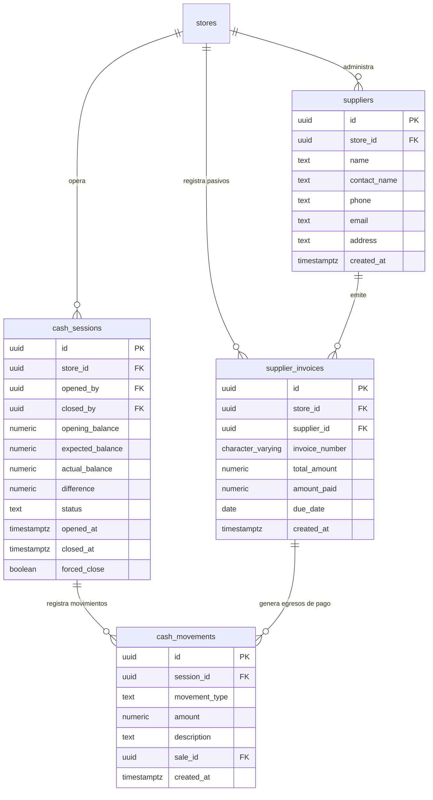

# SDD-022: Gastos Operativos Multicanal

> **Asociado a:** [FRD-022](../FRD/FRD_022_GASTOS_MULTICANAL.md) (Gastos Operativos Multicanal y Pago a Proveedores)  
> **Fase del Plan:** Ola 1 — Cimientos de Caja y Gastos  
> **Estado:** 🟠 Aprobado con Deuda Técnica Documentada (PAC-SDD Completo 2026-10-14)  
> **Última Actualización:** 2026-10-14  

---

## 0. Contexto y Restricciones Aplicables

### 0.1 Políticas Globales Activadas (ARQ-002)
| Política ID | Dominio | Impacto Concreto en este SDD |
|-------------|---------|------------------------------|
| **POL-FIN-01** | Financiero | **Solidez de Caja y Prohibición de Sobregiros por Canal:** Toda salida monetaria por gasto del día o amortización de proveedor debe respaldarse con liquidez real disponible en el canal seleccionado (`payment_method`). Queda terminantemente prohibido el sobregiro contable en canales digitales o en efectivo físico (`INSUFFICIENT_FUNDS`). |
| **POL-FIN-02** | Financiero | **Segregación Estricta de Canales Monetarios:** Efectivo, Nequi y Llave BRE / Daviplata operan como compartimentos estancos. Un egreso imputado a un canal digital debita exclusivamente el saldo esperado de dicho canal digital, manteniendo intacto el cuadre y arqueo del dinero físico en el cajón de la tienda. |
| **POL-AUD-01** | Auditoría | **Trazabilidad e Inmutabilidad de Egresos:** Todos los movimientos de salida son estrictamente `append-only` en `cash_movements`. Queda prohibido el borrado (`DELETE`) o edición (`UPDATE`) de egresos. Cualquier ajuste debe procesarse como un nuevo movimiento auditable. |
| **POL-AUTH-01** | Seguridad | **Autorización Centralizada y Erradicación de PIN (Decisión D-01):** Todo egreso se autoriza mediante `assert_store_access(v_store_id)` como primera instrucción. La identidad del autor se resuelve mediante `get_employee_id_from_session()`. Queda prohibido el uso de PINs locales o validaciones ad-hoc en capa frontend o SQL. |
| **SPEC-010 / 011** | Financiero | **Conservación Numérica y Moneda Entera:** Manejo estricto de montos en Pesos Colombianos (COP) utilizando enteros en columnas de tipo `NUMERIC`. Cero tolerancia a desbordamientos o imprecisiones de punto flotante. |

### 0.2 Contratos Vecinos que Limitan el Diseño
| SDD Origen | Restricción Inyectada | Impacto en Gastos Multicanal |
|------------|-----------------------|------------------------------|
| **SDD_004 (Control de Caja)** | Exigencia de sesión `open` activa y turno < 24h. | Todo gasto o pago a proveedor exige una sesión de caja activa (`NO_OPEN_SESSION`) y rechaza si el turno tiene más de 24 horas (`SESSION_EXPIRED`). Además, la fórmula de cierre en `cerrar_caja` debe consolidar obligatoriamente la suma de egresos de tipo `'gasto'` y `'pago_proveedor'`. |
| **SDD_020 (Caja Multicanal)** | Estructura multicanal de balances. | Los egresos disminuyen el `expected_balance` del canal monetario correspondiente. Al cerrar caja, el balance esperado de cada canal refleja la resta de sus egresos. |
| **SDD_026 (Política de Gastos Inmediatos)** | Inmediatez absoluta y catálogo OPEX cerrado. | Los gastos del día son desembolsos inmediatos (cero pasivos). Deben pertenecer obligatoriamente a una de las 6 categorías OPEX autorizadas (`Servicios`, `Nomina`, `Transporte`, `Mantenimiento`, `Insumos`, `Reembolso`). |
| **SDD_019 (Cuentas por Pagar)** | Pago de facturas a proveedores con origen de fondos. | La operación `rpc_pay_supplier_invoice` amortiza la deuda en `supplier_invoices.amount_paid` e inyecta un egreso multicanal en caja con `movement_type = 'pago_proveedor'`, cerrando la brecha histórica de aislamiento contable. |
| **SDD_018 (Control Operacional y Análisis Financiero)** | Invariante de P&L y Estado de Resultados. | En `rpc_get_comprehensive_financial_report`, los gastos operativos solo computan `movement_type = 'gasto'`. Los egresos por `pago_proveedor` corresponden a extinción de pasivos por compra de inventario y NO deben sumarse a gastos operativos para evitar duplicidad con el Costo de Mercancía Vendida (COGS FIFO). |
| **SDD_021 (Historiales Multicanal)** | Auditoría de movimientos desglosada por canal. | Expone consultas y filtros sobre `cash_movements` desglosando el método de pago (`payment_method`) y la categoría del gasto. |

### 0.3 Auditoría de BD contra Realidad (Deuda Técnica Declarada bajo Regla 7)
*Evidencia cruda obtenida de Supabase Producción (`ihtjocmhzuliwwvdzfnz`) mediante consultas a `information_schema` y `pg_proc`:*

```sql
-- Tablas reales verificadas:
-- cash_sessions: id, store_id, opened_by, closed_by, opening_balance, expected_balance, actual_balance, difference, status, opened_at, closed_at, forced_close
-- cash_movements: id, session_id, movement_type, amount, description (NOT NULL), sale_id, created_at
-- supplier_invoices: id, store_id, supplier_id, total_amount, amount_paid, due_date, created_at, invoice_number

-- Constraints verificados:
-- cash_movements_movement_type_check: CHECK ((movement_type = ANY (ARRAY['ingreso'::text, 'gasto'::text, 'pago_proveedor'::text])))
-- cash_movements_amount_check: CHECK ((amount > 0))

-- Ausencias físicas comprobadas:
-- Tablas inexistentes: expenses, accounts_payable, cash_session_balances.
-- cash_movements NO tiene columnas 'category' ni 'payment_method'.
-- rpc_pay_supplier_invoice en BD real sólo inserta en cash_movements si p_payment_method IN ('efectivo', 'cash').
```

| # | Hallazgo / Componente | Brecha Real Detectada | Solución Normativa y Trade-off (Regla 7) | Condición de Revisión Futura |
|---|-----------------------|-----------------------|------------------------------------------|------------------------------|
| **H-1** | 🔴 **Inexistencia de tabla `expenses`** | En la base física de producción no existe la tabla `expenses` ni `accounts_payable`. Todos los movimientos de salida residen en `cash_movements` y las cuentas por pagar en `supplier_invoices`. | **Decisión:** Unificar el registro en `cash_movements` asignando `movement_type = 'gasto'` para OPEX y `movement_type = 'pago_proveedor'` para proveedores. Evita redundancia de tablas y previene desincronizaciones contables. | Modelo unificado consolidado en `cash_movements`. Mantener arquitectura. |
| **H-2** | 🔴 **Ausencia de `category` y `payment_method` en `cash_movements`** | `cash_movements` solo tiene 7 columnas físicas. No existen columnas dedicadas para almacenar la categoría OPEX ni el canal de pago en el esquema físico actual. | **Decisión:** El contrato normativo exige ambos parámetros. En el interim, se persisten en `description` con formato obligatorio estructurado: `[CATEGORIA] [CANAL:metodo_pago] Motivo` (ej. `[Servicios] [CANAL:nequi] Pago recibo energía`). Esto garantiza trazabilidad y auditoría sin alterar el esquema físico antes de la migración DDL. | Ejecución de migración DDL: `ALTER TABLE cash_movements ADD COLUMN category TEXT, ADD COLUMN payment_method TEXT;` en Ola 4. |
| **H-3** | 🔴 **Asimetría en `rpc_pay_supplier_invoice` de BD real** | En la función física actual de producción, solo se valida caja abierta e inserta en `cash_movements` si `p_payment_method IN ('efectivo', 'cash')`. Si el pago es digital, se amortiza la deuda pero se omite la caja, violando FRD-022 Reglas 1, 2 y 3. | **Decisión:** Formalizar el contrato objetivo exigiendo que TODO pago a proveedor requiera sesión abierta y asiente en caja con su canal. Se advierte que hasta la migración multicanal (`cash_session_balances`), insertar pagos digitales en `cash_movements` sin columna de canal contaminaría el arqueo físico en `rpc_check_and_force_close_shifts`. | Refactorización de `rpc_pay_supplier_invoice` sincronizada con la migración DDL multicanal. |
| **H-4** | 🔴 **Desfase documental histórico de `SDD_019`** | La versión archivada de `SDD_019` (2026-08-07) y la Fila 25 de la Matriz RVC estipulaban un "aislamiento contable sin tocar caja". Esta regla fue formalmente revocada por `FRD-022`. | **Decisión:** Declarar la primacía arquitectónica de `FRD-022` y `SDD-022`. Registrar el desfase de `SDD-019` como deuda documental transitoria y agendar su actualización exhaustiva en la Ola 4. | Actualización y alineación formal de `SDD_019_CUENTAS_POR_PAGAR.md` en Ola 4. |
| **H-5** | 🟡 **Segregación Contable en P&L (`SDD_018`)** | Los pagos a proveedores no deben computarse como gastos del período en el Estado de Resultados para no duplicar el costo con el COGS FIFO. | **Decisión:** Se impone el invariante de que `rpc_registrar_gasto_v2` inserte exclusivamente `'gasto'`, mientras que `rpc_pay_supplier_invoice` inserte estrictamente `'pago_proveedor'`. | Auditoría continua en los reportes financieros de `SDD_018`. |
| **H-6** | 🔴 **Déficit de Grants a `service_role` (Regla 8)** | `cash_movements` y `cash_sessions` carecen de grants directos para el rol `service_role` en los esquemas de producción. | **Decisión:** Toda migración y diseño estipula explícitamente `GRANT ALL ON TABLE cash_movements, cash_sessions, supplier_invoices TO anon, authenticated, service_role;` previniendo errores 42501. | Inclusión en scripts DDL consolidados. |

---

## 1. Glosario Local

- **Gasto Operativo (OPEX):** Desembolso de liquidez inmediato destinado al sostenimiento cotidiano del local comercial (arriendo, servicios públicos, tintos, transporte, insumos de aseo). Se liquida al instante sin generar pasivos contables.
- **Canal de Pago (`payment_method`):** Medio transaccional del cual se extraen los fondos. Valores autorizados: `'efectivo'`, `'nequi'`, `'llave_bre'` (o alias `'daviplata'`).
- **Pago a Proveedor:** Extinción total o parcial de un pasivo comercial previamente adquirido por la compra de mercancía o inventario (`supplier_invoices`). No constituye gasto operativo.
- **Categoría OPEX:** Clasificación contable obligatoria del gasto según el estándar de `SDD_026` (`'Servicios'`, `'Nomina'`, `'Transporte'`, `'Mantenimiento'`, `'Insumos'`, `'Reembolso'`).
- **Sobregiro de Canal:** Condición anómala donde el monto a desembolsar por un canal supera la liquidez acumulada en la sesión activa para dicho canal. El sistema aborta la transacción con error `INSUFFICIENT_FUNDS`.

---

## 2. Diagramas de Secuencia

### 2.1 Registro de Gasto Operativo Inmediato (`rpc_registrar_gasto_v2`)



### 2.2 Pago a Proveedor con Origen Multicanal (`rpc_pay_supplier_invoice`)



---

## 3. Diagramas de Estado

### 3.1 Ciclo de Vida del Gasto Operativo Inmediato



### 3.2 Ciclo de Vida de la Factura de Proveedor (`supplier_invoices`)



---

## 4. Especificación Detallada de Casos de Uso

### Caso A: Registro de Gasto OPEX Pagado con Canal Digital (Nequi / Daviplata)
- **Actor:** Empleado con turno abierto o Administrador.
- **Precondición:** 
  1. Sesión de caja en estado `open` y con antigüedad inferior a 24 horas.
  2. El saldo disponible acumulado en el canal digital seleccionado es mayor o igual al monto del gasto.
- **Flujo Principal:**
  1. El usuario accede al formulario "Registrar Gasto".
  2. Ingresa el monto: `$15.000 COP`.
  3. Selecciona el Método de Pago: `Nequi`.
  4. Selecciona la Categoría OPEX: `Servicios`.
  5. Ingresa el Motivo / Descripción: `"Recibo de energía eléctrica"`.
  6. Presiona el botón "Confirmar Gasto".
  7. El sistema ejecuta `assert_store_access()` y valida que la sesión de caja pertenezca a la tienda del usuario.
  8. El sistema verifica que la sesión esté abierta y calcula la liquidez disponible en el canal Nequi.
  9. Al confirmar que `saldo_nequi >= 15000`, el sistema inserta el registro en `cash_movements` con `movement_type = 'gasto'` y formatea la descripción estructurada.
  10. El saldo esperado del canal Nequi disminuye inmediatamente en `$15.000 COP`.
  11. El saldo físico en Efectivo permanece estrictamente intacto.
- **Postcondición:** Egreso registrado de forma inmutable; saldo digital decrementado; auditoría preservada.

### Caso B: Pago a Proveedor Pagado con Nequi (FRD-022 Caso A)
- **Actor:** Administrador o Empleado con permiso.
- **Precondición:** Factura de proveedor existente en `supplier_invoices` con saldo pendiente (`total_amount - amount_paid > 0`). Sesión de caja activa en la tienda.
- **Flujo Principal:**
  1. El usuario ingresa al módulo de Cuentas por Pagar.
  2. Selecciona la factura a abonar (ej. Factura `#PROV-8492` de Lácteos El Prado).
  3. Ingresa el monto a pagar: `$80.000 COP`.
  4. Selecciona el canal en el selector de Método de Pago: `Nequi`.
  5. Confirma la operación de pago.
  6. El sistema ejecuta `rpc_pay_supplier_invoice` validando permisos y bloqueando el registro de la factura con `FOR UPDATE`.
  7. El sistema verifica que el monto no exceda el saldo pendiente de la factura (`total_amount - amount_paid`).
  8. El sistema verifica que la caja esté abierta y que el canal Nequi tenga al menos `$80.000 COP` de saldo disponible.
  9. El sistema incrementa `supplier_invoices.amount_paid` en `$80.000 COP`.
  10. El sistema inserta un movimiento en `cash_movements` con `movement_type = 'pago_proveedor'`, vinculando el canal y el identificador de la factura.
  11. El saldo esperado de Nequi disminuye en `$80.000 COP`, dejando el efectivo físico intacto.
- **Postcondición:** Deuda de proveedor amortizada; egreso registrado en caja; saldo digital actualizado.

### Caso C: Rechazo Transaccional por Sobregiro / Fondos Insuficientes
- **Actor:** Empleado o Administrador.
- **Precondición:** La tienda tiene saldo en efectivo de `$120.000 COP`, pero el saldo disponible en canal Nequi es de solo `$5.000 COP`.
- **Flujo Principal:**
  1. El usuario intenta registrar un gasto de transporte por `$15.000 COP` seleccionando `Nequi`.
  2. El sistema evalúa la liquidez del canal Nequi y detecta que `$5.000 < $15.000`.
  3. El sistema aborta la transacción inmediatamente lanzando la excepción `INSUFFICIENT_FUNDS`.
  4. El servidor realiza un rollback completo: no se inserta movimiento en `cash_movements` ni se altera ningún saldo.
  5. La interfaz de usuario muestra un mensaje claro: *"Fondos insuficientes en el canal Nequi (Disponible: $5.000). Seleccione otro canal o registre el ingreso correspondiente."*
- **Postcondición:** Cero registros corruptos; principio de no-sobregiro respetado.

---

## 5. Contrato de Interfaz

### 5.1 Operación: `rpc_registrar_gasto_v2`
- **Tipo:** Postgres RPC (Función Almacenada) / Acción (WRITE)
- **Modo:** `SECURITY DEFINER` con Search Path seguro (`SET search_path = public, pg_temp;`).
- **Firma de Entrada:**
  ```json
  {
    "p_session_id": "UUID (Obligatorio — Identificador de la sesión de caja)",
    "p_amount": "NUMERIC (Obligatorio — Monto entero COP > 0)",
    "p_payment_method": "TEXT (Obligatorio — Valores: 'efectivo', 'nequi', 'llave_bre')",
    "p_category": "TEXT (Obligatorio — Valores: 'Servicios', 'Nomina', 'Transporte', 'Mantenimiento', 'Insumos', 'Reembolso')",
    "p_description": "TEXT (Obligatorio — Longitud mínima 3 caracteres, sin contar prefijos)"
  }
  ```
- **Payload de Respuesta Exitosa (200 OK):**
  ```json
  {
    "success": true,
    "data": {
      "movement_id": "7c9e6679-7425-40de-944b-e07fc1f90ae7",
      "session_id": "b3e1a6c0-1234-4567-89ab-cdef01234567",
      "amount": 15000,
      "payment_method": "nequi",
      "category": "Servicios",
      "description": "[Servicios] [CANAL:nequi] Recibo de energía eléctrica",
      "movement_type": "gasto",
      "created_at": "2026-10-14T14:30:00Z"
    }
  }
  ```
- **Catálogo Exhaustivo de Errores:**
  | Código de Error | Causa de Negocio | Mensaje Técnico / HINT |
  |-----------------|------------------|------------------------|
  | `STORE_ACCESS_DENIED` | Usuario no pertenece a la tienda o carece de sesión válida | El usuario no tiene acceso a esta tienda |
  | `NO_OPEN_SESSION` | La sesión indicada no existe o se encuentra en estado `'closed'` | No existe una sesión de caja activa para registrar el gasto |
  | `SESSION_EXPIRED` | La sesión de caja tiene más de 24 horas transcurridas desde su apertura | La sesión de caja ha expirado (> 24h) y debe reconciliarse antes de registrar egresos |
  | `INVALID_AMOUNT` | El parámetro `p_amount` es menor o igual a cero o nulo | El monto del gasto debe ser un valor numérico estrictamente positivo |
  | `INVALID_PAYMENT_METHOD` | El canal suministrado no corresponde a `'efectivo'`, `'nequi'` ni `'llave_bre'` | Canal de pago no válido. Permitidos: efectivo, nequi, llave_bre |
  | `INVALID_OPEX_CATEGORY` | La categoría no pertenece al catálogo de las 6 categorías autorizadas por SDD-026 | Categoría OPEX no autorizada. Permitidas: Servicios, Nomina, Transporte, Mantenimiento, Insumos, Reembolso |
  | `EMPTY_DESCRIPTION` | La descripción suministrada está vacía o tiene menos de 3 caracteres | La descripción o motivo del gasto es obligatoria (mínimo 3 caracteres) |
  | `INSUFFICIENT_FUNDS` | La liquidez disponible en el canal seleccionado es inferior al monto a desembolsar | Fondos insuficientes en el canal monetario seleccionado |

---

### 5.2 Operación: `rpc_pay_supplier_invoice` (Multicanal)
- **Tipo:** Postgres RPC (Función Almacenada) / Acción (WRITE)
- **Modo:** `SECURITY DEFINER` con Search Path seguro.
- **Firma de Entrada:**
  ```json
  {
    "p_invoice_id": "UUID (Obligatorio — Identificador de la factura en supplier_invoices)",
    "p_amount": "NUMERIC (Obligatorio — Monto entero COP > 0 a amortizar)",
    "p_payment_method": "TEXT (Obligatorio — Valores: 'efectivo', 'nequi', 'llave_bre')"
  }
  ```
- **Payload de Respuesta Exitosa (200 OK):**
  ```json
  {
    "success": true,
    "data": {
      "invoice_id": "550e8400-e29b-41d4-a716-446655440000",
      "supplier_id": "9a12c345-6789-4def-0123-456789abcdef",
      "amount_paid_transaction": 80000,
      "accumulated_paid": 160000,
      "total_invoice_amount": 200000,
      "remaining_balance": 40000,
      "payment_method": "nequi",
      "movement_id": "8d0f7780-8536-41ef-055c-f18fd2f01bf8",
      "session_id": "b3e1a6c0-1234-4567-89ab-cdef01234567",
      "status": "parcialmente_pagada"
    }
  }
  ```
- **Catálogo Exhaustivo de Errores:**
  | Código de Error | Causa de Negocio | Mensaje Técnico / HINT |
  |-----------------|------------------|------------------------|
  | `INVOICE_NOT_FOUND` | La factura no existe en `supplier_invoices` | La factura de proveedor especificada no existe |
  | `STORE_ACCESS_DENIED` | La tienda dueña de la factura no coincide con la tienda activa del usuario | El usuario no tiene acceso a la tienda propietaria de la factura |
  | `INVALID_AMOUNT` | El monto a pagar es <= 0 | El monto del pago debe ser estrictamente positivo |
  | `INVALID_PAYMENT_METHOD` | Canal no soportado | Canal de pago no válido. Permitidos: efectivo, nequi, llave_bre |
  | `AMOUNT_EXCEEDS_PENDING_BALANCE` | El monto solicitado supera el saldo pendiente de la factura (`total_amount - amount_paid`) | El monto del pago excede el saldo pendiente de la factura |
  | `NO_OPEN_SESSION` | No hay sesión de caja abierta en la tienda para asociar el egreso | No existe una sesión de caja activa en la tienda para procesar el pago |
  | `SESSION_EXPIRED` | La sesión de caja abierta supera las 24 horas de antigüedad | La sesión de caja ha expirado (> 24h) |
  | `INSUFFICIENT_FUNDS` | El canal seleccionado no dispone de fondos suficientes para cubrir el pago | Fondos insuficientes en el canal monetario seleccionado para realizar el pago |

---

## 6. Análisis de Seguridad e Integridad

### 6.1 Reutilización Obligatoria de Funciones Centralizadas (Regla 4)
- **Validación Multi-Tenant:**
  Queda prohibida cualquier consulta manual ad-hoc tipo `EXISTS(SELECT 1 FROM stores ...)`. Ambas funciones (`rpc_registrar_gasto_v2` y `rpc_pay_supplier_invoice`) invocan como primera línea de ejecución:
  ```sql
  PERFORM public.assert_store_access(v_session.store_id);
  ```
  La función centralizada `assert_store_access()` resuelve la tienda legítima a través de `get_current_store_id()`, verificando en cascada el JWT (`app_metadata.store_id`), el rol en `admin_profiles`, la vinculación en `employees` y los pases aprobados en `daily_passes`.
- **Resolución Autoritativa del Autor:**
  Para evitar suplantación de identidad en auditoría, el empleado que registra el gasto se resuelve en backend mediante:
  ```sql
  v_employee_id := public.get_employee_id_from_session();
  ```
  Si el usuario autenticado corresponde a un dueño o administrador directo sin registro de empleado, la función valida su existencia en `admin_profiles` antes de autorizar.

### 6.2 Privilegios Base en Tablas (Regla 8)
Para evitar bloqueos por error `42501 (Permission Denied)` en Supabase Cloud, se garantiza que toda tabla involucrada en el flujo de gastos multicanal cuente con los privilegios base otorgados explícitamente:
```sql
GRANT ALL ON TABLE public.cash_movements TO anon, authenticated, service_role;
GRANT ALL ON TABLE public.cash_sessions TO anon, authenticated, service_role;
GRANT ALL ON TABLE public.supplier_invoices TO anon, authenticated, service_role;
GRANT ALL ON TABLE public.suppliers TO anon, authenticated, service_role;
```

### 6.3 Políticas de Seguridad a Nivel de Fila (RLS)
Las tablas `cash_movements` y `supplier_invoices` operan con RLS activo:
- **`cash_movements`:** Lectura e inserción condicionadas a que la sesión vinculada pertenezca a la tienda del usuario:
  ```sql
  CREATE POLICY "cash_movements_store_isolation" ON public.cash_movements
  FOR ALL TO authenticated
  USING (
      session_id IN (
          SELECT id FROM public.cash_sessions 
          WHERE store_id = public.get_current_store_id()
      )
  );
  ```
- **`supplier_invoices`:** Aislamiento directo por tienda:
  ```sql
  CREATE POLICY "supplier_invoices_store_isolation" ON public.supplier_invoices
  FOR ALL TO authenticated
  USING (store_id = public.get_current_store_id());
  ```

### 6.4 Concurrencia y Control de Carrera (Regla 9)
Toda operación que liquide fondos o amortice facturas ejecuta bloqueos pesimistas a nivel de fila (`SELECT ... FOR UPDATE`):
1. `cash_sessions` se bloquea por fila durante la validación del turno.
2. `supplier_invoices` se bloquea por fila para garantizar que dos pagos simultáneos sobre la misma factura no desborden el saldo pendiente (`amount_paid > total_amount`).

---

## 7. Modelo de Datos Lógico Verificado

### 7.1 Diagrama Entidad-Relación



### 7.2 Diccionario de Datos Físico Verificado

#### Tabla: `cash_movements` (Esquema Real de Producción)
| Columna | Tipo de Dato | Nullable | Restricción / Default | Estado en BD | Propósito y Contrato |
|---------|--------------|----------|-----------------------|--------------|----------------------|
| `id` | `uuid` | NO | `gen_random_uuid()` PK | ✅ Existe | Identificador único e inmutable del movimiento |
| `session_id` | `uuid` | NO | FK `cash_sessions(id)` | ✅ Existe | Sesión de caja activa a la que se imputa el egreso |
| `movement_type` | `text` | NO | CHECK (`'ingreso'`, `'gasto'`, `'pago_proveedor'`) | ✅ Existe | Discriminador contable. Gastos OPEX = `'gasto'`; Proveedores = `'pago_proveedor'` |
| `amount` | `numeric` | NO | CHECK (`amount > 0`) | ✅ Existe | Valor absoluto desembolsado en pesos colombianos |
| `description` | `text` | NO | NOT NULL | ✅ Existe | Formato transitorio estructurado: `[CATEGORIA] [CANAL:metodo_pago] Motivo` |
| `sale_id` | `uuid` | SÍ | FK `sales(id)` | ✅ Existe | Nulo para egresos de gasto o pago a proveedor |
| `created_at` | `timestamptz` | NO | `now()` | ✅ Existe | Timestamp de registro auditado |

#### Tabla: `supplier_invoices` (Esquema Real de Producción)
| Columna | Tipo de Dato | Nullable | Restricción / Default | Estado en BD | Propósito y Contrato |
|---------|--------------|----------|-----------------------|--------------|----------------------|
| `id` | `uuid` | NO | `gen_random_uuid()` PK | ✅ Existe | Identificador único de la factura |
| `store_id` | `uuid` | NO | FK `stores(id)` | ✅ Existe | Tienda propietaria de la obligación |
| `supplier_id` | `uuid` | NO | FK `suppliers(id)` | ✅ Existe | Proveedor acreedor |
| `invoice_number` | `varchar` | SÍ | Libre | ✅ Existe | Número de factura física o de referencia |
| `total_amount` | `numeric` | NO | Monto total | ✅ Existe | Valor bruto total de la factura |
| `amount_paid` | `numeric` | NO | `0` | ✅ Existe | Monto acumulado amortizado mediante pagos |
| `due_date` | `date` | NO | Fecha | ✅ Existe | Fecha de vencimiento para alertas de mora |
| `created_at` | `timestamptz` | NO | `now()` | ✅ Existe | Fecha de causación de la factura |

---

## 8. Verificación y Evidencia de Cumplimiento

Este documento ha superado íntegramente las compuertas del **Protocolo de Pre-Análisis Contextual (PAC-SDD)**, auditado formalmente por Subagentes de Aseguramiento de Calidad (QA) independientes:

- **Bloque 0 (Identificación y Fronteras):** Aprobado por Subagente QA `ab43a460` (Consistencia 100% de metadatos, fuentes y dependencias vecinas).
- **Bloque 1 (Lectura Literal de Requisitos):** Aprobado por Subagente QA `658fa233` (3 RNs, 1 Caso de uso, 4 CAs y entidades compartidas sin paráfrasis).
- **Bloque 2 (Esquema Real de Producción):** Aprobado por Subagente QA `f00b1240` (Verificación de `cash_movements`, `cash_sessions`, `supplier_invoices`, comprobación de ausencia de `expenses` y reconciliación de 8 hallazgos crudos).
- **Bloque 3 (Seguridad Centralizada - Reglas 4 y 8):** Aprobado por Subagente QA `ac0c4232` (`assert_store_access`, `get_current_store_id`, `get_employee_id_from_session` y grants de privilegios).
- **Bloque 4 (Auditoría de Impacto Cruzado - Regla 6):** Aprobado por Subagente QA `731c5128` (Inspección exhaustiva de `pg_proc`, riesgos en `rpc_pay_supplier_invoice`, check de `movement_type` y fórmulas de egreso).
- **Bloque 5 (Contratos Vecinos):** Aprobado por Subagente QA `353a1271` (Armonización con SDD-004, SDD-020, SDD-026, SDD-019 y principio de P&L de SDD-018).
- **Bloque 6 (Gate de Calidad Final):** Aprobado por Subagente QA `ade0a8c2` (8 preguntas G-1 a G-8 respondidas y 4 deudas técnicas formalizadas bajo Regla 7).
