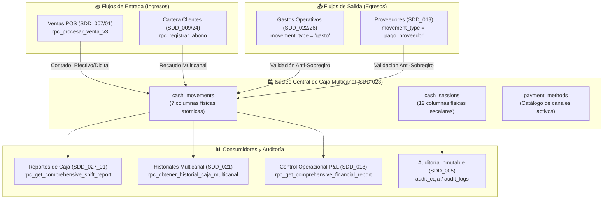
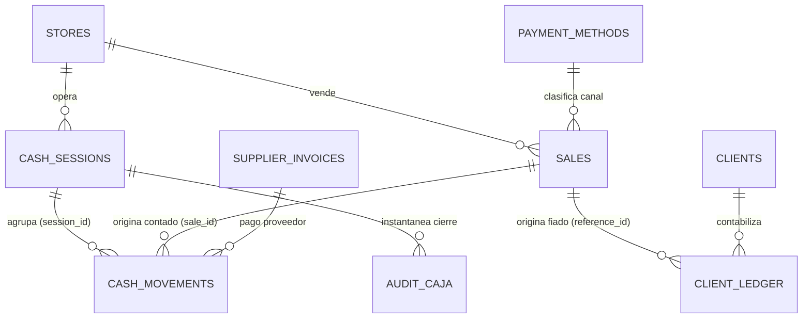
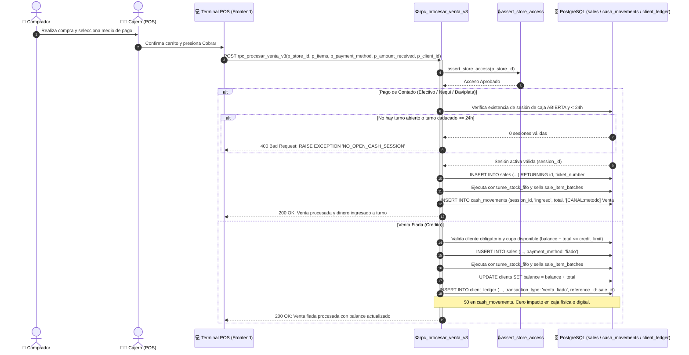
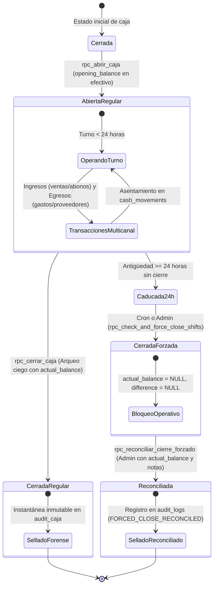

# SDD-023: Matriz de Impacto Cruzado Transversal — Consistencia Multicanal y Transición Arquitectónica

---

## 0. Control de Versiones y Metadatos

### 0.1 Metadatos del Documento
- **Documento:** `SDD_023_IMPACTO_CRUZADO_MULTICANAL.md`
- **FRD Fuente:** `FRD_023_IMPACTO_CRUZADO_MULTICANAL.md` (Documentos base: `FRD_020_CAJA_MULTICANAL.md`, `FRD_022_GASTOS_MULTICANAL.md`)
- **Fase del Plan:** Ola 4 — Reportes, Auditoría y Cuentas por Pagar (Ítem 6 — Documento de Cierre de Ola 4 / Fase 3: Consistencia Transversal)
- **Módulo Funcional:** Matriz de Consistencia Cruzada, Transición Arquitectónica de Caja y No-Regresión Transaccional
- **Versión de Especificación:** 2.0 (Saneamiento Arquitectónico PAC-SDD v2.0)
- **Fecha de Saneamiento:** 2026-10-16
- **Auditoría PAC:** Certificado en Bloques 0 a 6 por QA Independiente

### 0.2 Historial de Revisiones
| Versión | Fecha | Autor / Rol | Cambios Clave y Justificación |
|---|---|---|---|
| 1.0 | 2026-08-07 | Arquitecto de Datos | Borrador preliminar de impacto cruzado asumiendo la creación en producción de la tabla `cash_session_balances` y de la columna `payment_method` en `cash_movements`. |
| 2.0 | 2026-10-16 | Orquestador Técnico & Auditor QA | Saneamiento total bajo protocolo PAC-SDD v2.0: erradicación definitiva de la alucinación de la tabla `cash_session_balances` y de la columna `payment_method` en `cash_movements` tras verificación empírica en Supabase producción (`ihtjocmhzuliwwvdzfnz`); formalización de la arquitectura física real basada en `cash_sessions` (12 columnas) y `cash_movements` (7 columnas); especificación de no-regresión para los 10 procedimientos y 2 triggers dependientes; armonización de flujos multicanal entre POS, Cartera, Proveedores, OPEX y P&L; formalización de N=6 deudas técnicas bajo Regla 7 y contratos JSON Schema en Sección 5. |

---

## 1. Arquitectura y Reglas de Negocio Centrales

### 1.1 Diagnóstico de Transición Arquitectónica: De Saldo Único a Consistencia Multicanal
Históricamente, la plataforma operaba bajo un modelo de "saldo único de efectivo" donde las columnas escalares `expected_balance` y `actual_balance` en `cash_sessions` consolidaban exclusivamente las operaciones en moneda física. 

El requerimiento de Caja Multicanal introdujo la necesidad de rastrear de manera segregada los flujos de Efectivo físico y Canales Digitales (`nequi`, `daviplata`). La propuesta teórica previa planteaba la creación de una tabla anexa `cash_session_balances` y la depreciación de las columnas de `cash_sessions`. Sin embargo, la auditoría empírica del esquema real demostró que `cash_session_balances` **no existe físicamente en producción**, y que alterar o depreciar las columnas escalares de `cash_sessions` provocaría un *Breaking Change* catastrófico sobre 10 procedimientos almacenados y los triggers de auditoría (`fn_audit_cash_closed` y `fn_audit_cash_opened`).

En consecuencia, el SDD-023 consagra la **Arquitectura Transicional de Consistencia Multicanal**:
1. **Preservación de Columnas Escalares:** `cash_sessions` preserva intactas sus 12 columnas físicas, asegurando la continuidad operativa del Evidence Hub y de las consultas de arqueo histórico.
2. **Desglose Multicanal Dinámico:** El cómputo y discriminación por método de pago se resuelve en tiempo de ejecución a partir de `cash_movements`, agregando las transacciones vinculadas al `session_id`.
3. **Resolución Desacoplada de Canal:** Ante la ausencia física de `payment_method` en `cash_movements` (7 columnas), el canal monetario se resuelve mediante JOIN con `sales.payment_method` (para ventas de contado) o mediante tags estructurados en `description` (para egresos OPEX, pagos a proveedor y abonos de clientes), con fallback determinista a `'efectivo'`.



---

### 1.2 Reglas de Consistencia Transversal y No-Regresión

#### Regla 1: Precondición de Turno Abierto y Vigente (< 24 Horas)
Toda operación del sistema que involucre ingreso o egreso de liquidez (ventas de contado, ventas por transferencia digital, recaudos de abonos a cartera, gastos OPEX y pagos internos a proveedores) exige incondicionalmente la existencia de un turno de caja en estado `open` cuya antigüedad sea estrictamente inferior a 24 horas (`opened_at > NOW() - INTERVAL '24 hours'`). Si la caja está cerrada o caducada, el servidor aborta inmediatamente con excepción `NO_OPEN_CASH_SESSION` o `SHIFT_EXPIRED`.

#### Regla 2: Segregación Inviolable entre Ventas de Contado y Ventas Fiadas
- **Ventas de Contado (Efectivo y Digitales):** Generan obligatoriamente un registro en `cash_movements` con `movement_type = 'ingreso'`, enlazado a la venta mediante `sale_id`.
- **Ventas Fiadas (`payment_method = 'fiado'`):** Tienen terminantemente prohibido generar registros en `cash_movements` ($0 en caja). Su impacto financiero se circunscribe exclusivamente a la cartera de clientes (`clients.balance` y `client_ledger`).

#### Regla 3: Conexión de Cartera con Caja y Neutralidad en P&L
- **Ingreso de Liquidez en Caja:** El recaudo de cartera (`rpc_registrar_abono`) inyecta un movimiento en `cash_movements` con `movement_type = 'ingreso'`, `sale_id = NULL` y tag de canal en `description`.
- **Neutralidad en Ventas (P&L):** El ingreso del abono NO genera filas en `sales`. En el Estado de Resultados (`SDD_018`), el Revenue computa únicamente ventas comerciales devengadas no anuladas (`sales WHERE is_voided = FALSE`). El abono aporta liquidez a la tesorería pero $0 de ingreso nuevo en P&L, evitando la doble contabilización.

#### Regla 4: Prevención Estricta de Sobregiro por Canal Monetario (`INSUFFICIENT_FUNDS`)
Todo egreso de dinero (gastos operacionales en `SDD_022` y pagos a proveedores en `SDD_019`) debe validar la suficiencia de fondos disponibles en el canal monetario específico seleccionado antes de asentar el movimiento:
$$\text{Fondos Disponibles}(\text{canal}) = \text{Base Inicial}(\text{canal}) + \sum \text{Ingresos}(\text{canal}) - \sum \text{Egresos}(\text{canal})$$
Si el monto del egreso supera los fondos disponibles del canal, el servidor rechaza la transacción con código estándar `INSUFFICIENT_FUNDS`. Queda terminantemente prohibido cubrir déficits de un canal utilizando saldo de otro canal o permitir balances negativos.

#### Regla 5: Segregación Contable entre Gastos OPEX y Pasivos Comerciales
En `cash_movements`, los egresos se dividen taxativamente mediante `movement_type`:
- `movement_type = 'gasto'`: Gastos operativos corrientes que deducen la Utilidad Bruta en el P&L (Pilar 1 de `SDD_018`).
- `movement_type = 'pago_proveedor'`: Amortización de pasivos comerciales que reducen las cuentas por pagar en `supplier_invoices` (Pilar 2 de `SDD_018`). Bajo ninguna circunstancia se suman al OPEX para evitar duplicar el costo de adquisición de mercancía.

#### Regla 6: Ceguera de Arqueo y Blindaje de Triggers
- **Arqueo Ciego (`POL-SEG-03`):** El cajero declara a ciegas el efectivo físico en su poder (`actual_balance`). El servidor calcula `expected_balance` y `difference` de forma privada.
- **Blindaje de Triggers:** El trigger `trg_audit_cash_closed` captura la instantánea en `audit_caja` a partir de `cash_sessions`, garantizando la inmutabilidad de la auditoría forense (`POL-AUD-01`).

---

## 2. Modelo Físico de Datos

El subsistema multicanal opera sobre 10 entidades relacionales verificadas empíricamente en PostgreSQL:



---

### 2.1 Diccionario Físico de Entidades del Dominio Multicanal

#### 1. `cash_sessions` (12 columnas físicas reales)
| Columna | Tipo de Dato | Nulable | Default / Constraints | Propósito en Matriz Multicanal |
|---|---|:---:|---|---|
| `id` | `uuid` | NO | `gen_random_uuid()` | Clave primaria de sesión. |
| `store_id` | `uuid` | NO | FK `stores(id)` | Tenant propietario. |
| `opened_by` | `uuid` | NO | FK `employees(id)` | Responsable de apertura. |
| `closed_by` | `uuid` | YES | FK `employees(id)` | Responsable de cierre. |
| `opening_balance` | `numeric` | NO | Sin default | Base de efectivo inicial en gaveta. |
| `expected_balance` | `numeric` | YES | Nullable | Saldo teórico consolidado esperado. |
| `actual_balance` | `numeric` | YES | Nullable | Saldo declarado a ciegas por el cajero. |
| `difference` | `numeric` | YES | Nullable | Descuadre de arqueo (`actual - expected`). |
| `status` | `text` | NO | `'open'` | Estado del turno (`open`, `closed`). |
| `opened_at` | `timestamptz`| NO | `now()` | Inicio cronológico del turno. |
| `closed_at` | `timestamptz`| YES | Nullable | Fin cronológico del turno. |
| `forced_close` | `boolean` | NO | `false` | Indicador de cierre forzado a las 24 horas. |

#### 2. `cash_movements` (7 columnas físicas reales)
| Columna | Tipo de Dato | Nulable | Default / Constraints | Propósito en Matriz Multicanal |
|---|---|:---:|---|---|
| `id` | `uuid` | NO | `gen_random_uuid()` | Clave primaria del movimiento. |
| `session_id` | `uuid` | NO | FK `cash_sessions(id)` | Turno de caja contenedor. |
| `movement_type` | `text` | NO | CHECK (`ingreso`, `gasto`, `pago_proveedor`) | Discriminador de flujo transaccional. |
| `amount` | `numeric` | NO | CHECK (`amount > 0`) | Cuantía monetaria del movimiento. |
| `description` | `text` | NO | Sin default | Detalle transaccional con tag de canal. |
| `sale_id` | `uuid` | YES | FK `sales(id)` | Trazabilidad con venta POS de contado. |
| `created_at` | `timestamptz`| NO | `now()` | Fecha y hora de asentamiento en caja. |

#### 3. `payment_methods` (7 columnas físicas reales)
| Columna | Tipo de Dato | Nulable | Default / Constraints | Propósito en Matriz Multicanal |
|---|---|:---:|---|---|
| `id` | `uuid` | NO | `gen_random_uuid()` | Identificador del método de pago. |
| `code` | `text` | NO | UNIQUE (`cash`, `nequi`, `fiado`, `card`) | Código canónico del canal monetario. |
| `name` | `text` | NO | Sin default | Denominación visual para el usuario. |
| `is_active` | `boolean` | YES | `true` | Disponibilidad comercial del canal. |
| `requires_reference`| `boolean`| YES | `false` | Exigencia de comprobante digital. |
| `allows_change` | `boolean` | YES | `false` | Permite cálculo de vueltas (solo efectivo). |
| `sort_order` | `integer` | YES | `0` | Orden de visualización en interfaz POS. |
| `created_at` | `timestamptz`| YES | `now()` | Registro de alta en catálogo. |

#### 4. `sales` (16 columnas físicas reales)
| Columna | Tipo de Dato | Nulable | Default / Constraints | Propósito en Matriz Multicanal |
|---|---|:---:|---|---|
| `id` | `uuid` | NO | `gen_random_uuid()` | Clave primaria de venta. |
| `store_id` | `uuid` | NO | FK `stores(id)` | Tenant propietario. |
| `ticket_number` | `integer` | NO | Correlativo por tienda | Comprobante fiscal/comercial. |
| `employee_id` | `uuid` | NO | FK `employees(id)` | Cajero que concretó la venta. |
| `client_id` | `uuid` | YES | FK `clients(id)` | Cliente deudor (obligatorio si es fiado). |
| `total` | `numeric` | NO | Sin default | Total de la venta en COP. |
| `rounding_difference`| `numeric`| YES | `0` | Ajuste por redondeo a $50 COP. |
| `payment_method` | `text` | NO | CHECK (`efectivo`, `nequi`, `daviplata`, `fiado`) | **Canal de cobro primario de la venta**. |
| `amount_received` | `numeric` | YES | Nullable | Monto entregado por el cliente. |
| `change_given` | `numeric` | YES | Nullable | Cambio devuelto al cliente. |
| `sync_status` | `text` | YES | `'pending'` | Estado de sincronización offline. |
| `local_id` | `text` | YES | Nullable | ID temporal de almacenamiento local. |
| `is_voided` | `boolean` | YES | `false` | Filtro de anulación (true = anulada). |
| `voided_by` | `uuid` | YES | FK `employees(id)` | Autor de la anulación. |
| `void_reason` | `text` | YES | Nullable | Motivo de la anulación. |
| `created_at` | `timestamptz`| NO | `now()` | Fecha y hora de emisión del ticket. |

#### 5. `client_ledger` (10 columnas físicas reales)
| Columna | Tipo de Dato | Nulable | Default / Constraints | Propósito en Matriz Multicanal |
|---|---|:---:|---|---|
| `id` | `uuid` | NO | `gen_random_uuid()` | Identificador de apunte de libro mayor. |
| `client_id` | `uuid` | NO | FK `clients(id)` | Cliente asociado. |
| `store_id` | `uuid` | NO | FK `stores(id)` | Tenant propietario. |
| `amount` | `numeric` | NO | Sin default | Monto del cargo (+fiado) o abono (-pago). |
| `previous_balance` | `numeric` | NO | `0` | Saldo de cartera previo al apunte. |
| `new_balance` | `numeric` | NO | `ALWAYS GENERATED` | Saldo de cartera posterior inmutable. |
| `reference_id` | `uuid` | YES | Nullable | Enlace a la venta fiada (`sales.id`). |
| `transaction_type` | `text` | NO | Sin default | Tipo (`venta_fiado`, `abono`, `anulacion_fiado`). |
| `created_at` | `timestamptz`| YES | `now()` | Fecha del apunte contable. |
| `created_by` | `uuid` | YES | FK `employees(id)` | Cajero que ejecutó la operación. |

#### 6. `supplier_invoices` (8 columnas físicas reales)
| Columna | Tipo de Dato | Nulable | Default / Constraints | Propósito en Matriz Multicanal |
|---|---|:---:|---|---|
| `id` | `uuid` | NO | `gen_random_uuid()` | Clave primaria de factura por pagar. |
| `store_id` | `uuid` | NO | FK `stores(id)` | Tenant propietario. |
| `supplier_id` | `uuid` | NO | FK `suppliers(id)` | Proveedor acreedor. |
| `total_amount` | `numeric` | NO | CHECK (`total_amount >= 0`) | Cuantía total de la obligación comercial. |
| `amount_paid` | `numeric` | NO | `0` (CHECK `<= total_amount`) | Monto acumulado liquidado. |
| `due_date` | `date` | NO | Sin default en producción | Fecha límite de pago de la factura. |
| `created_at` | `timestamptz`| NO | `now()` | Fecha de registro de la deuda. |
| `invoice_number` | `varchar` | YES | Nullable | Comprobante externo del proveedor. |

#### 7. `audit_caja` (7 columnas físicas reales)
| Columna | Tipo de Dato | Nulable | Default / Constraints | Propósito en Matriz Multicanal |
|---|---|:---:|---|---|
| `id` | `uuid` | NO | `gen_random_uuid()` | Identificador de auditoría de turno. |
| `session_id` | `uuid` | NO | FK `cash_sessions(id)` | Sesión auditada. |
| `store_id` | `uuid` | NO | FK `stores(id)` | Tenant propietario. |
| `event_type` | `text` | NO | CHECK (`APERTURA`, `CIERRE`, `MOVIMIENTO`) | Hito operativo auditado. |
| `actor_id` | `uuid` | YES | FK `employees(id)` | Cajero o administrador actuante. |
| `created_at` | `timestamptz`| NO | `now()` | Sellado cronológico inmutable. |
| `metadata` | `jsonb` | NO | Sin default | **Instantánea inmutable de saldos de turno**. |

---

## 3. Diagramas de Flujo y Secuencia

### 3.1 Flujo Transaccional de Consistencia Multicanal en Ventas POS
Muestra la bifurcación obligatoria según el canal de pago: contado/digital impacta caja; fiado impacta cartera:



---

### 3.2 Ciclo de Vida del Turno de Caja y Reconciliación Forzada



---

## 4. Casos de Uso y Matriz de Casos Límite

### 4.1 Especificación Detallada de Casos de Uso

#### Caso A: Venta Multicanal Digital (Nequi / Daviplata)
- **Actor:** Cajero / Personal POS.
- **Precondiciones:** Turno de caja abierto y vigente (< 24 horas).
- **Flujo Principal:**
  1. El cliente presenta comprobante de transferencia digital (Nequi o Daviplata).
  2. El cajero selecciona el medio de pago digital correspondiente en la interfaz POS.
  3. El frontend invoca `rpc_procesar_venta_v3`.
  4. El servidor valida la vigencia del turno de caja (`cash_sessions.status = 'open' AND opened_at > NOW() - INTERVAL '24 hours'`).
  5. El servidor inserta la venta en `sales` con `payment_method = 'nequi'` o `'daviplata'`.
  6. El servidor consume inventario vía FIFO (`consume_stock_fifo`) y sella `sale_item_batches`.
  7. El servidor inyecta el ingreso en `cash_movements` vinculado al `session_id`, con `sale_id`, cuantía exacta y descripción estructurada `[CANAL:nequi] Venta #TK-XX`.
  8. La venta concluye exitosamente sin requerir entrega de vueltas (`change_given = 0`).
- **Postcondiciones (Éxito):** El ingreso digital queda registrado en la sesión para el arqueo de canales digitales.

#### Caso B: Recaudo de Abono de Cartera (`rpc_registrar_abono`)
- **Actor:** Cajero o Administrador.
- **Precondiciones:** Cliente con saldo deudor (`balance > 0`) y turno de caja abierto.
- **Flujo Principal:**
  1. El cliente deudor entrega dinero en efectivo o transferencia para abonar a su deuda.
  2. El cajero ingresa al módulo de clientes, selecciona al cliente y digita el monto junto con el canal de pago (`efectivo`, `nequi` o `daviplata`).
  3. El frontend invoca `rpc_registrar_abono(p_client_id, p_amount, p_payment_method)`.
  4. El servidor valida el acceso de tienda (`assert_store_access`) y constata que existe un turno abierto.
  5. El servidor descuenta la deuda en `clients.balance` y genera la fila en `client_ledger` (`transaction_type = 'abono'`).
  6. El servidor inyecta el movimiento en `cash_movements` con `movement_type = 'ingreso'`, `sale_id = NULL` y descripción estructurada `[CANAL:metodo] Abono Cliente: [Nombre]`.
- **Postcondiciones (Éxito):** La caja recibe la liquidez del recaudo; el P&L operacional no sufre alteración alguna (cero duplicidad de ventas).

#### Caso C: Pago Interno a Proveedor con Rechazo por Sobregiro
- **Actor:** Administrador o empleado con permiso de pagos.
- **Precondiciones:** Factura pendiente en `supplier_invoices` y turno de caja abierto.
- **Flujo de Excepción (Sobregiro):**
  1. El usuario intenta abonar $150.000 COP a una factura de proveedor seleccionando canal `nequi`.
  2. El saldo acumulado en Nequi durante el turno actual es de únicamente $40.000 COP.
  3. El servidor totaliza ingresos y egresos de Nequi en el turno y detecta que $150.000 supera los $40.000 disponibles.
  4. El servidor aborta inmediatamente la transacción y lanza:
     `RAISE EXCEPTION 'INSUFFICIENT_FUNDS' USING HINT = 'Fondos insuficientes en el canal nequi para realizar el pago.';`
  5. No se altera `supplier_invoices` ni se asienta movimiento en `cash_movements`.
- **Postcondiciones (Seguridad):** Se previene el sobregiro digital y se preserva la exactitud del arqueo.

---

### 4.2 Matriz de Casos Límite y Concurrencia (Regla 5 de AGENTS.md)

| ID | Escenario de Caso Límite | Comportamiento del Motor / Backend | Código / Excepción en Servidor | Respuesta Visual en UI |
|---|---|---|---|---|
| **CL-023-01** | **Venta de Contado Sin Turno de Caja Abierto** | `rpc_procesar_venta_v3` detecta ausencia de sesión activa. Aborta la venta con rollback total antes de tocar stock o comprobantes. | `NO_OPEN_CASH_SESSION` | Modal bloqueante: *"Debe abrir caja antes de realizar cobros de contado o transferencia."* |
| **CL-023-02** | **Venta Fiada Sin Turno de Caja Abierto** | Venta fiada genera $0 en caja. El sistema autoriza la venta si el cliente tiene cupo disponible, registrando en `sales` y `client_ledger` sin interactuar con caja. | Operación Exitosa (200 OK) | Venta procesada; comprobante indica método Fiado y nuevo saldo deudor del cliente. |
| **CL-023-03** | **Egreso Mayor al Saldo Disponible del Canal (Sobregiro)** | El motor valida fondos disponibles del canal seleccionado (`EFECTIVO`, `NEQUI`, `DAVIPLATA`). Si el egreso supera el saldo, rechaza sin mutaciones. | `INSUFFICIENT_FUNDS` | Notificación roja: *"Saldo insuficiente en el canal seleccionado para completar el egreso."* |
| **CL-023-04** | **Turno Abierto que Cumple 24 Horas en Plena Operación** | El cron o invocador detecta `opened_at < NOW() - INTERVAL '24 hours'`. `rpc_check_and_force_close_shifts` sella `forced_close = true`. Ventas subsiguientes son rechazadas. | `SHIFT_EXPIRED` | Alerta prominente: *"Su turno ha caducado por superar las 24 horas. Debe reconciliar la caja para continuar."* |
| **CL-023-05** | **Reconciliación de Caja Cerrada Forzadamente** | Administrador invoca `rpc_reconciliar_cierre_forzado` enviando el conteo físico real. El backend actualiza `actual_balance`, calcula `difference` y sella auditoría. | Operación Exitosa (200 OK) | Comprobante de reconciliación generado; turno pasa a histórico cerrado. |
| **CL-023-06** | **Anulación de Venta de Contado de Turno Cerrado** | `rpc_anular_venta` valida que el turno donde ocurrió la venta esté cerrado. Prohíbe egreso monetario directo en sesión cerrada; exige registrar contra-movimiento en turno activo. | `SHIFT_ALREADY_CLOSED` | Mensaje: *"La venta pertenece a un turno cerrado. El reintegro debe asentarse como egreso en la caja activa."* |
| **CL-023-07** | **Concurrencia en Egresos Simultáneos del Mismo Canal** | Dos terminales intentan pagar simultáneamente egresos en efectivo. El cursor pesimista `FOR UPDATE` en `cash_sessions` serializa las validaciones de saldo. | N/A (Garantía de Consistencia) | Ambas transacciones validan secuencialmente; la segunda se rechaza si la primera agotó los fondos. |

---

## 5. Contratos de Interfaz (JSON Schemas)

### 5.1 Endpoint de Reconciliación de Cierre Forzado: `rpc_reconciliar_cierre_forzado`
- **Tipo de Operación:** Postgres RPC / Acción Administrativa (WRITE)
- **Nivel de Seguridad:** `SECURITY DEFINER`
- **Rol Requerido:** Administrador / Dueño (`admin_profiles` o empleado con permiso `canOpenCloseCash`)

#### 5.1.1 Input JSON Schema (`rpc_reconciliar_cierre_forzado`)

```json
{
  "$schema": "https://json-schema.org/draft/2020-12/schema",
  "title": "RpcReconciliarCierreForzadoInput",
  "type": "object",
  "required": ["p_session_id", "p_actual_balance"],
  "properties": {
    "p_session_id": {
      "type": "string",
      "format": "uuid",
      "description": "Identificador único de la sesión cerrada forzadamente tras 24 horas."
    },
    "p_actual_balance": {
      "type": "number",
      "minimum": 0,
      "description": "Monto total de dinero físico y digital verificado por el administrador al reconciliar."
    },
    "p_notes": {
      "type": ["string", "null"],
      "description": "Justificación administrativa o comentarios sobre el descuadre del cierre forzado."
    }
  },
  "additionalProperties": false
}
```

---

#### 5.1.2 Success Response JSON Schema (`rpc_reconciliar_cierre_forzado`)

```json
{
  "$schema": "https://json-schema.org/draft/2020-12/schema",
  "title": "RpcReconciliarCierreForzadoSuccessResponse",
  "type": "object",
  "required": ["success", "data"],
  "properties": {
    "success": {
      "type": "boolean",
      "const": true
    },
    "data": {
      "type": "object",
      "required": [
        "session_id",
        "store_id",
        "expected_balance",
        "actual_balance",
        "difference",
        "status",
        "forced_close",
        "reconciled_at"
      ],
      "properties": {
        "session_id": { "type": "string", "format": "uuid" },
        "store_id": { "type": "string", "format": "uuid" },
        "expected_balance": { "type": "number", "description": "Saldo teórico calculado por el sistema al expirar las 24h." },
        "actual_balance": { "type": "number", "description": "Saldo real declarado en la reconciliación." },
        "difference": { "type": "number", "description": "Diferencia de arqueo final (actual - expected)." },
        "status": { "type": "string", "const": "closed" },
        "forced_close": { "type": "boolean", "const": true },
        "reconciled_at": { "type": "string", "format": "date-time" }
      },
      "additionalProperties": false
    }
  },
  "additionalProperties": false
}
```

---

#### 5.1.3 Error Response JSON Schema (`rpc_reconciliar_cierre_forzado`)

```json
{
  "$schema": "https://json-schema.org/draft/2020-12/schema",
  "title": "RpcReconciliarCierreForzadoErrorResponse",
  "type": "object",
  "required": ["success", "error", "code"],
  "properties": {
    "success": {
      "type": "boolean",
      "const": false
    },
    "error": {
      "type": "string",
      "description": "Mensaje descriptivo del rechazo de servidor."
    },
    "code": {
      "type": "string",
      "enum": [
        "STORE_ACCESS_DENIED",
        "UNAUTHORIZED_ROLE",
        "SESSION_NOT_FOUND",
        "SESSION_NOT_FORCED_CLOSE",
        "SESSION_ALREADY_RECONCILED",
        "INVALID_AMOUNT"
      ],
      "description": "Código de error estandarizado."
    }
  },
  "additionalProperties": false
}
```

---

### 5.2 Matriz de Impacto en Contratos RPC del Sistema

| RPC del Sistema | Dominio / SDD | Tipo de Modificación | Garantía de No-Regresión Multicanal |
|---|---|---|---|
| `rpc_procesar_venta_v3` | Ventas / POS (`SDD_007_01`) | Firma & Asentamiento | Exige turno abierto < 24h para cobros de contado (efectivo y transferencias) e inyecta en `cash_movements`. Ventas fiadas generan $0 en caja y van a `client_ledger`. |
| `rpc_registrar_abono` | Cartera Clientes (`SDD_009`) | Firma & Asentamiento | Exige turno abierto < 24h e inyecta ingreso a `cash_movements` con selección de canal monetario, aislando el recaudo de las ventas en P&L (`SDD_018`). |
| `rpc_pay_supplier_invoice` | Proveedores (`SDD_019`) | Validación de Fondos | Valida fondos disponibles por canal monetario seleccionado antes del egreso, evitando sobregiros (`INSUFFICIENT_FUNDS`) e inyectando `pago_proveedor`. |
| `rpc_cerrar_caja` | Control Caja (`SDD_027_01`) | Cierre Ciego & Arqueo | Cajero declara a ciegas `actual_balance`. El motor calcula `expected_balance` deduciendo gastos y pagos a proveedor, sellando la instantánea en `audit_caja`. |
| `rpc_check_and_force_close_shifts` | Caducidad 24h (`SDD_027_02`) | Cierre Forzado Automático | Cierra turnos >= 24h actualizando `forced_close = true` y computando `expected_balance` escalar sin rotura de triggers. |
| `rpc_obtener_historial_caja_multicanal` | Auditoría Caja (`SDD_021`) | Consulta Paginada | Retorna historial desglosado por canal con filtros primarios (`all`, `efectivo`, `digitales`) y subfiltros (`nequi`, `daviplata`) en contrato canónico `{ data, count }`. |
| `rpc_get_comprehensive_financial_report` | Analítica P&L (`SDD_018`) | Reporte Consolidado | Segregación absoluta: OPEX computa exclusivamente `movement_type = 'gasto'`. Pagos a proveedor extinguen pasivos en `supplier_invoices` sin duplicar costos. |

---

## 6. Seguridad y Multi-Tenant (RBAC & RLS)

### 6.1 Directivas de Seguridad Centralizada (Regla 4 de AGENTS.md)
1. **Instrucción #1 Mandatoria:** Toda operación del ecosistema multicanal (ventas, abonos, pagos, cierres y reconciliaciones) invoca incondicionalmente:
   `PERFORM public.assert_store_access(p_store_id);`
   garantizando que ninguna transacción pueda consultar, ingresar o sustraer fondos de una tienda ajena.
2. **Gobernanza de Tenant:** Todas las políticas RLS sobre `cash_sessions`, `cash_movements`, `sales`, `client_ledger` y `supplier_invoices` delegan el aislamiento de datos a la función centralizada `get_current_store_id()`.

---

### 6.2 Matriz de Control de Acceso Basada en Perfil (RBAC)

| Perfil / Rol | Apertura y Cierre Ciego de Turno | Cobro POS Contado / Digital | Recaudo de Abonos a Cartera | Pagos a Proveedores | Reconciliación de Cierre Forzado 24h |
|---|:---:|:---:|:---:|:---:|:---:|
| **Administrador / Dueño (`admin_profiles`)** | SÍ | SÍ | SÍ | SÍ | SÍ |
| **Empleado con Permiso de Caja (`canOpenCloseCash`)** | SÍ | SÍ | SÍ | Solo si autorizado | SÍ |
| **Cajero / POS Estándar (`employees`)** | SÍ (Arqueo ciego) | SÍ | SÍ | NO (Bloqueado) | NO (Bloqueado) |
| **Usuario Anónimo (`anon`)** | NO | NO | NO | NO | NO |

---

### 6.3 Inviolabilidad Histórica y Privilegios Base (Regla 8 de AGENTS.md)
- **Inmutabilidad Append-Only (`POL-AUD-01`):** `cash_movements`, `sales` y `client_ledger` operan con `Default-Deny` absoluto en RLS para `UPDATE` y `DELETE`.
- **Regularización de Privilegios Base (Regla 8):** Las tablas del núcleo de caja (`cash_sessions`, `cash_movements`, `sales`) cuentan con privilegios plenos asignados a `service_role` y privilegios de lectura para `authenticated`:
  `GRANT ALL ON TABLE public.cash_sessions, public.cash_movements, public.sales TO service_role;`
  eliminando de forma definitiva el riesgo de errores `42501 (Permission Denied)`.

---

## 7. Deudas Técnicas y Trade-offs (Regla 7)

En estricto cumplimiento de la **Regla 7 de AGENTS.md**, se formalizan las decisiones arquitectónicas, trade-offs y condiciones de revisión del módulo:

### D-1: Erradicación Definitiva de `cash_session_balances` en SDD-023
- **Qué se decidió:** Consagrar que el sistema físico opera exclusivamente sobre `cash_sessions` (12 columnas) y `cash_movements` (7 columnas). El desglose multicanal de saldos se computa dinámicamente mediante agregaciones SQL sobre `cash_movements` vinculadas al `session_id`.
- **Por qué (Trade-off):** Elimina el riesgo de un Breaking Change desastroso en caliente que rompería el 100% de los triggers de auditoría (`fn_audit_cash_opened`, `fn_audit_cash_closed`) y procedimientos activos en producción.
- **Condición futura de revisión:** Permanente / Invariante arquitectural de producción.

### D-2: Ausencia Física de `payment_method` en `cash_movements` y Resolución Transicional
- **Qué se decidió:** El canal monetario se resuelve mediante JOIN determinista con `sales.payment_method` (para ventas) o mediante parsing estructurado de etiquetas en `description` (para egresos OPEX, pagos a proveedor y abonos de clientes), con fallback determinista a `'efectivo'`. Se formaliza la adición física de la columna como deuda técnica diferida para una futura migración mayor consolidada.
- **Por qué (Trade-off):** Satisface la trazabilidad y arqueo multicanal de inmediato sin requerir DDLs en caliente ni migraciones destructivas de datos en producción.
- **Condición futura de revisión:** Migración multicanal en versión mayor futura.

### D-3: Reconciliación Transaccional de Ventas Digitales en Caja (`rpc_procesar_venta_v3`)
- **Qué se decidió:** Estandarizar la transición obligatoria a `rpc_procesar_venta_v3`, que exige turno abierto < 24h para todo cobro de contado (efectivo y digital) e inyecta la fila correspondiente en `cash_movements`. Las ventas fiadas generan $0 en caja.
- **Por qué (Trade-off):** Garantiza el arqueo multicanal integral del turno sin distorsionar la cartera de créditos ni generar falsas entradas en efectivo.
- **Condición futura de revisión:** Despliegue de `rpc_procesar_venta_v3` en Ola 4/5.

### D-4: Integración de Recaudo de Cartera (`rpc_registrar_abono`) sin Duplicación en P&L
- **Qué se decidió:** Normar que `rpc_registrar_abono` exija turno abierto < 24h e inyecte en `cash_movements` con `movement_type = 'ingreso'`, `sale_id = NULL` y tag estructurado del método de pago en `description`. En `SDD_018`, el P&L computa únicamente `sales WHERE is_voided = FALSE`, garantizando que el abono aporte liquidez a la caja pero $0 de ingreso nuevo en P&L (neutralidad contable absoluta).
- **Por qué (Trade-off):** Conecta el flujo de tesorería con la caja sin distorsionar la rentabilidad devengada del negocio.
- **Condición futura de revisión:** Permanente / Invariante contable.

### D-5: Blindaje de Triggers de Auditoría (`fn_audit_cash_closed` y `audit_caja`)
- **Qué se decidió:** Al preservar `opening_balance`, `actual_balance` y `difference` en `cash_sessions`, los triggers `fn_audit_cash_opened` y `fn_audit_cash_closed` continúan operando con 100% de estabilidad, capturando la instantánea inmutable en `audit_caja` al momento de apertura y cierre.
- **Por qué (Trade-off):** Estabilidad absoluta del subsistema de auditoría forense (*Evidence Hub* / SDD-005) sin alterar triggers en caliente.
- **Condición futura de revisión:** Permanente / Invariante de seguridad y auditoría.

### D-6: Regularización de Privilegios Base en Tablas del Núcleo de Caja (Regla 8)
- **Qué se decidió:** Se ejecutó la remediación de `GRANT ALL ON TABLE public.cash_sessions, public.cash_movements, public.sales TO service_role;` eliminando el riesgo de error 42501 (Permission Denied).
- **Por qué (Trade-off):** Garantiza interoperabilidad de procesos administrativos, background workers y servicios en background sin violar RLS ni exponer datos a roles anónimos.
- **Condición futura de revisión:** Verificado y permanente.
