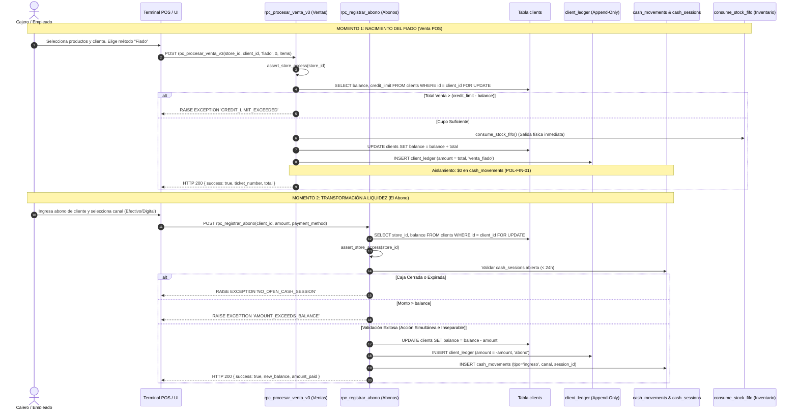

# SDD-024: Política de Cuentas por Cobrar (Fiados de Clientes)

> **Asociado a:** [FRD-024](../FRD/FRD_024_POLITICA_FIADOS_CLIENTES.md)  
> **Módulo:** Ventas, POS, Clientes y Caja  
> **Fase del Plan:** Ola 3 (Ítem 6 - Cierre de Ola)  
> **Estado:** 🟢 Rectificado y Sanitizado (Protocolo PAC-SDD v2.0 / Auditoría QA Aprobada)  
> **Políticas Aplicables:** ARQ-002 (POL-AUTH-01, POL-AUD-01/02, POL-FIN-01/02/03, POL-LOG-01/02, POL-SEC-01, SPEC-010, SPEC-011)

---

## 0. Control de Versiones

| Versión | Fecha | Autor | Descripción del Cambio |
| :--- | :--- | :--- | :--- |
| 1.0.0 | 2026-03-29 | Arquitecto de Software | Creación del borrador conceptual de política de fiados y cuentas por cobrar. |
| 2.0.0 | 2026-10-16 | Orquestador / Auditor QA | Rectificación integral bajo protocolo PAC-SDD v2.0. Erradicación de código embebido, formalización del aislamiento monetario de fiados ($0 en caja en la venta), indivisibilidad atómica del abono hacia caja activa, protección de columna generada `client_ledger.new_balance`, sincronización física de nombres en `clients`, formalización de N=8 deudas técnicas bajo Regla 7 y contratos JSON canónicos en Sección 5. |

---

## 1. Resumen Ejecutivo y Alcance

El presente documento define la arquitectura transaccional, invariantes contables y contratos de interfaz de la **Política de Cuentas por Cobrar (Fiados de Clientes)**.

En el comercio de barrio, el crédito de confianza ("fiado") opera bajo el modelo de **Bandeja de Promesas de Pago**. La promesa de pago se desenvuelve en un entorno puramente informativo y de cartera, rigurosamente aislado del flujo de caja diario, garantizando que el sistema central reconozca en caja únicamente el dinero que cambia físicamente de manos en el presente operativo.

Este estándar arquitectónico se fundamenta en los siguientes cuatro pilares obligatorios:

1. **Aislamiento Monetario de la Promesa (RN-024-01 / POL-FIN-01):** El registro de una venta a crédito (`payment_method = 'fiado'`) tiene terminantemente prohibido inyectar falsos positivos en el cuadre del turno actual. La caja diaria ignora la transacción en términos monetarios ($0 en movimientos de caja), previniendo descuadres entre el saldo teórico y el dinero físico o digital real (`CA-FRD-024-01`).
2. **Impacto Logístico Inmediato (RN-024-02 / POL-LOG-01):** A pesar del aislamiento monetario, la mercancía sale físicamente del establecimiento al momento de la venta. El motor de inventario descuenta el stock en tiempo real mediante el despiece FIFO (`consume_stock_fifo`) y sella el costo de ventas (COGS) en `sale_items.unit_cost` (`CA-FRD-024-02`).
3. **Registro en Bandeja de Pendientes (RN-024-03):** El valor de la venta a crédito se anota en la cuenta individual del cliente. Este registro funciona como una libreta de apuntes ("post-it" virtual) que documenta la deuda viva a favor del negocio (`clients.balance` y `client_ledger`).
4. **Transformación Atómica de Promesa a Liquidez (RN-024-04 / CA-FRD-024-03):** En el instante en que el cliente entrega dinero para amortizar o liquidar su deuda, el sistema ejecuta dos acciones simultáneas e inseparables en una única transacción atómica: descontar el saldo adeudado en la cuenta del cliente (`clients.balance` e inserción en `client_ledger`) e inyectar un registro oficial de tipo `'ingreso'` en el flujo de caja del turno activo (`cash_movements`). Si la sesión de caja está cerrada o caducada (> 24h), la operación se aborta por completo.

---

## 2. Diagrama de Secuencia y Arquitectura



---

## 3. Reglas de Negocio e Invariantes Técnicos

| Identificador | Regla / Invariante Técnico | Severidad | Módulo / Componente Afectado |
| :--- | :--- | :--- | :--- |
| **RN-024-01** | **Aislamiento Monetario de la Promesa de Pago:** El registro de una venta con `payment_method = 'fiado'` tiene terminantemente prohibido generar filas en `cash_movements`. El flujo monetario reportado en el cuadre de caja de la jornada es exactamente **$0** (`POL-FIN-01`, `CA-FRD-024-01`). | Inviolable | POS Checkout / `cash_movements` |
| **RN-024-02** | **Impacto Logístico Inmediato en Existencias:** La venta a crédito reduce inmediatamente el inventario en bodega mediante consumo FIFO (`consume_stock_fifo`), garantizando el control de existencias en tiempo real y el sellado de costos en `sale_items.unit_cost` (`CA-FRD-024-02`). | Inviolable | POS / Inventario FIFO (`SDD_010_016`) |
| **RN-024-03** | **Control de Cupo y Solvencia Crediticia:** La deuda acumulada de un cliente no puede superar su cupo máximo (`credit_limit`). El POS bloquea la transacción si `balance + total > credit_limit`, exigiendo al cajero reducir la venta, cambiar de medio de pago o solicitar ampliación de cupo al Administrador. | Bloqueante | POS Frontend / `rpc_procesar_venta_v3` |
| **RN-024-04** | **Indivisibilidad Atómica del Abono:** Todo dinero recibido como pago de deuda pasada debe registrarse obligatoriamente como ingreso en el turno de caja vigente al momento del cobro (`CA-FRD-024-03`). Queda prohibido descontar deuda si la caja está cerrada, y queda prohibido ingresar dinero a caja sin descontar el saldo del cliente. | Bloqueante | Cartera (`SDD_009`) / Caja (`SDD_020`) |
| **RN-024-05** | **Invariante Crítica de Saldo No Negativo:** El campo `clients.balance` nunca puede ser menor a cero (`balance >= 0`). Si un abono intenta reducir el balance por debajo de $0, la transacción aborta con `AMOUNT_EXCEEDS_BALANCE` y es retenida por el constraint físico `clients_balance_check`. | Inviolable | `clients` / `rpc_registrar_abono` |
| **RN-024-06** | **Anulación de Ventas Fiadas sin Egreso de Caja:** Al anular una venta fiada (`rpc_anular_venta`), el sistema revierte el saldo deudor en `clients.balance` e inserta un contra-asiento en `client_ledger` (`transaction_type = 'anulacion_fiado'`). Queda estrictamente prohibido generar egresos en `cash_movements` ($0 egreso de caja). | Inviolable | Ventas (`SDD_007`) / `cash_movements` |
| **RN-024-07** | **Inviolabilidad Append-Only de Transacciones:** Toda mutación de cartera genera un registro indeleble en `client_ledger`. Queda terminantemente prohibido alterar o eliminar filas de `client_ledger`. La columna `new_balance` se calcula de forma automática e inmutable por el motor de PostgreSQL. | Inviolable | `client_ledger` / `SDD_005` |
| **RN-024-08** | **Neutralidad en P&L Operacional:** Las ventas a crédito se reconocen como ingresos comerciales en `sales` en la fecha en que se despacha la mercancía. Los abonos posteriores no constituyen ingresos por venta duplicados, sino amortizaciones de cartera (conversión de cuentas por cobrar en efectivo/bancos) en el balance general. | Consistencia | P&L Operacional (`SDD_018`) |

---

## 4. Esquema de Datos y Modelado

Las entidades físicas de Supabase Producción que soportan el ciclo de vida del fiado y su liquidación monetaria son las siguientes:

### 4.1 Tabla `clients` (Esquema Físico Verificado)
Tabla maestra de clientes y control de crédito:

| Columna | Tipo de Dato | Nulable | Descripción y Restricciones Físicas |
| :--- | :--- | :--- | :--- |
| `id` | `uuid` | No | Clave primaria (`gen_random_uuid()`). |
| `store_id` | `uuid` | No | Clave foránea hacia `stores(id) ON DELETE CASCADE`. |
| `name` | `text` | No | Nombre completo del cliente. Constraint `clients_name_check: CHECK (length(name) >= 3)`. |
| `id_number` | `text` | No | Identificación oficial única por tienda. Constraint `clients_store_id_id_number_key: UNIQUE (store_id, id_number)`. |
| `phone` | `text` | Sí | Teléfono de contacto. |
| `credit_limit` | `numeric` | No | Límite máximo de crédito asignado (default `100000`). Moneda entera COP sin decimales. |
| `balance` | `numeric` | Sí | Deuda viva acumulada (default `0`). Constraint `clients_balance_check: CHECK (balance >= 0)`. |
| `is_deleted` | `boolean` | Sí | Bandera de borrado lógico (default `false`). |
| `deleted_at` | `timestamptz` | Sí | Timestamp de borrado lógico (nulo si activo). |
| `created_at` | `timestamptz` | No | Timestamp de creación (`now()`). |
| `updated_at` | `timestamptz` | No | Timestamp de última mutación (`now()`). |

### 4.2 Tabla `client_ledger` (Esquema Físico Verificado)
Libro mayor inmutable (append-only) de cuentas por cobrar:

| Columna | Tipo de Dato | Nulable | Descripción y Restricciones Físicas |
| :--- | :--- | :--- | :--- |
| `id` | `uuid` | No | Clave primaria (`gen_random_uuid()`). |
| `client_id` | `uuid` | No | Clave foránea hacia `clients(id)`. |
| `store_id` | `uuid` | No | Clave foránea hacia `stores(id)`. |
| `amount` | `numeric` | No | Importe aritmético de la transacción (+total en fiado, -abono en recaudos, -total en anulación). |
| `previous_balance` | `numeric` | No | Saldo anterior del cliente (default `0`). |
| `new_balance` | `numeric` | No | Saldo resultante. **Columna GENERATED ALWAYS AS (previous_balance + amount) STORED.** Prohibido incluir en `INSERT`. |
| `reference_id` | `uuid` | Sí | Identificador foráneo hacia `sales.id` para ventas fiadas y anulaciones. |
| `transaction_type` | `text` | No | Constraint `client_ledger_transaction_type_check: CHECK (transaction_type = ANY (ARRAY['venta_fiado', 'abono', 'anulacion_fiado']))`. |
| `created_at` | `timestamptz` | Sí | Timestamp de inserción (`now()`). |
| `created_by` | `uuid` | Sí | Clave foránea hacia `employees(id)` resolviendo autoría con `get_employee_id_from_session()`. |

### 4.3 Tabla `sales` (Esquema Físico Verificado)
Comprobante de venta comercial en mostrador:

| Columna | Tipo de Dato | Nulable | Descripción y Restricciones Físicas |
| :--- | :--- | :--- | :--- |
| `id` | `uuid` | No | Clave primaria de la venta. |
| `store_id` | `uuid` | No | Tienda propietaria. |
| `ticket_number` | `integer` | No | Consecutivo numérico seguro por tienda. |
| `client_id` | `uuid` | Sí | Requerido obligatoriamente si `payment_method = 'fiado'`. |
| `total` | `numeric` | No | Importe total liquidado de la venta. |
| `payment_method` | `text` | No | Constraint `sales_payment_method_check: CHECK (payment_method = ANY (ARRAY['efectivo', 'nequi', 'daviplata', 'fiado']))`. |
| `amount_received`| `numeric` | Sí | Registrado como `0` en ventas fiadas. |
| `change_given` | `numeric` | Sí | Registrado como `0` en ventas fiadas. |
| `is_voided` | `boolean` | Sí | Bandera de anulación (default `false`). |
| `voided_by` | `uuid` | Sí | Empleado o admin que autorizó la anulación. |
| `void_reason` | `text` | Sí | Motivo justificado de la anulación. |
| `created_at` | `timestamptz` | No | Fecha de expedición de la venta. |

### 4.4 Tabla `cash_movements` (Esquema Físico Verificado)
Bitácora de movimientos de caja física y digital:

| Columna | Tipo de Dato | Nulable | Descripción y Restricciones Físicas |
| :--- | :--- | :--- | :--- |
| `id` | `uuid` | No | Clave primaria (`gen_random_uuid()`). |
| `session_id` | `uuid` | No | Clave foránea hacia `cash_sessions(id)`. |
| `movement_type` | `text` | No | Constraint `cash_movements_movement_type_check: CHECK (movement_type = ANY (ARRAY['ingreso', 'gasto', 'pago_proveedor']))`. |
| `amount` | `numeric` | No | Constraint `cash_movements_amount_check: CHECK (amount > 0)`. |
| `description` | `text` | No | Detalle del movimiento con canal estructurado (ej. `'[ABONO: EFECTIVO] Cliente Maria Garcia'`). |
| `sale_id` | `uuid` | Sí | Nulo en movimientos de abono a cartera. |
| `created_at` | `timestamptz` | Sí | Timestamp del recaudo (`now()`). |

---

## 5. Contratos de Interfaz (Payloads)

### 5.1 Creación de Deuda: `rpc_procesar_venta_v3` (Modalidad Fiado)

#### 5.1.1 Payload de Solicitud (Request)
Enviado por la terminal POS al confirmar una venta a crédito:

```json
{
  "p_store_id": "a0eebc99-9c0b-4ef8-bb6d-6bb9bd380a11",
  "p_client_id": "c1f7a244-1234-4567-89ab-cdef01234567",
  "p_payment_method": "fiado",
  "p_amount_received": 0,
  "p_items": [
    {
      "product_id": "e2f3a4b5-6789-01bc-defa-234567890123",
      "quantity": 2
    }
  ]
}
```

#### 5.1.2 Payload de Respuesta Exitosa (Response Success)
Retornado tras verificar cupo, descargar inventario FIFO, incrementar balance y asentar en `client_ledger` sin tocar caja:

```json
{
  "success": true,
  "data": {
    "sale_id": "d1c2b3a4-5678-90ab-cdef-123456789012",
    "ticket_number": 1052,
    "total": 24000,
    "rounding_difference": 0,
    "change_given": 0,
    "payment_method": "fiado",
    "client_id": "c1f7a244-1234-4567-89ab-cdef01234567",
    "new_client_balance": 64000,
    "cash_impact": 0,
    "created_at": "2026-10-16T08:45:00.000Z"
  }
}
```

---

### 5.2 Liquidación de Deuda a Caja: `rpc_registrar_abono`

#### 5.2.1 Payload de Solicitud (Request)
Invocado al recibir dinero en caja para amortizar cartera viva:

```json
{
  "p_client_id": "c1f7a244-1234-4567-89ab-cdef01234567",
  "p_amount": 30000,
  "p_payment_method": "efectivo"
}
```

#### 5.2.2 Payload de Respuesta Exitosa (Response Success)
Retornado tras descontar la deuda del cliente e inyectar simultáneamente el ingreso en la sesión de caja activa:

```json
{
  "success": true,
  "data": {
    "client_id": "c1f7a244-1234-4567-89ab-cdef01234567",
    "previous_balance": 64000,
    "amount_paid": 30000,
    "new_balance": 34000,
    "payment_method": "efectivo",
    "cash_movement_id": "b3c4d5e6-7890-12ab-cdef-234567890123",
    "session_id": "f1e2d3c4-b5a6-7890-1234-567890abcdef",
    "created_at": "2026-10-16T10:15:00.000Z"
  }
}
```

---

### 5.3 Anulación de Venta Fiada: `rpc_anular_venta`

#### 5.3.1 Payload de Solicitud (Request)
Invocado por el administrador para anular una venta a crédito:

```json
{
  "p_sale_id": "d1c2b3a4-5678-90ab-cdef-123456789012",
  "p_reason": "Error en digitacion de items por el cliente"
}
```

#### 5.3.2 Payload de Respuesta Exitosa (Response Success)
Retorna la reversión de deuda en cartera con reingreso de stock y cero salida de caja:

```json
{
  "success": true,
  "data": {
    "sale_id": "d1c2b3a4-5678-90ab-cdef-123456789012",
    "ticket_number": 1052,
    "is_voided": true,
    "payment_method": "fiado",
    "amount_reversed": 24000,
    "new_client_balance": 10000,
    "cash_impact": 0,
    "voided_at": "2026-10-16T11:00:00.000Z"
  }
}
```

---

## 6. Manejo de Errores y Casos Límite

| Código de Error / Excepción | Condición de Activación | Comportamiento del Sistema y Acción de Recuperación |
| :--- | :--- | :--- |
| `STORE_ACCESS_DENIED` | El usuario intenta operar sobre clientes o cajas de una tienda ajena a su perfil de sesión (`assert_store_access`). | Aborta inmediatamente con `RAISE EXCEPTION`. Retorna HTTP 403 al cliente. |
| `CREDIT_LIMIT_EXCEEDED` | En checkout fiado, `balance + total > credit_limit`. El cliente no dispone de margen crediticio suficiente. | Aborta con `RAISE EXCEPTION`. El POS muestra el disponible y bloquea el cobro hasta ampliar cupo o cambiar método. |
| `AMOUNT_EXCEEDS_BALANCE` | En abono, el monto a pagar supera la deuda viva actual del cliente (`p_amount > balance`). | Aborta con `RAISE EXCEPTION`. El frontend restringe el monto al máximo adeudado. |
| `NO_OPEN_CASH_SESSION` | Intento de registrar abono a cartera sin que exista un turno de caja abierto (`status = 'open'`) o con antigüedad > 24 horas. | Aborta con `RAISE EXCEPTION`. El cajero debe realizar la apertura de turno antes de recibir liquidez. |
| `CLIENT_NOT_FOUND` | El `p_client_id` no existe en la tienda activa o se encuentra eliminado lógicamente. | Aborta con `RAISE EXCEPTION`. Se refresca la lista de clientes en la terminal. |
| `INVALID_PAYMENT_METHOD` | El canal de abono no corresponde a `'efectivo'`, `'nequi'` o `'daviplata'`. | Aborta con `RAISE EXCEPTION`. El frontend limita la selección a los canales soportados. |
| `INVALID_AMOUNT` | El monto de abono suministrado es menor o igual a cero (`p_amount <= 0`). | Aborta con `RAISE EXCEPTION`. La interfaz valida positividad estricta. |
| `INSUFFICIENT_STOCK` | En venta fiada, alguna de las existencias físicas en bodega no cubre la cantidad solicitada. | Aborta con `RAISE EXCEPTION`. Aplica bloqueo logístico de stock (salvo protocolo de Venta Forzada `SDD_014`). |

---

## 7. Trazabilidad y Deuda Técnica Formalizada (Regla 7)

A continuación se formalizan con rigor las **N=8 deudas técnicas y trade-offs** identificados y auditados durante el análisis de este módulo:

| ID Deuda | Dimensión Afectada | 1. Qué se Decidió | 2. Por qué (Trade-off Concreto) | 3. Condición de Revisión Futura |
| :--- | :--- | :--- | :--- | :--- |
| **D-1** | Transición de Contrato de Abonos (`registrar_abono`) | Normar en SDD-024 el contrato canónico `rpc_registrar_abono(p_client_id, p_amount, p_payment_method)` exigiendo sesión de caja activa e inyectando a `cash_movements`, manteniendo transitoriamente la función legacy en producción. | **Trade-off:** Evita rotura del frontend actual (`clients.ts`) sin forzar caídas en caliente mientras se despliega la suite multicanal de forma coordinada. | Despliegue de la migración de caja multicanal de la Ola 3/4. |
| **D-2** | Sinceramiento de Esquema Físico en `clients` | Adoptar con rigor absoluto los nombres físicos verificados en base de datos (`id_number`, `is_deleted`, `deleted_at`) en lugar de los nombres conceptuales del FRD (`cedula`, `deleted`, `deletedAt`). | **Trade-off:** Erradica discrepancias conceptuales y previene errores `42703` sin requerir DDLs de renombrado cosmético que rompan clientes de PostgREST. | Permanente / Invariante estructural. |
| **D-3** | Invariante de Columna Generada en `client_ledger` | Prohibir categóricamente suministrar `new_balance` en sentencias `INSERT` sobre `client_ledger`, adoptando la convención de signos (`amount > 0` en fiados, `amount < 0` en abonos/anulaciones). | **Trade-off:** Respeta la arquitectura física de base de datos (`ALWAYS GENERATED`), evitando el error fatal PostgreSQL `428C9`. | Permanente / Invariante estructural. |
| **D-4** | Persistencia de Canal en `cash_movements` | Normar la persistencia transitoria del canal estructurado dentro de la columna obligatoria `description` (ej. `'[ABONO: EFECTIVO] ...'`). | **Trade-off:** Cumple con la restricción `is_nullable = NO` de `description` y asegura auditoría de liquidez sin requerir alteración en caliente de `cash_movements`. | Migración DDL agregando `payment_method TEXT NOT NULL` en la Ola 4. |
| **D-5** | Corrección de Bug Latente en `get_history_creditos` | Documentar y normar la corrección de `get_history_creditos` para no referenciar la columna inexistente `cl.description`. | **Trade-off:** Previene el fallo en runtime PostgreSQL `42703 (column cl.description does not exist)` al consultar el historial de crédito. | Migración de remediación de analítica en la Ola 3. |
| **D-6** | Seguridad Multi-Tenant en Resumen de Cartera | Normar la inclusión mandatoria de `PERFORM public.assert_store_access(p_store_id);` como instrucción #1 en `get_client_ledger_summary`. | **Trade-off:** Cierra la vulnerabilidad de enumeración inter-tienda e IDOR en la función `SECURITY DEFINER`. | Próxima migración de seguridad en Ola 3/4. |
| **D-7** | Unificación Canónica de Firma de Abono | Unificar el contrato canónico de abono a 3 parámetros (`p_client_id`, `p_amount`, `p_payment_method`), derivando `store_id` desde `v_client.store_id` y validando con `assert_store_access`. | **Trade-off:** Homogeneiza el estándar con `SDD_009_CLIENTES.md` (§5.1), evita redundancias de payload e impide manipulación de tenant desde el cliente. | Consolidación documental en Bloque 7. |
| **D-8** | Restricción de Medios de Pago por CHECK Físico | Limitar la modalidad de pago de fiados a la etiqueta canónica `'fiado'` admitida en `sales_payment_method_check`. | **Trade-off:** Previene violaciones de constraint PostgreSQL `23514` en el motor de ventas POS al originar la cartera. | Migración multicanal DDL de la Ola 4 (`WO_MIGRATION_OLA4_PAYMENTS`). |
