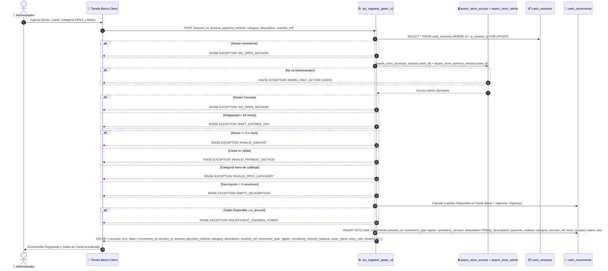
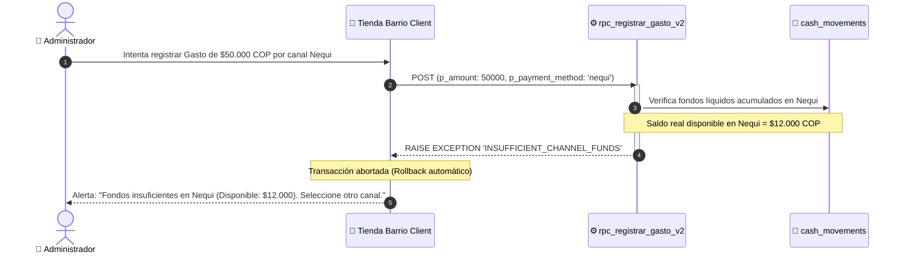
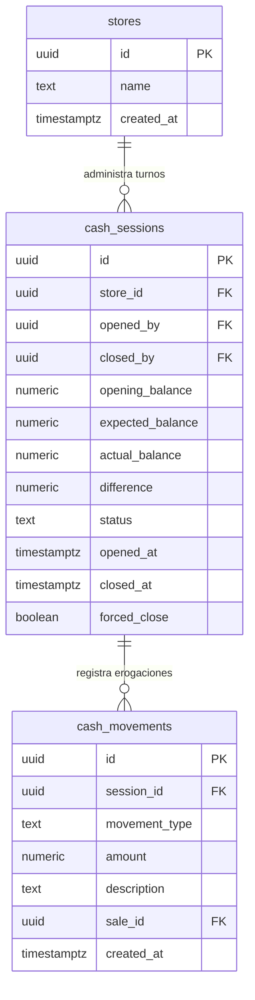

# SDD-026: Política de Gastos Generales (OPEX Inmediato)

> **Asociado a:** [FRD-026](../FRD/FRD_026_POLITICA_GASTOS_INMEDIATOS.md), [FRD-022](../FRD/FRD_022_GASTOS_MULTICANAL.md), Contrato Marco [SDD-003-01](./SDD_003_01_MATRIZ_PERMISOS_EMPLEADOS.md) y [`UX-ADR-002`](../../03_ui_ux_design/UX_ADR_LOG.md#ux-adr-002-consolidación-de-contexto-c2-en-workspace-cash-control-y-gastos-opex-exclusivos-admin)  
> **Fase del Plan:** Ola 2 (`WO-OLA2-C2-001` — Enmienda `POL-SEG-03` y Read Model OPEX)  
> **Estado:** 🟢 Vigente (`UX-ADR-002` — Gastos OPEX 100% exclusivos del Administrador)  
> **Última Actualización:** 2026-11-24  

---

## 0. Contexto y Restricciones Aplicables

### 0.1 Políticas Globales Activadas (`ARQ-002` v1.4)
| Política ID | Dominio | Impacto Concreto en este SDD |
|-------------|---------|------------------------------|
| **POL-FIN-01** | Financiero | **Inmediatez Absoluta y `"pago externo / fuera de caja"`:** Prohibido registrar gastos "por pagar". Todo desembolso fuera de Caja Dedicada POS se marca **"pago externo / fuera de caja"** (100% Admin-only) con `$0` impacto en caja. |
| **POL-FIN-02** | Financiero | **Segregación Estricta (`efectivo`, `nequi`, `llave_bre`):** Se elimina `'daviplata'` y `'bre'`. **Todo gasto digital (Nequi o Llave BRE) descuenta únicamente de su respectivo canal digital y jamás afecta el efectivo físico en gaveta.** Prohibido el sobregiro (`INSUFFICIENT_CHANNEL_FUNDS`). |
| **POL-SEG-03** | Seguridad | **Enmienda `UX-ADR-002` — Gastos OPEX Exclusivos Admin (`assert_store_admin`):** El registro (`rpc_registrar_gasto_v2`) y la consulta (`rpc_obtener_gastos_turno`) de gastos OPEX de caja son **estrictamente exclusivos del Administrador**. Ningún empleado tiene permiso delegable para registrar o consultar gastos OPEX; la UI oculta la pestaña `Gastos` a no-Admin y el backend aborta con `ADMIN_ONLY_ACTION` (`42501`). |
| **POL-AUD-01 / 02** | Auditoría | **Inmutabilidad y Fotografía de Firma (`actor_name`, `actor_role`):** Movimientos `append-only` en `cash_movements` con categoría OPEX cerrada (5 categorías, sin `'Reembolso'`), motivo obligatorio (`>= 3` chars), `p_voucher_ref` opcional y firma histórica inmutable. |
| **SPEC-010 / 011** | Financiero | Enteros COP en `NUMERIC` sin coma flotante; `total_opex_expenses` calculado por PostgreSQL (cero `.reduce()` en cliente). |

### 0.2 Contratos Vecinos que Limitan el Diseño
- **`SDD_003_01` / `UX-ADR-002`:** El registro y consulta de gastos OPEX no forma parte de los permisos delegables de empleado; exige `assert_store_admin(v_session.store_id)`.
- **`SDD_022` / `SDD_019`:** Pagos a proveedores y `"pago externo / fuera de caja"` son 100% Admin-only (`movement_type = 'pago_proveedor'` o `$0` POS).
- **`SDD_006_02`:** Los reembolsos a clientes ya no pertenecen al catálogo OPEX de gastos; se procesan en el POS bajo permiso `canManageRefunds`.
- **`SDD_018` / `SDD_021`:** P&L computa `movement_type = 'gasto'` en OPEX; empleados consultan solo sus movimientos propios del turno actual (`rpc_obtener_mis_movimientos_turno`) en `/cash-control?tab=movements`.

### 0.3 Auditoría de BD y Trade-off Explícito (Regla 7)
- **Esquema real verificado (`supabase_db_prueba`):** `cash_movements` tiene 13 columnas (`id`, `session_id`, `movement_type`, `amount`, `description`, `sale_id`, `created_at`, `payment_method`, `category`, `voucher_ref`, `actor_id`, `actor_name`, `actor_role`) y `cash_sessions` 18 columnas (incluyendo `opening_balance`, `status`, `opened_at`, `closing_attempts`, `forced_close_without_count`).
- **Trade-off formal (Regla 7 — Política OPEX 100% Admin):**
  - **Qué se decidió:** Restringir tanto el registro (`rpc_registrar_gasto_v2`) como la consulta (`rpc_obtener_gastos_turno`) de gastos OPEX estrictamente al Administrador (`assert_store_admin`), sin crear un 5.º permiso delegable en `EmployeePermissions`.
  - **Por qué (trade-off):** Garantiza una distribución simple y clara de responsabilidad financiera en tienda de barrio, evitando proliferación de permisos en `SDD-003-01` y previniendo fugas de caja por egresos operativos no supervisados.
  - **Condición de revisión futura:** Si en una fase posterior tiendas multi-turno operan 100% de forma autónoma sin Administrador presencial y requieren delegar egresos menores de turno, se evaluará introducir un permiso explícito `canRegisterExpenses` auditable con tope diario por turno.

---

## 1. Glosario Local

- **Gasto General (OPEX Inmediato):** Desembolso de liquidez operativo corriente desde Caja Dedicada POS ejecutado exclusivamente por el **Administrador** en turno abierto `< 24h`.
- **Pago Externo / Fuera de Caja:** Desembolso exclusivo del Administrador con fondos propios ajenos al cajón POS (`$0` impacto en caja).
- **Canal de Pago (`payment_method`):** Exclusivamente `'efectivo'`, `'nequi'`, `'llave_bre'`.
- **Catálogo Cerrado de Categorías OPEX (5 categorías — sin `'Reembolso'`):**
  1. `Servicios` (Energía eléctrica, acueducto, gas, servicio de internet, telefonía).
  2. `Nomina` (Jornales diarios, sueldos de personal de turno, anticipos aprobados).
  3. `Transporte` (Acarreos menores, taxis para diligencias de la tienda, domicilios/fletes).
  4. `Mantenimiento` (Reparaciones locativas inmediatas, repuestos menores, bombillos, plomería).
  5. `Insumos` (Bolsas plásticas, papel térmico para tickets, marcadores, elementos de aseo).
- **Snapshot de Firma (`actor_name`, `actor_role`):** Fotografía histórica inmutable del autor.
- **Sobregiro de Canal:** Intento de desembolsar un monto superior a los fondos líquidos acumulados en el canal correspondiente para el turno activo (`INSUFFICIENT_CHANNEL_FUNDS`).

---

## 2. Diagramas de Secuencia

### 2.1 Flujo de Registro de Desembolso Inmediato (`rpc_registrar_gasto_v2`)



### 2.2 Flujo Alternativo: Rechazo por Sobregiro de Fondos



---

## 3. Diagramas de Estado

### 3.1 Ciclo de Vida del Gasto Operativo Inmediato

```mermaid
stateDiagram-v2
    [*] --> FormularioDesembolso : Usuario ingresa datos de erogación
    FormularioDesembolso --> ValidandoSeguridad : Envía solicitud con categoría OPEX
    
    ValidandoSeguridad --> RechazadoSeguridad : STORE_ACCESS_DENIED
    ValidandoSeguridad --> VerificandoSesion : Sesión de tienda comprobada
    
    VerificandoSesion --> RechazadoSesion : Caja cerrada o > 24h
    VerificandoSesion --> VerificandoParametros : Sesión 'open' y activa
    
    VerificandoParametros --> RechazadoParametro : Categoría, Monto o Motivo inválido
    VerificandoParametros --> VerificandoLiquidez : Parámetros validados
    
    VerificandoLiquidez --> RechazadoSobregiro : Fondos insuficientes (INSUFFICIENT_FUNDS)
    VerificandoLiquidez --> ErogacionAsentada : Liquidez confirmada
    
    ErogacionAsentada --> [*] : Movimiento append-only asentado; saldo reducido inmediatamente

    RechazadoSeguridad --> [*] : 403 Forbidden
    RechazadoSesion --> [*] : Rollback Transaccional
    RechazadoParametro --> [*] : Rollback Transaccional
    RechazadoSobregiro --> [*] : Rollback Transaccional
```



---

## 4. Especificación Detallada de Casos de Uso

### Caso A: Notificación de Gasto Futuro (Fuera del Sistema — FRD-026 Caso A)
- **Actor:** Usuario Operativo / Propietario de la tienda.
- **Precondición:** El encargado recibe la factura física del servicio eléctrico el día lunes, la cual tiene como fecha de vencimiento el día viernes.
- **Flujo Principal:**
  1. El encargado retiene el recibo físico en la gaveta o cartelera del local.
  2. El software permanece inalterado. El usuario no registra ningún compromiso futuro en el sistema.
  3. El control de caja diario se mantiene puro y libre de pasivos ficticios.
- **Flujo Alternativo:** El usuario intenta buscar en la interfaz una opción para "crear un gasto por pagar" o "registrar factura pendiente". El sistema no provee dicha funcionalidad por diseño normativo.
- **Postcondición:** La liquidez y los reportes financieros del negocio no sufren contaminación por deudas operativas no desembolsadas.

### Caso B: Ejecución y Registro del Desembolso en Efectivo (FRD-026 Caso B)
- **Actor:** **Administrador** con sesión de caja activa.
- **Precondición:** Llega el día viernes. El Administrador extrae `$65.000 COP` en efectivo del cajón físico para pagar el servicio eléctrico.
- **Flujo Principal:**
  1. El Administrador accede al formulario de "Registrar Gasto".
  2. Digita el monto extraído: `$65.000 COP`.
  3. Selecciona el canal de origen: `Efectivo`.
  4. Selecciona la categoría OPEX: `Servicios`.
  5. Ingresa la descripción: `"Pago de factura de energía Codensa"`.
  6. Presiona el botón "Confirmar Gasto OPEX".
  7. El servidor recupera la sesión, verifica permisos con `assert_store_access()` + `assert_store_admin()` y valida que la caja esté abierta (`status = 'open'`) con antigüedad `< 24h`.
  8. El servidor calcula la liquidez disponible en Efectivo para el turno en curso y comprueba que `saldo_efectivo >= 65000`.
  9. El servidor asienta el egreso en `cash_movements` con `movement_type = 'gasto'`, `category = 'Servicios'`, `payment_method = 'efectivo'` y descripción limpia `TRIM(p_description)` (`"Pago de factura de energía Codensa"`).
  10. El dinero esperado en efectivo reportado para el arqueo del turno actual disminuye inmediatamente en `$65.000 COP`.
- **Postcondición:** Egreso asentado de forma inmutable; arqueo físico de efectivo sincronizado en tiempo real.

### Caso C: Desembolso Digital (`Nequi` / `Llave Bre-B`) con Segregación Multicanal
- **Actor:** **Administrador**.
- **Precondición:** Se efectúa una transferencia digital desde la cuenta Nequi de la tienda por `$30.000 COP` para comprar bolsas e insumos de aseo.
- **Flujo Principal:**
  1. El Administrador selecciona canal `Nequi`, categoría `Insumos`, monto `$30.000 COP`, comprobante opcional (`p_voucher_ref`) y motivo `"Compra de bolsas plásticas y cinta"`.
  2. El sistema valida la disponibilidad de saldo en el canal Nequi.
  3. Al confirmar fondos suficientes, el servidor registra el egreso en `cash_movements` persistiendo `payment_method = 'nequi'`, `category = 'Insumos'` y descripción limpia.
  4. El saldo esperado de Nequi disminuye inmediatamente en `$30.000 COP`.
  5. El dinero físico del cajón (Efectivo) permanece estrictamente intacto.
- **Postcondición:** Gasto digital asentado; sin afectación cruzada al efectivo en gaveta.

### Caso D: Rechazo Transaccional por Sobregiro / Fondos Insuficientes
- **Actor:** **Administrador**.
- **Precondición:** La tienda tiene saldo disponible en Nequi de `$5.000 COP`.
- **Flujo Principal:**
  1. El usuario intenta registrar un gasto de transporte por `$15.000 COP` por el canal `Nequi`.
  2. El servidor detecta que el saldo del canal resultaría negativo (`$5.000 - $15.000 = -$10.000 < 0`).
  3. El servidor aborta la transacción inmediatamente lanzando la excepción `INSUFFICIENT_FUNDS`.
  4. El sistema ejecuta un rollback automático: no se inserta ninguna fila en `cash_movements` ni se altera ningún saldo.
  5. La interfaz notifica al usuario: *"Fondos insuficientes en el canal Nequi (Disponible: $5.000). Seleccione el origen real de los fondos."*
- **Postcondición:** Cero asientos ficticios; principio de no-sobregiro respetado.

---

## 5. Contrato de Interfaz

### Operación 1 (WRITE): `rpc_registrar_gasto_v2`
- **Tipo:** Postgres RPC (Función Almacenada) / Acción (WRITE)
- **Modo de Ejecución:** `SECURITY DEFINER` con Search Path seguro (`SET search_path = public, pg_temp;`).
- **Firma SQL Real Verificada:**
  `public.rpc_registrar_gasto_v2(p_session_id uuid, p_amount numeric, p_payment_method text, p_category text, p_description text, p_voucher_ref text DEFAULT NULL::text) RETURNS jsonb`
- **Parámetros de Entrada:**
  ```json
  {
    "p_session_id": "UUID (Obligatorio — Identificador de la sesión de caja activa)",
    "p_amount": "NUMERIC (Obligatorio — Monto entero COP estrictamente positivo > 0)",
    "p_payment_method": "TEXT (Obligatorio — Valores autorizados: 'efectivo', 'nequi', 'llave_bre')",
    "p_category": "TEXT (Obligatorio — Valores autorizados: 'Servicios', 'Nomina', 'Transporte', 'Mantenimiento', 'Insumos')",
    "p_description": "TEXT (Obligatorio — Longitud mínima 3 caracteres tras TRIM)",
    "p_voucher_ref": "TEXT (Opcional DEFAULT NULL — Referencia/comprobante para pagos digitales)"
  }
  ```
- **Payload de Respuesta Exitosa (200 OK):**
  ```json
  {
    "success": true,
    "data": {
      "movement_id": "8f3b2190-3456-4789-abcd-ef0123456789",
      "session_id": "b3e1a6c0-1234-4567-89ab-cdef01234567",
      "amount": 65000,
      "payment_method": "efectivo",
      "category": "Servicios",
      "description": "Pago de factura de energía Codensa",
      "voucher_ref": null,
      "movement_type": "gasto",
      "remaining_channel_balance": 35000,
      "actor_name": "Administrador",
      "actor_role": "owner",
      "created_at": "2026-11-24T15:30:00Z"
    }
  }
  ```
- **Catálogo Exhaustivo de Errores (9 Códigos Unificados):**
  | Código de Error | Causa de Negocio | Mensaje Técnico / SQLSTATE |
  |-----------------|------------------|----------------------------|
  | `STORE_ACCESS_DENIED` | El usuario no pertenece a la tienda de la sesión o carece de sesión válida | `assert_store_access` — El usuario no tiene acceso a esta tienda |
  | `ADMIN_ONLY_ACTION` | Un empleado o actor sin rol de Administrador intenta registrar o consultar gastos OPEX | `42501` — `ADMIN_ONLY_ACTION: Esta acción es exclusiva del Administrador.` |
  | `NO_OPEN_SESSION` | La sesión indicada no existe (`P0002`) o se encuentra en estado `'closed'` (`P0001`) | No existe una sesión de caja activa para registrar el gasto |
  | `SHIFT_EXPIRED_24H` | La sesión de caja abierta supera las 24 horas transcurridas desde su apertura | `P0001` — El turno de caja superó el límite de 24 horas y pasó a Expirado/Bloqueado |
  | `INVALID_AMOUNT` | El parámetro `p_amount` es menor o igual a cero o nulo | `22023` — El monto del gasto debe ser un valor positivo mayor a cero |
  | `INVALID_PAYMENT_METHOD` | Canal monetario suministrado no válido | `22023` — Permitidos: `efectivo`, `nequi`, `llave_bre` |
  | `INVALID_OPEX_CATEGORY` | La categoría no pertenece a las 5 autorizadas del catálogo cerrado | `22023` — Permitidas: `Servicios`, `Nomina`, `Transporte`, `Mantenimiento`, `Insumos` |
  | `EMPTY_DESCRIPTION` | La descripción suministrada está vacía o tiene menos de 3 caracteres | `22023` — La descripción del gasto debe contener al menos 3 caracteres |
  | `INSUFFICIENT_CHANNEL_FUNDS` | La liquidez disponible en el canal seleccionado es inferior al monto a desembolsar | `P0001` — Fondos insuficientes en canal seleccionado |

### Operación 2 (READ MODEL): `rpc_obtener_gastos_turno`
- **Tipo:** Postgres RPC (Función Almacenada) / Lectura Autoritativa (READ)
- **Modo de Ejecución:** `SECURITY DEFINER` con `SET search_path = public, pg_temp;`.
- **Firma SQL:** `public.rpc_obtener_gastos_turno(p_session_id uuid) RETURNS jsonb`
- **Seguridad:** Verifica existencia de `v_session` en `cash_sessions` (`NO_OPEN_SESSION` si no existe), invoca `assert_store_access(v_session.store_id)` y **`assert_store_admin(v_session.store_id)`** (aborta con `ADMIN_ONLY_ACTION` / `42501` para no-Admin).
- **Invariante Read Model:** Calcula `total_opex_expenses` en PostgreSQL mediante `COALESCE(SUM(amount), 0)` filtrando estrictamente `movement_type = 'gasto'` (excluye `'pago_proveedor'`, `'reembolso'` e `'ingreso'`), eliminando agregaciones `.reduce()` en cliente.
- **Payload de Respuesta:**
  ```json
  {
    "success": true,
    "session_id": "<uuid>",
    "session_status": "open|closed",
    "total_opex_expenses": 0,
    "count": 0,
    "data": [
      {
        "id": "<uuid>",
        "amount": 0,
        "description": "...",
        "category": "...",
        "payment_method": "efectivo|nequi|llave_bre",
        "voucher_ref": null,
        "actor_name": "...",
        "actor_role": "...",
        "created_at": "..."
      }
    ]
  }
  ```

---

## 6. Análisis de Seguridad e Integridad

### 6.1 Reutilización Obligatoria de Funciones Centralizadas (Regla 4)
- **Validación Multi-Tenant, Tienda y Rol Admin (Regla 4):**
  Queda terminantemente prohibida cualquier comprobación de pertenencia o consulta ad-hoc manual (`WHERE store_id = ...`). Tanto `rpc_registrar_gasto_v2` como `rpc_obtener_gastos_turno` deben invocar obligatoriamente `public.assert_store_access(v_session.store_id)` y **`public.assert_store_admin(v_session.store_id)`** tras recuperar la sesión. Si el usuario no pertenece a la tienda aborta con `STORE_ACCESS_DENIED`; si no es Administrador aborta con `ADMIN_ONLY_ACTION` (`42501`).
- **Resolución Autoritativa del Autor:**
  La identidad del autor se resuelve mediante `public.resolve_actor_snapshot(v_session.store_id)` (almacenando `actor_id`, `actor_name`, `actor_role`). Queda prohibido confiar en identificadores enviados desde el frontend o exigir PINs locales.

### 6.2 Privilegios Base en Tablas y Funciones (Regla 8)
Para prevenir errores de denegación de permisos `42501 (Permission Denied)` en Supabase Cloud, las tablas base involucradas (`cash_movements`, `cash_sessions`) y ambos RPCs (`rpc_registrar_gasto_v2`, `rpc_obtener_gastos_turno`) cuentan explícitamente con privilegios otorgados (`GRANT ALL` / `GRANT EXECUTE`) a los roles `anon`, `authenticated` y `service_role`. Ambos RPCs operan con `SECURITY DEFINER` y `SET search_path = public, pg_temp`.

### 6.3 Políticas de Seguridad a Nivel de Fila (RLS) y Aislamiento Multi-Tenant
La tabla `cash_movements` opera con políticas RLS estrictas y activas, garantizando aislamiento multi-tenant absoluto para roles autenticados. La política de seguridad condiciona el acceso a que la sesión vinculada (`session_id`) pertenezca a la tienda identificada autoritativamente mediante la función centralizada `public.get_current_store_id()`. Ningún usuario puede consultar, insertar ni visualizar movimientos pertenecientes a tiendas ajenas.

### 6.4 Concurrencia y Control de Carrera (Bloqueo Pesimista)
Toda extracción monetaria exige control de concurrencia a nivel lógico mediante bloqueo pesimista (`FOR UPDATE`) sobre la fila de la sesión en `cash_sessions` antes de computar saldos o insertar movimientos. Esto garantiza que múltiples solicitudes simultáneas de egreso, o una colisión entre un gasto operativo y un cierre de turno concurrente, se serialicen atómicamente, impidiendo condiciones de carrera y asegurando que el saldo resultante nunca sea negativo ni viole la regla de no-sobregiro (`balance >= 0`).

---

## 7. Modelo de Datos Lógico Verificado

### 7.1 Diagrama Entidad-Relación



### 7.2 Diccionario de Datos Físico Verificado

#### Tabla: `cash_movements` (Esquema Real de Producción)
| Columna | Tipo de Dato | Nullable | Restricción / Default | Estado en BD | Propósito y Contrato |
|---------|--------------|----------|-----------------------|--------------|----------------------|
| `id` | `uuid` | NO | `gen_random_uuid()` PK | ✅ Existe | Identificador único e inmutable del egreso |
| `session_id` | `uuid` | NO | FK `cash_sessions(id)` ON DELETE CASCADE | ✅ Existe | Sesión de caja activa a la que se imputa la erogación |
| `movement_type` | `text` | NO | CHECK (`'ingreso'`, `'gasto'`, `'pago_proveedor'`) | ✅ Existe | Para gastos OPEX inmediatos es estrictamente `'gasto'` |
| `amount` | `numeric` | NO | CHECK (`amount > 0`) | ✅ Existe | Monto positivo extraído en pesos colombianos |
| `description` | `text` | NO | NOT NULL | ✅ Existe | Texto limpio (`TRIM`, mínimo 3 caracteres); categoría y canal se almacenan en `category` y `payment_method` |
| `sale_id` | `uuid` | SÍ | FK `sales(id)` | ✅ Existe | Nulo para egresos de gastos operativos |
| `created_at` | `timestamptz` | NO | `now()` | ✅ Existe | Marca temporal del desembolso para auditoría |

#### Tabla: `cash_sessions` (Esquema Real de Producción)
| Columna | Tipo de Dato | Nullable | Restricción / Default | Estado en BD | Propósito y Contrato |
|---------|--------------|----------|-----------------------|--------------|----------------------|
| `id` | `uuid` | NO | `gen_random_uuid()` PK | ✅ Existe | Identificador único del turno de caja |
| `store_id` | `uuid` | NO | FK `stores(id)` | ✅ Existe | Tienda propietaria de la sesión |
| `opened_by` | `uuid` | NO | FK `employees(id)` / `admin_profiles` | ✅ Existe | Usuario que aperturó la caja |
| `closed_by` | `uuid` | SÍ | FK `employees(id)` / `admin_profiles` | ✅ Existe | Usuario que efectuó el cierre de turno |
| `opening_balance` | `numeric` | NO | Base >= 0 | ✅ Existe | Fondo de cambio físico asignado a Efectivo |
| `expected_balance` | `numeric` | SÍ | Saldo calculado | ✅ Existe | Balance esperado (`Base + Ingresos - Egresos`) |
| `actual_balance` | `numeric` | SÍ | Conteo real | ✅ Existe | Dinero real reportado en arqueo ciego |
| `difference` | `numeric` | SÍ | `actual - expected` | ✅ Existe | Descuadre contable registrado al cierre |
| `status` | `text` | NO | CHECK (`'open'`, `'closed'`) | ✅ Existe | Estado operativo del turno |
| `opened_at` | `timestamptz` | NO | `now()` | ✅ Existe | Inicio de la sesión para cálculo de vigencia de 24h |
| `closed_at` | `timestamptz` | SÍ | Timestamp | ✅ Existe | Fin del turno de caja |
| `forced_close` | `boolean` | NO | `false` | ✅ Existe | Marca de cierre forzado por caducidad |
