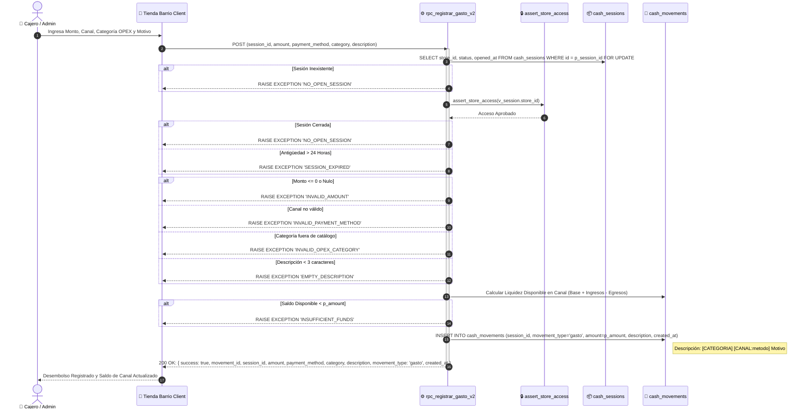
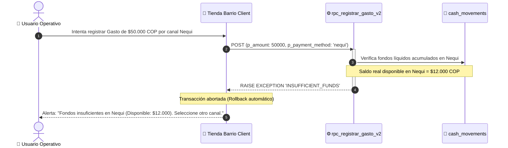
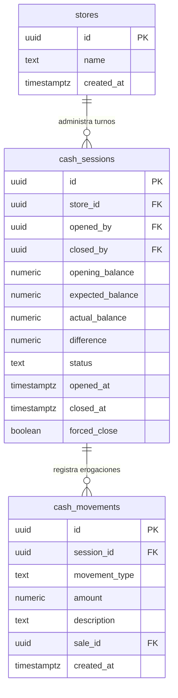

# SDD-026: Política de Gastos Generales (OPEX Inmediato)

> **Asociado a:** [FRD-026](../FRD/FRD_026_POLITICA_GASTOS_INMEDIATOS.md) (Límite Contable y Ejecución Inmediata de Gastos)  
> **Fase del Plan:** Ola 1 — Cimientos de Caja y Gastos  
> **Estado:** 🟠 Aprobado con Deuda Técnica Documentada (PAC-SDD Completo 2026-10-14)  
> **Última Actualización:** 2026-10-14  

---

## 0. Contexto y Restricciones Aplicables

### 0.1 Políticas Globales Activadas (ARQ-002)
| Política ID | Dominio | Impacto Concreto en este SDD |
|-------------|---------|------------------------------|
| **POL-FIN-01** | Financiero | **Inmediatez Absoluta (Flujo de Caja Puro):** Queda terminantemente prohibido modelar gastos generales como pasivos acumulados o promesas de pago ("gastos pendientes" o "por pagar"). Un gasto existe financiera y contablemente única y exclusivamente en el instante exacto en que el dinero físico o digital abandona las arcas del establecimiento. El sistema carece por diseño de interfaces o tablas para almacenar recibos futuros (CA-FRD-026-01). |
| **POL-FIN-02** | Financiero | **Afectación y Segregación Estricta de Canales:** Todo gasto operativo debe imputarse al canal monetario exacto de origen (`efectivo`, `nequi`, `llave_bre`) y debitar exclusivamente de la liquidez real disponible en dicho canal. Se prohíbe el sobregiro contable: si el saldo del canal resulta menor a la erogación, el servidor aborta la operación con `INSUFFICIENT_FUNDS` (CA-FRD-026-03). |
| **POL-AUD-01** | Auditoría | **Trazabilidad e Inmutabilidad de Egresos:** Todo registro de gasto genera una transacción de egreso real e inmediata de tipo `append-only` en `cash_movements` con `movement_type = 'gasto'`. Queda estrictamente vetado el `UPDATE` o `DELETE` de movimientos asentados. Toda salida exige una descripción no vacía (mínimo 3 caracteres) y una categoría OPEX válida (CA-FRD-026-04). |
| **POL-AUTH-01** | Seguridad | **Autorización Centralizada y Erradicación de PIN (Decisión D-01):** Todo egreso valida el acceso a la tienda del usuario mediante `assert_store_access(v_session.store_id)`. La identidad del cajero o autor se resuelve mediante `get_employee_id_from_session()` e `is_authorized_employee()`. Quedan erradicados los PINs locales de caja o tienda. |
| **SPEC-010 / 011** | Financiero | **Conservación Numérica y Moneda Entera:** Manejo riguroso de montos en Pesos Colombianos (COP) utilizando valores enteros en columnas de tipo `NUMERIC`. Cero tolerancia a desbordamientos o imprecisiones de punto flotante en la suma y resta de saldos. |

### 0.2 Contratos Vecinos que Limitan el Diseño
| SDD Origen | Restricción Inyectada | Impacto en la Política de Gastos |
|------------|-----------------------|----------------------------------|
| **SDD_004 (Control de Caja)** | Exigencia de sesión `open` activa y turno < 24h. | Bloquea de inmediato el registro de gastos si la caja está cerrada (`NO_OPEN_SESSION`) o si el turno supera las 24 horas transcurridas (`SESSION_EXPIRED`). En `cerrar_caja`, los egresos de tipo `'gasto'` se suman obligatoriamente al total de salidas para deducir del saldo esperado de turno. |
| **SDD_020 (Caja Multicanal)** | Estructura multicanal de balances y no-sobregiro. | El egreso reduce el `expected_balance` del canal seleccionado en `cash_session_balances`. El gasto digital (ej. Nequi) no altera el efectivo físico en cajón, protegiendo el arqueo ciego regular y forzado. |
| **SDD_022 (Gastos Multicanal)** | Paridad de interfaz y segregación ontológica de egresos. | `SDD_022` y `SDD_026` comparten el mismo contrato de interfaz para `rpc_registrar_gasto_v2`. Se impone la distinción estricta: los gastos operativos de sostenimiento asientan con `movement_type = 'gasto'`; las cancelaciones de facturas a proveedores asientan con `movement_type = 'pago_proveedor'`. |
| **SDD_018 (Control Operacional)** | P&L y Estado de Resultados (`Extracción de Reporte Financiero`). | En `rpc_get_comprehensive_financial_report`, los gastos operativos se consolidan sumando `movement_type = 'gasto'`. SDD-026 garantiza que los gastos generales se registren exclusivamente bajo `'gasto'`, protegiendo el Costo de Mercancía Vendida (COGS FIFO) y la Utilidad Neta de duplicaciones contables. |
| **SDD_021 (Historiales Multicanal)** | Auditoría de movimientos desglosada por canal y concepto. | El historial consume `cash_movements` filtrando por `payment_method`. La adopción del formato transitorio estructurado en `description` permite exponer la categoría OPEX y el método de pago al frontend. |

### 0.3 Auditoría de BD contra Realidad (Deuda Técnica Declarada bajo Regla 7)
*Evidencia cruda obtenida de Supabase Producción (`ihtjocmhzuliwwvdzfnz`) mediante consultas de verificación a `information_schema.columns`, `pg_constraint` y `pg_proc`:*

- **Tablas físicas verificadas en producción:**
  - `cash_sessions` (12 columnas existentes): `id`, `store_id`, `opened_by`, `closed_by`, `opening_balance`, `expected_balance`, `actual_balance`, `difference`, `status`, `opened_at`, `closed_at`, `forced_close`.
  - `cash_movements` (7 columnas existentes): `id`, `session_id`, `movement_type`, `amount`, `description` (NOT NULL), `sale_id`, `created_at`.
- **Ausencia física de tablas de pasivos de gasto comprobada:**
  - Se confirmó en `information_schema.tables` la inexistencia de tablas como `expenses`, `cash_session_balances` o `accounts_payable` (resultado de consulta vacío).
- **Restricciones y Check Constraints verificados:**
  - `cash_movements_amount_check`: Restricción estricta `amount > 0` (monto positivo obligatorio).
  - `cash_movements_movement_type_check`: Tipos de movimiento permitidos restringidos a `'ingreso'`, `'gasto'`, `'pago_proveedor'`.
- **Estado de funciones en catálogo `pg_proc`:**
  - Se confirmó que no existe la función `rpc_registrar_gasto_v2` ni ninguna otra función de gasto o egreso operativo (`%gasto%` o `%expense%`) en la base física de producción.

| # | Hallazgo / Componente | Brecha Real Detectada | Solución Normativa y Trade-off (Regla 7) | Condición de Revisión Futura |
|---|-----------------------|-----------------------|------------------------------------------|------------------------------|
| **H-1** | 🔴 **Ausencia de columna `category` en `cash_movements`** | `cash_movements` solo tiene 7 columnas físicas. No existe una columna dedicada para la categoría OPEX en la base física de producción. | **Decisión:** Exigir en el contrato RPC `p_category` obligatorio dentro del catálogo de las 6 categorías autorizadas. Persistir transitoriamente en `description` con formato obligatorio estructurado: `[CATEGORIA] [CANAL:metodo_pago] Motivo` (ej. `[Servicios] [CANAL:nequi] Pago recibo energía`). Garantiza trazabilidad y auditoría sin alterar el esquema DDL actual. | Despliegue de migración DDL consolidada en Ola 4: `ALTER TABLE public.cash_movements ADD COLUMN category TEXT;`. |
| **H-2** | 🔴 **Ausencia de columna `payment_method` en `cash_movements`** | `cash_movements` no cuenta con columna de canal nativa ni existe en producción la tabla `cash_session_balances`. | **Decisión:** Exigir `p_payment_method` obligatorio en el contrato RPC. El servidor calcula la liquidez disponible del canal y encapsula la etiqueta `[CANAL:metodo_pago]` en `description`. Previene la pérdida de trazabilidad del medio de pago en egresos de caja. | Aplicación de la migración multicanal `20260727000000_multichannel_schema.sql` en Ola 4. |
| **H-3** | 🔴 **Inexistencia física de `rpc_registrar_gasto_v2` en `pg_proc`** | En la base de datos real de producción no existe ninguna función almacenada para el registro de gastos operativos. | **Decisión:** Formalizar exhaustivamente en SDD-026 el contrato normativo objetivo de `rpc_registrar_gasto_v2` en paridad total con `SDD_022` (firmas, validaciones centralizadas, catálogo de 8 errores y payload de 8 campos). Permite cerrar la especificación documental sin migraciones prematuras de código SQL. | Creación y despliegue del RPC `rpc_registrar_gasto_v2` en Supabase Producción durante la fase de implementación de backend. |
| **H-4** | 🟡 **Agregación plana en P&L de `SDD_018`** | `rpc_get_comprehensive_financial_report` suma los gastos operativos de forma plana (`movement_type = 'gasto'`) sin exponer las categorías OPEX individualizadas en su JSON de salida. | **Decisión:** SDD-026 asienta estrictamente `movement_type = 'gasto'` para alimentar limpiamente la suma de `operational_expenses` sin distorsión. El catálogo cerrado de 6 categorías se estandariza como base taxonómica que alimentará la desagregación analítica futura. | Refactorización de la salida de `SDD_018` y vista contable en la Ola 4. |

---

## 1. Glosario Local

- **Gasto General (OPEX Inmediato):** Desembolso de liquidez operativo corriente requerido para el funcionamiento diario del establecimiento comercial (arriendo, servicios públicos, compras menores de aseo, transporte local o anticipos de personal). Es un egreso transaccional definitivo que se reconoce única y exclusivamente al momento de la salida de dinero.
- **Proscripción de Pasivos Operativos:** Principio arquitectónico cardinal que prohíbe la existencia de recibos o deudas por gastos dentro de la base de datos central. El sistema permanece completamente agnóstico a cualquier factura física hasta tanto no se efectúe la erogación.
- **Canal de Pago (`payment_method`):** Vía monetaria real de donde se extraen los fondos. Valores autorizados: `'efectivo'`, `'nequi'`, `'llave_bre'`.
- **Catálogo Cerrado de Categorías OPEX:** Lista taxativa de 6 conceptos autorizados para clasificar egresos:
  1. `Servicios` (Energía eléctrica, acueducto, gas, servicio de internet, telefonía).
  2. `Nomina` (Jornales diarios, sueldos de personal de turno, anticipos aprobados).
  3. `Transporte` (Acarreos menores, taxis para diligencias de la tienda, domicilios/fletes).
  4. `Mantenimiento` (Reparaciones locativas inmediatas, repuestos menores, bombillos, plomería).
  5. `Insumos` (Bolsas plásticas, papel térmico para tickets, marcadores, elementos de aseo).
  6. `Reembolso` (Salidas monetarias autorizadas para devoluciones o rectificaciones operativas).
- **Sobregiro de Canal:** Intento de desembolsar un monto superior a los fondos líquidos acumulados en el canal correspondiente para el turno activo. Aborta con error `INSUFFICIENT_FUNDS`.

---

## 2. Diagramas de Secuencia

### 2.1 Flujo de Registro de Desembolso Inmediato (`rpc_registrar_gasto_v2`)



### 2.2 Flujo Alternativo: Rechazo por Sobregiro de Fondos



---

## 3. Diagramas de Estado

### 3.1 Ciclo de Vida del Gasto Operativo Inmediato

```mermaid
stateDiagram-v2
    [*] --> FormularioDesembolso : Usuario ingresa datos de erogación
    FormularioDesembolso --> ValidandoSeguridad : Envía solicitud con categoría OPEX
    
    ValidandoSeguridad --> RechazadoSeguridad : STORE_ACCESS_DENIED
    ValidandoSeguridad --> VerificandoSesion : Sesión de tienda comprobada
    
    VerificandoSesion --> RechazadoSesion : Caja cerrada o > 24h
    VerificandoSesion --> VerificandoParametros : Sesión 'open' y activa
    
    VerificandoParametros --> RechazadoParametro : Categoría, Monto o Motivo inválido
    VerificandoParametros --> VerificandoLiquidez : Parámetros validados
    
    VerificandoLiquidez --> RechazadoSobregiro : Fondos insuficientes (INSUFFICIENT_FUNDS)
    VerificandoLiquidez --> ErogacionAsentada : Liquidez confirmada
    
    ErogacionAsentada --> [*] : Movimiento append-only asentado; saldo reducido inmediatamente

    RechazadoSeguridad --> [*] : 403 Forbidden
    RechazadoSesion --> [*] : Rollback Transaccional
    RechazadoParametro --> [*] : Rollback Transaccional
    RechazadoSobregiro --> [*] : Rollback Transaccional
```



---

## 4. Especificación Detallada de Casos de Uso

### Caso A: Notificación de Gasto Futuro (Fuera del Sistema — FRD-026 Caso A)
- **Actor:** Usuario Operativo / Propietario de la tienda.
- **Precondición:** El encargado recibe la factura física del servicio eléctrico el día lunes, la cual tiene como fecha de vencimiento el día viernes.
- **Flujo Principal:**
  1. El encargado retiene el recibo físico en la gaveta o cartelera del local.
  2. El software permanece inalterado. El usuario no registra ningún compromiso futuro en el sistema.
  3. El control de caja diario se mantiene puro y libre de pasivos ficticios.
- **Flujo Alternativo:** El usuario intenta buscar en la interfaz una opción para "crear un gasto por pagar" o "registrar factura pendiente". El sistema no provee dicha funcionalidad por diseño normativo.
- **Postcondición:** La liquidez y los reportes financieros del negocio no sufren contaminación por deudas operativas no desembolsadas.

### Caso B: Ejecución y Registro del Desembolso en Efectivo (FRD-026 Caso B)
- **Actor:** Cajero o Administrador con sesión de caja activa.
- **Precondición:** Llega el día viernes. El encargado extrae `$65.000 COP` en efectivo del cajón físico para pagar el servicio eléctrico.
- **Flujo Principal:**
  1. El usuario accede al formulario de "Registrar Gasto".
  2. Digita el monto extraído: `$65.000 COP`.
  3. Selecciona el canal de origen: `Efectivo`.
  4. Selecciona la categoría OPEX: `Servicios`.
  5. Ingresa la descripción: `"Pago de factura de energía Codensa"`.
  6. Presiona el botón "Confirmar Gasto".
  7. El servidor recupera la sesión, verifica permisos con `assert_store_access()` y valida que la caja esté abierta (`status = 'open'`) con antigüedad `< 24h`.
  8. El servidor calcula la liquidez disponible en Efectivo para el turno en curso y comprueba que `saldo_efectivo >= 65000`.
  9. El servidor asienta el egreso en `cash_movements` con `movement_type = 'gasto'` y formatea la descripción: `[Servicios] [CANAL:efectivo] Pago de factura de energía Codensa`.
  10. El dinero esperado en efectivo reportado para el arqueo del turno actual disminuye inmediatamente en `$65.000 COP`.
- **Postcondición:** Egreso asentado de forma inmutable; arqueo físico de efectivo sincronizado en tiempo real.

### Caso C: Desembolso Digital (Nequi / Daviplata) con Segregación Multicanal
- **Actor:** Administrador o Cajero autorizado.
- **Precondición:** Se efectúa una transferencia digital desde la cuenta Nequi de la tienda por `$30.000 COP` para comprar bolsas e insumos de aseo.
- **Flujo Principal:**
  1. El usuario selecciona canal `Nequi`, categoría `Insumos`, monto `$30.000 COP` y motivo `"Compra de bolsas plásticas y cinta"`.
  2. El sistema valida la disponibilidad de saldo en el canal Nequi.
  3. Al confirmar fondos suficientes, el servidor registra el egreso en `cash_movements` vinculando la etiqueta `[CANAL:nequi]`.
  4. El saldo esperado de Nequi disminuye inmediatamente en `$30.000 COP`.
  5. El dinero físico del cajón (Efectivo) permanece estrictamente intacto.
- **Postcondición:** Gasto digital asentado; sin afectación cruzada al efectivo en gaveta.

### Caso D: Rechazo Transaccional por Sobregiro / Fondos Insuficientes
- **Actor:** Cajero o Administrador.
- **Precondición:** La tienda tiene saldo disponible en Nequi de `$5.000 COP`.
- **Flujo Principal:**
  1. El usuario intenta registrar un gasto de transporte por `$15.000 COP` por el canal `Nequi`.
  2. El servidor detecta que el saldo del canal resultaría negativo (`$5.000 - $15.000 = -$10.000 < 0`).
  3. El servidor aborta la transacción inmediatamente lanzando la excepción `INSUFFICIENT_FUNDS`.
  4. El sistema ejecuta un rollback automático: no se inserta ninguna fila en `cash_movements` ni se altera ningún saldo.
  5. La interfaz notifica al usuario: *"Fondos insuficientes en el canal Nequi (Disponible: $5.000). Seleccione el origen real de los fondos."*
- **Postcondición:** Cero asientos ficticios; principio de no-sobregiro respetado.

---

## 5. Contrato de Interfaz

### Operación: `rpc_registrar_gasto_v2`
- **Tipo:** Postgres RPC (Función Almacenada) / Acción (WRITE)
- **Modo de Ejecución:** `SECURITY DEFINER` con Search Path seguro (`SET search_path = public, pg_temp;`).
- **Firma de Entrada:**
  ```json
  {
    "p_session_id": "UUID (Obligatorio — Identificador de la sesión de caja activa)",
    "p_amount": "NUMERIC (Obligatorio — Monto entero COP estrictamente positivo > 0)",
    "p_payment_method": "TEXT (Obligatorio — Valores autorizados: 'efectivo', 'nequi', 'llave_bre')",
    "p_category": "TEXT (Obligatorio — Valores autorizados: 'Servicios', 'Nomina', 'Transporte', 'Mantenimiento', 'Insumos', 'Reembolso')",
    "p_description": "TEXT (Obligatorio — Longitud mínima 3 caracteres, sin contar prefijos)"
  }
  ```
- **Payload de Respuesta Exitosa (200 OK — 8 Atributos en Paridad con SDD_022):**
  ```json
  {
    "success": true,
    "data": {
      "movement_id": "8f3b2190-3456-4789-abcd-ef0123456789",
      "session_id": "b3e1a6c0-1234-4567-89ab-cdef01234567",
      "amount": 65000,
      "payment_method": "efectivo",
      "category": "Servicios",
      "description": "[Servicios] [CANAL:efectivo] Pago de factura de energía Codensa",
      "movement_type": "gasto",
      "created_at": "2026-10-14T15:30:00Z"
    }
  }
  ```
- **Catálogo Exhaustivo de Errores (8 Códigos Unificados):**
  | Código de Error | Causa de Negocio | Mensaje Técnico / HINT |
  |-----------------|------------------|------------------------|
  | `STORE_ACCESS_DENIED` | El usuario no pertenece a la tienda de la sesión o carece de sesión válida | El usuario no tiene acceso a esta tienda |
  | `NO_OPEN_SESSION` | La sesión indicada no existe o se encuentra en estado `'closed'` | No existe una sesión de caja activa para registrar el gasto |
  | `SESSION_EXPIRED` | La sesión de caja abierta supera las 24 horas transcurridas desde su apertura | La sesión de caja ha expirado (> 24h) y debe reconciliarse antes de operar |
  | `INVALID_AMOUNT` | El parámetro `p_amount` es menor o igual a cero o nulo | El monto del gasto debe ser un valor numérico estrictamente positivo |
  | `INVALID_PAYMENT_METHOD` | Canal monetario suministrado no válido | Canal de pago no válido. Permitidos: efectivo, nequi, llave_bre |
  | `INVALID_OPEX_CATEGORY` | La categoría no pertenece a las 6 autorizadas del catálogo cerrado | Categoría OPEX no autorizada. Permitidas: Servicios, Nomina, Transporte, Mantenimiento, Insumos, Reembolso |
  | `EMPTY_DESCRIPTION` | La descripción suministrada está vacía o tiene menos de 3 caracteres | La descripción o motivo del gasto es obligatoria (mínimo 3 caracteres) |
  | `INSUFFICIENT_FUNDS` | La liquidez disponible en el canal seleccionado es inferior al monto a desembolsar | Fondos insuficientes en el canal monetario seleccionado |

---

## 6. Análisis de Seguridad e Integridad

### 6.1 Reutilización Obligatoria de Funciones Centralizadas (Regla 4)
- **Validación Multi-Tenant y de Tienda:**
  Queda terminantemente prohibida cualquier comprobación de pertenencia o consulta ad-hoc manual (`WHERE store_id = ...`). La función `rpc_registrar_gasto_v2` debe invocar obligatoriamente `public.assert_store_access(v_session.store_id)` como primera instrucción tras recuperar la sesión de caja. La función centralizada `assert_store_access()` resuelve la pertenencia legítima evaluando en cascada el JWT (`app_metadata.store_id`), el perfil en `admin_profiles`, la vinculación en `employees` y los pases de turno aprobados en `daily_passes`. Si la comprobación falla, la transacción aborta arrojando la excepción `STORE_ACCESS_DENIED`.
- **Resolución Autoritativa del Cajero / Autor:**
  Para garantizar la autoría del desembolso y prevenir suplantaciones de identidad, la identidad del autor se resuelve mediante la función centralizada `public.get_employee_id_from_session()`. Si el usuario no está registrado en `employees` pero figura en `admin_profiles`, la función valida su acceso como administrador/propietario invocando `public.is_authorized_employee()`. Queda prohibido confiar en identificadores de cajero enviados desde el frontend o exigir PINs locales.

### 6.2 Privilegios Base en Tablas y Funciones (Regla 8)
Para prevenir errores de denegación de permisos `42501 (Permission Denied)` en Supabase Cloud, el diseño exige que las tablas base involucradas (`cash_movements`, `cash_sessions`) y la función RPC `rpc_registrar_gasto_v2` cuenten explícitamente con los privilegios otorgados (`GRANT ALL` y `GRANT EXECUTE`) a los roles `anon`, `authenticated` y `service_role`. La función opera con `SECURITY DEFINER` y `search_path = public, pg_temp` para blindar el contexto de ejecución.

### 6.3 Políticas de Seguridad a Nivel de Fila (RLS) y Aislamiento Multi-Tenant
La tabla `cash_movements` opera con políticas RLS estrictas y activas, garantizando aislamiento multi-tenant absoluto para roles autenticados. La política de seguridad condiciona el acceso a que la sesión vinculada (`session_id`) pertenezca a la tienda identificada autoritativamente mediante la función centralizada `public.get_current_store_id()`. Ningún usuario puede consultar, insertar ni visualizar movimientos pertenecientes a tiendas ajenas.

### 6.4 Concurrencia y Control de Carrera (Bloqueo Pesimista)
Toda extracción monetaria exige control de concurrencia a nivel lógico mediante bloqueo pesimista (`FOR UPDATE`) sobre la fila de la sesión en `cash_sessions` antes de computar saldos o insertar movimientos. Esto garantiza que múltiples solicitudes simultáneas de egreso, o una colisión entre un gasto operativo y un cierre de turno concurrente, se serialicen atómicamente, impidiendo condiciones de carrera y asegurando que el saldo resultante nunca sea negativo ni viole la regla de no-sobregiro (`balance >= 0`).

---

## 7. Modelo de Datos Lógico Verificado

### 7.1 Diagrama Entidad-Relación



### 7.2 Diccionario de Datos Físico Verificado

#### Tabla: `cash_movements` (Esquema Real de Producción)
| Columna | Tipo de Dato | Nullable | Restricción / Default | Estado en BD | Propósito y Contrato |
|---------|--------------|----------|-----------------------|--------------|----------------------|
| `id` | `uuid` | NO | `gen_random_uuid()` PK | ✅ Existe | Identificador único e inmutable del egreso |
| `session_id` | `uuid` | NO | FK `cash_sessions(id)` ON DELETE CASCADE | ✅ Existe | Sesión de caja activa a la que se imputa la erogación |
| `movement_type` | `text` | NO | CHECK (`'ingreso'`, `'gasto'`, `'pago_proveedor'`) | ✅ Existe | Para gastos OPEX inmediatos es estrictamente `'gasto'` |
| `amount` | `numeric` | NO | CHECK (`amount > 0`) | ✅ Existe | Monto positivo extraído en pesos colombianos |
| `description` | `text` | NO | NOT NULL | ✅ Existe | Formato obligatorio: `[CATEGORIA] [CANAL:metodo_pago] Motivo` |
| `sale_id` | `uuid` | SÍ | FK `sales(id)` | ✅ Existe | Nulo para egresos de gastos operativos |
| `created_at` | `timestamptz` | NO | `now()` | ✅ Existe | Marca temporal del desembolso para auditoría |

#### Tabla: `cash_sessions` (Esquema Real de Producción)
| Columna | Tipo de Dato | Nullable | Restricción / Default | Estado en BD | Propósito y Contrato |
|---------|--------------|----------|-----------------------|--------------|----------------------|
| `id` | `uuid` | NO | `gen_random_uuid()` PK | ✅ Existe | Identificador único del turno de caja |
| `store_id` | `uuid` | NO | FK `stores(id)` | ✅ Existe | Tienda propietaria de la sesión |
| `opened_by` | `uuid` | NO | FK `employees(id)` / `admin_profiles` | ✅ Existe | Usuario que aperturó la caja |
| `closed_by` | `uuid` | SÍ | FK `employees(id)` / `admin_profiles` | ✅ Existe | Usuario que efectuó el cierre de turno |
| `opening_balance` | `numeric` | NO | Base >= 0 | ✅ Existe | Fondo de cambio físico asignado a Efectivo |
| `expected_balance` | `numeric` | SÍ | Saldo calculado | ✅ Existe | Balance esperado (`Base + Ingresos - Egresos`) |
| `actual_balance` | `numeric` | SÍ | Conteo real | ✅ Existe | Dinero real reportado en arqueo ciego |
| `difference` | `numeric` | SÍ | `actual - expected` | ✅ Existe | Descuadre contable registrado al cierre |
| `status` | `text` | NO | CHECK (`'open'`, `'closed'`) | ✅ Existe | Estado operativo del turno |
| `opened_at` | `timestamptz` | NO | `now()` | ✅ Existe | Inicio de la sesión para cálculo de vigencia de 24h |
| `closed_at` | `timestamptz` | SÍ | Timestamp | ✅ Existe | Fin del turno de caja |
| `forced_close` | `boolean` | NO | `false` | ✅ Existe | Marca de cierre forzado por caducidad |
