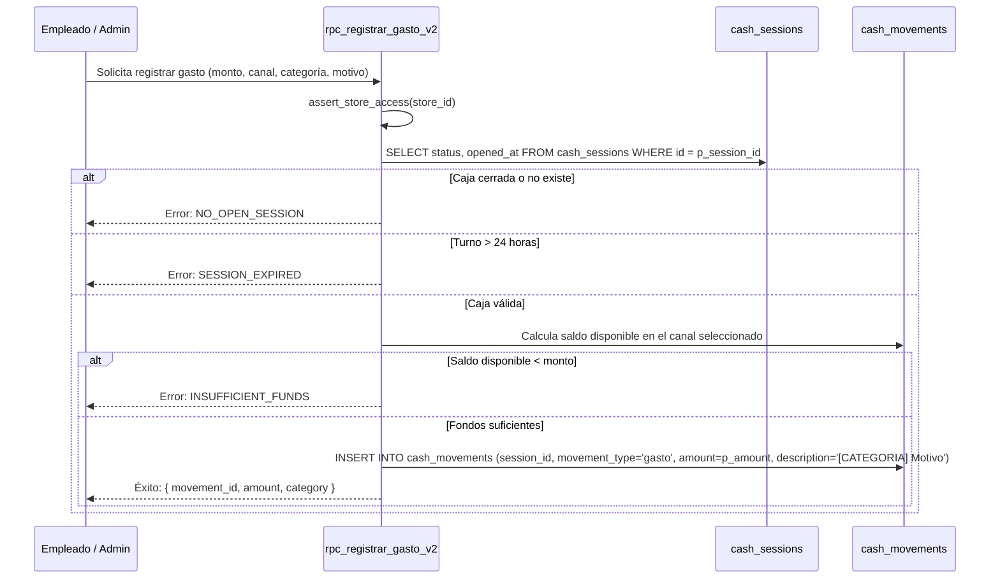
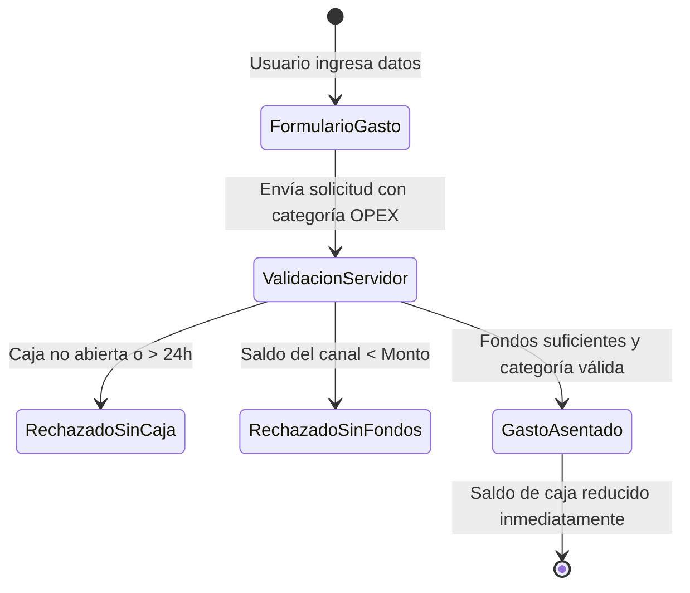
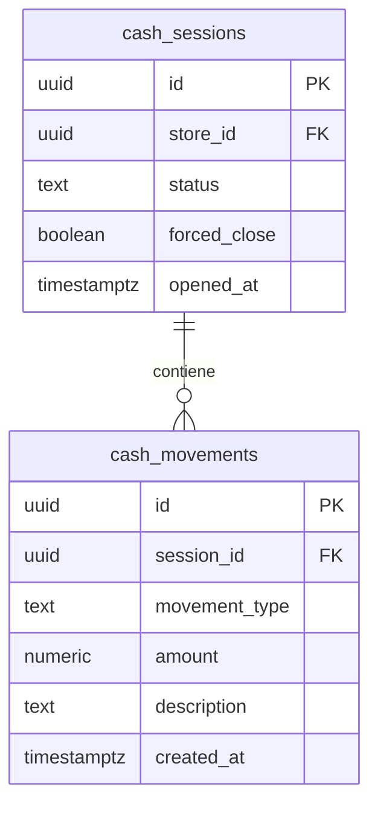

# SDD-026: Política de Gastos Generales (OPEX Inmediato)

> **Asociado a:** [FRD-026](../FRD/FRD_026_POLITICA_GASTOS_INMEDIATOS.md)  
> **Fase del Plan:** Ola 1 — Cimientos de Caja y Gastos  
> **Estado:** 🟡 Validado Localmente (Post Alineación v1.5.8)  
> **Última Actualización:** 2026-10-11  

---

## 0. Contexto y Restricciones Aplicables

### 0.1 Políticas Globales Activadas (ARQ-002)
| Política ID | Dominio | Impacto Concreto en este SDD |
|-------------|---------|------------------------------|
| **POL-FIN-01** | Financiero | **Inmediatez Absoluta (Liquidez Real):** Queda prohibido modelar gastos generales como pasivos o promesas ("gastos por pagar"). Un gasto existe exclusivamente cuando el dinero físico o digital sale de la caja. |
| **POL-FIN-02** | Financiero | **Afectación de Canal Específico:** El gasto debe imputarse al canal exacto del cual salió el dinero (`efectivo`, `nequi`, `llave_bre`) y validar que dicho canal no quede con saldo negativo. |
| **POL-AUD-01** | Auditoría | **Trazabilidad y Concepto Obligatorio:** Todo egreso debe asentar categoría OPEX y motivo legible no vacío en `cash_movements`. |
| **POL-AUTH-01** | Seguridad | **Validación de Tienda:** Se valida autorización mediante `assert_store_access` y sesión de caja activa. |

### 0.2 Contratos Vecinos que Limitan el Diseño
| SDD Origen | Restricción Inyectada | Impacto en Gastos |
|------------|-----------------------|-------------------|
| **SDD_004 (Control de Caja)** | Exigencia de sesión `OPEN`. | Si la caja está cerrada o caducada (> 24h), el registro de gastos es bloqueado de inmediato por el servidor. |
| **SDD_020 (Caja Multicanal)** | Prevención de Sobregiro por Canal. | El egreso valida que `saldo_canal >= p_amount` antes de autorizar el débito. |
| **SDD_018 (Control Operacional)** | Agrupamiento contable del Estado de Resultados. | Exige categorización estructurada en 6 tipos OPEX estándar para consolidar el reporte financiero. |

### 0.3 Auditoría de BD contra Realidad (Deuda Técnica Declarada)
*Evidencia cruda obtenida de Supabase Producción (`ihtjocmhzuliwwvdzfnz`):*

```sql
-- Tablas reales en producción:
-- No existe tabla 'expenses'. Los gastos se registran como filas en 'cash_movements':
-- id (uuid), session_id (uuid), sale_id (uuid), movement_type (text), amount (numeric), description (text), created_at (timestamptz)

-- Constraint real de movimiento:
-- cash_movements_movement_type_check: CHECK (movement_type = ANY (ARRAY['ingreso', 'gasto', 'pago_proveedor']))
```

| Hallazgo / Componente | Brecha Real Detectada | Solución Normativa y Trade-off | Condición de Revisión |
|-----------------------|-----------------------|---------------------------------|-----------------------|
| 🔴 **Ausencia de columna `category`** | `cash_movements` solo tiene `description`. No existe columna para categoría OPEX en la base de datos real. | **Decisión:** El contrato RPC `rpc_registrar_gasto_v2` exige `p_category` obligatorio (enum). En la persistencia física actual, se almacena en `description` con formato `[CATEGORIA] Motivo` para garantizar consistencia sin romper el esquema actual. | Migración para agregar `category TEXT NOT NULL` en `cash_movements`. |
| 🔴 **Ausencia de columna `payment_method`** | `cash_movements` en producción no tiene discriminación de canal. | **Decisión:** El contrato exige `p_payment_method`. El cálculo de sobregiro valida sobre los movimientos históricos del canal. | Aplicación de la migración multicanal en producción. |

---

## 1. Glosario Local

- **Gasto General (OPEX):** Desembolso operativo corriente del negocio que no corresponde a compra de mercancía ni a cuentas por pagar a proveedores.
- **Catálogo de Categorías OPEX:** Conjunto cerrado de categorías válidas:
  1. `Servicios` (Luz, Agua, Gas, Internet, Telefonía)
  2. `Nomina` (Sueldos, Jornales, Anticipos)
  3. `Transporte` (Fletes menores, Taxis, Envíos)
  4. `Mantenimiento` (Reparaciones locativas, Bombillos, Aseo)
  5. `Insumos` (Bolsas, Papel térmico, Cinta, Marcadores)
  6. `Reembolso` (Salidas correctivas autorizadas)
- **Extracción Inmediata:** Disminución en tiempo real del saldo disponible del turno activo.

---

## 2. Diagramas de Secuencia



---

## 3. Diagramas de Estado



---

## 4. Especificación Detallada de Casos de Uso

### Caso A: Registro Exitoso de Gasto Operativo
- **Actor:** Empleado con sesión activa.
- **Precondición:** Turno de caja abierto (< 24h) con fondos suficientes en el canal seleccionado.
- **Flujo Principal:**
  1. El usuario selecciona la opción "Nuevo Gasto".
  2. Digita el monto del desembolso (ej. $15.000).
  3. Selecciona el canal de origen (ej. `efectivo`).
  4. Selecciona obligatoriamente una categoría OPEX (ej. `Insumos`).
  5. Escribe el motivo detallado (ej. "Compra de bolsas plásticas").
  6. El servidor valida acceso, turno activo, categoría permitida y disponibilidad de fondos.
  7. El servidor asienta el egreso en `cash_movements`.
- **Postcondición:** Gasto registrado, saldo esperado del canal disminuido en $15.000.

### Caso B: Intento de Gasto con Fondos Insuficientes
- **Actor:** Empleado con sesión activa.
- **Precondición:** El canal seleccionado tiene saldo inferior al monto a registrar.
- **Flujo Principal:**
  1. El usuario intenta registrar un gasto de $50.000 pagado con `nequi`.
  2. El servidor detecta que el canal `nequi` solo tiene $20.000 de saldo disponible en el turno.
  3. El servidor aborta la transacción y retorna código `INSUFFICIENT_FUNDS`.
- **Postcondición:** La base de datos no sufre cambios; se protege contra sobregiros.

---

## 5. Contrato de Interfaz

### Operación: `rpc_registrar_gasto_v2`
- **Tipo:** RPC Postgres / Acción (WRITE)
- **Entradas:**
  ```json
  {
    "p_session_id": "UUID (Obligatorio)",
    "p_amount": "NUMERIC > 0 (Obligatorio)",
    "p_payment_method": "TEXT (Obligatorio: 'efectivo', 'nequi', 'llave_bre')",
    "p_category": "TEXT (Obligatorio: 'Servicios', 'Nomina', 'Transporte', 'Mantenimiento', 'Insumos', 'Reembolso')",
    "p_description": "TEXT (Obligatorio, longitud >= 3)"
  }
  ```
- **Salida Exitosa:**
  ```json
  {
    "success": true,
    "data": {
      "movement_id": "UUID",
      "amount": 15000.00,
      "category": "Insumos",
      "payment_method": "efectivo",
      "created_at": "TIMESTAMPTZ"
    }
  }
  ```
- **Catálogo de Errores:**
  | Código de Error | Causa | Mensaje Técnico |
  |-----------------|-------|-----------------|
  | `NO_OPEN_SESSION` | Sesión cerrada o inexistente | No existe una sesión de caja activa para registrar el gasto |
  | `SESSION_EXPIRED` | Turno abierto hace más de 24 horas | El turno actual está caducado; debe cerrarse antes de registrar movimientos |
  | `INSUFFICIENT_FUNDS` | Saldo disponible menor al monto | Fondos insuficientes en el canal seleccionado |
  | `INVALID_OPEX_CATEGORY` | Categoría no permitida | Categoría de gasto inválida; seleccione una opción del catálogo OPEX |
  | `EMPTY_DESCRIPTION` | Motivo vacío o demasiado corto | Debe ingresar una descripción con al menos 3 caracteres |
  | `INVALID_AMOUNT` | Monto menor o igual a cero | El monto del gasto debe ser estrictamente positivo |

---

## 6. Análisis de Seguridad

- **Control de Acceso:** Invocación de `assert_store_access(v_store_id)` en cada llamada.
- **Prevención de Sobregiros y Fugas:** Bloqueo explícito de saldo negativo por canal a nivel de base de datos; la transacción se cancela atómicamente si el balance resultante es menor a cero.
- **Inmutabilidad Absoluta:** No se expone ningún endpoint ni política RLS de `DELETE` o `UPDATE` sobre `cash_movements`; un gasto erróneo exige un contra-movimiento de corrección autorizado.

---

## 7. Modelo de Datos Lógico



### Diccionario de Datos de Gastos
| Tabla | Atributo | Tipo | Nullable | Estado en BD | Descripción |
|-------|----------|------|----------|--------------|-------------|
| `cash_movements` | `id` | UUID | NO | ✅ Sí | Identificador único del egreso |
| `cash_movements` | `session_id` | UUID | NO | ✅ Sí | Sesión de caja activa del turno |
| `cash_movements` | `movement_type` | TEXT | NO | ✅ Sí | Valor fijo `'gasto'` |
| `cash_movements` | `amount` | NUMERIC | NO | ✅ Sí | Monto positivo del desembolso |
| `cash_movements` | `description` | TEXT | NO | ✅ Sí | Contiene `[CATEGORIA] Motivo` |
| `cash_movements` | `created_at` | TIMESTAMPTZ | NO | ✅ Sí | Fecha y hora exacta del egreso |
